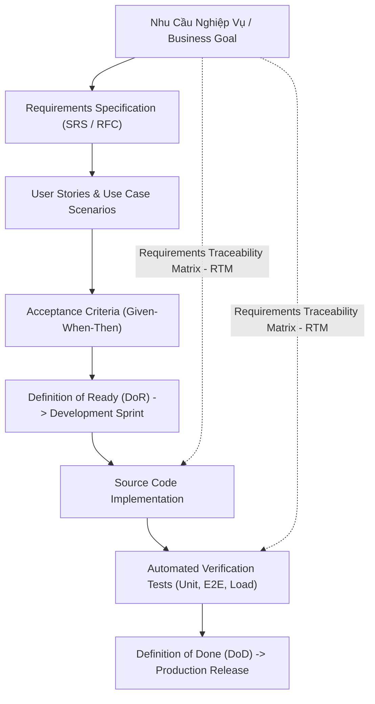
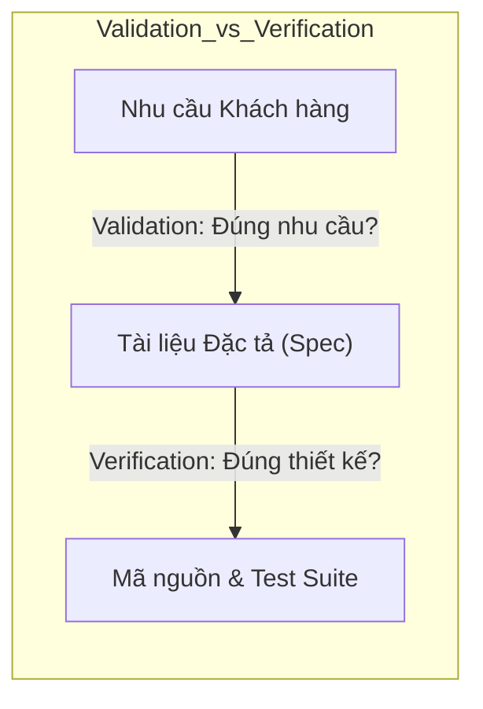
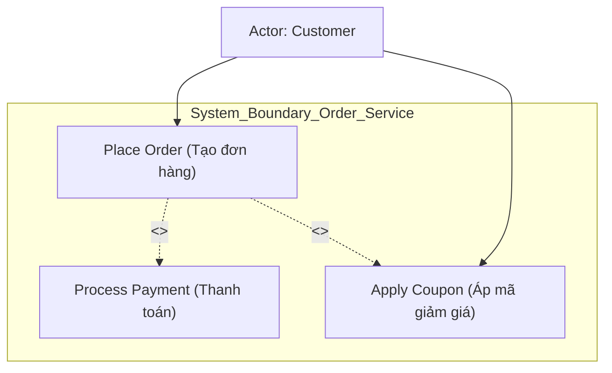
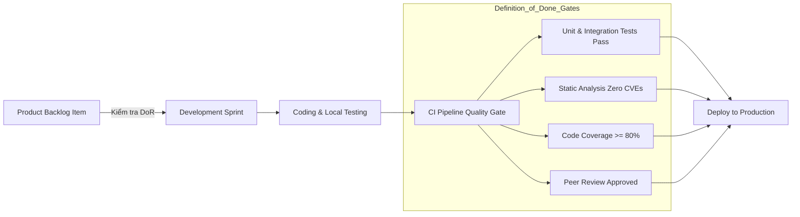
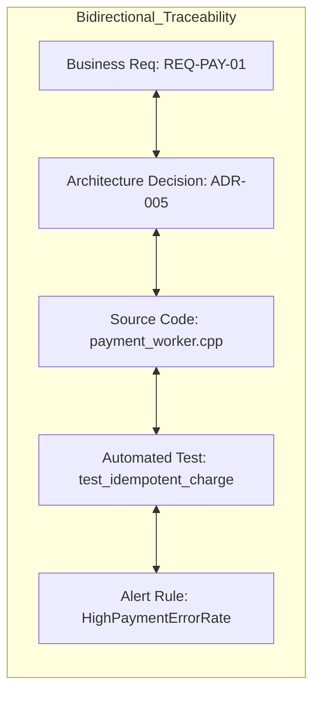

# 3.2. Đặc Tả Yêu Cầu và Ma Trận Truy Xuất (Requirements Specification & Traceability)

## Tổng quan về Requirements Specification & Traceability
Một ý tưởng kỹ thuật dù xuất sắc đến đâu cũng sẽ bị biến dạng trong quá trình triển khai nếu thiếu đi phương pháp đặc tả chuẩn hóa và khả năng truy xuất nguồn gốc hai chiều (Bidirectional Traceability). **Requirements Specification & Traceability** là quy trình chuyển hóa các nhu cầu kinh doanh thành các tài liệu kỹ thuật có thể xác minh được (Verifiable Specifications), thiết lập ranh giới nghiệm thu rõ ràng thông qua **Acceptance Criteria**, **Definition of Ready (DoR)**, **Definition of Done (DoD)**, và liên kết chặt chẽ từ dòng mã nguồn, bài kiểm thử ngược về mục tiêu kinh doanh ban đầu thông qua **Requirements Traceability Matrix (RTM)**.



---

## 2. Chi tiết từng Keyword (Under-the-Hood Deep Dive)

---

### 1. Specification, Validation vs Verification & Prioritization

#### 1. Khái niệm bản chất (What & Why)
* **Requirement Specification (Đặc tả yêu cầu)**: Văn bản kỹ thuật mô tả chính xác hành vi và các thuộc tính chất lượng của phần mềm mà không để lại kẽ hở cho sự suy diễn chủ quan.
* **Validation (Xác nhận tính đúng đắn với nhu cầu)**: Trả lời câu hỏi *"Are we building the right product?"* (Chúng ta có đang xây dựng đúng sản phẩm mà khách hàng và thị trường thực sự cần hay không?).
* **Verification (Xác minh tính đúng đắn với thiết kế)**: Trả lời câu hỏi *"Are we building the product right?"* (Chúng ta có đang xây dựng sản phẩm đúng theo các tiêu chuẩn kỹ thuật, không có bug và thỏa mãn tài liệu đặc tả hay không?).
* **Requirement Prioritization (Xếp hạng ưu tiên yêu cầu)**: Quy trình xác định thứ tự thực thi dựa trên giá trị kinh doanh, độ rủi ro kỹ thuật và sự phụ thuộc (Áp dụng các framework như MoSCoW: Must have, Should have, Could have, Won't have; hoặc RICE: Reach, Impact, Confidence, Effort).

#### 2. Cơ chế hoạt động sâu (Under the hood / Hardcore Internals)
- **Sự khác biệt giữa Validation và Verification trong thực tế**:
  - Đội ngũ xây dựng một dịch vụ mã hóa video C++ cực kỳ tối ưu, sử dụng SIMD AVX-512, không memory leak, 100% test coverage và p99 latency dưới 10ms. Quá trình **Verification** hoàn hảo 10/10.
  - Tuy nhiên, khách hàng mục tiêu là người dùng điện thoại thông minh giá rẻ cần xem video nén chuẩn H.264 qua mạng 3G, trong khi dịch vụ lại xuất video định dạng AV1 8K. Sản phẩm thất bại hoàn toàn ở khâu **Validation**.
- **Kỹ thuật Formal Specifications (Đặc tả hình thức)**:
  Trong các hệ thống phân tán quan trọng (AWS S3, Raft), kỹ sư sử dụng ngôn ngữ đặc tả hình thức toán học như **TLA+** để mô hình hóa và kiểm chứng tính đúng đắn của thuật toán (Safety & Liveness invariants) trước khi viết một dòng code nào.

#### 3. Sơ đồ minh họa (Mermaid Diagram)


#### 4. Code ví dụ thực chiến (C++20: Contract-Based Programming thể hiện Specification)
```cpp
#include <iostream>
#include <cassert>
#include <stdexcept>

// Minh họa Specification: Giao kết hợp đồng (Design by Contract)
// Tiền điều kiện (Pre-conditions), Hậu điều kiện (Post-conditions) và Bất biến (Invariants)

class HighSecurityVault {
private:
    double balance_{0.0};

    // Invariant: Số dư két sắt không bao giờ được âm
    void checkInvariants() const {
        assert(balance_ >= 0.0 && "Vault Invariant Violated: Balance cannot be negative!");
    }

public:
    explicit HighSecurityVault(double initialDeposit) : balance_(initialDeposit) {
        if (initialDeposit < 0.0) throw std::invalid_argument("Tiền gửi ban đầu không hợp lệ");
        checkInvariants();
    }

    // Specification: Rút tiền
    // Pre-condition: amount > 0 VÀ amount <= balance_
    // Post-condition: balance_mới = balance_cũ - amount
    double withdraw(double amount) {
        // 1. Kiểm tra Tiền điều kiện (Verification)
        if (amount <= 0.0) throw std::invalid_argument("Số tiền rút phải lớn hơn 0");
        if (amount > balance_) throw std::runtime_error("Số dư không đủ để thực hiện rút tiền");

        double oldBalance = balance_;
        balance_ -= amount;

        // 2. Kiểm tra Hậu điều kiện
        assert((balance_ == oldBalance - amount) && "Post-condition Failed: Tính toán sai lệch!");
        checkInvariants();

        return balance_;
    }
};

int main() {
    HighSecurityVault vault(1000.0);
    vault.withdraw(300.0);
    std::cout << "Giao dịch rút tiền tuân thủ tuyệt đối Contract Specification.\n";
    return 0;
}
```

#### 5. Ưu / Nhược điểm, Pitfalls & Anti-patterns
- **Anti-pattern: Verification without Validation**: Xây dựng hệ thống siêu phức tạp, kiểm thử kỹ lưỡng nhưng khách hàng không ai có nhu cầu sử dụng.

#### 6. Ứng dụng thực tế trong Backend / Systems
- **Amazon Web Services (AWS)**: Sử dụng TLA+ để đặc tả và phát hiện các bug phân tán tinh vi trong AWS S3 và DynamoDB mà kiểm thử thông thường không bao giờ tìm ra được.

---

### 2. User Stories, Use Cases, Use Case Diagrams & Business Rules

#### 1. Khái niệm bản chất (What & Why)
* **User Stories (Câu chuyện người dùng)**: Mô tả ngắn gọn nhu cầu dưới góc nhìn của người dùng: *"Là một [vai trò], tôi muốn [hành động] để [đạt được giá trị gì]"*.
* **Use Cases (Ca sử dụng)**: Tài liệu kịch bản chi tiết mô tả chuỗi tương tác tuần tự giữa tác nhân (Actor) và hệ thống, bao gồm luồng cơ bản (Main Success Scenario) và các luồng rẽ nhánh / lỗi (Alternative & Exception Flows).
* **Use Case Diagrams (Sơ đồ ca sử dụng)**: Sơ đồ trực quan UML biểu diễn mối quan hệ giữa các Actors và các Use Cases trong hệ thống.
* **Business Rules (Quy tắc kinh doanh)**: Các chính sách, điều kiện ràng buộc độc lập với công nghệ (ví dụ: "Khách hàng VIP được chiết khấu 10% nếu tổng giá trị đơn hàng trên $500 và tài khoản đã hoạt động trên 1 năm").
* **Domain Constraints (Ràng buộc miền)**: Giới hạn tự nhiên của mô hình kinh doanh (ví dụ: "Một chuyến bay không được bán vượt quá 105% số ghế thực tế").

#### 2. Cơ chế hoạt động sâu (Under the hood / Hardcore Internals)
- **Tách biệt Business Rules bằng Rule Engine (Drools / Decider Pattern)**:
  Không nên nhúng cứng các quy tắc kinh doanh phức tạp vào các câu lệnh `if-else` trong tầng Web Controller hoặc Database Stored Procedure. Thay vào đó, áp dụng **Specification Pattern** hoặc **Rules Engine Pattern** để các quy tắc có thể được thêm mới, sửa đổi hoặc kiểm thử độc lập mà không cần biên dịch lại toàn bộ hệ thống.

#### 3. Sơ đồ minh họa (Mermaid Diagram)


#### 4. Code ví dụ thực chiến (TypeScript: Specification Pattern cho Business Rules)
```typescript
interface Customer {
  id: string;
  isVip: boolean;
  registeredDays: number;
}

interface Order {
  totalAmountUsd: number;
  customer: Customer;
}

// Business Rule Specification Pattern
interface RuleSpecification<T> {
  isSatisfiedBy(candidate: T): boolean;
}

class VipDiscountEligibilityRule implements RuleSpecification<Order> {
  // Business Rule: Khách hàng VIP + Đơn > $500 + Đăng ký > 365 ngày
  isSatisfiedBy(order: Order): boolean {
    return (
      order.customer.isVip &&
      order.totalAmountUsd >= 500 &&
      order.customer.registeredDays >= 365
    );
  }
}

// Thực thi rule trong tầng nghiệp vụ
const sampleOrder: Order = {
  totalAmountUsd: 650,
  customer: { id: "CUST-102", isVip: true, registeredDays: 400 }
};

const discountRule = new VipDiscountEligibilityRule();
if (discountRule.isSatisfiedBy(sampleOrder)) {
  console.log("Thỏa mãn Business Rule: Áp dụng chiết khấu 10%!");
}
```

#### 5. Ưu / Nhược điểm, Pitfalls & Anti-patterns
- **Anti-pattern: Hardcoded Business Rules**: Ép cứng tỷ lệ chiết khấu hoặc hạn mức thẻ tín dụng trực tiếp vào code khiến mỗi lần bộ phận kinh doanh thay đổi chiến lược lại phải deploy khẩn cấp phiên bản mới.

#### 6. Ứng dụng thực tế trong Backend / Systems
- **Hệ thống phát hiện gian lận (Fraud Detection)**: Sử dụng chuỗi các Specification Rules để chấm điểm rủi ro của mỗi giao dịch thẻ tín dụng trong thời gian thực.

---

### 3. Acceptance Criteria, Definition of Ready (DoR) & Definition of Done (DoD)

#### 1. Khái niệm bản chất (What & Why)
* **Acceptance Criteria (Tiêu chí chấp nhận - AC)**: Tập hợp các điều kiện kiểm chứng cụ thể mà phần mềm bắt buộc phải vượt qua để một User Story được nghiệm thu hoàn thành (thường viết theo cấu trúc Given - When - Then).
* **Definition of Ready (DoR - Định nghĩa sẵn sàng)**: Tiêu chuẩn kỹ thuật bắt buộc để một task được phép đưa vào Sprint phát triển (Ví dụ: Yêu cầu không còn mơ hồ, API contract đã được thống nhất, dependencies đã sẵn sàng, UI mockups đã hoàn tất).
* **Definition of Done (DoD - Định nghĩa hoàn thành)**: Bảng kiểm tra toàn diện bảo đảm tính bền vững kỹ thuật trước khi đưa tính năng lên production (Ví dụ: Mã nguồn đã được peer-reviewed, Unit test pass 100%, tích hợp Telemetry dashboards, cập nhật tài liệu kỹ thuật, thỏa mãn bảo mật SAST).

#### 2. Cơ chế hoạt động sâu (Under the hood / Hardcore Internals)
- **Tự động hóa DoD qua CI/CD Pipeline Gates**:
  Không bao giờ để DoD là những lời hứa miệng. DoD phải được thực thi bằng mã (Policy as Code):
  - GitHub Branch Protection: Yêu cầu ít nhất 2 approvals từ Senior Engineers.
  - SonarQube Quality Gate: Đòi hỏi độ phủ mã (Code Coverage) $\ge 80\%$, zero vulnerabilities, zero security hotspots.
  - Container Image Scanning (Trivy / Clair): Chặn đứng pipeline nếu base image chứa lỗ hổng CVE nghiêm trọng.

#### 3. Sơ đồ minh họa (Mermaid Diagram)


#### 4. Code ví dụ thực chiến (TypeScript: BDD Acceptance Criteria với Framework Test)
```typescript
// Minh họa Acceptance Criteria theo cấu trúc Given - When - Then
describe('Acceptance Criteria: Chuyển khoản ngân hàng nội bộ', () => {
  it('Given: Tài khoản A có 500$, Tài khoản B có 100$ | When: Chuyển 200$ từ A sang B | Then: A còn 300$, B có 300$', async () => {
    // Given
    const accountA = { id: 'ACC_A', balance: 500 };
    const accountB = { id: 'ACC_B', balance: 100 };
    const transferService = new BankTransferService();

    // When
    const result = await transferService.executeTransfer({
      fromAccountId: accountA.id,
      toAccountId: accountB.id,
      amount: 200
    });

    // Then
    expect(result.status).toBe('SUCCESS');
    expect(await transferService.getBalance('ACC_A')).toBe(300);
    expect(await transferService.getBalance('ACC_B')).toBe(300);
  });
});
```

#### 5. Ưu / Nhược điểm, Pitfalls & Anti-patterns
- **Anti-pattern: "Mềm hóa" DoD dưới áp lực Deadline**: Hạ thấp tiêu chuẩn kiểm thử hoặc bỏ qua security scan để kịp ngày release, dẫn đến việc phải trả nợ kỹ thuật bằng các cuộc khủng hoảng sập mạng vào cuối tuần.

#### 6. Ứng dụng thực tế trong Backend / Systems
- **Quy trình Release tại Google & Netflix**: Một commit muốn vào nhánh chính bắt buộc phải chạy qua hàng nghìn bài kiểm thử tự động đáp ứng chặt chẽ Definition of Done.

---

### 4. Traceability, Change Management, RTM & NFR Quantification

#### 1. Khái niệm bản chất (What & Why)
* **Requirement Traceability (Khả năng truy xuất yêu cầu)**: Khả năng theo dõi vòng đời của một yêu cầu theo cả hai chiều: Từ yêu cầu kinh doanh $\rightarrow$ Thiết kế kiến trúc $\rightarrow$ Đoạn code cụ thể $\rightarrow$ Bài kiểm thử (Forward Traceability) và ngược lại (Backward Traceability).
* **Requirement Change Management (Quản lý thay đổi yêu cầu)**: Quy trình đánh giá tác động kỹ thuật và chi phí trước khi chấp thuận hoặc từ chối một thay đổi yêu cầu trong quá trình phát triển.
* **Requirements Traceability Matrix (RTM - Ma trận truy xuất nguồn gốc yêu cầu)**: Bảng liên kết chéo giữa mã định danh yêu cầu (Requirement ID), User Story, Code Commit ID và Test Case ID.
* **Quality Attribute Requirements & NFR Quantification**: Chuyển đổi các mong muốn chất lượng trừu tượng thành các chỉ số kỹ thuật có đơn vị đo lường cụ thể (ms, RPS, %, MTTD).

#### 2. Cơ chế hoạt động sâu (Under the hood / Hardcore Internals)
- **Cấu trúc của một Ma Trận Truy Xuất (RTM) trong Thực Tế**:

| Req ID | Mô tả Yêu cầu | Module / Code Reference | Unit / Integration Test Case | Production Metric / Dashboard |
| :--- | :--- | :--- | :--- | :--- |
| **REQ-AUTH-01** | Xác thực JWT có hạn 15 phút | `src/auth/jwt_validator.cpp#L45` | `tests/auth_test.cpp::TestExpiredToken` | Grafana: `auth_jwt_validation_failures_total` |
| **REQ-PAY-02** | Xử lý thanh toán Idempotent | `src/payment/idempotency.ts#L12` | `tests/payment.spec.ts::TestDuplicateKey` | Datadog: `payment.idempotency_conflicts` |
| **NFR-PERF-01** | p99 Latency < 200ms tại 10k RPS | `src/server/epoll_engine.cpp` | `k6/load_test_checkout.js` | Prometheus: `http_request_duration_seconds{quantile="0.99"}` |

#### 3. Sơ đồ minh họa (Mermaid Diagram)


#### 4. Code ví dụ thực chiến (C++20: Gắn Định Danh Traceability Trực Tiếp Vào Test Suite)
```cpp
#include <iostream>
#include <string_view>

// Kỹ thuật gán Requirement Tag trực tiếp vào Metadata của Test Suite để sinh báo cáo RTM tự động
struct TestCaseMetadata {
    std::string_view testId;
    std::string_view requirementId;
    std::string_view description;
};

void runTestWithTraceability(const TestCaseMetadata& meta, bool (*testFn)()) {
    std::cout << "[RUNNING] " << meta.testId 
              << " | Liên kết tới: " << meta.requirementId << " ... ";
    if (testFn()) {
        std::cout << "PASS (Thỏa mãn tiêu chuẩn nghiệm thu)\n";
    } else {
        std::cerr << "FAIL (Vi phạm yêu cầu kỹ thuật)\n";
    }
}

bool testTokenExpiryLogic() {
    // Giả lập logic kiểm tra thời hạn Token
    int tokenAgeSeconds = 901; // Quá 15 phút (900s)
    return tokenAgeSeconds > 900; // Kỳ vọng bị từ chối
}

int main() {
    TestCaseMetadata test1{
        .testId = "TEST-AUTH-101",
        .requirementId = "REQ-AUTH-01",
        .description = "Xác nhận JWT hết hạn sau chính xác 900 giây"
    };

    runTestWithTraceability(test1, testTokenExpiryLogic);
    return 0;
}
```

#### 5. Ưu / Nhược điểm, Pitfalls & Anti-patterns
- **Anti-pattern: Orphan Code (Mã nguồn mồ côi)**: Những đoạn code phức tạp nằm trong hệ thống mà không ai biết nó được viết ra nhằm phục vụ yêu cầu kinh doanh nào, không có ai sở hữu và không ai dám xóa.

#### 6. Ứng dụng thực tế trong Backend / Systems
- **Hệ thống phần mềm Y Tế & Hàng Không (FAA / FDA / ISO 26262)**: Bắt buộc 100% dòng code phải có Forward và Backward Traceability tới tài liệu đặc tả yêu cầu; bất kỳ dòng code mồ côi nào đều bị coi là vi phạm an toàn nghiêm trọng.

---

## Tổng kết Chương 3.2
Đặc tả yêu cầu và khả năng truy xuất hai chiều biến kỹ nghệ phần mềm từ một hoạt động mang tính nghệ thuật cảm tính thành một ngành khoa học kỹ thuật chính xác. Bằng cách số hóa các tiêu chí nghiệm thu (DoR/DoD), gắn kết mã nguồn với các Business Rules rõ ràng và duy trì ma trận truy xuất nguồn gốc, kỹ sư đảm bảo rằng mọi chu kỳ xung nhịp CPU đều phục vụ trực tiếp cho mục tiêu cốt lõi của doanh nghiệp.
