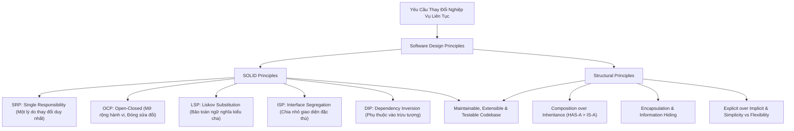
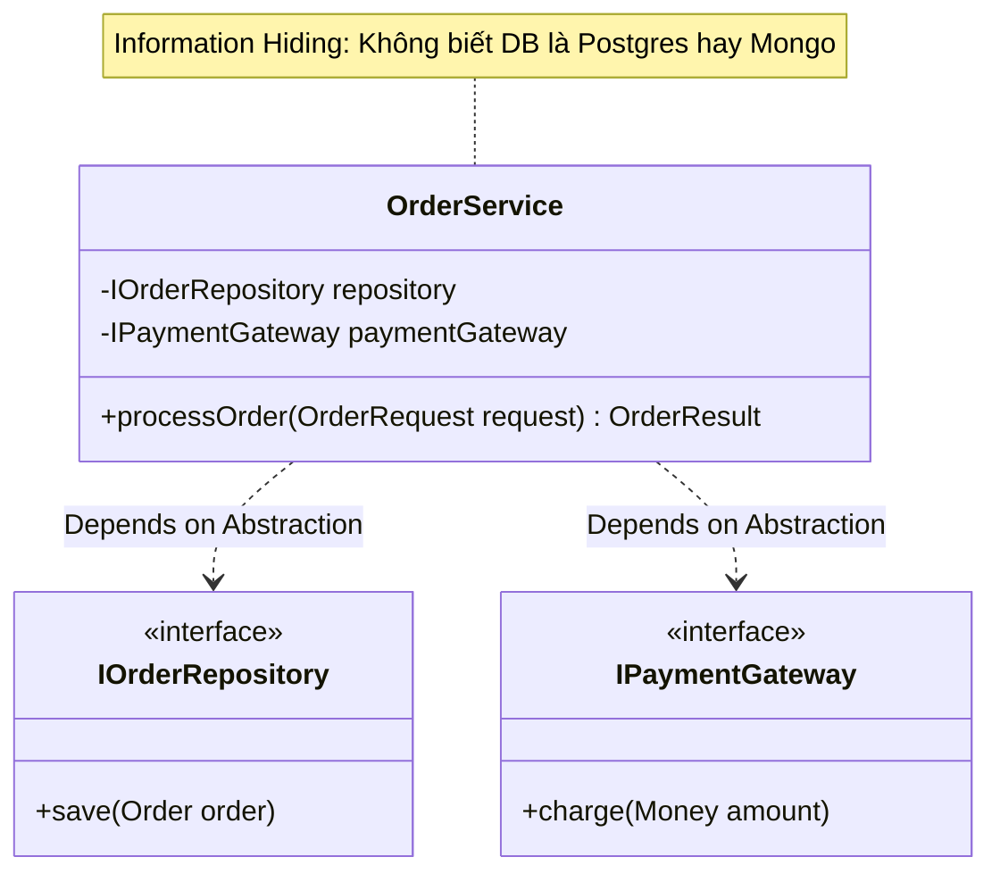
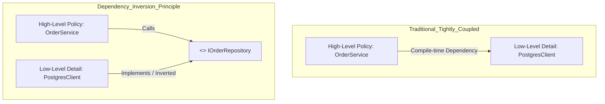
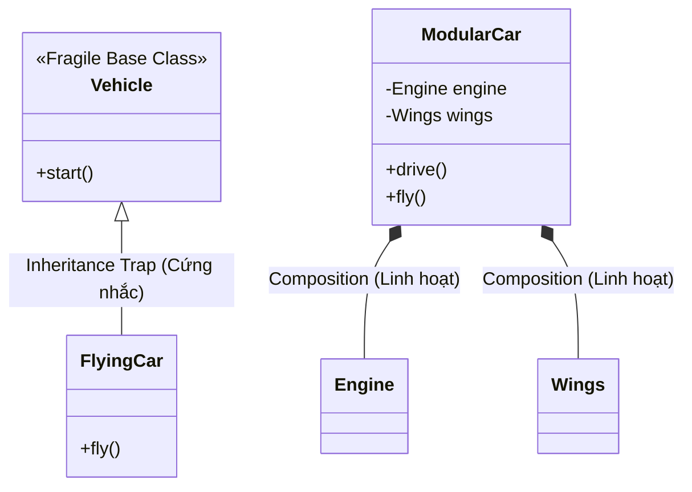

# 4.1. Nguyên Lý SOLID và Các Nguyên Tắc Thiết Kế Cốt Lõi (SOLID & Core Design Principles)

## Tổng quan về SOLID & Core Design Principles
Thiết kế phần mềm (Software Design) là nghệ thuật và khoa học định hình cấu trúc mã nguồn sao cho hệ thống có thể tiến hóa mượt mà trước những thay đổi không thể tránh khỏi của yêu cầu nghiệp vụ. Nếu không có các nguyên lý thiết kế định hướng, phần mềm sẽ rơi vào trạng thái thoái hóa mã (Code Rot), đặc trưng bởi tính cứng nhắc (Rigidity), dễ vỡ (Fragility), bất động (Immobility) và nhớp nháp (Viscosity). Bộ nguyên lý **SOLID**, kết hợp cùng các nguyên tắc nền tảng như **Composition over Inheritance**, **Encapsulation**, **Information Hiding**, và **Explicit over Implicit**, cung cấp các quy chuẩn vững chắc để tổ chức các class, module và ranh giới hệ thống ở mức vi mô.



---

## 2. Chi tiết từng Keyword (Under-the-Hood Deep Dive)

---

### 1. Software Design Fundamentals, Separation of Concerns, Encapsulation & Information Hiding

#### 1. Khái niệm bản chất (What & Why)
* **Software Design Fundamentals**: Nền tảng tổ chức các thực thể phần mềm (classes, functions, interfaces, modules) nhằm tối đa hóa khả năng đọc hiểu, kiểm thử, bảo trì và mở rộng.
* **Separation of Concerns (SoC - Phân tách mối quan tâm)**: Nguyên lý phân định rõ ràng các trách nhiệm khác nhau vào các thành phần tách biệt (ví dụ: Tách logic nghiệp vụ, logic truy vấn dữ liệu, và logic hiển thị/mạng).
* **Encapsulation (Đóng gói)**: Cơ chế gom nhóm dữ liệu (state) cùng với các thao tác xử lý dữ liệu đó (methods) vào một đơn vị thống nhất, đồng thời bảo vệ trạng thái nội tại khỏi sự can thiệp trực tiếp từ bên ngoài.
* **Information Hiding (Che giấu thông tin)**: Khái niệm rộng hơn đóng gói (được đề xướng bởi David Parnas), là nguyên tắc thiết kế nhằm ẩn giấu các quyết định thiết kế dễ biến động (ví dụ: Cấu trúc bộ nhớ, định dạng lưu trữ đĩa, thuật toán nội bộ) đằng sau một giao diện ổn định.

#### 2. Cơ chế hoạt động sâu (Under the hood / Hardcore Internals)
- **Memory Layout & Cache Locality trong Encapsulation**:
  - Khi đóng gói dữ liệu trong C++ (`struct` hoặc `class`), trình biên dịch sắp xếp các trường dữ liệu theo thứ tự khai báo và chèn thêm **Padding Bytes** để thỏa mãn quy tắc căn lề bộ nhớ của CPU (Data Alignment - ví dụ: biến 8-byte `uint64_t` phải nằm ở địa chỉ chia hết cho 8).
  - Information Hiding thông qua **Pimpl Idiom (Pointer to Implementation)**:
    Giúp che giấu hoàn toàn các biến private và include headers khỏi file `.h` công khai. Khi thay đổi biến nội bộ, chỉ cần biên dịch lại file `.cpp` của module mà không gây ra hiện tượng biên dịch dây chuyền (Cascade Recompilation) trên hàng trăm file khác trong codebase C++.

#### 3. Sơ đồ minh họa (Mermaid Diagram)


#### 4. Code ví dụ thực chiến (C++20: Che giấu thông tin với Pimpl Idiom)
```cpp
// File: ConnectionManager.h (Giao diện công khai, sạch sẽ, không lộ chi tiết thư viện mạng)
#pragma once
#include <memory>
#include <string_view>

class ConnectionManager {
public:
    ConnectionManager();
    ~ConnectionManager(); // Bắt buộc định nghĩa trong .cpp để giải phóng unique_ptr

    void connect(std::string_view endpoint);
    void sendPayload(std::string_view payload);

private:
    struct Impl; // Forward declaration: Che giấu chi tiết hiện thực (Information Hiding)
    std::unique_ptr<Impl> pimpl_;
};

// File: ConnectionManager.cpp (Chứa chi tiết kỹ thuật tầng thấp: Sockets, OpenSSL, OS headers)
#include "ConnectionManager.h"
#include <iostream>
#include <sys/socket.h>

struct ConnectionManager::Impl {
    int socketFd{-1};
    void initSocket() { /* Syscall socket initialization */ }
};

ConnectionManager::ConnectionManager() : pimpl_(std::make_unique<Impl>()) {}
ConnectionManager::~ConnectionManager() = default;

void ConnectionManager::connect(std::string_view endpoint) {
    pimpl_->initSocket();
    std::cout << "Kết nối thành công tới endpoint: " << endpoint << "\n";
}

void ConnectionManager::sendPayload(std::string_view payload) {
    std::cout << "Gửi " << payload.size() << " bytes qua socket " << pimpl_->socketFd << "\n";
}
```

#### 5. Ưu / Nhược điểm, Pitfalls & Anti-patterns
- **Anti-pattern: Getters/Setters Abuse**: Khai báo biến `private` nhưng lại tự động sinh hàm `get()` và `set()` cho tất cả các trường. Điều này phá hủy hoàn toàn tính đóng gói và biến class thành một cấu trúc dữ liệu thô bị chỉnh sửa tùy tiện từ bên ngoài.

#### 6. Ứng dụng thực tế trong Backend / Systems
- **Linux Kernel Virtual File System (VFS)**: Che giấu chi tiết phần cứng của ext4, XFS, Btrfs đằng sau giao diện trừu tượng `struct file_operations` với các hàm chuẩn `read()`, `write()`, `open()`.

---

### 2. The SOLID Principles: SRP, OCP, LSP, ISP & DIP

#### 1. Khái niệm bản chất (What & Why)
* **Single Responsibility Principle (SRP - Đơn trách nhiệm)**: *"A class should have one, and only one, reason to change"*. Một class chỉ nên phục vụ một tác nhân duy nhất (Single Actor).
* **Open-Closed Principle (OCP - Mở / Đóng)**: *"Software entities should be open for extension, but closed for modification"*. Có thể mở rộng hành vi của hệ thống bằng cách viết thêm code mới chứ không phải sửa đổi code cũ đang hoạt động ổn định.
* **Liskov Substitution Principle (LSP - Thay thế Liskov)**: Các lớp con phải có khả năng thay thế hoàn toàn cho lớp cha mà không làm thay đổi tính đúng đắn của chương trình (Không được siết chặt tiền điều kiện, không được nới lỏng hậu điều kiện, bảo toàn bất biến của lớp cha).
* **Interface Segregation Principle (ISP - Phân tách giao diện)**: Không ép buộc client phải phụ thuộc vào những phương thức mà nó không sử dụng. Ưu tiên nhiều interface nhỏ, chuyên biệt thay vì một interface "béo phì".
* **Dependency Inversion Principle (DIP - Đảo ngược phụ thuộc)**:
  1. Các module cấp cao không được phụ thuộc vào các module cấp thấp. Cả hai phải phụ thuộc vào trừu tượng (Abstraction/Interface).
  2. Sự trừu tượng không được phụ thuộc vào chi tiết. Chi tiết phải phụ thuộc vào sự trừu tượng.

#### 2. Cơ chế hoạt động sâu (Under the hood / Hardcore Internals)
- **Vi phạm Liskov Substitution Principle ở tầng Memory & CPU**:
  Bài toán kinh điển `Square extends Rectangle`:
  Nếu hàm `setWidth(w)` của hình vuông đồng thời thay đổi cả chiều cao, nó phá vỡ bất biến của hình chữ nhật:
  $$\text{Rectangle Invariant: } \text{setWidth}(w) \implies \text{getHeight}() == \text{oldHeight}$$
  Khi một thuật toán tính toán phân tán giả định `Rectangle` là độc lập giữa width và height, việc truyền `Square` vào sẽ gây ra lỗi logic nghiêm trọng trong quá trình render hoặc tính toán hình học.
- **DIP và Dynamic Linking / Plug-in Architecture**:
  DIP đảo ngược hướng phụ thuộc ở thời điểm biên dịch (Compile-time Dependency) so với luồng điều khiển ở thời điểm thực thi (Runtime Control Flow). Module nghiệp vụ gọi giao diện, và ở runtime, Dependency Injection framework hoặc Dynamic Linker (`dlopen()` trong Linux) nạp thư viện cụ thể vào bộ nhớ.

#### 3. Sơ đồ minh họa (Mermaid Diagram)


#### 4. Code ví dụ thực chiến (C++20: SOLID trọn vẹn với Interface Segregation & Dependency Inversion)
```cpp
#include <iostream>
#include <memory>
#include <string>

// 1. Interface Segregation Principle (ISP): Chia nhỏ giao diện
struct IReadableRepository {
    virtual ~IReadableRepository() = default;
    virtual std::string findById(int id) = 0;
};

struct IWritableRepository {
    virtual ~IWritableRepository() = default;
    virtual void save(int id, const std::string& data) = 0;
};

// 2. Hiện thực cụ thể tầng thấp (PostgreSQL implementation)
class PostgresStorage final : public IReadableRepository, public IWritableRepository {
public:
    std::string findById(int id) override {
        return "Record data for ID " + std::to_string(id);
    }
    void save(int id, const std::string& data) override {
        std::cout << "Lưu dữ liệu vào Postgres: [" << id << "] = " << data << "\n";
    }
};

// 3. Dependency Inversion Principle (DIP) & Single Responsibility (SRP):
// QueryService chỉ cần quyền đọc, không bao giờ có thể vô tình gọi hàm ghi dữ liệu
class QueryService {
private:
    std::shared_ptr<IReadableRepository> repo_;

public:
    explicit QueryService(std::shared_ptr<IReadableRepository> repo) : repo_(std::move(repo)) {}

    void display(int id) {
        std::cout << "Query Result: " << repo_->findById(id) << "\n";
    }
};

int main() {
    auto storage = std::make_shared<PostgresStorage>();
    QueryService query(storage);
    query.display(101);
    return 0;
}
```

#### 5. Ưu / Nhược điểm, Pitfalls & Anti-patterns
- **Anti-pattern: Interface Soup / Header Pollution**: Tạo interface cho tất cả các class dù class đó chỉ có đúng một hiện thực duy nhất và không bao giờ có nhu cầu mock hay thay thế trong suốt vòng đời dự án (vi phạm YAGNI).

#### 6. Ứng dụng thực tế trong Backend / Systems
- **Clean Architecture & Hexagonal Architecture**: Toàn bộ kiến trúc Ports & Adapters được xây dựng dựa trên nền tảng của Dependency Inversion Principle (DIP).

---

### 3. Composition over Inheritance, Simplicity vs Flexibility & Explicit over Implicit

#### 1. Khái niệm bản chất (What & Why)
* **Composition over Inheritance (Ưu tiên cấu thành hơn kế thừa)**: Kỹ thuật xây dựng hành vi phức tạp bằng cách kết hợp các đối tượng độc lập (mối quan hệ "HAS-A") thay vì kế thừa từ cây phả hệ phân cấp ("IS-A"). Giúp tránh được cái bẫy class bùng nổ phân cấp (Class Explosion Trap) và hiệu ứng giòn gãy (Fragile Base Class Problem).
* **DRY (Don't Repeat Yourself), KISS & YAGNI**: Bộ ba nguyên lý kiểm soát độ phức tạp (đã phân tích ở Chương 1.2), bảo đảm code luôn trực diện, tránh dư thừa logic và không lập trình phỏng đoán.
* **Simplicity vs Flexibility (Đơn giản đối trọng Linh hoạt)**: Sự giằng co kinh điển trong thiết kế. Càng tăng tính linh hoạt (nhiều lớp adapter, generic handlers, plugin hooks) thì độ phức tạp, số lượng file và tải nhận thức càng tăng. Kỹ sư trưởng thành luôn mặc định chọn Simplicity và chỉ tăng Flexibility khi có bằng chứng thực tế đòi hỏi.
* **Explicit over Implicit (Tường minh hơn ngầm định)**: Mã nguồn phải thể hiện rõ ràng các luồng dữ liệu, lỗi và sự phụ thuộc; không sử dụng "phép thuật" runtime (reflection ma thuật, global variables, monkey-patching).

#### 2. Cơ chế hoạt động sâu (Under the hood / Hardcore Internals)
- **Vấn đề Fragile Base Class trong Kế Thừa**:
  Khi lớp cha sửa đổi một phương thức nội bộ (ví dụ: `add()` gọi `addAll()`), lớp con kế thừa ghi đè (override) cả hai hàm có thể vô tình bị lặp vô tận (Infinite Recursion) hoặc đếm sai biến counter.
- **Hiệu năng Memory Layout của Composition**:
  Trong C++, Composition cho phép đặt các thành phần con nằm liên tiếp nhau trên cùng một vùng nhớ Cache Line (Embedded Struct):
  ```cpp
  struct Engine { int horsepower; };
  struct Car { Engine engine; int wheels; }; // engine nằm ngay cạnh wheels trong RAM!
  ```
  Ngược lại, nếu dùng kế thừa qua con trỏ trừu tượng (`virtual Base*`), đối tượng bị phân tán trên Heap, đòi hỏi con trỏ dereference và gây Cache Miss.

#### 3. Sơ đồ minh họa (Mermaid Diagram)


#### 4. Code ví dụ thực chiến (TypeScript: Composition over Inheritance với Strategy Pattern)
```typescript
// Composition over Inheritance: Lắp ghép hành vi thanh toán linh hoạt
interface PaymentStrategy {
  pay(amount: number): Promise<void>;
}

class StripeStrategy implements PaymentStrategy {
  async pay(amount: number): Promise<void> {
    console.log(`Thanh toán ${amount}$ qua Stripe Payment Gateway.`);
  }
}

class CryptoStrategy implements PaymentStrategy {
  async pay(amount: number): Promise<void> {
    console.log(`Thanh toán ${amount}$ bằng Smart Contract trên Ethereum.`);
  }
}

// OrderManager kết hợp với PaymentStrategy qua mối quan hệ HAS-A
class OrderManager {
  // Explicit Dependencies: Truyền phụ thuộc tường minh qua Constructor
  constructor(private paymentStrategy: PaymentStrategy) {}

  // Cho phép hoán đổi chiến lược thanh toán linh hoạt tại runtime
  setPaymentStrategy(strategy: PaymentStrategy) {
    this.paymentStrategy = strategy;
  }

  async checkout(orderId: string, amount: number) {
    console.log(`Bắt đầu thanh toán cho đơn hàng ${orderId}`);
    await this.paymentStrategy.pay(amount);
  }
}

// Sử dụng
const order = new OrderManager(new StripeStrategy());
order.checkout("ORD-5501", 120);
order.setPaymentStrategy(new CryptoStrategy()); // Hoán đổi dễ dàng mà không cần sửa cây kế thừa
order.checkout("ORD-5502", 450);
```

#### 5. Ưu / Nhược điểm, Pitfalls & Anti-patterns
- **Anti-pattern: Deep Inheritance Trees**: Cây phả hệ kế thừa sâu 6-7 tầng (`Animal -> Mammal -> Carnivore -> Canine -> Dog -> Labrador`). Một thay đổi nhỏ ở tầng `Animal` có thể phá vỡ hành vi của hàng chục lớp con bên dưới.

#### 6. Ứng dụng thực tế trong Backend / Systems
- **Entity Component System (ECS) trong Game Engines & High-Performance Systems**: Thay thế hoàn toàn mô hình hướng đối tượng kế thừa truyền thống bằng cách kết hợp các Component dữ liệu thô với các System xử lý song song để tối ưu hóa tối đa CPU Cache Locality.

---

## Tổng kết Chương 4.1
Các nguyên lý SOLID và tư duy thiết kế cốt lõi (Composition, Encapsulation, Explicit over Implicit) không phải là những giáo điều cứng nhắc để trưng bày, mà là những công cụ sinh tồn giúp codebase tồn tại qua nhiều năm tháng mở rộng. Bằng cách ưu tiên tính đơn giản, giữ cho các ranh giới module lỏng lẻo và phân tách các mối quan tâm rõ ràng, kỹ sư xây dựng nên những hệ thống thanh lịch, mạnh mẽ và sẵn sàng thích ứng với tương lai.
