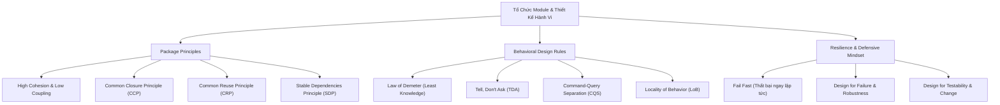
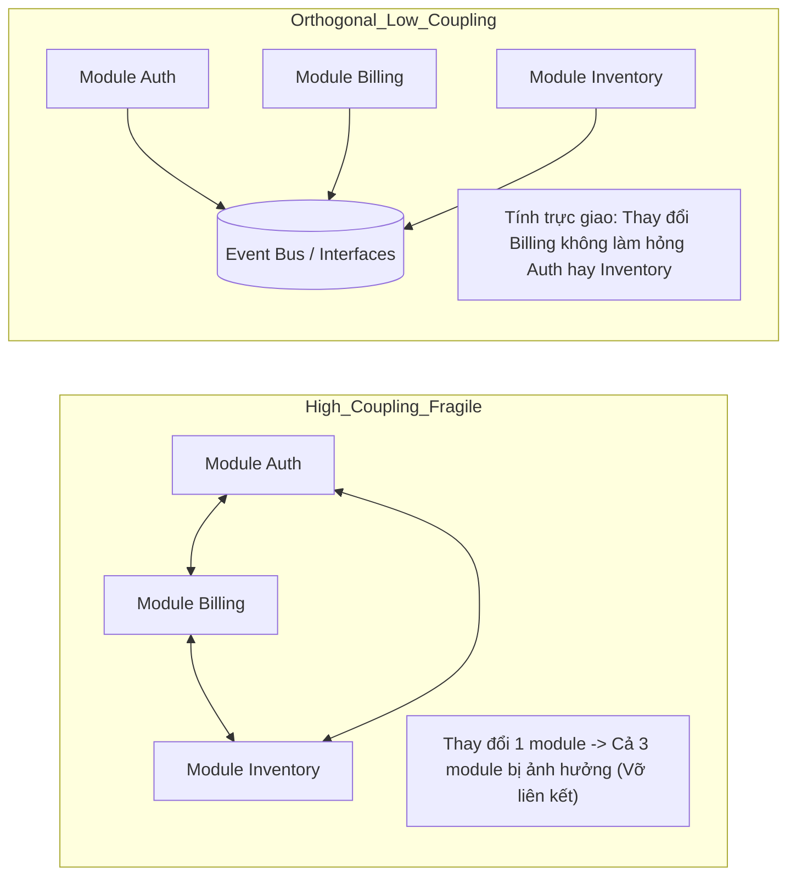
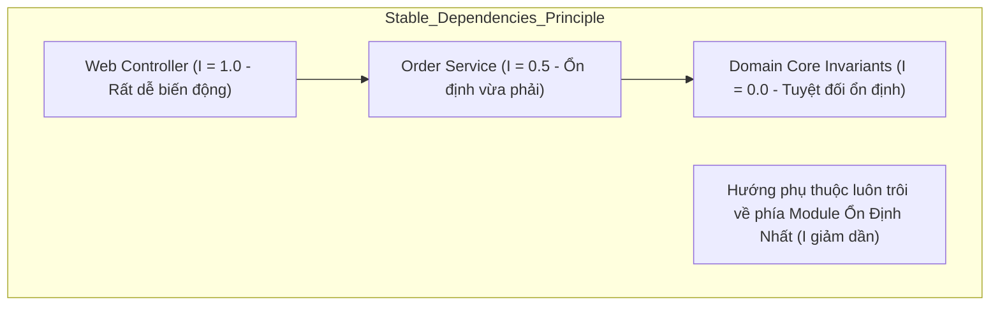
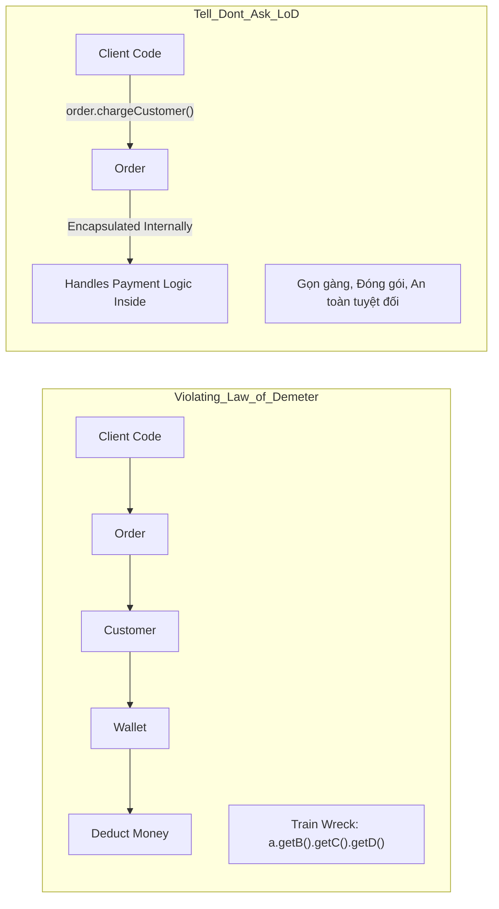
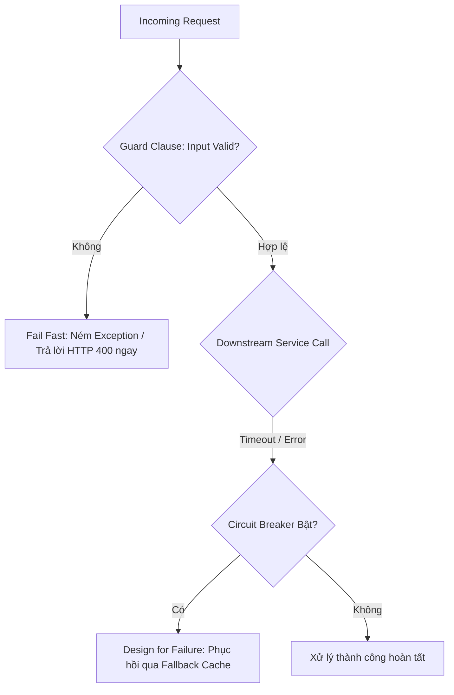

# 4.2. Tính Kết Dính, Ghép Cặp Gói và Thiết Kế Hành Vi (Package Cohesion, Coupling & Behavioral Design)

## Tổng quan về Package Cohesion, Coupling & Behavioral Design
Trong các hệ thống phần mềm lớn, chất lượng kiến trúc không chỉ được quyết định ở cấp độ từng dòng code hay từng class đơn lẻ, mà phụ thuộc chủ yếu vào cách tổ chức các gói (packages/modules) và cách các thành phần tương tác hành vi với nhau. **High Cohesion (Độ kết dính cao)** và **Low Coupling (Độ ghép cặp thấp)** là mục tiêu tối thượng của phân rã module. Để đạt được điều này, kỹ sư trưởng thành áp dụng các nguyên lý tổ chức package (Common Closure, Common Reuse, Stable Dependencies), các quy tắc thiết kế hành vi chặt chẽ (**Law of Demeter**, **Tell, Don't Ask**, **Command-Query Separation - CQS**), kết hợp với triết lý thiết kế hướng khả năng chịu lỗi (**Fail Fast**, **Defensive Design**, **Design for Failure**) và tối ưu hóa nhận thức qua **Locality of Behavior**.



---

## 2. Chi tiết từng Keyword (Under-the-Hood Deep Dive)

---

### 1. High Cohesion, Low Coupling, Modularity & Orthogonality

#### 1. Khái niệm bản chất (What & Why)
* **High Cohesion (Độ kết dính cao)**: Mức độ mà các thành phần bên trong một module thuộc về nhau và phục vụ cùng một mục đích nghiệp vụ duy nhất. Một module có cohesion cao thì tất cả các hàm và dữ liệu bên trong đều gắn bó chặt chẽ.
* **Low Coupling (Độ ghép cặp thấp)**: Mức độ phụ thuộc lẫn nhau giữa các module khác nhau. Coupling càng thấp thì việc thay đổi hoặc sửa lỗi bên trong một module càng ít gây ảnh hưởng dây chuyền sang các module khác.
* **Modularity (Tính module hóa)**: Khả năng chia tách hệ thống thành các khối độc lập có ranh giới rõ ràng, có thể biên dịch, kiểm thử và thay thế riêng biệt.
* **Orthogonality (Tính trực giao)**: Hai hay nhiều thứ được gọi là trực giao nếu sự thay đổi ở một thành phần hoàn toàn không làm thay đổi hoặc ảnh hưởng đến thành phần kia (tương tự như hai trục tọa độ $X$ và $Y$ trong không gian hình học).

#### 2. Cơ chế hoạt động sâu (Under the hood / Hardcore Internals)
- **Tác động của Coupling ở tầng Liên kết và Biên dịch (Linker & Compilation)**:
  - Khi hai module $A$ và $B$ bị ghép cặp chặt chẽ qua việc include chéo header files, trình biên dịch C++ bắt buộc phải nạp lại toàn bộ AST (Abstract Syntax Tree) của cả hai mỗi khi có một thay đổi nhỏ.
  - Nguy cơ **ABI Incompatibility (Application Binary Interface)**: Nếu class trong module $A$ thay đổi kích thước bộ nhớ (thêm một biến thành viên), module $B$ nếu được liên kết động (`.so` hoặc `.dll`) mà không được biên dịch lại sẽ đọc sai địa chỉ con trỏ offset trong RAM, gây lỗi `SIGSEGV` (Segmentation Fault) ngay lập tức tại runtime.
  - Thiết kế trực giao (Orthogonal Design) bảo đảm module $B$ chỉ tương tác qua giao diện ổn định (stable C-ABI hoặc abstract interface), triệt tiêu rủi ro ABI mismatch.

#### 3. Sơ đồ minh họa (Mermaid Diagram)


#### 4. Code ví dụ thực chiến (C++20: Thiết Kế Trực Giao Giữa Ghi Log và Xử Lý Nghiệp Vụ)
```cpp
#include <iostream>
#include <concepts>
#include <string_view>

// Thiết kế trực giao (Orthogonal Design): Logic xử lý tính thuế KHÔNG phụ thuộc vào công nghệ Log
template <typename TLogger>
concept Logger = requires(TLogger l, std::string_view msg) {
    { l.log(msg) } -> std::same_as<void>;
};

struct ConsoleLogger {
    void log(std::string_view msg) const {
        std::cout << "[LOG] " << msg << "\n";
    }
};

// Hàm TaxCalculator trực giao 100% với môi trường Console / File / Cloud Watch
template <Logger L>
class TaxCalculator {
private:
    L logger_;

public:
    explicit TaxCalculator(L logger) : logger_(logger) {}

    double calculateVat(double amount) const {
        double vat = amount * 0.10;
        logger_.log("Tính thuế VAT 10% thành công.");
        return vat;
    }
};

int main() {
    ConsoleLogger console;
    TaxCalculator calc(console);
    std::cout << "VAT: " << calc.calculateVat(200.0) << "$\n";
    return 0;
}
```

#### 5. Ưu / Nhược điểm, Pitfalls & Anti-patterns
- **Anti-pattern: Shotgun Surgery (Phẫu thuật đạn ghém)**: Mỗi khi cần thêm một trường dữ liệu nhỏ vào đơn hàng, lập trình viên phải sửa đổi 15 file khác nhau nằm rải rác trên toàn bộ codebase. Đây là triệu chứng điển hình của Low Cohesion và High Coupling.

#### 6. Ứng dụng thực tế trong Backend / Systems
- **Thiết kế Microservices**: Phân rã service theo ranh giới Bounded Contexts của Domain-Driven Design để mỗi service có High Cohesion với dữ liệu của chính mình và Low Coupling với các services khác qua async events.

---

### 2. Package Principles: Common Closure, Common Reuse & Stable Dependencies

#### 1. Khái niệm bản chất (What & Why)
* **Common Closure Principle (CCP - Đóng chung một lý do)**: Các class có cùng lý do và thời điểm thay đổi nên được đóng gói vào cùng một package/module. (Đây là phiên bản tương đương của SRP ở cấp độ package).
* **Common Reuse Principle (CRP - Tái sử dụng chung)**: Các class được sử dụng cùng nhau nên được đặt trong cùng một package. Tránh ép buộc người dùng của một package phải phụ thuộc vào những class mà họ không cần đến. (Phiên bản tương đương của ISP ở cấp độ package).
* **Stable Dependencies Principle (SDP - Phụ thuộc vào cái ổn định)**: Hướng của các phụ thuộc phải luôn chạy về phía có độ ổn định (stability) cao hơn. Một module khó thay đổi (có nhiều module khác phụ thuộc vào nó) không bao giờ được phép phụ thuộc vào một module dễ biến động.
* **Explicit Dependencies & Dependency Direction**: Mọi phụ thuộc phải được khai báo công khai, minh bạch (qua constructor hoặc configuration); chiều phụ thuộc luôn trỏ từ tầng chi tiết bên ngoài vào tầng chính sách nghiệp vụ bên trong.

#### 2. Cơ chế hoạt động sâu (Under the hood / Hardcore Internals)
- **Công thức Tính Chỉ Số Ổn Định (Instability Metric - $I$) của Robert C. Martin**:
  $$I = \frac{C_e}{C_a + C_e}$$
  - $C_a$ (Afferent Coupling): Số lượng class bên ngoài phụ thuộc vào các class bên trong package này (Trách nhiệm của package).
  - $C_e$ (Efferent Coupling): Số lượng class bên trong package này phụ thuộc vào các class bên ngoài (Sự phụ thuộc của package).
  - $I = 0$: **Hoàn toàn Ổn định (Maximally Stable)** - Rất khó thay đổi vì có quá nhiều người phụ thuộc vào nó (ví dụ: Thư viện `libc` hoặc `std::vector`).
  - $I = 1$: **Hoàn toàn Không ổn định (Maximally Instable)** - Rất dễ thay đổi vì không ai phụ thuộc vào nó.
  - **Quy tắc SDP**: Module $A$ phụ thuộc vào Module $B$ thì chỉ số $I_A \ge I_B$.

#### 3. Sơ đồ minh họa (Mermaid Diagram)


#### 4. Code ví dụ thực chiến (TypeScript: Explicit Dependencies Injection)
```typescript
// Explicit Dependencies: Khai báo phụ thuộc tường minh qua Constructor thay vì Service Locator ẩn giấu
interface TokenValidator {
  validate(token: string): boolean;
}

interface AuditLogger {
  logAccess(userId: string): Promise<void>;
}

class SecurityGateway {
  // Dependency Direction: Phụ thuộc vào các giao diện ổn định (I thấp)
  constructor(
    private readonly validator: TokenValidator,
    private readonly logger: AuditLogger
  ) {
    if (!validator || !logger) {
      throw new Error("Tất cả dependencies bắt buộc phải được cung cấp tường minh!");
    }
  }

  async authenticate(token: string, userId: string): Promise<boolean> {
    const isValid = this.validator.validate(token);
    if (isValid) {
      await this.logger.logAccess(userId);
    }
    return isValid;
  }
}
```

#### 5. Ưu / Nhược điểm, Pitfalls & Anti-patterns
- **Anti-pattern: Service Locator Hidden Dependency**: Dùng một global context `ServiceLocator.get("Database")` bên trong thân hàm. Điều này che giấu phụ thuộc, làm mất khả năng phân tích tĩnh và khiến unit test trở thành cơn ác mộng.

#### 6. Ứng dụng thực tế trong Backend / Systems
- **Monorepo Architecture (Nx / Bazel)**: Thiết lập các quy tắc linter (Boundary Rules) ngăn cản việc import ngược từ tầng App UI vào tầng Domain Core, bảo đảm tuân thủ SDP tự động trong CI.

---

### 3. Behavioral Design: Law of Demeter, Tell Don't Ask, CQS & Locality of Behavior

#### 1. Khái niệm bản chất (What & Why)
* **Law of Demeter (LoD - Quy tắc Demeter / Principle of Least Knowledge)**: Mỗi đơn vị chỉ nên nói chuyện với những người bạn thân thiết nhất của nó (Only talk to your immediate friends). Một phương thức của đối tượng $A$ chỉ được gọi các phương thức của: Bản thân $A$, các tham số truyền vào hàm, các đối tượng mà $A$ tạo ra, hoặc các biến thành viên của $A$. Tránh chuỗi gọi dài ngoằng: `a.getB().getC().getD().doSomething()`.
* **Tell, Don't Ask (TDA)**: Hãy ra lệnh cho đối tượng làm việc thay vì hỏi han dữ liệu trạng thái của nó rồi tự mình tính toán từ bên ngoài.
* **Command-Query Separation (CQS - Phân tách Lệnh và Truy vấn)**: Một phương thức chỉ nên là **Command** (thay đổi trạng thái hệ thống, trả về `void`) HOẶC là **Query** (truy vấn trả về kết quả, không có side-effect làm thay đổi trạng thái). Không bao giờ trộn lẫn cả hai.
* **Locality of Behavior (LoB - Tính địa phương của hành vi)**: Khả năng của một lập trình viên có thể đọc hiểu trọn vẹn hành vi của một đoạn code chỉ bằng cách nhìn vào chính file/hàm đó mà không cần nhảy qua 10 lớp abstraction trung gian.

#### 2. Cơ chế hoạt động sâu (Under the hood / Hardcore Internals)
- **Tác hại của việc vi phạm Law of Demeter ở tầng Bộ nhớ**:
  Chuỗi gọi hàm `order.getCustomer().getAddress().getCity()`:
  - Tốn 4 lần pointer dereferencing liên tiếp trong RAM:
    $$\text{Addr}(order) \rightarrow \text{Addr}(customer) \rightarrow \text{Addr}(address) \rightarrow \text{Addr}(city)$$
  - Mỗi bước nhảy con trỏ có thể rơi vào các trang bộ nhớ khác nhau (TLB Miss & Cache Miss).
  - Nguy hiểm nhất: Bất kỳ mắt xích nào trong chuỗi là con trỏ `nullptr` sẽ gây Crash ứng dụng (`NullPointerException` / `SIGSEGV`).
  - Áp dụng Tell, Don't Ask: Viết `order.deliverToCustomerCity()` giúp đóng gói toàn bộ chuỗi bên trong class Order.

#### 3. Sơ đồ minh họa (Mermaid Diagram)


#### 4. Code ví dụ thực chiến (C++20: Tell, Don't Ask và Command-Query Separation)
```cpp
#include <iostream>
#include <stdexcept>

class BankAccount {
private:
    double balance_{0.0};

public:
    explicit BankAccount(double initialBalance) : balance_(initialBalance) {}

    // QUERY: Chỉ trả về dữ liệu, tuyệt đối không làm thay đổi số dư (CQS Compliant)
    double getBalance() const noexcept {
        return balance_;
    }

    // COMMAND: Thay đổi trạng thái, trả về void, tự mình kiểm tra logic (Tell, Don't Ask)
    void debit(double amount) {
        if (amount <= 0.0) {
            throw std::invalid_argument("Số tiền trừ phải lớn hơn 0");
        }
        if (amount > balance_) {
            throw std::runtime_error("Số dư không đủ để thực hiện giao dịch!");
        }
        balance_ -= amount;
    }
};

int main() {
    BankAccount account(500.0);
    // VI PHẠM TDA: if (account.getBalance() > 100) account.setBalance(...) -> Xấu
    // TUÂN THỦ TDA: Ra lệnh trực tiếp cho đối tượng thực thi
    account.debit(150.0);
    std::cout << "Số dư sau khi debit (Query): " << account.getBalance() << "$\n";
    return 0;
}
```

#### 5. Ưu / Nhược điểm, Pitfalls & Anti-patterns
- **Anti-pattern: Train Wreck Calls**: Các chuỗi method chọc sâu vào cấu trúc nội tạng của đối tượng khác phá vỡ hoàn toàn nguyên tắc che giấu thông tin.

#### 6. Ứng dụng thực tế trong Backend / Systems
- **CQRS Architecture (Command Query Responsibility Segregation)**: Nâng tầm nguyên lý CQS lên cấp độ toàn bộ hệ thống phân tán, tách biệt hoàn toàn database đọc và database ghi.

---

### 4. Fail Fast, Defensive Design, Robustness, Design for Failure & Testability

#### 1. Khái niệm bản chất (What & Why)
* **Fail Fast (Thất bại ngay lập tức)**: Hệ thống phải phát hiện và báo lỗi ngay tại điểm phát sinh bất thường gần nhất thay vì âm thầm tiếp tục chạy với trạng thái hỏng hóc, khiến lỗi lan truyền sang các module khác và làm hỏng cơ sở dữ liệu.
* **Defensive Design & Robustness (Thiết kế phòng thủ và Tính bền bỉ)**: Khả năng của phần mềm duy trì hoạt động an toàn trước những đầu vào bất hợp lệ hoặc môi trường bất thường mà không bị crash hệ thống.
* **Design for Failure (Thiết kế giả định sự cố)**: Triết lý thiết kế chấp nhận thực tế rằng phần cứng, mạng và các dịch vụ downstream CHẮC CHẮN sẽ hỏng hóc tại một thời điểm nào đó trên production; do đó hệ thống phải được trang bị sẵn Circuit Breaker, Fallback và Graceful Degradation.
* **Design for Testability & Design for Change**: Thiết kế code sao cho có thể dễ dàng chèn mock/stub vào để kiểm thử tự động mọi kịch bản góc cạnh mà không cần phải can thiệp sửa đổi mã nguồn nghiệp vụ.

#### 2. Cơ chế hoạt động sâu (Under the hood / Hardcore Internals)
- **Cơ chế Fail Fast bằng Assertion và Guard Clauses**:
  - Tại ranh giới hàm (Function Boundary), kiểm tra điều kiện ngay ở các dòng đầu tiên:
    ```cpp
    void processBuffer(const uint8_t* ptr, size_t len) {
        if (!ptr || len == 0) [[unlikely]] {
            throw std::invalid_argument("Buffer null hoặc độ dài bằng 0");
        }
        // Thân hàm xử lý không bao giờ phải lo kiểm tra nullptr nữa
    }
    ```
  - Cờ `[[unlikely]]` trong C++20 gợi ý cho trình biên dịch rằng nhánh lỗi này rất hiếm khi xảy ra. Trình biên dịch sẽ sắp xếp mã máy của nhánh này ra ngoài vùng **Hot Instruction Cache Line** của CPU, giúp nhánh thực thi chính chạy mượt mà ở tốc độ tối đa của Instruction Pipeline.

#### 3. Sơ đồ minh họa (Mermaid Diagram)


#### 4. Code ví dụ thực chiến (C++20: Guard Clauses với Gợi ý Tối ưu Compiler `[[unlikely]]`)
```cpp
#include <iostream>
#include <stdexcept>
#include <vector>

// Fail Fast & Defensive Design kết hợp tối ưu Instruction Cache với [[unlikely]]
double computeAverageThroughput(const std::vector<double>& samples) {
    // 1. Guard Clause: Kiểm tra và Fail Fast ngay tại biên
    if (samples.empty()) [[unlikely]] {
        throw std::invalid_argument("Tập dữ liệu mẫu rỗng, không thể chia cho 0!");
    }

    // 2. Nhánh thực thi chính (Hot Path): CPU thực thi pipeline thẳng băng, không bị gián đoạn
    double sum = 0.0;
    for (double s : samples) {
        sum += s;
    }
    return sum / static_cast<double>(samples.size());
}

int main() {
    std::vector<double> metrics = {1200.5, 1340.2, 1180.9};
    std::cout << "Throughput trung bình: " << computeAverageThroughput(metrics) << " ops/sec\n";

    try {
        std::vector<double> emptyMetrics;
        computeAverageThroughput(emptyMetrics);
    } catch (const std::exception& e) {
        std::cerr << "Fail Fast kích hoạt chính xác: " << e.what() << "\n";
    }
    return 0;
}
```

#### 5. Ưu / Nhược điểm, Pitfalls & Anti-patterns
- **Anti-pattern: Pokemon Exception Handling ("Gotta catch 'em all")**:
  Bắt tất cả các loại exception bằng `catch (...)` rồi nuốt lỗi (empty catch block) mà không xử lý hoặc ghi log. Điều này biến lỗi chí mạng thành lỗi ngầm, khiến hệ thống hoạt động sai lệch và làm ô nhiễm dữ liệu nghiêm trọng.

#### 6. Ứng dụng thực tế trong Backend / Systems
- **Erlang / OTP Philosophy ("Let it crash")**: Triết lý thiết kế hệ thống viễn thông vi mô: Khi một tiến trình con gặp lỗi bất thường, hãy để nó sập ngay lập tức và để tiến trình Supervisor khôi phục lại nó về trạng thái ban đầu sạch sẽ.

---

## Tổng kết Chương 4.2
Tổ chức package và thiết kế hành vi là chiếc cầu nối quyết định khả năng mở rộng của một kiến trúc phần mềm lớn. Bằng cách áp dụng kỷ luật High Cohesion, Low Coupling, tuân thủ các nguyên lý ổn định gói (CCP, SDP), giữ gìn tính đóng gói qua Law of Demeter và tư duy phòng thủ Fail Fast, người kỹ sư tạo nên một codebase bền vững, có khả năng tự vệ cao và dễ dàng tiến hóa trước mọi biến động.
