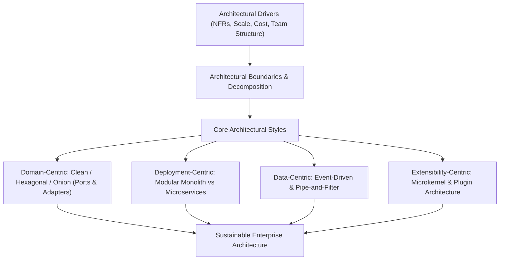
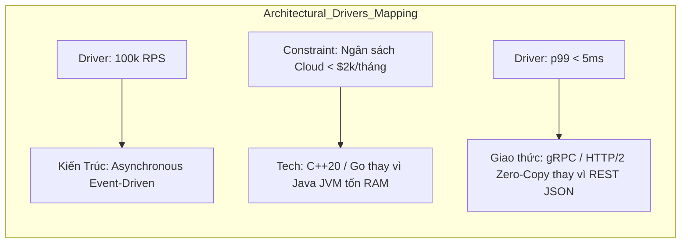
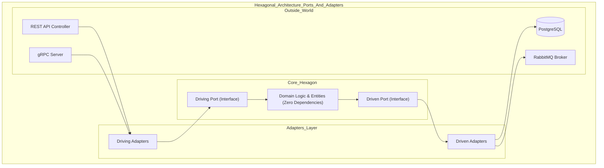
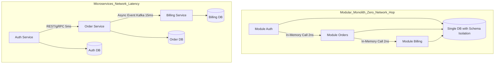
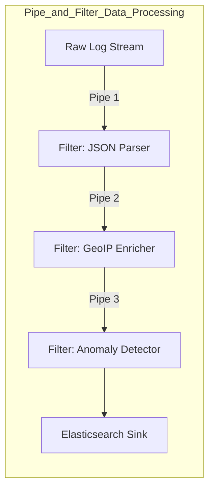

# 5.1. Động Lực Kiến Trúc, Phong Cách và Các Mẫu Kiến Trúc (Architectural Drivers, Styles & Patterns)

## Tổng quan về Architectural Drivers, Styles & Patterns
Kiến trúc phần mềm (Software Architecture) là tập hợp các quyết định kỹ thuật quan trọng nhất về mặt cấu trúc hệ thống—những quyết định mà nếu thay đổi sau này sẽ đòi hỏi chi phí vô cùng đắt đỏ. **Architectural Thinking (Tư duy kiến trúc)** không bắt đầu từ việc chọn công nghệ thời thượng, mà bắt đầu từ việc xác định các động lực kiến trúc (**Architectural Drivers**), thấu hiểu các ràng buộc (**Constraints**) và cân bằng các điểm đánh đổi (**Trade-offs**). Một kỹ sư trưởng thành phải thành thạo việc lựa chọn và phối hợp giữa các phong cách kiến trúc: từ **Modular Monolith**, **Clean / Hexagonal Architecture** (Ports & Adapters), **Microservices**, **Event-Driven Architecture (EDA)** cho đến **Pipe-and-Filter** và **Microkernel / Plugin Architecture**.



---

## 2. Chi tiết từng Keyword (Under-the-Hood Deep Dive)

---

### 1. Architectural Thinking, Drivers, Constraints, Boundaries & Trade-offs

#### 1. Khái niệm bản chất (What & Why)
* **Architectural Thinking (Tư duy kiến trúc)**: Năng lực nhìn nhận hệ thống ở tầm vĩ mô, cân nhắc giữa cấu trúc phần mềm, yêu cầu kinh doanh, tổ chức đội ngũ (Định luật Conway) và chi phí vận hành lâu dài.
* **Architectural Drivers (Động lực kiến trúc)**: Các yếu tố định hình hình hài kiến trúc, bao gồm: Yêu cầu chức năng cốt lõi (Core FRs), Các thuộc tính chất lượng (NFRs như độ trễ, khả năng mở rộng), và Mục tiêu chiến lược kinh doanh.
* **Architectural Constraints (Ràng buộc kiến trúc)**: Các giới hạn bất khả kháng về ngân sách, quy định pháp luật (Data residency, GDPR), hạ tầng sẵn có hoặc ngăn xếp công nghệ bắt buộc.
* **Architectural Boundaries (Ranh giới kiến trúc)**: Đường biên giới vật lý hoặc logic phân tách các vùng trách nhiệm độc lập, kiểm soát luồng phụ thuộc và che giấu các quyết định triển khai nội bộ.
* **Architectural Trade-offs (Sự đánh đổi kiến trúc)**: Bản chất của kiến trúc là sự thỏa hiệp. Tăng tính phân tán (Microservices) giúp mở rộng độc lập nhưng làm bùng nổ độ phức tạp mạng và mất tính nhất quán ACID tức thì.

#### 2. Cơ chế hoạt động sâu (Under the hood / Hardcore Internals)
- **Định luật Conway (Conway's Law) & Reverse Conway Maneuver**:
  *"Organizations which design systems are constrained to produce designs which are copies of the communication structures of these organizations."*
  - Nếu một tổ chức có 3 nhóm kỹ thuật độc lập (Nhóm Frontend, Nhóm Backend, Nhóm Database), họ sẽ tự nhiên tạo ra kiến trúc 3 tầng (3-Tier Layered Architecture).
  - Kỹ sư trưởng thành áp dụng **Reverse Conway Maneuver**: Tái cơ cấu tổ chức thành các nhóm đa chức năng (Cross-functional Stream-aligned Teams) xung quanh từng Bounded Context của nghiệp vụ để kiến trúc Microservices / Modular Monolith phản ánh đúng ranh giới kinh doanh mà không bị nghẽn giao tiếp.

#### 3. Sơ đồ minh họa (Mermaid Diagram)


#### 4. Code ví dụ thực chiến (C++20: Architectural Boundary qua Interface Decoupling)
```cpp
#include <iostream>
#include <memory>
#include <string_view>

// Architectural Boundary: Tầng Core Domain không được phép include bất kỳ thư viện SQL hay HTTP nào
namespace Domain::Boundary {

struct OrderEntity {
    int64_t id;
    double totalAmount;
};

// Port (Giao diện ranh giới)
class IOrderPersistencePort {
public:
    virtual ~IOrderPersistencePort() = default;
    virtual void persist(const OrderEntity& order) = 0;
};

// Use Case (High-Level Policy)
class PlaceOrderUseCase {
private:
    std::shared_ptr<IOrderPersistencePort> persistencePort_;

public:
    explicit PlaceOrderUseCase(std::shared_ptr<IOrderPersistencePort> port) 
        : persistencePort_(std::move(port)) {}

    void execute(int64_t orderId, double amount) {
        OrderEntity order{orderId, amount};
        // Thực thi quy tắc nghiệp vụ cốt lõi...
        persistencePort_->persist(order);
    }
};

} // namespace Domain::Boundary
```

#### 5. Ưu / Nhược điểm, Pitfalls & Anti-patterns
- **Anti-pattern: Resume-Driven Architecture (RDA)**: Chọn kiến trúc phức tạp (Microservices, Kafka, Kube) chỉ để làm đẹp CV xin việc của kỹ sư mà hoàn toàn không tương thích với Architectural Drivers của dự án.

#### 6. Ứng dụng thực tế trong Backend / Systems
- **Quyết định tách Monolith sang Microservices**: Chỉ thực hiện khi số lượng kỹ sư vượt quá 50 người và Monolith trở thành điểm nghẽn về tốc độ triển khai (Deployment Bottleneck) và xung đột mã nguồn.

---

### 2. Domain-Centric Styles: Clean, Hexagonal, Onion & Layered Architecture

#### 1. Khái niệm bản chất (What & Why)
* **Layered Architecture (Kiến trúc phân tầng truyền thống)**: Tổ chức hệ thống theo các tầng ngang kỹ thuật: Presentation $\rightarrow$ Business Logic $\rightarrow$ Persistence $\rightarrow$ Database. Điểm yếu là tầng nghiệp vụ thường bị phụ thuộc chặt vào schema của cơ sở dữ liệu.
* **Hexagonal Architecture (Kiến trúc lục giác / Ports and Adapters)**: Do Alistair Cockburn khởi xướng. Đặt Domain Logic làm trung tâm, giao tiếp với thế giới bên ngoài thông qua các **Ports** (Giao diện) và **Adapters** (Bộ chuyển đổi: HTTP adapter, DB adapter, CLI adapter).
* **Clean Architecture & Onion Architecture**: Các biến thể hoàn thiện của kiến trúc hướng tâm do Robert C. Martin và Jeffrey Palermo đề xuất. Áp đặt quy tắc tối thượng: **The Dependency Rule** - Các phụ thuộc mã nguồn chỉ được phép trỏ từ bên ngoài vào bên trong (Tầng chi tiết bên ngoài phụ thuộc vào tầng chính sách cốt lõi bên trong).

#### 2. Cơ chế hoạt động sâu (Under the hood / Hardcore Internals)
- **Cơ chế Ports and Adapters**:
  - **Inbound / Driving Port**: Giao diện tiếp nhận yêu cầu từ thế giới bên ngoài vào Core (ví dụ: `IOrderServicePort`). Driving Adapter là REST Controller hoặc gRPC Handler gọi vào Port này.
  - **Outbound / Driven Port**: Giao diện giúp Core gọi ra cơ sở hạ tầng bên ngoài (ví dụ: `IOrderRepositoryPort`). Driven Adapter là class `PostgresOrderRepository` hiện thực interface này.
  - Core Domain hoàn toàn độc lập với Framework, UI, và Database; có thể chạy Unit Test với tốc độ cực nhanh trong bộ nhớ mà không cần khởi động Docker hay Database.

#### 3. Sơ đồ minh họa (Mermaid Diagram)


#### 4. Code ví dụ thực chiến (TypeScript: Hexagonal Architecture trọn vẹn)
```typescript
// 1. DOMAIN CORE (Tuyệt đối không import thư viện bên ngoài)
export interface Order {
  id: string;
  amount: number;
}

// 2. PORTS (Giao diện ranh giới)
export interface OrderRepositoryPort {
  save(order: Order): Promise<void>;
}

export interface NotificationPort {
  send(message: string): Promise<void>;
}

// 3. USE CASE (Application Service)
export class OrderPlacementService {
  constructor(
    private readonly repo: OrderRepositoryPort,
    private readonly notifier: NotificationPort
  ) {}

  async placeOrder(id: string, amount: number): Promise<void> {
    if (amount <= 0) throw new Error("Giá trị đơn hàng phải lớn hơn 0");
    const order: Order = { id, amount };
    await this.repo.save(order);
    await this.notifier.send(`Đơn hàng ${id} đã được tạo thành công.`);
  }
}

// 4. ADAPTERS (Tầng hạ tầng cụ thể)
export class PostgresOrderAdapter implements OrderRepositoryPort {
  async save(order: Order): Promise<void> {
    console.log(`[Adapter DB] Lưu đơn hàng ${order.id} vào PostgreSQL table.`);
  }
}

export class SlackNotificationAdapter implements NotificationPort {
  async send(message: string): Promise<void> {
    console.log(`[Adapter Slack] Gửi tin nhắn Webhook: ${message}`);
  }
}
```

#### 5. Ưu / Nhược điểm, Pitfalls & Anti-patterns
- **Ưu điểm**: Khả năng kiểm thử (Testability) đạt mức tối đa. Dễ dàng đổi DB từ Postgres sang MongoDB chỉ bằng cách viết Adapter mới mà không chạm vào Domain logic.
- **Pitfalls**: Lạm dụng boilerplate code quá mức cho các tác vụ CRUD đơn giản (Accidental Complexity).

#### 6. Ứng dụng thực tế trong Backend / Systems
- **Hệ thống thanh toán Core Payment**: Luôn sử dụng Clean/Hexagonal Architecture để tách biệt nghiệp vụ xử lý giao dịch khỏi API của các ngân hàng đối tác (vốn thường xuyên thay đổi định dạng).

---

### 3. Deployment & Communication Styles: Modular Monolith, Microservices, EDA & SOA

#### 1. Khái niệm bản chất (What & Why)
* **Modular Monolith (Monolith hướng module)**: Kiến trúc triển khai nguyên khối (Single Deployment Unit) nhưng bên trong được tổ chức thành các module có ranh giới nghiêm ngặt, giao tiếp qua API nội bộ và không truy cập chéo database của nhau. Đây là điểm khởi đầu lý tưởng cho 95% dự án.
* **Microservices Architecture**: Phân rã hệ thống thành một tập hợp các dịch vụ độc lập, tự vận hành, sở hữu database riêng và giao tiếp qua mạng (HTTP/gRPC/Messaging).
* **Service-Oriented Architecture (SOA)**: Phong cách kiến trúc hướng dịch vụ cấp doanh nghiệp truyền thống, thường sử dụng Enterprise Service Bus (ESB) và chuẩn XML/SOAP.
* **Event-Driven Architecture (EDA - Kiến trúc hướng sự kiện)**: Các dịch vụ giao tiếp bất đồng bộ qua việc sản xuất (produce) và tiêu thụ (consume) các sự kiện (Events) thông qua Message Broker (Kafka, RabbitMQ), giúp giảm thiểu độ ghép cặp về thời gian và không gian.

#### 2. Cơ chế hoạt động sâu (Under the hood / Hardcore Internals)
- **Độ trễ và Chi phí của Network Hop trong Microservices**:
  - Trong Modular Monolith: Gọi hàm giữa hai module chỉ là một chỉ thị CPU `CALL`, tốn khoảng **$2-5\text{ ns}$**, dữ liệu truyền qua con trỏ bộ nhớ (Zero serialization, Zero kernel overhead).
  - Trong Microservices: Gọi giữa hai service qua mạng:
    $$\text{JSON Serialization} \rightarrow \text{Kernel Socket Buffer} \rightarrow \text{TCP/IP Stack} \rightarrow \text{NIC DMA} \rightarrow \text{Network Switch} \rightarrow \text{Deserialization}$$
    Tốn từ **$2\text{ ms}$ đến $20\text{ ms}$** (chậm hơn $1,000,000$ lần!).
  - Chưa kể rủi ro Network Partition, TLS Handshake CPU overhead và hiện tượng Distributed Cascading Failures.

#### 3. Sơ đồ minh họa (Mermaid Diagram)


#### 4. Code ví dụ thực chiến (TypeScript: Modular Monolith In-Memory Event Dispatcher)
```typescript
// Modular Monolith: Giao tiếp lỏng lẻo giữa các module qua In-Memory Event Bus (Zero Network Latency)
type DomainEvent = { eventName: string; payload: any };
type EventHandler = (event: DomainEvent) => Promise<void>;

class InMemoryEventBus {
  private handlers = new Map<string, EventHandler[]>();

  subscribe(eventName: string, handler: EventHandler) {
    const list = this.handlers.get(eventName) || [];
    list.push(handler);
    this.handlers.set(eventName, list);
  }

  async publish(event: DomainEvent): Promise<void> {
    const list = this.handlers.get(event.eventName) || [];
    // Thực thi song song trong cùng tiến trình bộ nhớ
    await Promise.all(list.map(fn => fn(event)));
  }
}

// Module Orders phát sự kiện
const eventBus = new InMemoryEventBus();

// Module Email đăng ký lắng nghe (Hoàn toàn độc lập với Module Orders)
eventBus.subscribe("ORDER_CREATED", async (e) => {
  console.log(`[EmailModule] Gửi email xác nhận cho đơn hàng: ${e.payload.orderId}`);
});

// Khi đơn hàng được tạo:
eventBus.publish({ eventName: "ORDER_CREATED", payload: { orderId: "ORD-999" } });
```

#### 5. Ưu / Nhược điểm, Pitfalls & Anti-patterns
- **Anti-pattern: Distributed Monolith**: Xây dựng hàng chục microservices nhưng chúng lại chia sẻ chung một Database hoặc gọi đồng bộ (REST chain) phụ thuộc chặt chẽ vào nhau. Khi đó tổ chức phải gánh chịu toàn bộ nhược điểm của cả Monolith và Microservices mà không thu được bất kỳ lợi ích nào.

#### 6. Ứng dụng thực tế trong Backend / Systems
- **Shopify & StackOverflow**: Vận hành hạ tầng hàng tỷ request mỗi tháng trên kiến trúc **Modular Monolith** cực kỳ tối ưu, tiết kiệm hàng triệu USD chi phí máy chủ và vận hành đơn giản.

---

### 4. Specialized Styles: Component-Based, Plugin, Pipe-and-Filter & Microkernel Architecture

#### 1. Khái niệm bản chất (What & Why)
* **Component-Based Architecture**: Xây dựng phần mềm từ các thành phần có thể tái sử dụng, được đóng gói sẵn và tương tác qua các giao diện định nghĩa chuẩn.
* **Plugin Architecture / Microkernel Architecture**: Hệ thống gồm hai phần:
  1. **Core System (Microkernel)**: Chứa logic tối thiểu để ứng dụng vận hành.
  2. **Plugin Modules**: Các thành phần mở rộng độc lập cắm vào Core để bổ sung tính năng mới mà không cần sửa đổi Core.
* **Pipe-and-Filter Architecture (Đường ống và Bộ lọc)**: Phân rã bài toán xử lý luồng dữ liệu thành một chuỗi các bước biến đổi độc lập (Filters) được kết nối với nhau qua các kênh truyền (Pipes). Dữ liệu đầu ra của Filter này là đầu vào của Filter tiếp theo.

#### 2. Cơ chế hoạt động sâu (Under the hood / Hardcore Internals)
- **Plugin Architecture ở tầng Hệ Điều Hành**:
  Các ứng dụng chuyên nghiệp (NGINX, Envoy Proxy, VS Code) nạp plugin động tại runtime thông qua các hàm thư viện của hệ điều hành:
  - Linux: `dlopen()`, `dlsym()`, `dlclose()`.
  - Core định nghĩa một con trỏ hàm chuẩn (Function Pointer VTable). Khi nạp thư viện động `.so`, Core gọi `dlsym()` để lấy địa chỉ hàm và thực thi mã máy trực tiếp với chi phí overhead gần như bằng 0.
- **Pipe-and-Filter và Linux Pipes Overhead**:
  Lệnh `cat access.log | grep "500" | awk '{print $7}'`:
  - Mỗi dấu `|` là một syscall `pipe()` tạo ra một buffer vòng trong nhân Linux (dung lượng mặc định 64KB).
  - Dữ liệu truyền giữa các tiến trình qua cơ chế IPC (Inter-Process Communication), tận dụng tối đa CPU đa lõi khi các Filter chạy song song trên các thread khác nhau.

#### 3. Sơ đồ minh họa (Mermaid Diagram)


#### 4. Code ví dụ thực chiến (C++20: Pipe-and-Filter Pipeline sử dụng Ranges & Lambdas)
```cpp
#include <iostream>
#include <vector>
#include <ranges>
#include <string>

// Pipe-and-Filter trong C++20: Tận dụng Ranges Views để xử lý luồng lười (Lazy Evaluation)
// Không cấp phát bộ nhớ trung gian giữa các bộ lọc (Zero Allocation Pipeline)

struct LogEntry {
    int statusCode;
    std::string path;
};

int main() {
    std::vector<LogEntry> logs = {
        {200, "/api/v1/user"},
        {500, "/api/v1/checkout"},
        {404, "/favicon.ico"},
        {502, "/api/v1/payment"},
        {200, "/api/v1/products"}
    };

    // Chuỗi Pipe-and-Filter: Lọc lỗi Server (status >= 500) và trích xuất đường dẫn
    auto errorPaths = logs 
        | std::views::filter([](const LogEntry& entry) { return entry.statusCode >= 500; }) // Filter 1
        | std::views::transform([](const LogEntry& entry) { return entry.path; });           // Filter 2

    std::cout << "=== CÁC ENDPOINT GẶP SỰ CỐ PRODUCTION (Pipe-and-Filter) ===\n";
    for (const auto& path : errorPaths) {
        std::cout << "Lỗi tại: " << path << "\n";
    }
    return 0;
}
```

#### 5. Ưu / Nhược điểm, Pitfalls & Anti-patterns
- **Anti-pattern: Leaky Plugin State**: Plugin can thiệp trực tiếp vào bộ nhớ toàn cục của Core Kernel làm sập toàn bộ ứng dụng khi plugin gặp lỗi. Core phải cung cấp cơ chế Sandboxing (ví dụ: Chạy plugin trong WebAssembly runtime - Wasm) để bảo vệ tính ổn định.

#### 6. Ứng dụng thực tế trong Backend / Systems
- **Envoy Proxy & NGINX**: Vận hành dựa trên kiến trúc Filter Chain (Pipe-and-Filter) cho phép chèn các bộ lọc Rate Limiting, Authentication, và Compression vào luồng HTTP request một cách linh hoạt.

---

## Tổng kết Chương 5.1
Không có một phong cách kiến trúc nào là vạn năng. Kỹ sư trưởng thành phân tích cẩn trọng các Architectural Drivers và Constraints để lựa chọn giải pháp phù hợp: Bắt đầu bằng Clean Modular Monolith để tối đa hóa tốc độ phát triển và hiệu năng, tích hợp tư duy hướng sự kiện (EDA) cho các luồng xử lý nền, và chỉ phân rã sang Microservices khi quy mô tổ chức và bài toán kinh doanh thực sự đòi hỏi.
