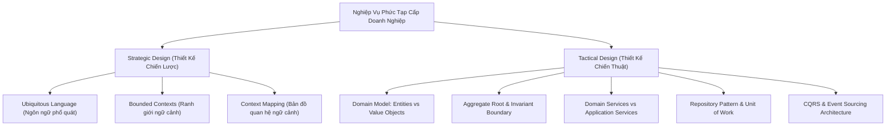
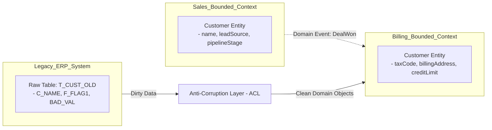
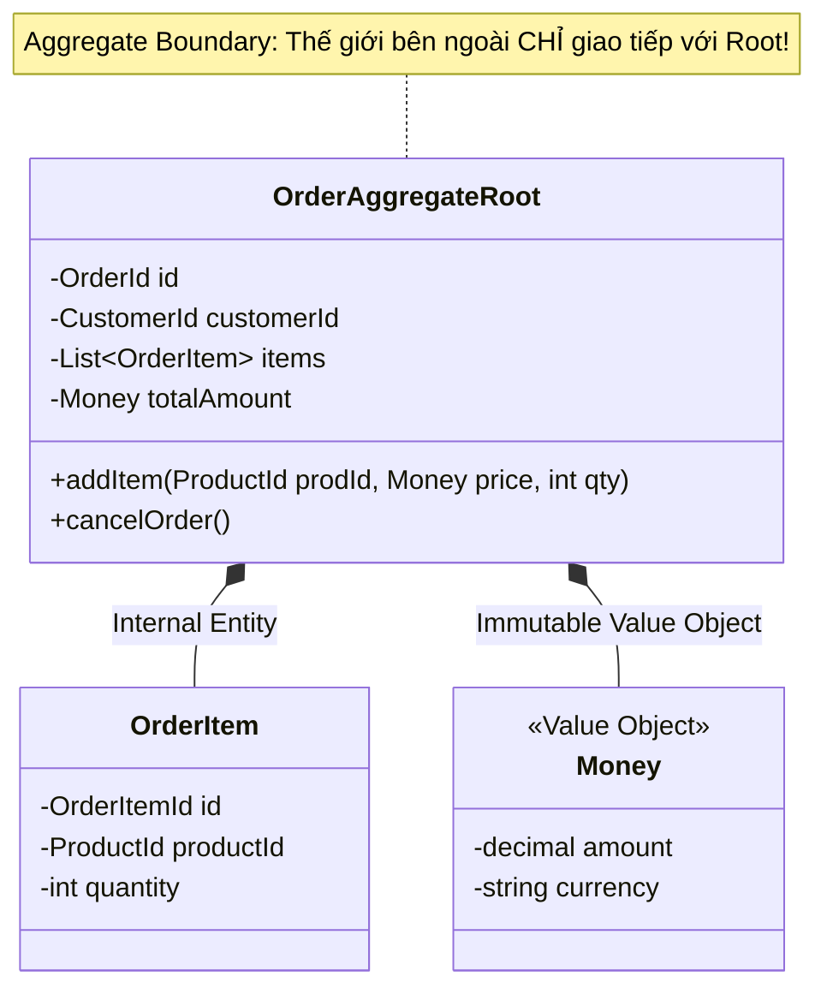
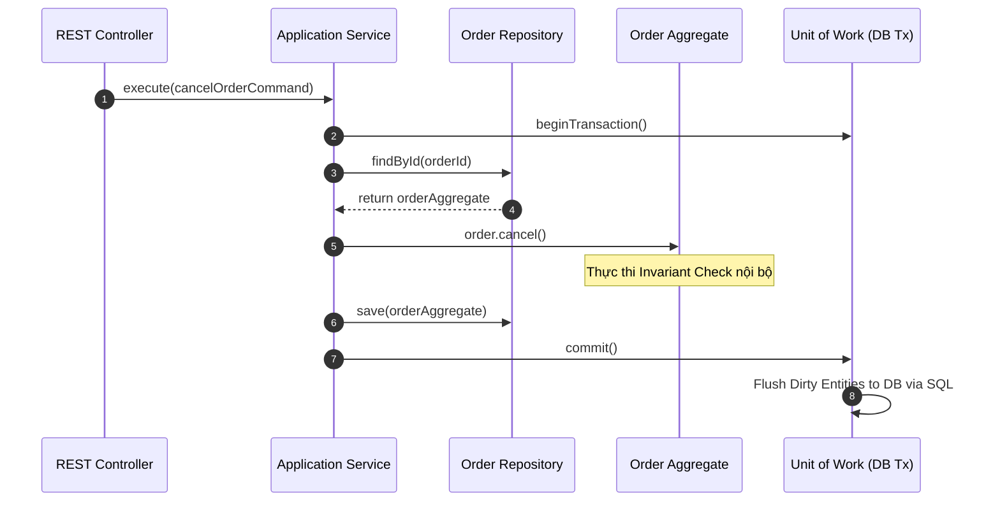
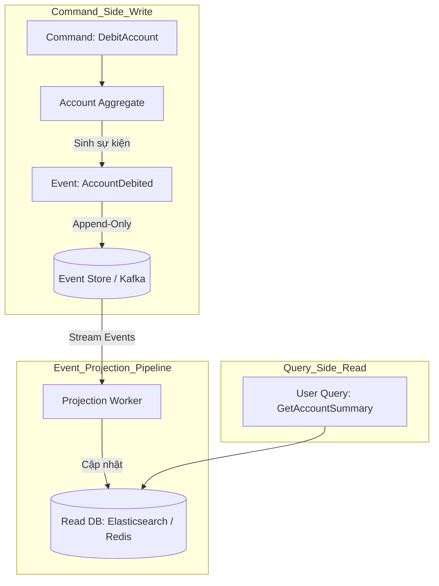

# 5.2. Thiết Kế Hướng Miền và Các Mẫu Chiến Thuật (Domain-Driven Design & Tactical Patterns)

## Tổng quan về Domain-Driven Design & Tactical Patterns
Khi phần mềm giải quyết các bài toán kinh doanh có độ phức tạp cao (FinTech, Thương mại điện tử, Logistics, Y tế), thách thức lớn nhất không nằm ở công nghệ mà nằm ở sự sai lệch giữa mô hình tư duy của chuyên gia nghiệp vụ (Domain Experts) và mã nguồn của lập trình viên. **Domain-Driven Design (DDD - Thiết kế hướng miền)** do Eric Evans khởi xướng là phương pháp luận toàn diện nhằm giải quyết bài toán này. DDD được chia làm hai trụ cột: **Strategic Design (Thiết kế chiến lược)** giúp vẽ ranh giới ngôn ngữ và nghiệp vụ thông qua **Bounded Contexts** và **Context Mapping**; và **Tactical Design (Thiết kế chiến thuật)** cung cấp các khối xây dựng mã nguồn cụ thể như **Entities**, **Value Objects**, **Aggregates**, **Domain Services**, **Repositories**, **Unit of Work**, cùng các mô hình nâng cao như **CQRS** và **Event Sourcing**.



---

## 2. Chi tiết từng Keyword (Under-the-Hood Deep Dive)

---

### 1. Strategic Design: Ubiquitous Language, Bounded Contexts & Context Mapping

#### 1. Khái niệm bản chất (What & Why)
* **Domain-Driven Design (DDD)**: Triết lý phát triển phần mềm đặt trọng tâm vào việc mô hình hóa chính xác miền nghiệp vụ thực tế, xây dựng mô hình dựa trên sự hợp tác chặt chẽ giữa kỹ sư và chuyên gia nghiệp vụ.
* **Strategic Design (Thiết kế chiến lược)**: Phần quan trọng nhất của DDD, trả lời câu hỏi: *Hệ thống lớn này nên được chia cắt thành các ranh giới nghiệp vụ như thế nào để các nhóm kỹ sư có thể làm việc độc lập mà không dẫm chân lên nhau?*.
* **Ubiquitous Language (Ngôn ngữ phổ quát)**: Một ngôn ngữ chung, duy nhất, không mơ hồ được sử dụng thống nhất bởi cả chuyên gia nghiệp vụ, product manager, kỹ sư phần mềm và thể hiện trực tiếp trong mã nguồn (tên biến, tên class, tên bảng database).
* **Bounded Contexts (Ngữ cảnh bị giới hạn)**: Một ranh giới tường minh mà bên trong đó một mô hình miền (Domain Model) cụ thể được áp dụng và ngôn ngữ phổ quát có ý nghĩa tuyệt đối chính xác. Cùng một từ "User", trong Context "Auth" nó mang ý nghĩa thông tin đăng nhập/mật khẩu, nhưng trong Context "Billing" nó lại là pháp nhân chịu trách nhiệm xuất hóa đơn.
* **Context Mapping (Bản đồ ngữ cảnh)**: Mô hình hóa các mối quan hệ giao tiếp và quyền lực kỹ thuật giữa các Bounded Contexts: Shared Kernel, Customer-Supplier, Conformist, Anti-Corruption Layer (ACL), Open Host Service (OHS), Separate Ways.

#### 2. Cơ chế hoạt động sâu (Under the hood / Hardcore Internals)
- **Anti-Corruption Layer (ACL - Lớp chống ô nhiễm)**:
  Khi một Bounded Context hiện đại (được thiết kế bằng Clean DDD) cần tích hợp với một hệ thống Legacy cổ lỗ (chứa các trường dữ liệu lộn xộn, snake_case, mã lỗi kỳ dị):
  - Kỹ sư thiết kế một tầng trung gian ACL gồm **Adapters** và **Translators**.
  - Tầng ACL đón nhận dữ liệu từ Legacy, phân tích cú pháp, kiểm tra tính hợp lệ và ánh xạ (translate) sang các Domain Entities chuẩn chỉnh của Context mới.
  - Ngăn chặn hoàn toàn việc các khái niệm xấu xí của hệ thống cũ "lây nhiễm" (corrupt) vào Domain Model cốt lõi.

#### 3. Sơ đồ minh họa (Mermaid Diagram)


#### 4. Code ví dụ thực chiến (TypeScript: Anti-Corruption Layer Translation)
```typescript
// Legacy Dirty Data đến từ hệ thống cũ (Third-party / Legacy ERP)
interface LegacyCustomerPayload {
  C_ID: string;
  FULL_NM: string;
  STAT_CD: number; // 1 = Active, 2 = Suspended
}

// Clean Domain Model của Bounded Context Billing
interface BillingCustomer {
  customerId: string;
  legalName: string;
  isActive: boolean;
}

// Anti-Corruption Layer (ACL) Translator
class CustomerAclTranslator {
  static toDomain(legacy: LegacyCustomerPayload): BillingCustomer {
    if (!legacy.C_ID || !legacy.FULL_NM) {
      throw new Error("[ACL] Dữ liệu Legacy bị thiếu trường bắt buộc!");
    }

    return {
      customerId: `CUST_${legacy.C_ID.trim()}`,
      legalName: legacy.FULL_NM.trim(),
      isActive: legacy.STAT_CD === 1
    };
  }
}
```

#### 5. Ưu / Nhược điểm, Pitfalls & Anti-patterns
- **Anti-pattern: The Universal Data Model**: Cố gắng tạo ra một class `Customer` hay `Product` duy nhất dùng chung cho toàn bộ tập đoàn với 200 thuộc tính. Đây là thảm họa kiến trúc khiến mọi thay đổi nhỏ đều gây lỗi toàn hệ thống.

#### 6. Ứng dụng thực tế trong Backend / Systems
- **Kiến trúc Microservices tại Amazon**: Mỗi Microservice tương ứng với một Bounded Context riêng biệt (Order Context, Fulfillment Context, Recommendation Context), bảo đảm tính tự chủ hoàn toàn của từng nhóm.

---

### 2. Tactical Design: Entities, Value Objects, Aggregates & Invariant Boundaries

#### 1. Khái niệm bản chất (What & Why)
* **Tactical Design (Thiết kế chiến thuật)**: Tập hợp các mẫu thiết kế hướng đối tượng được sử dụng để xây dựng mô hình miền bên trong một Bounded Context.
* **Entities (Thực thể)**: Các đối tượng nghiệp vụ được định danh bởi một ID duy nhất xuyên suốt thời gian, trạng thái có thể biến đổi nhưng danh tính (Identity) không bao giờ đổi (ví dụ: `User`, `Order`).
* **Value Objects (Đối tượng giá trị)**: Các đối tượng không có ID, được định nghĩa hoàn toàn bởi giá trị của các thuộc tính cấu thành, có tính chất **bất biến (Immutable)**. Hai Value Objects có các trường bằng nhau được coi là một (ví dụ: `Money`, `Address`, `DateRange`).
* **Aggregate & Aggregate Root (Cụm thực thể và Gốc cụm)**: Một cụm các Entities và Value Objects liên kết với nhau thành một đơn vị giao dịch nhất quán (Transactional Consistency Boundary). Mọi truy cập, sửa đổi từ bên ngoài BẮT BUỘC phải đi qua **Aggregate Root**. Không thành phần bên ngoài nào được phép can thiệp trực tiếp vào các entity con bên trong.

#### 2. Cơ chế hoạt động sâu (Under the hood / Hardcore Internals)
- **Invariant Enforcement trong Aggregate Boundary**:
  - Giả sử đơn hàng (`Order` - Aggregate Root) có danh sách các dòng sản phẩm (`OrderItem` - Entity con).
  - Quy tắc bất biến (Business Invariant): "Tổng giá trị đơn hàng không được vượt quá hạn mức tín dụng $10,000$ và mỗi đơn hàng tối đa 50 món".
  - Nếu mã nguồn bên ngoài lấy con trỏ `order.getItems().add(new Item())`: Bất biến bị phá vỡ hoàn toàn vì `Order` không có cơ hội kiểm tra hạn mức!
  - Thiết kế Aggregate đúng chuẩn: Hàm `order.addItem(...)` tự kiểm tra điều kiện, tự tính lại tổng tiền. Toàn bộ cụm Aggregate được commit hoặc rollback trong cùng một Database Transaction.

#### 3. Sơ đồ minh họa (Mermaid Diagram)


#### 4. Code ví dụ thực chiến (C++20: Aggregate Root và Value Object chuẩn chỉnh)
```cpp
#include <iostream>
#include <vector>
#include <string>
#include <stdexcept>

// 1. VALUE OBJECT (Immutable, Không có ID, so sánh theo giá trị)
class Money {
private:
    int64_t cents_{0};

public:
    explicit constexpr Money(int64_t cents) : cents_(cents) {
        if (cents < 0) throw std::invalid_argument("Tiền không được âm");
    }

    int64_t getCents() const noexcept { return cents_; }

    constexpr Money operator+(const Money& other) const noexcept {
        return Money(cents_ + other.cents_);
    }

    bool operator==(const Money& other) const noexcept = default; // C++20 Spaceship/Default
};

// 2. AGGREGATE ROOT (Kiểm soát toàn bộ Invariant Boundary)
class OrderAggregate {
private:
    std::string orderId_;
    std::vector<Money> itemPrices_;
    Money total_{0};
    static constexpr int64_t CREDIT_LIMIT_CENTS = 500'000; // $5,000

public:
    explicit OrderAggregate(std::string orderId) : orderId_(std::move(orderId)) {}

    // Phương thức kiểm soát Invariant: Không cho phép thêm nếu vượt hạn mức
    void addItem(Money price) {
        Money newTotal = total_ + price;
        if (newTotal.getCents() > CREDIT_LIMIT_CENTS) {
            throw std::domain_error("Vi phạm Invariant: Vượt quá hạn mức tín dụng tối đa cho phép!");
        }
        itemPrices_.push_back(price);
        total_ = newTotal;
        std::cout << "Thêm sản phẩm thành công. Tổng giá trị đơn: " << total_.getCents() / 100 << "$\n";
    }

    Money getTotal() const noexcept { return total_; }
};

int main() {
    OrderAggregate order("ORD-7701");
    order.addItem(Money(15000)); // +$150
    order.addItem(Money(20000)); // +$200
    return 0;
}
```

#### 5. Ưu / Nhược điểm, Pitfalls & Anti-patterns
- **Anti-pattern: Giant Aggregates**: Tạo một Aggregate chứa hàng nghìn thực thể con (ví dụ: `Company` chứa toàn bộ `Employees` và `Departments`). Điều này dẫn đến tranh chấp khóa cơ sở dữ liệu (Lock Contention) cực kỳ gay gắt và lỗi bộ nhớ khi load dữ liệu vào RAM.

#### 6. Ứng dụng thực tế trong Backend / Systems
- **Thiết kế Domain Layer trong Spring Boot / NestJS / ASP.NET Core**: Xây dựng các Aggregate Roots làm ranh giới khóa lạc quan (Optimistic Locking với trường `@Version`) để xử lý tương tranh an toàn.

---

### 3. Services, Repository Pattern & Unit of Work

#### 1. Khái niệm bản chất (What & Why)
* **Domain Services (Dịch vụ miền)**: Nơi chứa logic nghiệp vụ thuần túy không thuộc về một Entity hay Value Object đơn lẻ nào (ví dụ: Thuật toán chuyển tiền giữa hai tài khoản ngân hàng khác nhau: `MoneyTransferDomainService`).
* **Application Services (Dịch vụ ứng dụng / Use Cases)**: Tầng điều phối (Orchestration Layer). Không chứa logic nghiệp vụ tính toán mà chịu trách nhiệm: Mở transaction, nạp Aggregate từ Repository, gọi Aggregate thực thi, và gửi thông báo/sự kiện ra ngoài.
* **Repository Pattern**: Lớp trừu tượng hóa mô phỏng việc truy cập cơ sở dữ liệu giống như một tập hợp đối tượng trong bộ nhớ (`collection-like interface`). Ẩn giấu hoàn toàn các câu lệnh SQL, ORM đằng sau các hàm `save(aggregate)`, `findById(id)`.
* **Unit of Work (UoW)**: Mẫu thiết kế theo dõi mọi thay đổi (thêm, sửa, xóa) của các đối tượng nghiệp vụ trong suốt một nghiệp vụ giao dịch, sau đó ghi toàn bộ thay đổi xuống Database trong đúng một Transaction duy nhất để tối ưu hóa Round-Trip mạng và bảo đảm ACID.

#### 2. Cơ chế hoạt động sâu (Under the hood / Hardcore Internals)
- **Unit of Work và Dirty Checking ở tầng ORM**:
  - Khi Application Service gọi `repository.findById(42)`, Unit of Work lưu một bản sao trạng thái ban đầu của Entity vào bộ nhớ (Snapshot).
  - Khi transaction chuẩn bị commit, Unit of Work so sánh (diff) từng trường dữ liệu giữa Entity hiện tại và Snapshot ban đầu để phát hiện những trường nào thực sự bị thay đổi (Dirty Checking).
  - Tự động sinh ra câu lệnh SQL tối ưu: `UPDATE orders SET status = 'PAID' WHERE id = 42` thay vì cập nhật mù quáng toàn bộ 30 cột.

#### 3. Sơ đồ minh họa (Mermaid Diagram)


#### 4. Code ví dụ thực chiến (TypeScript: Unit of Work & Repository Pattern)
```typescript
interface AggregateRoot {
  id: string;
}

interface UnitOfWork {
  registerDirty(entity: AggregateRoot): void;
  commit(): Promise<void>;
  rollback(): Promise<void>;
}

class SqlUnitOfWork implements UnitOfWork {
  private dirtyEntities: AggregateRoot[] = [];

  registerDirty(entity: AggregateRoot): void {
    this.dirtyEntities.push(entity);
  }

  async commit(): Promise<void> {
    console.log(`[SQL UoW] Bắt đầu Transaction Database...`);
    for (const entity of this.dirtyEntities) {
      console.log(`[SQL UoW] Flush thay đổi của Entity ${entity.id} xuống Postgres.`);
    }
    console.log(`[SQL UoW] COMMIT Transaction thành công.`);
    this.dirtyEntities = [];
  }

  async rollback(): Promise<void> {
    console.log(`[SQL UoW] ROLLBACK Transaction.`);
    this.dirtyEntities = [];
  }
}
```

#### 5. Ưu / Nhược điểm, Pitfalls & Anti-patterns
- **Anti-pattern: Repository leaking IQueryable**: Trả về `IQueryable` từ Repository ra ngoài Controller. Điều này phá vỡ tính đóng gói, khiến logic truy vấn SQL rò rỉ khắp nơi trên tầng UI.

#### 6. Ứng dụng thực tế trong Backend / Systems
- **Hibernate / Entity Framework Core**: Bản thân `DbContext` hoặc `EntityManager` chính là sự kết hợp hoàn hảo giữa Repository Pattern và Unit of Work Pattern.

---

### 4. CQRS (Command Query Responsibility Segregation) & Event Sourcing

#### 1. Khái niệm bản chất (What & Why)
* **CQRS (Command Query Responsibility Segregation)**: Tách biệt hoàn toàn mô hình xử lý ghi (Command - Thay đổi trạng thái, thực thi nghiệp vụ phức tạp, bảo đảm Invariant) và mô hình xử lý đọc (Query - Tối ưu hóa truy vấn hiển thị, denormalized views, không có business logic).
* **Event Sourcing (Lưu trữ nguồn sự kiện)**: Thay vì lưu trữ trạng thái hiện tại của thực thể vào bảng database (`UPDATE accounts SET balance = 500`), ta lưu trữ toàn bộ chuỗi các sự kiện nghiệp vụ đã từng xảy ra trong quá khứ (`MoneyDeposited`, `MoneyWithdrawn`) vào một **Append-Only Event Store**. Trạng thái hiện tại được tái tạo bằng cách phát lại (replay) các sự kiện này từ đầu.

#### 2. Cơ chế hoạt động sâu (Under the hood / Hardcore Internals)
- **Tối ưu hóa I/O Đĩa của Event Sourcing & CQRS**:
  - Ghi sự kiện vào Event Store: Là thao tác **Sequential Append-Only Write** trên đĩa. Không bao giờ có `UPDATE` hay `DELETE`. Tốc độ ghi đạt mức tối đa của phần cứng SSD/NVMe.
  - Tái tạo trạng thái (State Rehydration) qua **Snapshots**: Nếu một tài khoản có 100,000 sự kiện, việc replay từ đầu sẽ rất chậm. Kỹ sư định kỳ tạo một Snapshot (lưu trạng thái tại event thứ 100,000). Khi nạp, chỉ cần load Snapshot gần nhất + replay các event phát sinh sau đó.
  - Đồng bộ sang Read Database (Elasticsearch / Redis) qua Async Projections với độ trễ tính bằng mili-giây.

#### 3. Sơ đồ minh họa (Mermaid Diagram)


#### 4. Code ví dụ thực chiến (C++20: Event Sourcing Aggregate Rehydration)
```cpp
#include <iostream>
#include <vector>
#include <string>
#include <variant>

// 1. Domain Events (Bất biến)
struct MoneyDeposited { double amount; };
struct MoneyWithdrawn { double amount; };

using BankEvent = std::variant<MoneyDeposited, MoneyWithdrawn>;

// 2. Event Sourced Aggregate
class EventSourcedAccount {
private:
    double balance_{0.0};

    // Hàm áp dụng sự kiện để thay đổi trạng thái nội tại (Apply Event)
    void apply(const MoneyDeposited& e) { balance_ += e.amount; }
    void apply(const MoneyWithdrawn& e) { balance_ -= e.amount; }

public:
    // Tái tạo trạng thái (Rehydrate) từ lịch sử các sự kiện
    void loadFromHistory(const std::vector<BankEvent>& events) {
        for (const auto& event : events) {
            std::visit([this](const auto& e) { this->apply(e); }, event);
        }
    }

    double getBalance() const noexcept { return balance_; }
};

int main() {
    // Lịch sử sự kiện lưu trong Append-Only Event Store
    std::vector<BankEvent> history = {
        MoneyDeposited{1000.0},
        MoneyWithdrawn{200.0},
        MoneyDeposited{50.0}
    };

    EventSourcedAccount account;
    account.loadFromHistory(history);

    std::cout << "Trạng thái số dư sau khi Rehydrate Event Sourcing: " << account.getBalance() << "$\n";
    return 0;
}
```

#### 5. Ưu / Nhược điểm, Pitfalls & Anti-patterns
- **Ưu điểm**: Audit log 100% hoàn hảo không thể chối cãi (vô giá trong ngành kiểm toán, tài chính). Cho phép "du hành thời gian" (Time Travel Debugging).
- **Pitfalls**: Vấn đề Event Schema Evolution (khi định dạng sự kiện thay đổi qua các năm) đòi hỏi kỹ thuật Upcasting sự kiện rất phức tạp.

#### 6. Ứng dụng thực tế trong Backend / Systems
- **Git Version Control System**: Git là hiện thân kinh điển của Event Sourcing. Toàn bộ lịch sử mã nguồn là chuỗi các Commits (Events), và working directory hiện tại chỉ là một Projection được chiếu ra tại một thời điểm!

---

## Tổng kết Chương 5.2
Domain-Driven Design mang lại cho kỹ sư phần mềm một hệ tư duy sắc bén để giải mã và chế ngự các bài toán nghiệp vụ phức tạp nhất. Bằng cách thiết lập các ranh giới Bounded Contexts rõ ràng trong thiết kế chiến lược, bảo vệ các bất biến nghiệp vụ bằng Aggregate Boundaries trong thiết kế chiến thuật, và áp dụng CQRS/Event Sourcing khi cần tối ưu hiệu năng ghi - đọc độc lập, chúng ta xây dựng nên những hệ thống trường tồn cùng sự phát triển của doanh nghiệp.
