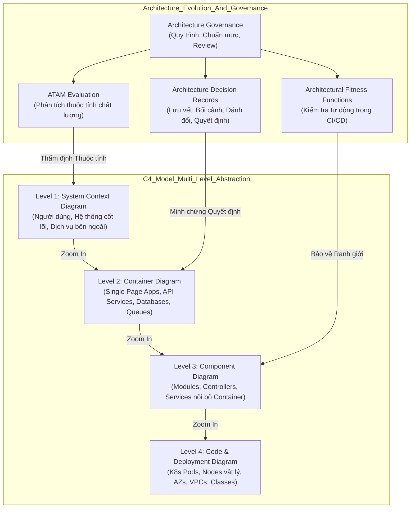

# 5.3. Quản Trị Kiến Trúc, Tài Liệu Hóa và Mô Hình C4 (Architecture Governance, Documentation & C4 Model)

> [!IMPORTANT]
> **Nếu bạn chỉ được nhớ một điều duy nhất:** Kiến trúc phần mềm không phải là một bản vẽ tĩnh trừu tượng được tạo ra rồi bỏ xó trên giấy, mà là một thực thể sống liên tục tiến hóa; muốn kiến trúc không bị xói mòn theo thời gian (*Architectural Erosion*), ta bắt buộc phải tự động hóa việc bảo vệ các ranh giới thiết kế bằng **Architectural Fitness Functions**, lưu trữ bối cảnh ra quyết định bằng **ADR**, và trực quan hóa hệ thống đa tầng bằng **Mô hình C4**.

---

## 1. Kiến trúc Tổng quan & Mô hình Tư duy (Mental Model)

### Phép loại suy thực tế (The Urban Planning & Zoning Enforcement)
Hãy hình dung kiến trúc của một đại đô thị hiện đại:
- **Bản quy hoạch tổng thể (Master Plan)**: Quy định rõ ranh giới khu dân cư, khu công nghiệp nặng, mạng lưới cấp thoát nước và đường cao tốc vành đai.
- **Hiện tượng xói mòn đô thị (Urban Erosion / Slumification)**: Nếu không có lực lượng thanh tra xây dựng (*Governance*), chỉ sau vài năm, người dân sẽ tự ý cơi nới nhà ở lấn chiếm lòng lề đường, xả nước thải công nghiệp trực tiếp vào bể nước sạch sinh hoạt, biến đô thị thành một "ổ chuột" hỗn loạn và tắc nghẽn.
- **Hệ thống thanh tra tự động (Fitness Functions)**: Tương đương với các camera giám sát và trạm cân tự động: hễ có xe quá tải đi vào cầu yếu hoặc công trình vi phạm ranh giới quy hoạch, hệ thống lập tức phát còi báo động và phong tỏa hiện trường.
- **Bản đồ Google Maps (The C4 Model)**: Không ai dùng một tấm bản đồ duy nhất để vừa xem vị trí các quốc gia trên thế giới, vừa xem tên từng ngõ hẻm và sơ đồ ống nước trong nhà tắm. Bạn cần các tầng phóng to/thu nhỏ (*Zoom Levels*):
  - *Tầm nhìn Vệ tinh (Level 1 - System Context)*: Nhìn thấy toàn thành phố và các cao tốc nối sang tỉnh lân cận.
  - *Tầm nhìn Quận/Phường (Level 2 - Container)*: Thấy các tòa nhà, sân bay, bến xe.
  - *Tầm nhìn Khối nhà (Level 3 - Component)*: Thấy các phòng ban, cầu thang, hành lang thoát hiểm.
  - *Bản vẽ Kỹ thuật Chi tiết (Level 4 - Code/Deployment)*: Thấy vị trí từng trụ bê tông cốt thép và đường điện âm tường.



---

## 2. Chi tiết từng Keyword (Under-the-Hood Deep Dive)

### 2.1. Architecture Governance & Architectural Erosion
- **Bản chất kỹ thuật**:
  - **Architecture Governance (Quản trị kiến trúc)**: Toàn bộ tập hợp các quy định, cơ chế phản hồi và công cụ kiểm soát nhằm đảm bảo hệ thống phần mềm được triển khai và tiến hóa đúng theo các nguyên tắc kiến trúc đã định hình.
  - **Architectural Erosion (Xói mòn kiến trúc / Architectural Drift)**: Hiện tượng khoảng cách giữa "kiến trúc dự kiến trên bản vẽ" (*intended architecture*) và "kiến trúc thực tế đang chạy trên mã nguồn" (*as-implemented architecture*) ngày càng giãn rộng theo thời gian do các commit vội vã, các bản vá lỗi "chữa cháy" (*hotfixes*) và sự thiếu hiểu biết của các kỹ sư mới.
- **Biểu hiện ở tầng sâu**: Mã nguồn xuất hiện các vòng phụ thuộc chéo (*Circular Dependencies*), tầng Domain gọi trực tiếp tới SQL Driver, hoặc tầng Web Controller truy vấn thẳng vào cơ sở dữ liệu mà không qua Business Service.

### 2.2. Architectural Fitness Functions (Hàm Thích ứng Kiến trúc)
- **Bản chất kỹ thuật (Neal Ford, Rebecca Parsons & Pat Kua - Evolutionary Architecture)**: Fitness Function là bất kỳ cơ chế tự động nào (Unit test, Linter, CI check, Telemetry threshold) cung cấp sự đánh giá khách quan về một thuộc tính chất lượng của kiến trúc.
- **Cơ chế hoạt động sâu**:
  - Thay vì tổ chức các cuộc họp phê bình dài dòng, đội ngũ viết các bài test kiến trúc tự động (sử dụng ArchUnit, Dependency-Cruiser hoặc custom AST analyzers).
  - Thuật toán kiểm tra đồ thị phân tích cây cú pháp trừu tượng (*Abstract Syntax Tree - AST*):
    $$\forall m \in \text{DomainModules}, \quad \text{Dependencies}(m) \cap \text{InfrastructureModules} = \emptyset$$
  - Nếu bất kỳ commit nào vi phạm quy tắc (ví dụ: `import com.mysql.jdbc` trong Domain Entity), bài test lập tức ném ngoại lệ và chặn đứng Pull Request ngay tại cổng CI/CD.

### 2.3. Architecture Review & Governance Board
- **Bản chất kỹ thuật**: Quy trình phản biện chính thức một đề xuất kiến trúc mới trước khi phân bổ nguồn lực kỹ thuật triển khai. Hội đồng đánh giá (thường gồm Staff/Principal Engineers, Security Engineers, SREs) tập trung chất vấn về các điểm nghẽn chịu tải, khả năng phục hồi khi thảm họa (*Disaster Recovery*), tính tương thích ngược và chi phí vận hành.
- **Văn hóa Review hiện đại**: Chuyển từ "cửa kiểm soát thủ công độc đoán" (*Bureaucratic Gatekeeper*) sang "cố vấn kỹ thuật và xây dựng đường ống tự động" (*Paved Path / Guardrails*).

### 2.4. Architecture Evolution & Migration
- **Bản chất kỹ thuật**: Khả năng của hệ thống thích ứng với sự thay đổi của yêu cầu kinh doanh và bước tiến công nghệ mà không cần đập đi xây lại từ đầu.
- **Kỹ thuật Migration an toàn (Strangler Fig Pattern)**: Thay vì phương pháp "Big Bang Rewrite" (viết lại toàn bộ hệ thống mới trong 2 năm rồi chuyển đổi một lần – vốn có tỷ lệ thất bại lên tới 80%), kỹ sư trưởng thành chọn cách di chuyển từng phần:
  1. Đặt một API Gateway/Proxy ở phía trước hệ thống cũ.
  2. Bóc tách một module nhỏ sang dịch vụ mới.
  3. Định tuyến một phần lưu lượng (Canary) sang dịch vụ mới.
  4. Lặp lại chu trình cho tới khi hệ thống cũ hoàn toàn bị "bóp chết" tự nhiên (*Zero Downtime Migration*).

### 2.5. Architecture Documentation & Living Documentation
- **Bản chất kỹ thuật**: Tài liệu kiến trúc phải là **Living Documentation** – tài liệu phản ánh chính xác trạng thái thực tế của hệ thống. Nếu tài liệu được viết trong file Word hoặc trang Wiki Confluence tách rời khỏi Git repo, nó sẽ trở nên lỗi thời chỉ sau 2 tuần.
- **Triết lý Docs-as-Code**: Tài liệu hóa kiến trúc bằng Markdown, Mermaid, PlantUML hoặc Structurizr DSL, đặt trực tiếp trong kho mã nguồn Git (`/docs/architecture/`), được version control và cập nhật song song với mỗi Pull Request.

### 2.6. Architecture Decision Records (ADR)
- **Bản chất kỹ thuật (Michael Nygard)**: Tài liệu ngắn gọn (1–2 trang) ghi lại một quyết định kiến trúc quan trọng, giải thích rõ *tại sao* quyết định đó được đưa ra và những *đánh đổi* đi kèm.
- **Cấu trúc chuẩn của một ADR**:
  1. **Title**: Định danh ngắn gọn (`ADR-0012: Chuyen doi Message Queue tu RabbitMQ sang Apache Kafka`).
  2. **Status**: Trạng thái vòng đời (`Proposed`, `Accepted`, `Rejected`, `Deprecated`, `Superseded by ADR-XXXX`).
  3. **Context**: Bối cảnh thực tế thúc đẩy quyết định (Lưu lượng đơn hàng tăng từ 1,000 msg/s lên 50,000 msg/s; RabbitMQ gặp hiện tượng tràn RAM và crash khi consumer bị nghẽn).
  4. **Decision**: Quyết định được chọn lựa (Chuyển sang Apache Kafka với retention policy dựa trên ổ đĩa).
  5. **Consequences**: Đánh giá đa chiều:
     - *Hệ quả tích cực*: Throughput tăng gấp 20 lần, hỗ trợ Replay sự kiện, tách rời hoàn toàn producer và consumer.
     - *Hệ quả tiêu cực*: Chi phí vận hành tăng do cần cụm ZooKeeper/KRaft; độ trễ delivery tăng nhẹ từ 2ms lên 8ms; đội ngũ cần đào tạo thêm về Kafka partition rebalancing.

### 2.7. Architecture Trade-off Analysis Method (ATAM)
- **Bản chất kỹ thuật (SEI / Carnegie Mellon University)**: Phương pháp luận có cấu trúc nhằm đánh giá các kiến trúc phần mềm dựa trên các thuộc tính chất lượng mục tiêu (*Quality Attributes*).
- **Các khái niệm cốt lõi trong ATAM**:
  - **Sensitivity Points (Điểm nhạy cảm)**: Một quyết định kiến trúc có tác động trực tiếp đến một thuộc tính chất lượng (ví dụ: Kích thước Connection Pool tác động trực tiếp đến Latency).
  - **Trade-off Points (Điểm đánh đổi)**: Một quyết định kiến trúc tác động tích cực đến thuộc tính chất lượng này nhưng lại tác động tiêu cực đến thuộc tính khác (ví dụ: Bật mã hóa TLS 1.3 cho toàn bộ inter-service communication giúp tăng Bảo mật nhưng làm tăng CPU Overhead và Latency).
  - **Utility Tree (Cây tiện ích)**: Công cụ phân cấp các yêu cầu phi chức năng theo độ ưu tiên nghiệp vụ và độ khó kỹ thuật: `(High Business Value, High Architectural Difficulty)`.

### 2.8. Quality Attribute Scenarios (Kịch bản Thuộc tính Chất lượng)
- **Bản chất kỹ thuật**: Một kịch bản chuẩn mực gồm 6 phần để mô tả phi chức năng một cách định lượng, loại bỏ các cụm từ mơ hồ như "hệ thống phải nhanh" hoặc "hệ thống phải bảo mật":
  1. **Source (Nguồn kích thích)**: Tác nhân khởi phát (ví dụ: Kẻ tấn công từ Internet, hoặc 50,000 người dùng đồng thời).
  2. **Stimulus (Kích thích)**: Sự kiện xảy ra (ví dụ: Gửi liên tục 100,000 HTTP requests không hợp lệ trong 1 giây).
  3. **Environment (Môi trường)**: Trạng thái hệ thống khi chịu kích thích (ví dụ: Đang trong giờ cao điểm Flash Sale).
  4. **Artifact (Thành phần bị tác động)**: Thành phần hệ thống chịu tải (ví dụ: API Gateway & Service Xác thực).
  5. **Response (Phản hồi dự kiến)**: Hành vi hệ thống (ví dụ: Kích hoạt Rate Limiting, trả về HTTP 429, ghi log bảo mật).
  6. **Response Measure (Thước đo phản hồi)**: Tiêu chí định lượng thành công (ví dụ: Không có tiến trình nào bị crash, p99 Latency của các request hợp lệ khác vẫn duy trì $< 200\text{ ms}$).

### 2.9. The C4 Model (Simon Brown)
- **Bản chất kỹ thuật**: Khung trực quan hóa kiến trúc theo 4 cấp độ phân tầng, giúp giải quyết triệt để tình trạng các kỹ sư vẽ sơ đồ "hộp và mũi tên" hỗn loạn không rõ ý nghĩa ngữ nghĩa (*Semantics*).
- **Nguyên lý Zooming**: Giống như Google Maps, người đọc có thể đứng ở tầng bối cảnh toàn cục và đào sâu dần vào từng container, từng component và từng dòng code.

### 2.10. C4 Level 1: System Context Diagram (Bối cảnh Hệ thống)
- **Phạm vi**: Góc nhìn cao nhất dành cho các bên liên quan (Business stakeholders, Product Owners, Kỹ sư mới).
- **Thành phần**:
  - Người dùng thực tế (Persona, Khách hàng, Quản trị viên).
  - Hệ thống phần mềm của doanh nghiệp (Vẽ như một chiếc "Hộp đen" duy nhất ở trung tâm).
  - Các hệ thống bên ngoài phụ thuộc (Cổng thanh toán Stripe, Nhà mạng viễn thông, Dịch vụ Email Twilio).

### 2.11. C4 Level 2: Container Diagram (Sơ đồ Vỏ chứa Ứng dụng)
- **Phạm vi**: Dành cho kỹ sư phần mềm, kiến trúc sư và đội ngũ vận hành hạ tầng/SRE.
- **Định nghĩa Container trong C4**: Không chỉ là Docker Container! Một Container trong C4 là **bất kỳ đơn vị thực thi hoặc lưu trữ độc lập nào** có thể chạy riêng lẻ:
  - Một ứng dụng Frontend SPA (React, Vue).
  - Một Mobile App (iOS/Android).
  - Một Backend Web API Service (Go, C++, Node.js).
  - Một Cơ sở dữ liệu quan hệ (PostgreSQL Primary/Replica).
  - Một Hàng đợi thông điệp (Kafka Broker).
- **Mối liên kết**: Ghi rõ giao thức truyền thông và định dạng dữ liệu (ví dụ: `gRPC/HTTP2`, `JSON/HTTPS`, `SQL/TCP Port 5432`).

### 2.12. C4 Level 3: Component Diagram (Sơ đồ Thành phần Module)
- **Phạm vi**: Phóng to vào bên trong **một Container duy nhất** để thấy rõ cấu trúc các khối logic bên trong.
- **Thành phần**: Controllers, Domain Services, Use Cases, Repositories, Adapters.
- **Mục tiêu**: Làm rõ ranh giới trách nhiệm và sự phân tách mối quan tâm bên trong mã nguồn; làm cơ sở trực tiếp cho việc viết *Architectural Fitness Functions*.

### 2.13. C4 Level 4: Code & Deployment Diagram
- **Deployment Diagram**: Bản đồ ánh xạ các Container ở Level 2 lên cơ sở hạ tầng vật lý và mạng thực tế: Kubernetes Clusters, Namespaces, Worker Nodes, VPC Subnets, Multi-AZs, Load Balancers, IAM Roles.
- **Code Diagram (UML Class/Sequence)**: Chỉ vẽ cho các thuật toán cực kỳ phức tạp hoặc các mẫu hình thiết kế cốt lõi; tránh vẽ dàn trải vì mã nguồn ở tầng này thay đổi liên tục.

### 2.14. Diagrams as Code & Architecture Astronauts Anti-Pattern
- **Diagrams as Code**: Sử dụng các ngôn ngữ khai báo văn bản (Structurizr DSL, Mermaid, PlantUML) để sinh ra sơ đồ kiến trúc tự động. Điều này cho phép version control sơ đồ trong Git, review qua PR và ngăn chặn sơ đồ bị lệch pha với code.
- **Anti-pattern: Architecture Astronauts (Kiến trúc sư bay bổng)**: Các cá nhân chỉ ngồi trong phòng lạnh vẽ ra các sơ đồ đồ sộ trên PowerPoint, áp đặt các công nghệ phức tạp mà không bao giờ chạm tay vào mã nguồn hay thấu hiểu nỗi đau triển khai thực tế của kỹ sư.

---

## 3. Thực thi Mã nguồn & Mô phỏng Chuyên sâu (Dual-Engine Implementation)

Để minh chứng cho sức mạnh của **Architectural Governance** và **Fitness Functions**, chúng ta triển khai một bài toán kỹ nghệ sản xuất thực tế: **Công cụ Kiểm định Tự động Ranh giới Kiến trúc (Clean Architecture Boundary Validator & Dependency Graph Analyzer)**.

### Engine 1: C++20 – Dependency Graph Analyzer & Cycle Detector (ArchUnit Engine for Systems)

Chương trình C++20 xây dựng đồ thị phụ thuộc giữa các module và kiểm tra hai quy tắc kiến trúc tối thượng:
1. **Layer Boundary Violation**: Tầng `Domain` tuyệt đối không được phụ thuộc vào `Infrastructure` hoặc `Database`.
2. **Circular Dependency Detection**: Phát hiện chu trình phụ thuộc bằng thuật toán DFS (phát hiện chu kỳ trong đồ thị có hướng).

```cpp
#include <iostream>
#include <string>
#include <vector>
#include <unordered_map>
#include <unordered_set>
#include <memory>
#include <format>
#include <stdexcept>

// ============================================================================
// 1. Domain Model: Architecture Dependency Graph Representation
// ============================================================================
enum class LayerType {
    Domain,
    Application,
    Infrastructure,
    Presentation
};

std::string_view layerToString(LayerType layer) {
    switch (layer) {
        case LayerType::Domain:         return "Domain";
        case LayerType::Application:    return "Application";
        case LayerType::Infrastructure: return "Infrastructure";
        case LayerType::Presentation:   return "Presentation";
    }
    return "Unknown";
}

struct ModuleNode {
    std::string name;
    LayerType layer;
    std::unordered_set<std::string> dependencies;
};

// ============================================================================
// 2. Architectural Fitness Function Engine
// ============================================================================
class ArchitectureGovernanceEngine {
private:
    std::unordered_map<std::string, ModuleNode> modules_;

    bool detectCycleDFS(const std::string& current,
                        std::unordered_set<std::string>& visited,
                        std::unordered_set<std::string>& recursionStack,
                        std::vector<std::string>& cyclePath) const {
        visited.insert(current);
        recursionStack.insert(current);
        cyclePath.push_back(current);

        auto it = modules_.find(current);
        if (it != modules_.end()) {
            for (const auto& neighbor : it->second.dependencies) {
                if (recursionStack.find(neighbor) != recursionStack.end()) {
                    cyclePath.push_back(neighbor);
                    return true; // Phat hien chu trinh (Circular Dependency)!
                }
                if (visited.find(neighbor) == visited.end()) {
                    if (detectCycleDFS(neighbor, visited, recursionStack, cyclePath)) {
                        return true;
                    }
                }
            }
        }

        recursionStack.erase(current);
        cyclePath.pop_back();
        return false;
    }

public:
    void registerModule(std::string name, LayerType layer) {
        modules_[name] = ModuleNode{std::move(name), layer, {}};
    }

    void addDependency(const std::string& fromModule, const std::string& toModule) {
        if (!modules_.contains(fromModule) || !modules_.contains(toModule)) {
            throw std::invalid_argument("Module khong ton tai trong do thi kien truc!");
        }
        modules_[fromModule].dependencies.insert(toModule);
    }

    // Fitness Function 1: Kiem tra ranh gioi Clean Architecture
    // Domain KHONG duoc phep phu thuoc truc tiep vao Infrastructure hoac Presentation
    std::vector<std::string> verifyLayerBoundaries() const {
        std::vector<std::string> violations;

        for (const auto& [name, node] : modules_) {
            if (node.layer == LayerType::Domain) {
                for (const auto& depName : node.dependencies) {
                    const auto& depNode = modules_.at(depName);
                    if (depNode.layer == LayerType::Infrastructure || depNode.layer == LayerType::Presentation) {
                        violations.push_back(std::format(
                            "[VIOLATION] Module Domain '{}' vi pham Clean Architecture khi phu thuoc vao '{}' ({})",
                            name, depName, layerToString(depNode.layer)
                        ));
                    }
                }
            }
        }
        return violations;
    }

    // Fitness Function 2: Kiem tra Chu trinh phu thuoc (Zero Circular Dependencies)
    std::vector<std::string> verifyNoCircularDependencies() const {
        std::unordered_set<std::string> visited;
        std::unordered_set<std::string> recursionStack;
        std::vector<std::string> cyclePath;
        std::vector<std::string> cycleViolations;

        for (const auto& [name, _] : modules_) {
            if (visited.find(name) == visited.end()) {
                if (detectCycleDFS(name, visited, recursionStack, cyclePath)) {
                    std::string pathStr;
                    for (size_t i = 0; i < cyclePath.size(); ++i) {
                        pathStr += cyclePath[i];
                        if (i + 1 < cyclePath.size()) pathStr += " -> ";
                    }
                    cycleViolations.push_back(std::format(
                        "[CYCLIC DEPENDENCY] Phat hien chu trinh kien truc: {}", pathStr
                    ));
                    break;
                }
            }
        }
        return cycleViolations;
    }
};

// ============================================================================
// 3. Main Verification Simulation
// ============================================================================
int main() {
    std::cout << "=== C++20 ARCHITECTURAL FITNESS FUNCTION ENGINE DEMO ===\n\n";

    ArchitectureGovernanceEngine engine;

    // Dang ky cac modules he thong
    engine.registerModule("OrderEntity", LayerType::Domain);
    engine.registerModule("PaymentProcessor", LayerType::Application);
    engine.registerModule("PostgresRepository", LayerType::Infrastructure);
    engine.registerModule("OrderHttpController", LayerType::Presentation);

    // Kich ban 1: Thiet lap quan he hop le
    // Controller -> Application -> Domain <- Repository
    engine.addDependency("OrderHttpController", "PaymentProcessor");
    engine.addDependency("PaymentProcessor", "OrderEntity");
    engine.addDependency("PostgresRepository", "OrderEntity");

    std::cout << "--> Kiem tra kien truc hop le ban dau:\n";
    auto violations1 = engine.verifyLayerBoundaries();
    auto cycles1 = engine.verifyNoCircularDependencies();
    std::cout << "Layer Violations: " << violations1.size() << " | Cyclic Dependencies: " << cycles1.size() << "\n";
    std::cout << "[PASSED] Kien truc tuan thu nghiem ngat ranh gioi sach!\n\n";

    // Kich ban 2: Mot lap trinh vien vo tinh inject PostgresRepository truc tiep vao OrderEntity (Erosion!)
    std::cout << "--> Mo phong Architectural Erosion (Domain import Infrastructure):\n";
    engine.addDependency("OrderEntity", "PostgresRepository");
    auto violations2 = engine.verifyLayerBoundaries();
    for (const auto& v : violations2) {
        std::cout << "CI/CD Gate Rejection: " << v << "\n";
    }

    // Kich ban 3: Tao chu trinh phu thuoc nguy hiem (OrderEntity -> PaymentProcessor -> OrderEntity)
    std::cout << "\n--> Mo phong Circular Dependency Trap:\n";
    engine.addDependency("OrderEntity", "PaymentProcessor");
    auto cycles2 = engine.verifyNoCircularDependencies();
    for (const auto& c : cycles2) {
        std::cout << "CI/CD Gate Rejection: " << c << "\n";
    }

    return 0;
}
```

---

### Engine 2: Python 3.11+ – AST-Based Living Fitness Function for Clean Architecture

Chương trình Python sử dụng module chuẩn `ast` (Abstract Syntax Tree) để phân tích trực tiếp cú pháp file mã nguồn thực tế, tự động quét sạch các lệnh `import` vi phạm ranh giới kiến trúc ngay trong pipeline kiểm thử tự động.

```python
#!/usr/bin/env python3
"""
Python 3.11+ AST-Based Architectural Fitness Function.
Statically parses source code files to enforce Clean Architecture layer isolation.
"""

import ast
from dataclasses import dataclass
from enum import StrEnum
from pathlib import Path
import sys
from typing import List, Set


class ArchitectureLayer(StrEnum):
    DOMAIN = "domain"
    APPLICATION = "application"
    INFRASTRUCTURE = "infrastructure"
    PRESENTATION = "presentation"


@dataclass(slots=True, frozen=True)
class ArchitecturalViolation:
    file_path: str
    line_number: int
    source_layer: ArchitectureLayer
    forbidden_imported_module: str
    rule_description: str


class CleanArchitectureFitnessChecker(ast.NodeVisitor):
    """AST Visitor phân tích mọi cú pháp import bên trong file mã nguồn"""

    FORBIDDEN_IMPORTS_FOR_DOMAIN: Set[str] = {
        "sqlalchemy", "psycopg2", "fastapi", "flask", "requests", 
        "boto3", "pymongo", "redis", "django", "infrastructure"
    }

    def __init__(self, file_path: str, layer: ArchitectureLayer) -> None:
        self.file_path = file_path
        self.layer = layer
        self.violations: List[ArchitecturalViolation] = []

    def visit_Import(self, node: ast.Import) -> None:
        for alias in node.names:
            self._check_import(alias.name, node.lineno)
        self.generic_visit(node)

    def visit_ImportFrom(self, node: ast.ImportFrom) -> None:
        if node.module:
            self._check_import(node.module, node.lineno)
        self.generic_visit(node)

    def _check_import(self, module_name: str, lineno: int) -> None:
        base_pkg = module_name.split(".")[0]
        if self.layer == ArchitectureLayer.DOMAIN:
            if base_pkg in self.FORBIDDEN_IMPORTS_FOR_DOMAIN:
                self.violations.append(ArchitecturalViolation(
                    file_path=self.file_path,
                    line_number=lineno,
                    source_layer=self.layer,
                    forbidden_imported_module=module_name,
                    rule_description="Domain Core phai hoan toan doc lap, khong duoc import Infrastructure/Web framework!"
                ))


def run_fitness_function_on_code_snippet(code: str, file_name: str, layer: ArchitectureLayer) -> List[ArchitecturalViolation]:
    tree = ast.parse(code, filename=file_name)
    checker = CleanArchitectureFitnessChecker(file_path=file_name, layer=layer)
    checker.visit(tree)
    return checker.violations


if __name__ == "__main__":
    print("=== PYTHON 3.11+ AST ARCHITECTURAL FITNESS FUNCTION DEMO ===\n")

    # Đoạn mã 1: Domain Entity thuần khiết (Hợp lệ)
    valid_domain_code = """
from dataclasses import dataclass
from typing import Optional
import datetime

@dataclass
class Order:
    order_id: str
    total_amount_cents: int
    created_at: datetime.datetime
"""

    # Đoạn mã 2: Domain Entity bị ô nhiễm hạ tầng (Vi phạm nghiêm trọng)
    polluted_domain_code = """
from dataclasses import dataclass
import sqlalchemy as sa
from infrastructure.database import get_db_session

@dataclass
class Customer:
    customer_id: str
    name: str

    def save_to_db(self):
        session = get_db_session()
        # Direct SQL emission inside Domain Model!
"""

    print("1. Kiem tra Domain Entity chuan muc (valid_domain.py):")
    v1 = run_fitness_function_on_code_snippet(valid_domain_code, "domain/order.py", ArchitectureLayer.DOMAIN)
    if not v1:
        print("   [FITNESS PASSED] File domain/order.py hoan toan thuan khiet ve mat kien truc!\n")

    print("2. Kiem tra Domain Entity bi o nhiem (polluted_domain.py):")
    v2 = run_fitness_function_on_code_snippet(polluted_domain_code, "domain/customer.py", ArchitectureLayer.DOMAIN)
    if v2:
        print(f"   [FITNESS FAILED] Phat hien {len(v2)} vi pham kien truc trong CI Pipeline:")
        for violation in v2:
            print(f"   --> Line {violation.line_number}: Cam import '{violation.forbidden_imported_module}'! "
                  f"Ly do: {violation.rule_description}")
        print("\n   [CI ACTION] Tu choi merge Pull Request de ngan chan Architectural Erosion!")
```

---

### Terminal Output Thực Tế Giả Lập

```text
=== C++20 ARCHITECTURAL FITNESS FUNCTION ENGINE DEMO ===

--> Kiem tra kien truc hop le ban dau:
Layer Violations: 0 | Cyclic Dependencies: 0
[PASSED] Kien truc tuan thu nghiem ngat ranh gioi sach!

--> Mo phong Architectural Erosion (Domain import Infrastructure):
CI/CD Gate Rejection: [VIOLATION] Module Domain 'OrderEntity' vi pham Clean Architecture khi phu thuoc vao 'PostgresRepository' (Infrastructure)

--> Mo phong Circular Dependency Trap:
CI/CD Gate Rejection: [CYCLIC DEPENDENCY] Phat hien chu trinh kien truc: OrderEntity -> PaymentProcessor -> OrderEntity

=== PYTHON 3.11+ AST ARCHITECTURAL FITNESS FUNCTION DEMO ===

1. Kiem tra Domain Entity chuan muc (valid_domain.py):
   [FITNESS PASSED] File domain/order.py hoan toan thuan khiet ve mat kien truc!

2. Kiem tra Domain Entity bi o nhiem (polluted_domain.py):
   [FITNESS FAILED] Phat hien 2 vi pham kien truc trong CI Pipeline:
   --> Line 3: Cam import 'sqlalchemy' ! Ly do: Domain Core phai hoan toan doc lap, khong duoc import Infrastructure/Web framework!
   --> Line 4: Cam import 'infrastructure.database'! Ly do: Domain Core phai hoan toan doc lap, khong duoc import Infrastructure/Web framework!

   [CI ACTION] Tu choi merge Pull Request de ngan chan Architectural Erosion!
```

---

## 4. Systems Engineering & Production Pitfalls

### Các Chế độ Thất bại Thực chiến (Failure Modes & Anti-Patterns)

#### 1. Sự Cố "Xoắn Ốc Phụ Thuộc Vòng Tròn" (Circular Dependency Deadlock)
- **Triệu chứng**: Module A import Module B, Module B import Module C, Module C import Module A. Ứng dụng đột ngột bị lỗi `Segmentation Fault` (C++) hoặc `ImportError: cannot import name ... from partially initialized module` (Python) khi khởi động trong production container.
- **Cơ chế hỏng hóc**: Thứ tự khởi tạo các đối tượng tĩnh (*Static Initialization Order Fiasco*) trong C++ là không xác định. Nếu đối tượng của A cần B trước khi B được cấp phát bộ nhớ, chương trình sẽ dereference con trỏ rác (`nullptr`), gây crash tiến trình ngay trước khi kịp bind vào cổng mạng.
- **Biện pháp phòng ngừa**: Tích hợp thuật toán dò chu trình đồ thị (như ví dụ C++20 ở Mục 3) trực tiếp vào script pre-commit hook và CI pipeline.

#### 2. Hội chứng "ADR Viết Xong Bỏ Xó" (Write-Once, Never-Read ADRs)
- **Triệu chứng**: Nhóm kỹ thuật viết 30 file ADR trong tháng đầu tiên của dự án. Hai năm sau, các quyết định đã thay đổi hoàn toàn nhưng không ai cập nhật trạng thái `Superseded`. Kỹ sư mới vào đọc tài liệu và triển khai mã nguồn theo chuẩn công nghệ cũ đã bị đào thải.
- **Giải pháp chuẩn hóa**:
  - Khi một quyết định mới thay thế quyết định cũ, bắt buộc phải tạo ADR mới và cập nhật trạng thái của ADR cũ thành `Superseded by ADR-XXXX`, kèm liên kết ngược lại.
  - Tổ chức rà soát ADR định kỳ 6 tháng một lần cùng đội ngũ Principal Engineers.

#### 3. Bẫy Chi Tiết Hóa Quá Mức C4 Level 4 (Level 4 Over-Documentation Trap)
- **Triệu chứng**: Nhóm cố gắng vẽ sơ đồ lớp UML chi tiết (Level 4 Code Diagram) cho toàn bộ 500 classes trong hệ thống.
- **Hậu quả**: Cứ mỗi lần refactor đổi tên hàm hoặc thêm tham số, sơ đồ lại bị sai lệch. Chi phí bảo trì tài liệu trở thành gánh nặng kinh hoàng, dẫn đến việc cả nhóm bỏ mặc không ai thèm vẽ nữa.
- **Quy tắc vàng của Simon Brown**: Chỉ nên tập trung tài liệu hóa vững chắc ở **Level 1 (System Context)** và **Level 2 (Container)**. Level 3 (Component) chỉ vẽ cho các core service có logic nghiệp vụ phức tạp. Tuyệt đối không vẽ Level 4 thủ công; nếu cần, hãy để IDE hoặc Doxygen tự sinh tự động từ mã nguồn.

#### 4. Hiện Tượng "Bản Thiết Kế Bí Mật" (Tribal Knowledge Silos)
- **Triệu chứng**: Toàn bộ kiến trúc và nguyên lý vận hành hệ thống chỉ nằm trong đầu của một Senior Architect kỳ cựu. Không có sơ đồ C4, không có tài liệu phân tích đánh đổi ATAM.
- **Rủi ro sản xuất**: Khi cá nhân đó nghỉ việc (rủi ro Bus Factor = 1), cả công ty rơi vào trạng thái hoảng loạn: không ai dám nâng cấp thư viện, không ai hiểu tại sao hệ thống lại chia nhỏ các microservices như vậy, và việc bảo trì biến thành một cơn ác mộng tốn kém.

---

## 5. Bảng So sánh & Decision Matrix

| Công Cụ / Phương Pháp Luận | Mục Đích Cốt Lõi | Đối Tượng Tiếp Nhận Phù Hợp | Ưu Điểm Nổi Bật | Nhược Điểm & Giới Hạn Cần Lưu Ý |
| :--- | :--- | :--- | :--- | :--- |
| **ADR (Architecture Decision Record)** | Ghi lại bối cảnh, quyết định kỹ thuật và các đánh đổi đi kèm | Toàn bộ kỹ sư phát triển, Tech Lead, Kỹ sư kế cận | Gọn nhẹ (Markdown), lưu trong Git, dễ review qua PR | Không thể hiện được bức tranh kiến trúc toàn cảnh trực quan |
| **Architectural Fitness Functions** | Tự động hóa kiểm tra tính tuân thủ của kiến trúc trong CI/CD | Máy chủ CI/CD, Kỹ sư phát triển trực tiếp | Chặn đứng lỗi tức thì, không phụ thuộc vào trí nhớ con người | Cần đầu tư thời gian ban đầu để viết parser và rule engine |
| **ATAM (Trade-off Analysis Method)** | Thẩm định các thuộc tính chất lượng (NFR) và phát hiện rủi ro | Ban giám đốc kỹ thuật (VP/CTO), Principal Engineers, SRE | Đào sâu vào các điểm đánh đổi then chốt trước khi làm lớn | Quy trình trang trọng, tốn nhiều buổi workshop đa phòng ban |
| **C4 Level 1 (System Context)** | Định hình ranh giới hệ thống và mối liên kết ngoại vi | Product Owner, Business Stakeholders, Kỹ sư mới | Rõ ràng, dễ hiểu tức thì, không bị nhiễu bởi thuật ngữ code | Không thể hiện được công nghệ hay cơ chế triển khai cụ thể |
| **C4 Level 2 (Container Diagram)** | Xác định các khối ứng dụng, cơ sở dữ liệu và giao thức mạng | Software Engineers, DevOps, SREs, Security | Là bản đồ quan trọng nhất để hiểu luồng dữ liệu và hạ tầng | Dễ bị nhầm lẫn giữa Container C4 và Docker/OCI Container |
| **C4 Level 3 (Component Diagram)** | Phân rã cấu trúc logic bên trong một Container duy nhất | Kỹ sư trực tiếp code và bảo trì Container đó | Giúp phân tách Clean Architecture và SoC sạch sẽ | Tốn công cập nhật nếu cấu trúc code nội bộ biến động nhanh |

---

## Tổng kết Chương 5.3
Một kiến trúc phần mềm vĩ đại không phải là một tượng đài bất di bất dịch, mà là một cơ thể sống có khả năng tự bảo vệ và thích nghi bền bỉ. Bằng cách thiết lập cơ chế quản trị tự động qua Architectural Fitness Functions, lưu giữ ký ức trí tuệ của tổ chức qua các bản ghi ADR, lượng hóa rủi ro bằng ATAM và soi sáng mọi ngóc ngách hệ thống qua lăng kính 4 tầng của C4 Model, người kỹ sư trưởng thành bảo đảm hệ thống luôn trong suốt, kiểm soát được và sẵn sàng phát triển mạnh mẽ trước mọi thử thách quy mô.