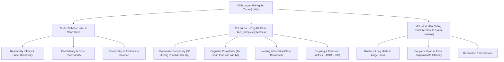
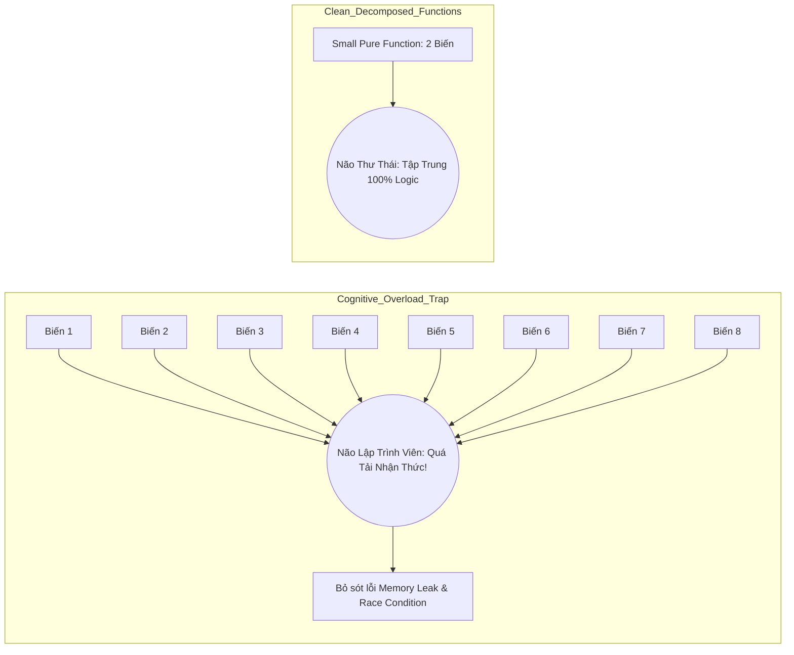
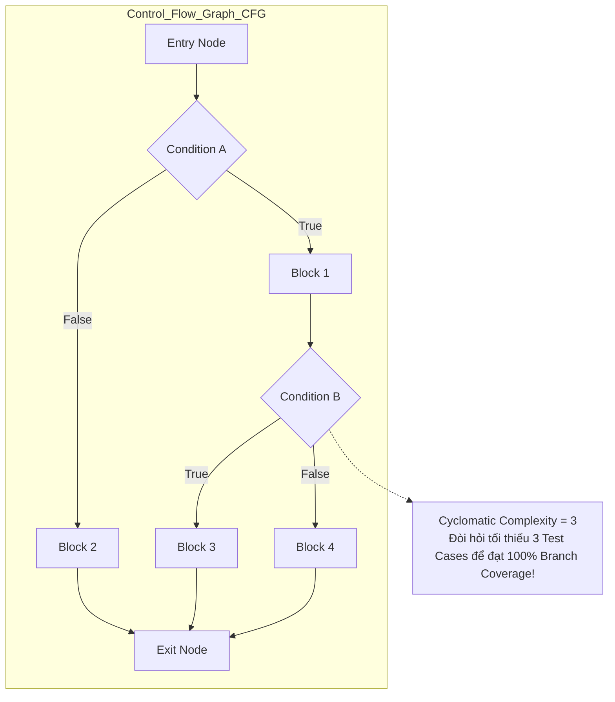
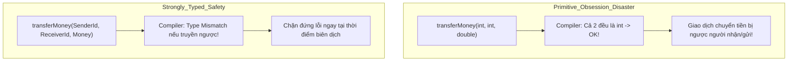

# 6.1. Khả Năng Đọc Hiểu, Độ Phức Tạp và Chỉ Số Đo Lường Chất Lượng Mã Nguồn (Readability, Complexity & Quality Metrics)

## Tổng quan về Readability, Complexity & Quality Metrics
Trong kỹ nghệ phần mềm chuyên nghiệp, tỷ lệ thời gian một kỹ sư dành để **đọc mã nguồn** so với thời gian thực sự **viết mã nguồn mới** thường vượt quá $10:1$. Do đó, khả năng đọc hiểu (**Code Readability**), sự rõ ràng (**Clarity**) và tính nhất quán (**Consistency**) chính là yếu tố sống còn quyết định chi phí bảo trì lâu dài của dự án. Một đoạn code "chạy được" không đồng nghĩa với một đoạn code có chất lượng tốt. Kỹ sư trưởng thành đánh giá chất lượng mã nguồn một cách định lượng thông qua các chỉ số đo lường độ phức tạp (**Cyclomatic Complexity**, **Cognitive Complexity**, **Nesting Complexity**, **Coupling & Cohesion Metrics**), nhận diện sớm các mùi hôi mã nguồn (**Code Smells**) và các mẫu chống thiết kế (**Anti-Patterns**), đồng thời luôn cân bằng tinh tế giữa tính dễ đọc và mức độ trừu tượng hóa (**Readability vs Abstraction**).



---

## 2. Chi tiết từng Keyword (Under-the-Hood Deep Dive)

---

### 1. Code Quality, Readability, Clarity, Consistency, Maintainability & Reviewability

#### 1. Khái niệm bản chất (What & Why)
* **Code Quality (Chất lượng mã nguồn)**: Mức độ thỏa mãn của mã nguồn đối với cả yêu cầu chức năng (chạy đúng, không có bug) lẫn các thuộc tính nội tại (dễ đọc, dễ bảo trì, dễ kiểm thử, an toàn kiểu dữ liệu).
* **Code Readability & Clarity (Tính dễ đọc và Sự sáng sủa)**: Mã nguồn thể hiện trực diện ý đồ của người viết (Intent-revealing code). Người đọc không cần phải "biên dịch code trong đầu" để hiểu hàm đang làm gì.
* **Code Consistency (Tính nhất quán)**: Sự đồng nhất về quy ước đặt tên, kiến trúc thư mục, xử lý lỗi và phong cách viết trên toàn bộ dự án. Một codebase xuất sắc đọc giống như được viết bởi duy nhất một lập trình viên.
* **Code Maintainability & Understandability**: Khả năng một kỹ sư mới có thể nắm bắt logic và sửa đổi hệ thống một cách an toàn mà không gây ra lỗi hồi quy ngoài ý muốn.
* **Code Testability, Extensibility & Reusability**: Mã nguồn được thiết kế phân rã lỏng lẻo để có thể dễ dàng viết Unit Test độc lập, mở rộng tính năng mới và tái sử dụng ở các ngữ cảnh khác nhau mà không phải copy-paste.
* **Code Reviewability (Khả năng hỗ trợ review)**: Đoạn mã được tổ chức thành các commit nhỏ, nguyên tử, logic thay đổi rõ ràng, giúp người review dễ dàng phát hiện khiếm khuyết trong thời gian ngắn.

#### 2. Cơ chế hoạt động sâu (Under the hood / Hardcore Internals)
- **Tải nhận thức của não bộ (Working Memory Limits) khi đọc code**:
  - Theo nghiên cứu tâm lý học nhận thức (Miller's Law), bộ nhớ làm việc tạm thời của con người chỉ có thể xử lý tối đa $7 \pm 2$ mẩu thông tin (chunks) cùng một lúc.
  - Khi một hàm có 15 biến cục bộ, 4 tầng lồng nhau (`if-for-try-while`), não bộ lập trình viên bị tràn bộ nhớ tạm (Cognitive Overload).
  - Kết quả: Không còn năng lực nhận thức để nhận ra các lỗi tinh vi về con trỏ, tràn bộ nhớ đệm hay tranh chấp luồng (Race Condition).

#### 3. Sơ đồ minh họa (Mermaid Diagram)


#### 4. Code ví dụ thực chiến (C++20: Code Clarity với Explicit Types và Structured Binding)
```cpp
#include <iostream>
#include <tuple>
#include <string>
#include <vector>

// BAD: Thiếu Clarity, người đọc phải đoán pair.first, pair.second là gì
// std::vector<std::pair<int, std::pair<std::string, double>>> badData;

// GOOD: Đặt tên tường minh, thể hiện rõ ràng Domain Intent
struct CustomerAccount {
    int id;
    std::string email;
    double balance;
};

// Sử dụng C++20 Structured Binding để tăng tính Readability tuyệt đối
void displayAccounts(const std::vector<CustomerAccount>& accounts) {
    for (const auto& [id, email, balance] : accounts) {
        std::cout << "ID: " << id << " | Email: " << email << " | Balance: " << balance << "$\n";
    }
}

int main() {
    std::vector<CustomerAccount> list = {
        {101, "alice@tech.io", 450.0},
        {102, "bob@systems.dev", 1200.5}
    };
    displayAccounts(list);
    return 0;
}
```

#### 5. Ưu / Nhược điểm, Pitfalls & Anti-patterns
- **Anti-pattern: Clever Code (Code quá thông minh)**: Viết các biểu thức toán học hoặc con trỏ một dòng phức tạp (ví dụ: `while(*s++ = *t++);` hoặc lạm dụng toán tử ba ngôi 4 tầng lồng nhau) để chứng tỏ trình độ. Đây là thứ code độc hại bậc nhất trong môi trường kỹ thuật chuyên nghiệp.

#### 6. Ứng dụng thực tế trong Backend / Systems
- **Google C++ Style Guide & Chromium Development**: Các quy chuẩn kỹ thuật bắt buộc mọi hàm phải rõ ràng, cấm lạm dụng các tính năng ma thuật làm mờ ám luồng thực thi.

---

### 2. Complexity Metrics: Cyclomatic, Cognitive, Nesting & Dependency Metrics

#### 1. Khái niệm bản chất (What & Why)
* **Cyclomatic Complexity (Độ phức tạp chu trình - Thomas McCabe)**: Số lượng đường đi độc lập tuyến tính qua đồ thị luồng điều khiển (Control Flow Graph - CFG) của một hàm:
  $$M = E - N + 2P$$
  (Trong đó $E$ là số cạnh, $N$ là số nút, $P$ là số thành phần liên thông; hoặc đơn giản là $1 + \text{số lượng câu lệnh rẽ nhánh: } \text{if, for, while, case, \&\&, ||}$). Giá trị $M > 10$ cảnh báo hàm rất khó kiểm thử.
* **Cognitive Complexity (Độ phức tạp nhận thức - SonarQube)**: Chỉ số đo lường mức độ khó khăn của con người trong việc đọc hiểu logic của hàm. Nó phạt nặng các cấu trúc lồng nhau (Nesting) và các cú pháp nhảy luồng phức tạp (break, continue, recursion).
* **Nesting Complexity (Độ sâu lồng nhau)**: Mức độ các khối lệnh bị thụt lề vào trong. Hiện tượng "Arrow Anti-pattern" (mã nguồn hình mũi tên nhọn chọc sang phải) làm giảm khả năng theo dõi trạng thái.
* **Function, Class & Module Complexity**: Các thước đo về độ dài dòng code, số lượng phương thức, và số lượng biến thành viên.
* **Coupling Metrics (CBO - Coupling Between Objects)**: Số lượng class khác mà một class cụ thể bị phụ thuộc trực tiếp vào. CBO càng cao, class càng giòn gãy.
* **Cohesion Metrics (LCOM - Lack of Cohesion of Methods)**: Thước đo mức độ không kết dính giữa các phương thức của một class. Nếu các phương thức trong class không sử dụng chung các biến thành viên, LCOM sẽ cao, báo hiệu class đang ôm đồm quá nhiều trách nhiệm.

#### 2. Cơ chế hoạt động sâu (Under the hood / Hardcore Internals)
- **Đồ thị Luồng Điều Khiển (Control Flow Graph - CFG) và Assembly Branching**:
  Mỗi nhánh `if` hoặc toán tử `&&` trong C++ được trình biên dịch dịch ra chỉ thị nhảy điều kiện (Conditional Jump: `je`, `jne`, `jg`, `jle` trong x86_64).
  - Cyclomatic Complexity cao đồng nghĩa với việc CPU Branch Predictor phải đoán trước rất nhiều ngã rẽ.
  - Khi dữ liệu đầu vào biến động ngẫu nhiên, hiện tượng **Branch Misprediction** xảy ra liên tục: CPU buộc phải flush toàn bộ lệnh đang nạp trong Instruction Pipeline (mất từ 15 đến 20 chu kỳ xung nhịp cho mỗi lần đoán sai), làm suy giảm hiệu năng nghiêm trọng.
  - Tối ưu hóa: Giảm Cyclomatic Complexity giúp mã máy chạy thẳng (Straight-line execution), tối đa hóa hiệu quả của CPU Instruction Pre-fetching.

#### 3. Sơ đồ minh họa (Mermaid Diagram)


#### 4. Code ví dụ thực chiến (C++20: Khử bỏ Nesting Complexity bằng Guard Clauses và Early Return)
```cpp
#include <iostream>
#include <string>

struct UserRequest {
    bool isAuthenticated;
    bool hasPermission;
    std::string payload;
};

// BAD: Nesting Complexity sâu 4 tầng (Arrow Code) - Cognitive Complexity = 7
void processRequestBad(const UserRequest& req) {
    if (req.isAuthenticated) {
        if (req.hasPermission) {
            if (!req.payload.empty()) {
                std::cout << "Thực thi: " << req.payload << "\n";
            } else {
                std::cerr << "Lỗi: Payload rỗng\n";
            }
        } else {
            std::cerr << "Lỗi: Thiếu quyền truy cập\n";
        }
    } else {
        std::cerr << "Lỗi: Chưa xác thực\n";
    }
}

// GOOD: Guard Clauses & Early Return - Nesting = 0, Cognitive Complexity = 1
void processRequestGood(const UserRequest& req) {
    if (!req.isAuthenticated) {
        std::cerr << "Lỗi: Chưa xác thực\n";
        return;
    }
    if (!req.hasPermission) {
        std::cerr << "Lỗi: Thiếu quyền truy cập\n";
        return;
    }
    if (req.payload.empty()) {
        std::cerr << "Lỗi: Payload rỗng\n";
        return;
    }

    // Luồng chính chạy thẳng, tâm trí thư thái
    std::cout << "Thực thi: " << req.payload << "\n";
}

int main() {
    UserRequest r{true, true, "EXECUTE_PAYMENT"};
    processRequestGood(r);
    return 0;
}
```

#### 5. Ưu / Nhược điểm, Pitfalls & Anti-patterns
- **Anti-pattern: Arrow Anti-pattern**: Thụt lề sâu 6-7 tab do lồng quá nhiều `if-else` và vòng lặp `for`.

#### 6. Ứng dụng thực tế trong Backend / Systems
- **Tích hợp SonarQube / CodeClimate trong CI**: Thiết lập ngưỡng chặn tự động: Bất kỳ hàm nào có Cognitive Complexity $> 15$ hoặc Cyclomatic Complexity $> 10$ đều bị reject không cho merge vào nhánh `main`.

---

### 3. Code Smells, Anti-Patterns & Readability vs Abstraction

#### 1. Khái niệm bản chất (What & Why)
* **Code Smells (Mùi hôi mã nguồn - Martin Fowler)**: Những dấu hiệu bề mặt trong mã nguồn cảnh báo sự tồn tại của một vấn đề thiết kế sâu xa hơn bên dưới (chưa hẳn là lỗi, nhưng làm chậm tốc độ phát triển và tăng nguy cơ sinh bug):
  - *Bloaters*: Long Method, Large Class, Primitive Obsession, Long Parameter List.
  - *Object-Orientation Abusers*: Switch Statements lặp đi lặp lại, Refused Bequest (lớp con từ chối thừa kế thuộc tính lớp cha).
  - *Change Preventers*: Divergent Change, Shotgun Surgery.
  - *Dispensables*: Comments thừa thãi giải thích code xấu, Duplicate Code, Dead Code.
  - *Couplers*: Feature Envy (hàm của class A nhưng suốt ngày chọc vào dữ liệu của class B), Inappropriate Intimacy.
* **Anti-Patterns (Mẫu chống thiết kế)**: Các giải pháp phổ biến bề ngoài có vẻ hấp dẫn nhưng thực tế mang lại hậu quả tiêu cực tồi tệ hơn nhiều so với vấn đề ban đầu (ví dụ: God Object, Magic Numbers, Spaghetti Code).
* **Readability vs Abstraction**: Cân đối giữa việc giữ code dễ đọc trực tiếp và việc tạo ra các lớp trừu tượng hóa. Trừu tượng hóa quá mức (Over-abstraction) khiến lập trình viên phải nhảy qua 15 file interface chỉ để tìm ra một dòng code cộng hai số thực tế!

#### 2. Cơ chế hoạt động sâu (Under the hood / Hardcore Internals)
- **Tác hại của Primitive Obsession ở tầng An Toàn Bộ Nhớ**:
  - Dùng kiểu nguyên thủy `std::string` hoặc `int` cho mọi thứ:
    ```cpp
    void transferMoney(int fromUserId, int toUserId, double amount);
    ```
  - Nếu lập trình viên vô tình gọi:
    ```cpp
    transferMoney(toUserId, fromUserId, amount); // ĐẢO LỘN NGUỒN VÀ ĐÍCH!
    ```
  - Trình biên dịch hoàn toàn bất lực vì cả hai tham số đều là kiểu `int`. Lỗi này lọt qua mọi static analyzer và chỉ phát nổ khi tiền bị trừ ngược trong tài khoản khách hàng thực tế.
  - Giải pháp loại bỏ Primitive Obsession: Dùng **Strongly Typed IDs** (Value Objects).

#### 3. Sơ đồ minh họa (Mermaid Diagram)


#### 4. Code ví dụ thực chiến (TypeScript: Khử bỏ Primitive Obsession bằng Branded Types)
```typescript
// Kỹ thuật Branded Types (Nominal Typing trong TypeScript)
// Giúp phân biệt các chuỗi nguyên thủy mà không tốn chi phí cấp phát bộ nhớ runtime (Zero Overhead)

type UserId = string & { readonly __brand: unique symbol };
type OrderId = string & { readonly __brand: unique symbol };

function makeUserId(id: string): UserId {
  return id as UserId;
}

function makeOrderId(id: string): OrderId {
  return id as OrderId;
}

// Hàm có chữ ký tường minh, không thể nhầm lẫn
function cancelOrder(userId: UserId, orderId: OrderId): void {
  console.log(`Hủy đơn hàng ${orderId} cho người dùng ${userId}`);
}

const user = makeUserId("USR-882");
const order = makeOrderId("ORD-119");

// cancelOrder(order, user); 
// LỖI BIÊN DỊCH NGAY LẬP TỨC: Type 'OrderId' is not assignable to type 'UserId'!
cancelOrder(user, order); // Hợp lệ 100%
```

#### 5. Ưu / Nhược điểm, Pitfalls & Anti-patterns
- **Anti-pattern: Speculative Generality**: Viết sẵn các interface và hook tổng quát hóa "để phòng khi 5 năm nữa công ty cần mở rộng sang ngân hàng vũ trụ". Kết quả là code rối rắm gấp 10 lần nhưng không bao giờ tính năng đó được sử dụng.

#### 6. Ứng dụng thực tế trong Backend / Systems
- **Linux Kernel Coding Style**: Linus Torvalds quy định rõ: Thụt lề đúng 8 ký tự tab. Nếu một hàm bị thụt lề quá sâu (3-4 tầng), nó bắt buộc phải được thiết kế lại vì chức năng đó đang làm quá nhiều việc.

---

## Tổng kết Chương 6.1
Chất lượng mã nguồn không phải là sự cảm tính cá nhân mà là một chuỗi các thuộc tính có thể đo lường và kiểm soát được. Bằng cách hạ thấp độ phức tạp chu trình và nhận thức, loại bỏ các mùi hôi mã nguồn kinh điển và giữ cân bằng giữa tính trừu tượng và sự trực diện, người kỹ sư bảo đảm codebase luôn trong trạng thái minh bạch, dễ dàng kiểm thử và thân thiện với toàn bộ đội ngũ phát triển.
