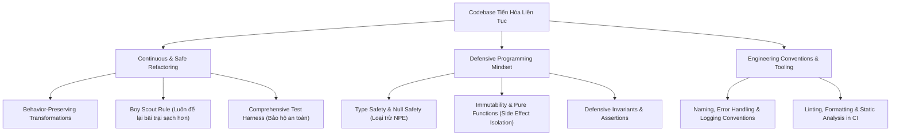
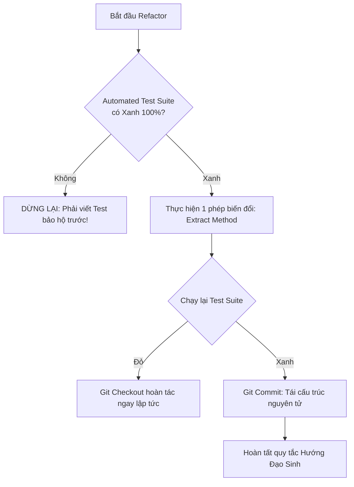
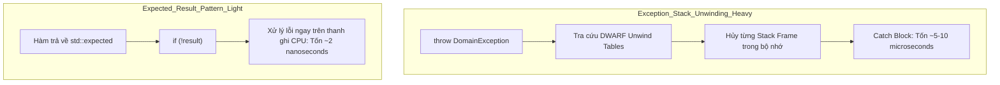
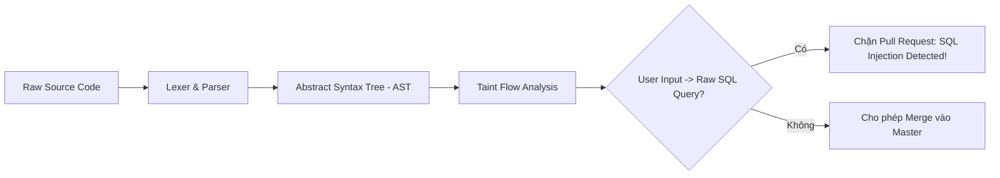
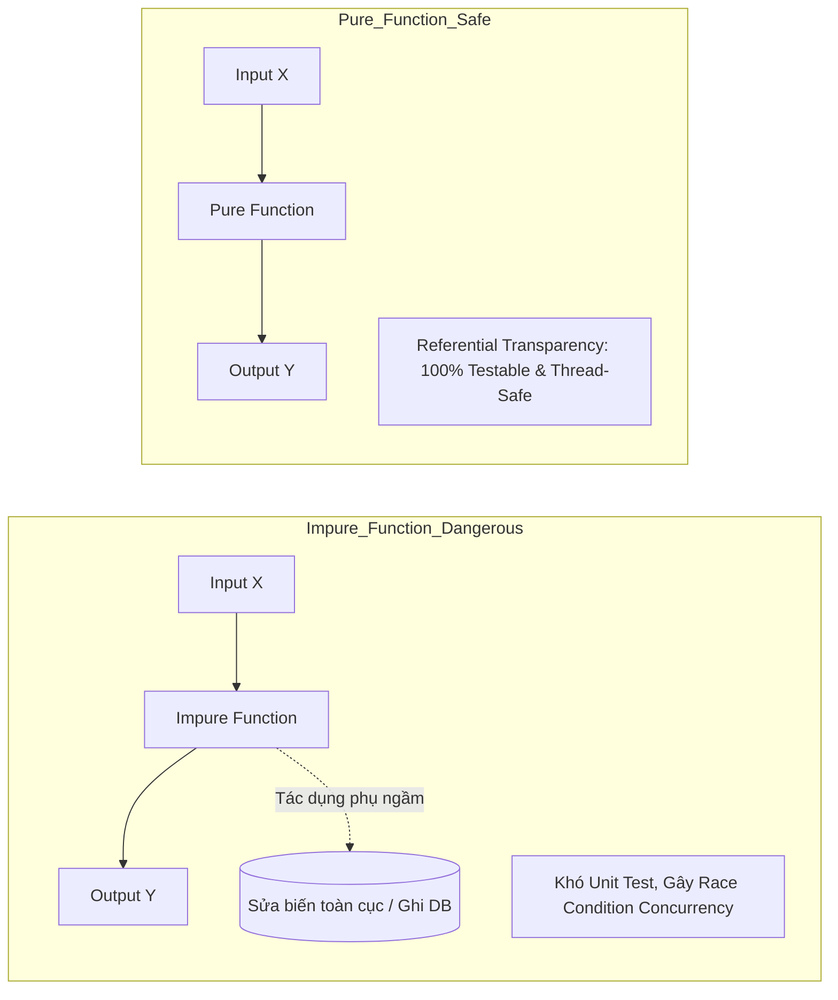

# 6.2. Chiến Lược Refactoring và Lập Trình Phòng Thủ (Refactoring Strategies & Defensive Programming)

## Tổng quan về Refactoring Strategies & Defensive Programming
Mã nguồn phần mềm chịu tác động liên tục của hiện tượng thoái hóa entropy (Software Entropy): theo thời gian, các tính năng mới được chắp vá vội vàng sẽ làm suy giảm cấu trúc thiết kế ban đầu. **Refactoring (Tái cấu trúc)** là quá trình tái cấu trúc lại mã nguồn nội bộ mà tuyệt đối bảo toàn hành vi bên ngoài (**Behavior-Preserving Refactoring**). Một kỹ sư trưởng thành không đợi đến khi codebase sụp đổ mới đập đi xây lại, mà thực hành tái cấu trúc liên tục qua **Boy Scout Rule**, áp dụng các kỹ thuật tái cấu trúc an toàn (**Safe Refactoring**), xây dựng hệ thống phòng thủ vững chắc thông qua **Type Safety**, **Null Safety**, **Immutability**, **Pure Functions** và **Defensive Programming**, đồng thời chuẩn hóa quy ước đặt tên, xử lý lỗi và ghi log chuyên nghiệp.



---

## 2. Chi tiết từng Keyword (Under-the-Hood Deep Dive)

---

### 1. Refactoring, Safe & Behavior-Preserving Refactoring, Techniques & Boy Scout Rule

#### 1. Khái niệm bản chất (What & Why)
* **Refactoring (Tái cấu trúc)**: Kỹ thuật có kỷ luật nhằm làm sạch cấu trúc bên trong của phần mềm (làm cho code dễ hiểu hơn, chi phí sửa đổi rẻ hơn) mà **hoàn toàn không làm thay đổi hành vi quan sát được từ bên ngoài** (Observable Behavior).
* **Safe & Behavior-Preserving Refactoring**: Tái cấu trúc dựa trên một mạng lưới an toàn là bộ kiểm thử tự động toàn diện (Test Suite). Nếu không có automated tests, việc "refactoring" thực chất chỉ là việc di chuyển bug từ chỗ này sang chỗ khác một cách ngẫu nhiên.
* **Refactoring Techniques (Các kỹ thuật tái cấu trúc kinh điển - Martin Fowler)**: Extract Method, Inline Method, Extract Class, Move Field, Replace Conditional with Polymorphism, Introduce Parameter Object, Rename Symbol.
* **Boy Scout Rule (Quy tắc hướng đạo sinh)**: *"Always leave the campground cleaner than you found it"*. Mỗi khi bạn chạm vào một file để sửa bug hoặc thêm tính năng, hãy luôn dành 5 phút để dọn dẹp ít nhất một mùi hôi code nhỏ (đổi một cái tên biến khó hiểu, tách một hàm quá dài). Theo thời gian, codebase sẽ ngày càng trở nên trong sạch.

#### 2. Cơ chế hoạt động sâu (Under the hood / Hardcore Internals)
- **Chu trình Refactor An Toàn kết hợp Git Atomic Commits**:
  1. Chạy toàn bộ Test Suite: Tất cả các bài kiểm thử phải là màu xanh (Pass).
  2. Thực hiện **đúng một phép biến đổi tái cấu trúc duy nhất** (ví dụ: Extract Method bằng công cụ refactor tự động của IDE dựa trên AST để tránh gõ nhầm).
  3. Chạy lại Test Suite ngay lập tức.
  4. Tạo một Git commit riêng biệt: `refactor: extract calculateVat from processOrder`.
  5. Tuyệt đối **không bao giờ trộn lẫn commit refactor với commit thêm tính năng mới**. Điều này giúp việc review Pull Request minh bạch và cho phép `git revert` hoặc `git bisect` hoạt động an toàn 100%.

#### 3. Sơ đồ minh họa (Mermaid Diagram)


#### 4. Code ví dụ thực chiến (C++20: Behavior-Preserving Refactoring - Replace Conditional with Polymorphism)
```cpp
#include <iostream>
#include <memory>
#include <string>

// BEFORE REFACTOR: Câu lệnh switch-case dài dòng, vi phạm OCP và dễ phát sinh lỗi
// double calculateFeeBad(int userType, double amount) { ... }

// AFTER REFACTOR: Extract Polymorphic Strategy Hierarchy (Bảo toàn hành vi 100%)
class IFeeStrategy {
public:
    virtual ~IFeeStrategy() = default;
    virtual double calculate(double amount) const = 0;
};

class RegularFeeStrategy final : public IFeeStrategy {
public:
    double calculate(double amount) const override { return amount * 0.05; }
};

class PremiumFeeStrategy final : public IFeeStrategy {
public:
    double calculate(double amount) const override { return amount * 0.01; }
};

class FeeCalculator {
private:
    std::unique_ptr<IFeeStrategy> strategy_;

public:
    explicit FeeCalculator(std::unique_ptr<IFeeStrategy> s) : strategy_(std::move(s)) {}

    double getFee(double amount) const {
        return strategy_->calculate(amount);
    }
};

int main() {
    FeeCalculator calc(std::make_unique<PremiumFeeStrategy>());
    std::cout << "Phí giao dịch sau refactor: " << calc.getFee(1000.0) << "$\n";
    return 0;
}
```

#### 5. Ưu / Nhược điểm, Pitfalls & Anti-patterns
- **Anti-pattern: The Big Bang Refactoring**: Kỹ sư tách một nhánh git riêng và biến mất trong 2 tháng để "viết lại toàn bộ hệ thống". Kết quả là nhánh đó bị xung đột hàng nghìn dòng code với nhánh `main` và không bao giờ có thể merge lại được.

#### 6. Ứng dụng thực tế trong Backend / Systems
- **Tái cấu trúc hệ thống Core Billing**: Sử dụng phương pháp **Branch by Abstraction** để thay thế dần dần từng module thanh toán mà không làm gián đoạn dòng tiền đang chạy trên production.

---

### 2. Engineering Conventions: Naming, Error Handling & Logging Conventions

#### 1. Khái niệm bản chất (What & Why)
* **Naming Conventions (Quy ước đặt tên)**: Đặt tên cho biến, hàm, class sao cho tự thân nó là tài liệu giải thích mục đích (Self-documenting code). Tránh các tên viết tắt tối nghĩa (`temp`, `data`, `mgr`).
* **API Naming**: Thiết kế URL, headers và endpoint của API theo quy chuẩn nhất quán (REST: Danh từ số nhiều `/api/v1/orders/{id}`, HTTP Methods chuẩn `GET, POST, PUT, DELETE`; gRPC: RPC methods dạng động từ `CreateOrder`, `GetAccount`).
* **Error Handling Conventions (Quy ước xử lý lỗi)**: Nguyên tắc thống nhất cách xử lý và truyền tải lỗi: Lỗi nào dùng Exception, lỗi nào dùng Result/Either Pattern, định dạng mã lỗi trả về cho client (chuẩn RFC 7807 Problem Details).
* **Logging Conventions (Quy ước ghi log)**: Cấu trúc log đồng nhất trên toàn bộ hệ thống (Structured Logging dạng JSON), phân định rõ ràng các cấp độ (DEBUG, INFO, WARN, ERROR, FATAL), luôn gắn kèm ngữ cảnh (Context, User ID, Correlation ID).

#### 2. Cơ chế hoạt động sâu (Under the hood / Hardcore Internals)
- **Hiệu năng của Exception vs `std::expected` / Result Type trong C++20**:
  - **C++ Exceptions (Zero-Cost Exceptions)**: Khi không có lỗi ném ra, code chạy với tốc độ tối đa không có overhead kiểm tra. Tuy nhiên, khi một exception thực sự bị ném (`throw`):
    - Hệ điều hành và runtime phải thực hiện **Stack Unwinding**.
    - Phải tra cứu bảng DWARF Call Frame Information (CFI) trong ELF binary để tìm `catch` block tương ứng.
    - Thời gian ném exception tốn từ **$1\text{ µs}$ đến $10\text{ µs}$** (hàng chục nghìn chu kỳ CPU!).
  - **Result Type (`std::expected<T, E>`)**:
    - Trả về đối tượng lưu trữ trực tiếp trên thanh ghi CPU hoặc stack frame.
    - Chi phí xử lý lỗi chỉ tương đương một lệnh nhảy điều kiện đơn giản ($1-2\text{ ns}$).
    - Lựa chọn kỹ thuật: Dùng Result Pattern cho các lỗi nghiệp vụ dự đoán được (Business Errors như "Số dư không đủ"), chỉ dùng Exception cho các thảm họa bất khả kháng (Out of Memory, Disk Failure).

#### 3. Sơ đồ minh họa (Mermaid Diagram)


#### 4. Code ví dụ thực chiến (C++20: Xử lý lỗi hiệu năng cao với `std::expected` / Result Pattern)
```cpp
#include <iostream>
#include <string>
#include <expected> // C++23 hoặc thư viện C++20 polyfill

enum class PaymentError {
    INSUFFICIENT_FUNDS,
    ACCOUNT_FROZEN,
    GATEWAY_TIMEOUT
};

// Error Handling Convention: Dùng std::expected thay cho Exception cho lỗi nghiệp vụ thường gặp
std::expected<double, PaymentError> processPayment(double balance, double amount) {
    if (amount > balance) {
        return std::unexpected(PaymentError::INSUFFICIENT_FUNDS);
    }
    return balance - amount; // Thành công trả về số dư mới
}

int main() {
    auto result = processPayment(100.0, 150.0);
    if (!result) {
        switch (result.error()) {
            case PaymentError::INSUFFICIENT_FUNDS:
                std::cerr << "[ERROR] Không thể thanh toán: Số dư tài khoản không đủ!\n";
                break;
            default:
                std::cerr << "[ERROR] Lỗi không xác định.\n";
                break;
        }
    } else {
        std::cout << "Giao dịch thành công. Số dư còn lại: " << *result << "$\n";
    }
    return 0;
}
```

#### 5. Ưu / Nhược điểm, Pitfalls & Anti-patterns
- **Anti-pattern: Unstructured String Logging**: Ghi log bằng cách nối chuỗi thô: `logger.info("User " + id + " failed login at " + ip);`. Log này không thể tìm kiếm hay tổng hợp được trên Elasticsearch/Datadog. Phải dùng Structured JSON Logging.

#### 6. Ứng dụng thực tế trong Backend / Systems
- **Chuẩn RFC 7807 (Problem Details for HTTP APIs)**: Trả về lỗi REST API có cấu trúc chuẩn hóa: `type`, `title`, `status`, `detail`, `instance`, giúp mọi client frontend tự động xử lý lỗi nhất quán.

---

### 3. Tooling & Enforcement: Code Formatting, Linting & Static Analysis

#### 1. Khái niệm bản chất (What & Why)
* **Code Formatting (Định dạng mã nguồn)**: Tự động hóa việc căn lề, dấu cách, dấu ngoặc nhọn bằng các công cụ chuyên dụng (Prettier, Clang-Format, Black). Triệt tiêu hoàn toàn các cuộc tranh luận vô bổ về phong cách gõ phím trong các buổi Code Review.
* **Linting**: Quá trình phân tích mã nguồn để cảnh báo các lỗi cú pháp tiềm ẩn, biến không sử dụng, vi phạm quy tắc phong cách (ESLint, Clang-Tidy).
* **Static Analysis (Phân tích tĩnh)**: Công cụ phân tích sâu toàn bộ mã nguồn mà không cần thực thi chương trình, kiểm tra luồng dữ liệu (Data Flow Analysis) và đồ thị trạng thái để phát hiện các lỗ hổng rò rỉ bộ nhớ, con trỏ rỗng (`nullptr`), sử dụng biến sau khi đã giải phóng (`Use-After-Free`), và các lỗ hổng an ninh mạng (SonarQube, Coverity, CodeQL).

#### 2. Cơ chế hoạt động sâu (Under the hood / Hardcore Internals)
- **Tầng AST (Abstract Syntax Tree) trong Static Analysis**:
  Static Analyzer quét file nguồn, chuyển đổi văn bản thô thành cây cú pháp trừu tượng AST:
  - Kiểm tra quy tắc con trỏ trong Clang-Tidy:
    Tìm mọi nút gọi hàm `malloc()` mà không có nhánh dẫn tới `free()` trên tất cả các đường đi thoát hàm (Exit Paths).
  - Phân tích luồng vấy bẩn (**Taint Analysis**):
    Đánh dấu dữ liệu nhận từ người dùng (`req.body`) là "bị vấy bẩn" (tainted). Theo dõi luồng đi của biến đó trong AST. Nếu biến đó đi thẳng vào hàm `db.query(...)` mà không đi qua hàm lọc (Sanitizer), công cụ lập tức báo cờ đỏ: **Cảnh báo Lỗ hổng SQL Injection cấp độ nghiêm trọng**.

#### 3. Sơ đồ minh họa (Mermaid Diagram)


#### 4. Code ví dụ thực chiến (C++: Thiết Lập Clang-Tidy Configuration File `.clang-tidy`)
```yaml
# Cấu hình Static Analysis nghiêm ngặt cho dự án Backend C++20
---
Checks: >
  -*,
  clang-analyzer-*,
  bugprone-*,
  modernize-*,
  performance-*,
  cppcoreguidelines-*,
  -cppcoreguidelines-pro-bounds-pointer-arithmetic

WarningsAsErrors: '*' # Coi mọi cảnh báo phân tích tĩnh như một lỗi biên dịch!
HeaderFilterRegex: '.*'
CheckOptions:
  - key:   modernize-use-trailing-return-type.UseTrailingReturnTypes
    value: 0
  - key:   readability-identifier-naming.VariableCase
    value: camelBack
  - key:   readability-identifier-naming.ClassCase
    value: CamelCase
```

#### 5. Ưu / Nhược điểm, Pitfalls & Anti-patterns
- **Anti-pattern: Disabling Linters with Inline Comments**: Lập trình viên lười biếng đặt cờ `// nolint` hoặc `// eslint-disable-next-line` để lách luật qua mặt CI thay vì thực sự sửa lỗi an toàn mã nguồn.

#### 6. Ứng dụng thực tế trong Backend / Systems
- **Quy trình đóng góp mã nguồn Linux Kernel**: Bắt buộc mọi bản vá (patch) phải vượt qua bài kiểm tra của script `checkpatch.pl` trước khi được xem xét bởi các maintainers.

---

### 4. Defensive Programming: Type Safety, Null Safety, Immutability & Pure Functions

#### 1. Khái niệm bản chất (What & Why)
* **Defensive Programming (Lập trình phòng thủ)**: Phương pháp tiếp cận giả định rằng tất cả dữ liệu đầu vào đều có thể độc hại hoặc sai lệch, và mã nguồn phải tự bảo vệ tính toàn vẹn của mình trong mọi tình huống.
* **Type Safety (An toàn kiểu dữ liệu)**: Khả năng của hệ thống kiểu (Type System) trong việc ngăn chặn các lỗi gán sai kiểu tại thời điểm biên dịch, bảo đảm một vùng nhớ dành cho chuỗi không thể bị đọc nhầm thành con trỏ hàm.
* **Null Safety (An toàn con trỏ rỗng)**: Kỹ thuật thiết kế loại trừ hoàn toàn "sai lầm tỷ đô" (`NullPointerException`) bằng cách cấm kiểu dữ liệu mang giá trị null mặc định, bắt buộc bọc các giá trị có thể thiếu vào kiểu `Option<T>` hoặc `std::optional<T>`.
* **Immutability (Tính bất biến)**: Một đối tượng sau khi được khởi tạo trong bộ nhớ thì trạng thái của nó không bao giờ có thể bị thay đổi. Mọi thao tác cập nhật đều tạo ra một đối tượng mới.
* **Side Effect Management & Pure Functions (Hàm thuần túy)**: Một hàm thuần túy có hai tính chất:
  1. Luôn trả về cùng một kết quả với cùng một bộ tham số đầu vào (Referential Transparency).
  2. Tuyệt đối không gây ra tác dụng phụ (không sửa biến toàn cục, không ghi file, không gọi mạng).

#### 2. Cơ chế hoạt động sâu (Under the hood / Hardcore Internals)
- **Tối ưu hóa của Compiler đối với Pure Functions và Immutability**:
  - Khi một hàm được đánh dấu là `[[gnu::pure]]` hoặc `constexpr` trong C++:
    Trình biên dịch biết chắc chắn hàm không làm biến đổi bộ nhớ toàn cục. Do đó, nếu hàm được gọi lặp lại 100 lần trong một vòng lặp với cùng tham số, trình biên dịch tự động tối ưu hóa bằng cách gọi duy nhất 1 lần (Common Subexpression Elimination - CSE).
  - Đối với dữ liệu Immutability: Hệ điều hành có thể đặt trang bộ nhớ đó vào vùng **Read-Only Data Segment (`.rodata`)**. Bất kỳ luồng nào cố tình ghi đè vào địa chỉ này sẽ bị CPU MMU (Memory Management Unit) ngắt và ném lỗi `SIGSEGV` ngay lập tức, bảo vệ tuyệt đối dữ liệu khỏi race condition.

#### 3. Sơ đồ minh họa (Mermaid Diagram)


#### 4. Code ví dụ thực chiến (C++20: Null Safety với `std::optional` và Pure Functions)
```cpp
#include <iostream>
#include <optional>
#include <string>

// Null Safety: Tuyệt đối không dùng nullptr trần trụi (Raw Pointer)
// Bắt buộc trả về std::optional để ép buộc người gọi phải kiểm tra sự tồn tại

struct UserRecord {
    int id;
    std::string name;
};

// Hàm thuần túy (Pure Function): Không có side-effect, không đọc/ghi biến toàn cục
constexpr double calculateDiscount(double price, double percentage) noexcept {
    return price * (1.0 - percentage / 100.0);
}

// Hàm tìm kiếm trả về Optional
std::optional<UserRecord> findUserInCache(int id) {
    if (id == 42) {
        return UserRecord{42, "Grace Hopper"};
    }
    return std::nullopt; // Biểu diễn an toàn cho việc không tìm thấy
}

int main() {
    auto userOpt = findUserInCache(42);

    // Bắt buộc kiểm tra Null Safety bằng cú pháp chuẩn C++
    if (userOpt.has_value()) {
        std::cout << "Tìm thấy user: " << userOpt->name << "\n";
    } else {
        std::cout << "Không tìm thấy user trong cache.\n";
    }

    constexpr double discounted = calculateDiscount(200.0, 15.0);
    std::cout << "Giá sau chiết khấu (Compile-time Pure Function): " << discounted << "$\n";
    return 0;
}
```

#### 5. Ưu / Nhược điểm, Pitfalls & Anti-patterns
- **Anti-pattern: Defensive Copying Overkill**: Copy toàn bộ mảng dữ liệu 100MB chỉ để bảo đảm tính Immutability trong khi hệ thống đang chạy ở đường dẫn băng thông cao (Hot Path). Phải cân bằng bằng cách sử dụng các cấu trúc dữ liệu Persistent Data Structures (như HAMT - Hash Array Mapped Trie) để chia sẻ bộ nhớ an toàn (Structural Sharing).

#### 6. Ứng dụng thực tế trong Backend / Systems
- **React & Redux / Functional Core Imperative Shell**: Kiến trúc phân tách rõ ràng phần lõi tính toán là các hàm thuần túy bất biến (Pure Domain Logic), và đẩy toàn bộ các thao tác có tác dụng phụ (Database, Network, File I/O) ra lớp vỏ ngoài cùng.

---

## Tổng kết Chương 6.2
Refactoring liên tục và lập trình phòng thủ là tấm lá chắn bảo vệ codebase khỏi sự lão hóa kỹ thuật. Bằng việc tôn trọng quy tắc Hướng Đạo Sinh, thống nhất các quy ước đặt tên và xử lý lỗi, sử dụng công cụ phân tích tĩnh trong CI, và tận dụng triệt để Type Safety, Null Safety cùng Pure Functions, người kỹ sư bảo đảm hệ thống luôn an toàn, dễ bảo trì và vận hành bền bỉ trên môi trường production.
