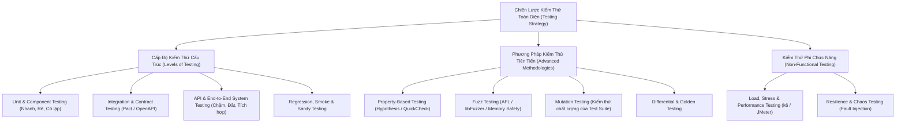
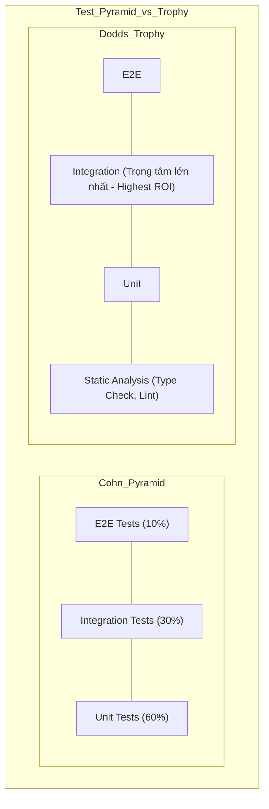
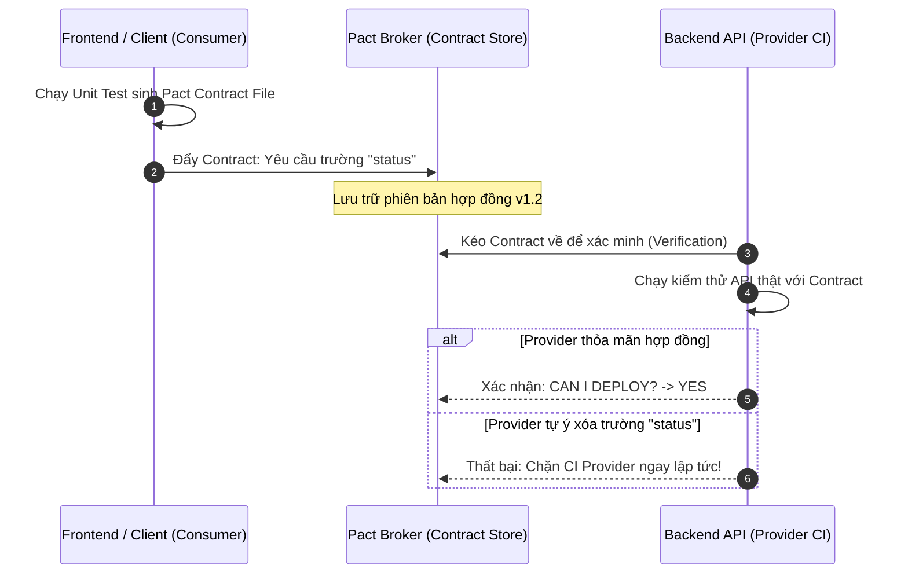
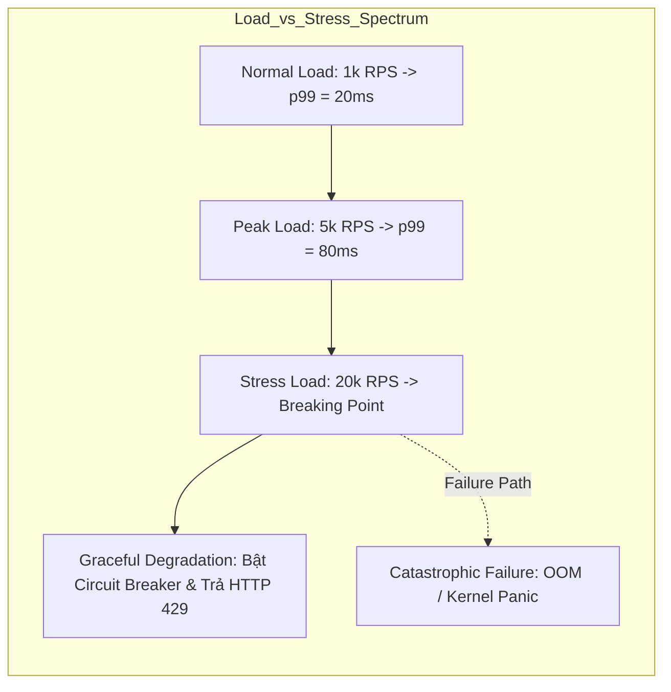
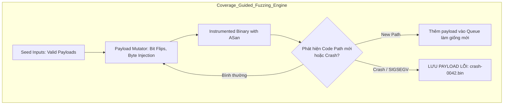

# 7.1. Phân Loại và Các Phương Pháp Kiểm Thử Kỹ Nghệ (Testing Taxonomy & Methodologies)

## Tổng quan về Testing Taxonomy & Methodologies
Kiểm thử phần mềm (Testing Engineering) không đơn thuần là hoạt động tìm lỗi (bug hunting) ở giai đoạn cuối dự án, mà là một kỷ luật kỹ thuật định lượng nhằm thiết lập **mức độ tin cậy toán học** vào tính đúng đắn và độ bền bỉ của hệ thống. Một kỹ sư trưởng thành xây dựng chiến lược kiểm thử đa tầng dựa trên các mô hình kinh điển như **Test Pyramid (Kim tự tháp kiểm thử)** và **Testing Trophy**, kết hợp hài hòa giữa các cấp độ kiểm thử chức năng (**Unit, Integration, Component, Contract, E2E**) và phi chức năng (**Performance, Load, Stress, Security, Resilience**). Đồng thời, kỹ sư tinh thông các phương pháp kiểm thử tiên tiến ở tầng sâu như **Mutation Testing**, **Property-Based Testing**, **Model-Based Testing**, **Fuzz Testing**, **Differential Testing**, và **Snapshot / Golden Testing**.



---

## 2. Chi tiết từng Keyword (Under-the-Hood Deep Dive)

---

### 1. Testing Fundamentals, Strategy, Test Pyramid & Testing Trophy

#### 1. Khái niệm bản chất (What & Why)
* **Testing Fundamentals & Strategy**: Định hình cách tiếp cận tổng thể về kiểm thử của tổ chức: kiểm thử cái gì, ở tầng nào, với tần suất ra sao, và mức độ chấp nhận rủi ro kỹ thuật là bao nhiêu.
* **Test Pyramid (Kim tự tháp kiểm thử - Mike Cohn)**: Mô hình kinh điển khuyến nghị cơ cấu số lượng test cases:
  - *Đáy tháp (Số lượng lớn nhất, thực thi nhanh nhất, chi phí rẻ nhất)*: **Unit Tests**.
  - *Tầng giữa*: **Integration Tests**.
  - *Đỉnh tháp (Số lượng ít nhất, thực thi chậm nhất, chi phí đắt nhất, dễ vỡ nhất)*: **End-to-End (E2E) UI Tests**.
* **Testing Trophy (Chiếc cúp kiểm thử - Kent C. Dodds)**: Mô hình hiện đại phổ biến trong phát triển Web/Microservices, nhấn mạnh rằng **Integration Tests** mang lại tỷ suất hoàn vốn (ROI) cao nhất vì chúng kiểm chứng sự phối hợp thực tế giữa các module mà không quá tốn kém như E2E UI.
* **Automated vs Manual & Exploratory Testing**: Tự động hóa 100% các kịch bản hồi quy lặp đi lặp lại (Automated Regression), và dành thời gian con người cho **Exploratory Testing** (Kiểm thử thăm dò tự do để tìm kiếm các lỗ hổng trải nghiệm và các ca sử dụng phi truyền thống).
* **Smoke Testing vs Sanity Testing**:
  - *Smoke Testing (Build Verification Test)*: Bộ test kiểm tra nhanh các tính năng sống còn nhất ngay sau khi build xong để quyết định có nên tiếp tục deploy hay không ("Hệ thống có bốc khói không?").
  - *Sanity Testing*: Kiểm tra nhanh tập trung vào một tính năng hoặc một bug vừa được fix xem nó có thực sự hoạt động trước khi chạy full regression.

#### 2. Cơ chế hoạt động sâu (Under the hood / Hardcore Internals)
- **Tốc độ thực thi và Chi phí I/O giữa các tầng kiểm thử**:
  - **Unit Test (Pure In-Memory)**: Chạy $10,000$ tests trong chưa đầy $1$ giây ($< 0.1\text{ ms/test}$) vì chỉ thực thi các chỉ thị CPU trên RAM cục bộ, không có I/O disk hay syscall mạng.
  - **Integration Test (Docker Container / Testcontainers)**: Mất từ $100\text{ ms}$ đến vài giây cho mỗi test do tốn thời gian thiết lập TCP connection tới PostgreSQL/Redis container và commit transaction.
  - **End-to-End UI Test (Selenium / Playwright)**: Mất từ $5\text{ s}$ đến $30\text{ s}$ cho mỗi kịch bản vì phải khởi động Chromium headless process, parse CSS/DOM, render JavaScript và chờ phản hồi mạng.
  - Do đó, đảo ngược kim tự tháp (Ice Cream Cone Anti-pattern - toàn E2E test, ít Unit test) sẽ làm nghẽn CI pipeline hàng giờ và gây ra hiện tượng Flaky Test kinh niên.

#### 3. Sơ đồ minh họa (Mermaid Diagram)


#### 4. Code ví dụ thực chiến (TypeScript: Phân biệt rõ ranh giới Unit Test và Integration Test)
```typescript
// 1. UNIT TEST: Kiểm thử logic tính giá thuần túy trong RAM (Siêu nhanh, Zero I/O)
describe('Unit Test: DiscountCalculator', () => {
  it('áp dụng chiết khấu 20% cho đơn hàng trên $1000', () => {
    const calc = new DiscountCalculator();
    expect(calc.calculate(1500)).toBe(1200);
  });
});

// 2. INTEGRATION TEST: Kiểm thử sự phối hợp với PostgreSQL qua Testcontainers (Có Network & Disk I/O)
describe('Integration Test: OrderRepository with Real Postgres', () => {
  let dbClient: Client;

  beforeAll(async () => {
    // Khởi tạo connection thực tế tới database
    dbClient = new Client({ connectionString: process.env.TEST_DB_URL });
    await dbClient.connect();
  });

  afterAll(async () => {
    await dbClient.end();
  });

  it('lưu và truy vấn chính xác đơn hàng trong database', async () => {
    const repo = new PostgresOrderRepository(dbClient);
    await repo.save({ id: 'ORD-101', amount: 500 });

    const order = await repo.findById('ORD-101');
    expect(order).not.toBeNull();
    expect(order?.amount).toBe(500);
  });
});
```

#### 5. Ưu / Nhược điểm, Pitfalls & Anti-patterns
- **Anti-pattern: Ice Cream Cone (Cây kem ốc quế)**: Hầu hết các bài kiểm thử là kiểm thử thủ công và E2E UI tự động. Kết quả: CI chạy mất 4 tiếng, test thỉnh thoảng pass thỉnh thoảng fail (flaky), lập trình viên mất niềm tin vào hệ thống kiểm thử.

#### 6. Ứng dụng thực tế trong Backend / Systems
- **Quy trình Release tại Spotify**: Sử dụng Smoke Test tự động chạy trong vòng 3 phút trên Canary pod để quyết định có tiếp tục rollout bản cập nhật sang toàn bộ cụm Kubernetes hay tự động hủy bỏ (auto-abort).

---

### 2. Functional, Contract, API, Component, System & Acceptance Testing

#### 1. Khái niệm bản chất (What & Why)
* **Component Testing (Kiểm thử thành phần)**: Kiểm thử một module hoặc một dịch vụ hoàn chỉnh trong môi trường cô lập, các phụ thuộc bên ngoài (external services, database) được thay thế bằng mocks/stubs.
* **Contract Testing (Kiểm thử hợp đồng - Consumer-Driven Contracts / Pact)**: Phương pháp kiểm chứng thỏa thuận giao diện API giữa dịch vụ tiêu thụ (Consumer) và dịch vụ cung cấp (Provider) mà không cần phải khởi chạy cả hai dịch vụ cùng lúc. Ngăn chặn nguy cơ Provider đổi định dạng JSON làm sập Consumer trên production.
* **API Testing**: Kiểm thử trực tiếp tầng giao diện lập trình ứng dụng (REST, gRPC, GraphQL): kiểm tra mã trạng thái HTTP, định dạng payload, schema validation, phân trang, và bảo mật xác thực (Auth headers).
* **System Testing & Acceptance Testing (UAT)**: Kiểm thử toàn bộ hệ thống tích hợp hoàn chỉnh để chứng minh phần mềm thỏa mãn các tiêu chí chấp nhận nghiệp vụ ban đầu của khách hàng.

#### 2. Cơ chế hoạt động sâu (Under the hood / Hardcore Internals)
- **Cơ chế hoạt động của Consumer-Driven Contract Testing (Pact Engine)**:
  1. *Phía Consumer*: Viết test giả định Provider trả về payload: `{ "userId": 42, "status": "ACTIVE" }`. Pact ghi nhận kỳ vọng này thành một file hợp đồng nhị phân JSON (**Pact Contract File**).
  2. *Pact Broker*: Đẩy file contract lên kho lưu trữ trung tâm.
  3. *Phía Provider*: Trong CI của Provider, công cụ Pact replay lại chính xác các request từ file contract vào API thật của Provider và xác minh Provider có trả về đúng schema đó không.
  4. Nếu Provider đổi trường `userId` thành `id`, build của Provider lập tức bị chặn đứng trước khi code được deploy lên môi trường staging!

#### 3. Sơ đồ minh họa (Mermaid Diagram)


#### 4. Code ví dụ thực chiến (TypeScript: Consumer-Driven Contract Test với Mock Server)
```typescript
// Minh họa tư duy Contract Testing: Định nghĩa hợp đồng chặt chẽ giữa Consumer và Provider
interface UserContractResponse {
  id: number;
  username: string;
  role: 'ADMIN' | 'USER';
}

function validateProviderContract(response: any): response is UserContractResponse {
  return (
    typeof response.id === 'number' &&
    typeof response.username === 'string' &&
    (response.role === 'ADMIN' || response.role === 'USER')
  );
}

// Trong bài test của Consumer:
describe('Contract Verification Test', () => {
  it('đảm bảo Provider tuân thủ đúng Schema hợp đồng', () => {
    const mockProviderPayload = { id: 101, username: 'octocat', role: 'ADMIN' };
    const isValid = validateProviderContract(mockProviderPayload);
    expect(isValid).toBe(true);
  });
});
```

#### 5. Ưu / Nhược điểm, Pitfalls & Anti-patterns
- **Ưu điểm**: Loại bỏ hoàn toàn sự cần thiết của các môi trường Staging tích hợp cồng kềnh, chậm chạp và tốn kém chi phí.
- **Pitfalls**: Consumer viết contract quá chi tiết (assert cả các trường nội bộ không cần thiết của Provider), dẫn đến việc Provider bị trói buộc và khó refactor.

#### 6. Ứng dụng thực tế trong Backend / Systems
- Các kiến trúc Microservices quy mô hàng trăm services tại SoundCloud và Uber đều bắt buộc sử dụng **Pact Contract Testing** để bảo đảm tính tương thích giao tiếp giữa các nhóm.

---

### 3. Non-Functional Testing: Performance, Load, Stress, Security, Reliability & Resilience

#### 1. Khái niệm bản chất (What & Why)
* **Performance & Load Testing**: Đo lường hành vi của hệ thống dưới tải trọng dự kiến (ví dụ: 2000 RPS liên tục trong 1 giờ) để xác định độ trễ p95, p99 và mức tiêu hao tài nguyên CPU/RAM.
* **Stress Testing**: Đẩy tải trọng vượt qua ngưỡng thiết kế tối đa cho đến khi hệ thống bắt đầu sụp đổ (Break Point), nhằm quan sát xem hệ thống có suy thoái nhẹ nhàng (Graceful Degradation) hay sụp đổ thảm họa (Catastrophic Crash), và kiểm tra khả năng tự phục hồi khi tải giảm xuống.
* **Security Testing (Penetration & Vulnerability Testing)**: Kiểm tra các lỗ hổng OWASP Top 10: SQL Injection, XSS, CSRF, broken authentication, IDOR và rò rỉ dữ liệu nhạy cảm.
* **Reliability & Resilience Testing (Kiểm thử độ bền bỉ & Khả năng chịu lỗi)**: Chủ động tiêm lỗi (Fault Injection, Chaos Engineering) như ngắt mạng, kill tiến trình ngẫu nhiên, làm đầy phân vùng ổ đĩa để kiểm chứng cơ chế Circuit Breaker, Auto-Failover và Data Consistency.
* **Compatibility & Usability Testing**: Kiểm thử tính tương thích đa nền tảng phần cứng, hệ điều hành và trải nghiệm trực quan của người dùng.

#### 2. Cơ chế hoạt động sâu (Under the hood / Hardcore Internals)
- **Các thông số Kernel & Socket trong Load Testing**:
  Khi chạy công cụ sinh tải (k6, wrk2, Locust) ở mức 100k kết nối đồng thời:
  - Máy client và server đều có nguy cơ cạn kiệt dải cổng tạm thời (Ephemeral Port Exhaustion): Cần tinh chỉnh sysctl `net.ipv4.ip_local_port_range = 1024 65535`.
  - Quản lý trạng thái socket: `net.ipv4.tcp_tw_reuse = 1` để tái sử dụng nhanh các socket ở trạng thái `TIME_WAIT`.
  - Giới hạn File Descriptor của tiến trình: Lệnh `ulimit -n 1000000` (mỗi TCP connection tiêu tốn đúng 1 file descriptor trong bảng mở file của Linux Kernel).

#### 3. Sơ đồ minh họa (Mermaid Diagram)


#### 4. Code ví dụ thực chiến (k6: Kịch bản Load & Stress Test định lượng ngưỡng SLI)
```javascript
import http from 'k6/http';
import { check, sleep } from 'k6';

// Cấu hình Load Testing: Đo lường ngưỡng chịu tải theo NFR
export const options = {
  stages: [
    { duration: '30s', target: 500 },  // Ramp-up lên 500 người dùng ảo (VUs)
    { duration: '1m', target: 2000 },  // Đẩy lên mức Stress 2000 VUs
    { duration: '30s', target: 0 },     // Ramp-down về 0
  ],
  thresholds: {
    // NFR SLI Enforcement: 99% số request phải có độ trễ dưới 300ms
    http_req_duration: ['p(99)<300'],
    // Tỷ lệ lỗi cho phép tối đa là dưới 0.1%
    http_req_failed: ['rate<0.001'],
  },
};

export default function () {
  const res = http.get('http://api.internal.local/orders/status');
  check(res, {
    'status là 200': (r) => r.status === 200,
  });
  sleep(0.1);
}
```

#### 5. Ưu / Nhược điểm, Pitfalls & Anti-patterns
- **Anti-pattern: Testing in Production without Guardrails**: Bắn tải trực tiếp lên production mà không cô lập dữ liệu test, khiến các đơn hàng giả mạo bị gửi sang kho đóng gói và trừ tiền thật trên thẻ tín dụng của khách hàng!

#### 6. Ứng dụng thực tế trong Backend / Systems
- **Chaos Engineering tại Netflix (Chaos Kong)**: Mô phỏng kịch bản sập toàn bộ một Region của AWS để kiểm chứng hệ thống tự động định tuyến toàn bộ traffic sang Region khác trong vòng dưới 2 phút.

---

### 4. Advanced Methodologies: Mutation, Property-Based, Fuzz, Differential & Golden Testing

#### 1. Khái niệm bản chất (What & Why)
* **Mutation Testing (Kiểm thử đột biến)**: Công cụ đánh giá chất lượng thực sự của Test Suite. Nó chủ động tạo ra các đột biến (Mutants) trong mã nguồn (ví dụ: đổi `+` thành `-`, đổi `>` thành `<=`, xóa một dòng gọi hàm) rồi chạy lại bộ test. Nếu bộ test vẫn "Xanh", mutant đó đã sống sót (Mutant Survived) $\rightarrow$ Chứng tỏ test suite của bạn có lỗ hổng lớn và thiếu assertions!
* **Property-Based Testing (Kiểm thử dựa trên thuộc tính - QuickCheck / Hypothesis)**: Thay vì kiểm thử với các giá trị hardcode cụ thể (`add(2, 3) == 5`), ta định nghĩa các bất biến phổ quát (Properties) của thuật toán:
  $$\forall a, b \in \mathbb{Z}, \quad \text{add}(a, b) == \text{add}(b, a) \quad (\text{Tính giao hoán})$$
  Framework sẽ tự động sinh hàng chục nghìn trường hợp ngẫu nhiên và đặc biệt (0, số âm, số nguyên cực đại) để cố gắng phá vỡ thuộc tính đó.
* **Fuzz Testing (Fuzzing - AFL / libFuzzer)**: Kỹ thuật kiểm thử bảo mật tự động bơm hàng triệu chuỗi byte ngẫu nhiên hoặc biến dị (mutated payloads) vào hàm tiếp nhận để kích hoạt các lỗi sập hệ thống: Segmentation Fault, Buffer Overflow, Infinite Loops, Panic.
* **Differential Testing (Kiểm thử vi phân)**: Chạy cùng một bộ dữ liệu đầu vào qua hai phiên bản phần mềm khác nhau (ví dụ: Thuật toán cũ đang chạy ổn định và Thuật toán mới được tối ưu hóa C++ SIMD) và so sánh từng byte kết quả trả về. Nếu có sai lệch, thuật toán mới bị coi là có bug.
* **Snapshot & Golden Testing**: Lưu trữ kết quả đầu ra chuẩn (Golden Master File - ví dụ: File JSON phức tạp hoặc ảnh render). Các lần chạy test sau sẽ so sánh trực tiếp kết quả mới với Golden File để phát hiện ngay lập tức bất kỳ thay đổi ngoài ý muốn nào.

#### 2. Cơ chế hoạt động sâu (Under the hood / Hardcore Internals)
- **Cơ chế Coverage-Guided Fuzzing của `libFuzzer` / Clang**:
  - Trình biên dịch chèn thêm các đoạn mã theo dõi (Sanitizer Coverage Instrumentation) vào nhị phân thông qua cờ:
    `-fsanitize=fuzzer,address,undefined`
  - AddressSanitizer (ASan) chèn các vùng nhớ đỏ (**Redzones**) xung quanh mỗi biến trên Stack và Heap.
  - Khi Fuzzer bơm một payload làm con trỏ ghi lệch dù chỉ 1 byte vào Redzone: ASan chặn đứng tức thì, sinh Crash Report kèm Call Stack chi tiết và lưu payload độc hại đó thành một file để kỹ sư tái hiện (Reproduction).

#### 3. Sơ đồ minh họa (Mermaid Diagram)


#### 4. Code ví dụ thực chiến (C++20: Target Function cho LLVM libFuzzer)
```cpp
#include <cstdint>
#include <cstddef>
#include <string_view>
#include <stdexcept>

// Hàm mục tiêu cần kiểm tra tính an toàn bộ nhớ (Fuzzing Target)
void parseComplexNetworkPacket(const uint8_t* data, size_t size) {
    if (size < 4) return; // Guard clause hợp lệ

    // Giả lập một lỗi tinh vi: Crash nếu 4 byte đầu tiên khớp với chuỗi "CRSH"
    if (data[0] == 'C' && data[1] == 'R' && data[2] == 'S' && data[3] == 'H') {
        // Cố tình gây lỗi bộ nhớ Segmentation Fault / Buffer Overflow để Fuzzer bắt
        volatile int* bad_ptr = nullptr;
        *bad_ptr = 42; 
    }
}

// Chữ ký hàm bắt buộc của libFuzzer: LLVMFuzzerTestOneInput
extern "C" int LLVMFuzzerTestOneInput(const uint8_t *data, size_t size) {
    parseComplexNetworkPacket(data, size);
    return 0; // Trả về 0 để Fuzzer tiếp tục sinh input tiếp theo
}
```

#### 5. Ưu / Nhược điểm, Pitfalls & Anti-patterns
- **Anti-pattern: Flaky Snapshot Tests**: Sử dụng Snapshot Testing cho các payload có chứa trường thời gian động (`createdAt: new Date()`) hoặc UUID ngẫu nhiên. Khi đó bài test sẽ fail mỗi lần chạy mặc dù code không hề có lỗi.

#### 6. Ứng dụng thực tế trong Backend / Systems
- **Google OSS-Fuzz**: Dự án liên tục fuzzing hàng trăm thư viện mã nguồn mở quan trọng nhất của thế giới (Linux Kernel, OpenSSL, Git, cURL), phát hiện hàng chục nghìn lỗ hổng an ninh bộ nhớ nghiêm trọng trước khi tin tặc kịp khai thác.

---

## Tổng kết Chương 7.1
Kiểm thử chuyên nghiệp là một tổ hợp các phương pháp luận tinh vi từ tầng cấu trúc đến tầng phi chức năng và thuật toán tự động. Bằng cách xây dựng kim tự tháp kiểm thử cân đối, bảo đảm hợp đồng giao tiếp giữa các dịch vụ qua Contract Testing, kiểm chứng khả năng chịu tải bằng Stress Testing, và rà soát các góc khuất bằng Fuzzing và Property-Based Testing, người kỹ sư bảo đảm hệ thống vận hành với độ tin cậy tuyệt đối.
