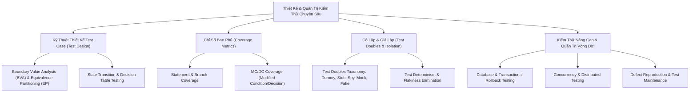
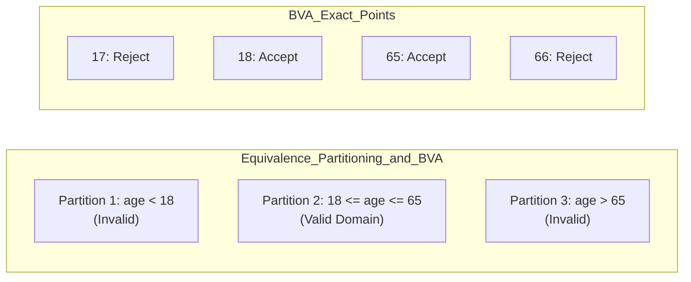
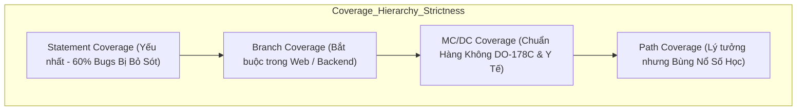
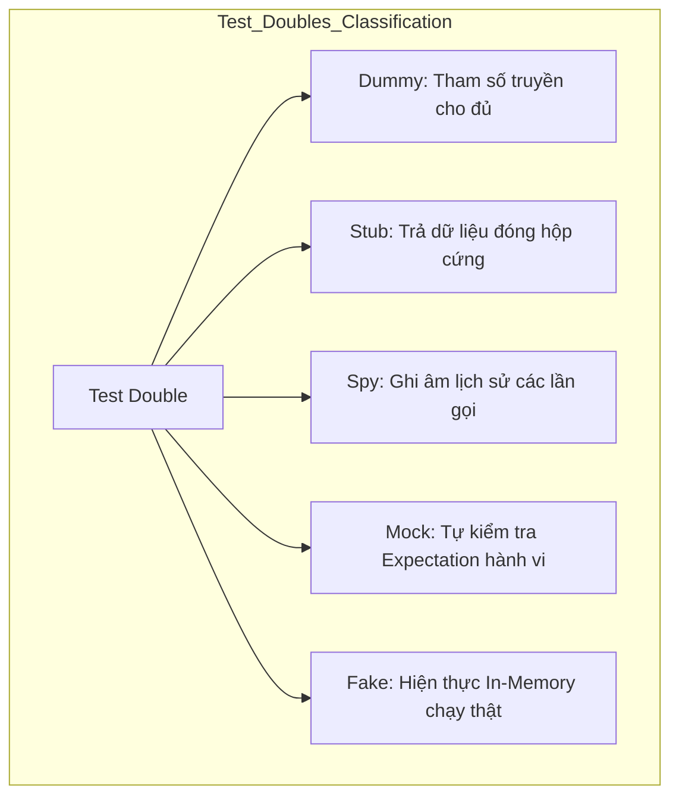
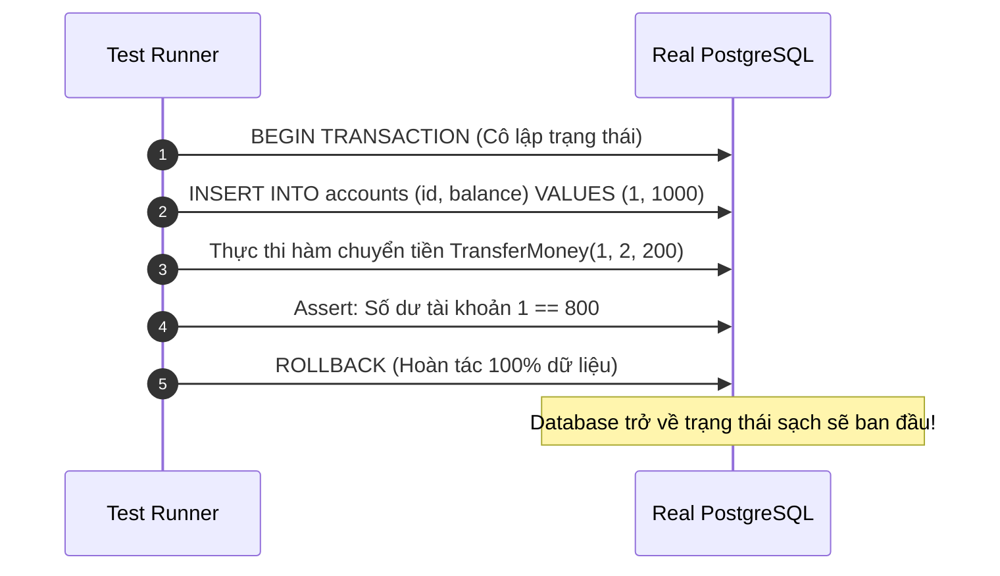

# 7.2. Thiết Kế Test Case, Độ Bao Phủ và Tính Cô Lập Kiểm Thử (Test Design, Coverage & Isolation)

## Tổng quan về Test Design, Coverage & Isolation
Một bộ kiểm thử có số lượng test case khổng lồ nhưng không được thiết kế khoa học sẽ chỉ mang lại ảo tưởng về sự an toàn trong khi làm tiêu tốn tài nguyên CI vô ích. Kỹ nghệ kiểm thử chuyên nghiệp đòi hỏi việc áp dụng các kỹ thuật thiết kế test case chuẩn mực như **Boundary Value Analysis (BVA)**, **Equivalence Partitioning (EP)**, **State Transition Testing**, và **Decision Table Testing** để tối đa hóa khả năng phát hiện lỗi với số lượng kịch bản tối thiểu. Đồng thời, kỹ sư phải hiểu rõ bản chất toán học của các chỉ số độ bao phủ (**Statement, Branch, Path, MC/DC Coverage**), kiểm soát tuyệt đối tính cô lập (**Test Isolation**) và tính tất định (**Determinism**), tiêu diệt hiện tượng kiểm thử chập chờn (**Test Flakiness**), và phân biệt chính xác bản chất của từng loại **Test Doubles (Dummy, Stub, Spy, Mock, Fake)** trong môi trường kiểm thử tương tranh và phân tán.



---

## 2. Chi tiết từng Keyword (Under-the-Hood Deep Dive)

---

### 1. Test Design Techniques: BVA, Equivalence Partitioning, State Transition & Decision Tables

#### 1. Khái niệm bản chất (What & Why)
* **Equivalence Partitioning (EP - Phân vùng tương đương)**: Chia không gian dữ liệu đầu vào thành các phân vùng rời rạc mà chương trình được kỳ vọng sẽ xử lý như nhau. Chỉ cần chọn một giá trị đại diện từ mỗi phân vùng (Hợp lệ và Bất hợp lệ) để kiểm thử, giúp giảm số lượng test case từ vô hạn xuống một con số hữu hạn có kiểm soát.
* **Boundary Value Analysis (BVA - Phân tích giá trị biên)**: Kỹ thuật kiểm thử tập trung vào các điểm biên của các phân vùng tương đương (nơi tập trung $> 80\%$ các lỗi lập trình: $Min - 1, Min, Min + 1, Max - 1, Max, Max + 1$).
* **State Transition Testing (Kiểm thử chuyển đổi trạng thái)**: Dựa trên biểu đồ máy trạng thái hữu hạn (FSM) để thiết kế các ca kiểm thử bảo đảm mọi trạng thái đều được duyệt qua và các chuyển đổi bất hợp lệ đều bị chặn đứng.
* **Decision Table Testing (Kiểm thử bảng quyết định)**: Công cụ bảng ma trận logic biểu diễn sự kết hợp phức tạp giữa nhiều điều kiện đầu vào (Inputs) và các hành động tương ứng của hệ thống (Actions), giúp không bỏ sót bất kỳ tổ hợp boolean nào.

#### 2. Cơ chế hoạt động sâu (Under the hood / Hardcore Internals)
- **Áp dụng BVA & EP cho Bài toán Tuổi Đủ Điều Kiện Vay Vốn ($18 \le \text{age} \le 65$)**:
  - **Equivalence Partitions**:
    - Phân vùng 1 (Không hợp lệ - Quá trẻ): $\text{age} < 18$.
    - Phân vùng 2 (Hợp lệ): $18 \le \text{age} \le 65$.
    - Phân vùng 3 (Không hợp lệ - Quá già): $\text{age} > 65$.
  - **Boundary Values cần kiểm thử chính xác**:
    - Biên dưới: $17$ (Bị từ chối), $18$ (Được chấp nhận), $19$ (Được chấp nhận).
    - Biên trên: $64$ (Được chấp nhận), $65$ (Được chấp nhận), $66$ (Bị từ chối).
    - Biên cực đoan tầng nhị phân: $-1$, $0$, `INT_MAX`, `INT_MIN`.

#### 3. Sơ đồ minh họa (Mermaid Diagram)


#### 4. Code ví dụ thực chiến (C++20: BVA và Decision Table Testing)
```cpp
#include <iostream>
#include <cassert>

enum class LoanEligibility { REJECTED, APPROVED, MANUAL_REVIEW };

// Decision Table Logic: Tuổi, Thu nhập và Nợ xấu
LoanEligibility evaluateLoan(int age, double monthlyIncome, bool hasBadCredit) {
    if (age < 18 || age > 65) return LoanEligibility::REJECTED; // BVA Rule
    if (hasBadCredit) return LoanEligibility::REJECTED;
    if (monthlyIncome >= 3000.0) return LoanEligibility::APPROVED;
    if (monthlyIncome >= 1500.0) return LoanEligibility::MANUAL_REVIEW;
    return LoanEligibility::REJECTED;
}

void testLoanDecisionTable() {
    // Test Case 1: Biên dưới tuổi (17) -> REJECTED
    assert(evaluateLoan(17, 5000.0, false) == LoanEligibility::REJECTED);
    // Test Case 2: Đúng biên 18 tuổi, thu nhập cao, không nợ xấu -> APPROVED
    assert(evaluateLoan(18, 5000.0, false) == LoanEligibility::APPROVED);
    // Test Case 3: Đúng biên 65 tuổi -> APPROVED
    assert(evaluateLoan(65, 4000.0, false) == LoanEligibility::APPROVED);
    // Test Case 4: Vượt biên 66 tuổi -> REJECTED
    assert(evaluateLoan(66, 4000.0, false) == LoanEligibility::REJECTED);
    // Test Case 5: Thu nhập biên (1500$) -> MANUAL_REVIEW
    assert(evaluateLoan(30, 1500.0, false) == LoanEligibility::MANUAL_REVIEW);
    // Test Case 6: Có nợ xấu dù thu nhập cao -> REJECTED
    assert(evaluateLoan(30, 10000.0, true) == LoanEligibility::REJECTED);

    std::cout << "Toàn bộ các test cases BVA & Decision Table đều PASS!\n";
}

int main() {
    testLoanDecisionTable();
    return 0;
}
```

#### 5. Ưu / Nhược điểm, Pitfalls & Anti-patterns
- **Anti-pattern: Random Value Testing**: Viết test với các giá trị ngẫu nhiên rơi vào giữa phân vùng (`age = 37`) mà bỏ qua hoàn toàn các điểm biên (`17, 18, 65, 66`), khiến lỗi off-by-one (`<` thay vì `<=`) lọt lên production.

#### 6. Ứng dụng thực tế trong Backend / Systems
- **Kiểm thử máy trạng thái của đơn hàng trong E-Commerce**: State Transition Testing giúp phát hiện các lỗ hổng logic nghiêm trọng như người dùng có thể kích hoạt hoàn tiền khi đơn hàng vẫn đang ở trạng thái `DRAFT`.

---

### 2. Code Coverage Metrics: Statement, Branch, Path & MC/DC Coverage

#### 1. Khái niệm bản chất (What & Why)
* **Statement Coverage (Độ bao phủ câu lệnh)**: Tỷ lệ phần trăm các dòng code thực tế được thực thi ít nhất một lần bởi test suite. (Chỉ số yếu nhất, 100% statement coverage vẫn có thể bỏ sót 50% số bug).
* **Branch Coverage (Độ bao phủ nhánh / Decision Coverage)**: Tỷ lệ phần trăm các nhánh boolean (True / False) của mọi câu lệnh rẽ nhánh được thực thi.
* **Condition Coverage (Độ bao phủ điều kiện)**: Đảm bảo mọi biểu thức điều kiện con bên trong mệnh đề ghép đều đã được kiểm tra cả hai giá trị True và False.
* **Path Coverage (Độ bao phủ đường đi)**: Tỷ lệ tất cả các con đường thực thi độc lập có thể có từ đầu đến cuối hàm. Trong các hàm có nhiều vòng lặp, số lượng đường đi bùng nổ theo cấp số nhân khiến 100% Path Coverage là bất khả thi trong thực tế.
* **MC/DC (Modified Condition/Decision Coverage)**: Tiêu chuẩn kiểm thử khắt khe bậc nhất (bắt buộc trong ngành hàng không vũ trụ DO-178C). Đòi hỏi mỗi điều kiện con bên trong mệnh đề ghép phải được chứng minh có thể **đơn phương làm thay đổi kết quả của toàn bộ mệnh đề quyết định**, trong khi các điều kiện khác giữ nguyên giá trị.

#### 2. Cơ chế hoạt động sâu (Under the hood / Hardcore Internals)
- **Minh họa MC/DC cho Mệnh đề Quyết định: $Z = (A \lor B) \land C$**:
  Để đạt chuẩn MC/DC, ta cần kiểm thử các cặp giá trị chứng minh từng biến:
  - Để chứng minh $A$ quyết định:
    - Test 1: $A = \text{True}, B = \text{False}, C = \text{True} \implies Z = \text{True}$
    - Test 2: $A = \text{False}, B = \text{False}, C = \text{True} \implies Z = \text{False}$
    (Kết quả $Z$ lật từ True sang False chỉ do $A$ lật, trong khi $B$ và $C$ cố định!).
  - Số lượng test case tối thiểu cần thiết cho MC/DC là $N + 1$ (với $N$ là số điều kiện), thay vì $2^N$ như Multiple Condition Coverage.

#### 3. Sơ đồ minh họa (Mermaid Diagram)


#### 4. Code ví dụ thực chiến (C++20: Ví Dụ Về 100% Statement Coverage Vẫn Bỏ Sót Lỗi Chia Cho 0)
```cpp
#include <iostream>
#include <cassert>

// Hàm có lỗi chia cho 0 tiềm ẩn
int dangerousDivide(int a, int b, bool flag) {
    int result = 0;
    if (flag) {
        result = a / b; // Dòng này có thể chia cho 0 nếu b == 0!
    }
    return result;
}

void testStatementCoverageTrap() {
    // Test Case này chạy qua 100% số dòng code (Statement Coverage = 100%)
    assert(dangerousDivide(10, 2, true) == 5);
    // TUY NHIÊN: Branch flag = false chưa được test, và kịch bản b = 0 chưa được test!
    // Nếu chạy: dangerousDivide(10, 0, true) -> CRASH SIGFPE (Divide by Zero) ngay lập tức!
}

int main() {
    testStatementCoverageTrap();
    std::cout << "Cảnh báo: 100% Statement Coverage không bảo đảm an toàn!\n";
    return 0;
}
```

#### 5. Ưu / Nhược điểm, Pitfalls & Anti-patterns
- **Anti-pattern: Coverage Goodhart's Law**: Đặt KPI "Code coverage phải đạt 90%". Lập trình viên đối phó bằng cách viết các bài test chạy qua code mà không có câu lệnh `assert` nào (Assertion-free tests) chỉ để làm đẹp chỉ số coverage của CI.

#### 6. Ứng dụng thực tế trong Backend / Systems
- **Hệ thống điều khiển bay Boeing / Airbus (DO-178C Level A)**: Bắt buộc 100% mã máy (Assembly instructions) phải đạt chuẩn MC/DC Coverage trước khi phần mềm được phép nạp vào máy bay.

---

### 3. Test Doubles: Dummy, Stub, Spy, Mock, Fake & Test Isolation

#### 1. Khái niệm bản chất (What & Why)
* **Test Isolation (Tính cô lập kiểm thử)**: Mỗi test case phải chạy hoàn toàn độc lập, không phụ thuộc vào thứ tự thực thi, không chia sẻ bộ nhớ hay dữ liệu database với test khác.
* **Test Determinism (Tính tất định)**: Cùng một đoạn code, nếu chạy $1,000$ lần thì cả $1,000$ lần đều phải cho ra cùng một kết quả (Xanh hoặc Đỏ).
* **Test Flakiness (Kiểm thử chập chờn)**: Hiện tượng bài test lúc Pass lúc Fail mà không có bất kỳ thay đổi nào trong mã nguồn (thường do race condition, phụ thuộc vào thời gian thực, hoặc rò rỉ trạng thái database).
* **Test Doubles Taxonomy (Phân loại vật thay thế - Gerard Meszaros)**:
  - **Dummy**: Đối tượng được truyền vào chỉ để lấp đầy tham số chữ ký hàm, không bao giờ được sử dụng thực tế.
  - **Stub**: Trả về dữ liệu đóng hộp sẵn (Canned responses) cho các lời gọi hàm mà không có logic xử lý.
  - **Spy**: Ghi nhận lại các thông tin về cách nó được gọi (được gọi bao nhiêu lần, với tham số nào).
  - **Mock**: Được lập trình sẵn kỳ vọng (Expectations) về những phương thức mà nó bắt buộc phải nhận được; tự fail test nếu không được gọi đúng kỳ vọng.
  - **Fake**: Một hiện thực hoạt động thực sự nhưng có cách cài đặt giản lược, không dùng trong production (ví dụ: `InMemoryDatabaseFake` sử dụng `std::unordered_map` thay vì PostgreSQL thật).

#### 2. Cơ chế hoạt động sâu (Under the hood / Hardcore Internals)
- **Fake vs Mock trong Kiểm thử Kiến trúc Lớn**:
  - **Lạm dụng Mock (Mockist Testing / Fragile Tests)**: Mock từng hàm private hoặc internal interaction:
    ```typescript
    expect(mockDb.query).toHaveBeenCalledWith("SELECT * FROM users WHERE id = 1");
    ```
    Khi refactor đổi câu SQL hoặc đổi sang ORM, toàn bộ Mock tests bị gãy (vỡ vụn) dù hành vi nghiệp vụ vẫn đúng 100%.
  - **Sử dụng Fake (Classicist Testing / Robust Tests)**: Dùng `FakeUserRepository` lưu dữ liệu vào RAM HashMap. Test chỉ tương tác với interface công khai:
    ```typescript
    await userRepo.save(user);
    expect(await userRepo.findById(user.id)).toEqual(user);
    ```
    Test cực kỳ bền bỉ trước mọi hoạt động refactor nội bộ.

#### 3. Sơ đồ minh họa (Mermaid Diagram)


#### 4. Code ví dụ thực chiến (C++20: Phân Biệt Giữa Stub, Mock và Fake)
```cpp
#include <iostream>
#include <unordered_map>
#include <string>
#include <cassert>

struct User { int id; std::string name; };

class IUserRepository {
public:
    virtual ~IUserRepository() = default;
    virtual User findById(int id) = 0;
    virtual void save(User u) = 0;
};

// 1. STUB: Luôn trả về dữ liệu cố định đóng hộp
class UserStub final : public IUserRepository {
public:
    User findById(int) override { return User{1, "Stubbed User"}; }
    void save(User) override {}
};

// 2. FAKE: Hiện thực In-Memory hoạt động thực sự (Tuyệt vời cho Test Isolation)
class InMemoryUserFake final : public IUserRepository {
private:
    std::unordered_map<int, User> store_;

public:
    User findById(int id) override {
        if (!store_.contains(id)) throw std::runtime_error("Not found");
        return store_[id];
    }
    void save(User u) override { store_[u.id] = u; }
};

int main() {
    InMemoryUserFake fakeRepo;
    fakeRepo.save(User{42, "Linus Torvalds"});
    
    assert(fakeRepo.findById(42).name == "Linus Torvalds");
    std::cout << "Fake Repository bảo đảm tính Test Isolation hoàn hảo trong RAM.\n";
    return 0;
}
```

#### 5. Ưu / Nhược điểm, Pitfalls & Anti-patterns
- **Anti-pattern: Thread.sleep() in Tests**: Sử dụng `sleep(2000)` để đợi một tác vụ bất đồng bộ hoàn thành. Đây là nguyên nhân số 1 gây ra Flaky Tests khi server CI bị nghẽn CPU. Luôn dùng cơ chế Polling có Timeout hoặc Async Await Notification (`wait_for`).

#### 6. Ứng dụng thực tế trong Backend / Systems
- **Google Testing Blog**: Khuyến nghị ưu tiên sử dụng **Fakes** do chính đội ngũ viết thư viện đó cung cấp (ví dụ: Google Cloud Storage Test Fake) thay vì tự viết các Mocks mong manh.

---

### 4. Advanced Testing: Concurrency, Database, Distributed Systems & Maintenance

#### 1. Khái niệm bản chất (What & Why)
* **Database & Transaction Testing**: Kỹ thuật kiểm thử dữ liệu an toàn. Mỗi bài test chạy bên trong một Database Transaction độc lập và tự động **ROLLBACK** ở teardown, bảo đảm database luôn sạch sẽ cho bài test tiếp theo.
* **Concurrency Testing**: Kiểm thử các bài toán tương tranh (Race Conditions, Deadlocks, Memory Visibility) bằng cách kích thích hàng trăm luồng truy cập đồng thời vào một tài nguyên chung.
* **Distributed Systems Testing**: Kiểm thử khả năng chịu lỗi của hệ thống phân tán trước các sự kiện Network Partitions, Clock Drift, và Split-Brain (sử dụng các công cụ như Jepsen).
* **Test Maintenance & Defect Reproduction**: Kỷ luật duy trì bộ test luôn tinh gọn, xóa bỏ các test lỗi thời, và quy trình biến mỗi bug phát hiện trên production thành một bài **Reproduction Test Case (Regression Test)** tự động trước khi sửa mã nguồn.

#### 2. Cơ chế hoạt động sâu (Under the hood / Hardcore Internals)
- **ThreadSanitizer (TSan) trong Concurrency Testing**:
  - Khi biên dịch C++ với cờ `-fsanitize=thread`, trình biên dịch chèn mã theo dõi vào mọi chỉ thị đọc/ghi bộ nhớ (`Read/Write Memory Instructions`).
  - TSan duy trì một máy trạng thái bộ nhớ bóng (**Shadow Memory**) để ghi nhận luồng nào đã truy cập vào địa chỉ byte đó và vào thời điểm nào (dựa trên thuật toán Vector Clocks).
  - Nếu hai luồng cùng truy cập một địa chỉ bộ nhớ mà ít nhất một luồng thực hiện thao tác Ghi (Write), đồng thời không có quan hệ **Happens-Before** (không có Mutex hay Atomic Memory Barrier), TSan lập tức in ra Call Stack của cả hai luồng và báo cáo: **Data Race Detected!**.

#### 3. Sơ đồ minh họa (Mermaid Diagram)


#### 4. Code ví dụ thực chiến (C++20: Concurrency Test phát hiện Race Condition)
```cpp
#include <iostream>
#include <thread>
#include <vector>
#include <atomic>
#include <cassert>

// Class an toàn tương tranh được bảo vệ bằng Atomic
class ThreadSafeMetrics {
private:
    std::atomic<int64_t> totalRequests_{0};

public:
    void record() noexcept {
        totalRequests_.fetch_add(1, std::memory_order_relaxed);
    }

    int64_t get() const noexcept {
        return totalRequests_.load(std::memory_order_relaxed);
    }
};

void runConcurrencyTest() {
    ThreadSafeMetrics metrics;
    constexpr int NUM_THREADS = 8;
    constexpr int INCS_PER_THREAD = 100'000;
    std::vector<std::thread> workers;

    for (int i = 0; i < NUM_THREADS; ++i) {
        workers.emplace_back([&metrics]() {
            for (int j = 0; j < INCS_PER_THREAD; ++j) {
                metrics.record();
            }
        });
    }

    for (auto& t : workers) t.join();

    // Xác minh tính toàn vẹn dữ liệu đa luồng
    assert(metrics.get() == NUM_THREADS * INCS_PER_THREAD);
    std::cout << "Concurrency Test PASSED: " << metrics.get() << " operations hoàn tất không có Data Race!\n";
}

int main() {
    runConcurrencyTest();
    return 0;
}
```

#### 5. Ưu / Nhược điểm, Pitfalls & Anti-patterns
- **Anti-pattern: Test Interdependency**: Test B chỉ chạy thành công nếu Test A chạy trước nó (vì Test A tạo dữ liệu trong DB mà Test B cần đọc). Khi chạy song song trên CI đa lõi, thứ tự bị đảo lộn và test bị fail ngẫu nhiên.

#### 6. Ứng dụng thực tế trong Backend / Systems
- **Kiểm thử Jepsen trên Kafka & CockroachDB**: Công cụ kiểm thử phân tán Jepsen liên tục tạo ra các vụ ngắt mạng giả lập giữa các nodes trong cụm phân tán để kiểm tra xem hệ thống có đảm bảo được tính nhất quán Strict Serializability theo đúng cam kết hay không.

---

## Tổng kết Chương 7.2
Thiết kế kiểm thử khoa học và bảo đảm tính cô lập là điều kiện tiên quyết để xây dựng một hệ thống CI/CD đáng tin cậy. Bằng cách áp dụng phân tích giá trị biên (BVA) và bảng quyết định để tối ưu hóa test cases, hiểu rõ giới hạn của từng chỉ số coverage, tiêu diệt test chập chờn (flakiness) bằng Test Doubles phù hợp, và khai thác các công cụ phân tích động như ThreadSanitizer, người kỹ sư tạo nên một tấm lưới an toàn vững chắc, cho phép hệ thống triển khai liên tục lên production với sự tự tin cao độ.
