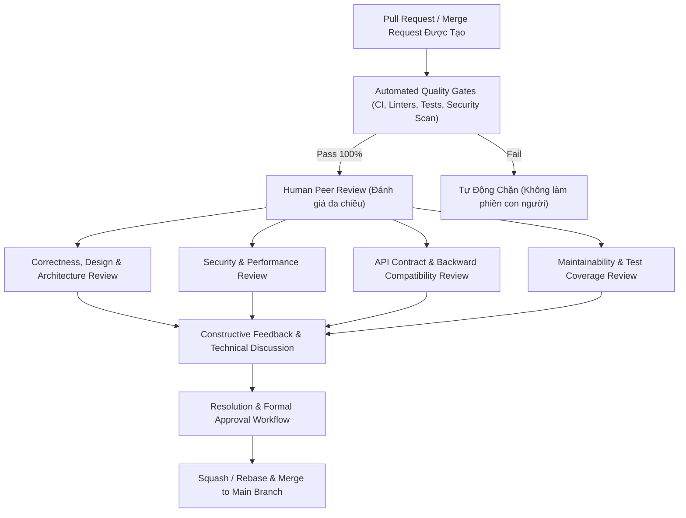
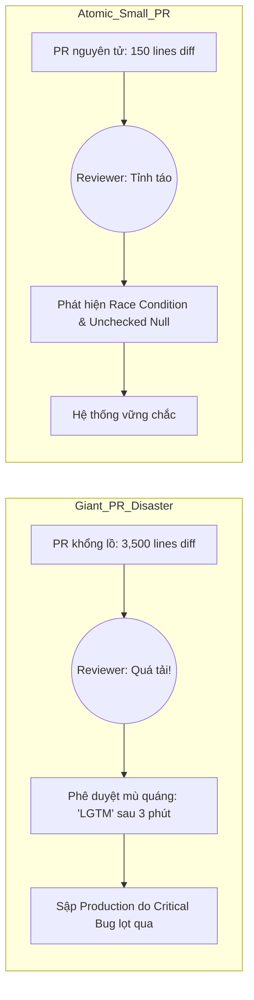
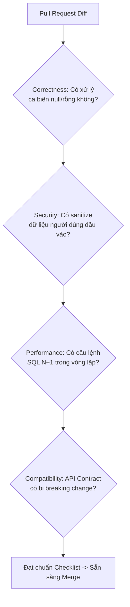
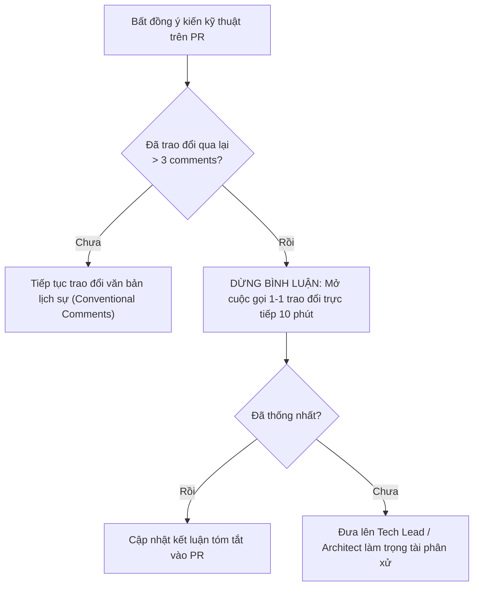
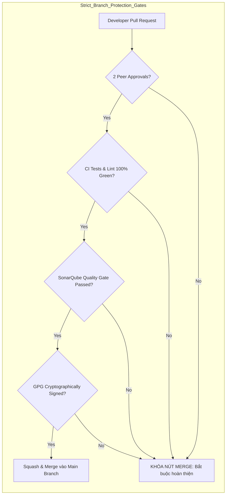

# 8.1. Thực Hành Code Review và Các Cổng Kiểm Soát Chất Lượng (Code Review Practices & Quality Gates)

## Tổng quan về Code Review Practices & Quality Gates
Code Review không đơn thuần là thủ tục hành chính kiểm tra lỗi cú pháp (vốn là nhiệm vụ của máy tính thông qua Linters và Compilers), mà là một trong những hoạt động **chia sẻ tri thức, đồng thuận thiết kế và bảo vệ tính toàn vẹn hệ thống** quan trọng nhất trong kỹ nghệ phần mềm. Một quy trình Code Review trưởng thành được định hướng bởi các nguyên tắc rõ ràng: giới hạn phạm vi Pull Request (**Review Scope Management**), sử dụng danh sách kiểm tra đa tầng (**Review Checklists** từ Correctness, Security, Performance đến Backward Compatibility), giao tiếp phản hồi mang tính xây dựng (**Constructive Feedback**), hóa giải bất đồng kỹ thuật một cách văn minh (**Review Disagreements Resolution**), và thiết lập các chính sách phê duyệt nghiêm ngặt (**Approval Workflows & Merge Policies**).



---

## 2. Chi tiết từng Keyword (Under-the-Hood Deep Dive)

---

### 1. Code Review Fundamentals, Scope Management, Pull & Merge Request Reviews

#### 1. Khái niệm bản chất (What & Why)
* **Code Review Fundamentals**: Hoạt động thẩm định chéo mã nguồn giữa các kỹ sư trước khi code được tích hợp vào nhánh chính. Mục tiêu: Tìm lỗi logic, đảm bảo tuân thủ kiến trúc, duy trì khả năng đọc hiểu và chia sẻ quyền sở hữu tập thể (Collective Ownership).
* **Pull Request (PR) / Merge Request (MR) Review**: Đơn vị giao tiếp kỹ thuật chuẩn hóa trên các nền tảng (GitHub, GitLab), bao gồm phần giải trình mục tiêu, liên kết tới issue/ticket, danh sách thay đổi và các hình ảnh/kết quả đo đạc bằng chứng.
* **Review Scope Management (Quản lý phạm vi review)**: Kỷ luật giữ cho mỗi Pull Request luôn nhỏ và tập trung. Quy tắc thực nghiệm: Một PR lý tưởng không nên vượt quá **200 đến 400 dòng code** thay đổi (trừ file sinh tự động).
* **Định luật Parkinson về sự tầm thường (Bikeshedding)**: Hiện tượng phổ biến trong Code Review: Một PR thay đổi 10 dòng code sẽ nhận được 50 bình luận tranh cãi về tên biến hay dấu cách; trong khi một PR thay đổi 5000 dòng code sẽ được approve vội vàng trong 5 phút với dòng chữ "Looks Good To Me" (LGTM)!

#### 2. Cơ chế hoạt động sâu (Under the hood / Hardcore Internals)
- **Tải nhận thức và Tỷ lệ phát hiện lỗi theo Kích thước PR (Cisco Code Review Study)**:
  - Nghiên cứu của Cisco trên 2,500 cuộc review chỉ ra rằng:
    - Khi tốc độ review vượt quá **500 dòng/giờ**, khả năng phát hiện lỗi của con người giảm xuống gần bằng 0.
    - Với PR có kích thước $< 200$ dòng code: Tỷ lệ phát hiện khiếm khuyết đạt $> 70\%$.
    - Với PR có kích thước $> 1000$ dòng code: Não bộ bị quá tải nhận thức, người review chỉ lướt qua bề mặt.
  - Quản lý phạm vi review là vũ khí kỹ thuật bảo vệ production chứ không phải sở thích cá nhân.

#### 3. Sơ đồ minh họa (Mermaid Diagram)


#### 4. Code ví dụ thực chiến (Markdown: Bản mẫu Pull Request Template Chuẩn Kỹ Nghệ)
```markdown
<!-- .github/pull_request_template.md -->
### 🎯 Mục tiêu Thay đổi (What & Why)
- Giải quyết Issue: #1042
- Tóm tắt: Tách module tính thuế khỏi OrderController và áp dụng Strategy Pattern.

### 🔍 Loại Thay đổi
- [ ] Bug fix (Không làm gãy API cũ)
- [x] Refactoring (Bảo toàn 100% hành vi bên ngoài)
- [ ] Tính năng mới
- [ ] Breaking Change (Đã có ADR đính kèm)

### 🧪 Bằng chứng Kiểm thử (Verification & Test Evidence)
- [x] Unit Test Pass 100% (Coverage đạt 88.5%)
- [x] Đã chạy Benchmark: Độ trễ giảm từ 12ms xuống 3.2ms
- [ ] Kèm ảnh chụp log hoặc kết quả chạy kịch bản k6

### 🛡️ Đánh giá Rủi ro & Khả năng Rollback
- Rủi ro: Thấp.
- Chiến lược Rollback: Feature Flag `ENABLE_NEW_TAX_STRATEGY=false`.
```

#### 5. Ưu / Nhược điểm, Pitfalls & Anti-patterns
- **Anti-pattern: Ghost PRs (PR ma)**: PR bị bỏ quên trong hàng tuần mà không ai review, dẫn đến việc bị phân nhánh quá xa so với `main` và phát sinh xung đột khổng lồ khi merge.

#### 6. Ứng dụng thực tế trong Backend / Systems
- **Quy trình Review tại Google (Critique)**: Mỗi thay đổi bắt buộc phải có ít nhất 2 chữ ký: Một chữ ký về tính đúng đắn kỹ thuật (Peer Reviewer) và một chữ ký của chủ sở hữu module (CODEOWNERS / Readability Approver).

---

### 2. Multi-Dimensional Review Checklists: Correctness, Security, Performance & Contracts

#### 1. Khái niệm bản chất (What & Why)
* **Correctness Review (Đánh giá tính đúng đắn)**: Kiểm tra xem code có thực sự giải quyết đúng bài toán nghiệp vụ, đúng các ca biên (edge cases), và không gây ra tác dụng phụ ngoài ý muốn.
* **Design & Architecture Review**: Kiểm tra xem mã nguồn có tuân thủ các ranh giới kiến trúc (Clean/Hexagonal), không làm phát sinh phụ thuộc vòng, và có tuân thủ SOLID hay không.
* **Security Review**: Rà soát các lỗ hổng Injection, xác thực/phân quyền (AuthN/AuthZ), rò rỉ thông tin nhạy cảm trong log, kiểm tra CSRF/XSS, và quản lý bí mật (Secrets).
* **Performance Review**: Soi xét độ phức tạp thuật toán $O(N)$, cấp phát bộ nhớ thừa thãi, N+1 query trong ORM, thiếu index cơ sở dữ liệu, và nguy cơ nghẽn I/O.
* **Maintainability & Readability Review**: Đánh giá tính rõ ràng của tên biến, hàm, sự phân chia trách nhiệm và độ sâu lồng nhau của code.
* **API Contract & Backward Compatibility Review**: Bảo đảm rằng việc thay đổi mã nguồn không làm gãy các client cũ đang chạy (ví dụ: Không được xóa trường trong JSON response, không đổi kiểu dữ liệu của trường hiện có).

#### 2. Cơ chế hoạt động sâu (Under the hood / Hardcore Internals)
- **Danh sách Kiểm tra Kỹ thuật Chuyên Sâu (Production Review Checklist)**:
  1. *Resource Leak*: Mọi File Descriptor, Socket, Database Connection có được bọc trong RAII hoặc khối `try-finally` không?
  2. *Concurrency & Memory Visibility*: Biến dùng chung giữa các luồng có được đồng bộ bằng `std::atomic` hoặc Mutex không? Có nguy cơ Deadlock do thứ tự lấy lock (Lock Acquisition Ordering) không?
  3. *Database Transaction Boundaries*: Transaction có bị giữ quá lâu qua một network call bên thứ ba không (gây cạn kiệt Connection Pool)?
  4. *Backward Compatibility*: Thêm cột mới trong DB có đi kèm lệnh `NOT NULL` mà không có `DEFAULT` value trên bảng lớn không?

#### 3. Sơ đồ minh họa (Mermaid Diagram)


#### 4. Code ví dụ thực chiến (C++20: Ngăn Chặn Breaking API Contract Trong Quá Trình Review)
```cpp
#include <iostream>
#include <optional>
#include <string>

// BEFORE: Phiên bản API v1
// struct UserProfile { std::string username; std::string email; };

// REVIEW CHECKLIST: Thay đổi API v2 bắt buộc phải Backward-Compatible!
// KHÔNG ĐƯỢC: Xóa trường cũ hoặc đổi kiểu dữ liệu
// PHẢI: Thêm trường mới dưới dạng Optional để không làm gãy các Client cũ

struct UserProfileV2 {
    std::string username;           // Bắt buộc (Tương thích v1)
    std::string email;              // Bắt buộc (Tương thích v1)
    std::optional<std::string> bio; // Trường mới thêm: Optional, an toàn 100% với Client v1
};

void renderProfile(const UserProfileV2& p) {
    std::cout << "User: " << p.username << " (" << p.email << ")\n";
    if (p.bio.has_value()) {
        std::cout << "Bio: " << *p.bio << "\n";
    }
}

int main() {
    UserProfileV2 clientLegacy{"linus", "linus@kernel.org", std::nullopt};
    renderProfile(clientLegacy); // Chạy mượt mà với dữ liệu client cũ
    return 0;
}
```

#### 5. Ưu / Nhược điểm, Pitfalls & Anti-patterns
- **Anti-pattern: Nitpicking on Formatting**: Reviewer dành 80% thời gian để bắt bẻ dấu chấm phẩy, cách xuống dòng. Đây là việc của Prettier / Clang-Format tự động trong CI. Reviewer con người chỉ nên tập trung vào Logic, Kiến trúc, Bảo mật và Hiệu năng.

#### 6. Ứng dụng thực tế trong Backend / Systems
- **Database Schema Migration Review**: Mọi câu lệnh SQL migration trong PR đều bắt buộc phải được review bởi một DBA hoặc Database Specialist để kiểm tra kế hoạch thực thi `EXPLAIN` trước khi merge.

---

### 3. Review Feedback Dynamics: Constructive Feedback, Disagreements & Resolution

#### 1. Khái niệm bản chất (What & Why)
* **Constructive Feedback (Phản hồi mang tính xây dựng)**: Phản hồi tập trung vào mã nguồn chứ không nhắm vào con người viết mã. Sử dụng ngôn ngữ khách quan, giải thích rõ lý do kỹ thuật (TẠI SAO) và đề xuất phương án cải thiện cụ thể thay vì chỉ chê bai cụt ngủn ("Đoạn này tệ quá").
* **Technical Discussion (Thảo luận kỹ thuật)**: Xem Code Review như một diễn đàn học thuật cởi mở, nơi các kỹ sư cùng mổ xẻ các giải pháp thay thế và học hỏi lẫn nhau.
* **Review Disagreements & Resolution (Xử lý bất đồng trong review)**: Khi hai kỹ sư có quan điểm đối nghịch nhau về một giải pháp kiến trúc:
  1. Thảo luận trực tiếp qua cuộc gọi 10 phút thay vì đấu khẩu hàng chục bình luận văn bản qua lại trên GitHub (Quy tắc 3-comment rule).
  2. Dựa vào bằng chứng số liệu (Benchmark, Profiling) để phân xử.
  3. Nếu vẫn bế tắc, đưa lên Tech Lead hoặc Architecture Council làm trọng tài phân xử dựa trên tiêu chí chiến lược của tổ chức.

#### 2. Cơ chế hoạt động sâu (Under the hood / Hardcore Internals)
- **Quy tắc Gắn Nhãn Phản Hồi (Conventional Comments Standard)**:
  Để giảm thiểu căng thẳng và hiểu nhầm cảm xúc trong Code Review, các tổ chức kỹ thuật hàng đầu áp dụng tiền tố phân loại mức độ nghiêm trọng:
  - `praise:` Khen ngợi đoạn code xuất sắc ("praise: Cách xử lý thuật toán chỗ này rất thanh lịch!").
  - `nit:` (Nitpick) Góp ý nhỏ, mang tính thẩm mỹ, **không bắt buộc phải sửa** để được approve ("nit: Đổi tên biến này thành `timeoutMs` sẽ rõ ràng hơn").
  - `suggestion:` Đề xuất giải pháp tốt hơn, kèm code mẫu ("suggestion: Chỗ này có thể dùng `std::string_view` để tránh cấp phát bộ nhớ").
  - `issue:` Lỗi logic hoặc bảo mật thực sự, **bắt buộc phải sửa** trước khi merge ("issue: Hàm này chưa kiểm tra nullptr, có thể gây crash").
  - `question:` Đặt câu hỏi để hiểu rõ ý đồ ("question: Tại sao chúng ta không dùng cache ở đây?").

#### 3. Sơ đồ minh họa (Mermaid Diagram)


#### 4. Code ví dụ thực chiến (Conventional Comments Simulation)
```text
// Ví dụ về một Feedback chuẩn mực của Kỹ Sư Trưởng Thành:
issue (blocking): Hàm này đang thực hiện gọi HTTP tuần tự bên trong vòng lặp for (N+1 HTTP calls).
Tại sao: Khi danh sách có 100 phần tử, độ trễ sẽ bị cộng dồn lên tới 5 giây, gây timeout API Gateway.
Đề xuất: Chúng ta nên gom các ID lại và gọi endpoint Batch: `POST /api/v1/orders/batch-lookup` 
hoặc sử dụng Promise.all để thực thi song song có giới hạn concurrency.

nit (non-blocking): Tên biến `d` nên đổi thành `durationSeconds` để tăng tính rõ ràng.
```

#### 5. Ưu / Nhược điểm, Pitfalls & Anti-patterns
- **Anti-pattern: Defensive Author (Tác giả tự ái)**: Coi mọi góp ý trên code như một sự công kích cá nhân và phản ứng gay gắt, từ chối giải thích lý do kỹ thuật.

#### 6. Ứng dụng thực tế trong Backend / Systems
- **Văn hóa Kỹ thuật tại GitLab**: Áp dụng triệt để văn hóa phản hồi không đổ lỗi và quy chuẩn Conventional Comments trên 100% các dự án mã nguồn mở.

---

### 4. Approval Workflows, Merge Policies & Branch Protection

#### 1. Khái niệm bản chất (What & Why)
* **Approval Workflows (Quy trình phê duyệt)**: Quy định bắt buộc về số lượng và vai trò của những người phải ký duyệt trước khi một PR được phép tích hợp (ví dụ: Yêu cầu ít nhất 2 approvals, trong đó bắt buộc có 1 người thuộc nhóm Security nếu PR sửa đổi thư mục `auth/`).
* **Merge Policies (Chính sách tích hợp nhánh)**:
  - **Squash and Merge**: Nén toàn bộ 20 commit lộn xộn của nhánh tính năng thành đúng 1 commit duy nhất, sạch đẹp trên nhánh chính.
  - **Rebase and Merge**: Áp dụng các commit của nhánh tính năng lên đầu nhánh chính mà không tạo merge commit rác, giữ cho lịch sử Git là một đường thẳng tắp.
  - **Merge Commit (Create a merge commit)**: Giữ nguyên cây lịch sử phân nhánh (thường dùng trong Git Flow truyền thống).
* **Branch Protection (Bảo vệ nhánh)**: Cơ chế kỹ thuật ở tầng Git Server ngăn cấm bất kỳ ai (kể cả Tech Lead hay CTO) được phép `git push --force` hoặc commit trực tiếp vào nhánh `main` mà không qua Pull Request.

#### 2. Cơ chế hoạt động sâu (Under the hood / Hardcore Internals)
- **Tầng Bảo Vệ Cryptographic Git Commit Signing (GPG / SSH Keys)**:
  - Một chính sách bảo vệ nhánh nghiêm ngặt (Strict Branch Protection) bắt buộc:
    1. **Require signed commits**: Mọi commit phải được ký bằng khóa riêng tư GPG/SSH của kỹ sư (`git commit -S -m "..."`). Tránh việc kẻ tấn công giả mạo tác giả commit (Author Spoofing).
    2. **Require status checks to pass before merging**: Tất cả các bước kiểm tra tự động của CI (Build, Unit Test, Linter, Secret Scanner) phải trả về mã `0 (Success)`.
    3. **Require branches to be up to date before merging**: Ngăn ngừa hiện tượng tích hợp trên nền tảng mã nguồn cũ (Stale Base Branch).

#### 3. Sơ đồ minh họa (Mermaid Diagram)


#### 4. Code ví dụ thực chiến (JSON: Cấu hình GitHub Branch Protection Rule qua API)
```json
{
  "required_status_checks": {
    "strict": true,
    "contexts": [
      "ci/github-actions/unit-tests",
      "ci/github-actions/security-sast",
      "sonarcloud/quality-gate"
    ]
  },
  "enforce_admins": true,
  "required_pull_request_reviews": {
    "dismiss_stale_reviews": true,
    "require_code_owner_reviews": true,
    "required_approving_review_count": 2
  },
  "restrictions": null,
  "allow_force_pushes": false,
  "allow_deletions": false
}
```

#### 5. Ưu / Nhược điểm, Pitfalls & Anti-patterns
- **Anti-pattern: "Admin Bypass Everything"**: Trao quyền bypass branch protection cho một số cá nhân và họ thường xuyên dùng quyền này để push code trực tiếp lúc nửa đêm khi có sự cố, vô tình ghi đè và làm mất mát mã nguồn của đồng nghiệp.

#### 6. Ứng dụng thực tế trong Backend / Systems
- **Tiêu chuẩn Tuân thủ SOC 2 Type II**: Bắt buộc doanh nghiệp công nghệ phải chứng minh 100% dòng code chạy trên production đều có bằng chứng review độc lập và không ai có thể tự đưa code của chính mình lên mà không qua kiểm soát hai người (Four-Eyes Principle).

---

## Tổng kết Chương 8.1
Code Review chuyên nghiệp là nền tảng của một tổ chức kỹ thuật bền vững. Bằng cách kiểm soát chặt chẽ phạm vi thay đổi, vận hành danh sách kiểm tra đa tầng từ tính đúng đắn đến tính tương thích ngược, xây dựng văn hóa phản hồi mang tính xây dựng và áp đặt các chính sách phê duyệt nhánh tự động bằng công nghệ, chúng ta bảo đảm chất lượng của từng dòng code và không ngừng nâng cao năng lực cho toàn bộ đội ngũ kỹ thuật.
