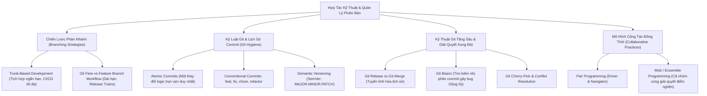
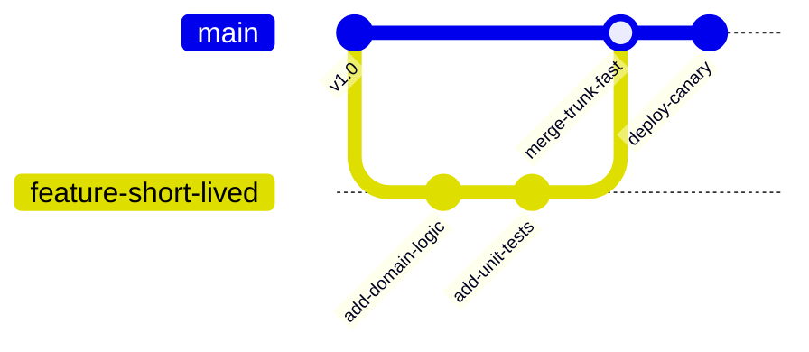
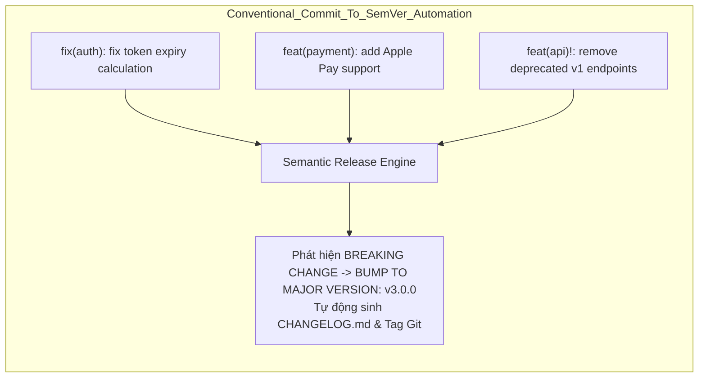
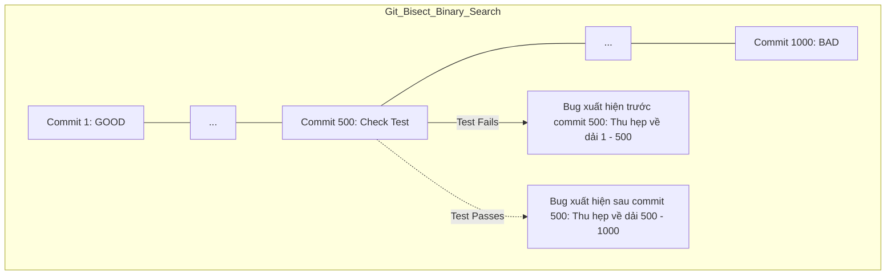
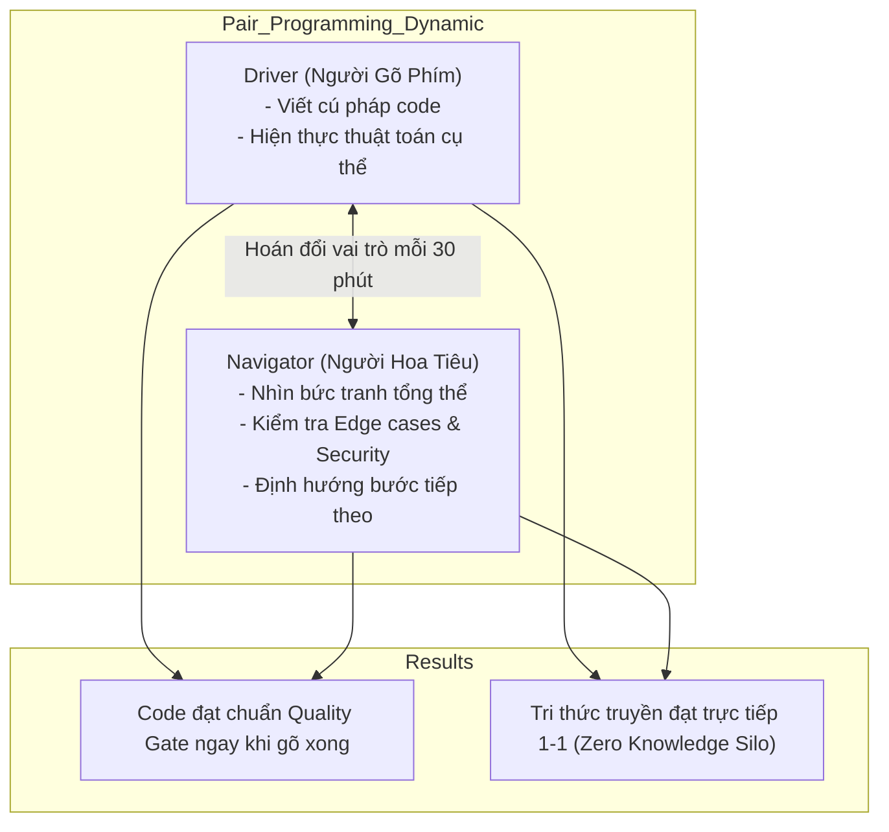

# 8.2. Chiến Lược Nhánh, Văn Hóa Git và Phát Triển Cộng Tác (Branching Strategies, Git Hygiene & Collaborative Engineering)

## Tổng quan về Branching Strategies, Git Hygiene & Collaborative Engineering
Trong các tổ chức kỹ thuật quy mô lớn với hàng trăm kỹ sư cùng tác động vào một kho mã nguồn (Monorepo hoặc Multi-repo), cách thức quản lý luồng nhánh (**Branching Strategy**) và kỷ luật lịch sử phiên bản (**Git Hygiene**) quyết định trực tiếp tốc độ chuyển giao phần mềm (**Lead Time for Changes**). Sự lựa chọn giữa mô hình truyền thống **Git Flow** và mô hình hiện đại **Trunk-Based Development** phản ánh mức độ trưởng thành về tự động hóa CI/CD. Một kỹ sư chuyên nghiệp phải làm chủ các kỹ thuật Git tầng sâu (**Interactive Rebase**, **Git Bisect** để truy vết bug nhị phân, **Cherry-Pick**, **Conflict Resolution**), tuân thủ nghiêm ngặt **Atomic & Conventional Commits**, hiểu rõ **Semantic Versioning (SemVer)**, đồng thời thuần thục các hình thức cộng tác trực tiếp như **Pair Programming**, **Mob Programming**, và **Collaborative Debugging**.



---

## 2. Chi tiết từng Keyword (Under-the-Hood Deep Dive)

---

### 1. Branching Strategies: Trunk-Based Development vs Git Flow vs Feature Branching

#### 1. Khái niệm bản chất (What & Why)
* **Trunk-Based Development (TBD)**: Chiến lược phân nhánh hiện đại được các công ty công nghệ hàng đầu (Google, Meta, Netflix) áp dụng. Tất cả kỹ sư làm việc trên các nhánh tính năng rất ngắn hạn (Short-lived branches - sống dưới 1-2 ngày) và liên tục tích hợp (merge) vào nhánh chính duy nhất (`main` hoặc `trunk`). Kết hợp cùng **Feature Flags** để ẩn các tính năng chưa hoàn thiện trên production.
* **Git Flow (Vincent Driessen)**: Mô hình truyền thống gồm nhiều nhánh dài hạn: `master`, `develop`, `feature/*`, `release/*`, `hotfix/*`. Phù hợp với các sản phẩm đóng gói bàn giao định kỳ hàng quý (Desktop apps, Game consoles), nhưng là điểm nghẽn lớn cho văn hóa Continuous Delivery hiện đại.
* **Feature Branch Workflow**: Mỗi tính năng được phát triển trên một nhánh riêng và chỉ được merge vào `main` sau khi tính năng đã hoàn thiện 100%. Nếu nhánh sống quá lâu (hàng tuần hoặc hàng tháng), hiện tượng "Merge Hell" chắc chắn sẽ xảy ra.
* **Release Branching**: Tạo nhánh cố định trước ngày release chính thức để đội QA kiểm thử đóng băng mã nguồn (Code Freeze), chỉ cho phép cherry-pick các bản vá lỗi nghiêm trọng vào nhánh này.

#### 2. Cơ chế hoạt động sâu (Under the hood / Hardcore Internals)
- **Tác động của Branching Model lên Hiện tượng Merge Hell & Tích hợp liên tục**:
  - Khi hai nhánh $A$ và $B$ tách ra từ `main` tại commit $C_0$:
    - Trong 3 tuần, nhánh $A$ sửa đổi 50 file, nhánh $B$ tái cấu trúc (refactor) 30 file trong số đó.
    - Không gian trạng thái phân kỳ (Divergence Space) tăng theo hàm số mũ của thời gian.
    - Thuật toán merge 3-way (`git merge-recursive` hoặc `ort` engine) phải tìm kiếm **Common Ancestor** $C_0$ và so sánh delta:
      $$\Delta_A = A - C_0, \quad \Delta_B = B - C_0$$
    - Khi các delta xung đột trên cùng dòng code hoặc thay đổi tên hàm mà nhánh kia đang gọi, thuật toán bó tay và đẩy việc giải quyết hàng trăm xung đột cho con người.
  - **Trunk-Based Development giải quyết triệt để**: Bằng cách tích hợp mỗi 4 tiếng, delta giữa nhánh và trunk luôn cực kỳ nhỏ ($\approx 50$ dòng code), xung đột được phát hiện và giải quyết ngay lập tức khi nó còn sơ khai.

#### 3. Sơ đồ minh họa (Mermaid Diagram)


#### 4. Code ví dụ thực chiến (TypeScript: Sử dụng Feature Flag trong Trunk-Based Development)
```typescript
// Trunk-Based Development: Merge code tính năng mới vào Trunk hàng ngày
// nhưng bảo vệ người dùng bằng Feature Flag động (Decouple Deployment from Release)

interface FeatureFlagService {
  isEnabled(flagName: string, userId: string): boolean;
}

class PaymentProcessor {
  constructor(private flagService: FeatureFlagService) {}

  async processCheckout(userId: string, amount: number): Promise<void> {
    // Code mới đã nằm trên Production nhưng chỉ bật cho 1% Beta Users
    if (this.flagService.isEnabled("USE_STRIPE_V3_TURBO", userId)) {
      console.log(`[BETA PATH] Sử dụng luồng thanh toán Stripe v3 mới tối ưu hóa.`);
      await this.executeStripeV3(amount);
      return;
    }

    // Luồng cũ ổn định cho 99% người dùng thông thường
    console.log(`[STABLE PATH] Sử dụng luồng thanh toán Legacy ổn định.`);
    await this.executeLegacyPayment(amount);
  }

  private async executeStripeV3(amount: number) { /* New Implementation */ }
  private async executeLegacyPayment(amount: number) { /* Old Implementation */ }
}
```

#### 5. Ưu / Nhược điểm, Pitfalls & Anti-patterns
- **Anti-pattern: Long-Lived Feature Branches**: Nhánh tính năng sống 3 tháng trời, đến ngày merge thì xung đột 200 file, không ai dám nhận trách nhiệm resolve conflict vì sợ làm hỏng logic của nhau.

#### 6. Ứng dụng thực tế trong Backend / Systems
- **Báo cáo DORA State of DevOps**: Chỉ ra rằng các tổ chức công nghệ hàng đầu (Elite Performers) đều áp dụng **Trunk-Based Development** để đạt tần suất triển khai hàng chục lần một ngày với thời gian phục hồi sau sự cố (MTTR) tính bằng phút.

---

### 2. Commit Hygiene: Atomic Commits, Conventional Commits & Semantic Versioning

#### 1. Khái niệm bản chất (What & Why)
* **Commit Hygiene (Kỷ luật commit)**: Tiêu chuẩn giữ cho lịch sử phiên bản của kho mã nguồn luôn trong sáng, dễ hiểu, có thể truy vết và có thể hoàn tác an toàn.
* **Atomic Commits (Commit nguyên tử)**: Mỗi commit chỉ nên chứa **đúng một thay đổi logic duy nhất**, hoàn chỉnh và độc lập. Sau mỗi commit, toàn bộ test suite của dự án vẫn phải chạy thành công (Pass). Tuyệt đối không commit code dở dang làm vỡ build.
* **Conventional Commits**: Quy chuẩn định dạng thông điệp commit chuẩn quốc tế, giúp con người và máy tính đều hiểu được ý nghĩa:
  - Cấu trúc: `<type>(<scope>): <short description>`
  - Các type chuẩn: `feat` (tính năng mới), `fix` (sửa lỗi), `refactor` (tái cấu trúc code), `perf` (tối ưu hiệu năng), `test` (thêm/sửa test), `chore` (cấu hình build, dependencies), `docs` (tài liệu).
* **Semantic Versioning (SemVer - Tom Preston-Werner)**: Quy tắc đánh số phiên bản phần mềm theo định dạng:
  $$\textbf{MAJOR.MINOR.PATCH}$$
  - **PATCH**: Tăng khi sửa lỗi mà không thay đổi API (Backward-compatible bug fixes).
  - **MINOR**: Tăng khi thêm tính năng mới nhưng vẫn tương thích ngược (Backward-compatible new features).
  - **MAJOR**: Tăng khi có thay đổi làm gãy tính tương thích ngược (Breaking Changes).

#### 2. Cơ chế hoạt động sâu (Under the hood / Hardcore Internals)
- **Tự động hóa Release và Changelog bằng Conventional Commits & Semantic Release**:
  - Khi kho Git tuân thủ nghiêm ngặt Conventional Commits:
    - Công cụ tự động (như `standard-version` hoặc `semantic-release`) quét toàn bộ commit logs kể từ tag gần nhất:
      - Nếu có commit chứa tiêu đề `BREAKING CHANGE:` hoặc `feat!:` $\implies$ Tự động tăng **MAJOR** version (ví dụ: `2.4.1 -> 3.0.0`).
      - Nếu có commit `feat:` $\implies$ Tự động tăng **MINOR** version (`2.4.1 -> 2.5.0`).
      - Nếu chỉ toàn commit `fix:` $\implies$ Tự động tăng **PATCH** version (`2.4.1 -> 2.4.2`).
    - Tự động sinh file `CHANGELOG.md` sạch đẹp và tạo Git Release Tag mà không cần sự can thiệp thủ công của con người.

#### 3. Sơ đồ minh họa (Mermaid Diagram)


#### 4. Code ví dụ thực chiến (Git Commit Messages Chuẩn Conventional Commits)
```text
feat(billing): thêm hỗ trợ thanh toán qua cổng ZaloPay

- Tích hợp ZaloPay SDK v2 vào BillingAdapter
- Bổ sung Domain Event ZaloPayPaymentCompleted
- Thêm bài kiểm thử Integration Test giả lập Webhook callback

Closes Issue: #208
BREAKING CHANGE: Trường `paymentMethod` trong OrderDTO hiện bắt buộc phải có giá trị.
```

#### 5. Ưu / Nhược điểm, Pitfalls & Anti-patterns
- **Anti-pattern: "WIP Commits"**: Commit mã nguồn với các thông điệp vô nghĩa: `wip`, `fix bug`, `fix test`, `update`, `aaa`. Điều này biến lịch sử Git thành bãi rác và vô hiệu hóa hoàn toàn khả năng sử dụng `git bisect`.

#### 6. Ứng dụng thực tế trong Backend / Systems
- **Hệ sinh thái Node.js / NPM & Rust Crates**: Toàn bộ hệ thống quản lý thư viện thế giới vận hành dựa trên cam kết **Semantic Versioning** để tự động tải các bản cập nhật an toàn (`^1.2.3`).

---

### 3. Advanced Git Operations: Interactive Rebase, Bisect, Cherry-Pick & Conflict Resolution

#### 1. Khái niệm bản chất (What & Why)
* **Git Rebase (Tái định vị gốc)**: Di chuyển điểm bắt đầu của nhánh tính năng lên đỉnh mới nhất của nhánh chính, tạo ra một lịch sử commit tuyến tính (Linear History) đẹp đẽ, loại bỏ hoàn toàn các merge commit rác ("Merge branch 'main' into feature").
* **Git Bisect (Truy vết lỗi nhị phân)**: Công cụ thần thánh của Git sử dụng thuật toán tìm kiếm nhị phân (Binary Search) để tìm ra chính xác commit nào đã gây ra bug trong số hàng nghìn commits với độ phức tạp thời gian $O(\log N)$.
* **Git Cherry-Pick**: Chọn lọc và trích xuất một hoặc một vài commit cụ thể từ một nhánh khác để áp dụng vào nhánh hiện tại mà không cần merge toàn bộ nhánh.
* **Merge Conflict Resolution (Giải quyết xung đột merge)**: Kỹ năng phân tích delta ba bên (3-way merge) để giải quyết các xung đột mã nguồn một cách chính xác mà không vô tình xóa mất code của đồng nghiệp.

#### 2. Cơ chế hoạt động sâu (Under the hood / Hardcore Internals)
- **Thuật toán Tìm kiếm Nhị phân trong `git bisect`**:
  - Giả sử hệ thống đang ở commit thứ $10,000$ và phát hiện một bug nghiêm trọng mà ở commit thứ $1,000$ (3 tháng trước) không hề có.
  - Số lượng commit cần kiểm tra là $9,000$. Nếu kiểm tra thủ công từng commit sẽ mất hàng tuần.
  - `git bisect` chỉ mất:
    $$\lceil \log_2(9000) \rceil \approx 13 \text{ bước kiểm tra!}$$
  - Ở mỗi bước, Git tự động checkout về commit ở giữa. Kỹ sư chạy test script:
    - Nếu test pass $\implies$ `git bisect good`.
    - Nếu test fail $\implies$ `git bisect bad`.
  - Chỉ trong vòng 5 phút, Git chỉ mặt đặt tên chính xác commit tác giả nào đã đưa bug vào hệ thống!

#### 3. Sơ đồ minh họa (Mermaid Diagram)


#### 4. Code ví dụ thực chiến (Bash Script: Tự động hóa hoàn toàn Git Bisect với Test Runner)
```bash
#!/bin/bash
# Kỹ thuật Tự động hóa Git Bisect: Tìm commit gây lỗi mà không cần con người can thiệp

# 1. Đánh dấu điểm bắt đầu
git bisect start
git bisect bad HEAD              # Commit hiện tại bị lỗi
git bisect good v2.0.0           # Phiên bản v2.0.0 cách đây 6 tháng chạy hoàn hảo

# 2. Để Git tự động chạy script test và tìm nhị phân
# Nếu script trả về exit code 0: Git coi là GOOD
# Nếu script trả về exit code khác 0: Git coi là BAD
git bisect run ./scripts/run_unit_test.sh

# 3. Kết thúc bisect và trở về trạng thái bình thường sau khi tìm thấy thủ phạm
git bisect reset
```

#### 5. Ưu / Nhược điểm, Pitfalls & Anti-patterns
- **Anti-pattern: Rebasing Public/Shared Branches**: Chạy lệnh `git rebase` trên các nhánh dùng chung (`main`, `develop`) rồi dùng `git push --force`. Hành vi này ghi đè lại lịch sử commit của Git Server, phá hủy toàn bộ kho mã nguồn cục bộ của tất cả các đồng nghiệp khác trong nhóm! **Chỉ rebase trên nhánh cá nhân của chính mình**.

#### 6. Ứng dụng thực tế trong Backend / Systems
- **Debugging lỗi suy giảm hiệu năng trong Linux Kernel**: Linus Torvalds và các cộng sự sử dụng `git bisect` kết hợp cùng automated boot scripts để xác định bản vá nào làm tăng độ trễ mạng trong số hàng chục nghìn bản vá của mỗi phiên bản kernel mới.

---

### 4. Collaborative Engineering: Pair Programming, Mob Programming & Knowledge Sharing

#### 1. Khái niệm bản chất (What & Why)
* **Pair Programming (Lập trình cặp)**: Kỹ thuật hai lập trình viên cùng làm việc trên một máy trạm:
  - **The Driver (Người lái)**: Ngồi gõ phím, tập trung vào cú pháp, chi tiết cài đặt và thuật toán vi mô.
  - **The Navigator (Người hoa tiêu)**: Quan sát bức tranh tổng thể, rà soát lỗi logic, xem xét ranh giới thiết kế, liên tục đặt câu hỏi về các trường hợp biên và kiểm tra sự tuân thủ kiến trúc.
  - Hai người hoán đổi vai trò cho nhau sau mỗi 30-45 phút.
* **Mob Programming (Ensemble Programming - Lập trình hội đồng)**: Mở rộng lập trình cặp ra toàn bộ nhóm (4-6 kỹ sư) cùng ngồi lại xử lý đúng một bài toán phức tạp trên một màn hình lớn. Rất hiệu quả khi xử lý sự cố khẩn cấp (SEV-1 Incident) hoặc giải quyết một kiến trúc hoàn toàn mới.
* **Collaborative Debugging & Knowledge Sharing**: Phá vỡ các tháp cô lập tri thức (Knowledge Silos), nâng cao chỉ số an toàn của dự án (**Bus Factor**) để không một cá nhân nào trở thành điểm nghẽn độc quyền về tri thức của hệ thống.

#### 2. Cơ chế hoạt động sâu (Under the hood / Hardcore Internals)
- **Hiệu quả Kinh tế và Chất lượng của Pair Programming (Nghiên cứu của Laurie Williams, Đại học Utah)**:
  - Lập trình cặp tốn thêm khoảng **15% tổng thời gian lập trình viên** so với hai người làm việc độc lập.
  - NHƯNG: Số lượng lỗi (Defects/Bugs) giảm tới **15% đến 20%** ngay từ khâu viết code.
  - Thời gian sửa lỗi trên production đắt hơn gấp hàng chục lần so với 15% thời gian gõ phím ban đầu.
  - Hơn nữa, việc review code diễn ra đồng thời trong thời gian thực (Zero PR Wait Time), loại bỏ hoàn toàn thời gian chết chờ đợi review pull request.

#### 3. Sơ đồ minh họa (Mermaid Diagram)


#### 4. Code ví dụ thực chiến (TypeScript: Ping-Pong Pair Programming Pattern)
```typescript
// Phong cách Ping-Pong Pair Programming kết hợp TDD:
// Bước 1: Người A (Navigator lúc trước) viết một Unit Test thất bại (ĐỎ)
describe('Ping-Pong TDD: RomanNumeralConverter', () => {
  it('chuyển đổi số 4 thành IV', () => {
    // Test này ban đầu bị Fail vì chưa có code hiện thực
    expect(convertRoman(4)).toBe('IV');
  });
});

// Bước 2: Chuyển bàn phím cho Người B (Driver) viết đoạn code tối giản nhất để Test chuyển sang XANH
function convertRoman(num: number): string {
  if (num === 4) return 'IV'; // Làm xanh test nhanh nhất
  return '';
}

// Bước 3: Cả hai cùng bàn bạc Refactor code cho tổng quát, sau đó Người B viết tiếp test cho số 9!
```

#### 5. Ưu / Nhược điểm, Pitfalls & Anti-patterns
- **Anti-pattern: Passenger Syndrome**: Khi lập trình cặp, người Navigator lơ đãng ngồi bấm điện thoại hoặc hoàn toàn im lặng, biến buổi làm việc thành màn biểu diễn đơn độc của người Driver.

#### 6. Ứng dụng thực tế trong Backend / Systems
- **Onboarding Kỹ sư Mới**: Áp dụng Pair Programming trong 2 tuần đầu tiên giúp kỹ sư mới làm quen với codebase phức tạp nhanh gấp 3 lần so với việc bắt họ tự đọc tài liệu một mình.

---

## Tổng kết Chương 8.2
Văn hóa nhánh và kỹ thuật cộng tác là huyết mạch duy trì tốc độ phát triển bền vững của tổ chức. Bằng cách áp dụng Trunk-Based Development để giải phóng năng lực Continuous Delivery, giữ gìn lịch sử phiên bản trong sạch bằng Atomic & Conventional Commits, làm chủ các công cụ truy vết nhị phân như Git Bisect, và thúc đẩy tri thức tập thể qua Pair Programming, người kỹ sư chuyên nghiệp bảo đảm rằng tổ chức luôn tiến về phía trước với sự gắn kết và hiệu quả cao nhất.
