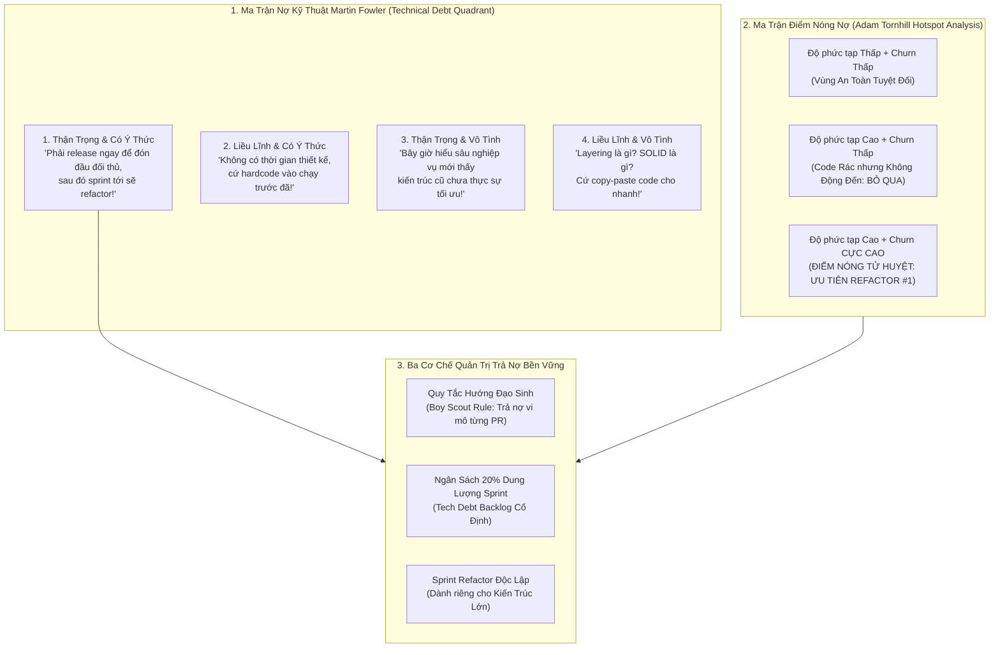

# 9.1. Technical Debt Taxonomy and Measurement

> [!IMPORTANT]
> **Nếu bạn chỉ được nhớ một điều duy nhất:** Nợ kỹ thuật (Technical Debt) vận hành hoàn toàn tương đồng với **Nợ tài chính**: Vay một khoản nợ nhỏ có tính toán giúp doanh nghiệp ra mắt tính năng sớm hơn để giành thị phần; nhưng nếu không trả lãi định kỳ, quy luật **Lãi Suất Kép (Compounding Interest)** sẽ khiến tốc độ phát triển (Engineering Velocity) rơi tự do về 0, biến toàn bộ thời gian của đội ngũ thành việc đi dập lửa sự cố Production. Một tổ chức công nghệ trưởng thành tuyệt đối không bao giờ rơi vào cái bẫy "Viết lại từ đầu" (**The Big Rewrite Trap**), mà quản trị nợ chủ động bằng cách dành cố định **$15\% - 20\%$ Capacity mỗi Sprint**, định lượng nợ qua phương pháp **SQALE Index** và định vị chính xác điểm nóng refactoring bằng **Ma trận Tần suất Thay đổi vs Độ phức tạp (Code Churn vs Cyclomatic Complexity Matrix)**.

---

## 1. Kiến trúc Tổng quan & Mô hình Tư duy (Mental Model)

### Ẩn Dụ Đời Sống: Ngôi Nhà Ống Chắp Vá & Thẻ Tín Dụng Lãi Suất Cao
1. **Lãi Suất Kép Của Nợ Kỹ Thuật**: Bạn vay tiền từ thẻ tín dụng (cắt xén kiến trúc để kịp tiến độ) với lãi suất 20%/năm. Ban đầu số tiền lãi chỉ vài trăm ngàn. Nhưng nếu bạn tiếp tục quẹt thẻ mua sắm thêm tính năng mà không trả nợ gốc, sau 3 năm số tiền lãi vượt quá thu nhập hàng tháng. Lúc này, chỉ một việc nhỏ như đổi màu một nút bấm cũng làm gãy vỡ toàn bộ hệ thống thanh toán.
2. **Ma Trận Martin Fowler (Bác Sĩ Cấp Cứu vs Lang Băm Liều Lĩnh)**:
   - *Vay Nợ Thận Trọng & Có Ý Thức (Prudent & Deliberate)*: Một bác sĩ quyết định băng bó tạm thời vết thương cho bệnh nhân tại hiện trường tai nạn để kịp chuyển vào phòng mổ lớn. Đây là quyết định chiến lược sáng suốt: chấp nhận nợ để cứu sống sinh mạng dự án.
   - *Vay Nợ Liều Lĩnh & Vô Tình (Reckless & Inadvertent)*: Một thợ xây không biết gì về kết cấu bê tông cốt thép, xây bừa một bức tường nghiêng trên nền đất lún mà thậm chí không biết mình đang xây sai. Đây là sự vô minh kỹ thuật hủy hoại tổ chức.
3. **Phân Tích Điểm Nóng (Chiếc Cửa Sổ Bị Nứt Trên Ngã Tư)**: Một đoạn mã dù cực kỳ rác rưởi và phức tạp, nhưng nếu nó nằm ở góc khuất và 5 năm qua không ai chạm vào, nó **hoàn toàn vô hại**. Ngược lại, một đoạn mã chỉ hơi rối một chút nhưng nằm ngay tại giao lộ trung tâm (luồng thanh toán Checkout), mỗi ngày có 10 kỹ sư commit code vào đó, thì đó chính là **Điểm nóng chết người (Hotspot)** cần phải dốc toàn lực refactor ngay lập tức!



---

## 2. Chi tiết từng Keyword (Under-the-Hood Deep Dive)

### 2.1. Taxonomy of Technical Debt (Code, Architecture, Testing, Infrastructure & Documentation)
Nợ kỹ thuật không đơn thuần là "code xấu", mà là một phổ rộng các khoản nợ phân bổ xuyên suốt vòng đời phần mềm:
1. **Code-Level Debt (Nợ Tầng Mã Nguồn)**:
   - Các triệu chứng kinh điển (Code Smells): Vi phạm nguyên lý DRY (Copy-paste code), các lớp thần thánh (God Classes / Bloated Methods dài hàng nghìn dòng), biến đặt tên tối nghĩa, lạm dụng cờ boolean (`flag = true/false`) để phân nhánh logic phức tạp, và vi phạm các nguyên lý SOLID.
2. **Architectural Debt (Nợ Tầng Kiến Trúc)**:
   - Dạng nợ tốn kém nhất để khắc phục. Xói mòn các ranh giới kiến trúc (Architectural Erosion), vi phạm Domain-Driven Design (phụ thuộc vòng tròn giữa các module), rò rỉ chi tiết triển khai cơ sở dữ liệu lên tầng giao diện người dùng, phụ thuộc cứng vào các thư viện bên thứ ba đã ngừng bảo trì (EoL - End of Life).
3. **Testing Debt (Nợ Tầng Kiểm Thử)**:
   - Thiếu vắng các bài kiểm thử tự động ở tầng Unit/Integration, kiểm thử phụ thuộc vào môi trường bên ngoài dẫn tới tình trạng **Flaky Tests** (lúc pass lúc fail). Hậu quả: Kỹ sư mất hoàn toàn sự tự tin khi sửa đổi mã nguồn, dẫn tới tâm lý "sợ đụng vào code cũ".
4. **Infrastructure & Operations Debt (Nợ Hạ Tầng & Vận Hành)**:
   - Cấu hình hạ tầng thủ công qua giao diện Web (Click-ops) thay vì dùng Infrastructure-as-Code (Terraform / Ansible), thiếu hệ thống giám sát cảnh báo (Observability blind spots), tích lũy các lỗ hổng bảo mật chưa vá (CVEs), và quy trình CI/CD chập chờn mất hàng giờ để build.
5. **Documentation & Knowledge Debt (Nợ Tri Thức & Tài Liệu)**:
   - Thiếu vắng các bản ghi quyết định kiến trúc (**ADR - Architecture Decision Records**), tài liệu API lỗi thời so với thực tế, tri thức hệ thống chỉ nằm trong đầu của một vài lập trình viên kỳ cựu (Bus Factor = 1).

- **Nợ Phụ Thuộc (Dependency Debt & Supply Chain Vulnerabilities)**:
  - Một ứng dụng trung bình ngày nay bao gồm hơn 80% mã nguồn đến từ các thư viện mã nguồn mở bên thứ ba (npm, PyPI, crates.io, Maven). Nợ phụ thuộc phát sinh khi nhóm không cập nhật phiên bản thư viện định kỳ.
  - *Bài học lịch sử Left-Pad (2016)*: Một thư viện chỉ có 11 dòng mã bị gỡ khỏi npm đã làm sập hàng nghìn hệ thống build trên toàn cầu (Babel, React).
  - *Giải pháp*: Bắt buộc khóa cứng phiên bản bằng Lockfiles (`package-lock.json`, `Cargo.lock`, `poetry.lock`), tích hợp các bot tự động kiểm toán lỗ hổng (Dependabot / Renovate) và quét mã độc (Snyk, Trivy) trong pipeline CI/CD.

### 2.2. Mathematical Compounding Interest of Debt & Friction Drag
Mô hình toán học định lượng sự sụt giảm vận tốc phát triển phần mềm theo thời gian:
- Gọi:
  - $C_0$: Chi phí công sức ban đầu nếu thiết kế chuẩn chỉ.
  - $P$: Tiền nợ gốc (Principal) = Phần công sức bị cắt giảm để bàn giao tính năng gấp ($P < C_0$).
  - $r$: Lãi suất cản trở (Friction Rate) = Phần trăm thời gian hao phí thêm mỗi khi một kỹ sư phải đọc hiểu, đi vòng qua các cạm bẫy hoặc fix bug của đống code nợ ($r \in [0.05, 0.15]$ mỗi Sprint).
  - $t$: Số chu kỳ phát triển tiếp theo được xây dựng đè lên nền móng nợ đó.
- **Công Thức Lãi Suất Kép**:
  $$C(t) = P \times (1 + r)^t$$
  - *Hệ quả thực tế*: Nếu $r = 10\%$ mỗi Sprint, thì sau 10 Sprints ($t = 10$):
    $$C(10) = P \times (1.10)^{10} \approx \mathbf{2.59 \times P}$$
    Chi phí bảo trì phụ trội đã tăng gấp **2.6 lần** so với chi phí ban đầu! Nếu không trả nợ, đến Sprint 20, chi phí sẽ là $6.72 P$, toàn bộ năng lực của đội ngũ bị chôn vùi trong việc trả lãi mà không tạo ra thêm bất kỳ giá trị kinh doanh mới nào.

### 2.3. Martin Fowler's Technical Debt Quadrant (Prudent vs Reckless, Deliberate vs Inadvertent)
Khung ma trận 4 góc phần tư phân loại động cơ và thái độ khi vay nợ kỹ thuật:
- **Prudent & Deliberate (Thận trọng & Có ý thức - Vay Nợ Chiến Lược)**: Nhóm hiểu rõ kiến trúc chuẩn mực, nhưng vì mục tiêu sống còn của công ty (kịp demo cho nhà đầu tư gọi vốn), họ chủ động chọn giải pháp tạm thời, ghi lại nợ vào backlog và lên lịch trả ngay Sprint sau.
- **Reckless & Deliberate (Liều lĩnh & Có ý thức - Vay Nợ Cẩu Thả)**: Nhóm biết làm thế là sai, nhưng vì lười biếng hoặc áp lực quản lý, họ chọn cách chắp vá cẩu thả mà không hề có kế hoạch dọn dẹp.
- **Reckless & Inadvertent (Liều lĩnh & Vô tình - Nợ Do Năng Lực Kém)**: Nhóm hoàn toàn không biết đến các nguyên lý thiết kế sạch, viết code theo bản năng và vô tình tạo ra một bãi rác mà không hề hay biết.
- **Prudent & Inadvertent (Thận trọng & Vô tình - Nợ Tiến Hóa Tri Thức)**: Nhóm đã nỗ lực thiết kế tốt nhất có thể tại thời điểm bắt đầu. Nhưng sau 1 năm vận hành và hiểu sâu sắc hơn về nghiệp vụ thực tế của khách hàng, họ nhận ra kiến trúc ban đầu không còn là giải pháp tối ưu nhất. Đây là khoản nợ tất yếu và lành mạnh của mọi phần mềm tiến hóa.

### 2.4. SQALE Methodology & Technical Debt Index (Remediation Cost vs Development Cost)
- **Phương Pháp Luận SQALE (Software Quality Assessment based on Lifecycle Expectations)**:
  - Phương pháp chuẩn hóa quốc tế được tích hợp trong **SonarQube** để định lượng nợ kỹ thuật thành số giờ công lao động cụ thể.
  - Phân loại vi phạm theo 8 đặc tính chất lượng của ISO 25010: Khả năng bảo trì (Maintainability), Độ tin cậy (Reliability), An toàn bảo mật (Security), Hiệu năng (Efficiency)...
  - Mỗi vi phạm được gắn với một **Chi Phí Khắc Phục (Remediation Cost)** tính bằng phút/giờ (ví dụ: thiếu unit test = 30 phút, method quá dài = 15 phút, vòng lặp phức tạp = 45 phút).
- **Chỉ Số Nợ Kỹ Thuật (Technical Debt Ratio - TDR)**:
  $$\text{TDR} = \frac{\text{Tổng Chi Phí Khắc Phục (Remediation Cost)}}{\text{Tổng Chi Phí Xây Dựng Lại Từ Đầu (Development Cost)}} \times 100\%$$
  - $\text{TDR} \le 5\%$: Xếp hạng **A** (Mã nguồn cực kỳ lành mạnh).
  - $5\% < \text{TDR} \le 10\%$: Xếp hạng **B** (Bình thường, cần kiểm soát).
  - $\text{TDR} > 20\%$: Xếp hạng **D/E** (Mã nguồn báo động đỏ, có nguy cơ phá sản kỹ thuật).

- **Bảng Tra Cứu Chi Phí Khắc Phục Chuẩn Hóa SQALE (SQALE Remediation Model)**:
  Phương pháp SQALE quy đổi từng vi phạm chất lượng thành thời gian sửa đổi dự kiến (Estimated Remediation Time):
  ```text
  ┌──────────────────────────────────────────┬──────────────────────┬──────────────────────────────┐
  │ Loại Vi Phạm (Rule Violation)            │ Trọng Số Thời Gian   │ Tác Động Tới Chất Lượng      │
  ├──────────────────────────────────────────┼──────────────────────┼──────────────────────────────┤
  │ Thiếu Unit Test cho Public API           │ 30 - 60 phút / hàm   │ Giảm độ tin cậy khi mở rộng  │
  │ Method dài quá 80 dòng                   │ 20 phút / method     │ Khó đọc hiểu, tăng thời gian │
  │ Cyclomatic Complexity > 15               │ 45 phút / khối       │ Tăng nhánh lỗi tiềm ẩn       │
  │ Copy-paste khối mã > 20 dòng             │ 15 phút / khối       │ Nguy cơ sửa lỗi thiếu sót    │
  │ Lỗ hổng bảo mật cấp cao (High CVE)       │ 4 - 8 giờ / CVE      │ Nguy cơ bị tấn công thực tế  │
  │ Sử dụng API bị Deprecated                │ 1 - 2 giờ / vị trí   │ Khó nâng cấp phiên bản mới   │
  └──────────────────────────────────────────┴──────────────────────┴──────────────────────────────┘
  ```
  Tổng thời gian khắc phục của toàn bộ dự án chia cho chi phí phát triển ước tính ($30\text{ phút} \times \text{Tổng số LOC}$) cho ra chỉ số Technical Debt Ratio (TDR) giúp ban giám đốc có cái nhìn định lượng tài chính minh bạch.

### 2.5. Code Churn vs Complexity Matrix (Adam Tornhill Hotspot Analysis)
Được phát triển bởi Adam Tornhill trong cuốn sách kinh điển *Your Code as a Crime Scene*:
- Phân tích đa chiều kết hợp hai chỉ số:
  1. **Độ Phức Tạp Thuật Toán (Cyclomatic Complexity / Indentation Depth)**: Đo lường độ xoắn não của code (số lượng câu lệnh rẽ nhánh `if/else`, vòng lặp).
  2. **Tần Suất Thay Đổi Của Mã Nguồn (Code Churn / Revision Frequency)**: Đo lường số lần tệp tin hoặc hàm đó bị sửa đổi trong lịch sử Git trong 6 tháng qua.
- **Quy Luật Phân Phối Điểm Nóng (The Hotspot Power Law)**:
  - Thực tế chứng minh chỉ có **$2\% - 4\%$ tổng số tệp tin** trong codebase là các điểm nóng (Hotspots) chịu trách nhiệm cho hơn **$80\%$ số lỗi và chi phí bảo trì** của toàn bộ công ty!
  - Thay vì cố gắng refactor toàn bộ dự án hàng triệu dòng, kỹ sư chỉ cần xác định đúng top 5 tệp tin nằm ở góc phần tư **"Độ Phức Tạp Cao + Code Churn Cực Cao"** để tối ưu hóa, mang lại hiệu quả tức thì cho toàn bộ tổ chức.

---

## 3. Thực thi Mã nguồn & Mô phỏng Chuyên sâu (Dual-Engine Implementation)

### Engine 1: C++20 Chặn Đứng Nợ Kỹ Thuật Bằng `[[deprecated]]`, `static_assert` & Concepts
Mã nguồn C++20 minh họa cách đội ngũ kiến trúc sư sử dụng hệ thống kiểu tĩnh và chỉ thị trình biên dịch để ép buộc dọn dẹp API cũ, ngăn chặn tích lũy nợ kỹ thuật tại thời điểm compile-time:

```cpp
#include <iostream>
#include <string>
#include <concepts>
#include <type_traits>

// 1. Định nghĩa Concept C++20 ép buộc kiến trúc sạch (Architecture Enforcement)
template <typename T>
concept ValidLedgerPayload = requires(T a) {
    { a.get_transaction_id() } -> std::same_as<std::string>;
    { a.get_amount() } -> std::floating_point;
    requires sizeof(T) <= 128; // Ngăn chặn nợ phình to kích thước struct
};

class ModernPaymentPayload {
public:
    ModernPaymentPayload(std::string tx_id, double amount) 
        : tx_id_(std::move(tx_id)), amount_(amount) {}

    std::string get_transaction_id() const { return tx_id_; }
    double get_amount() const { return amount_; }

private:
    std::string tx_id_;
    double amount_;
};

class EnterprisePaymentGateway {
public:
    // API Cũ: Đã lỗi thời, đánh dấu cờ [[deprecated]] kèm chỉ dẫn chuyển đổi rõ ràng
    [[deprecated("API thanh toán thô v1 gây nợ kỹ thuật! Hãy chuyển sang process_transaction() với ValidLedgerPayload trước Q4/2026.")]]
    void process_raw_payment(const std::string& raw_account, double amount) {
        std::cout << "  [Legacy API Warning] Đang xử lý tài khoản cũ: " << raw_account 
                  << " (Cần lên lịch dọn dẹp!)\n";
    }

    // API Mới: Ép buộc tuân thủ Concept C++20, chặn đứng code rác ngay tại compile-time!
    template <ValidLedgerPayload Payload>
    void process_transaction(const Payload& payload) {
        std::cout << "  [Modern API] Giao dịch hợp chuẩn ACID: " << payload.get_transaction_id() 
                  << " | Số tiền: " << payload.get_amount() << "$\n";
    }
};

int main() {
    std::cout << "=== C++20 Technical Debt Prevention & Compile-Time Enforcement ===\n";
    EnterprisePaymentGateway gateway;

    // 1. Gọi API mới an toàn chuẩn mực
    ModernPaymentPayload valid_tx("TX-SECURE-9901", 1250.50);
    gateway.process_transaction(valid_tx);

    // 2. Minh họa gọi API cũ: Trình biên dịch sẽ phát cảnh báo Deprecation Warning
    std::cout << "\nGọi API cũ bị đánh dấu Deprecated:\n";
    gateway.process_raw_payment("ACC-OLD-0012", 50.0);

    // 3. Bảo vệ tĩnh chống suy thoái kiến trúc bằng static_assert
    static_assert(sizeof(ModernPaymentPayload) <= 128, 
                  "VI PHẠM KIẾN TRÚC: Kích thước Payload vượt quá hạn mức cho phép!");

    std::cout << "\nKiến trúc mã nguồn được bảo vệ vững chắc bởi trình biên dịch C++20!\n";
    return 0;
}
```

#### Terminal Output Mẫu (C++20 Engine):
```text
=== C++20 Technical Debt Prevention & Compile-Time Enforcement ===
  [Modern API] Giao dịch hợp chuẩn ACID: TX-SECURE-9901 | Số tiền: 1250.5$

Gọi API cũ bị đánh dấu Deprecated:
  [Legacy API Warning] Đang xử lý tài khoản cũ: ACC-OLD-0012 (Cần lên lịch dọn dẹp!)

Kiến trúc mã nguồn được bảo vệ vững chắc bởi trình biên dịch C++20!
```
*(Trình biên dịch in cảnh báo rõ ràng kèm mốc thời gian xóa bỏ API cũ).*

---

### Engine 2: Python 3.11+ Phân Tích Điểm Nóng Nợ Kỹ Thuật (Code Churn vs. Complexity Analyzer)
Chương trình Python phân tích lịch sử sửa đổi và đo lường độ phức tạp cyclomatic để tự động phát hiện các tệp tin tử huyệt (Hotspots):

```python
from dataclasses import dataclass
from typing import List, Dict

@dataclass
class CodeModuleMetrics:
    filename: str
    revisions_churn: int       # Số lần tệp bị commit sửa đổi trong Git
    cyclomatic_complexity: int # Điểm độ phức tạp thuật toán (số nhánh if/for/while)

class TechDebtHotspotAnalyzer:
    """Bộ công cụ phân tích điểm nóng nợ kỹ thuật theo phương pháp Adam Tornhill."""
    def __init__(self, modules: List[CodeModuleMetrics]):
        self.modules = modules

    def calculate_hotspot_score(self, m: CodeModuleMetrics) -> float:
        """Hotspot Score = Chuẩn hóa (Churn * Complexity)."""
        return m.revisions_churn * m.cyclomatic_complexity

    def analyze(self) -> List[Dict]:
        results = []
        for m in self.modules:
            score = self.calculate_hotspot_score(m)
            # Phân loại mức độ nghiêm trọng
            if m.cyclomatic_complexity >= 20 and m.revisions_churn >= 30:
                priority = "CẤP BÁCH: ĐIỂM NÓNG TỬ HUYỆT (Refactor Ngay!)"
            elif m.cyclomatic_complexity >= 20 and m.revisions_churn < 10:
                priority = "Bình thường: Code phức tạp nhưng không chạm tới (Bỏ qua)"
            elif m.cyclomatic_complexity < 10 and m.revisions_churn >= 30:
                priority = "Ổn định: Tần suất sửa đổi cao nhưng code rất sạch"
            else:
                priority = "An toàn: Vùng rủi ro thấp"

            results.append({
                "file": m.filename,
                "churn": m.revisions_churn,
                "complexity": m.cyclomatic_complexity,
                "score": score,
                "priority": priority
            })

        # Sắp xếp theo Hotspot Score giảm dần
        results.sort(key=lambda x: x["score"], reverse=True)
        return results

if __name__ == "__main__":
    print("=== Python 3.11+ Technical Debt Hotspot Analyzer ===")
    
    # Dữ liệu đo đạc thực tế từ một dự án E-Commerce
    codebase = [
        CodeModuleMetrics("checkout_service.py", revisions_churn=85, cyclomatic_complexity=42),
        CodeModuleMetrics("legacy_encryption.py", revisions_churn=3,  cyclomatic_complexity=38),
        CodeModuleMetrics("user_profile_dto.py", revisions_churn=65, cyclomatic_complexity=4),
        CodeModuleMetrics("payment_gateway.py",  revisions_churn=45, cyclomatic_complexity=28),
        CodeModuleMetrics("math_helpers.py",     revisions_churn=8,  cyclomatic_complexity=5)
    ]

    analyzer = TechDebtHotspotAnalyzer(codebase)
    report = analyzer.analyze()

    print(f"\n{'Tệp Tin Mã Nguồn':<24} | {'Churn':<6} | {'Complexity':<10} | {'Score':<8} | {'Hành Động Khuyến Nghị'}")
    print("-" * 88)
    for r in report:
        print(f"{r['file']:<24} | {r['churn']:<6} | {r['complexity']:<10} | {r['score']:<8} | {r['priority']}")

    print("\nKết luận: Dốc 80% nỗ lực refactoring vào top 2 điểm nóng hàng đầu thay vì viết lại toàn bộ!")
```

#### Terminal Output Mẫu (Python 3.11+ Engine):
```text
=== Python 3.11+ Technical Debt Hotspot Analyzer ===

Tệp Tin Mã Nguồn         | Churn  | Complexity | Score    | Hành Động Khuyến Nghị
----------------------------------------------------------------------------------------
checkout_service.py      | 85     | 42         | 3570     | CẤP BÁCH: ĐIỂM NÓNG TỬ HUYỆT (Refactor Ngay!)
payment_gateway.py       | 45     | 28         | 1260     | CẤP BÁCH: ĐIỂM NÓNG TỬ HUYỆT (Refactor Ngay!)
user_profile_dto.py      | 65     | 4          | 260      | Ổn định: Tần suất sửa đổi cao nhưng code rất sạch
legacy_encryption.py     | 3      | 38         | 114      | Bình thường: Code phức tạp nhưng không chạm tới (Bỏ qua)
math_helpers.py          | 8      | 5          | 40       | An toàn: Vùng rủi ro thấp

Kết luận: Dốc 80% nỗ lực refactoring vào top 2 điểm nóng hàng đầu thay vì viết lại toàn bộ!
```

---

## 4. Systems Engineering & Production Pitfalls

- **Ba Cơ Chế Quản Trị Trả Nợ Bền Vững (Detailed Governance Frameworks)**:
  1. **Quy Tắc Hướng Đạo Sinh (The Boy Scout Rule - Micro-Refactoring)**: *"Luôn để khu cắm trại sạch sẽ hơn khi bạn vừa đặt chân đến"*. Trong mọi Pull Request, kỹ sư bắt buộc phải dọn dẹp ít nhất một điểm nợ nhỏ (đổi tên biến rõ nghĩa, xóa dead code, viết thêm 1 unit test) tại vùng mã mình vừa chạm vào. Nợ được trả dần dần hàng ngày mà không cần xin ngân sách riêng.
  2. **Ngân Sách Nợ 20% Cố Định (The 20% Capacity Allocation)**: Trong mỗi buổi Sprint Planning, 80% thời gian được dành cho các User Stories của Product Owner, 20% thời gian còn lại thuộc toàn quyền kiểm soát của Tech Lead để xử lý các Task trong Tech Debt Backlog.
  3. **Sprint Trả Nợ Độc Lập (Dedicated Hardening / Refactoring Sprints)**: Dành riêng 1-2 tuần giữa các mốc phát hành lớn để xử lý các khoản nợ kiến trúc khổng lồ (chia tách cơ sở dữ liệu, nâng cấp phiên bản framework chính, cấu hình lại CI/CD pipeline).

### 4.1. Cạm Bẫy Phổ Biến: "Thèm Muốn Viết Lại Từ Đầu" (The Big Rewrite Trap)
- **Cơ chế tâm lý**: Khi một hệ thống tích lũy quá nhiều nợ kỹ thuật, các kỹ sư mới thường tuyên bố: *"Hệ thống cũ quá nát, không thể cứu vãn được nữa, hãy cho chúng tôi 6 tháng để đập đi xây lại từ đầu bằng công nghệ mới nhất!"*
- **Quy luật vỡ mộng của Joel Spolsky (Things You Should Never Do)**:
  - Dự án viết lại từ đầu gần như **$90\%$ sẽ thất bại, trễ hạn từ 1 đến 2 năm hoặc làm phá sản doanh nghiệp** (như bài học lịch sử Netscape Navigator viết lại Mozilla mất 3 năm, dâng toàn bộ thị trường trình duyệt cho Microsoft Internet Explorer).
  - *Lý do*: Bạn đã quên mất rằng mã nguồn cũ dù xấu xí nhưng nó chứa đựng **hàng ngàn trường hợp ngoại lệ (Edge Cases), kinh nghiệm sửa lỗi thực tế và tri thức kinh doanh xương máu** mà không một bản đặc tả tài liệu nào ghi lại đầy đủ. Viết lại từ đầu đồng nghĩa với việc bạn phải vấp ngã lại toàn bộ các bug mà tiền bối đã mất 5 năm để sửa!
  - *Chiến lược chuẩn mực*: Áp dụng **Mô hình Dây Leo Siết Cổ (Strangler Fig Pattern)**: xây dựng các dịch vụ mới bao bọc bên ngoài, bóc tách từng tính năng nhỏ độc lập và thay thế dần dần hệ thống cũ cho đến khi nó tự biến mất.

- **Hiệu Ứng Cửa Sổ Vỡ Trong Kỹ Thuật Phần Mềm (The Broken Window Theory)**:
  - Bắt nguồn từ thuyết xã hội học của James Q. Wilson và George L. Kelling, được Andrew Hunt và David Thomas đưa vào cuốn sách *The Pragmatic Programmer*.
  - Nếu một tòa nhà có một chiếc cửa sổ bị vỡ mà không ai sửa chữa, người đi đường sẽ kết luận rằng không ai quan tâm đến tòa nhà đó. Chẳng mấy chốc, những chiếc cửa sổ khác sẽ bị đập vỡ, rác rưởi bị vứt bừa bãi và tòa nhà trở thành tụ điểm tội phạm.
  - Trong mã nguồn: Khi một kỹ sư nhìn thấy một đoạn code bẩn, một câu lệnh `// TODO: fix this later` từ 3 năm trước, họ sẽ mất đi động lực viết code chuẩn chỉnh. Họ sẽ tự nhủ: *"Xung quanh toàn rác, mình viết thêm 1 hàm xấu nữa thì có sao đâu!"* Sự suy thoái văn hóa chất lượng lan truyền với tốc độ cấp số nhân.
  - *Phòng chống*: Thiết lập cổng chất lượng (**Quality Gates**) nghiêm ngặt trong CI/CD: Nếu PR làm giảm độ bao phủ test hoặc tăng chỉ số nợ SQALE, hệ thống tự động khóa quyền Merge.

### 4.2. Hiện Tượng Vô Hình Hóa Nợ Kỹ Thuật (Tech Debt Invisibility)
- Nếu nợ kỹ thuật không được đưa vào bảng Jira / Kanban của Product Manager, nó không tồn tại đối với ban giám đốc.
- **Giải pháp**: Biến nợ thành các con số kinh doanh cụ thể: *"Nếu không trả nợ module này, mỗi tháng công ty mất thêm 120 giờ công kỹ sư (tương đương \$10,000 lương) chỉ để sửa lỗi hồi quy và thời gian build kéo dài"*.

### 4.3. Các Lệnh Chẩn Đoán Production Thực Chiến (CLI Diagnostics)
```bash
# 1. Trích xuất top 10 tệp tin bị thay đổi (Code Churn) nhiều nhất trong 6 tháng qua
git log --since="6 months ago" --name-only --pretty=format: | sort | grep -v '^$' | uniq -c | sort -nr | head -10

# 2. Đo lường độ phức tạp Cyclomatic Complexity của mã nguồn Python bằng Radon
radon cc . -s -a -nb

# 3. Phân tích chỉ số nợ kỹ thuật SQALE bằng SonarQube Scanner CLI
sonar-scanner -Dsonar.projectKey=core-backend -Dsonar.sources=. -Dsonar.host.url=http://localhost:9000

# 4. Đếm số dòng mã, tỷ lệ chú thích và khoảng trắng bằng CLOC
cloc . --exclude-dir=vendor,node_modules,build
```

---

## 5. Bảng So sánh & Decision Matrix

| Hạng Mục Nợ Kỹ Thuật | Triệu Chứng Điển Hình | Hậu Quả Kinh Doanh | Chiến Lược Khắc Phục | Mức Độ Khẩn Cấp |
| :--- | :--- | :--- | :--- | :--- |
| **Code Smells (Vi mô)** | God class, DRY violation | Tốc độ viết code chậm, bug nhỏ | Áp dụng Boy Scout Rule trong từng PR | Trung bình |
| **Architectural Debt** | Phụ thuộc vòng tròn, tight coupling | Không thể scale, không thể tách microservices | Áp dụng Strangler Fig Pattern | **Cực kỳ khẩn cấp** |
| **Testing Debt** | Flaky tests, thiếu test tự động | Sợ release, bug lọt lên Production | Dành riêng Sprint chặn để viết Integration Tests | Cao |
| **Infrastructure Debt** | Click-ops, thiếu CI/CD, CVEs | Downtime bất ngờ, rò rỉ bảo mật | Chuyển đổi sang Terraform & Automated Scan | Cao |
| **Documentation Debt** | Bus factor = 1, mất kiến trúc | Onboarding kỹ sư mới mất 3 tháng | Bắt buộc viết ADR cho mọi thay đổi lớn | Trung bình |

> [!TIP]
> **Quy Tắc Vàng Ra Quyết Định Thiết Kế (Engineering Decision Rule)**:
> 1. Không bao giờ thỏa hiệp với việc không trả nợ: **Luôn giữ quy tắc bất di bất dịch trích 20% dung lượng mỗi Sprint** cho việc trả nợ kỹ thuật và tối ưu hóa hạ tầng.
> 2. Tuyệt đối không đề xuất phương án "Đập đi xây lại từ đầu" (The Big Rewrite) trừ khi codebase cũ sử dụng ngôn ngữ đã chết không còn tuyển được người; luôn áp dụng **Strangler Fig Pattern**.
> 3. Ưu tiên giải quyết nợ dựa trên dữ liệu thực chứng: Sử dụng **Ma trận Churn vs Complexity** để chỉ refactor những điểm nóng có tần suất chạm tới cao nhất trong thực tế.

> [!NOTE]
> **Khái Niệm "Kiến Trúc Đủ Dùng" (Just Enough Architecture)**:
> Quản trị nợ kỹ thuật không đồng nghĩa với việc tôn thờ sự hoàn hảo thái quá (Over-Engineering). Trong giai đoạn đầu khởi nghiệp (Product-Market Fit), việc vay nợ thận trọng là bắt buộc để tồn tại. Kỹ năng của một Staff/Principal Engineer nằm ở chỗ biết chính xác khi nào nên vay, vay bao nhiêu, và thiết lập ngưỡng báo động khi nào bắt buộc phải trả nợ.
