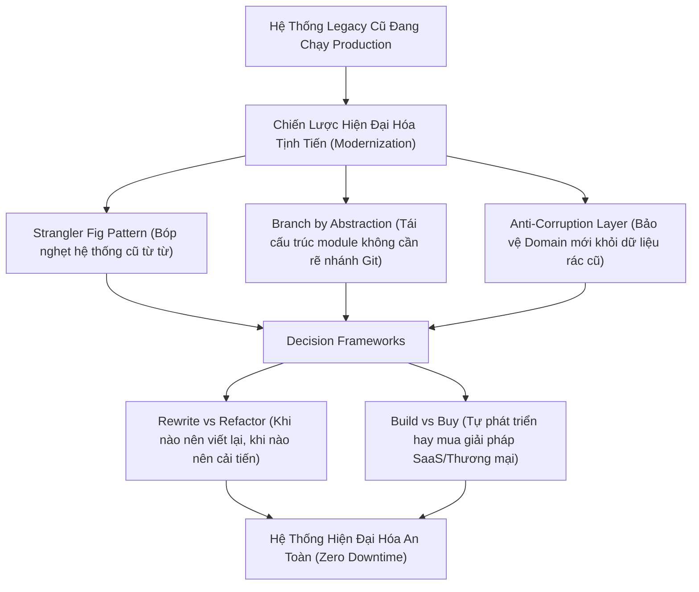
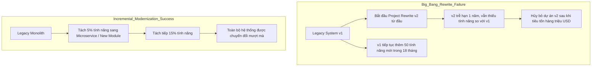
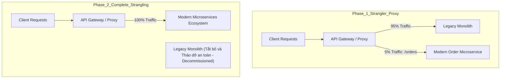
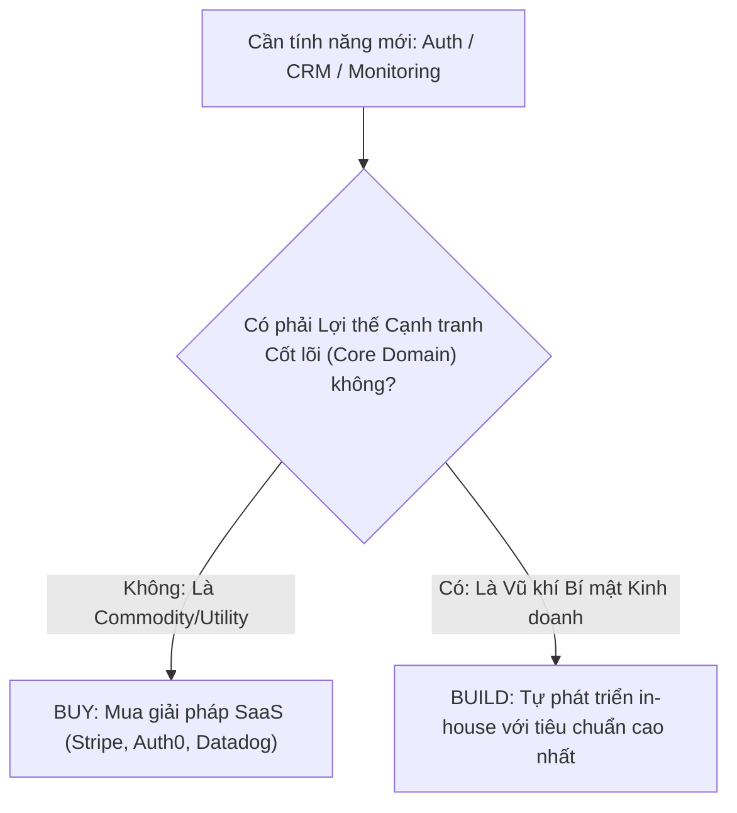

# 9.2. Hiện Đại Hóa Hệ Thống Kế Thừa và Các Mẫu Tái Cấu Trúc (Legacy Modernization & Refactoring Patterns)

## Tổng quan về Legacy Modernization & Refactoring Patterns
Định nghĩa kinh điển của Michael Feathers về **Legacy Code (Mã nguồn kế thừa)** là: *"Legacy code is simply code without tests"*. Khi một hệ thống đã vận hành thành công trong 5-10 năm, nó chứa đựng toàn bộ tri thức và các giá trị kinh doanh cốt lõi của doanh nghiệp, nhưng đồng thời bị bao phủ bởi hàng trăm nghìn dòng mã nguồn giòn gãy, không có bài kiểm thử tự động và tài liệu đã thất lạc. Ý nghĩ đập đi viết lại toàn bộ từ đầu (**Big Bang Rewrite**) là ảo tưởng nguy hiểm bậc nhất trong ngành phần mềm và thường dẫn đến thảm họa phá sản dự án. Kỹ sư trưởng thành lựa chọn con đường **Hiện đại hóa tịnh tiến (Incremental Modernization)** thông qua các mẫu kiến trúc kinh điển: **Strangler Fig Pattern**, **Branch by Abstraction**, **Anti-Corruption Layer (ACL)**, **Modularization**, và phương pháp luận phân tích thấu đáo bài toán **Rewrite vs Refactor** và **Build vs Buy**.



---

## 2. Chi tiết từng Keyword (Under-the-Hood Deep Dive)

---

### 1. Legacy Code Management & The Myth of the "Big Bang Rewrite"

#### 1. Khái niệm bản chất (What & Why)
* **Legacy Code Management**: Quá trình tiếp nhận, đọc hiểu, kiểm thử và chuyển dịch các khối mã nguồn cổ lỗ một cách an toàn mà không làm gián đoạn doanh thu đang hoạt động.
* **The "Big Bang Rewrite" Trap (Cạm bẫy đập đi viết lại toàn bộ)**: Sai lầm phổ biến khi một đội ngũ kỹ sư mới đến và tuyên bố: "Code cũ quá tệ, chúng ta hãy đóng băng tính năng và viết lại một hệ thống mới từ con số 0 trong 6 tháng!".
* **Định luật Netscape (Joel Spolsky)**: Năm 1998, Netscape quyết định viết lại trình duyệt từ đầu (Netscape 6.0). Quá trình này mất gần 3 năm trong khi đối thủ Internet Explorer chiếm lĩnh toàn bộ thị phần, dẫn đến sự sụp đổ hoàn toàn của Netscape. *"Viết lại từ đầu là sai lầm chiến lược tồi tệ nhất mà một công ty phần mềm có thể mắc phải"*.
* **Lý do Big Bang Rewrite Thất Bại**:
  1. *Moving Target*: Trong 1-2 năm bạn viết hệ thống mới, hệ thống cũ vẫn phải sửa hàng trăm bug và thêm tính năng mới để phục vụ khách hàng. Bạn không bao giờ đuổi kịp nó.
  2. *Hidden Business Knowledge*: Hệ thống cũ chứa đựng hàng nghìn đoạn code "kỳ dị" (quirks) nhưng thực chất là các bản vá giải quyết các trường hợp biên của khách hàng VIP mà không có ai còn nhớ. Hệ thống mới viết lại chắc chắn sẽ bỏ sót các trường hợp biên này.

#### 2. Cơ chế hoạt động sâu (Under the hood / Hardcore Internals)
- **Kỹ thuật Đưa Legacy Code vào Test Harness (Michael Feathers Method)**:
  Làm thế nào để sửa code khi không có test mà không làm hỏng tính năng?
  1. **Identify Change Points**: Xác định chính xác vị trí dòng code cần sửa.
  2. **Find Inflection Points**: Tìm giao diện hoặc điểm vào gần nhất có thể quan sát được hành vi mà không cần đụng vào database thật.
  3. **Break Dependencies (Bẻ gãy phụ thuộc)**: Sử dụng các kỹ thuật như *Extract Interface* hoặc *Pass Parameter* để chèn Mock/Fake vào điểm giao tiếp đó.
  4. **Write Characterization Tests (Kiểm thử đặc trưng hóa)**: Viết các bài test ghi nhận hành vi hiện tại của code cũ (ngay cả khi hành vi đó có vẻ kỳ quặc) để làm mốc bảo vệ trước khi bắt đầu tái cấu trúc.

#### 3. Sơ đồ minh họa (Mermaid Diagram)


#### 4. Code ví dụ thực chiến (C++20: Kỹ Thuật Bẻ Gãy Phụ Thuộc Bằng Dependency Injection Đơn Giản)
```cpp
#include <iostream>
#include <memory>
#include <string_view>

// BƯỚC 1 CỦA LEGACY REFACTOR: Bẻ gãy Hardcoded Dependency
// Code cũ phụ thuộc cứng vào hàm syscall hệ thống hoặc database toàn cục:
// void sendInvoiceBad() { Database::executeRawSql("..."); }

// Tái cấu trúc an toàn: Trích xuất interface để có thể viết Characterization Test
class IDatabaseDriver {
public:
    virtual ~IDatabaseDriver() = default;
    virtual void execute(std::string_view query) = 0;
};

class RealProductionDbDriver final : public IDatabaseDriver {
public:
    void execute(std::string_view query) override {
        std::cout << "[PRODUCTION DB] Thực thi: " << query << "\n";
    }
};

class InvoiceManager {
private:
    std::shared_ptr<IDatabaseDriver> db_;

public:
    // Đưa dependency ra ngoài Constructor (Dependency Inversion)
    explicit InvoiceManager(std::shared_ptr<IDatabaseDriver> db) : db_(std::move(db)) {}

    void processInvoice(int invoiceId) {
        db_->execute("UPDATE invoices SET status = 'PROCESSED' WHERE id = " + std::to_string(invoiceId));
    }
};

int main() {
    auto db = std::make_shared<RealProductionDbDriver>();
    InvoiceManager manager(db);
    manager.processInvoice(1001);
    return 0;
}
```

#### 5. Ưu / Nhược điểm, Pitfalls & Anti-patterns
- **Anti-pattern: "Second-System Effect" (Hội chứng hệ thống thứ hai - Fred Brooks)**: Khi được trao cơ hội viết lại hệ thống mới, các kỹ sư cố gắng nhồi nhét tất cả các ý tưởng, framework và thiết kế phức tạp nhất mà họ không thể làm ở hệ thống cũ, khiến hệ thống mới sụp đổ vì sự phức tạp thái quá.

#### 6. Ứng dụng thực tế trong Backend / Systems
- **Hệ thống phần mềm ngân hàng chạy COBOL**: Hầu hết các ngân hàng lớn (Barclays, BNY Mellon) chọn cách bọc hệ thống COBOL đằng sau các API wrapper hiện đại thay vì viết lại toàn bộ hệ thống xử lý tài chính từ đầu.

---

### 2. Strangler Fig Pattern & Branch by Abstraction

#### 1. Khái niệm bản chất (What & Why)
* **Strangler Fig Pattern (Mẫu cây sung bóp nghẹt - Martin Fowler)**: Lấy cảm hứng từ loài cây sung bóp nghẹt trong rừng nhiệt đới: hạt của nó rơi lên ngọn cây chủ, đâm rễ bao quanh thân cây chủ và từ từ lớn lên cho đến khi cây chủ chết đi và chỉ còn lại thân cây mới. Trong phần mềm, ta đặt một tầng định tuyến (API Gateway / Reverse Proxy) phía trước hệ thống cũ, chuyển dần từng endpoint hoặc từng nghiệp vụ sang hệ thống mới cho đến khi toàn bộ traffic được chuyển hết và hệ thống cũ bị tắt bỏ an toàn.
* **Branch by Abstraction (Rẽ nhánh bằng trừu tượng)**: Kỹ thuật tái cấu trúc một thành phần lớn trực tiếp trên nhánh `main` mà không cần tạo nhánh Git dài hạn:
  1. Tạo một lớp trừu tượng (Abstraction Layer) bọc lấy module cũ.
  2. Chuyển toàn bộ client trong codebase gọi qua lớp trừu tượng này.
  3. Viết module mới hiện thực lớp trừu tượng đó.
  4. Hoán đổi hiện thực cũ sang hiện thực mới (thường qua Feature Flag).
  5. Xóa bỏ module cũ và lớp trừu tượng khi hệ thống đã ổn định 100%.

#### 2. Cơ chế hoạt động sâu (Under the hood / Hardcore Internals)
- **Định tuyến Traffic trong Strangler Fig Pattern ở tầng NGINX / Envoy**:
  - Tầng Proxy kiểm tra đường dẫn URL và Headers của HTTP Request:
    ```nginx
    # Cấu hình NGINX Strangler Fig
    location /api/v1/orders {
        # Đã chuyển đổi: Định tuyến sang Modern Go/C++ Microservice
        proxy_pass http://modern_order_service:8080;
    }

    location / {
        # Chưa chuyển đổi: Định tuyến về Monolith Legacy cũ
        proxy_pass http://legacy_monolith_backend:9000;
    }
    ```
  - Quá trình chuyển dịch diễn ra hoàn toàn vô hình đối với người dùng cuối và các client ứng dụng di động.

#### 3. Sơ đồ minh họa (Mermaid Diagram)


#### 4. Code ví dụ thực chiến (TypeScript: Branch by Abstraction với Strategy Switching)
```typescript
// BƯỚC 1 & 2: Tạo Abstraction Layer bọc lấy thành phần cũ
interface PaymentGatewayPort {
  charge(amount: number): Promise<boolean>;
}

// BƯỚC 3: Giữ nguyên module cũ đang chạy
class OldSoapPaymentGateway implements PaymentGatewayPort {
  async charge(amount: number): Promise<boolean> {
    console.log(`[LEGACY SOAP] Gọi XML WebService cũ: ${amount}$`);
    return true;
  }
}

// BƯỚC 4: Viết module mới tối ưu
class ModernRestPaymentGateway implements PaymentGatewayPort {
  async charge(amount: number): Promise<boolean> {
    console.log(`[MODERN REST] Gọi Stripe JSON API mới: ${amount}$`);
    return true;
  }
}

// BƯỚC 5: Chuyển đổi an toàn qua Configuration / Feature Flag
class PaymentService {
  constructor(private gateway: PaymentGatewayPort) {}

  async executePayment(amount: number) {
    return await this.gateway.charge(amount);
  }
}

const useModern = process.env.ENABLE_MODERN_PAYMENT === "true";
const service = new PaymentService(useModern ? new ModernRestPaymentGateway() : new OldSoapPaymentGateway());
service.executePayment(500);
```

#### 5. Ưu / Nhược điểm, Pitfalls & Anti-patterns
- **Anti-pattern: Strangler Stagnation (Mắc kẹt giữa chừng)**: Di chuyển được 50% hệ thống rồi dừng lại do thiếu cam kết từ ban lãnh đạo. Kết quả là công ty phải vận hành song song cả hai hệ thống (Legacy và Modern) trong nhiều năm, làm tăng gấp đôi chi phí vận hành và tải nhận thức.

#### 6. Ứng dụng thực tế trong Backend / Systems
- **Hệ thống thanh toán của GitHub**: GitHub chuyển đổi dần dần từ Monolith Ruby on Rails khổng lồ sang các dịch vụ backend Go chuyên biệt bằng **Strangler Fig Pattern** và Scientist Library mà không để xảy ra bất kỳ sự cố gián đoạn dịch vụ nào.

---

### 3. Rewrite vs Refactor & Build vs Buy Frameworks

#### 1. Khái niệm bản chất (What & Why)
* **Rewrite vs Refactor Decision Framework**: Khung quyết định khoa học nhằm xác định khi nào nên cải tiến mã nguồn cũ (Refactor) và khi nào việc đập đi xây mới (Rewrite) là hợp lý:
  - *Chọn Refactor khi*: Hệ thống cốt lõi vẫn đang sinh lời, lỗi chủ yếu nằm ở tầng mã nguồn cục bộ, có thể cô lập và thêm test.
  - *Chỉ cân nhắc Rewrite khi*: Ngôn ngữ hoặc nền tảng phần cứng đã hoàn toàn tuyệt chủng (không thể tuyển dụng kỹ sư), chi phí duy trì cao hơn chi phí viết mới nhiều lần, và phạm vi bài toán đã được định nghĩa cực kỳ rõ ràng.
* **Build vs Buy (Tự xây dựng hay Mua giải pháp ngoài)**: Một trong những quyết định kỹ thuật cấp cao quan trọng nhất.
  - **Tự Xây Dựng (Build)**: Dành riêng cho **Core Competency (Lợi thế cạnh tranh cốt lõi)** của doanh nghiệp—thứ mang lại sự khác biệt trên thị trường (ví dụ: Thuật toán gợi ý của Netflix, Công cụ tìm kiếm của Google).
  - **Mua / Sử dụng SaaS (Buy / Open Source)**: Dành cho các thành phần tiện ích (Commodity Infrastructure)—những thứ cần thiết để vận hành nhưng không tạo ra lợi thế cạnh tranh riêng (ví dụ: Auth0 / Okta cho đăng nhập, Stripe cho thanh toán, SendGrid cho gửi email, Datadog cho monitoring).

#### 2. Cơ chế hoạt động sâu (Under the hood / Hardcore Internals)
- **Tính toán Total Cost of Ownership (TCO) trong Build vs Buy**:
  - Một nhóm kỹ sư đề xuất: "Chúng ta hãy tự viết một Message Queue thay vì trả tiền cho AWS SQS hoặc Kafka để tiết kiệm $200/tháng".
  - Kỹ sư trưởng thành tính toán TCO thực tế:
    - Chi phí phát triển ban đầu: 2 kỹ sư $\times 3$ tháng $= 6$ tháng công $\approx \$60,000$.
    - Chi phí bảo trì, vá lỗi bảo mật, trực on-call lúc nửa đêm khi broker crash: 1 kỹ sư dành 20% thời gian $= \$24,000/\text{năm}$.
    - Rủi ro mất mát tin nhắn giao dịch gây thiệt hại kinh doanh.
  - So sánh với chi phí dùng AWS SQS ($200 \times 12 = \$2,400/\text{năm}$) với SLA $99.9\%$. Quyết định đúng đắn là **BUY (Sử dụng giải pháp sẵn có)**!

#### 3. Sơ đồ minh họa (Mermaid Diagram)


#### 4. Code ví dụ thực chiến (TypeScript: Tích Hợp SaaS Thay Vì Tự Viết Bánh Xe Lịch Sử)
```typescript
// Build vs Buy: Tận dụng SDK của nhà cung cấp chuyên nghiệp (Stripe)
// thay vì tự xây dựng cơ chế xử lý thẻ tín dụng phức tạp tốn kém chứng chỉ PCI-DSS

import Stripe from 'stripe';

class PaymentGatewayService {
  private stripe: Stripe;

  constructor(apiKey: string) {
    // BUY Decision: Trả một phần trăm nhỏ phí giao dịch để nhận được độ an toàn tuyệt đối
    this.stripe = new Stripe(apiKey, { apiVersion: '2023-10-16' });
  }

  async createSecurePaymentIntent(amountCents: number, currency: string = 'usd') {
    return await this.stripe.paymentIntents.create({
      amount: amountCents,
      currency: currency,
      automatic_payment_methods: { enabled: true },
    });
  }
}
```

#### 5. Ưu / Nhược điểm, Pitfalls & Anti-patterns
- **Anti-pattern: Not-Invented-Here Syndrome (NIH - Hội chứng không phải do tôi tạo ra)**: Xu hướng từ chối sử dụng các thư viện hoặc dịch vụ có sẵn của bên thứ ba chỉ vì tâm lý muốn tự mình viết ra mọi thứ từ con số 0.

#### 6. Ứng dụng thực tế trong Backend / Systems
- **Quyết định sử dụng Kubernetes vs Tự viết Orchestrator**: Hầu hết các công ty lớn chuyển sang dùng Kubernetes thay vì duy trì các công cụ triển khai nội bộ tự viết, giúp họ tập trung 100% nguồn lực vào logic nghiệp vụ của chính mình.

---

## Tổng kết Chương 9.2
Hiện đại hóa hệ thống kế thừa là đỉnh cao của sự trưởng thành kỹ thuật. Bằng việc từ bỏ ảo tưởng đập đi viết lại một cách mù quáng, kiên trì áp dụng các mẫu kiến trúc tịnh tiến như Strangler Fig và Branch by Abstraction, bảo vệ mô hình mới bằng Anti-Corruption Layer và đưa ra các quyết định Build vs Buy dựa trên phân tích TCO sắc bén, người kỹ sư bảo toàn giá trị cốt lõi của doanh nghiệp và đưa hệ thống vững bước vào tương lai.
