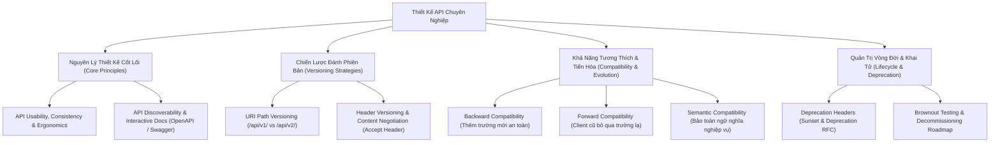
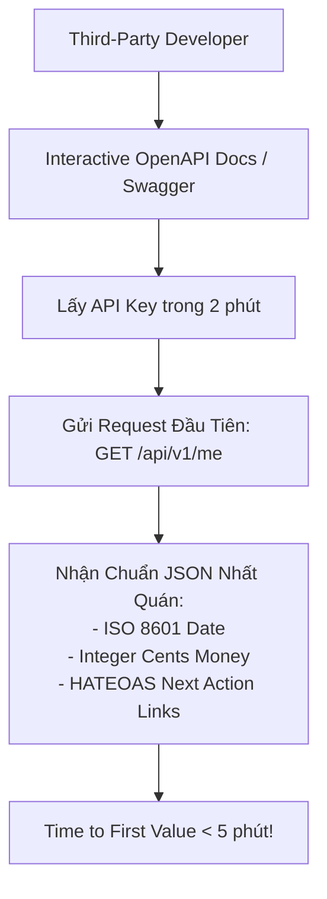
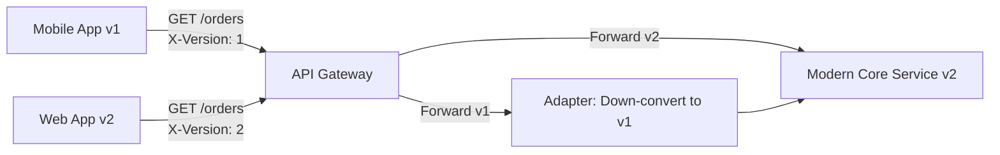
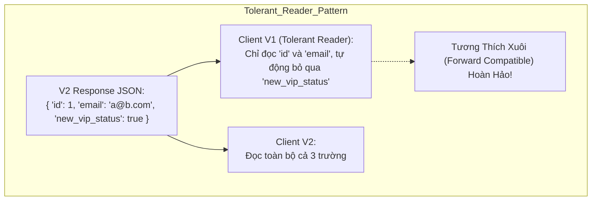
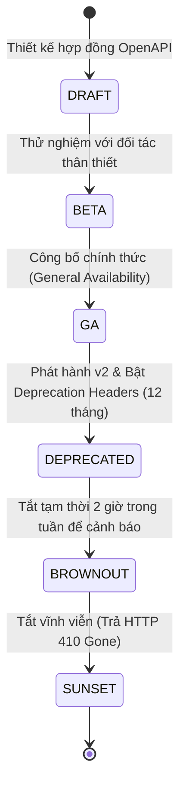

# 10.1. Thiết Kế Hợp Đồng API và Chiến Lược Tiến Hóa (API Design, Contracts & Evolution)

## Tổng quan về API Design, Contracts & Evolution
Trong kỷ nguyên của điện toán phân tán, điện toán đám mây và microservices, API (Application Programming Interface) chính là **bộ mặt và sản phẩm chính thức** của hệ thống backend. Một API được công bố ra thế giới bên ngoài là một lời cam kết ràng buộc (Contractual Commitment): một khi đã có khách hàng tích hợp, bạn không thể tùy tiện sửa đổi chữ ký hàm mà không gây ra thảm họa gián đoạn cho đối tác. Kỹ nghệ thiết kế API chuyên nghiệp đòi hỏi việc tuân thủ các nguyên lý thiết kế lấy trải nghiệm lập trình viên làm trung tâm (**API Usability**, **Discoverability**, **Consistency**), áp dụng các chiến lược đánh phiên bản chuẩn hóa (**URI Versioning**, **Header Versioning**, **Content Negotiation**), bảo toàn tính tương thích xuôi và ngược (**Backward & Forward Compatibility**), và vận hành quy trình khai tử API có trách nhiệm (**API Deprecation & Lifecycle Governance**).



---

## 2. Chi tiết từng Keyword (Under-the-Hood Deep Dive)

---

### 1. API Design Principles: Consistency, Usability & Discoverability

#### 1. Khái niệm bản chất (What & Why)
* **API Design Principles**: Bộ nguyên tắc định hướng việc tạo ra các giao diện lập trình trực quan, dễ học, khó dùng sai (Easy to use, hard to misuse).
* **API Consistency (Tính nhất quán của API)**: Sự đồng nhất tuyệt đối về cấu trúc URL, quy ước đặt tên (casing: camelCase hoặc snake_case), định dạng ngày tháng (chuẩn ISO 8601: `2026-11-09T23:05:31Z`), cấu trúc phân trang, và cách biểu diễn lỗi trên toàn bộ các dịch vụ của tổ chức.
* **API Usability (Tính khả dụng / Công thái học của API - Ergonomics)**: Đo lường mức độ thuận tiện và thời gian cần thiết để một lập trình viên bên ngoài thực hiện thành công cuộc gọi API đầu tiên (Time to First "Hello World").
* **API Discoverability (Khả năng tự khám phá - HATEOAS)**: Khả năng của API trong việc hướng dẫn client biết được các bước hành động tiếp theo có thể thực hiện thông qua các liên kết siêu văn bản (`_links`).
* **API Documentation**: Tài liệu kỹ thuật sống động, có thể tương tác trực tiếp (Interactive Documentation như Swagger UI, Redoc) sinh tự động từ file đặc tả hợp đồng chuẩn.

#### 2. Cơ chế hoạt động sâu (Under the hood / Hardcore Internals)
- **Chuẩn Hóa Format Ngày Tháng & Số Học ở tầng Byte**:
  - Không bao giờ truyền timestamp dưới dạng số nguyên epoch 32-bit (`time_t` 32-bit): Sẽ gặp sự cố **Year 2038 Problem (Y2K38)** khi số nguyên có dấu tràn mốc $2^{31}-1$.
  - Luôn sử dụng chuỗi chuẩn **ISO 8601 UTC**: `"2026-11-09T16:05:31.000Z"`.
  - Đối với tiền tệ: Tuyệt đối không dùng số thực dấu phẩy động (`float` hoặc `double`) trong JSON vì lỗi làm tròn nhị phân IEEE 754:
    $$0.1 + 0.2 = 0.30000000000000004$$
    API phải trả về số nguyên biểu diễn đơn vị nhỏ nhất (Cents, Xu) hoặc chuỗi chuỗi số chính xác cao (`"1500.50"`).

#### 3. Sơ đồ minh họa (Mermaid Diagram)


#### 4. Code ví dụ thực chiến (C++20: API Response Serialization Chuẩn Nhất Quán)
```cpp
#include <iostream>
#include <string>

// Chuẩn hóa cấu trúc API Envelope nhất quán trên toàn hệ thống
template <typename TData>
struct ApiResponse {
    bool success;
    std::string timestamp; // ISO 8601 UTC
    TData data;
};

struct UserDto {
    int64_t id;
    std::string email;
    int64_t balanceInCents; // An toàn số học tuyệt đối
};

void serializeResponse(const ApiResponse<UserDto>& res) {
    std::cout << "{\n"
              << "  \"success\": " << (res.success ? "true" : "false") << ",\n"
              << "  \"timestamp\": \"" << res.timestamp << "\",\n"
              << "  \"data\": {\n"
              << "    \"id\": " << res.data.id << ",\n"
              << "    \"email\": \"" << res.data.email << "\",\n"
              << "    \"balanceInCents\": " << res.data.balanceInCents << "\n"
              << "  }\n"
              << "}\n";
}

int main() {
    ApiResponse<UserDto> response{
        true,
        "2026-11-09T16:05:31Z",
        {1042, "developer@fintech.io", 500000} // $5,000.00
    };
    serializeResponse(response);
    return 0;
}
```

#### 5. Ưu / Nhược điểm, Pitfalls & Anti-patterns
- **Anti-pattern: Inconsistent Casing**: Trong cùng một API response, trường này là `user_id` (snake_case), trường kia lại là `orderId` (camelCase) và trường khác lại là `Postal-Code` (kebab-case).

#### 6. Ứng dụng thực tế trong Backend / Systems
- **Stripe API**: Được coi là tiêu chuẩn vàng của thế giới về API Consistency và Developer Experience: Mọi object đều có trường `object`, tài liệu tương tác hiển thị mã mẫu bằng ngôn ngữ lập trình của bạn với API key thật của chính bạn.

---

### 2. API Versioning Strategies: URI, Header & Content Negotiation

#### 1. Khái niệm bản chất (What & Why)
* **API Versioning (Đánh phiên bản API)**: Cơ chế cho phép hệ thống cung cấp nhiều phiên bản hợp đồng khác nhau cùng một lúc để các client có thể nâng cấp theo lộ trình riêng mà không bị ép buộc nâng cấp đồng loạt.
* **URI Path Versioning (Đánh phiên bản qua đường dẫn)**: Nhúng số phiên bản trực tiếp vào URL:
  `https://api.example.com/v1/orders`
  `https://api.example.com/v2/orders`
  Ưu điểm: Cực kỳ trực quan, dễ cấu hình định tuyến trên NGINX, dễ thử nghiệm trên trình duyệt.
* **Header Versioning (Đánh phiên bản qua Header tùy chỉnh)**: Gửi phiên bản qua Custom HTTP Header:
  `GET /orders` kèm header `X-API-Version: 2026-11-01`
  Được ưa chuộng bởi Stripe (versioning theo ngày phát hành).
* **Content Negotiation (Thương lượng nội dung - `Accept` Header)**: Sử dụng chuẩn HTTP Media Type:
  `Accept: application/vnd.mycompany.v2+json`
  Ưu điểm: Tuân thủ chặt chẽ triết lý REST thuần túy (URL đại diện cho tài nguyên, định dạng do client thương lượng).

#### 2. Cơ chế hoạt động sâu (Under the hood / Hardcore Internals)
- **Định tuyến Header Versioning ở tầng API Gateway**:
  - Khi client gửi request kèm header:
    `X-API-Version: 2`
  - Envoy Proxy / NGINX đọc Header này và so sánh với bảng Routing:
    - Nếu Header $= 1 \implies$ Forward tới cụm Pod `order-service-v1`
    - Nếu Header $= 2 \implies$ Forward tới cụm Pod `order-service-v2`
    - Nếu không truyền Header $\implies$ Mặc định fallback về phiên bản ổn định đã công bố của tài khoản đó.
  - Kỹ thuật **Tầng Biến Đổi Schema (Schema Transformation Layer)**: Thay vì chạy 2 service riêng biệt, một service duy nhất chạy Core v2, và một tầng Adapter trung gian tự động biến đổi (down-convert) response v2 sang cấu trúc v1 nếu client gửi header v1.

#### 3. Sơ đồ minh họa (Mermaid Diagram)


#### 4. Code ví dụ thực chiến (TypeScript: Content Negotiation & Version Routing Middleware)
```typescript
import { Request, Response, NextFunction } from 'express';

// Middleware phân tích Version từ Accept Header hoặc Custom Header
function apiVersionMiddleware(req: Request, res: Response, next: NextFunction) {
  const versionHeader = req.header('X-API-Version');
  const acceptHeader = req.header('Accept');

  let selectedVersion = 'v1'; // Default Fallback

  if (versionHeader === '2.0' || acceptHeader?.includes('vnd.company.v2+json')) {
    selectedVersion = 'v2';
  }

  // Gắn metadata phiên bản vào request context để Controller xử lý
  (req as any).apiVersion = selectedVersion;
  res.setHeader('X-Selected-API-Version', selectedVersion);
  next();
}
```

#### 5. Ưu / Nhược điểm, Pitfalls & Anti-patterns
- **Anti-pattern: Versioning Everything for Minor Changes**: Tăng version từ `/v1/` lên `/v2/` chỉ vì thêm một trường không bắt buộc (optional field) mới vào response. Điều này buộc hàng nghìn client phải đổi endpoint vô nghĩa.

#### 6. Ứng dụng thực tế trong Backend / Systems
- **GitHub REST API**: Sử dụng Header Versioning: `X-GitHub-Api-Version: 2022-11-28`, cho phép GitHub cập nhật các endpoint mà không làm vỡ các URL tĩnh của hàng triệu webhook trên toàn cầu.

---

### 3. Compatibility Matrix: Backward, Forward & Semantic Compatibility

#### 1. Khái niệm bản chất (What & Why)
* **Backward Compatibility (Tương thích ngược)**: Khả năng của hệ thống mới (v2) xử lý thành công các yêu cầu từ các client cũ (v1) mà không đòi hỏi client phải thay đổi bất kỳ điều gì.
* **Forward Compatibility (Tương thích xuôi)**: Khả năng của các client cũ (v1) có thể tiếp tục hoạt động an toàn khi nhận được dữ liệu từ hệ thống mới (v2) (ví dụ: Client cũ tự động phớt lờ các trường dữ liệu mới mà nó không hiểu thay vì ném lỗi crash).
* **Semantic Compatibility (Tương thích ngữ nghĩa)**: Dù cú pháp dữ liệu (Syntax) không thay đổi, nhưng ngữ nghĩa nghiệp vụ của trường đó phải được bảo toàn. Nếu trường `status: "PENDING"` trước đây có nghĩa là "Chờ duyệt trong 24h", nhưng bây giờ lại có nghĩa là "Bị đóng băng do nghi ngờ gian lận", thì đây là một **Breaking Semantic Change** cực kỳ nguy hiểm.
* **Tolerant Reader Pattern (Mẫu người đọc khoan dung)**: Quy tắc vàng của Martin Fowler: Các client chỉ nên trích xuất chính xác những trường mà nó cần và bắt buộc phải bỏ qua mọi trường lạ xuất hiện trong payload.

#### 2. Cơ chế hoạt động sâu (Under the hood / Hardcore Internals)
- **Quy tắc Vàng để Duy Trì Backward Compatibility (Additive Changes Only)**:
  1. **ĐƯỢC PHÉP**: Thêm một trường mới vào Response JSON (Client áp dụng Tolerant Reader sẽ bỏ qua an toàn).
  2. **ĐƯỢC PHÉP**: Thêm một trường tùy chọn (`optional`) vào Request payload.
  3. **TUYỆT ĐỐI CẤM (Breaking Change)**: Xóa một trường đang tồn tại trong Response.
  4. **TUYỆT ĐỐI CẤM (Breaking Change)**: Đổi kiểu dữ liệu của một trường (ví dụ: từ `id: 123` sang `id: "123"`).
  5. **TUYỆT ĐỐI CẤM (Breaking Change)**: Thêm một trường bắt buộc (`required`) vào Request payload.

#### 3. Sơ đồ minh họa (Mermaid Diagram)


#### 4. Code ví dụ thực chiến (TypeScript: Tolerant Reader Pattern với Zod Validation)
```typescript
import { z } from 'zod';

// Client V1 Schema: Sử dụng .passthrough() hoặc .strip() của Zod
// để tự động loại bỏ các trường lạ trong tương lai mà không ném lỗi Validation Error
const OrderClientV1Schema = z.object({
  orderId: z.string(),
  totalAmount: z.number(),
}).strip(); // Tolerant Reader: Tự động phớt lờ các trường v2 như `loyaltyPoints`

// Dữ liệu từ Server V2 mới nhất
const incomingV2Response = {
  orderId: "ORD-991",
  totalAmount: 250.0,
  loyaltyPointsEarned: 50, // Trường mới thêm từ v2
  recommendedItems: ["ITEM-A", "ITEM-B"] // Trường mới thêm
};

// Client v1 phân tích cú pháp an toàn
const parsed = OrderClientV1Schema.parse(incomingV2Response);
console.log("Client V1 parse thành công mà không bị crash:", parsed);
```

#### 5. Ưu / Nhược điểm, Pitfalls & Anti-patterns
- **Anti-pattern: Strict Schema Validation at Client**: Client cấu hình thư viện parse JSON với cờ `failOnUnknownProperties: true`. Khi đó, chỉ cần server thêm 1 trường mới để phục vụ ứng dụng web là toàn bộ ứng dụng mobile cũ trên điện thoại người dùng lập tức bị sập (Crash on Launch)!

#### 6. Ứng dụng thực tế trong Backend / Systems
- **Protocol Buffers (Protobuf)**: Được thiết kế dựa trên số thứ tự của trường (Field Tags: `int32 id = 1;`). Khi trường số 2 bị xóa hoặc trường số 3 được thêm mới, Protobuf tự động bỏ qua các tag lạ ở tầng nhị phân, bảo đảm tính tương thích ngược và xuôi đạt mức tuyệt đối.

---

### 4. API Lifecycle Management: Deprecation, Sunsetting & Change Governance

#### 1. Khái niệm bản chất (What & Why)
* **API Lifecycle Management (Quản trị vòng đời API)**: Chu trình toàn vẹn từ khi thiết kế (Design) $\rightarrow$ Thử nghiệm (Preview / Beta) $\rightarrow$ Phát hành chính thức (General Availability - GA) $\rightarrow$ Đánh dấu lỗi thời (Deprecated) $\rightarrow$ Khai tử (Retired / Sunset).
* **API Deprecation (Đánh dấu lỗi thời)**: Thông báo chính thức rằng một endpoint hoặc tính năng không còn được khuyến khích sử dụng, sẽ không nhận thêm tính năng mới và sẽ bị gỡ bỏ sau một khoảng thời gian báo trước (thường từ 6 tháng đến 1 năm).
* **Chuẩn HTTP Deprecation & Sunset Headers (RFC 8594 & IETF Draft)**:
  - Header `Deprecation: @1731196800` (Thời điểm API bắt đầu bị deprecated).
  - Header `Sunset: Sun, 09 Nov 2027 00:00:00 GMT` (Thời điểm chính xác API sẽ bị tắt vĩnh viễn).
  - Header `Link: <https://api.docs.com/migration-v2>; rel="deprecation"`.
* **Brownout Testing (Kiểm thử mất điện cục bộ)**: Kỹ thuật chủ động tắt API cũ trong vòng 1-2 giờ vào các khung giờ thấp điểm trước ngày Sunset chính thức 1 tháng, nhằm "đánh thức" các khách hàng vẫn còn đang âm thầm gọi API cũ mà không chịu đọc email thông báo!

#### 2. Cơ chế hoạt động sâu (Under the hood / Hardcore Internals)
- **Tự động gắn Deprecation Headers bằng NGINX / Gateway Middleware**:
  Khi client gọi vào endpoint đã được lên kế hoạch khai tử:
  ```http
  HTTP/1.1 200 OK
  Content-Type: application/json
  Deprecation: true
  Sunset: Wed, 11 Nov 2027 00:00:00 GMT
  Link: <https://api.example.com/docs/v2-migration>; rel="sunset"
  ```
  Các công cụ giám sát của client (Datadog, OpenTelemetry) có thể quét các header này để tự động tạo cảnh báo cho đội ngũ kỹ thuật của họ về việc cần di chuyển code.

#### 3. Sơ đồ minh họa (Mermaid Diagram)


#### 4. Code ví dụ thực chiến (TypeScript: Express Middleware Gắn Chuẩn Header RFC Sunset)
```typescript
import { Request, Response, NextFunction } from 'express';

// Middleware đánh dấu API Deprecated theo chuẩn RFC 8594
function deprecatedEndpointMiddleware(sunsetDateUtcString: string, migrationDocUrl: string) {
  return (req: Request, res: Response, next: NextFunction) => {
    // 1. Gắn các chuẩn Header quốc tế
    res.setHeader('Deprecation', 'true');
    res.setHeader('Sunset', sunsetDateUtcString);
    res.setHeader('Link', `<${migrationDocUrl}>; rel="deprecation"`);

    // 2. Ghi log Telemetry nội bộ để theo dõi đối tác nào vẫn đang gọi API cũ
    const callerAppId = req.header('X-Client-App-Id') || 'UNKNOWN_CLIENT';
    console.warn(`[API DEPRECATION WARNING] Client ${callerAppId} đang gọi API cũ: ${req.path}`);

    next();
  };
}

// Áp dụng cho route cũ v1
// app.use('/api/v1/checkout', deprecatedEndpointMiddleware("Sun, 01 Nov 2027 00:00:00 GMT", "https://docs.api.io/v2"));
```

#### 5. Ưu / Nhược điểm, Pitfalls & Anti-patterns
- **Anti-pattern: Silent Breaking Changes**: Đột ngột xóa hoặc đổi kiểu dữ liệu của một API đang chạy trên production mà không có bất kỳ thông báo hay lộ trình deprecation nào, gây tê liệt hệ thống của khách hàng và phá hủy uy tín của công ty.

#### 6. Ứng dụng thực tế trong Backend / Systems
- **Chính sách Deprecation của Google Cloud & AWS**: Cam kết duy trì tính ổn định của các API GA tối thiểu từ 1 đến 3 năm sau khi có thông báo Deprecation chính thức.

---

## Tổng kết Chương 10.1
API là hợp đồng sống còn giữa hệ thống của bạn và thế giới bên ngoài. Bằng cách thiết kế giao diện nhất quán, trực quan, lựa chọn chiến lược đánh phiên bản phù hợp, tuân thủ nghiêm ngặt nguyên tắc chỉ thêm mới chứ không sửa đổi cũ để bảo toàn tính tương thích ngược, và thực thi quy trình khai tử API có trách nhiệm, người kỹ sư bảo vệ khách hàng khỏi sự gián đoạn và khẳng định đẳng cấp chuyên nghiệp của tổ chức.
