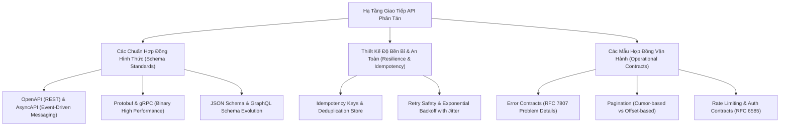
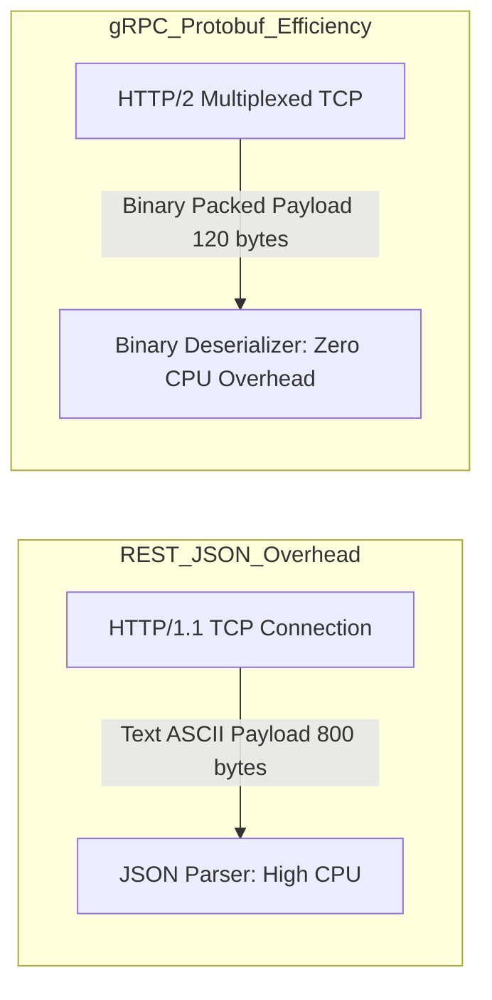
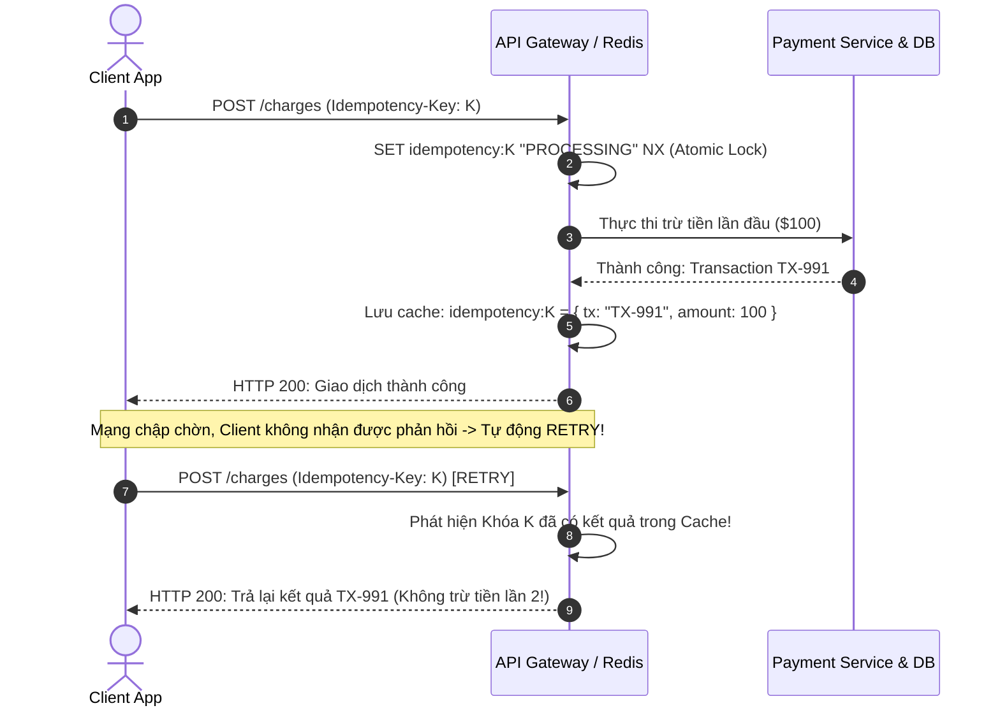
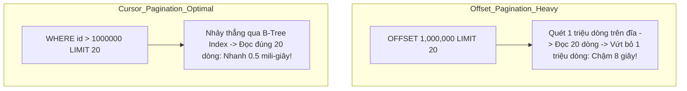

# 10.2. Giao Thức, Tính Bền Bỉ và Quản Trị Hợp Đồng API (Protocols, Resilience & API Governance)

## Tổng quan về Protocols, Resilience & API Governance
Trong các hệ thống phân tán hiệu năng cao, hợp đồng API không chỉ dừng lại ở các tài liệu mô tả bằng lời nói mà được định nghĩa hình thức bằng mã nguồn máy tính (**Machine-Readable Schemas**) thông qua các chuẩn mực như **OpenAPI**, **AsyncAPI**, **JSON Schema**, **Protocol Buffers (Protobuf)**, **gRPC** và **GraphQL**. Đồng thời, mạng viễn thông vốn dĩ là môi trường không đáng tin cậy (Unreliable Network): các gói tin có thể bị trễ, mất mát hoặc gửi lặp lại nhiều lần. Để hệ thống đạt được độ tin cậy tuyệt đối, kỹ sư backend bắt buộc phải thiết kế các cơ chế bền bỉ cốt lõi: **Tính bất biến giao dịch (Idempotency)**, **An toàn khi thử lại (Retry Safety)**, hợp đồng xử lý lỗi chuẩn hóa (**Error Contract RFC 7807**), hợp đồng phân trang (**Cursor-based Pagination**), hợp đồng giới hạn lưu lượng (**Rate Limiting Headers**), và các cơ chế kiểm soát truy cập (**AuthN / AuthZ Contracts**).



---

## 2. Chi tiết từng Keyword (Under-the-Hood Deep Dive)

---

### 1. Schema Specifications: OpenAPI, AsyncAPI, JSON Schema, Protobuf & gRPC

#### 1. Khái niệm bản chất (What & Why)
* **OpenAPI Specification (OAS - trước đây là Swagger)**: Chuẩn định nghĩa giao diện chuẩn hóa cho RESTful APIs, mô tả chi tiết endpoints, query parameters, request bodies, và HTTP status codes bằng YAML/JSON.
* **AsyncAPI**: Chuẩn định nghĩa mã nguồn mở dành riêng cho các kiến trúc hướng sự kiện (Event-Driven Architecture) và Message Brokers (Kafka, RabbitMQ, MQTT, WebSockets), mô tả các channels, topics, message payloads và headers.
* **JSON Schema**: Chuẩn từ vựng cho phép chú thích và xác thực cấu trúc cú pháp của tài liệu JSON.
* **Protocol Buffers (Protobuf) & gRPC (Google Remote Procedure Call)**: Cơ chế tuần tự hóa dữ liệu nhị phân đa nền tảng kết hợp framework RPC hiệu năng cao của Google, sử dụng HTTP/2 làm tầng vận chuyển (Transport Layer) với khả năng Multiplexing và Header Compression (HPACK).
* **GraphQL Schema Evolution**: Kỹ thuật tiến hóa schema trong GraphQL bằng cách thêm các trường mới vào Type và sử dụng directive `@deprecated(reason: "...")` thay vì phải tạo phiên bản v1/v2 cho toàn bộ endpoint.

#### 2. Cơ chế hoạt động sâu (Under the hood / Hardcore Internals)
- **So sánh Hiệu năng CPU & Mạng giữa JSON REST và Protobuf gRPC**:
  - **JSON qua HTTP/1.1**:
    - Dữ liệu dạng văn bản (Text-based): CPU phải phân tích cú pháp từng ký tự ASCII (Lexing & String Parsing), tốn hàng trăm chu kỳ CPU.
    - Kích thước payload lớn do lặp lại các tên trường chuỗi (`"transaction_id"`, `"user_id"`).
    - HTTP/1.1 bị hiện tượng **Head-of-Line Blocking** ở tầng ứng dụng (mỗi TCP connection chỉ xử lý tuần tự một request tại một thời điểm).
  - **Protobuf qua HTTP/2 (gRPC)**:
    - Mã hóa nhị phân bằng kỹ thuật **Varint (Variable-length zig-zag encoding)**: Số nguyên nhỏ chỉ tốn 1 hoặc 2 bytes thay vì chuỗi ASCII 10 bytes.
    - Các trường được định danh bằng số nguyên Tag (1 byte) thay vì tên chuỗi.
    - Tốc độ Serialization/Deserialization nhanh hơn từ **5 đến 10 lần**, giảm kích thước gói tin mạng tới **60-80%**.
    - HTTP/2 **Multiplexing**: Hàng trăm RPC calls chạy đồng thời trên duy nhất một kết nối TCP mà không bị block.

#### 3. Sơ đồ minh họa (Mermaid Diagram)


#### 4. Code ví dụ thực chiến (Protobuf v3: Hợp Đồng Giao Diện Nhị Phân Chuẩn)
```protobuf
syntax = "proto3";

package payment.v1;

option go_package = "payment/v1;paymentv1";

// Hợp đồng dịch vụ thanh toán hiệu năng cao
service PaymentService {
  rpc ProcessPayment (PaymentRequest) returns (PaymentResponse);
}

enum Currency {
  CURRENCY_UNSPECIFIED = 0;
  USD = 1;
  EUR = 2;
  VND = 3;
}

message PaymentRequest {
  string idempotency_key = 1;
  uint64 user_id = 2;
  int64 amount_in_cents = 3;
  Currency currency = 4;
}

message PaymentResponse {
  string transaction_id = 1;
  bool is_successful = 2;
  int64 balance_remaining = 3;
}
```

#### 5. Ưu / Nhược điểm, Pitfalls & Anti-patterns
- **Anti-pattern: Reusing Protobuf Tag Numbers**: Đổi số thứ tự tag trong file `.proto` (ví dụ: đổi `string email = 2;` thành `int32 age = 2;`). Điều này sẽ phá hủy hoàn toàn dữ liệu nhị phân khi giải mã ở các dịch vụ đang chạy phiên bản cũ.

#### 6. Ứng dụng thực tế trong Backend / Systems
- **Giao tiếp nội bộ giữa các Microservices tại Google/Netflix**: 100% các cuộc gọi RPC inter-service đều chạy bằng gRPC/Protobuf để tiết kiệm hàng chục triệu USD tiền băng thông và hạ tầng compute.

---

### 2. Resilience: Idempotency & Retry Safety

#### 1. Khái niệm bản chất (What & Why)
* **Idempotency (Tính bất biến / Lũy lượng)**: Tính chất của một thao tác mà việc thực thi nó **một lần hay nhiều lần liên tiếp đều mang lại cùng một trạng thái hệ thống và cùng một kết quả trả về**:
  $$f(f(x)) = f(x)$$
  Trong HTTP: `GET`, `PUT`, `DELETE` mặc định là Idempotent; trong khi `POST` mặc định KHÔNG phải là Idempotent (mỗi lần gọi có thể tạo ra một đơn hàng mới hoặc trừ tiền thêm một lần).
* **Retry Safety (An toàn khi thử lại)**: Khả năng của client tự động gửi lại một request bị timeout hoặc lỗi mạng mà không sợ gây ra tác dụng phụ tiêu cực (Double Billing, Duplicate Orders).
* **Idempotency Key (Khóa bất biến)**: Một mã định danh duy nhất (UUID v4) do client sinh ra và gửi kèm trong HTTP Header:
  `Idempotency-Key: 9b1deb4d-3b7d-4bad-9bdd-2b0d7b3dcb6d`

#### 2. Cơ chế hoạt động sâu (Under the hood / Hardcore Internals)
- **Quy trình Xử lý Idempotency Key bằng Database Atomic Lock / Redis**:
  1. Client gửi request: `POST /api/v1/charges` kèm `Idempotency-Key: K`.
  2. Server kiểm tra trong Redis Cache:
     - Dùng lệnh nguyên tử: `SET idempotency:K "PROCESSING" NX EX 120` (Set if Not Exists với hạn 120 giây).
     - Nếu trả về `0` (Khóa đã tồn tại):
       - Nếu giá trị là `"PROCESSING"`: Có một request trùng lặp đang chạy song song $\rightarrow$ Trả về ngay lập tức HTTP `409 Conflict`.
       - Nếu giá trị là một JSON Response đã lưu trước đó: Trả về ngay lập tức Response đó từ cache mà **hoàn toàn không chạy lại logic trừ tiền**.
     - Nếu trả về `1` (Khóa mới):
       - Bắt đầu transaction Database, thực thi trừ tiền.
       - Lưu kết quả Response vào Redis với Key `idempotency:K`.
       - Commit Transaction và trả kết quả cho client.

#### 3. Sơ đồ minh họa (Mermaid Diagram)


#### 4. Code ví dụ thực chiến (C++20: Idempotency Verification Handler)
```cpp
#include <iostream>
#include <string>
#include <unordered_map>
#include <optional>
#include <mutex>

struct CachedResponse {
    int statusCode;
    std::string responseBody;
};

class IdempotencyEngine {
private:
    std::unordered_map<std::string, CachedResponse> cache_;
    std::mutex mtx_;

public:
    // Kiểm tra xem Idempotency Key đã được xử lý chưa
    std::optional<CachedResponse> checkKey(const std::string& key) {
        std::lock_guard<std::mutex> lock(mtx_);
        if (cache_.contains(key)) {
            return cache_[key];
        }
        return std::nullopt;
    }

    // Lưu kết quả xử lý thành công
    void saveResult(const std::string& key, int status, std::string body) {
        std::lock_guard<std::mutex> lock(mtx_);
        cache_[key] = CachedResponse{status, std::move(body)};
    }
};

int main() {
    IdempotencyEngine engine;
    std::string clientKey = "req_uuid_884920412";

    // Request 1: Chưa có trong cache -> Thực thi nghiệp vụ
    if (!engine.checkKey(clientKey).has_value()) {
        std::cout << "[FIRST RUN] Thực hiện trừ tiền $100 trên thẻ khách hàng.\n";
        engine.saveResult(clientKey, 200, "{\"txId\": \"TX-001\", \"status\": \"PAID\"}");
    }

    // Request 2 (Retry do mạng rớt): Đã có trong cache -> Trả về kết quả cũ ngay lập tức
    auto cached = engine.checkKey(clientKey);
    if (cached.has_value()) {
        std::cout << "[IDEMPOTENT RETRY] Phát hiện khóa cũ! Trả về kết quả đóng hộp: " 
                  << cached->responseBody << " (Không trừ tiền thêm lần nào!)\n";
    }
    return 0;
}
```

#### 5. Ưu / Nhược điểm, Pitfalls & Anti-patterns
- **Anti-pattern: Retry Storm without Exponential Backoff**: Khi server đang quá tải, hàng triệu client đồng loạt retry ngay lập tức khiến server không bao giờ có cơ hội hồi phục. Luôn kết hợp Retry với **Exponential Backoff và Full Jitter**:
  $$\text{Sleep Time} = \text{random}(0, \min(M, B \cdot 2^{\text{attempt}}))$$

#### 6. Ứng dụng thực tế trong Backend / Systems
- **Cổng thanh toán Stripe & PayPal**: Yêu cầu bắt buộc client phải gửi header `Idempotency-Key` cho mọi giao dịch tạo thanh toán hoặc hoàn tiền.

---

### 3. Operational Contracts: RFC 7807 Errors, Pagination, Filtering & Rate Limiting

#### 1. Khái niệm bản chất (What & Why)
* **Error Contract Design (Chuẩn RFC 7807 - Problem Details for HTTP APIs)**: Chuẩn hóa cấu trúc phản hồi lỗi của REST API thành một đối tượng JSON nhất quán thay vì trả về HTML báo lỗi hoặc chuỗi thô.
* **Pagination Contracts (Hợp đồng phân trang)**:
  - *Offset-based Pagination*: `?limit=20&offset=100` (hoặc `?page=5`). Đơn giản nhưng có điểm thắt cổ chai hiệu năng nghiêm trọng trên bảng lớn và bị lỗi trôi dữ liệu khi có bản ghi mới chèn vào.
  - *Cursor-based / Keyset Pagination*: `?limit=20&after_cursor=eyJpZCI6MTA0Mn0=`. Tận dụng B-Tree Index, hiệu năng luôn đạt $O(\log N)$ bất kể dữ liệu lớn đến đâu và không bao giờ bị nhảy trang sai.
* **Filtering and Sorting Contracts**: Chuẩn hóa cách client truy vấn lọc và sắp xếp dữ liệu (ví dụ: `?filter[status]=active&sort=-created_at,price`).
* **Rate Limit Contracts (Chuẩn IETF / RFC 6585)**: Trả về mã lỗi HTTP `429 Too Many Requests` kèm các header định lượng:
  - `RateLimit-Limit`: Số lượng request tối đa cho phép trong khung thời gian.
  - `RateLimit-Remaining`: Số lượng request còn lại được phép gọi.
  - `RateLimit-Reset` hoặc `Retry-After`: Số giây client bắt buộc phải chờ trước khi được gọi tiếp.
* **Authentication & Authorization Contracts**: Sử dụng HTTP Authorization Header chuẩn:
  `Authorization: Bearer <JWT_TOKEN>` kết hợp chuẩn RFC 6750.

#### 2. Cơ chế hoạt động sâu (Under the hood / Hardcore Internals)
- **Tại sao Offset Pagination làm Database sụp đổ ở trang sâu (The Deep Paging Problem)**:
  - Khi client gọi: `SELECT * FROM orders ORDER BY id LIMIT 20 OFFSET 1000000;`
  - Database engine (PostgreSQL/MySQL) bắt buộc phải:
    1. Quét qua và đọc đủ **$1,000,020$ dòng** từ đĩa vào RAM buffer.
    2. Sắp xếp $1,000,020$ dòng đó.
    3. Vứt bỏ $1,000,000$ dòng đầu tiên và chỉ trả về 20 dòng cuối cùng!
    4. Gây ra hiện tượng I/O Thrashing và khóa bộ nhớ đệm cực kỳ tồi tệ.
  - **Keyset / Cursor Pagination khắc phục tận gốc**:
    `SELECT * FROM orders WHERE id > 1000000 ORDER BY id ASC LIMIT 20;`
    Database chỉ cần nhảy trực tiếp qua B-Tree Index tới đúng node có `id = 1000001` và đọc đúng 20 dòng tiếp theo trong thời gian **$< 1\text{ ms}$**!

#### 3. Sơ đồ minh họa (Mermaid Diagram)


#### 4. Code ví dụ thực chiến (TypeScript: RFC 7807 Error Response & Cursor Pagination Contract)
```typescript
// 1. Chuẩn Hóa Phản Hồi Lỗi Theo RFC 7807 Problem Details
interface ProblemDetails {
  type: string;        // URI định danh loại lỗi
  title: string;       // Tiêu đề ngắn gọn, dễ đọc
  status: number;      // HTTP Status Code
  detail: string;      // Giải thích chi tiết cụ thể của lỗi
  instance: string;    // URI của request cụ thể gây lỗi
  invalidParams?: Array<{ name: string; reason: string }>; // Dành riêng cho lỗi Validation
}

// 2. Chuẩn Hóa Phân Trang Bằng Cursor (Keyset Pagination)
interface CursorPaginatedResponse<T> {
  data: T[];
  pagination: {
    limit: number;
    hasMore: boolean;
    nextCursor: string | null; // Chuỗi base64 mã hóa giá trị ID cuối cùng
  };
}

function encodeCursor(lastId: number): string {
  return Buffer.from(JSON.stringify({ lastId })).toString('base64');
}

function decodeCursor(cursorString: string): { lastId: number } {
  return JSON.parse(Buffer.from(cursorString, 'base64').toString('utf-8'));
}
```

#### 5. Ưu / Nhược điểm, Pitfalls & Anti-patterns
- **Anti-pattern: Leaking Stack Trace in 500 Responses**: Khi có exception unhandled, backend trả về toàn bộ Java/Node.js Call Stack Trace kèm thông tin hệ điều hành trong JSON response. Đây là lỗ hổng an ninh thông tin nghiêm trọng giúp tin tặc tìm ra các thư viện bị lỗi để khai thác.

#### 6. Ứng dụng thực tế trong Backend / Systems
- **Twitter & Slack APIs**: Toàn bộ hệ thống dòng thời gian (Timeline) và tin nhắn hội thoại đều sử dụng **Cursor-based Pagination** (`next_cursor`) để bảo đảm người dùng lướt feed mượt mà không bao giờ bị trùng tin nhắn.

---

## Tổng kết Chương 10.2
Một hệ thống API đẳng cấp không chỉ đẹp về mặt cú pháp mà phải vững vàng trước mọi biến cố của mạng viễn thông và quy mô dữ liệu khổng lồ. Bằng cách định nghĩa hợp đồng bằng máy qua Protobuf và OpenAPI, bảo vệ giao dịch bằng Idempotency Keys, giải quyết bài toán tải trang sâu bằng Cursor Pagination và chuẩn hóa thông báo lỗi theo chuẩn RFC 7807, người kỹ sư tạo nên một nền tảng dịch vụ mạnh mẽ, an toàn và sẵn sàng phục vụ hàng triệu người dùng trên toàn cầu.
