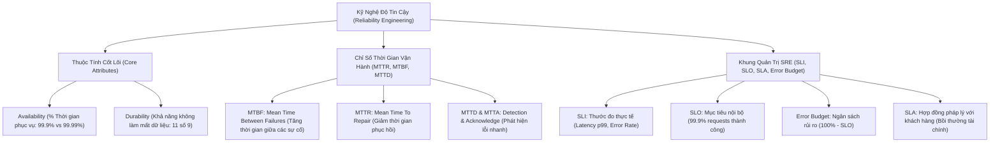
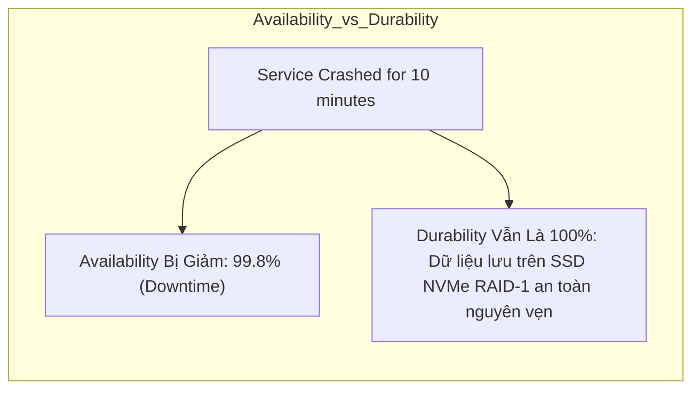
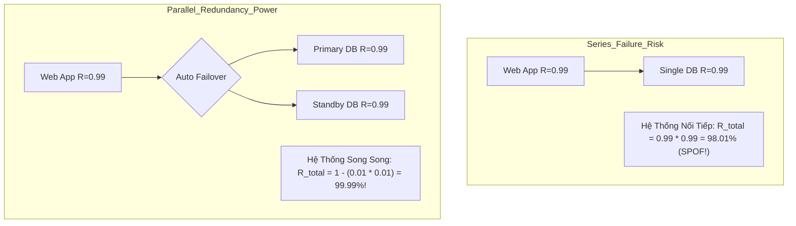
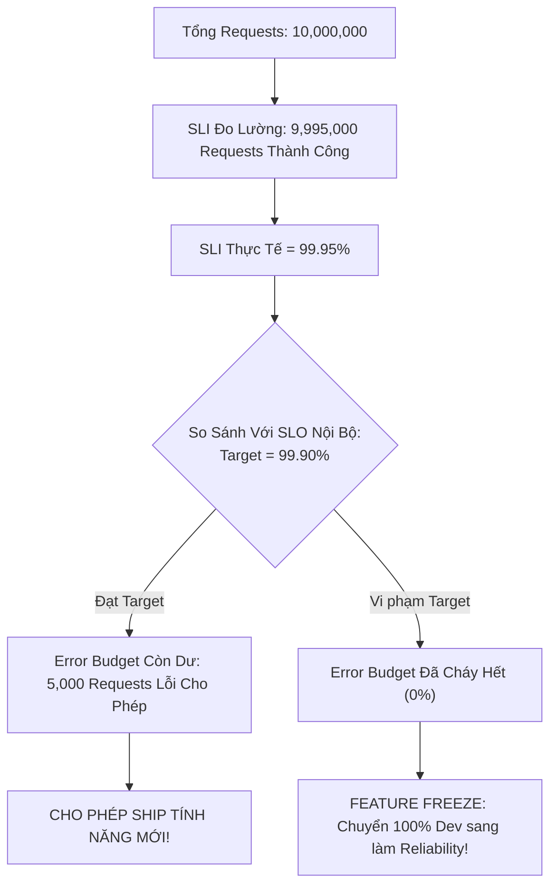

# 11.1. Nền Tảng Kỹ Nghệ Độ Tin Cậy và Các Chỉ Số SRE (Reliability Fundamentals & SRE Metrics)

## Tổng quan về Reliability Fundamentals & SRE Metrics
Trong kỹ nghệ phần mềm quy mô lớn, tính năng sản phẩm chỉ có giá trị khi hệ thống thực sự khả dụng cho người dùng. Khái niệm **Site Reliability Engineering (SRE)** do Google tiên phong đã biến độ tin cậy từ một ước vọng cảm tính thành một môn khoa học kỹ thuật định lượng toán học. Độ tin cậy (**Reliability**) là khả năng của một hệ thống thực thi chính xác các chức năng được yêu cầu dưới những điều kiện xác định trong một khoảng thời gian nhất định. Kỹ sư SRE trưởng thành phân biệt rõ ràng giữa tính khả dụng (**Availability**) và tính bền vững dữ liệu (**Durability**), thành thạo việc đo đạc và tối ưu hóa các chỉ số thời gian vận hành (**MTBF, MTTR, MTTD, MTTA**), xây dựng mô hình khối độ tin cậy (**Reliability Block Diagrams**), và vận hành bộ ba thần thánh của SRE: **SLI (Service Level Indicator)**, **SLO (Service Level Objective)** và **Error Budget (Ngân sách lỗi)** để cân bằng giữa tốc độ đổi mới tính năng và sự ổn định của production.



---

## 2. Chi tiết từng Keyword (Under-the-Hood Deep Dive)

---

### 1. Reliability Fundamentals: Availability vs Durability & The "Nines" of Availability

#### 1. Khái niệm bản chất (What & Why)
* **Reliability Engineering (Kỹ nghệ độ tin cậy)**: Kỷ luật áp dụng các nguyên lý khoa học máy tính và kỹ thuật hệ thống để thiết kế các phần mềm có khả năng chịu lỗi, tự phục hồi và hoạt động ổn định liên tục.
* **Availability (Tính khả dụng / Sẵn sàng)**: Tỷ lệ phần trăm thời gian mà một dịch vụ có thể đáp ứng thành công các yêu cầu hợp lệ của người dùng:
  $$\text{Availability} = \frac{\text{Uptime}}{\text{Uptime} + \text{Downtime}} \times 100\%$$
* **Durability (Tính bền vững dữ liệu)**: Khả năng của hệ thống lưu trữ bảo vệ dữ liệu không bị mất mát hoặc hư hỏng vĩnh viễn qua thời gian (Data Loss Prevention). Khác biệt căn bản: Một cơ sở dữ liệu có thể có Availability là 99% (bị sập 15 phút do khởi động lại máy chủ), nhưng Durability của nó vẫn có thể đạt 100% (không một byte dữ liệu nào của khách hàng bị mất sau khi khởi động lại).
* **The "Nines" of Availability (Số lượng các số 9)**: Thước đo chuẩn hóa quốc tế về tính khả dụng:
  - **3 số 9 (99.9%)**: Cho phép tối đa **8.76 giờ** downtime mỗi năm (Phù hợp cho hầu hết các dịch vụ Web SaaS thông thường).
  - **4 số 9 (99.99%)**: Cho phép tối đa **52.56 phút** downtime mỗi năm (Bắt buộc cho hệ thống E-commerce lớn, Cổng thanh toán).
  - **5 số 9 (99.999% - High Availability)**: Cho phép tối đa **5.26 phút** downtime mỗi năm (Chuẩn hệ thống Viễn thông vi mô, Hệ thống điều khiển không lưu). Mỗi số 9 tăng thêm làm chi phí hạ tầng và độ phức tạp kiến trúc tăng lên gấp 5 đến 10 lần!

#### 2. Cơ chế hoạt động sâu (Under the hood / Hardcore Internals)
- **Thiết kế Đạt 11 Số 9 Durability của AWS S3 (99.999999999%)**:
  Làm thế nào để bảo đảm nếu lưu 10,000,000 file trong 10,000 năm thì trung bình chỉ mất tối đa 1 file?
  - Dữ liệu không bao giờ được lưu trên một đĩa cứng đơn lẻ (xác suất hỏng hóc đĩa cơ HDD Annualized Failure Rate là $\approx 1-2\%$).
  - Sử dụng thuật toán **Erasure Coding (Reed-Solomon Codes)**:
    Một file được phân chia thành $K$ mảnh dữ liệu (Data Chunks) và $M$ mảnh chẵn lẻ (Parity Chunks).
    Toàn bộ $K + M$ mảnh này được phân tán vật lý trên ít nhất 3 Availability Zones (AZs) khác nhau cách xa hàng chục km.
    Hệ thống chỉ bị mất dữ liệu khi cùng một lúc có nhiều hơn $M$ trung tâm dữ liệu bị phá hủy hoàn toàn (xác suất thống kê gần bằng 0).

#### 3. Sơ đồ minh họa (Mermaid Diagram)


#### 4. Code ví dụ thực chiến (C++20: Tính Toán Downtime Budget Dựa Trên Các Số 9 Availability)
```cpp
#include <iostream>
#include <iomanip>

struct AvailabilityTarget {
    double percentage;
    const char* name;
};

void calculateDowntimeBudget(const AvailabilityTarget& target) {
    constexpr double MINUTES_PER_YEAR = 365.25 * 24.0 * 60.0;
    double allowedDowntimeMinutes = MINUTES_PER_YEAR * (1.0 - target.percentage / 100.0);

    std::cout << std::fixed << std::setprecision(2);
    std::cout << "Mục tiêu: " << target.name << " (" << target.percentage << "%)\n"
              << " -> Downtime cho phép tối đa mỗi năm: " << allowedDowntimeMinutes << " phút ("
              << (allowedDowntimeMinutes / 60.0) << " giờ)\n"
              << " -> Downtime cho phép mỗi tháng: " << (allowedDowntimeMinutes / 12.0) << " phút\n"
              << "--------------------------------------------------------\n";
}

int main() {
    calculateDowntimeBudget({99.9, "Three Nines (99.9%)"});
    calculateDowntimeBudget({99.99, "Four Nines (99.99%)"});
    calculateDowntimeBudget({99.999, "Five Nines (99.999%)"});
    return 0;
}
```

#### 5. Ưu / Nhược điểm, Pitfalls & Anti-patterns
- **Anti-pattern: "Cam kết 100% Availability"**: Tuyên bố hệ thống có tính khả dụng 100%. Đây là điều bất khả thi về mặt vật lý (cáp quang biển có thể bị đứt, sét đánh trúng trạm biến áp trung tâm dữ liệu). Mục tiêu 100% chỉ làm tê liệt tốc độ phát triển tính năng mới.

#### 6. Ứng dụng thực tế trong Backend / Systems
- **Thiết kế Multi-Region Active-Active**: Để đạt 4 số 9 availability, hệ thống bắt buộc phải được triển khai trên ít nhất 2 vùng điện toán đám mây độc lập (ví dụ: `us-east-1` và `us-west-2`) với cơ chế DNS Failover tự động qua AWS Route 53.

---

### 2. Operational Time Metrics: MTBF, MTTR, MTTD, MTTA & Reliability Modeling

#### 1. Khái niệm bản chất (What & Why)
* **MTBF (Mean Time Between Failures - Thời gian trung bình giữa các sự cố)**: Khoảng thời gian trung bình mà một hệ thống hoạt động ổn định bình thường trước khi gặp lỗi tiếp theo. Thước đo độ tin cậy nội tại của phần mềm và phần cứng.
* **MTTR (Mean Time To Repair / Recover - Thời gian trung bình để sửa chữa)**: Khoảng thời gian từ khi hệ thống bắt đầu hỏng hóc cho đến khi dịch vụ được phục hồi hoàn toàn trở lại trạng thái bình thường.
  $$\text{Availability} = \frac{\text{MTBF}}{\text{MTBF} + \text{MTTR}}$$
  *Nhận thức sâu sắc*: Để tăng Availability, ta có hai con đường: Tăng MTBF (làm code ít lỗi hơn - rất khó và đắt) HOẶC giảm MTTR (tự động hóa rollback, tự phục hồi - rẻ hơn và hiệu quả hơn rất nhiều!).
* **MTTD (Mean Time To Detect - Thời gian phát hiện sự cố)**: Thời gian từ lúc lỗi phát sinh trên production đến khi hệ thống monitoring/alerting thông báo cho kỹ sư biết.
* **MTTA (Mean Time To Acknowledge - Thời gian tiếp nhận sự cố)**: Thời gian từ lúc nhận được alert đến khi kỹ sư trực on-call bấm xác nhận (Ack) và bắt đầu quá trình điều tra.
* **Failure Rate ($\lambda$ - Tỷ lệ hỏng hóc)**: Số lần lỗi phát sinh trong một đơn vị thời gian ($\lambda = 1 / \text{MTBF}$).
* **Reliability Modeling & Reliability Block Diagrams (RBD - Sơ đồ khối độ tin cậy)**: Phương pháp toán học mô hình hóa độ tin cậy của toàn bộ hệ thống dựa trên cấu trúc các thành phần mắc nối tiếp (Series) hoặc song song (Parallel).

#### 2. Cơ chế hoạt động sâu (Under the hood / Hardcore Internals)
- **Toán Học của Reliability Block Diagrams (RBD)**:
  - **Hệ thống Nối Tiếp (Series System - Single Point of Failure)**:
    Hệ thống gồm API Gateway ($R_1 = 0.99$) nối tiếp Database ($R_2 = 0.99$).
    Hệ thống chỉ chạy khi cả hai cùng chạy:
    $$R_{\text{series}} = R_1 \times R_2 = 0.99 \times 0.99 = 0.9801 \quad (98.01\%)$$
    *Quy luật*: Độ tin cậy của một chuỗi nối tiếp luôn **kém hơn thành phần yếu nhất trong chuỗi**!
  - **Hệ thống Song Song (Parallel System - Redundancy / Dự phòng)**:
    Thêm một Database Standby dự phòng ($R_2 = 0.99$) chạy song song với Primary ($R_1 = 0.99$).
    Hệ thống chỉ sập khi cả hai cùng sập đồng thời:
    $$R_{\text{parallel}} = 1 - (1 - R_1)(1 - R_2) = 1 - (0.01 \times 0.01) = 0.9999 \quad (99.99\%)$$
    Chuyển từ nối tiếp sang song song dự phòng nâng độ tin cậy từ 2 số 9 lên 4 số 9!

#### 3. Sơ đồ minh họa (Mermaid Diagram)


#### 4. Code ví dụ thực chiến (C++20: Mô Phỏng RBD và Tính Toán MTTR Impact)
```cpp
#include <iostream>

// Tính toán Availability theo công thức MTBF và MTTR
double calculateAvailability(double mtbfHours, double mttrHours) {
    return (mtbfHours / (mtbfHours + mttrHours)) * 100.0;
}

int main() {
    double mtbf = 720.0; // Trung bình 1 tháng (720 giờ) gặp sự cố 1 lần

    // Kịch bản 1: MTTR thủ công (Kỹ sư mất 4 giờ để debug và deploy vá lỗi)
    double availManual = calculateAvailability(mtbf, 4.0);

    // Kịch bản 2: MTTR hiện đại (Tự động Rollback bằng Canary & Healthcheck trong 2 phút = 0.033 giờ)
    double availAutomated = calculateAvailability(mtbf, 0.033);

    std::cout << "Availability với MTTR thủ công (4 giờ): " << availManual << "%\n";
    std::cout << "Availability với MTTR tự động (2 phút): " << availAutomated << "%\n";
    std::cout << "Kết luận: Tối ưu MTTR là con đường ngắn nhất để đạt 4 số 9 Availability!\n";
    return 0;
}
```

#### 5. Ưu / Nhược điểm, Pitfalls & Anti-patterns
- **Anti-pattern: Focus Only on Prevention (Chỉ chăm chăm phòng ngừa)**: Dành toàn bộ ngân sách để cố gắng viết code không bao giờ có lỗi (tăng MTBF) trong khi bỏ bê hoàn toàn các công cụ phục hồi (MTTR). Khi sự cố không thể tránh khỏi xảy ra, nhóm mất hàng chục giờ lúng túng không biết cách khôi phục hệ thống.

#### 6. Ứng dụng thực tế trong Backend / Systems
- **Tự động hóa Kubernetes Pod Healing**: Khi một tiến trình bị crash, Linux Kubelet phát hiện trong vòng $10\text{ s}$ (MTTD thấp) và lập tức tạo Pod mới thay thế trong $5\text{ s}$ (MTTR thấp), người dùng hoàn toàn không cảm nhận được sự cố.

---

### 3. SRE Framework: SLI, SLO, SLA & Error Budgets

#### 1. Khái niệm bản chất (What & Why)
* **Service Level Indicator (SLI - Chỉ số mức dịch vụ)**: Thước đo định lượng trực tiếp về mức độ dịch vụ đang được cung cấp trong thời gian thực. Thường được biểu diễn dưới dạng tỷ lệ:
  $$\text{SLI} = \frac{\text{Số lượng sự kiện tốt (Good Events)}}{\text{Tổng số lượng sự kiện hợp lệ (Valid Events)}} \times 100\%$$
  Ví dụ: Tỷ lệ các HTTP requests có latency $< 200\text{ ms}$ và status code không phải $5xx$.
* **Service Level Objective (SLO - Mục tiêu mức dịch vụ)**: Ngưỡng mục tiêu nội bộ của nhóm kỹ thuật về độ tin cậy của dịch vụ (ví dụ: "SLI phải đạt $\ge 99.9\%$ trong chu kỳ 30 ngày lăn").
* **Service Level Agreement (SLA - Thỏa thuận mức dịch vụ)**: Bản hợp đồng pháp lý và thương mại ký kết với khách hàng bên ngoài. Nếu hệ thống vi phạm SLA, công ty bắt buộc phải bồi thường tài chính hoặc hoàn tiền cho đối tác. *Quy tắc SRE*: **SLO luôn luôn phải khắt khe hơn SLA** để khi hệ thống bắt đầu vi phạm SLO nội bộ, nhóm kỹ thuật vẫn còn biên an toàn để xử lý trước khi chạm đến ngưỡng phạt của SLA!
* **Error Budget (Ngân sách lỗi)**: Phần bù của SLO:
  $$\text{Error Budget} = 100\% - \text{SLO}$$
  Nếu SLO là $99.9\%$, thì Error Budget là $0.1\%$. Đây không phải là một con số chết mà là **ngân sách rủi ro cho phép nhóm kỹ thuật được quyền mắc lỗi để đổi mới tính năng**.

#### 2. Cơ chế hoạt động sâu (Under the hood / Hardcore Internals)
- **Chính Sách Điều Hành Khi Error Budget Bị Cháy (Budget Burn Policy)**:
  - Error Budget biến cuộc đối đầu kinh điển giữa hai bộ phận:
    - *Product Team*: "Tôi muốn release tính năng mới thật nhanh!".
    - *Operations / SRE Team*: "Tôi muốn hệ thống ổn định, đừng deploy gì cả!".
  - Trở thành một thỏa thuận toán học minh bạch:
    - **Khi Error Budget còn dồi dào ($> 20\%$)**: Đội Product được toàn quyền release tính năng mới, thử nghiệm A/B testing, chấp nhận rủi ro.
    - **Khi Error Budget bị cạn kiệt ($0\%$) hoặc cháy quá nhanh (High Burn Rate)**:
      Toàn bộ các đợt release tính năng mới lập tức bị **ĐÓNG BĂNG (Feature Freeze)**! 100% tài nguyên kỹ thuật của cả nhóm Product và Dev bắt buộc phải chuyển sang sửa lỗi, trả nợ kỹ thuật, tối ưu hóa hệ thống cho đến khi Error Budget phục hồi trong chu kỳ tiếp theo.

#### 3. Sơ đồ minh họa (Mermaid Diagram)


#### 4. Code ví dụ thực chiến (TypeScript: Thuật Toán Tính Toán Burn Rate Của Error Budget)
```typescript
interface SreMetrics {
  totalRequests: number;
  failedRequests: number;
  sloPercentage: number; // Ví dụ: 99.9
}

class ErrorBudgetCalculator {
  static evaluateBudget(metrics: SreMetrics): {
    sliActual: number;
    budgetRemainingPercentage: number;
    shouldFreezeFeatures: boolean;
  } {
    const successRequests = metrics.totalRequests - metrics.failedRequests;
    const sliActual = (successRequests / metrics.totalRequests) * 100.0;

    const allowedFailureRate = (100.0 - metrics.sloPercentage) / 100.0;
    const maxAllowedFailures = metrics.totalRequests * allowedFailureRate;

    const budgetRemaining = maxAllowedFailures - metrics.failedRequests;
    const budgetRemainingPercentage = (budgetRemaining / maxAllowedFailures) * 100.0;

    const shouldFreezeFeatures = budgetRemainingPercentage <= 0;

    return {
      sliActual,
      budgetRemainingPercentage: Math.max(0, budgetRemainingPercentage),
      shouldFreezeFeatures
    };
  }
}

const last30DaysMetrics: SreMetrics = {
  totalRequests: 5_000_000,
  failedRequests: 6_200, // Đã hỏng 6,200 requests
  sloPercentage: 99.9     // Cho phép hỏng tối đa: 5,000,000 * 0.001 = 5,000 requests
};

const result = ErrorBudgetCalculator.evaluateBudget(last30DaysMetrics);
console.log(`SLI Thực Tế: ${result.sliActual.toFixed(3)}%`);
console.log(`Ngân Sách Lỗi Còn Lại: ${result.budgetRemainingPercentage.toFixed(1)}%`);
if (result.shouldFreezeFeatures) {
  console.warn("CẢNH BÁO: Error Budget đã cháy âm! Áp dụng chính sách Feature Freeze ngay lập tức!");
}
```

#### 5. Ưu / Nhược điểm, Pitfalls & Anti-patterns
- **Anti-pattern: Vanity SLOs**: Đặt mục tiêu SLO quá cao (99.999%) trong khi phần cứng bên dưới chỉ là các máy chủ ảo giá rẻ, dẫn đến việc Error Budget luôn bị cháy và nhóm không bao giờ được phép ship tính năng mới.

#### 6. Ứng dụng thực tế trong Backend / Systems
- **Google SRE Book**: Khẳng định Error Budget là phát minh vĩ đại nhất của SRE nhằm giải quyết triệt để sự xung đột quyền lợi giữa nhóm Phát triển và nhóm Vận hành.

---

## Tổng kết Chương 11.1
Kỹ nghệ độ tin cậy là nền tảng sống còn của mọi hệ thống backend hiện đại. Bằng việc định lượng hóa tính khả dụng qua các số 9, thấu hiểu sức mạnh của việc giảm thiểu MTTR qua tự động hóa, thiết kế dự phòng song song để triệt tiêu các điểm chết nối tiếp, và điều hành tổ chức bằng bộ ba SLI/SLO/Error Budget, người kỹ sư bảo đảm rằng hệ thống luôn tăng trưởng bền vững và tạo dựng niềm tin tuyệt đối nơi khách hàng.
