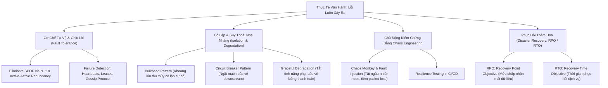
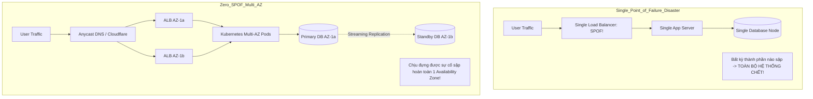
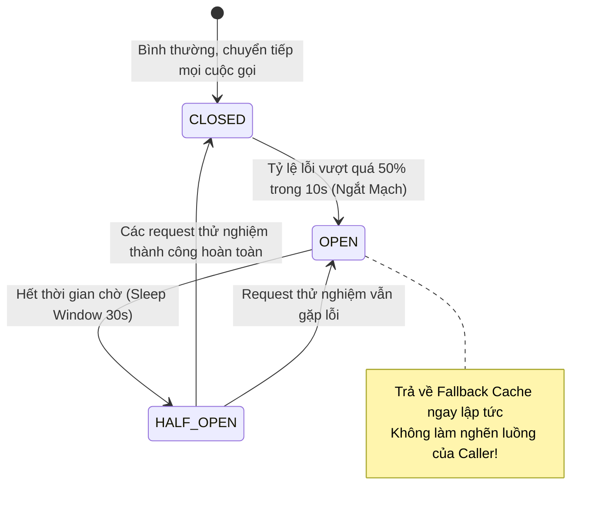
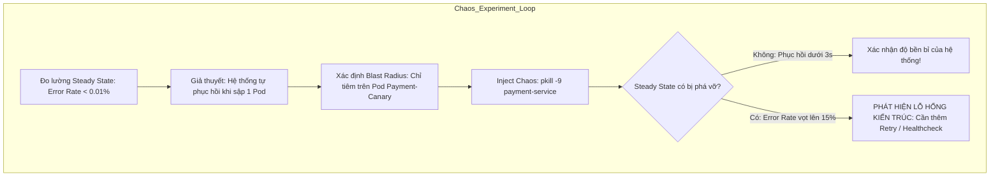

# 11.2. Khả Năng Chịu Lỗi, Tính Bền Bỉ và Kỹ Nghệ Hỗn Loạn (Fault Tolerance, Resilience & Chaos Engineering)

## Tổng quan về Fault Tolerance, Resilience & Chaos Engineering
Định luật Murphy trong điện toán phân tán khẳng định: *"Bất cứ điều gì có thể hỏng hóc, chắc chắn sẽ hỏng hóc tại thời điểm tồi tệ nhất"*. Một hệ thống phức tạp với hàng nghìn máy chủ, card mạng, và ổ đĩa SSD vận hành liên tục 24/7 sẽ luôn luôn tồn tại một vài thành phần ở trạng thái hỏng hóc cục bộ. Khái niệm **Resilience (Khả năng đàn hồi / Bền bỉ)** không phải là việc xây dựng một hệ thống không bao giờ sập (vốn là ảo tưởng), mà là năng lực hấp thụ cú sốc, tự cô lập lỗi (**Fault Isolation**), suy thoái chức năng nhẹ nhàng (**Graceful Degradation**), và tự động phục hồi (**Recoverability**) mà không làm gián đoạn toàn cục. Để chủ động kiểm chứng các năng lực này trước khi thảm họa thực sự xảy ra trên production, kỹ sư áp dụng phương pháp luận **Chaos Engineering (Kỹ nghệ hỗn loạn)** và **Fault Injection (Tiêm lỗi có kiểm soát)**, triệt tiêu mọi điểm chết đơn lẻ (**Single Points of Failure - SPOF**), và thiết lập kế hoạch phục hồi thảm họa toàn diện (**Disaster Recovery & Business Continuity**).



---

## 2. Chi tiết từng Keyword (Under-the-Hood Deep Dive)

---

### 1. Resilience, Fault Tolerance, Redundancy, SPOF & Failure Domains

#### 1. Khái niệm bản chất (What & Why)
* **Fault Tolerance (Khả năng chịu lỗi)**: Khả năng của hệ thống tiếp tục vận hành đúng đắn mà không bị gián đoạn ngay cả khi một hoặc nhiều thành phần phần cứng hoặc phần mềm bên trong bị sập hoàn toàn.
* **Resilience (Tính đàn hồi / Bền bỉ)**: Khả năng hệ thống thích ứng với áp lực, chịu đựng sự cố bất ngờ, suy thoái chức năng có kiểm soát và tự phục hồi về trạng thái bình thường sau khi cú sốc qua đi.
* **Redundancy (Tính dự phòng)**: Việc nhân bản các thành phần quan trọng (máy chủ, nguồn điện, đường cáp mạng, ổ đĩa) để khi thành phần chính gặp sự cố, thành phần dự phòng sẽ lập tức tiếp quản (Failover):
  - *Active-Passive (N+1)*: Nút phụ ở trạng thái chờ (Standby), chỉ kích hoạt khi nút chính sập.
  - *Active-Active*: Tất cả các nút đều cùng tham gia xử lý tải trong thời gian thực.
* **Single Point of Failure (SPOF - Điểm chết đơn lẻ)**: Bất kỳ mắt xích nào trong hệ thống mà nếu nó ngừng hoạt động, toàn bộ hệ thống sẽ lập tức sụp đổ hoàn toàn (ví dụ: Một con switch mạng duy nhất, một database master duy nhất không có replication).
* **Failure Domains (Vùng ảnh hưởng của sự cố)**: Phạm vi ranh giới vật lý hoặc logic bị tác động bởi một sự cố đơn lẻ. Ví dụ: Sự cố mất điện một tủ rack máy chủ (Rack-level domain), sự cố ngập lụt một Data Center (AZ-level domain), hoặc sự cố cáp quang biển đứt (Region-level domain). Kỹ sư phải thiết kế để vùng ảnh hưởng của lỗi luôn được thu hẹp ở mức tối thiểu.

#### 2. Cơ chế hoạt động sâu (Under the hood / Hardcore Internals)
- **Cơ chế Phát Hiện Sự Cố (Failure Detection) ở Tầng Mạng Phân Tán**:
  Làm thế nào để phân biệt giữa một Node đã chết thật sự (Crash-stop) và một Node chỉ đang bị chậm do mạng lag hoặc bận Garbage Collection (Transient Slowdown)?
  - **Phi Accrual Failure Detector (Thuật toán $\phi$)**:
    Thay vì sử dụng một giá trị timeout cố định ngớ ngẩn (Fixed Timeout 5s - rất dễ gây ra hiện tượng False Positive khi mạng bị lag nhẹ), thuật toán $\phi$ (được dùng trong Akka, Cassandra) liên tục theo dõi lịch sử thời gian gửi Heartbeat của các node và tính toán độ tin cậy theo phân phối xác suất thống kê.
    Giá trị $\phi$ phản ánh mức độ nghi ngờ: $\phi = 8$ đồng nghĩa với xác suất node đã chết là $1 - 10^{-8}$. Khi $\phi$ vượt ngưỡng cấu hình, hệ thống mới chính thức kích hoạt quy trình Auto-Failover.

#### 3. Sơ đồ minh họa (Mermaid Diagram)


#### 4. Code ví dụ thực chiến (C++20: Heartbeat Failure Detector Cơ Bản)
```cpp
#include <iostream>
#include <chrono>
#include <thread>

class HeartbeatMonitor {
private:
    using Clock = std::chrono::steady_clock;
    Clock::time_point lastHeartbeat_{Clock::now()};
    const std::chrono::milliseconds timeoutThreshold_{3000}; // 3 giây timeout

public:
    void recordHeartbeat() noexcept {
        lastHeartbeat_ = Clock::now();
    }

    bool isNodeDead() const noexcept {
        auto now = Clock::now();
        auto elapsed = std::chrono::duration_cast<std::chrono::milliseconds>(now - lastHeartbeat_);
        return elapsed > timeoutThreshold_;
    }
};

int main() {
    HeartbeatMonitor monitor;
    std::cout << "[INIT] Bắt đầu theo dõi Node sức khỏe qua Heartbeat...\n";
    
    // Giả lập node gửi heartbeat đều đặn
    monitor.recordHeartbeat();
    std::this_thread::sleep_for(std::chrono::milliseconds(1000));
    std::cout << "Node Status: " << (monitor.isNodeDead() ? "DEAD (Kích hoạt Failover)" : "ALIVE") << "\n";

    // Giả lập node bị sập (mất kết nối 3.5 giây)
    std::this_thread::sleep_for(std::chrono::milliseconds(3500));
    if (monitor.isNodeDead()) {
        std::cerr << "[CRITICAL ALERT] Phát hiện Node ngừng gửi Heartbeat quá 3 giây! Kích hoạt Auto-Failover sang Backup Node ngay lập tức!\n";
    }
    return 0;
}
```

#### 5. Ưu / Nhược điểm, Pitfalls & Anti-patterns
- **Anti-pattern: Split-Brain Syndrome trong Auto-Failover**: Khi mạng giữa hai node Primary và Standby bị đứt tạm thời (Network Partition), cả hai node đều tưởng đối phương đã chết và cùng tự phong mình làm Master. Cả hai cùng nhận lệnh ghi từ client dẫn đến phân kỳ và phá hủy dữ liệu nghiêm trọng. Luôn yêu cầu **Quorum Consensus (ví dụ: Raft $\ge 3$ nodes)** trước khi thăng cấp Master mới.

#### 6. Ứng dụng thực tế trong Backend / Systems
- **Patroni & Consul cho PostgreSQL High Availability**: Sử dụng cụm đồng thuận phân tán Raft để bảo đảm tại một thời điểm duy nhất chỉ có đúng 1 Primary Database được cấp Lease hoạt động.

---

### 2. Fault Isolation, Graceful Degradation & Resilience Patterns (Bulkhead & Circuit Breaker)

#### 1. Khái niệm bản chất (What & Why)
* **Fault Isolation (Cô lập lỗi)**: Ngăn chặn lỗi từ một module hoặc một dịch vụ lây lan sang toàn bộ các dịch vụ khác (Chặn đứng hiện tượng Cascading Failures).
* **Graceful Degradation (Suy thoái nhẹ nhàng)**: Khi hệ thống bị quá tải hoặc một dịch vụ phụ trợ bị sập, hệ thống chủ động tắt bớt các tính năng không thiết yếu (Non-critical features) để bảo vệ các tính năng cốt lõi (Core Business Flow).
* **Bulkhead Pattern (Mẫu vách ngăn kín nước của tàu thủy)**: Tương tự như việc chia thân tàu Titanic thành nhiều khoang kín nước độc lập (nếu một khoang bị thủng, nước chỉ tràn vào khoang đó chứ không làm chìm cả con tàu). Trong phần mềm, Bulkhead chia tách tài nguyên (Thread Pools, Memory, Connection Pools) cho từng dịch vụ downstream riêng biệt.
* **Circuit Breaker Pattern (Mẫu cầu dao ngắt điện - Michael Nygard)**: Giám sát các cuộc gọi tới downstream service:
  - Trạng thái **CLOSED**: Bình thường, các cuộc gọi được chuyển tiếp.
  - Trạng thái **OPEN**: Khi tỷ lệ lỗi vượt quá ngưỡng (ví dụ: 50% timeout trong 10 giây), cầu dao ngắt mạch tức thì. Mọi cuộc gọi tiếp theo bị từ chối ngay lập tức (Fail Fast) hoặc trả về dữ liệu dự phòng (Fallback) mà không làm tốn tài nguyên mạng.
  - Trạng thái **HALF-OPEN**: Sau một khoảng thời gian chờ (Sleep Window), cầu dao cho phép một vài request thử nghiệm đi qua để kiểm tra xem downstream đã hồi phục hay chưa.

#### 2. Cơ chế hoạt động sâu (Under the hood / Hardcore Internals)
- **Tác hại của việc Thiếu Bulkhead ở Tầng Thread Pool của Web Server**:
  - Giả sử Tomcat hoặc Java Backend Server có một Thread Pool dùng chung gồm $200$ worker threads.
  - Có 2 API: `/checkout` (Nghiệp vụ thanh toán cốt lõi) và `/recommendations` (Gợi ý sản phẩm bên lề).
  - Một ngày nọ, Machine Learning Service gợi ý sản phẩm bị lag, phản hồi mất $30\text{ s}$ cho mỗi request.
  - Khách hàng liên tục gọi vào `/recommendations` $\implies$ Cả $200$ threads trong Thread Pool đều bị block ở trạng thái `WAITING` socket của service gợi ý!
  - Kết quả: Khách hàng muốn vào `/checkout` trả tiền bị từ chối kết nối (HTTP 503) vì không còn một thread nào rảnh rỗi trong thread pool. Lỗi từ tính năng phụ đã làm sập tính năng cốt lõi!
  - **Giải pháp Bulkhead**: Cấp phát cố định tối đa 30 threads cho `/recommendations` và 170 threads cho `/checkout`.

#### 3. Sơ đồ minh họa (Mermaid Diagram)


#### 4. Code ví dụ thực chiến (TypeScript: Circuit Breaker và Graceful Degradation)
```typescript
enum CircuitState { CLOSED, OPEN, HALF_OPEN }

class CircuitBreaker {
  private state: CircuitState = CircuitState.CLOSED;
  private failureCount: number = 0;
  private lastFailureTime: number = 0;
  private readonly FAILURE_THRESHOLD = 3;
  private readonly RESET_TIMEOUT_MS = 10000; // 10 giây

  async executeWithFallback<T>(action: () => Promise<T>, fallback: () => T): Promise<T> {
    const now = Date.now();

    // Kiểm tra chuyển từ OPEN sang HALF-OPEN
    if (this.state === CircuitState.OPEN) {
      if (now - this.lastFailureTime > this.RESET_TIMEOUT_MS) {
        console.log("[CIRCUIT BREAKER] Chuyển sang HALF-OPEN: Thử nghiệm cuộc gọi downstream.");
        this.state = CircuitState.HALF_OPEN;
      } else {
        console.warn("[CIRCUIT BREAKER] Mạch đang OPEN! Thực thi Graceful Degradation qua Fallback.");
        return fallback(); // Fail Fast, trả fallback ngay
      }
    }

    try {
      const result = await action();
      if (this.state === CircuitState.HALF_OPEN) {
        console.log("[CIRCUIT BREAKER] Downstream đã phục hồi! Đóng mạch (CLOSED).");
        this.state = CircuitState.CLOSED;
        this.failureCount = 0;
      }
      return result;
    } catch (err) {
      this.failureCount++;
      this.lastFailureTime = now;
      if (this.failureCount >= this.FAILURE_THRESHOLD) {
        console.error("[CIRCUIT BREAKER] Vượt ngưỡng lỗi! Cầu dao NGẮT MẠCH (OPEN)!");
        this.state = CircuitState.OPEN;
      }
      return fallback();
    }
  }
}

// Ứng dụng thực tế: Luồng gọi Dịch vụ Đánh giá Khách hàng (Review Service)
const breaker = new CircuitBreaker();

async function getProductReviews(productId: string) {
  return await breaker.executeWithFallback(
    async () => {
      // Giả lập gọi API bên ngoài bị lỗi timeout
      throw new Error("Downstream Review Service Timeout!");
    },
    () => {
      // Graceful Degradation Fallback: Trả về danh sách rỗng thay vì làm sập trang xem sản phẩm
      return { reviews: [], note: "Tính năng đánh giá tạm thời gián đoạn để bảo trì." };
    }
  );
}
```

#### 5. Ưu / Nhược điểm, Pitfalls & Anti-patterns
- **Anti-pattern: Cascading Retries (Cơn bão thử lại)**: Khi Circuit Breaker chưa kịp ngắt, các service phía trên liên tục retry với số lần nhân lên theo cấp số nhân (Client retry 3 lần $\rightarrow$ Gateway retry 3 lần $\rightarrow$ Service A retry 3 lần $= 27$ requests đổ xuống Database đang hấp hối).

#### 6. Ứng dụng thực tế trong Backend / Systems
- **Netflix Hystrix / Resilience4j & Envoy Proxy**: Được tích hợp sẵn trong Service Mesh để tự động bảo vệ mọi microservice khỏi các sự cố nghẽn mạng dây chuyền.

---

### 3. Chaos Engineering & Fault Injection

#### 1. Khái niệm bản chất (What & Why)
* **Chaos Engineering (Kỹ nghệ hỗn loạn - Principles of Chaos Engineering)**: Kỷ luật chủ động thử nghiệm trên một hệ thống phần mềm nhằm xây dựng niềm tin vào khả năng chịu đựng của hệ thống trước những điều kiện biến động và sự cố bất thường trên môi trường production.
* **Fault Injection (Tiêm lỗi có kiểm soát)**: Kỹ thuật chủ động đưa các khiếm khuyết vào hệ thống: làm trễ mạng 200ms, giả lập packet loss 10%, ngắt đột ngột tiến trình cơ sở dữ liệu, tiêu hao 100% CPU.
* **Bốn Bước Thực Hành Chaos Engineering Chuẩn Khoa Học**:
  1. **Định nghĩa trạng thái ổn định (Define Steady State)**: Xác định các chỉ số SLI bình thường của hệ thống (ví dụ: p99 latency $< 100\text{ ms}$, Error rate $< 0.05\%$).
  2. **Thiết lập giả thuyết (Formulate Hypothesis)**: "Giả thuyết: Nếu ta tắt ngẫu nhiên 1 trong 3 cụm Redis Sentinel, hệ thống vẫn duy trì steady state mà không bị tăng tỷ lệ lỗi".
  3. **Đưa biến số hỗn loạn vào (Inject Chaos)**: Chạy công cụ tắt tiến trình Redis.
  4. **Kiểm chứng và đo lường (Verify and Learn)**: So sánh trạng thái thực tế với steady state. Nếu giả thuyết bị bác bỏ $\implies$ Ta vừa phát hiện một điểm yếu chí mạng của hệ thống trước khi nó tự phát nổ trên production!
* **Blast Radius (Bán kính phát nổ)**: Giới hạn phạm vi ảnh hưởng của thử nghiệm Chaos ở mức nhỏ nhất có thể (chỉ thử nghiệm trên 1% lưu lượng canary hoặc môi trường staging trước) để bảo đảm an toàn kinh doanh.

#### 2. Cơ chế hoạt động sâu (Under the hood / Hardcore Internals)
- **Công cụ Hỗn Loạn Tầng Nhân Linux: Chaos Mesh & Linux Traffic Control (`tc`)**:
  - Làm thế nào Chaos Engineering giả lập đường truyền mạng chập chờn?
  - Sử dụng lệnh `tc` (Traffic Control) kết hợp cùng kernel module `netem` (Network Emulator) trong Linux Kernel:
    ```bash
    # Tiêm độ trễ 150ms có dao động ngẫu nhiên +/- 20ms trên card mạng eth0
    tc qdisc add dev eth0 root netem delay 150ms 20ms distribution normal
    
    # Tiêm tỷ lệ mất gói tin 5% và làm hỏng 1% số gói tin
    tc qdisc add dev eth0 root netem loss 5% corrupt 1%
    ```
  - Linux Kernel tự động hoãn hoặc vứt bỏ các gói tin ở tầng Network Queue trước khi đẩy ra card mạng NIC, tạo ra môi trường thử nghiệm độ bền bỉ chân thực nhất.

#### 3. Sơ đồ minh họa (Mermaid Diagram)


#### 4. Code ví dụ thực chiến (TypeScript: Chaos Middleware Tiêm Lỗi Có Kiểm Soát)
```typescript
import { Request, Response, NextFunction } from 'express';

// Chaos Middleware: Dùng để tiêm độ trễ và lỗi ngẫu nhiên trong môi trường Staging/Canary
function chaosInjectionMiddleware(latencyMs: number, errorRatePercentage: number) {
  return async (req: Request, res: Response, next: NextFunction) => {
    // Chỉ kích hoạt Chaos nếu có Header đặc biệt hoặc môi trường cho phép
    if (process.env.ENABLE_CHAOS_EXPERIMENT !== 'true') {
      return next();
    }

    // 1. Tiêm độ trễ mạng (Network Latency Injection)
    if (latencyMs > 0) {
      await new Promise(resolve => setTimeout(resolve, latencyMs));
    }

    // 2. Tiêm lỗi ngẫu nhiên (Fault Injection)
    const random = Math.random() * 100;
    if (random < errorRatePercentage) {
      console.warn(`[CHAOS MONKEY] Đã tiêm lỗi HTTP 500 có chủ đích tại: ${req.path}`);
      return res.status(500).json({ error: "Simulated Chaos Engineering Fault" });
    }

    next();
  };
}
```

#### 5. Ưu / Nhược điểm, Pitfalls & Anti-patterns
- **Anti-pattern: Chaos without Observability**: Chạy Chaos Engineering bắn sập server mà không có sẵn hệ thống Metrics/Tracing đầy đủ để quan sát. Kết quả là hệ thống sập mà không ai biết chính xác mắt xích nào đã bị vỡ trước.

#### 6. Ứng dụng thực tế trong Backend / Systems
- **Netflix Simian Army (Chaos Monkey, Chaos Gorilla, Chaos Kong)**: Chạy liên tục mỗi ngày trên môi trường production của Netflix để tự động tắt các server ảo EC2 ngẫu nhiên, bảo đảm rằng các kỹ sư không bao giờ được phép viết code phụ thuộc vào một máy chủ đơn lẻ.

---

### 4. Disaster Recovery (DR) & Business Continuity Planning (BCP)

#### 1. Khái niệm bản chất (What & Why)
* **Disaster Recovery (DR - Phục hồi sau thảm họa)**: Tập hợp các chính sách, công cụ và quy trình kỹ thuật nhằm khôi phục lại hạ tầng công nghệ và dữ liệu sau một biến cố thảm khốc (cháy trung tâm dữ liệu, động đất, bị tin tặc tấn công mã hóa tống tiền Ransomware).
* **Business Continuity Planning (BCP - Kế hoạch kinh doanh liên tục)**: Chiến lược toàn diện của tổ chức bảo đảm các hoạt động kinh doanh cốt lõi vẫn có thể duy trì phục vụ khách hàng ngay cả trong thời gian thảm họa đang diễn ra.
* **RPO (Recovery Point Objective - Mục tiêu điểm phục hồi)**: Lượng dữ liệu tối đa chấp nhận bị mất (tính theo đơn vị thời gian) khi thảm họa xảy ra.
  - Ví dụ: Nếu RPO là **15 phút**, thì hệ thống sao lưu phải chạy ít nhất mỗi 15 phút một lần. Bất kỳ giao dịch nào xảy ra trong 15 phút trước thảm họa có thể bị mất.
  - Với các hệ thống tài chính cốt lõi: RPO bắt buộc phải bằng **0** (Zero Data Loss - sử dụng Synchronous Replication).
* **RTO (Recovery Time Objective - Mục tiêu thời gian phục hồi)**: Khoảng thời gian tối đa cho phép để khôi phục lại dịch vụ hoạt động bình thường sau khi thảm họa xảy ra.
  - Nếu RTO là **2 giờ**, thì toàn bộ quy trình kích hoạt trung tâm dữ liệu dự phòng, khôi phục database từ snapshot và đổi DNS phải hoàn tất trong vòng dưới 2 giờ.
* **Operational Readiness Review (ORR - Đánh giá sẵn sàng vận hành)**: Bảng kiểm tra toàn diện trước khi đưa một dịch vụ mới lên production: Đã cấu hình alert chưa? Đã có Runbook chưa? Đã thử nghiệm kịch bản Restore Database từ bản backup chưa?

#### 2. Cơ chế hoạt động sâu (Under the hood / Hardcore Internals)
- **Các Cấp Độ Kiến Trúc Phục Hồi Thảm Họa (Disaster Recovery Tiers)**:
  1. *Backup & Restore (RTO: 24h, RPO: 24h - Chi phí thấp nhất)*: Định kỳ sao lưu dữ liệu lên Cloud Storage (S3 Glacier). Khi có thảm họa, dựng lại server từ đầu và import dữ liệu.
  2. *Pilot Light (RTO: 2-4h, RPO: Vài phút)*: Duy trì database core chạy replication liên tục ở Region 2, các server ứng dụng ở trạng thái tắt. Khi thảm họa xảy ra, bật tự động scale cụm server ứng dụng.
  3. *Warm Standby (RTO: Phút, RPO: Giây)*: Một phiên bản thu nhỏ (Scaled-down version) của toàn bộ hệ thống luôn chạy sẵn sàng ở Region 2.
  4. *Multi-Region Active-Active (RTO: 0, RPO: 0 - Đắt nhất)*: Hệ thống chạy song song 100% công suất ở cả hai Region toàn cầu. Khi 1 Region sập hoàn toàn, Anycast DNS chuyển hướng toàn bộ traffic sang Region kia tức thì mà người dùng không hề hay biết.

#### 3. Sơ đồ minh họa (Mermaid Diagram)
```mermaid
graph TD
    subgraph Disaster_Recovery_Spectrum
        T1["Backup & Restore: RTO 24h / RPO 24h ($)"]
        T2["Pilot Light: RTO 2h / RPO 10m ($$)"]
        T3["Warm Standby: RTO 10m / RPO 1m ($$$)"]
        T4["Multi-Site Active-Active: RTO ~0 / RPO ~0 ($$$$$)"]
        
        T1 --> T2 --> T3 --> T4
    end
```

#### 4. Code ví dụ thực chiến (Bash Script: Tự Động Hóa Kiểm Thử Khôi Phục Backup - Automated Disaster Drill)
```bash
#!/bin/bash
# Kỹ nghệ SRE: "Một bản sao lưu chưa từng được thử nghiệm khôi phục thì không được coi là bản sao lưu!"
# Script tự động chạy hàng tuần để xác minh tính toàn vẹn của Backup Database

set -euo pipefail

BACKUP_FILE="s3://production-backups/pg_dump_latest.sql.gz"
RESTORE_CONTAINER="test_dr_postgres_instance"

echo "[DR DRILL] Bắt đầu tải bản sao lưu mới nhất từ Cloud Storage..."
aws s3 cp "$BACKUP_FILE" /tmp/backup.sql.gz

echo "[DR DRILL] Khởi tạo container PostgreSQL thử nghiệm cô lập..."
docker run --name "$RESTORE_CONTAINER" -e POSTGRES_PASSWORD=secret -d -p 5439:5432 postgres:15

sleep 5 # Chờ database khởi động

echo "[DR DRILL] Tiến hành khôi phục dữ liệu từ file backup..."
gunzip -c /tmp/backup.sql.gz | docker exec -i "$RESTORE_CONTAINER" psql -U postgres -d postgres

echo "[DR DRILL] Xác minh tính toàn vẹn dữ liệu (Data Integrity Check)..."
ROW_COUNT=$(docker exec -i "$RESTORE_CONTAINER" psql -U postgres -d postgres -t -c "SELECT count(*) FROM users;")

if [ "$ROW_COUNT" -gt 0 ]; then
    echo "[SUCCESS] Bản sao lưu hoàn hảo! Khôi phục thành công $ROW_COUNT bản ghi người dùng."
    docker rm -f "$RESTORE_CONTAINER"
    exit 0
else
    echo "[CRITICAL FAILURE] File sao lưu bị hỏng hoặc rỗng! Báo động đội SRE ngay lập tức!"
    docker rm -f "$RESTORE_CONTAINER"
    exit 1
fi
```

#### 5. Ưu / Nhược điểm, Pitfalls & Anti-patterns
- **Anti-pattern: Untested Backups**: Cần mẫn chạy cronjob sao lưu database mỗi đêm trong suốt 5 năm, nhưng chưa từng một lần thử nghiệm khôi phục lại dữ liệu từ file backup đó. Đến ngày máy chủ chính bị hỏng ổ đĩa mới bàng hoàng phát hiện ra file backup bị lỗi giải nén từ 2 năm trước!

#### 6. Ứng dụng thực tế trong Backend / Systems
- **AWS GameDay & DiRT (Disaster Recovery Training của Google)**: Hàng năm, Google tổ chức các đợt tập dượt DiRT bí mật: Các kỹ sư trưởng cố tình cắt đứt đường truyền của các trung tâm dữ liệu lớn để kiểm tra xem đội ngũ trực chiến và các hệ thống tự động có xử lý đúng theo kế hoạch BCP hay không.

---

## Tổng kết Chương 11.2
Độ bền bỉ không phải là một đặc tính tự nhiên sinh ra mà là kết quả của một kỷ luật kỹ thuật được rèn giũa qua lửa đạn. Bằng cách triệt tiêu các điểm chết đơn lẻ bằng kiến trúc dự phòng, bao bọc hệ thống bằng các vách ngăn Bulkhead và cầu dao Circuit Breaker, chủ động phá hủy hệ thống có kiểm soát qua Chaos Engineering, và cam kết chặt chẽ các chỉ số RPO/RTO qua các cuộc diễn tập khôi phục thảm họa định kỳ, người kỹ sư bảo đảm hệ thống luôn vững như bàn thạch trước mọi cơn giông bão của thế giới số.
