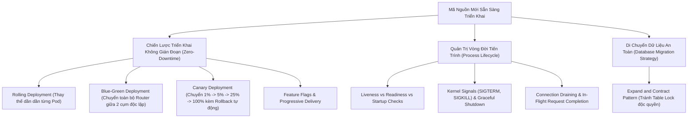
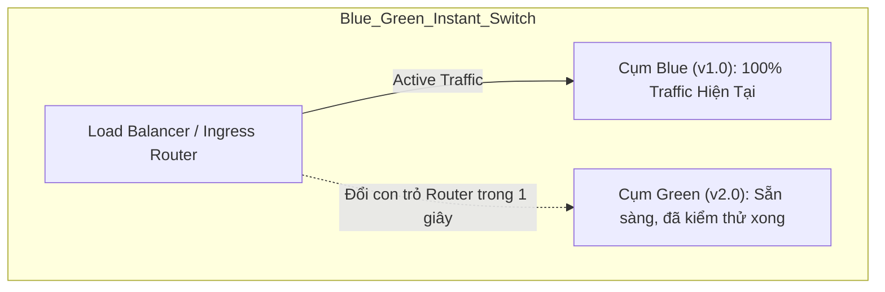
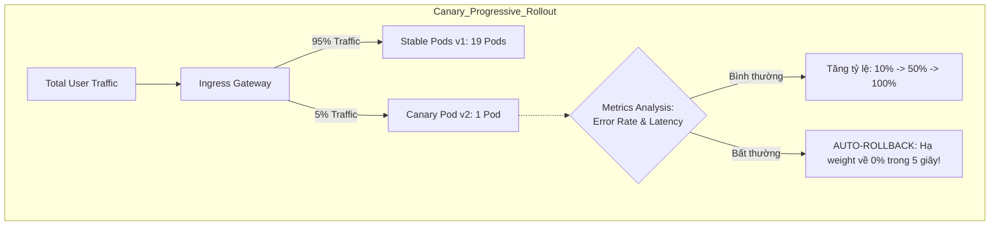
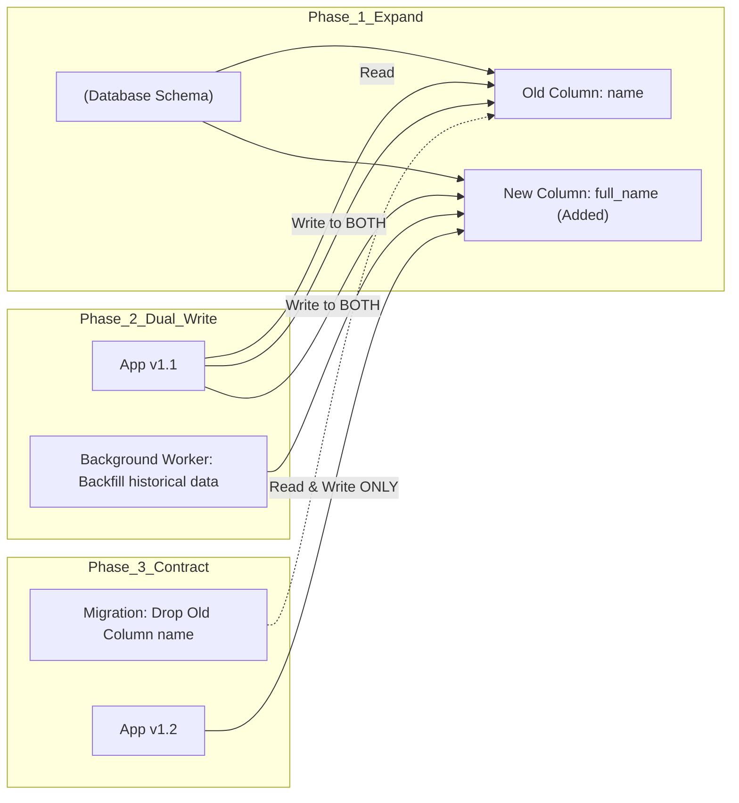
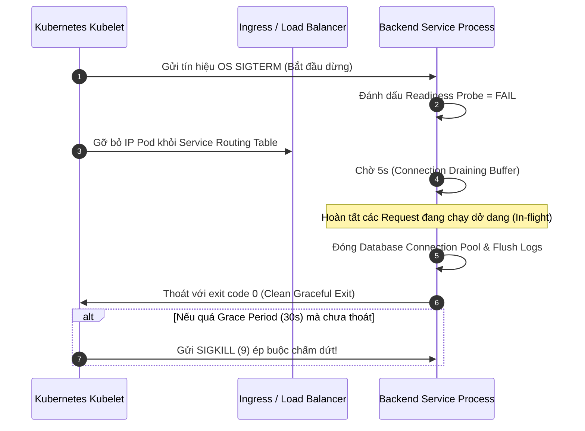

# 12.1. Chiến Lược Triển Khai và Quản Trị Vòng Đời Tiến Trình (Deployment Strategies & Process Lifecycle)

## Tổng quan về Deployment Strategies & Process Lifecycle
Trong kỹ nghệ phần mềm chuyên nghiệp, việc viết xong code chỉ chiếm một nửa chặng đường; nửa còn lại là đưa mã nguồn đó vận hành trơn tru trên môi trường thực tế mà không gây gián đoạn cho người dùng dù chỉ một giây (**Zero-Downtime Deployment**). Kỹ sư sản xuất (Production Engineer) hiện đại làm chủ các chiến lược chuyển giao cấp tiến (**Rolling Deployment**, **Blue-Green Deployment**, **Canary Deployment**, **Feature Flags & Progressive Delivery**), kết hợp với kỹ thuật di chuyển dữ liệu tương thích ngược (**Backward-Compatible Database Migrations: Expand-and-Contract**). Đồng thời, ở tầng hệ điều hành và container, kỹ sư phải kiểm soát chính xác vòng đời tiến trình (**Application Lifecycle Management**): từ **Graceful Startup**, kiểm tra sức khỏe (**Liveness & Readiness Probes**) đến việc ngắt kết nối an toàn (**Graceful Shutdown & Connection Draining**) khi nhận tín hiệu từ Linux Kernel.



---

## 2. Chi tiết từng Keyword (Under-the-Hood Deep Dive)

---

### 1. Zero-Downtime Deployment Strategies: Rolling, Blue-Green, Canary & Progressive Delivery

#### 1. Khái niệm bản chất (What & Why)
* **Zero-Downtime Deployment**: Kỹ thuật cập nhật phiên bản mới của phần mềm lên hệ thống đang chạy mà không làm rớt bất kỳ kết nối nào và không hiển thị trang báo lỗi cho người dùng.
* **Rolling Deployment (Triển khai cuốn chiếu)**: Chiến lược cập nhật tuần tự từng nhóm máy chủ/pods (ví dụ: Cập nhật 25% số lượng pod tại một thời điểm). Tiết kiệm chi phí tài nguyên (không cần x2 máy chủ), nhưng tại một thời điểm hệ thống sẽ tồn tại song song cả phiên bản cũ và mới.
* **Blue-Green Deployment (Triển khai Xanh-Đỏ)**: Duy trì hai môi trường sản xuất hoàn toàn giống hệt nhau: Môi trường **Blue** đang chạy phiên bản hiện tại nhận 100% traffic; triển khai phiên bản mới lên môi trường **Green** và kiểm thử toàn diện. Sau đó đổi con trỏ Router / Load Balancer sang Green tức thì trong 1 giây. Nếu có lỗi, đổi con trỏ ngược lại Blue để rollback ngay lập tức.
* **Canary Deployment (Triển khai chim hoàng yến)**: Lấy cảm hứng từ những người thợ mỏ mang chim hoàng yến xuống hầm than để phát hiện khí độc sớm. Trong phần mềm, ta chuyển một phần lưu lượng thực tế rất nhỏ (ví dụ: 1% hoặc 5% traffic) tới phiên bản mới; giám sát chặt chẽ tỷ lệ lỗi và độ trễ. Nếu các chỉ số ổn định, tăng dần lên 25%, 50% và 100%; nếu có bất thường, tự động đảo ngược (Auto-rollback) ngay lập tức.
* **Progressive Delivery & Feature Flags**: Nâng cấp của Continuous Delivery kết hợp Feature Flags: Tách biệt hoàn toàn giữa việc **Deploy** (đưa mã nhị phân lên server) và **Release** (bật tính năng cho người dùng theo từng phân khúc khách hàng).

#### 2. Cơ chế hoạt động sâu (Under the hood / Hardcore Internals)
- **Định Tuyến Traffic trong Canary Deployment ở tầng Service Mesh (Envoy / Istio)**:
  - Client gửi HTTP Request đến Envoy Ingress Gateway.
  - Envoy đọc cấu hình `VirtualService` phân chia trọng số (Weighted Routing):
    ```yaml
    route:
      - destination:
          host: order-service
          subset: v1-stable
        weight: 95
      - destination:
          host: order-service
          subset: v2-canary
        weight: 5
    ```
  - Envoy sử dụng thuật toán bốc thăm ngẫu nhiên đồng đều (Random / Round-robin) trên từng HTTP Stream để chuyển chính xác 5% các kết nối tới tập hợp Pods chạy v2.
  - Hệ thống Prometheus liên tục theo dõi: Nếu tỷ lệ lỗi HTTP $5xx$ của v2 vượt quá $0.1\%$, công cụ Flagger tự động cập nhật cấu hình Envoy hạ weight của v2 về $0\%$ trong vòng dưới $5\text{ s}$!

#### 3. Sơ đồ minh họa (Mermaid Diagram)




#### 4. Code ví dụ thực chiến (YAML: Kubernetes Canary Deployment với HPA)
```yaml
# Cấu hình Kubernetes Deployment cho phiên bản Canary v2
apiVersion: apps/v1
kind: Deployment
metadata:
  name: order-service-canary
  labels:
    app: order-service
    track: canary
spec:
  replicas: 1 # Chỉ chiếm 1 Pod nhỏ thử nghiệm
  selector:
    matchLabels:
      app: order-service
      track: canary
  template:
    metadata:
      labels:
        app: order-service
        track: canary
    spec:
      containers:
      - name: order-app
        image: registry.internal/order-service:v2.1.0-canary
        ports:
        - containerPort: 8080
        resources:
          limits:
            cpu: "500m"
            memory: "512Mi"
          requests:
            cpu: "100m"
            memory: "128Mi"
```

#### 5. Ưu / Nhược điểm, Pitfalls & Anti-patterns
- **Anti-pattern: Friday Evening Deployments (Deploy chiều thứ Sáu)**: Triển khai các thay đổi lớn vào cuối buổi chiều thứ Sáu trước kỳ nghỉ cuối tuần. Khi sự cố xảy ra lúc nửa đêm, toàn bộ đội ngũ kỹ thuật bị lôi kéo vào các cuộc khủng hoảng căng thẳng.

#### 6. Ứng dụng thực tế trong Backend / Systems
- **Facebook Gatekeeper**: Hệ thống kiểm soát Feature Flag và Progressive Delivery khổng lồ của Meta, cho phép các kỹ sư bật một tính năng mới cho riêng nhân viên nội bộ của công ty trước, sau đó là người dùng tại New Zealand, rồi mới mở rộng ra toàn thế giới.

---

### 2. Backward-Compatible Database Migrations: The Expand and Contract Pattern

#### 1. Khái niệm bản chất (What & Why)
* **Database Migration Strategy**: Kế hoạch thay đổi cấu trúc bảng, thêm cột, đổi tên hoặc di chuyển dữ liệu trên cơ sở dữ liệu production mà không làm khóa bảng (Lock contention) và không làm hỏng ứng dụng.
* **The Expand and Contract Pattern (Mẫu Mở rộng và Thu hẹp - hay Parallel Change)**: Kỹ thuật bắt buộc để đạt được Zero-Downtime Deployment khi có sự thay đổi về Database Schema:
  1. **Phase 1 (Expand - Mở rộng)**: Thêm cấu trúc mới vào database song song với cấu trúc cũ (Database hỗ trợ cả hai). Ví dụ: Muốn đổi tên cột `name` thành `first_name` và `last_name`, ta thêm hai cột mới mà vẫn giữ nguyên cột `name`.
  2. **Phase 2 (Dual-Writing - Ghi kép)**: Triển khai phiên bản ứng dụng v1.1 có khả năng đọc từ cột cũ nhưng ghi đồng thời vào cả cột cũ và cột mới. Chạy script di chuyển (Backfill) dữ liệu lịch sử trong nền.
  3. **Phase 3 (Read from New - Đọc từ mới)**: Triển khai phiên bản ứng dụng v1.2 chuyển sang đọc hoàn toàn từ cột mới.
  4. **Phase 4 (Contract - Thu hẹp)**: Xóa bỏ cột cũ khỏi Database Schema một cách an toàn.

#### 2. Cơ chế hoạt động sâu (Under the hood / Hardcore Internals)
- **Cơ Chế Tránh Khóa Độc Quyền (AccessExclusiveLock) trong PostgreSQL**:
  - Khi chạy lệnh: `ALTER TABLE orders ADD COLUMN status VARCHAR(20) DEFAULT 'PENDING' NOT NULL;`
  - Trên PostgreSQL phiên bản cũ ($< 11$), lệnh này phải ghi đè giá trị mặc định lên từng dòng trên đĩa $\implies$ Khóa toàn bộ bảng bằng `AccessExclusiveLock`. Mọi câu lệnh `SELECT`, `INSERT`, `UPDATE` của khách hàng bị treo cứng trong suốt thời gian quét hàng triệu dòng!
  - **Quy trình An Toàn Chuẩn Kỹ Nghệ**:
    1. Tạo cột cho phép NULL: `ALTER TABLE orders ADD COLUMN status VARCHAR(20);` (Thao tác chỉ cập nhật metadata catalog, mất $0.1\text{ ms}$).
    2. Cập nhật dữ liệu cũ theo từng batch nhỏ 5000 dòng để không làm nghẽn Write-Ahead Log (WAL).
    3. Thêm ràng buộc kiểm tra không validate: `ALTER TABLE orders ADD CONSTRAINT check_status NOT NULL NOT VALID;`
    4. Validate bất đồng bộ mà không khóa bảng: `ALTER TABLE orders VALIDATE CONSTRAINT check_status;`

#### 3. Sơ đồ minh họa (Mermaid Diagram)


#### 4. Code ví dụ thực chiến (TypeScript: Dual-Write Data Layer trong Giai Đoạn Expand)
```typescript
interface DatabaseClient {
  query(sql: string, params: any[]): Promise<any>;
}

class UserDataMigrationRepository {
  constructor(private db: DatabaseClient) {}

  // Giai đoạn Dual-Write: Ghi đồng thời vào cả cột cũ (name) và cột mới (firstName, lastName)
  async updateUserProfile(userId: number, firstName: string, lastName: string): Promise<void> {
    const legacyCombinedName = `${firstName} ${lastName}`.trim();

    // Câu lệnh SQL Dual-Write bảo đảm tương thích ngược 100% với các services cũ đang đọc cột name
    const sql = `
      UPDATE users 
      SET 
        name = $1,           -- Cột cũ (Legacy)
        first_name = $2,     -- Cột mới (Modern)
        last_name = $3       -- Cột mới (Modern)
      WHERE id = $4;
    `;

    await this.db.query(sql, [legacyCombinedName, firstName, lastName, userId]);
    console.log(`[DUAL WRITE] Cập nhật thành công cho User ${userId} trên cả 2 cấu trúc schema!`);
  }
}
```

#### 5. Ưu / Nhược điểm, Pitfalls & Anti-patterns
- **Anti-pattern: Renaming Column Directly**: Chạy lệnh `ALTER TABLE RENAME COLUMN` trực tiếp trên database đang hoạt động. Ngay lập tức, toàn bộ các instances của ứng dụng cũ đang chạy trên production bị sập với lỗi `column does not exist`.

#### 6. Ứng dụng thực tế trong Backend / Systems
- **Quy tắc Vàng tại Stripe & GitHub**: Không bao giờ triển khai thay đổi Database Schema và thay đổi Code ứng dụng sử dụng schema đó trong cùng một commit. Chúng luôn được tách thành ít nhất 3 Pull Requests độc lập triển khai cách nhau nhiều ngày.

---

### 3. Process Lifecycle: Signals, Health Checks, Graceful Shutdown & Connection Draining

#### 1. Khái niệm bản chất (What & Why)
* **Application Lifecycle Management (Quản trị vòng đời ứng dụng)**: Việc kiểm soát các giai đoạn của một tiến trình phần mềm: Khởi tạo (Bootstrap) $\rightarrow$ Sẵn sàng nhận tải (Ready) $\rightarrow$ Đang chạy (Running) $\rightarrow$ Ngừng tiếp nhận kết nối mới (Draining) $\rightarrow$ Giải phóng tài nguyên và Thoát (Terminated).
* **Linux Kernel Signals (`SIGTERM`, `SIGINT`, `SIGKILL`)**:
  - `SIGTERM (Signal 15)`: Tín hiệu yêu cầu tiến trình tự dọn dẹp và kết thúc nhẹ nhàng (Graceful Termination). Tiến trình có thể bắt (catch) và xử lý tín hiệu này.
  - `SIGKILL (Signal 9)`: Tín hiệu hủy diệt của hệ điều hành. Kernel ép buộc thu hồi bộ nhớ và giết tiến trình ngay lập tức, tiến trình KHÔNG THỂ bắt hay hoãn tín hiệu này.
* **Graceful Startup & Health Checks**:
  - **Startup Probe**: Kiểm tra xem ứng dụng đã nạp xong cấu hình và khởi tạo kết nối ban đầu chưa (hữu ích cho các ứng dụng nặng mất 30s khởi động).
  - **Liveness Probe**: Kiểm tra xem tiến trình có còn sống hay đã bị Deadlock hoàn toàn. Nếu Liveness fail $\implies$ Kubernetes sẽ kill tiến trình và tạo lại.
  - **Readiness Probe**: Kiểm tra xem tiến trình đã sẵn sàng tiếp nhận request từ người dùng hay chưa. Nếu Readiness fail $\implies$ Tạm thời gỡ bỏ Pod khỏi danh sách của Load Balancer nhưng KHÔNG kill tiến trình.
* **Graceful Shutdown & Connection Draining**: Khi nhận `SIGTERM`, tiến trình:
  1. Chuyển trạng thái Readiness sang `False` (để Load Balancer ngừng gửi traffic mới).
  2. Tiếp tục hoàn tất các request đang xử lý dở dang (In-flight Requests).
  3. Đóng các database connections và flush toàn bộ log ra đĩa.
  4. Thoát với mã `0 (Clean Exit)`.

#### 2. Cơ chế hoạt động sâu (Under the hood / Hardcore Internals)
- **Cuộc Đua Tín Hiệu (Race Condition) Giữa Kubernetes Endpoints Controller và Kubelet**:
  - Khi một Pod bị xóa (`kubectl delete pod` hoặc Rolling Update):
    - *Luồng 1*: Kubelet gửi tín hiệu `SIGTERM` tới tiến trình bên trong Pod.
    - *Luồng 2*: Endpoints Controller cập nhật `iptables` / IPVS trên toàn bộ các node mạng để gỡ IP của Pod khỏi Service.
    - **Vấn đề**: Luồng 2 (cập nhật mạng iptables) có độ trễ phân tán mất từ $1$ đến $3\text{ giây}$. Nếu tiến trình của bạn nhận `SIGTERM` và đóng ngay socket trong vòng $0.1\text{ s}$, các request mới từ Load Balancer vẫn tiếp tục bay tới IP đó và bị lỗi `Connection Refused (TCP RST)`!
  - **Giải pháp Chuẩn SRE**:
    Tiến trình bắt `SIGTERM`, thực hiện lệnh `sleep(5)` trước khi thực sự đóng socket nghe (Listen Socket), bảo đảm hệ thống mạng iptables toàn cụm đã gỡ IP hoàn toàn trước khi tiến trình ngừng phục vụ.

#### 3. Sơ đồ minh họa (Mermaid Diagram)


#### 4. Code ví dụ thực chiến (C++20: Xử Lý Chuẩn Tín Hiệu Linux Kernel `SIGTERM` & Graceful Shutdown)
```cpp
#include <iostream>
#include <csignal>
#include <atomic>
#include <thread>
#include <chrono>

std::atomic<bool> isRunning{true};
std::atomic<int> inFlightRequests{0};

// Handler tiếp nhận tín hiệu từ Linux Kernel (SIGTERM / SIGINT)
void signalHandler(int signum) {
    if (signum == SIGTERM || signum == SIGINT) {
        std::cout << "\n[KERNEL SIGNAL] Nhận tín hiệu SIGTERM (" << signum 
                  << ")! Bắt đầu quy trình Graceful Shutdown...\n";
        isRunning.store(false); // Dừng tiếp nhận request mới
    }
}

void simulateWorker() {
    while (isRunning.load()) {
        inFlightRequests.fetch_add(1);
        // Giả lập xử lý nghiệp vụ
        std::this_thread::sleep_for(std::chrono::milliseconds(200));
        inFlightRequests.fetch_sub(1);
        std::this_thread::sleep_for(std::chrono::milliseconds(100));
    }
}

int main() {
    // Đăng ký Signal Handler với nhân Linux
    std::signal(SIGTERM, signalHandler);
    std::signal(SIGINT, signalHandler);

    std::cout << "[PID: " << ::getpid() << "] Server đang chạy. Đang lắng nghe requests...\n";
    std::thread worker(simulateWorker);

    // Vòng lặp chính đợi tín hiệu ngắt
    while (isRunning.load()) {
        std::this_thread::sleep_for(std::chrono::milliseconds(500));
    }

    // GIAI ĐOẠN CONNECTION DRAINING
    std::cout << "[DRAINING] Ngừng nhận request mới. Đang chờ các in-flight requests hoàn tất...\n";
    while (inFlightRequests.load() > 0) {
        std::cout << " -> Đang đợi " << inFlightRequests.load() << " requests dở dang kết thúc...\n";
        std::this_thread::sleep_for(std::chrono::milliseconds(100));
    }

    worker.join();
    std::cout << "[CLEAN EXIT] Toàn bộ tài nguyên và Database Pools đã được giải phóng an toàn. Tạm biệt!\n";
    return 0;
}
```

#### 5. Ưu / Nhược điểm, Pitfalls & Anti-patterns
- **Anti-pattern: Fast Suicide on SIGTERM**: Ứng dụng vừa nhận `SIGTERM` lập tức gọi `exit(0)`. Toàn bộ 50 giao dịch thanh toán của khách hàng đang chạy dở dang bị ngắt kết nối đột ngột, làm phát sinh dữ liệu mồ côi (Corrupted state) trong database.

#### 6. Ứng dụng thực tế trong Backend / Systems
- **Cấu hình NGINX Worker Shutdown**: Lệnh `nginx -s quit` (Graceful Shutdown) bảo đảm các worker processes phục vụ xong toàn bộ các HTTP connections hiện có trước khi tiến trình master tự giải phóng bộ nhớ.

---

## Tổng kết Chương 12.1
Triển khai hệ thống lên production là sự kết hợp hoàn hảo giữa chiến lược kiến trúc cấp cao và sự am hiểu tường tận cơ chế của hệ điều hành tầng thấp. Bằng việc áp dụng Canary Deployment để giảm thiểu bán kính rủi ro, di chuyển cơ sở dữ liệu qua mẫu Expand-and-Contract an toàn, và kiểm soát chặt chẽ vòng đời tiến trình qua Graceful Shutdown và Connection Draining, người kỹ sư bảo đảm hệ thống vận hành liên tục 24/7/365 mà không một lần làm gián đoạn trải nghiệm của người dùng.
