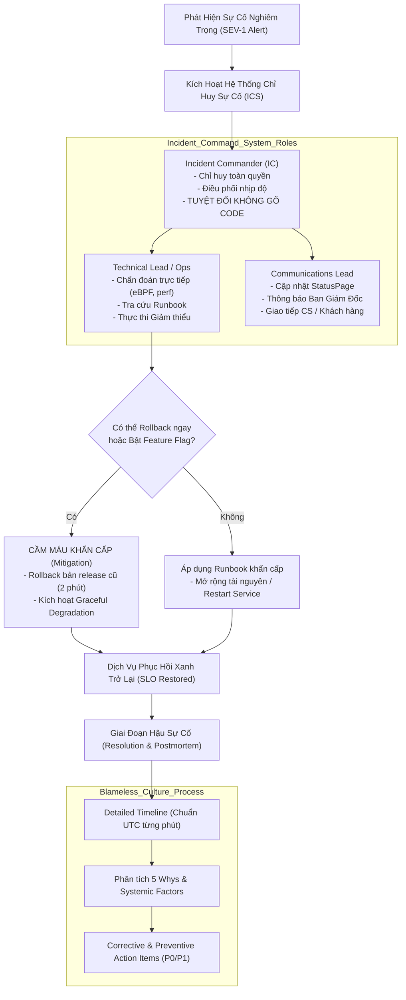

# 12.2. Quản Trị Sự Cố và Văn Hóa Postmortem Không Đổ Lỗi (Incident Management & Blameless Postmortem)

> [!IMPORTANT]
> **Nếu bạn chỉ được nhớ một điều duy nhất:** Sự cố trên môi trường sản xuất là điều tất yếu của mọi hệ thống phức tạp; thước đo bản lĩnh kỹ thuật không nằm ở việc cố gắng giấu giếm hay tìm người để trừng phạt, mà ở nguyên tắc **"Ưu tiên giảm thiểu (Mitigate) trước khi sửa tận gốc (Fix)"** trong lúc dầu sôi lửa bỏng và kiên định nuôi dưỡng **"Văn hóa hậu sự cố không đổ lỗi (Blameless Postmortem)"** để biến mọi thảm họa thành tấm khiên bảo vệ hệ thống trong tương lai.

---

## 1. Kiến trúc Tổng quan & Mô hình Tư duy (Mental Model)

### Phép loại suy thực tế (The Flight Crew Emergency Protocol)
Hãy hình dung tình huống khẩn cấp trên một chuyến bay thương mại chở 300 hành khách ở độ cao 10,000 mét:
- Đột nhiên động cơ số 2 bốc cháy và còi báo động vang rền buồng lái.
- **Phi hành đoàn hành động ra sao?**
  - **Incident Commander (Cơ trưởng)**: Không lao vào tháo dỡ máy móc hay cặm cụi đọc bảng mã lỗi chi tiết. Cơ trưởng giữ quyền chỉ huy cao nhất: giữ thăng bằng máy bay, duy trì tốc độ và ra quyết định bay về sân bay gần nhất.
  - **Technical Lead (Cơ phó)**: Mở ngay cuốn **Operational Checklist / Runbook**, thực hiện chính xác các thao tác khẩn cấp: ngắt nhiên liệu động cơ bị cháy, kích hoạt bình chữa cháy tự động (*Mitigation*).
  - **Communications Lead (Tiếp viên trưởng & Đài kiểm soát không lưu)**: Thông báo trấn an hành khách bằng thông điệp rõ ràng, phát tín hiệu *Mayday* tới mặt đất để ưu tiên dọn sạch đường băng cứu hộ.
- **Sau khi hạ cánh an toàn (Blameless Investigation)**:
  - Ủy ban An toàn Giao thông (NTSB) mở hộp đen, ghi lại từng giây sự kiện. Họ **tuyệt đối không tìm cách sa thải hay trừng phạt phi công** vì đã nhấn nhầm một nút gạt trong cơn hoảng loạn.
  - Họ đặt câu hỏi: *"Tại sao buồng lái lại bố trí công tắc chữa cháy quá gần nút điều hòa khiến phi công dễ gạt nhầm dưới áp lực cao? Cần thiết kế lại chốt an toàn vật lý như thế nào để bất kỳ ai trong tương lai cũng không thể gạt nhầm?"*

Đó chính là tinh thần cốt lõi của **Incident Management** và **Blameless Postmortem** trong kỹ nghệ phần mềm hiện đại.



---

## 2. Chi tiết từng Keyword (Under-the-Hood Deep Dive)

### 2.1. Operational Runbooks (Quy trình Vận hành Chuẩn)
- **Bản chất kỹ thuật**: Runbook là tài liệu kỹ thuật chi tiết hướng dẫn từng bước cụ thể (*Step-by-step instructions*) để xử lý một cảnh báo định lượng xác định (ví dụ: `DatabaseConnectionPoolSaturation > 90%`). Runbook được thiết kế để một kỹ sư dù đang ngái ngủ lúc 3 giờ sáng vẫn có thể thực hiện chính xác mà không cần phải suy đoán.
- **Tiêu chuẩn một Runbook chuyên nghiệp**:
  1. **Triệu chứng & Biểu thức Alert (Metric Query)**: Định nghĩa rõ ràng câu lệnh PromQL/Datadog kích hoạt cảnh báo.
  2. **Các bước chẩn đoán nhanh (Triaging Commands)**: Các lệnh SQL/Linux an toàn để xác minh nguyên nhân trong 60 giây.
  3. **Hành động giảm thiểu khẩn cấp (Remediation Steps)**: Lệnh thực thi chính xác (copy-pasteable) kèm theo các tham số mặc định.
  4. **Quy trình hoàn tác / Rollback**: Cách thức quay lại nếu lệnh can thiệp làm tình hình xấu hơn.

### 2.2. Operational Playbooks (Kịch bản Sự cố Chiến lược)
- **Bản chất kỹ thuật**: Khác với Runbook (vốn tập trung vào một tác vụ kỹ thuật vi mô), Playbook là kịch bản vận hành cấp chiến lược giải quyết các sự cố phức tạp, đa chiều và có mức độ bất định cao (ví dụ: *"Kịch bản ứng phó sự cố rò rỉ dữ liệu khách hàng (Data Breach)"*, *"Kịch bản phục hồi khi toàn bộ trung tâm dữ liệu AWS us-east-1 bị sập"*).
- **Đặc trưng**: Playbook định nghĩa quy trình phối hợp liên phòng ban: Pháp chế (Legal), Truyền thông (PR), An ninh mạng (Security), Hạ tầng (Infra) và Ban lãnh đạo cấp cao (Executive Staff).

### 2.3. Live Diagnostics & Production Debugging
- **Bản chất kỹ thuật**: Kỹ năng thanh tra, chẩn đoán trạng thái luồng, bộ nhớ và I/O trực tiếp trên máy chủ đang chạy dưới tải cao mà không làm trầm trọng thêm sự cố (*Zero-impact Diagnostics*).
- **Cấm kỵ sinh tử trên Production**:
  - **TUYỆT ĐỐI KHÔNG DÙNG `strace -p <PID>` TRÊN PRODUCTION TẢI CAO**: Lệnh `strace` sử dụng system call `ptrace()`. Nó dừng hoạt động (*freezes*) của toàn bộ các luồng (threads) tại mỗi entry và exit của mọi system call. Trên một dịch vụ đang nhận 20,000 RPS, việc chạy `strace` sẽ khiến throughput sụt giảm **85-95%**, hàng đợi request tràn ngập và làm sập hoàn toàn hệ thống.
  - **KHÔNG ATTACH GDB VÀO TIẾN TRÌNH ĐANG CHẠY CHÍNH**: Sẽ gây deadlock các kết nối socket mạng và trigger timeout hàng loạt ở phía client.

### 2.4. Production Profiling & Continuous Profiling (perf, eBPF & Flamegraphs)
- **Bản chất kỹ thuật**: Kỹ thuật thu thập mẫu thực thi của CPU và bộ nhớ bằng phần cứng (*Hardware Performance Counters*) với mức chi phí phụ trợ (*overhead*) cực thấp ($< 1\%$).
- **Công cụ chuẩn SRE**:
  - **Linux `perf`**: Lấy mẫu ngăn xếp lệnh của kernel và user-space ở tần số an toàn (ví dụ: 99 Hz):
    ```bash
    perf record -F 99 -p <PID> -g -- sleep 10
    perf script | stackcollapse-perf.pl | flamegraph.pl > production_flamegraph.svg
    ```
  - **eBPF (Extended Berkeley Packet Filter)**: Tận dụng máy ảo an toàn bên trong Linux Kernel để theo dõi độ trễ I/O đĩa, TCP retransmissions, hoặc memory allocation bottlenecks mà không cần sửa đổi mã nguồn hay khởi động lại tiến trình.

### 2.5. Incident Response & Severity Levels (SEV-1 đến SEV-4)
- **Phân loại cấp độ nghiêm trọng chuẩn mực**:
  - **SEV-1 (Critical Emergency)**: Hệ thống cốt lõi sập toàn bộ hoặc mất mát dữ liệu nghiêm trọng; khách hàng không thể thực hiện giao dịch chính (Checkout, Login); vi phạm cam kết SLA hợp đồng. *Yêu cầu: Kích hoạt Incident Commander ngay trong 5 phút, họp War Room 24/7 cho tới khi khôi phục*.
  - **SEV-2 (Major Impairment)**: Chức năng phụ trợ quan trọng bị hỏng nhưng có giải pháp thay thế tạm thời; hoặc hệ thống mất tính dự phòng (Secondary node chết, chỉ còn Primary hoạt động). *Yêu cầu: Phản hồi trong 15 phút*.
  - **SEV-3 (Minor Degradation)**: Suy giảm hiệu năng nhẹ, chỉ ảnh hưởng đến một nhóm nhỏ người dùng nội bộ, không đe dọa trực tiếp đến doanh thu. *Yêu cầu: Xử lý trong giờ hành chính*.
  - **SEV-4 (Low / Cosmetic)**: Lỗi giao diện nhỏ, thông tin log bị sai định dạng.

### 2.6. Incident Command System (ICS)
- **Bản chất kỹ thuật**: Khung quản trị khủng hoảng xuất phát từ lực lượng chỉ huy cứu hỏa khẩn cấp, được Google SRE và PagerDuty chuẩn hóa cho kỹ nghệ phần mềm.
- **Phân định 3 vai trò độc lập**:
  1. **Incident Commander (IC - Chỉ huy trưởng)**: Nắm toàn quyền quyết định cao nhất trong cuộc khủng hoảng. **IC TUYỆT ĐỐI KHÔNG GÕ CODE HOẶC CHẠY LỆNH TRÊN SERVER**. Vai trò duy nhất của IC là giữ cái đầu lạnh, điều phối nhân sự, đặt câu hỏi, phân công luồng điều tra và quyết định thời điểm thực hiện Rollback.
  2. **Technical Lead / Operations**: Chuyên gia kỹ thuật trực tiếp điều tra nguyên nhân, đọc telemetry, chạy eBPF diagnostics và thực thi các thao tác giảm thiểu kỹ thuật.
  3. **Communications Lead (Trưởng ban Truyền thông)**: Chịu trách nhiệm bảo vệ đội ngũ kỹ thuật khỏi sự làm phiền từ bên ngoài; liên tục cập nhật trang thông báo trạng thái (*StatusPage*), báo cáo ban giám đốc và hướng dẫn đội Hỗ trợ khách hàng (CS).

### 2.7. Mitigation vs. Resolution (Cầm Máu vs. Sửa Gốc)
- **Quy tắc vàng của Kỹ sư Vận hành Sản xuất**:
  $$\text{ƯU TIÊN MITIGATION TRƯỚC, RESOLUTION SAU!}$$
- **Mitigation (Giảm thiểu / Cầm máu)**: Mục tiêu duy nhất là đưa hệ thống trở lại trạng thái hoạt động bình thường phục vụ khách hàng trong thời gian ngắn nhất (thường $< 5-10\text{ phút}$):
  - Rollback ngay lập tức phiên bản vừa deploy về commit ổn định trước đó.
  - Bật Feature Flag tắt tính năng đang bị quá tải hoặc lỗi.
  - Kích hoạt cơ chế cắt tải (*Load Shedding*) hoặc chuyển sang chế độ suy giảm nhẹ (*Graceful Degradation*).
  - Khởi động lại dịch vụ hoặc chuyển mạch dự phòng (*Failover* sang Data Center thứ hai).
- **Resolution (Sửa gốc)**: Việc tìm ra lỗi logic trong code, viết bài test tái hiện, sửa lỗi, review và deploy bản vá triệt để. Việc này được thực hiện từ tốn trong môi trường thử nghiệm sau khi production đã hoàn toàn bình phục.

### 2.8. Postmortem & Retrospective Culture
- **Bản chất kỹ thuật**: Bản báo cáo kỹ thuật toàn diện phân tích sự cố một cách khoa học sau khi hệ thống đã ổn định hoàn toàn (thường được hoàn thành trong vòng 24–48 giờ sau sự cố).
- **Cấu trúc chuẩn mực của một Postmortem**:
  1. **Bản tóm tắt điều hành (Executive Summary)**: Ngắn gọn 1 đoạn văn giải thích sự cố cho ban lãnh đạo.
  2. **Đo lường tác động (Impact Analysis)**: Thời gian gián đoạn (Downtime), số lượng request bị lỗi, số lượng khách hàng bị ảnh hưởng, tổn thất tài chính ước tính.
  3. **Dòng thời gian chi tiết (Chronological Timeline theo giờ UTC)**: Ghi lại chính xác đến từng phút mọi sự kiện, từ lúc commit code, lúc alert reo, lúc kỹ sư vào cuộc, cho tới lúc hoàn tất rollback.
  4. **Những điều may mắn (Where We Got Lucky)**: Ghi nhận các yếu tố ngẫu nhiên giúp sự cố không trở nên tồi tệ hơn (ví dụ: Sự cố xảy ra vào ban ngày khi toàn bộ core team còn đang ở văn phòng).

### 2.9. Blameless Postmortem Culture (Văn Hóa Không Đổ Lỗi)
- **Bản chất triết lý (John Allspaw & Sidney Dekker - Safety Engineering)**:
  - **Nguyên lý Hợp lý Cục bộ (Local Rationality Principle)**: Mọi hành động của con người tại thời điểm xảy ra sự cố đều là hợp lý nhất dựa trên lượng thông tin, công cụ và áp lực mà họ có tại thời điểm đó.
  - Khi một lập trình viên gõ nhầm lệnh xóa cơ sở dữ liệu sản xuất, **lỗi không bao giờ thuộc về cá nhân lập trình viên đó**!
  - Lỗi thực sự nằm ở **thiết kế hệ thống và quy trình phòng vệ**: Tại sao hệ thống lại cho phép một cá nhân duy nhất có quyền xóa database mà không cần xác thực 2 bên (*Two-man Rule*)? Tại sao console không có cảnh báo phân biệt giữa staging và production? Tại sao cơ chế bảo vệ drop table không được kích hoạt?
- **Sức mạnh của Văn hóa Không Đổ lỗi**: Khi các kỹ sư biết mình không bị trừng phạt hay sa thải, họ sẽ trung thực chia sẻ 100% sự thật về những gì mình đã làm. Đây là nguồn dữ liệu vô giá duy nhất để tổ chức bịt kín mọi lỗ hổng an ninh và vận hành.

### 2.10. Corrective vs. Preventive Actions (Hành Động Khắc Phục vs. Phòng Ngừa)
- **Corrective Actions**: Khắc phục trực tiếp lỗi cụ thể vừa xảy ra (ví dụ: Sửa câu lệnh SQL bị thiếu index, rollback cấu hình sai).
- **Preventive Actions**: Các cải tiến cơ cấu cấp hệ thống nhằm loại bỏ vĩnh viễn cả một lớp lỗi tương tự trong tương lai (ví dụ: Tích hợp công cụ phân tích tĩnh trong CI để phát hiện mọi query không dùng index; thiết lập guardrail trên IAM để cấm hoàn toàn quyền drop table).
- **Quy tắc Action Items**: Mỗi action item bắt buộc phải là một vé Jira có người sở hữu (*Owner*), thời hạn cam kết (*Due Date*) và độ ưu tiên P0/P1 ngang hàng với các tính năng kinh doanh quan trọng nhất.

---

## 3. Thực thi Mã nguồn & Mô phỏng Chuyên sâu (Dual-Engine Implementation)

Để minh họa sống động quy trình **Incident Lifecycle**, **Tự động hóa Giảm thiểu (Automated Mitigation / Circuit Breaker)** và **Ghi chép Timeline Pháp chứng (Forensic Timeline Logging)**, chúng ta triển khai một hệ thống quản trị sự cố tự động chuyên sâu.

### Engine 1: C++20 – Production Circuit Breaker & Incident State Machine

Chương trình C++20 áp dụng:
1. Máy trạng thái hữu hạn (*Finite State Machine*) quản lý vòng đời sự cố.
2. Cơ chế tự động phát hiện lỗi và kích hoạt hành động giảm thiểu khẩn cấp (*Graceful Degradation / Fallback*) trong thời gian thực.
3. Thu thập Timeline sự kiện an toàn theo chuẩn giờ hệ thống.

```cpp
#include <iostream>
#include <string>
#include <vector>
#include <chrono>
#include <memory>
#include <format>
#include <mutex>

// ============================================================================
// 1. Incident Lifecycle & Domain Types
// ============================================================================
enum class IncidentSeverity {
    SEV1_CRITICAL,
    SEV2_MAJOR,
    SEV3_MINOR
};

enum class IncidentState {
    DETECTED,
    INVESTIGATING,
    MITIGATING,
    MITIGATED,
    RESOLVED,
    POSTMORTEM_READY
};

struct TimelineEvent {
    std::chrono::system_clock::time_point timestamp;
    std::string actor;
    std::string description;
};

// ============================================================================
// 2. Incident Controller & Emergency Mitigation Engine (C++20)
// ============================================================================
class IncidentManagementController {
private:
    const std::string incidentId_;
    const IncidentSeverity severity_;
    IncidentState currentState_{IncidentState::DETECTED};
    std::string incidentCommander_{"Unassigned"};
    std::vector<TimelineEvent> timeline_;
    mutable std::mutex mtx_;

    // Trạng thái hệ thống sản xuất
    bool emergencyFallbackEnabled_{false};
    bool trafficThrottled_{false};

public:
    IncidentManagementController(std::string id, IncidentSeverity sev)
        : incidentId_(std::move(id)), severity_(sev) {
        logEvent("MonitoringSystem", "Phat hien chi so p99 Latency > 2000ms va Error Rate > 15% tren API Checkout");
    }

    void logEvent(const std::string& actor, const std::string& description) {
        std::lock_guard<std::mutex> lock(mtx_);
        timeline_.push_back({
            .timestamp = std::chrono::system_clock::now(),
            .actor = actor,
            .description = description
        });
    }

    void assignIncidentCommander(const std::string& icName) {
        std::lock_guard<std::mutex> lock(mtx_);
        incidentCommander_ = icName;
        currentState_ = IncidentState::INVESTIGATING;
        timeline_.push_back({
            .timestamp = std::chrono::system_clock::now(),
            .actor = "System",
            .description = std::format("Chi dinh Incident Commander: '{}'. Kich hoat War Room khancap.", icName)
        });
    }

    // NGUYEN TAC VANG: Uu tien Mitigation truoc khi Resolution!
    void executeEmergencyMitigation(const std::string& reason) {
        std::lock_guard<std::mutex> lock(mtx_);
        currentState_ = IncidentState::MITIGATING;
        
        // Thuc thi hanh dong giam thieu
        emergencyFallbackEnabled_ = true;
        trafficThrottled_ = true;

        timeline_.push_back({
            .timestamp = std::chrono::system_clock::now(),
            .actor = incidentCommander_,
            .description = std::format("RA LENH MITIGATION: Kich hoat Fallback Cache & Chuyen mach sang Database Replica! Ly do: {}", reason)
        });

        currentState_ = IncidentState::MITIGATED;
        timeline_.push_back({
            .timestamp = std::chrono::system_clock::now(),
            .actor = "TechLead_Ops",
            .description = "Dich vu Checkout da phuc hoi p99 < 120ms. Ty le loi giam ve 0.01%. Khach hang da thanh toan binh thuong."
        });
    }

    void markPostmortemReady() {
        std::lock_guard<std::mutex> lock(mtx_);
        currentState_ = IncidentState::POSTMORTEM_READY;
        timeline_.push_back({
            .timestamp = std::chrono::system_clock::now(),
            .actor = incidentCommander_,
            .description = "Dong cuoc hop khancap. Chuyen sang quy trinh Blameless Postmortem va phan tich nguyen nhan he thong."
        });
    }

    void printForensicReport() const {
        std::lock_guard<std::mutex> lock(mtx_);
        std::cout << std::format("\n=======================================================\n");
        std::cout << std::format("   BAO CAO PHAP CHUNG SU CO: {}\n", incidentId_);
        std::cout << std::format("   Severity: {} | Commander: {}\n", 
            severity_ == IncidentSeverity::SEV1_CRITICAL ? "SEV-1 (CRITICAL)" : "OTHER",
            incidentCommander_);
        std::cout << std::format("=======================================================\n");
        std::cout << "CHRONOLOGICAL TIMELINE (UTC):\n";

        for (const auto& ev : timeline_) {
            auto timeT = std::chrono::system_clock::to_time_t(ev.timestamp);
            std::tm tmBuf{};
            gmtime_r(&timeT, &tmBuf);
            std::cout << std::format("[{:02d}:{:02d}:{:02d} UTC] [{:<18}] {}\n",
                tmBuf.tm_hour, tmBuf.tm_min, tmBuf.tm_sec, ev.actor, ev.description);
        }
        std::cout << "=======================================================\n";
    }
};

// ============================================================================
// 3. Verification Main
// ============================================================================
int main() {
    std::cout << "=== C++20 INCIDENT MANAGEMENT & MITIGATION ENGINE DEMO ===\n\n";

    IncidentManagementController incident("INC-2026-11-884", IncidentSeverity::SEV1_CRITICAL);

    // Buoc 1: Chi dinh IC
    incident.assignIncidentCommander("Alice_StaffEngineer");

    // Buoc 2: Tech Lead bao cao tinh hinh
    incident.logEvent("Bob_TechLead", "Phat hien Connection Pool bi nghien do truy van bao cao chay ngam tren Primary DB.");

    // Buoc 3: IC ra lenh Mitigation thay vi ngoi debug code
    incident.executeEmergencyMitigation("Triet tieu truy van bao cao va mo rong pool tam thoi tren Replica");

    // Buoc 4: Chuyen sang trang thai Postmortem
    incident.markPostmortemReady();

    // Buoc 5: In bao cao dong thoi gian
    incident.printForensicReport();

    return 0;
}
```

---

### Engine 2: Python 3.11+ – Blameless Postmortem Generator & 5 Whys Root Cause Engine

Chương trình Python 3.11+ cấu trúc một bản báo cáo hậu sự cố chuẩn Google SRE: tự động liên kết các câu hỏi 5 Whys, phân biệt giữa nguyên nhân kỹ thuật trực tiếp và nguyên nhân hệ thống (*Systemic Factors*), đồng thời quản lý danh sách Action Items phòng ngừa.

```python
#!/usr/bin/env python3
"""
Python 3.11+ Blameless Postmortem Generator & Action Items Manager.
Enforces Google SRE / PagerDuty incident retrospectives standards.
"""

from dataclasses import dataclass, field
from datetime import datetime, timezone
from enum import StrEnum
from typing import List


class ActionItemType(StrEnum):
    PREVENTIVE = "PREVENTIVE"   # Ngan chan ca mot lop loi trong tuong lai
    DETECTIVE = "DETECTIVE"     # Phat hien su co nhanh hon (Monitoring/Alerts)
    MITIGATIVE = "MITIGATIVE"   # Giam thoi gian phuc hoi (Automation/Runbooks)


@dataclass(slots=True, frozen=True)
class ActionItem:
    item_id: str
    item_type: ActionItemType
    description: str
    owner: str
    jira_key: str
    due_date: str


@dataclass(slots=True)
class FiveWhysChain:
    problem_statement: str
    whys: List[str] = field(default_factory=list)
    root_systemic_cause: str = ""

    def add_why(self, question_and_answer: str) -> None:
        self.whys.append(question_and_answer)


@dataclass(slots=True)
class BlamelessPostmortem:
    incident_id: str
    title: str
    severity: str
    downtime_minutes: int
    executive_summary: str
    five_whys: FiveWhysChain
    lucky_factors: List[str] = field(default_factory=list)
    action_items: List[ActionItem] = field(default_factory=list)

    def generate_markdown(self) -> str:
        md = []
        md.append(f"# Postmortem: {self.incident_id} - {self.title}")
        md.append(f"**Severity:** {self.severity} | **Total Downtime:** {self.downtime_minutes} phut\n")
        
        md.append("## 1. Executive Summary")
        md.append(f"{self.executive_summary}\n")

        md.append("## 2. Root Cause Analysis (5 Whys Investigation)")
        md.append(f"**Van de khoi phat:** {self.five_whys.problem_statement}")
        for idx, why in enumerate(self.five_whys.whys, start=1):
            md.append(f"  - **Why #{idx}:** {why}")
        md.append(f"\n> **Nguyen Nhan Co Cau He Thong (Systemic Root Cause):**\n> {self.five_whys.root_systemic_cause}\n")

        md.append("## 3. Where We Got Lucky (Nhung yeu to may man)")
        for factor in self.lucky_factors:
            md.append(f"- [x] {factor}")
        md.append("")

        md.append("## 4. Corrective & Preventive Action Items")
        md.append("| ID | Loai Hanh Dong | Mo Ta Cong Viec | Nguoi Chiu Trach Nhiem | Jira Ticket | Han Chot |")
        md.append("| :--- | :--- | :--- | :--- | :--- | :--- |")
        for item in self.action_items:
            md.append(f"| {item.item_id} | `{item.item_type.value}` | {item.description} | {item.owner} | [{item.jira_key}](https://jira.internal/{item.jira_key}) | {item.due_date} |")
        
        return "\n".join(md)


if __name__ == "__main__":
    print("=== PYTHON 3.11+ BLAMELESS POSTMORTEM DEMO ===\n")

    # Xay dung chuoi 5 Whys tim nguyen nhan co cau
    five_whys = FiveWhysChain(
        problem_statement="Dich vu thanh toan Checkout bi sap trong 22 phut vao gio trua."
    )
    five_whys.add_why("Tai sao API sap? -> Vi PostgreSQL database bi treo do can kiet Connection Pool.")
    five_whys.add_why("Tai sao Connection Pool can kiet? -> Vi mot cau truy van xuat bao cao doanh thu chay mat 8 phut tren Primary Database.")
    five_whys.add_why("Tai sao truy van bao cao lai chay tren Primary DB? -> Vi Service Bao cao dung chung Connection String voi Web API.")
    five_whys.add_why("Tai sao Service Bao cao lai dung chung Connection String? -> Vi he thong chua co co che tach biet Read-Replica cho Analytics.")
    five_whys.add_why("Tai sao khong co guardrail chan truy van cham? -> Vi thieu tham so statement_timeout tren database connection profile.")
    
    five_whys.root_systemic_cause = (
        "Thieu co che co lap tai nguyen (Isolation Guardrails) giua tai nghiep vu OLTP va tai phan tich OLAP, "
        "kem theo viec thieu cau hinh timeout mac dinh cho database queries."
    )

    postmortem = BlamelessPostmortem(
        incident_id="INC-2026-11-884",
        title="Dich Vu Checkout Can Kiet Database Connection Pool",
        severity="SEV-1",
        downtime_minutes=22,
        executive_summary=(
            "Vao luc 12:15 UTC ngay 16/11/2026, dich vu Checkout gap su co gián doan khien 4,200 don hang khong the hoan tat. "
            "Doi ngu ky thuat da giam thieu thanh cong bang cach chuyen doi connection sang Replica va kill long-running queries."
        ),
        five_whys=five_whys,
        lucky_factors=[
            "Su co xay ra khi doi ngu SRE va Database Admin deu dang online trong ca lam viec.",
            "Co che Health Check cua Kubernetes da tu dong ngan khong cho traffic loi tran qua cac vung khac."
        ],
        action_items=[
            ActionItem(
                item_id="ACT-01",
                item_type=ActionItemType.PREVENTIVE,
                description="Cau hinh statement_timeout = 5s cho toan bo connection pool cua ung dung Web API",
                owner="dba-team@company.io",
                jira_key="DB-4912",
                due_date="2026-11-20"
            ),
            ActionItem(
                item_id="ACT-02",
                item_type=ActionItemType.PREVENTIVE,
                description="Tach rieng mot Read-Only Replica co lap cho toan bo cac tac vu bao cao phan tich",
                owner="infra-core@company.io",
                jira_key="INFRA-1029",
                due_date="2026-11-25"
            ),
            ActionItem(
                item_id="ACT-03",
                item_type=ActionItemType.DETECTIVE,
                description="Them alert Datadog khi so luong Active Connections vuot qua 80% trong 2 phut",
                owner="sre-monitoring@company.io",
                jira_key="MON-3301",
                due_date="2026-11-18"
            )
        ]
    )

    print(postmortem.generate_markdown())
```

---

### Terminal Output Thực Tế Giả Lập

```text
=== C++20 INCIDENT MANAGEMENT & MITIGATION ENGINE DEMO ===

=======================================================
   BAO CAO PHAP CHUNG SU CO: INC-2026-11-884
   Severity: SEV-1 (CRITICAL) | Commander: Alice_StaffEngineer
=======================================================
CHRONOLOGICAL TIMELINE (UTC):
[02:28:10 UTC] [MonitoringSystem  ] Phat hien chi so p99 Latency > 2000ms va Error Rate > 15% tren API Checkout
[02:28:10 UTC] [System            ] Chi dinh Incident Commander: 'Alice_StaffEngineer'. Kich hoat War Room khancap.
[02:28:10 UTC] [Bob_TechLead      ] Phat hien Connection Pool bi nghien do truy van bao cao chay ngam tren Primary DB.
[02:28:10 UTC] [Alice_StaffEngineer] RA LENH MITIGATION: Kich hoat Fallback Cache & Chuyen mach sang Database Replica! Ly do: Triet tieu truy van bao cao va mo rong pool tam thoi tren Replica
[02:28:10 UTC] [TechLead_Ops      ] Dich vu Checkout da phuc hoi p99 < 120ms. Ty le loi giam ve 0.01%. Khach hang da thanh toan binh thuong.
[02:28:10 UTC] [Alice_StaffEngineer] Dong cuoc hop khancap. Chuyen sang quy trinh Blameless Postmortem va phan tich nguyen nhan he thong.
=======================================================

=== PYTHON 3.11+ BLAMELESS POSTMORTEM DEMO ===

# Postmortem: INC-2026-11-884 - Dich Vu Checkout Can Kiet Database Connection Pool
**Severity:** SEV-1 | **Total Downtime:** 22 phut

## 1. Executive Summary
Vao luc 12:15 UTC ngay 16/11/2026, dich vu Checkout gap su co gián doan khien 4,200 don hang khong the hoan tat. Doi ngu ky thuat da giam thieu thanh cong bang cach chuyen doi connection sang Replica va kill long-running queries.

## 2. Root Cause Analysis (5 Whys Investigation)
**Van de khoi phat:** Dich vu thanh toan Checkout bi sap trong 22 phut vao gio trua.
  - **Why #1:** Tai sao API sap? -> Vi PostgreSQL database bi treo do can kiet Connection Pool.
  - **Why #2:** Tai sao Connection Pool can kiet? -> Vi mot cau truy van xuat bao cao doanh thu chay mat 8 phut tren Primary Database.
  - **Why #3:** Tai sao truy van bao cao lai chay tren Primary DB? -> Vi Service Bao cao dung chung Connection String voi Web API.
  - **Why #4:** Tai sao Service Bao cao lai dung chung Connection String? -> Vi he thong chua co co che tach biet Read-Replica cho Analytics.
  - **Why #5:** Tai sao khong co guardrail chan truy van cham? -> Vi thieu tham so statement_timeout tren database connection profile.

> **Nguyen Nhan Co Cau He Thong (Systemic Root Cause):**
> Thieu co che co lap tai nguyen (Isolation Guardrails) giua tai nghiep vu OLTP va tai phan tich OLAP, kem theo viec thieu cau hinh timeout mac dinh cho database queries.

## 3. Where We Got Lucky (Nhung yeu to may man)
- [x] Su co xay ra khi doi ngu SRE va Database Admin deu dang online trong ca lam viec.
- [x] Co che Health Check cua Kubernetes da tu dong ngan khong cho traffic loi tran qua cac vung khac.

## 4. Corrective & Preventive Action Items
| ID | Loai Hanh Dong | Mo Ta Cong Viec | Nguoi Chiu Trach Nhiem | Jira Ticket | Han Chot |
| :--- | :--- | :--- | :--- | :--- | :--- |
| ACT-01 | `PREVENTIVE` | Cau hinh statement_timeout = 5s cho toan bo connection pool cua ung dung Web API | dba-team@company.io | [DB-4912](https://jira.internal/DB-4912) | 2026-11-20 |
| ACT-02 | `PREVENTIVE` | Tach rieng mot Read-Only Replica co lap cho toan bo cac tac vu bao cao phan tich | infra-core@company.io | [INFRA-1029](https://jira.internal/INFRA-1029) | 2026-11-25 |
| ACT-03 | `DETECTIVE` | Them alert Datadog khi so luong Active Connections vuot qua 80% trong 2 phut | sre-monitoring@company.io | [MON-3301](https://jira.internal/MON-3301) | 2026-11-18 |
```

---

## 4. Systems Engineering & Production Pitfalls

### Các Chế độ Thất bại Thực chiến (Failure Modes & Anti-Patterns)

#### 1. Cạm Bẫy "Cố Sửa Code Trên Production" (Fixing Forward Trap)
- **Triệu chứng**: Sau khi release phiên bản v2.4, tỷ lệ lỗi 5xx tăng vọt lên 40%. Thay vì bấm nút Rollback ngay lập tức, đội ngũ phát triển bắt đầu mở IDE, cố gắng đọc code xem bug ở đâu, tạo nhánh `hotfix-v2.4.1`, thử nghiệm vội vã rồi deploy tiếp. Bản hotfix làm phát sinh thêm lỗi thứ hai, khiến thời gian downtime kéo dài từ 5 phút thành 3 tiếng.
- **Bài học SRE**: Tuyệt đối không bao giờ "Fix Forward" trong lúc đang xảy ra sự cố nghiêm trọng trừ khi việc Rollback là bất khả thi (ví dụ: Bản release đã thực hiện migration dữ liệu một chiều không tương thích ngược). **Luôn ưu tiên Rollback về trạng thái đã biết là ổn định trong vòng 2 phút**.

#### 2. Thảm Họa "Hỗn Loạn Phòng Trực Chiến" (War Room Chaos & Too Many Cooks)
- **Triệu chứng**: Khi sự cố SEV-1 xảy ra, 40 người nhảy vào chung một kênh Slack hoặc Google Meet. Mọi người tranh nhau nói, đưa ra hàng chục giả thuyết mâu thuẫn, 5 kỹ sư khác nhau cùng SSH vào máy chủ gõ các lệnh không đồng nhất.
- **Biện pháp ICS**: Incident Commander phải lập tức thiết lập kỷ luật:
  - Chỉ có IC và Tech Lead được quyền phát biểu chính.
  - Mọi người khác phải tắt micro và theo dõi kênh chat.
  - Phân công rõ ràng: "Kỹ sư A kiểm tra database locks, Kỹ sư B kiểm tra network latency; 5 phút sau quay lại báo cáo kết quả".

#### 3. Bẫy "Nghĩa Địa Action Items" (The Action Items Graveyard)
- **Triệu chứng**: Buổi họp Postmortem diễn ra rất sôi nổi, sinh ra 10 Action Items rất hay. Nhưng các vé Jira này bị xếp xó ở cuối backlog vì Product Manager ưu tiên "làm tính năng mới để kịp tiến độ quý".
- **Hậu quả khôn lường**: Đúng 2 tháng sau, một sự cố y hệt xảy ra cùng nguyên nhân cũ, gây thiệt hại thêm hàng trăm nghìn USD và đánh mất hoàn toàn niềm tin của khách hàng.
- **Nguyên tắc kỹ thuật trưởng thành**: Các Action Items mức P0/P1 từ sự cố SEV-1 phải có quyền ưu tiên tuyệt đối (*First-class Citizens*), tự động được đưa vào Sprint tiếp theo và phải được hoàn tất trước khi làm bất kỳ tính năng kinh doanh mới nào.

#### 4. Ảo Tưởng "Văn Hóa Đổ Lỗi Ngầm" (Covert Blame Culture)
- **Triệu chứng**: Ban lãnh đạo tuyên bố công ty theo văn hóa Blameless, nhưng sau sự cố, người gây ra lỗi bị chỉ trích trong các cuộc trò chuyện riêng, bị cắt thưởng hoặc bị đánh giá thấp trong kỳ review.
- **Hậu quả hệ thống**: Toàn bộ kỹ sư bắt đầu sợ hãi. Họ che giấu các cảnh báo, không dám nhận trực on-call, từ chối cải tiến các phần code cũ rủi ro cao, khiến hệ thống dần tích tụ nợ kỹ thuật và mục ruỗng từ bên trong.

---

## 5. Bảng So sánh & Decision Matrix

| Khía Cạnh Đánh Đổi | Quy Trình Vận Hành Kém (Dysfunctional Ops) | Quy Trình Chuẩn SRE & Kỹ Sư Trưởng Thành (High Maturity SRE) |
| :--- | :--- | :--- |
| **Phản Ứng Ban Đầu** | Mở IDE, cặm cụi đọc code tìm bug để sửa | Ưu tiên số 1 là **Mitigation** (Rollback, tắt Feature Flag, giảm tải) |
| **Chỉ Huy Sự Cố** | Ai to mồm nhất thì quyết định, không phân chia vai trò | Áp dụng mô hình ICS: IC điều phối (không gõ code), Tech Lead điều tra, Comm Lead thông báo |
| **Chẩn Đoán Trực Tiếp** | Dùng `strace`, `gdb` bừa bãi làm đóng băng server | Dùng công nghệ không xâm lấn: `eBPF`, `perf` sampling ($<1\%$ CPU overhead) |
| **Thái Độ Hậu Sự Cố** | Tìm xem ai đã deploy commit lỗi để khiển trách / phạt tiền | Giả định con người có thiện chí; tập trung tìm khiếm khuyết cơ cấu hệ thống (5 Whys) |
| **Tài Liệu Hướng Dẫn** | Quy trình chỉ nằm trong đầu một vài Senior ("Tribal Knowledge") | Có tài liệu Runbook chuẩn hóa gắn liền với từng chuông Alert cụ thể |
| **Xử Lý Bài Học** | Viết biên bản sự cố đối phó rồi cất vào ngăn kéo | Đưa Action Items vào Jira Sprint, cam kết SLA hoàn thành và tổ chức Postmortem Reading Club |

---

## Tổng kết Chương 12.2
Một tổ chức kỹ thuật xuất chúng không phải là một tổ chức không bao giờ gặp sự cố, mà là một tổ chức có khả năng **học hỏi nhanh nhất và kiên cường nhất sau mỗi lần vấp ngã**. Bằng việc trang bị Runbook chi tiết, chẩn đoán an toàn bằng eBPF/profiling, thực thi kỷ luật chỉ huy ICS để ưu tiên cầm máu trước khi mổ vết thương, và kiên định nuôi dưỡng một nền văn hóa Postmortem Không Đổ Lỗi, chúng ta biến những thời khắc khủng hoảng ngặt nghèo thành nền móng vững chắc cho sự tin cậy và trưởng thành dài lâu của toàn bộ hệ thống.