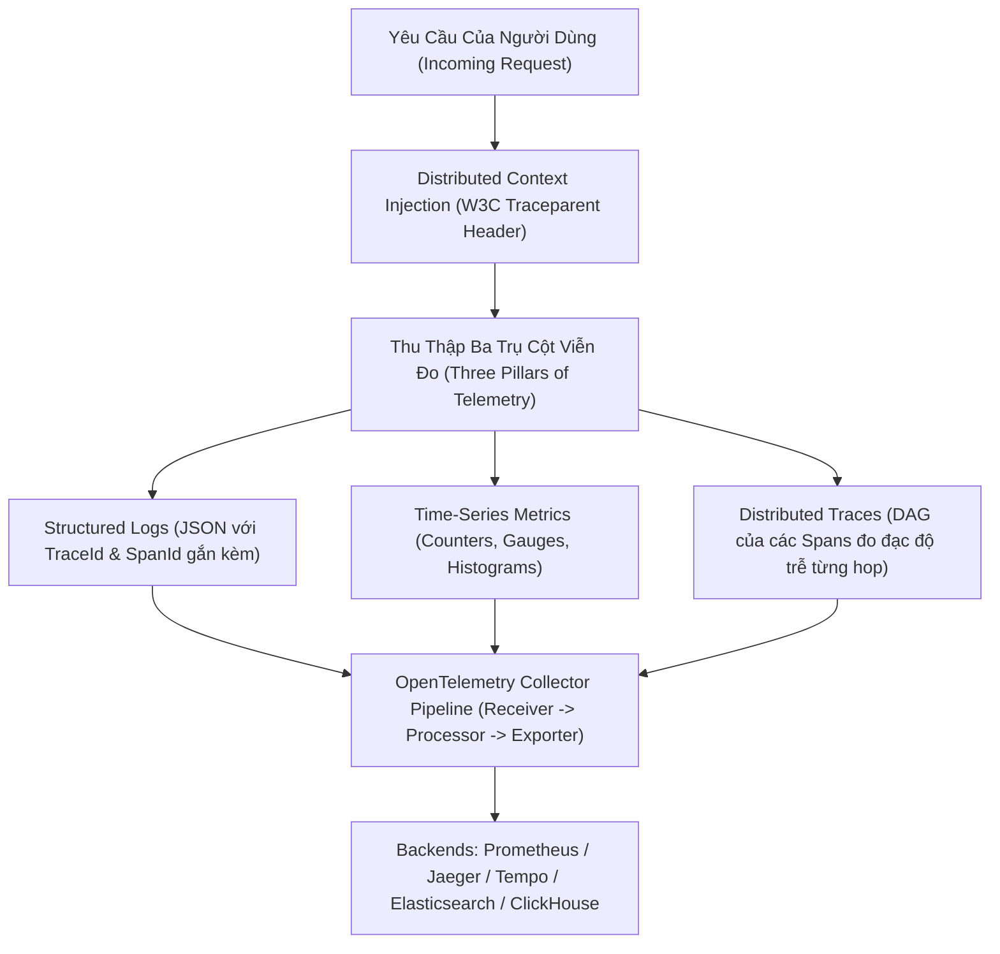
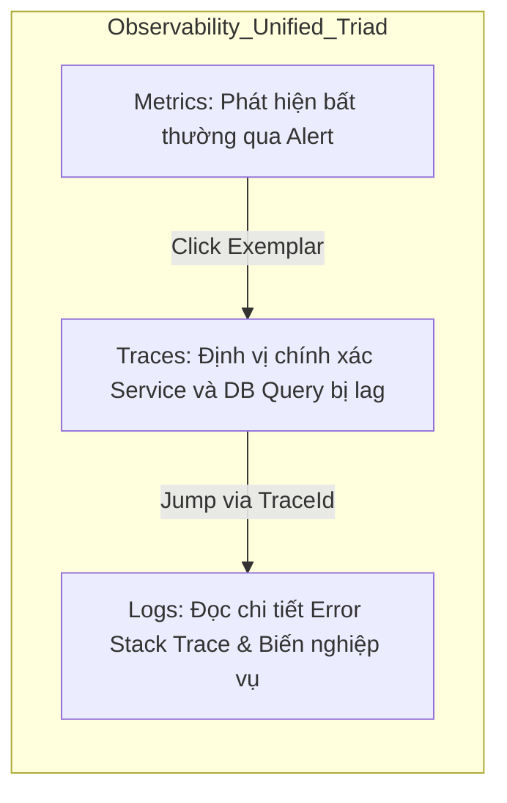
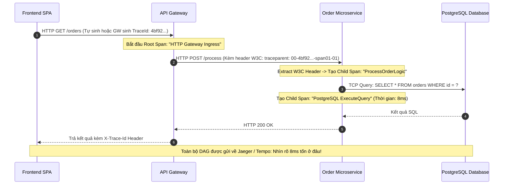
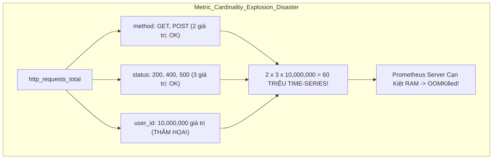
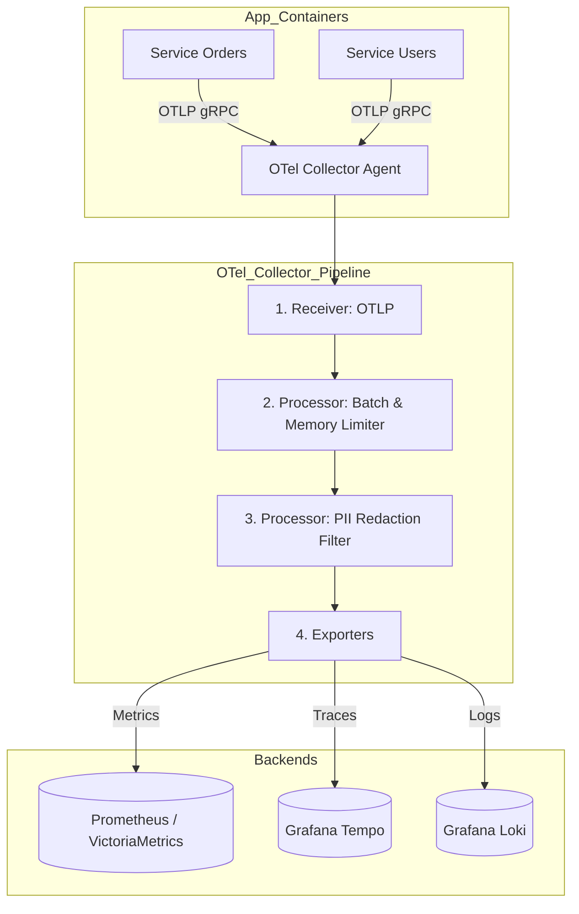

# 13.1. Ba Trụ Cột Khả Năng Quan Sát và Đường Ống Dữ Liệu Từ Xa (Three Pillars of Observability & Telemetry Pipelines)

## Tổng quan về Three Pillars of Observability & Telemetry Pipelines
Trong các hệ thống phân tán vi mô (Microservices, Service Mesh, Serverless), việc một yêu cầu của người dùng phải đi qua hàng chục nút mạng và các ranh giới dịch vụ khác nhau khiến cho các công cụ giám sát truyền thống (**Traditional Monitoring**) trở nên mù lòa. Giám sát trả lời câu hỏi: *"Hệ thống có đang hoạt động không?"*, trong khi **Khả năng quan sát (Observability - o11y)** trả lời câu hỏi: *"Tại sao hệ thống lại hành xử bất thường như vậy từ việc suy luận các trạng thái đầu ra bên ngoài?"*. Để đạt được năng lực này, kỹ sư xây dựng hệ thống thu thập dữ liệu đo đạc từ xa dựa trên **Ba Trụ Cột Khả Năng Quan Sát (Logs, Metrics, Traces)**, áp dụng chuẩn mở quốc tế **OpenTelemetry (OTel)**, làm chủ cơ chế lan truyền ngữ cảnh phân tán (**Distributed Trace Context Propagation: W3C TraceContext**), và kiểm soát vấn đề bùng nổ nhãn đo lường (**Metric Cardinality Explosion**).



---

## 2. Chi tiết từng Keyword (Under-the-Hood Deep Dive)

---

### 1. Observability Fundamentals: Monitoring vs Observability & The Three Pillars

#### 1. Khái niệm bản chất (What & Why)
* **Observability (Khả năng quan sát - bắt nguồn từ Lý thuyết điều khiển của Rudolf Kálmán)**: Thước đo mức độ một trạng thái nội tại của một hệ thống có thể được suy luận chính xác chỉ thông qua việc kiểm tra các đầu ra bên ngoài của nó. Khả năng quan sát cho phép kỹ sư điều tra các lỗi "chưa từng biết đến" (**Unknown-Unknowns**) mà không cần phải triển khai thêm code mới.
* **Monitoring vs Observability**:
  - *Monitoring*: Tiếp cận từ dưới lên, kiểm tra xem các chỉ số đã định nghĩa từ trước có nằm trong ngưỡng an toàn hay không (ví dụ: "CPU có vượt quá 80% không?"). Chỉ tìm được lỗi đã biết (**Known-Unknowns**).
  - *Observability*: Cho phép đặt câu hỏi mở và khám phá dữ liệu đa chiều: "Tại sao người dùng tại khu vực Singapore sử dụng trình duyệt Safari lại có độ trễ p99 tăng vọt 5 lần sau đợt rollout 10% canary?".
* **Ba Trụ Cột của Observability (The Three Pillars)**:
  1. **Metrics (Số liệu đo lường theo chuỗi thời gian - Time-series)**: Dữ liệu số học có thể tổng hợp được (Aggregatable). Chi phí lưu trữ rẻ, tối ưu cho alerting và biểu đồ tổng quan.
  2. **Logs (Nhật ký sự kiện)**: Bản ghi có dấu thời gian (Timestamped event records) mô tả một sự kiện rời rạc đã diễn ra. Giàu ngữ cảnh chi tiết nhất nhưng chi phí lưu trữ và phân tích cú pháp đắt đỏ nhất.
  3. **Traces (Dấu vết phân tán)**: Biểu diễn hành trình toàn vẹn của một request khi nó chu du qua toàn bộ các dịch vụ trong mạng phân tán, đo đạc chính xác thời gian tiêu tốn tại từng chặng.

#### 2. Cơ chế hoạt động sâu (Under the hood / Hardcore Internals)
- **Log Correlation: Hợp Nhất Ba Trụ Cột Nhờ Correlation IDs**:
  - Ba trụ cột sẽ trở nên vô giá trị nếu chúng tồn tại ở các hòn đảo dữ liệu tách biệt (Silos).
  - Kỹ thuật **Log Correlation**: Mọi câu log của ứng dụng bắt buộc phải được tự động chèn thêm hai trường siêu dữ liệu trích xuất từ OpenTelemetry Context:
    `"trace_id": "4bf92f3577b34da6a3ce929d0e0e4736"`
    `"span_id": "00f067aa0ba902b7"`
  - Khi xem một biểu đồ Metric thấy p99 latency tăng vọt $\rightarrow$ Click vào một **Exemplar** (điểm mẫu dữ liệu) để nhảy thẳng sang **Distributed Trace** tương ứng $\rightarrow$ Từ Trace ID, bấm 1 nút để nhảy sang xem đúng các dòng **Structured Logs** sinh ra trong chính request đó! Quá trình điều tra rút ngắn từ 2 tiếng xuống còn 10 giây!

#### 3. Sơ đồ minh họa (Mermaid Diagram)


#### 4. Code ví dụ thực chiến (C++20: Structured Contextual Logger Tự Động Gắn Trace Metadata)
```cpp
#include <iostream>
#include <string_view>
#include <chrono>

// Contextual Logging: Ghi log có cấu trúc JSON kèm TraceId và SpanId
struct TraceContext {
    std::string_view traceId;
    std::string_view spanId;
};

class StructuredLogger {
public:
    static void logInfo(const TraceContext& ctx, std::string_view message, std::string_view userId) {
        auto now = std::chrono::system_clock::now();
        std::cout << "{\n"
                  << "  \"level\": \"INFO\",\n"
                  << "  \"trace_id\": \"" << ctx.traceId << "\",\n"
                  << "  \"span_id\": \"" << ctx.spanId << "\",\n"
                  << "  \"user_id\": \"" << userId << "\",\n"
                  << "  \"message\": \"" << message << "\"\n"
                  << "}\n";
    }
};

int main() {
    TraceContext activeTrace{"4bf92f3577b34da6a3ce929d0e0e4736", "00f067aa0ba902b7"};
    StructuredLogger::logInfo(activeTrace, "Đơn hàng thanh toán thành công qua thẻ tín dụng", "USR-9921");
    return 0;
}
```

#### 5. Ưu / Nhược điểm, Pitfalls & Anti-patterns
- **Anti-pattern: "Log and Forget"**: In ra hàng terabyte log văn bản tự do bằng `System.out.println` hoặc `printf` mà không có định dạng JSON và không có Correlation ID, khiến việc tìm kiếm log của một user cụ thể giữa hàng triệu dòng log đồng thời trở thành điều bất khả thi.

#### 6. Ứng dụng thực tế trong Backend / Systems
- **Grafana LGTM Stack (Loki, Grafana, Tempo, Mimir)**: Bộ công cụ mã nguồn mở hàng đầu thế giới liên kết chặt chẽ Logs (Loki), Metrics (Mimir), và Traces (Tempo) trên một giao diện trực quan duy nhất.

---

### 2. Distributed Tracing & W3C Trace Context Propagation

#### 1. Khái niệm bản chất (What & Why)
* **Distributed Tracing (Truy vết phân tán - Dapper của Google)**: Kỹ thuật theo dõi chuỗi thực thi của các yêu cầu khi chúng đi qua ranh giới tiến trình và mạng viễn thông.
* **Trace (Dấu vết)**: Đại diện cho toàn bộ luồng công việc từ đầu đến cuối (End-to-end journey), là một Đồ thị có hướng (DAG) gồm nhiều Spans. Được định danh bởi một **Trace ID** 128-bit duy nhất toàn cầu.
* **Span (Đoạn truy vết)**: Đơn vị công việc cơ bản bên trong một Trace. Mỗi Span đại diện cho một khoảng thời gian thực thi (ví dụ: Một truy vấn SQL, một cuộc gọi HTTP tới downstream, một lần xử lý message từ Kafka). Có **Span ID** 64-bit, tên chiến dịch, thời điểm bắt đầu, thời điểm kết thúc, trạng thái (OK/Error) và các thuộc tính gán kèm (Attributes).
* **Trace Context Propagation (Lan truyền ngữ cảnh vết)**: Cơ chế đóng gói (Inject) metadata của Trace vào giao thức truyền thông mạng (HTTP Headers, gRPC Metadata, Kafka Record Headers) và mở gói (Extract) ở phía bên nhận để nối dài chuỗi Trace xuyên suốt các server khác nhau.
* **Chuẩn Quốc Tế W3C Trace Context**: Chuẩn quy định header HTTP chính thức gồm 2 trường:
  - `traceparent: 00-4bf92f3577b34da6a3ce929d0e0e4736-00f067aa0ba902b7-01`
    (Định dạng: `version - trace_id - parent_span_id - trace_flags`).
  - `tracestate`: Dành riêng cho việc truyền metadata của các vendor khác nhau.

#### 2. Cơ chế hoạt động sâu (Under the hood / Hardcore Internals)
- **Lan Truyền Ngữ Cảnh Bằng Thread-Local Storage & Async Hooks**:
  Làm thế nào để code tầng sâu (ví dụ: hàm `db.query()` nằm sâu trong 10 tầng call stack) biết được mình đang thuộc Trace ID nào mà không cần truyền biến `ctx` qua từng hàm?
  - Trong C++ / Java: Sử dụng biến **Thread-Local Storage (TLS)**:
    `thread_local TraceContext currentContext;`
    Khi thread nhận request, nó lưu context vào TLS. Bất kỳ hàm nào chạy trên thread đó đều có thể đọc được context trực tiếp từ con trỏ thanh ghi FS/GS của CPU mà không tốn chi phí đồng bộ hóa.
  - Trong Node.js: Sử dụng cơ chế của V8 Engine: **`AsyncLocalStorage`** để bảo toàn context xuyên qua các callback bất đồng bộ của Event Loop.

#### 3. Sơ đồ minh họa (Mermaid Diagram)


#### 4. Code ví dụ thực chiến (TypeScript: Đóng Gói và Mở Gói W3C Trace Context Headers)
```typescript
interface W3CTraceContext {
  traceId: string;
  parentSpanId: string;
  sampled: boolean;
}

class W3CTraceContextPropagator {
  // Trích xuất (Extract) Trace Context từ HTTP Request Headers đến
  static extract(traceparentHeader: string | undefined): W3CTraceContext | null {
    if (!traceparentHeader) return null;
    const parts = traceparentHeader.split('-');
    if (parts.length !== 4 || parts[0] !== '00') return null; // Phiên bản W3C 00

    return {
      traceId: parts[1],
      parentSpanId: parts[2],
      sampled: parts[3] === '01'
    };
  }

  // Đóng gói (Inject) Trace Context vào HTTP Headers trước khi gọi downstream service
  static inject(ctx: W3CTraceContext, newSpanId: string): Record<string, string> {
    const flags = ctx.sampled ? '01' : '00';
    return {
      'traceparent': `00-${ctx.traceId}-${newSpanId}-${flags}`
    };
  }
}
```

#### 5. Ưu / Nhược điểm, Pitfalls & Anti-patterns
- **Anti-pattern: Broken Context Propagation**: Một service trung gian nhận request nhưng khi gọi tiếp service tiếp theo lại quên không forward header `traceparent`. Điều này làm đứt gãy đồ thị Trace thành hai mảnh rời rạc, làm mất hoàn toàn khả năng truy vết từ đầu đến cuối.

#### 6. Ứng dụng thực tế trong Backend / Systems
- **OpenTelemetry Auto-Instrumentation**: Tự động chèn mã bytecode (trong Java JVM) hoặc Monkey-patching (trong Node.js/Python) vào các thư viện phổ biến (Express, HTTP, gRPC, libpq) để tự động lan truyền W3C Trace Context mà lập trình viên không cần viết một dòng code nào.

---

### 3. Metric Types & Metric Cardinality Explosion

#### 1. Khái niệm bản chất (What & Why)
* **Metrics (Số liệu đo lường)**: Các giá trị số học biểu diễn trạng thái của hệ thống tại các mốc thời gian đều đặn. Gồm 4 kiểu cơ bản (Prometheus Standard):
  1. **Counter**: Số liệu chỉ tăng dần theo thời gian (ví dụ: Tổng số HTTP requests đã nhận `http_requests_total`). Chỉ bị reset về 0 khi tiến trình khởi động lại. Sử dụng hàm `rate()` để tính tốc độ trên giây.
  2. **Gauge**: Số liệu có thể tăng hoặc giảm tự do biểu diễn trạng thái tức thời (ví dụ: Bộ nhớ RAM đang sử dụng, số lượng goroutines, nhiệt độ CPU).
  3. **Histogram**: Gom nhóm các mẫu dữ liệu vào các khoảng cấu hình sẵn (**Buckets**) để tính toán phân phối xác suất và các phân vị (**Quantiles: p50, p90, p99**).
  4. **Summary**: Tính toán trực tiếp phân vị ở phía client (ít dùng hơn do không thể tổng hợp chéo giữa các instances).
* **Metric Cardinality (Bậc lực lượng của metric)**: Số lượng chuỗi thời gian (Time-series) duy nhất được sinh ra từ tích Descartes của tất cả các nhãn (Labels / Dimensions) gắn kèm một metric:
  $$\text{Total Time-series} = \prod_{i=1}^{k} |\text{Label}_i|$$
* **Metric Cardinality Explosion (Vụ nổ bậc lực lượng metric)**: Thảm họa vận hành xảy ra khi lập trình viên vô tình gắn một nhãn có giá trị vô hạn (High-cardinality labels như `user_id`, `email`, `order_id`, `credit_card_hash`) vào một metric Prometheus.

#### 2. Cơ chế hoạt động sâu (Under the hood / Hardcore Internals)
- **Cơ Chế Sập Bộ Nhớ của Prometheus TSDB khi Gặp Cardinality Explosion**:
  - Trong Prometheus Time-Series Database (TSDB):
    - Mỗi tổ hợp nhãn duy nhất tạo ra một chuỗi thời gian (**Time-series**) riêng biệt.
    - Mỗi time-series tiêu tốn một vùng nhớ RAM để đệm các khối byte chunks nhị phân (Gorilla Floating Point Compression).
    - Đồng thời, chuỗi đó phải được lập chỉ mục trong bảng Inverted Index (`index` file trên đĩa).
  - Khi một lập trình viên viết:
    ```cpp
    http_requests_total.labels({"method", "GET"}, {"user_id", userId}).increment();
    ```
  - Nếu hệ thống có $10,000,000$ users $\implies$ Prometheus phải tạo ra **10 triệu time-series độc lập**!
  - Bộ nhớ RAM của máy chủ Prometheus lập tức bị cạn kiệt trong 30 giây, ném lỗi Linux `OOMKilled` và kéo sập toàn bộ hệ thống Alerting của toàn công ty!
  - **Quy tắc Vàng**: **TUYỆT ĐỐI KHÔNG BAO GIỜ** đưa dữ liệu có tính chất độc nhất (User ID, IP, URL parameters) vào Metric Labels! Dữ liệu đó bắt buộc phải nằm trong Traces hoặc Structured Logs!

#### 3. Sơ đồ minh họa (Mermaid Diagram)


#### 4. Code ví dụ thực chiến (C++20: Prometheus Metric Instrumentation An Toàn)
```cpp
#include <iostream>
#include <string_view>
#include <unordered_map>
#include <atomic>

// Metric Instrumentation Chuẩn: CHỈ sử dụng Bounded Low-Cardinality Labels!
class SafeHttpMetricsTracker {
private:
    // Label tĩnh, hữu hạn: Chỉ có GET, POST, PUT, DELETE và 2xx, 4xx, 5xx
    std::atomic<uint64_t> getSuccess_{0};
    std::atomic<uint64_t> getClientError_{0};
    std::atomic<uint64_t> getServerError_{0};

public:
    void recordRequest(std::string_view method, int statusCode) noexcept {
        if (method == "GET") {
            if (statusCode >= 200 && statusCode < 300) getSuccess_.fetch_add(1, std::memory_order_relaxed);
            else if (statusCode >= 400 && statusCode < 500) getClientError_.fetch_add(1, std::memory_order_relaxed);
            else if (statusCode >= 500) getServerError_.fetch_add(1, std::memory_order_relaxed);
        }
        // Cardinality luôn bị chặn cứng = 3 time-series, tuyệt đối an toàn cho RAM!
    }

    uint64_t getSuccessCount() const noexcept { return getSuccess_.load(std::memory_order_relaxed); }
};

int main() {
    SafeHttpMetricsTracker metrics;
    metrics.recordRequest("GET", 200);
    metrics.recordRequest("GET", 500);
    std::cout << "Ghi nhận Metrics thành công. Thành công: " << metrics.getSuccessCount() << "\n";
    return 0;
}
```

#### 5. Ưu / Nhược điểm, Pitfalls & Anti-patterns
- **Anti-pattern: Path Parameter as Label**: Dùng URL nguyên bản làm nhãn: `path="/users/1042/orders/8821"`. Số lượng time-series bùng nổ theo số lượng orders! Phải chuẩn hóa thành đường dẫn mẫu: `path="/users/{userId}/orders/{orderId}"`.

#### 6. Ứng dụng thực tế trong Backend / Systems
- **Thực tế tại Uber (M3DB)**: Xây dựng hệ thống cơ sở dữ liệu chuỗi thời gian M3DB phân tán khổng lồ để xử lý hàng tỷ metrics mỗi giây và trang bị các thuật toán tự động phát hiện và ngăn chặn Cardinality Quota ở cổng nạp.

---

### 4. OpenTelemetry (OTel) Architecture & Telemetry Pipelines

#### 1. Khái niệm bản chất (What & Why)
* **OpenTelemetry (OTel - Sự hợp nhất giữa OpenTracing và OpenMetrics của CNCF)**: Chuẩn mở tiêu chuẩn công nghiệp toàn cầu (Vendor-Neutral Standard) cung cấp các SDK, API và công cụ thu thập telemetry hợp nhất cho Metrics, Logs và Traces.
* **OTel API vs OTel SDK**:
  - **OTel API**: Chỉ chứa các định nghĩa giao diện trừu tượng, không có logic thực thi. Cho phép tác giả các thư viện mở rộng chèn mã quan sát mà không làm phụ thuộc vào một vendor cụ thể.
  - **OTel SDK**: Hiện thực cụ thể của API, quản lý bộ nhớ đệm, luồng batching, và xuất dữ liệu.
* **OpenTelemetry Collector**: Một tiến trình proxy trung gian mạnh mẽ độc lập với ứng dụng, hoạt động như một đường ống dữ liệu viễn đo (**Telemetry Pipeline**) gồm 3 giai đoạn:
  1. **Receivers**: Tiếp nhận dữ liệu qua giao thức chuẩn **OTLP (OpenTelemetry Protocol)** qua gRPC hoặc HTTP.
  2. **Processors**: Lọc dữ liệu, gỡ bỏ thông tin nhạy cảm PII, gắn thêm siêu dữ liệu Kubernetes pod/node, và thực hiện lấy mẫu (Sampling).
  3. **Exporters**: Đẩy dữ liệu đồng thời tới nhiều hệ thống backend khác nhau (Prometheus, Datadog, AWS CloudWatch, Tempo).

#### 2. Cơ chế hoạt động sâu (Under the hood / Hardcore Internals)
- **Hiệu năng của OTel Collector Pipeline**:
  - Ứng dụng nghiệp vụ chỉ cần gửi dữ liệu nội bộ tới một tiến trình OTel Collector Agent chạy cùng máy trạm (DaemonSet hoặc Sidecar) qua giao thức nhị phân gRPC Unix Domain Socket.
  - Giảm thiểu toàn bộ gánh nặng CPU, mã hóa SSL và buffer bộ nhớ ra khỏi tiến trình chính của ứng dụng.
  - OTel Collector sử dụng bộ đệm bộ nhớ vòng (**Memory Ballast & Batch Processor**) để gom hàng nghìn spans lại thành một mẻ (batch) nén gzip trước khi bắn ra ngoài mạng Internet, tiết kiệm tối đa băng thông.

#### 3. Sơ đồ minh họa (Mermaid Diagram)


#### 4. Code ví dụ thực chiến (YAML: Cấu hình OpenTelemetry Collector Pipeline Hoàn Chỉnh)
```yaml
# otel-collector-config.yaml
receivers:
  otlp:
    protocols:
      grpc:
        endpoint: 0.0.0.0:4317
      http:
        endpoint: 0.0.0.0:4318

processors:
  # Bộ đệm bảo vệ bộ nhớ không bao giờ để Collector bị OOM
  memory_limiter:
    check_interval: 1s
    limit_percentage: 75
    spike_limit_percentage: 20

  # Gom mẻ tối ưu hóa I/O mạng
  batch:
    send_batch_size: 8192
    timeout: 5s

exporters:
  prometheus:
    endpoint: "0.0.0.0:8889"
  otlp/tempo:
    endpoint: "tempo:4317"
    tls:
      insecure: true

service:
  pipelines:
    traces:
      receivers: [otlp]
      processors: [memory_limiter, batch]
      exporters: [otlp/tempo]
    metrics:
      receivers: [otlp]
      processors: [memory_limiter, batch]
      exporters: [prometheus]
```

#### 5. Ưu / Nhược điểm, Pitfalls & Anti-patterns
- **Anti-pattern: Vendor Lock-in with Proprietary SDKs**: Nhúng trực tiếp SDK độc quyền của một nhà cung cấp đám mây cụ thể (như New Relic hoặc Datadog) sâu vào hàng nghìn dòng code nghiệp vụ. Khi nhà cung cấp tăng giá gấp 3 lần, công ty bị mắc kẹt và mất hàng tháng trời để gỡ bỏ. Sử dụng chuẩn mở **OpenTelemetry** cho phép bạn đổi nhà cung cấp chỉ bằng cách sửa 1 dòng cấu hình trong Collector!

#### 6. Ứng dụng thực tế trong Backend / Systems
- **Quy chuẩn Toàn cầu CNCF**: OpenTelemetry hiện là dự án có tốc độ phát triển và số lượng người đóng góp lớn thứ hai trong toàn bộ hệ sinh thái Cloud Native Computing Foundation (chỉ sau Kubernetes).

---

## Tổng kết Chương 13.1
Khả năng quan sát là giác quan của người kỹ sư phần mềm trong thế giới phân tán phức tạp. Bằng cách kết hợp hài hòa ba trụ cột Metrics, Logs và Traces thông qua cơ chế lan truyền ngữ cảnh W3C chuẩn mực, hiểu rõ mối nguy hại của hiện tượng bùng nổ nhãn đo lường, và triển khai các đường ống viễn đo phi tập trung bằng OpenTelemetry, người kỹ sư làm chủ hoàn toàn hành vi của hệ thống và tự tin vận hành những cụm microservices khổng lồ.
