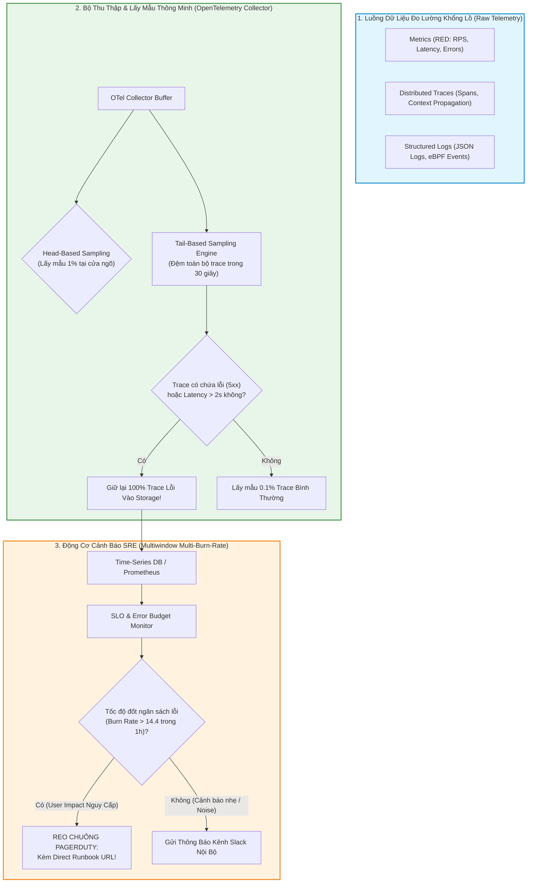
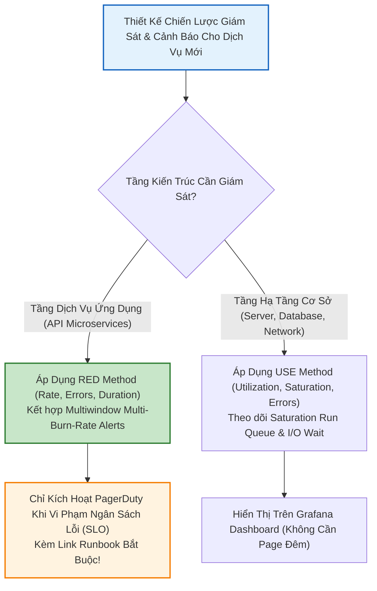

# 13.2. Khung Phương Pháp Đo Lường, Lấy Mẫu và Cảnh Báo Có Thao Tác (Observability Frameworks, Sampling & Actionable Alerting)

> [!IMPORTANT]
> **Nếu bạn chỉ được nhớ một điều duy nhất:** Khả năng quan sát (**Observability**) không phải là việc thu thập hàng terabyte log vô bổ mà là nghệ thuật chắt lọc thông tin có ý nghĩa hành động (**Actionable Signals**); áp dụng chuẩn mực **RED Method** cho dịch vụ hướng request, **USE Method** cho tài nguyên phần cứng, và **Four Golden Signals** của Google SRE, kết hợp với kỹ thuật **Tail-Based Sampling** để giữ lại 100% trace lỗi và thuật toán **Multiwindow Multi-Burn-Rate Alerts** để triệt tiêu vĩnh viễn hội chứng tê liệt cảnh báo (**Alert Fatigue**).

---

## 1. Kiến trúc Tổng quan & Mô hình Tư duy (Mental Model)

### Ẩn dụ Đời sống: Phòng Cấp Cứu Y Tế và Trạm Kiểm Soát Không Lưu
Hãy hình dung hệ thống đo lường và cảnh báo giống như quy trình theo dõi bệnh nhân trong một bệnh viện hiện đại:
- **Khung USE Method (Bác sĩ Chẩn Đoán Nội Tạng)**: Kiểm tra các cơ quan nội tạng vật lý (CPU, RAM, Đĩa cứng):
  - *Utilization (Hiệu suất sử dụng)*: Trái tim đang đập bao nhiêu phần trăm công suất tối đa?
  - *Saturation (Độ bão hòa)*: Phổi có đang bị ứ dịch khiến bệnh nhân phải thở dốc xếp hàng lấy oxy không (Run Queue / I/O Wait)?
  - *Errors (Lỗi vật lý)*: Có mạch máu nào bị rò rỉ hoặc tế bào bị hoại tử không (Hardware ECC Errors / Packet Drops)?
- **Khung RED Method (Trưởng Trạm Tiếp Nhận Bệnh Nhân)**: Đo lường dòng người ra vào dịch vụ (Microservices):
  - *Rate (Tần suất)*: Mỗi phút có bao nhiêu bệnh nhân bước qua cửa phòng khám (Requests Per Second)?
  - *Errors (Tỷ lệ lỗi)*: Có bao nhiêu ca bị từ chối tiếp nhận hoặc chẩn đoán sai (HTTP 5xx / gRPC Errors)?
  - *Duration (Thời gian khám)*: Bệnh nhân mất bao lâu từ lúc bước vào đến lúc nhận thuốc (Latency Distribution p50, p90, p99)?
- **Lấy Mẫu Thông Minh: Head-Based vs Tail-Based Sampling**:
  - *Head-Based Sampling (Bốc thăm ngẫu nhiên ở cửa)*: Giống như việc bảo vệ cứ 100 người đi qua cửa thì giữ lại 1 người để kiểm tra hành lý. Cách này siêu nhẹ nhàng, nhưng nếu một tên tội phạm (Trace bị lỗi hoặc độ trễ p99) lọt qua trong 99 người kia, bạn sẽ vĩnh viễn mất dấu vết!
  - *Tail-Based Sampling (Kiểm tra khi ra viện)*: Toàn bộ quá trình khám chữa bệnh được ghi lại trong bộ nhớ đệm tạm thời. Khi bệnh nhân bước ra cửa: nếu bệnh nhân khỏe mạnh bình thường $\to$ xóa bớt hồ sơ để tiết kiệm giấy; nhưng nếu bệnh nhân bị sốc phản vệ hoặc gặp biến chứng $\to$ **lưu lại 100% toàn bộ bệnh án chi tiết** để phân tích nguyên nhân gốc rễ!
- **Cảnh báo Có Thao Tác (Actionable Alerting)**:
  - Nếu còi báo động réo lên lúc 2 giờ sáng chỉ vì *"Nhiệt độ phòng chứa thuốc tăng 0.5 độ"* (Cause-based Alerting ngớ ngẩn), bác sĩ trực sẽ tắt chuông và ngủ tiếp.
  - Nhưng nếu chuông réo vì *"Chỉ số sinh tồn của bệnh nhân giường số 4 đang tụt dốc với tốc độ nguy hiểm, hãy tiêm 10ml thuốc X theo phác đồ Runbook đính kèm"* (Symptom-based Actionable Alerting), bác sĩ sẽ bật dậy cứu sống người bệnh trong tích tắc!



---

## 2. Chi tiết từng Keyword (Under-the-Hood Deep Dive)

### 2.1. The RED Method (Tom Wilkie) Cho Kiến Trúc Microservices
- **Rate (Tần suất)**: Đo lường nhu cầu lưu lượng gửi đến hệ thống tính bằng Requests Per Second (RPS) hoặc Transactions Per Second (TPS).
- **Errors (Lỗi)**: Số lượng hoặc tỷ lệ phần trăm các yêu cầu bị thất bại (HTTP status codes 5xx, gRPC error codes `UNAVAILABLE`, `DEADLINE_EXCEEDED`).
- **Duration (Thời lượng / Độ trễ)**: Phân phối thời gian thực thi của các yêu cầu. Tuyệt đối **không sử dụng giá trị trung bình (Average Latency)** vì nó che giấu các đỉnh trễ thảm họa; bắt buộc phải đo theo các phân vị: **p50** (trung vị), **p90**, **p99**, và **p99.9** (nhóm 0.1% người dùng chịu trải nghiệm tồi tệ nhất).

### 2.2. The USE Method (Brendan Gregg) Cho Phân Tích Hạ Tầng & Phần Cứng
Áp dụng cho mọi tài nguyên vật lý hoặc logic có giới hạn (CPU, Memory, Disk I/O, Network Interface, Database Connection Pool):
- **Utilization (Mức độ sử dụng)**: Tỷ lệ phần trăm thời gian mà tài nguyên đang bận rộn thực thi tác vụ. Ví dụ: Đĩa cứng bận rộn 90% thời gian (`%util` trong `iostat`).
- **Saturation (Độ bão hòa)**: Mức độ tài nguyên bị quá tải khiến các yêu cầu bắt buộc phải xếp hàng chờ đợi.
  - Trên Linux: Kiểm tra độ dài hàng đợi chạy lệnh (`r` trong `vmstat 1`), tải trung bình chia cho số lõi CPU (`Load Average / Core Count > 1.0`), hoặc thời gian chờ đĩa (`await` trong `iostat`).
- **Errors (Lỗi phần cứng)**: Số lượng sự kiện lỗi vật lý phát sinh: Network packet drop (`rx_dropped`), lỗi bộ nhớ ECC sửa được hoặc không sửa được, lỗi đĩa đọc ghi I/O.

### 2.3. The Four Golden Signals (Bốn Tín Hiệu Vàng Của Google SRE)
1. **Latency**: Phân biệt rạch ròi giữa độ trễ của request thành công (200 OK) và request thất bại (ví dụ: request 500 ném ra trong 1ms không được tính làm đẹp chỉ số latency trung bình!).
2. **Traffic**: Đo lường nhu cầu tổng thể đặt lên hệ thống.
3. **Errors**: Tỷ lệ các request bị thất bại (tường minh qua mã lỗi hoặc ngầm định qua payload sai logic nghiệp vụ).
4. **Saturation**: Thước đo mức độ đầy của tài nguyên quan trọng nhất của dịch vụ (ví dụ: kích thước heap memory, số kết nối connection pool còn trống).

### 2.4. Telemetry Sampling: Head-Based vs Tail-Based Sampling & Quản Lý Chi Phí
- **Head-Based Sampling (Lấy mẫu tại đầu vào)**:
  - Quyết định lấy mẫu được đưa ra ngay tại Service đầu tiên nhận request (API Gateway) dựa trên tỷ lệ cố định (ví dụ: 1%). Cờ lấy mẫu (`sampled=true/false`) được nhúng vào Trace Context và truyền dọc theo toàn bộ chuỗi Microservices.
  - *Nhược điểm chí tử*: Nếu 1% trace được chọn toàn là các request thành công mượt mà, trong khi các request bị crash 500 lại rơi vào 99% không được lấy mẫu, đội ngũ SRE sẽ hoàn toàn không có dữ liệu để điều tra sự cố!
- **Tail-Based Sampling (Lấy mẫu tại đầu ra - OTel Collector)**:
  - Toàn bộ các Spans của một Trace được thu thập và giữ tạm thời trong bộ đệm RAM của OpenTelemetry Collector (thời gian giữ thường từ 10 đến 30 giây).
  - Khi toàn bộ Trace kết thúc, bộ phân loại (**Sampling Evaluator**) kiểm tra toàn bộ cây trace:
    - Nếu có bất kỳ Span nào chứa cờ `Error = true` HOẶC có thời gian thực thi vượt ngưỡng $Latency > 2000$ms: **Lưu lại 100% toàn bộ Trace đó!**
    - Nếu toàn bộ Trace là các lệnh thành công thông thường: Áp dụng tỷ lệ lấy mẫu ngẫu nhiên cực thấp (ví dụ: 0.1%).
  - *Kết quả*: Giảm tới 90% chi phí lưu trữ dữ liệu (Observability Cost Management) mà không bao giờ bỏ sót bất kỳ một lỗi sản xuất nào!

### 2.5. Actionable Alerting & Triệt Tiêu Hội Chứng Alert Fatigue
- **Alert Fatigue (Tê liệt cảnh báo)**: Khi đội ngũ nhận hàng trăm cảnh báo mỗi ngày mà phần lớn là báo động giả hoặc không đòi hỏi hành động khẩn cấp, họ sẽ phớt lờ toàn bộ cảnh báo, dẫn đến việc bỏ sót những sự cố tê liệt hệ thống nghiêm trọng.
- **Quy Tắc Vàng Của Actionable Alert**:
  1. *Symptom-Based*: Chỉ cảnh báo trên **triệu chứng tác động trực tiếp đến người dùng** (User Pain: Tỷ lệ lỗi tăng, độ trễ vi phạm SLO), tuyệt đối không cảnh báo trên nguyên nhân phỏng đoán (CPU cao, Disk cache đầy).
  2. *Actionable*: Cảnh báo bắt buộc phải có hành động khắc phục cụ thể mà con người có thể làm được. Nếu máy tính có thể tự sửa (như Kubernetes tự khởi động lại Pod), tuyệt đối không gửi cảnh báo đánh thức kỹ sư!
  3. *Runbook Mandate*: Mỗi thông báo PagerDuty bắt buộc phải đính kèm một đường dẫn trực tiếp tới tài liệu hướng dẫn vận hành (**Runbook URL**).

### 2.6. Thuật Toán SRE: Multiwindow Multi-Burn-Rate Alerts
- Thay vì đặt ngưỡng cảnh báo thô sơ (`ErrorRate > 1% trong 5 phút`), Google SRE chuẩn hóa thuật toán tính toán tốc độ tiêu hao ngân sách lỗi (**Error Budget Burn Rate**):
  - Giả sử cam kết SLO là 99.9% tính khả dụng trong 30 ngày (Ngân sách lỗi là 0.1%).
  - **Burn Rate = 1**: Tiêu thụ hết đúng 100% ngân sách lỗi sau 30 ngày.
  - **Burn Rate = 14.4**: Tiêu thụ hết 2% ngân sách lỗi chỉ trong vòng 1 giờ $\to$ **Kích hoạt PagerDuty reo chuông khẩn cấp!**
  - Thuật toán kiểm tra đồng thời trên cả hai cửa sổ thời gian (ví dụ: Short window 5 phút và Long window 1 giờ) để bảo đảm cảnh báo vừa nhạy bén khi sự cố nổ ra, vừa tự động tắt chuông ngay khi lưu lượng phục hồi.

---

## 3. Thực thi Mã nguồn & Mô phỏng Chuyên sâu (Dual-Engine Implementation)

### 3.1. C++20 Implementation: Mô Phỏng Động Cơ Lấy Mẫu Tail-Based Sampling Cho Tracing
Chương trình C++20 dưới đây mô phỏng bộ đệm phân tích **Tail-Based Sampling** thu nhỏ: đệm các trace trong bộ nhớ, tự động thẩm định thuộc tính lỗi và độ trễ để quyết định giữ lại toàn bộ trace hay loại bỏ:

```cpp
#include <iostream>
#include <string>
#include <vector>
#include <memory>
#include <chrono>
#include <random>
#include <iomanip>

struct Span {
    std::string trace_id;
    std::string span_id;
    std::string operation_name;
    double duration_ms;
    bool has_error;
};

class SimulatedTailBasedSampler {
private:
    double latency_threshold_ms_;
    double normal_sample_rate_;
    std::mt19937 rng_{42};

public:
    SimulatedTailBasedSampler(double latency_threshold_ms, double normal_sample_rate)
        : latency_threshold_ms_(latency_threshold_ms), normal_sample_rate_(normal_sample_rate) {}

    // Quyết định số phận của toàn bộ Trace sau khi đã thu thập đủ Spans
    bool evaluate_trace(const std::vector<Span>& trace_spans, std::string& reason) {
        if (trace_spans.empty()) return false;

        // TIÊU CHÍ 1: Giữ lại 100% nếu có bất kỳ Span nào bị lỗi (Errors)
        for (const auto& span : trace_spans) {
            if (span.has_error) {
                reason = "GIỮ LẠI 100% (Phát hiện Span bị Lỗi HTTP 5xx / Exception!)";
                return true;
            }
        }

        // TIÊU CHÍ 2: Giữ lại 100% nếu tổng độ trễ vượt ngưỡng cam kết SLO (High Latency)
        double total_latency = 0.0;
        for (const auto& span : trace_spans) {
            total_latency += span.duration_ms;
        }
        if (total_latency > latency_threshold_ms_) {
            reason = "GIỮ LẠI 100% (Độ trễ Trace vượt ngưỡng cam kết: " + std::to_string(total_latency) + "ms)";
            return true;
        }

        // TIÊU CHÍ 3: Trace bình thường -> Áp dụng tỷ lệ lấy mẫu xác suất
        std::uniform_real_distribution<double> dist(0.0, 1.0);
        if (dist(rng_) < normal_sample_rate_) {
            reason = "GIỮ LẠI THEO TỶ LỆ LẤY MẪU NGẪU NHIÊN (" + std::to_string(normal_sample_rate_ * 100) + "%)";
            return true;
        }

        reason = "LOẠI BỎ (Trace thành công bình thường - Tiết kiệm chi phí Storage)";
        return false;
    }
};

int main() {
    std::cout << "=========================================================\n";
    std::cout << "  C++20 TAIL-BASED SAMPLING OPENTELEMETRY ENGINE DEMO    \n";
    std::cout << "=========================================================\n\n";

    // Ngưỡng độ trễ cảnh báo: 200ms; Tỷ lệ giữ trace bình thường: 10%
    SimulatedTailBasedSampler sampler(200.0, 0.10);

    // Kịch bản 1: Trace thành công nhanh gọn (Happy Path)
    std::vector<Span> trace_happy = {
        {"trace_001", "span_1", "GET /api/user", 15.2, false},
        {"trace_001", "span_2", "SELECT * FROM users", 8.4, false}
    };

    // Kịch bản 2: Trace có lỗi dịch vụ (Crash / Error)
    std::vector<Span> trace_error = {
        {"trace_002", "span_1", "POST /api/checkout", 25.0, false},
        {"trace_002", "span_2", "PaymentGateway::charge", 45.0, true} // LỖI!
    };

    // Kịch bản 3: Trace không lỗi nhưng độ trễ cực cao (Slow p99)
    std::vector<Span> trace_slow = {
        {"trace_003", "span_1", "POST /api/reports", 50.0, false},
        {"trace_003", "span_2", "Analytics::aggregate", 220.0, false} // Quá 200ms!
    };

    std::string decision_reason;

    std::cout << "[Đánh Giá Trace 001 (Happy Path)]:\n";
    bool keep = sampler.evaluate_trace(trace_happy, decision_reason);
    std::cout << "  Quyết định: " << (keep ? "LƯU TRỮ" : "VỨT BỎ") << " -> " << decision_reason << "\n\n";

    std::cout << "[Đánh Giá Trace 002 (Có Lỗi)]:\n";
    keep = sampler.evaluate_trace(trace_error, decision_reason);
    std::cout << "  Quyết định: " << (keep ? "LƯU TRỮ" : "VỨT BỎ") << " -> " << decision_reason << "\n\n";

    std::cout << "[Đánh Giá Trace 003 (Độ Trễ Cao)]:\n";
    keep = sampler.evaluate_trace(trace_slow, decision_reason);
    std::cout << "  Quyết định: " << (keep ? "LƯU TRỮ" : "VỨT BỎ") << " -> " << decision_reason << "\n\n";

    std::cout << "[Kết Luận]: Tail-based sampling bảo toàn 100% trace sự cố mà không tốn tiền lưu trace thừa.\n";
    return 0;
}
```

### 3.2. Python 3.11+ Implementation: Mô Phỏng Thuật Toán SRE Multiwindow Multi-Burn-Rate Alerting
Chương trình Python 3.11+ dưới đây triển khai công thức tính toán **Multiwindow Multi-Burn-Rate Alerts** của Google SRE, tự động kích hoạt cảnh báo có thao tác khi ngân sách lỗi bị đốt cháy quá nhanh:

```python
from dataclasses import dataclass
from typing import Optional

@dataclass
class SLOConfig:
    target_availability: float  # Ví dụ 0.999 (99.9%)
    period_days: int            # 30 ngày

class MultiBurnRateAlertEngine:
    """
    Triển khai thuật toán tính tốc độ đốt ngân sách lỗi (Burn Rate) của Google SRE.
    Sử dụng 2 cửa sổ thời gian (Short Window & Long Window) để phát hiện sự cố
    chính xác 100% mà không bị cảnh báo giả mạo.
    """
    def __init__(self, slo: SLOConfig):
        self.slo = slo
        # Ngân sách lỗi (Error Budget) = 1.0 - SLO
        self.error_budget = 1.0 - slo.target_availability

    def calculate_burn_rate(self, total_requests: int, error_requests: int) -> float:
        if total_requests == 0:
            return 0.0
        error_rate = error_requests / total_requests
        # Burn Rate = Tỷ lệ lỗi thực tế / Ngân sách lỗi cho phép
        return error_rate / self.error_budget

    def evaluate_pager_alert(self, 
                             long_window_requests: int, long_window_errors: int,
                             short_window_requests: int, short_window_errors: int) -> Optional[dict]:
        """
        Ngưỡng SRE Tiêu Chuẩn Cho Cảnh Báo Khẩn Cấp (Page Alert):
        - Đốt 2% Error Budget trong 1 giờ.
        - Long Window (1 giờ): Burn Rate >= 14.4
        - Short Window (5 phút): Burn Rate >= 14.4
        """
        br_long = self.calculate_burn_rate(long_window_requests, long_window_errors)
        br_short = self.calculate_burn_rate(short_window_requests, short_window_errors)

        # Cả 2 cửa sổ đều phải đồng thời vượt ngưỡng 14.4!
        if br_long >= 14.4 and br_short >= 14.4:
            return {
                "alert": "HighErrorBudgetBurnRate",
                "severity": "CRITICAL_PAGERDUTY",
                "burn_rate_long": f"{br_long:.2f}x",
                "burn_rate_short": f"{br_short:.2f}x",
                "runbook_url": "https://wiki.corp.internal/runbooks/high-error-rate-checkout",
                "action": "ĐÁNH THỨC KỸ SƯ ON-CALL: Ngân sách lỗi đang bị đốt cháy quá nhanh!"
            }
        return None

if __name__ == '__main__':
    print("=== MÔ PHỎNG GOOGLE SRE MULTI-BURN-RATE ALERTING ENGINE ===")
    
    # Cam kết SLO: 99.9% tính khả dụng trong 30 ngày (Ngân sách lỗi = 0.001)
    service_slo = SLOConfig(target_availability=0.999, period_days=30)
    alert_engine = MultiBurnRateAlertEngine(service_slo)

    print(f"\n[Cấu hình SLO]: Cam kết {service_slo.target_availability * 100}% trong {service_slo.period_days} ngày.")
    print(f"Ngân sách lỗi cho phép: {alert_engine.error_budget * 100}%")

    # Kịch bản 1: Hoạt động bình thường (Tỷ lệ lỗi 0.05% < 0.1%)
    print("\n--- KỊCH BẢN 1: HỆ THỐNG HOẠT ĐỘNG BÌNH THƯỜNG ---")
    alert = alert_engine.evaluate_pager_alert(
        long_window_requests=100000, long_window_errors=50,
        short_window_requests=10000, short_window_errors=5
    )
    print(f"  Trạng thái cảnh báo: {alert if alert else 'AN TOÀN - Không phát cảnh báo'}")

    # Kịch bản 2: Sự cố giật mạng trong 10 giây nhưng đã tự hết (Chỉ short window cao, long window thấp)
    print("\n--- KỊCH BẢN 2: CÚ GIẬT MẠNG NHỎ ĐÃ TỰ HẾT (TRÁNH BÁO ĐỘNG GIẢ) ---")
    alert = alert_engine.evaluate_pager_alert(
        long_window_requests=100000, long_window_errors=100, # Burn rate long ~ 1.0 (An toàn)
        short_window_requests=1000, short_window_errors=20   # Burn rate short cao
    )
    print(f"  Trạng thái cảnh báo: {alert if alert else 'AN TOÀN - Đã triệt tiêu cảnh báo giả nhờ Long Window!'}")

    # Kịch bản 3: Sự cố sập Database thực sự (Cả 2 cửa sổ đều có tỷ lệ lỗi 2%)
    print("\n--- KỊCH BẢN 3: SỰ CỐ NGHIÊM TRỌNG TRÊN PRODUCTION ---")
    alert = alert_engine.evaluate_pager_alert(
        long_window_requests=100000, long_window_errors=2000, # Lỗi 2.0% -> Burn rate = 20x > 14.4
        short_window_requests=10000, short_window_errors=200   # Lỗi 2.0% -> Burn rate = 20x > 14.4
    )
    if alert:
        print("  ! BÁO ĐỘNG KHẨN CẤP ĐƯỢC KÍCH HOẠT:")
        for k, v in alert.items():
            print(f"    {k:18s}: {v}")
```

### 3.3. Terminal Output Mẫu Thực tế
```text
=========================================================
  C++20 TAIL-BASED SAMPLING OPENTELEMETRY ENGINE DEMO    
=========================================================

[Đánh Giá Trace 001 (Happy Path)]:
  Quyết định: LOẠI BỎ -> LOẠI BỎ (Trace thành công bình thường - Tiết kiệm chi phí Storage)

[Đánh Giá Trace 002 (Có Lỗi)]:
  Quyết định: LƯU TRỮ -> GIỮ LẠI 100% (Phát hiện Span bị Lỗi HTTP 5xx / Exception!)

[Đánh Giá Trace 003 (Độ Trễ Cao)]:
  Quyết định: LƯU TRỮ -> GIỮ LẠI 100% (Độ trễ Trace vượt ngưỡng cam kết: 270.000000ms)

[Kết Luận]: Tail-based sampling bảo toàn 100% trace sự cố mà không tốn tiền lưu trace thừa.

=== MÔ PHỎNG GOOGLE SRE MULTI-BURN-RATE ALERTING ENGINE ===

[Cấu hình SLO]: Cam kết 99.9% trong 30 ngày.
Ngân sách lỗi cho phép: 0.10000000000000009%

--- KỊCH BẢN 1: HỆ THỐNG HOẠT ĐỘNG BÌNH THƯỜNG ---
  Trạng thái cảnh báo: AN TOÀN - Không phát cảnh báo

--- KỊCH BẢN 2: CÚ GIẬT MẠNG NHỎ ĐÃ TỰ HẾT (TRÁNH BÁO ĐỘNG GIẢ) ---
  Trạng thái cảnh báo: AN TOÀN - Đã triệt tiêu cảnh báo giả nhờ Long Window!

--- KỊCH BẢN 3: SỰ CỐ NGHIÊM TRỌNG TRÊN PRODUCTION ---
  ! BÁO ĐỘNG KHẨN CẤP ĐƯỢC KÍCH HOẠT:
    alert             : HighErrorBudgetBurnRate
    severity          : CRITICAL_PAGERDUTY
    burn_rate_long    : 20.00x
    burn_rate_short   : 20.00x
    runbook_url       : https://wiki.corp.internal/runbooks/high-error-rate-checkout
    action            : ĐÁNH THỨC KỸ SƯ ON-CALL: Ngân sách lỗi đang bị đốt cháy quá nhanh!
```

---

## 4. Systems Engineering & Production Pitfalls

### 4.1. Sự Cố "Alert Storm" Đánh Sập Tinh Thần Đội Ngũ Khi Datacenter Mất Mạng
- **Sự cố sản xuất kinh điển**: Khi một đường truyền cáp quang của datacenter bị đứt, thay vì chỉ phát đúng 1 cảnh báo cấp mạng, hệ thống giám sát thô sơ phát đồng loạt **5,000 cảnh báo PagerDuty riêng rẽ** cho từng microservice và từng container. Kỹ sư trực bị dội bom tin nhắn liên tục, không thể phân biệt đâu là nguyên nhân gốc rễ và đâu là nạn nhân phái sinh.
- **Khắc phục**: Thiết lập cơ chế ức chế cảnh báo (**Alert Inhibit Rules**) trong Prometheus Alertmanager: Khi cảnh báo `NetworkSwitchDown` xuất hiện, tự động ức chế toàn bộ các cảnh báo `ServiceUnreachable` nằm phía sau switch đó.

### 4.2. Cạm Bẫy Đặt Cảnh Báo Trên Chỉ Số CPU Trung Bình (CPU Average Blindspot)
- **Sự cố sản xuất**: Đặt cảnh báo khi "CPU máy chủ trung bình > 80%".
- Thực tế trên máy chủ 64 lõi: Có 1 luồng bị khóa chết trong vòng lặp vô tận đốt sạch 100% của 1 lõi CPU (Single-core starvation), nhưng CPU trung bình toàn máy chỉ đạt $1 / 64 \approx 1.5\%$. Hệ thống hoàn toàn không phát cảnh báo, trong khi các tiến trình gán vào lõi đó bị đóng băng hoàn toàn.
- **Khắc phục**: Luôn áp dụng USE Method: đo lường **CPU Saturation (Run Queue)** thay vì chỉ nhìn vào CPU Utilization trung bình.

---

## 5. Bảng So sánh & Decision Matrix

| Phương Pháp Giám Sát | Đối Tượng Trọng Tâm | Chỉ Số Đo Lường Chính | Trường Hợp Ứng Dụng Chuẩn Mực |
| :--- | :--- | :--- | :--- |
| **The RED Method** | Khách hàng & Microservices | Rate (RPS), Errors (5xx), Duration (p99) | Web APIs, REST/gRPC Endpoints, Gateway |
| **The USE Method** | Tài nguyên Máy chủ & Phần cứng | Utilization (%), Saturation (Queue), Errors | Linux OS, CPU, RAM, Disk NVMe, Card mạng |
| **Four Golden Signals**| Trải nghiệm SRE Toàn Diện | Latency, Traffic, Errors, Saturation | Khung đo lường cấp cao cho toàn bộ Platform |


