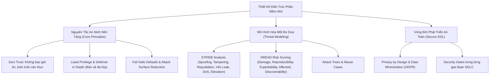
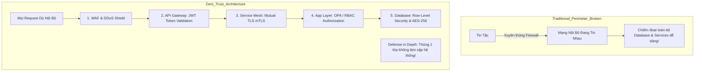
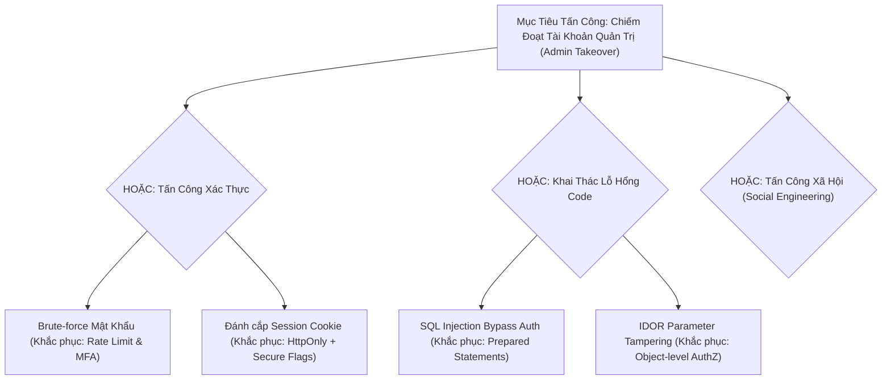
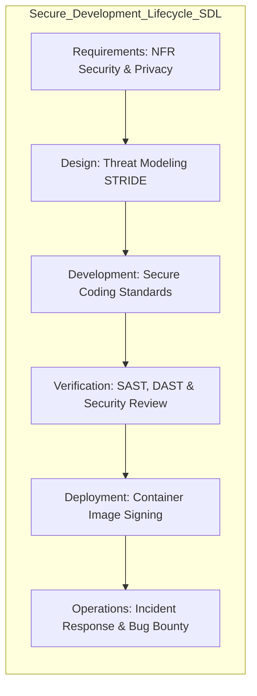

# 14.1. Nền Tảng An Ninh và Mô Hình Hóa Mối Đe Dọa (Security Foundations & Threat Modeling)

## Tổng quan về Security Foundations & Threat Modeling
Trong phát triển phần mềm hiện đại, an ninh mạng không thể là một tính năng được "gắn thêm" vào phút chót trước khi release. Một lỗ hổng an ninh kiến trúc có thể xóa sổ toàn bộ uy tín, gây thiệt hại hàng triệu USD tiền phạt pháp lý (GDPR, PCI-DSS) và làm sụp đổ một doanh nghiệp. Tư duy an ninh kỹ nghệ (**Security Engineering Mindset**) đòi hỏi việc áp dụng các nguyên lý bảo mật bất biến ngay từ những nét vẽ thiết kế đầu tiên (**Security by Design**, **Secure by Default**, **Defense in Depth**, **Least Privilege**, **Zero Trust**). Kỹ sư trưởng thành không đợi tin tặc tấn công mới vá lỗi, mà chủ động săn tìm rủi ro thông qua quy trình **Mô hình hóa mối đe dọa (Threat Modeling)** có hệ thống: áp dụng mô hình **STRIDE**, lượng hóa rủi ro qua **DREAD**, xây dựng cây tấn công (**Attack Trees**), mô hình hóa các ca lạm dụng (**Abuse Cases**), và tích hợp toàn diện vào vòng đời phát triển phần mềm an toàn (**Secure Development Lifecycle - SDL**).



---

## 2. Chi tiết từng Keyword (Under-the-Hood Deep Dive)

---

### 1. Fundamental Security Principles: Zero Trust, Defense in Depth & Least Privilege

#### 1. Khái niệm bản chất (What & Why)
* **Security by Design & Secure by Default**: Phần mềm phải được thiết kế an toàn ngay từ cấu trúc cốt lõi; mọi cấu hình mặc định khi xuất xưởng đều phải ở mức bảo mật cao nhất (ví dụ: Mặc định bật TLS 1.3, mặc định tắt các cổng không dùng, mặc định đóng quyền truy cập của người dùng mới).
* **Zero Trust (Không tin tưởng bất kỳ ai)**: Triết lý kiến trúc loại bỏ hoàn toàn khái niệm "mạng nội bộ tin cậy" (Perimeter Security cũ kỹ: Tường lửa bảo vệ bên ngoài, bên trong ai cũng tin nhau). Trong Zero Trust, **mọi yêu cầu mạng (kể cả giữa 2 microservices trong cùng một cụm Kubernetes) đều bị coi là có nguy cơ thù địch**, bắt buộc phải xác thực danh tính (mTLS), kiểm tra quyền hạn (AuthZ) và mã hóa dữ liệu trên đường truyền.
* **Defense in Depth (Bảo vệ theo chiều sâu / Phòng thủ nhiều lớp)**: Không bao giờ đặt toàn bộ niềm tin vào một cơ chế phòng thủ duy nhất. Hệ thống phải có nhiều tầng bảo vệ độc lập: WAF $\rightarrow$ API Gateway $\rightarrow$ Service Mesh mTLS $\rightarrow$ Application Code Validation $\rightarrow$ Database Encryption at Rest $\rightarrow$ Network Policies. Nếu một lớp bị thủng, các lớp sau vẫn bảo vệ được dữ liệu.
* **Least Privilege (Quyền hạn tối thiểu)**: Mỗi tiến trình, người dùng, hoặc dịch vụ chỉ được cấp đúng những quyền hạn tối thiểu tuyệt đối cần thiết để thực thi nhiệm vụ của mình trong khoảng thời gian ngắn nhất (ví dụ: Service chỉ cần đọc bảng `products` thì tài khoản database của nó tuyệt đối không được cấp quyền `DROP TABLE` hay quyền đọc bảng `credit_cards`).
* **Fail-Safe Defaults (Mặc định an toàn khi thất bại)**: Khi một cơ chế kiểm tra bảo mật gặp sự cố ngoại lệ (Exception) hoặc timeout, trạng thái mặc định của hệ thống bắt buộc phải là **TỪ CHỐI TRUY CẬP (Deny Access)** thay vì mở cửa cho qua.
* **Complete Mediation & Separation of Duties**: Mọi quyền truy cập vào mọi đối tượng đều phải được kiểm tra tính hợp lệ mà không có ngoại lệ (không có backdoor hay cache quyền nguy hiểm); các tác vụ nhạy cảm đòi hỏi sự phê duyệt của hai vai trò độc lập (ví dụ: Lập trình viên không thể tự approve và tự deploy code của chính mình lên production).
* **Attack Surface Reduction (Thu hẹp bề mặt tấn công)**: Loại bỏ các tính năng không dùng, tắt các cổng mạng mở thừa, gỡ các package nhị phân không cần thiết trong container image (Distroless containers) để giảm thiểu tối đa các điểm mà tin tặc có thể nhắm tới.

#### 2. Cơ chế hoạt động sâu (Under the hood / Hardcore Internals)
- **Zero Trust ở Tầng Mạng: Mutual TLS (mTLS) và SPIFFE/SPIRE**:
  - Trong mạng phân tán truyền thống: Dịch vụ A gọi Dịch vụ B qua HTTP trần trụi (Plaintext) vì giả định "cả hai đều nằm trong VPC nội bộ". Tin tặc chỉ cần chiếm được 1 Pod là có thể dùng `tcpdump` bắt trộm toàn bộ mật khẩu và token trong mạng!
  - Trong Zero Trust với mTLS:
    - Mỗi Pod được cấp một định danh mật mã chuẩn **SPIFFE ID**:
      `spiffe://cluster.local/ns/production/sa/order-service-account`
    - Cả Client và Server đều xuất trình chứng chỉ X.509 cho nhau trong quá trình TLS Handshake (Xác thực hai chiều).
    - CPU thực hiện trao đổi khóa Elliptic Curve Diffie-Hellman (ECDHE) $\implies$ Toàn bộ gói tin mạng giữa hai dịch vụ được mã hóa AES-256-GCM ở tầng phần cứng, vô hiệu hóa hoàn toàn các cuộc tấn công nghe lén (Eavesdropping) và giả mạo (Man-in-the-Middle).

#### 3. Sơ đồ minh họa (Mermaid Diagram)


#### 4. Code ví dụ thực chiến (C++20: Fail-Safe Defaults trong Thẩm Định Quyền Truy Cập)
```cpp
#include <iostream>
#include <string_view>
#include <stdexcept>

enum class UserRole { GUEST, USER, ADMIN };

// Fail-Safe Defaults: Mặc định luôn luôn TỪ CHỐI (DENY)
class AccessController {
public:
    static bool isActionAllowed(UserRole role, std::string_view action) noexcept {
        try {
            // Chỉ mở quyền tường minh cho từng vai trò cụ thể (Allowlist)
            if (role == UserRole::ADMIN) {
                return true;
            }
            if (role == UserRole::USER) {
                return (action == "READ_OWN_DATA" || action == "UPDATE_PROFILE");
            }
            // GUEST hoặc vai trò không xác định
            return false;
        } catch (...) {
            // FAIL-SAFE DEFAULTS: Bất kỳ ngoại lệ nào xảy ra -> LẬP TỨC TỪ CHỐI!
            return false;
        }
    }
};

int main() {
    bool canDelete = AccessController::isActionAllowed(UserRole::USER, "DELETE_DATABASE");
    std::cout << "Người dùng thường có quyền xóa DB không? " 
              << (canDelete ? "CÓ (LỖ HỔNG!)" : "KHÔNG (FAIL-SAFE AN TOÀN)") << "\n";
    return 0;
}
```

#### 5. Ưu / Nhược điểm, Pitfalls & Anti-patterns
- **Anti-pattern: Security through Obscurity (Bảo mật bằng sự bí hiểm)**: Giả định rằng hệ thống an toàn chỉ vì ta giấu kín mã nguồn, hoặc đổi cổng SSH từ port 22 sang port 2222. Tin tặc chỉ cần dùng công cụ quét cổng như `nmap` trong 5 giây là tìm ra toàn bộ dịch vụ.

#### 6. Ứng dụng thực tế trong Backend / Systems
- **Google BeyondCorp**: Kiến trúc Zero Trust đột phá của Google, nơi toàn bộ nhân viên truy cập các ứng dụng nội bộ từ bất kỳ quán cà phê nào mà không cần kết nối VPN truyền thống, bảo mật dựa trên danh tính người dùng và tình trạng thiết bị.

---

### 2. Threat Modeling: STRIDE, DREAD & Attack Trees

#### 1. Khái niệm bản chất (What & Why)
* **Threat Modeling (Mô hình hóa mối đe dọa)**: Quy trình kỹ thuật có cấu trúc nhằm xác định, định lượng và phân tích các nguy cơ an ninh tiềm ẩn trong kiến trúc phần mềm, từ đó thiết kế các biện pháp giảm thiểu trước khi viết code.
* **Mô Hình Phân Loại STRIDE (Do Loren Kohnfelder và Praerit Garg phát minh tại Microsoft)**:
  - **S - Spoofing (Giả mạo danh tính)**: Kẻ tấn công giả vờ là một người dùng hợp lệ hoặc một dịch vụ khác (Biện pháp: Xác thực mạnh, mTLS, JWT signature).
  - **T - Tampering (Làm sai lệch dữ liệu)**: Can thiệp sửa đổi trái phép dữ liệu trên đường truyền hoặc trong database (Biện pháp: Chữ ký số, HMAC, TLS).
  - **R - Repudiation (Chối bỏ trách nhiệm)**: Kẻ gian thực hiện hành vi xấu nhưng chối bỏ vì hệ thống không có bằng chứng (Biện pháp: Audit Log bất biến append-only, chữ ký số).
  - **I - Information Disclosure (Rò rỉ thông tin)**: Lộ lọt dữ liệu nhạy cảm ra ngoài (Biện pháp: Mã hóa AES-256, che giấu dữ liệu PII Data Masking).
  - **D - Denial of Service (Từ chối dịch vụ - DoS)**: Làm cạn kiệt tài nguyên hệ thống khiến người dùng hợp lệ không thể truy cập (Biện pháp: Rate Limiting, Bounded Queue, CDN Caching).
  - **E - Elevation of Privilege (Leo thang đặc quyền)**: Người dùng có quyền thấp chiếm đoạt quyền quản trị tối cao (Biện pháp: RBAC, ABAC, Principle of Least Privilege).
* **Mô Hình Chấm Điểm Rủi Ro DREAD**:
  Định lượng mức độ nghiêm trọng của mỗi nguy cơ theo thang điểm $1-10$:
  $$\text{DREAD Score} = \frac{D + R + E + A + D_i}{5}$$
  - $D$ (Damage Potential): Mức độ thiệt hại nếu bị khai thác.
  - $R$ (Reproducibility): Mức độ dễ dàng tái hiện lại cuộc tấn công.
  - $E$ (Exploitability): Mức độ kỹ năng/công cụ cần thiết để tấn công.
  - $A$ (Affected Users): Tỷ lệ phần trăm người dùng bị tác động.
  - $D_i$ (Discoverability): Khả năng kẻ tấn công phát hiện ra lỗ hổng.
* **Attack Trees (Cây tấn công - Bruce Schneier)**: Sơ đồ hình cây biểu diễn mục tiêu của kẻ tấn công ở nút gốc (ví dụ: "Đọc trộm dữ liệu thẻ tín dụng"), các nhánh con biểu diễn các phương thức khác nhau (qua SQL Injection, qua đánh cắp backup, qua lừa đảo nhân viên).
* **Abuse Cases (Ca lạm dụng)**: Ngược lại với Use Case thông thường (mô tả người dùng tốt tương tác với hệ thống), Abuse Case mô tả hành vi của kẻ xấu cố tình khai thác hệ thống nhằm trục lợi.

#### 2. Cơ chế hoạt động sâu (Under the hood / Hardcore Internals)
- **Áp dụng STRIDE trên Sơ Đồ Luồng Dữ Liệu (Data Flow Diagram - DFD)**:
  Kỹ sư vẽ DFD gồm: Thực thể bên ngoài (Process/External Entity), Kho lưu trữ dữ liệu (Data Store), Luồng dữ liệu (Data Flow) và các **Ranh giới tin cậy (Trust Boundaries)**.
  Mỗi khi một luồng dữ liệu cắt ngang qua một Trust Boundary (ví dụ: Dữ liệu từ Internet đi vào API Gateway):
  Bắt buộc phải áp dụng bộ kiểm tra STRIDE toàn diện tại chính điểm giao cắt đó để triệt tiêu lỗ hổng.

#### 3. Sơ đồ minh họa (Mermaid Diagram)


#### 4. Code ví dụ thực chiến (C++20: DREAD Risk Assessment Calculator)
```cpp
#include <iostream>
#include <string>
#include <vector>

struct ThreatRisk {
    std::string threatName;
    int damage;           // 1-10
    int reproducibility;  // 1-10
    int exploitability;   // 1-10
    int affectedUsers;    // 1-10
    int discoverability;  // 1-10

    double calculateDreadScore() const noexcept {
        return (damage + reproducibility + exploitability + affectedUsers + discoverability) / 5.0;
    }
};

int main() {
    std::vector<ThreatRisk> threats = {
        {"SQL Injection tại API Login", 10, 9, 8, 10, 8}, // DREAD = 9.0 (Cực kỳ nguy hiểm)
        {"Lộ phiên bản Nginx trong Server Header", 2, 8, 3, 1, 9} // DREAD = 4.6 (Thấp)
    };

    std::cout << "=== BẢNG ĐÁNH GIÁ RỦI RO THEO CHUẨN DREAD ===\n";
    for (const auto& t : threats) {
        std::cout << "Mối đe dọa: " << t.threatName 
                  << " | DREAD Score: " << t.calculateDreadScore() 
                  << " -> " << (t.calculateDreadScore() >= 7.0 ? "ƯU TIÊN FIX KHẨN CẤP (P0)" : "THEO DÕI (P3)") << "\n";
    }
    return 0;
}
```

#### 5. Ưu / Nhược điểm, Pitfalls & Anti-patterns
- **Anti-pattern: Threat Modeling Once and Never Update**: Thực hiện mô hình hóa mối đe dọa một lần duy nhất lúc mở dự án rồi cất vào tủ tài liệu. Khi kiến trúc thay đổi, thêm microservice mới, các ranh giới tin cậy mới xuất hiện nhưng không được rà soát lại.

#### 6. Ứng dụng thực tế trong Backend / Systems
- **Microsoft Security Development Lifecycle (SDL)**: Mọi sản phẩm phần mềm của Microsoft (Windows, Azure, Office) bắt buộc phải trải qua phiên Threat Modeling chính thức và được phê duyệt bởi Security Architect trước khi được phép viết code.

---

### 3. Privacy by Design, Data Minimization & Secure Development Lifecycle (SDL)

#### 1. Khái niệm bản chất (What & Why)
* **Privacy by Design (Quyền riêng tư theo thiết kế - Ann Cavoukian)**: Nguyên tắc kỹ thuật đảm bảo quyền riêng tư của người dùng được bảo vệ tự động trong toàn bộ hệ thống công nghệ thông tin mà không đòi hỏi người dùng phải tự tìm cách bảo vệ mình.
* **Data Minimization (Giảm thiểu dữ liệu)**: Nguyên tắc cốt lõi của luật GDPR Châu Âu: Chỉ thu thập, xử lý và lưu trữ **đúng những dữ liệu cá nhân tối thiểu cần thiết** cho mục đích đã nêu, và phải xóa bỏ ngay khi mục đích đó hoàn tất. (Ví dụ: Để kiểm tra người dùng đủ 18 tuổi hay chưa, hệ thống chỉ cần lưu biến boolean `is_over_18: true` chứ không cần lưu toàn bộ ngày tháng năm sinh hoặc số CMND/Hộ chiếu!).
* **Secure Development Lifecycle (SDL - Vòng đời phát triển phần mềm an toàn)**: Quy trình tích hợp các chốt kiểm soát an ninh mạng (Security Gates) vào mọi giai đoạn của SDLC truyền thống:
  1. *Yêu cầu*: Xác định Security & Privacy Requirements.
  2. *Thiết kế*: Threat Modeling & Architecture Review.
  3. *Lập trình*: Secure Coding Guidelines & Peer Review.
  4. *Kiểm thử*: SAST, DAST, SCA & Penetration Testing.
  5. *Phát hành*: Incident Response Plan & Bug Bounty Program.

#### 2. Cơ chế hoạt động sâu (Under the hood / Hardcore Internals)
- **Kỹ thuật Ẩn Danh Dữ Liệu (Data Anonymization / Pseudonymization)**:
  Làm thế nào để đội ngũ Data Science có thể phân tích dữ liệu phân tích mà không vi phạm luật riêng tư GDPR?
  - **Hashing có Salt (HMAC-SHA256)**: Thay thế email người dùng bằng một chuỗi mã băm một chiều:
    $$\text{Pseudonym} = \text{HMAC-SHA256}(\text{email}, \text{SecretKey})$$
  - **Differential Privacy (Quyền riêng tư vi phân)**: Thêm một lượng nhiễu toán học có kiểm soát (Laplace Noise) vào kết quả truy vấn thống kê, bảo đảm một nhà phân tích không thể suy luận ra sự có mặt hay vắng mặt của một cá nhân cụ thể trong tập dữ liệu.

#### 3. Sơ đồ minh họa (Mermaid Diagram)


#### 4. Code ví dụ thực chiến (TypeScript: Data Minimization & PII Masking Trong Logging)
```typescript
interface UserRegistrationDto {
  fullName: string;
  email: string;
  creditCardNumber: string;
}

class PiiDataSanitizer {
  // Nguyên tắc Data Minimization: Che giấu thông tin định danh cá nhân (PII) trước khi ghi log
  static maskCreditCard(cardNumber: string): string {
    const cleanNumber = cardNumber.replace(/\D/g, '');
    if (cleanNumber.length < 4) return '****';
    // Chỉ giữ lại 4 số cuối cùng theo chuẩn PCI-DSS
    return `****-****-****-${cleanNumber.slice(-4)}`;
  }

  static maskEmail(email: string): string {
    const parts = email.split('@');
    if (parts.length !== 2) return '***@***';
    const name = parts[0];
    const maskedName = name.length > 2 ? `${name[0]}***${name[name.length - 1]}` : '***';
    return `${maskedName}@${parts[1]}`;
  }
}

const rawUser: UserRegistrationDto = {
  fullName: "John Doe",
  email: "johndoe.developer@enterprise.com",
  creditCardNumber: "4111-2222-3333-4444"
};

console.log("[AUDIT LOG AN TOÀN] Khởi tạo tài khoản:", {
  maskedEmail: PiiDataSanitizer.maskEmail(rawUser.email),
  maskedCard: PiiDataSanitizer.maskCreditCard(rawUser.creditCardNumber)
});
```

#### 5. Ưu / Nhược điểm, Pitfalls & Anti-patterns
- **Anti-pattern: Hoarding Data "Just in Case" (Tham lam tích trữ dữ liệu)**: Thu thập toàn bộ vị trí GPS, số điện thoại, sở thích của khách hàng với suy nghĩ "để dành sau này có thể dùng làm AI". Khi cơ sở dữ liệu bị lộ lọt, công ty phải đối mặt với mức phạt kinh hoàng lên tới 4% tổng doanh thu toàn cầu theo luật GDPR.

#### 6. Ứng dụng thực tế trong Backend / Systems
- **Apple iOS Privacy Nutrition Labels**: Ép buộc mọi ứng dụng phải công khai minh bạch chính xác dữ liệu nào được thu thập và cam kết tuân thủ nguyên tắc Data Minimization.

---

## Tổng kết Chương 14.1
Tư duy an ninh kỹ nghệ là thước đo danh dự và trách nhiệm xã hội của người kỹ sư phần mềm. Bằng việc xây dựng hệ thống trên nền tảng Zero Trust và phòng thủ theo chiều sâu, chủ động săn tìm rủi ro qua mô hình hóa mối đe dọa STRIDE, và áp dụng nguyên lý giảm thiểu dữ liệu trong vòng đời phát triển an toàn, chúng ta bảo vệ tài sản của doanh nghiệp và sự tin tưởng thiêng liêng của hàng triệu người dùng.
