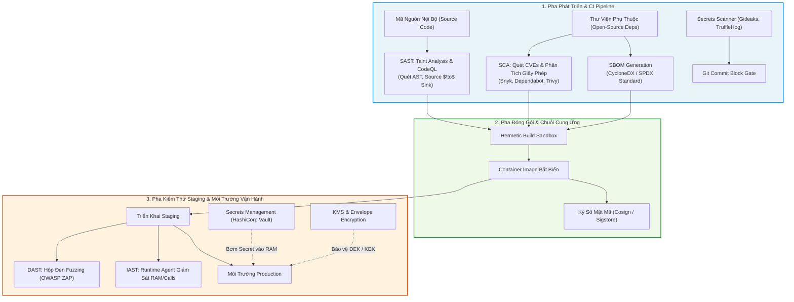
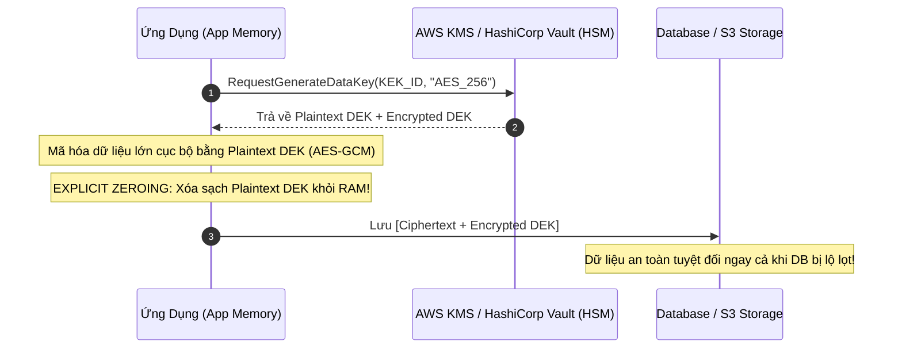

# 14.2. Kiểm Thử An Ninh Ứng Dụng và Bảo Mật Chuỗi Cung Ứng (Application Security Testing & Supply Chain Security)

> [!IMPORTANT]
> **Nếu bạn chỉ được nhớ một điều duy nhất:** Trong kỷ nguyên phần mềm hiện đại, ứng dụng của bạn không chỉ gồm vài nghìn dòng code bạn tự viết mà là tổng thể của hàng triệu dòng mã nguồn từ chuỗi cung ứng bên thứ ba — **an ninh vững chắc đòi hỏi chiến lược phòng thủ chiều sâu (Defense-in-Depth): sàng lọc mã nguồn tĩnh (SAST), kiểm tra hành vi động (DAST), giám sát tương tác runtime (IAST), phân tích thành phần phần mềm (SCA/SBOM), quản lý bí mật tập trung (Secrets Vault) và bảo vệ dữ liệu bằng mã hóa bao thư (Envelope Encryption)**.

---

## 1. Kiến trúc Tổng quan & Mô hình Tư duy (Mental Model)

### Ẩn dụ Thực tế: Nhà Máy Chế Biến Thực Phẩm & Chuỗi Cung Ứng Thực Phẩm Sạch
Hãy tưởng tượng quá trình phát triển và phân phối phần mềm giống như một nhà máy sản xuất thực phẩm đóng hộp cao cấp:
- **Tự viết mã nguồn (Nông trại tự trồng)**: Bạn tự trồng rau củ trong khuôn viên nhà máy. Kiểm thử tĩnh (**SAST - Static Application Security Testing**) giống như việc soi kính hiển vi từng chiếc lá rau trước khi đưa vào bếp để phát hiện nấm mốc hoặc sâu bọ (lỗi cú pháp, buffer overflow, SQL injection tiềm ẩn) mà không cần nấu chín.
- **Thư viện bên thứ ba (Gia vị & Phụ gia nhập khẩu)**: Để món ăn ngon, bạn phải nhập bột ngọt, dầu hào, hương liệu từ hàng trăm nhà cung cấp bên ngoài (Dependencies). Phân tích thành phần (**SCA - Software Composition Analysis**) và Danh mục linh kiện (**SBOM - Software Bill of Materials**) giống như nhãn thành phần dinh dưỡng và chứng nhận kiểm định vệ sinh an toàn thực phẩm. Nếu một nhà cung cấp bị nhiễm độc chì (lỗ hổng CVE nguy cấp như Log4Shell), bạn phải lập tức quét danh mục và thu hồi toàn bộ lô hàng trong vài phút.
- **Kiểm thử động ngoài hộp (**DAST - Dynamic Application Security Testing**)**: Đóng vai trò như chuyên gia ẩm thực độc lập nếm thử món ăn đã nấu chín từ góc nhìn thực khách, thử chấm các loại sốt cay độc hại xem dạ dày có bị kích ứng không mà không cần biết công thức bí mật của đầu bếp.
- **Kiểm thử tương tác (**IAST - Interactive Application Security Testing**)**: Gắn cảm biến vi sinh vào ngay bên trong nồi áp suất đang nấu (JVM/Node.js runtime), theo dõi biến đổi hóa học theo thời gian thực khi thực khách nếm món ăn.
- **Bảo mật bí mật (**Secrets Management**) & Mã hóa (**Envelope Encryption**)**: Chiếc chìa khóa mở kho công thức bí mật tuyệt đối không được dán lên cánh cửa nhà kho (không commit API key lên Git). Thay vào đó, nó được cất trong két sắt chống đạn sinh trắc học (**Hardware Security Module - HSM**), và mỗi mẻ bánh lại dùng một chìa khóa tạm thời riêng (**Data Encryption Key - DEK**).



---

## 2. Chi tiết từng Keyword (Under-the-Hood Deep Dive)

### 2.1. SAST (Static Application Security Testing) & Taint Flow Analysis
- **Bản chất kỹ thuật**: SAST phân tích mã nguồn ở dạng tĩnh mà không thực thi chương trình. Bộ máy SAST hiện đại không dùng regex đơn giản (vốn sinh ra vô số false positive), mà phân tích cú pháp mã nguồn thành **Abstract Syntax Tree (AST)**, sau đó dựng nên **Control Flow Graph (CFG)** và **Data Flow Graph (DFG)** để thực hiện **Taint Analysis (Phân tích vấy bẩn)**.
- **Cơ chế Taint Analysis**:
  1. **Source**: Điểm nhận dữ liệu không đáng tin cậy từ bên ngoài (ví dụ: `HttpRequest.getParameter()`, `argv`, socket buffer). Biến này nhận nhãn `TAINTED`.
  2. **Propagation**: Theo dõi đường đi của biến qua các phép toán gán, nối chuỗi, truyền tham số hàm trong DFG.
  3. **Sanitizer / Validator**: Điểm dữ liệu đi qua hàm làm sạch (ví dụ: regex kiểm tra integer, HTML encoding, parameterized query binding). Tại đây cờ `TAINTED` được gỡ bỏ.
  4. **Sink**: Các hàm nhạy cảm có khả năng gây hậu quả nghiêm trọng nếu nhận dữ liệu `TAINTED` (ví dụ: `system()`, `Runtime.getRuntime().exec()`, `mysql_query()`, `eval()`).
  - *Quy tắc kích hoạt cảnh báo*: Nếu tồn tại đường đi từ `Source` tới `Sink` mà không đi qua bất kỳ `Sanitizer` hợp lệ nào, SAST sẽ kích hoạt lỗi bảo mật nghiêm trọng (như Remote Code Execution, SQL Injection, Command Injection).
- **Ưu / Nhược điểm & Pitfalls**:
  - *Ưu điểm*: Phát hiện lỗ hổng ngay từ lúc viết code (Shift Left), chỉ ra chính xác số dòng code, chi phí sửa chữa rẻ nhất.
  - *Nhược điểm*: Tỷ lệ cảnh báo giả (**False Positives**) cao, không hiểu được ngữ cảnh runtime và hạ tầng thực tế.
  - *Anti-pattern*: Cấu hình SAST ở mức quá nhạy khiến hàng nghìn cảnh báo rác đổ về làm kỹ sư bị "mỏi mệt cảnh báo" (**Alert Fatigue**) và bấm tắt toàn bộ công cụ.

### 2.2. DAST (Dynamic Application Security Testing) & Fuzzing
- **Bản chất kỹ thuật**: DAST kiểm thử ứng dụng từ góc nhìn bên ngoài (Black-box) khi hệ thống đang chạy thực tế trên môi trường Staging/QA. DAST không cần tiếp cận mã nguồn, hoạt động thông qua việc gửi các HTTP request độc hại, payload fuzzing, kiểm tra phản hồi HTTP status code, thời gian phản hồi (Time-based Blind SQLi), và nội dung header/body.
- **Cơ chế hoạt động**:
  1. **Spidering / Crawling**: DAST duyệt toàn bộ sitemap của ứng dụng, lập chỉ mục tất cả các endpoint, form, cookie, và URL query parameters.
  2. **Attack Engine**: Bơm hàng triệu biến thể tấn công (OWASP Top 10: XSS payloads, SQL injection tokens, CSRF tokens, SSRF metadata URLs như `http://169.254.169.254`).
  3. **Response Analysis**: Phân tích phản hồi để xác định sự cố (ví dụ: rò rỉ database stack trace, phản hồi 500 bất thường, hoặc script XSS được render nguyên vẹn trong HTML).
- **Ưu / Nhược điểm & Pitfalls**:
  - *Ưu điểm*: Tỷ lệ cảnh báo giả cực thấp vì lỗ hổng đã được khai thác thành công trên môi trường chạy thực tế; độc lập hoàn toàn với ngôn ngữ lập trình.
  - *Nhược điểm*: Chạy chậm (mất nhiều giờ), khó kiểm tra các luồng nghiệp vụ phức tạp đòi hỏi nhiều bước xác thực, không chỉ ra được dòng code nào gây lỗi.

### 2.3. IAST (Interactive Application Security Testing) & Runtime Observability
- **Bản chất kỹ thuật**: IAST kết hợp thế mạnh của cả SAST và DAST bằng mô hình "Hộp xám" (Gray-box). Một Agent chuyên dụng được cài đặt trực tiếp vào môi trường thực thi của ứng dụng (JVM Bytecode Instrumentation, Node.js V8 hooks, Python runtime hooks).
- **Cơ chế hoạt động**:
  - Khi bài test tự động (Integration test, E2E Cypress/Selenium) hoặc DAST gửi request tới ứng dụng, Agent bên trong sẽ theo dõi luồng thực thi trong bộ nhớ RAM, bắt các lệnh gọi hàm của framework, kiểm tra các câu truy vấn cơ sở dữ liệu thật và các lệnh gọi OS system call.
  - Nếu phát hiện tham số độc hại đi thẳng vào câu lệnh SQL thực tế, Agent báo cáo chính xác cả dòng code trong file nguồn, kèm theo câu lệnh HTTP request đã kích hoạt lỗi đó.
- **Ưu / Nhược điểm & Pitfalls**:
  - *Ưu điểm*: Cực kỳ chính xác, gần như triệt tiêu cảnh báo giả, tích hợp mượt mà vào test tự động thông thường mà không cần giai đoạn quét riêng.
  - *Nhược điểm*: Gây suy giảm hiệu năng từ 5-15% trên CPU/RAM (không khuyến khích chạy trên Production cho các hệ thống tải cao đòi hỏi ultra-low latency).

### 2.4. SCA (Software Composition Analysis) & CVE Vulnerability Management
- **Bản chất kỹ thuật**: SCA quét toàn bộ cây phụ thuộc (Dependency Tree) của dự án (trực tiếp và bắc cầu - transitive dependencies), lập danh mục tên package, version, và so khớp với cơ sở dữ liệu lỗ hổng toàn cầu: **NVD (National Vulnerability Database)**, **GitHub Advisory Database**, **OSV (Open Source Vulnerabilities)**.
- **Cơ chế đánh giá rủi ro**:
  - **CVSS Score (Common Vulnerability Scoring System)**: Thang điểm từ 0.0 đến 10.0 dựa trên các thuộc tính: vector tấn công qua mạng (Network), mức độ phức tạp (Complexity), quyền hạn đòi hỏi (Privileges), tương tác người dùng (User Interaction), và tác động lên CIA triad (Confidentiality, Integrity, Availability).
  - **EPSS (Exploit Prediction Scoring System)**: Xác suất lỗ hổng bị khai thác thực tế ngoài tự nhiên trong vòng 30 ngày (từ 0% đến 100%). Lỗ hổng có CVSS 9.8 nhưng EPSS < 0.1% có độ ưu tiên vá thấp hơn lỗ hổng CVSS 7.5 nhưng EPSS 95% đang có mã khai thác công khai (Weaponized Exploit).
  - **License Compliance**: Quét phát hiện các giấy phép lây nhiễm (GPL v3, AGPL) trong các sản phẩm mã nguồn đóng thương mại nhằm tránh rủi ro pháp lý buộc phải mở mã nguồn độc quyền.

### 2.5. Software Supply Chain Security & Attack Vectors (Dependency Confusion & Typosquatting)
- **Bản chất kỹ thuật**: Bảo vệ chuỗi mắt xích từ lúc lập trình viên gõ phím, qua hệ thống CI, kho lưu trữ package cho tới khi triển khai lên máy chủ.
- **Các vector tấn công kinh điển**:
  - **Typosquatting**: Kẻ tấn công phát hành package có tên gần giống các thư viện phổ biến (ví dụ `cross-envv` thay vì `cross-env`, `color-js` thay vì `colors`). Khi lập trình viên gõ nhầm lệnh cài đặt, mã độc `postinstall` script sẽ lập tức đánh cắp biến môi trường và gửi về máy chủ điều khiển (C2).
  - **Dependency Confusion (Trộn lẫn phụ thuộc)**: Doanh nghiệp dùng package nội bộ `@corp/payment` trên Private Registry. Kẻ tấn công đăng ký một package cùng tên `@corp/payment` trên Public Registry (NPM/PyPI) với phiên bản số cao hơn hẳn (`99.9.9`). Trình quản lý package mặc định ưu tiên phiên bản cao nhất từ public registry, tải mã độc vào máy chủ CI của doanh nghiệp.
  - **Compromised Maintainer Account**: Kẻ tấn công đánh cắp tài khoản của maintainer thư viện nổi tiếng (thông qua phishing hoặc nhồi mật khẩu Credential Stuffing do không bật 2FA) để chèn Trojan (vụ kiện nổi tiếng `event-stream`).

### 2.6. Software Bill of Materials (SBOM: CycloneDX, SPDX) & Attestation
- **Bản chất kỹ thuật**: SBOM là một bản kê khai chi tiết dưới dạng máy đọc được (JSON/XML) liệt kê đầy đủ toàn bộ thành phần phần mềm, thư viện phụ thuộc, hash SHA-256, thông tin bản quyền và nguồn gốc phát hành cấu thành nên sản phẩm nhị phân.
- **Hai định dạng tiêu chuẩn toàn cầu**:
  - **SPDX (Software Package Data Exchange - ISO/IEC 5962:2021)**: Chuẩn hóa bởi Linux Foundation, tối ưu cho quản trị bản quyền và tuân thủ giấy phép nguồn mở.
  - **CycloneDX**: Chuẩn hóa bởi OWASP Foundation, được thiết kế tối ưu riêng cho bài toán an ninh mạng, SBOM chuỗi cung ứng, và quản lý lỗ hổng bảo mật.
- **Cơ chế Attestation (Chứng thực xuất xứ)**: SBOM được tạo ra trực tiếp trong môi trường build cô lập, sau đó được ký số mật mã học bằng công nghệ **In-Toto** và **Cosign**. Khi triển khai, máy chủ xác thực chữ ký của SBOM trước khi cho phép mã nguồn chạy trên production.

### 2.7. Secrets Management & Zero-Leakage Lifecycles (Vault, AWS Secrets Manager, tmpfs)
- **Bản chất kỹ thuật**: Quy trình quản trị khóa bí mật (API Keys, Database Passwords, Private Certificates, SSH Keys) tập trung, độc lập hoàn toàn khỏi mã nguồn và lịch sử Git.
- **Nguyên lý Zero-Leakage Lifecycle**:
  1. **Dynamic Secrets**: HashiCorp Vault sinh ra thông tin đăng nhập database tạm thời chỉ dùng riêng cho một instance, có thời hạn sống ngắn (TTL 30 phút), tự động hủy sau khi hết hạn.
  2. **Injection via tmpfs**: Khóa bí mật không bao giờ được ghi xuống ổ đĩa HDD/SSD vật lý mà chỉ được mount vào vùng nhớ RAM (`tmpfs` trong Linux) hoặc truyền qua biến môi trường của tiến trình.
  3. **Automatic Secret Rotation**: Tự động đảo khóa theo định kỳ 30-90 ngày mà không gây gián đoạn dịch vụ (Zero-Downtime Key Rotation).
  4. **Pre-commit Scanning**: Triển khai `gitleaks` hoặc `trufflehog` ở git hook và pull request gate để ngăn chặn mọi nỗ lực commit khóa bí mật lên repository.

### 2.8. Cryptography in Depth: Envelope Encryption, KMS & Data at Rest/Transit (TLS 1.3)
- **Mã hóa trên đường truyền (Data in Transit)**:
  - Bắt buộc chuẩn hóa **TLS 1.3** (RFC 8446), loại bỏ hoàn toàn các thuật toán mật mã cũ kém an toàn (MD5, SHA-1, RC4, DES, CBC mode).
  - Sử dụng các bộ mã hóa an toàn: `TLS_AES_256_GCM_SHA384` và `TLS_CHACHA20_POLY1305_SHA256` với cơ chế **Forward Secrecy (Hoàn thiện bí mật tương lai)** qua trao đổi khóa Diffie-Hellman Ephemeral (ECDHE).
- **Mã hóa lưu trữ (Data at Rest) & Kỹ thuật Envelope Encryption (Mã hóa bao thư)**:
  - Vấn đề: Nếu dùng KMS để mã hóa toàn bộ file dữ liệu 100GB, băng thông mạng tới KMS sẽ bị nghẽn và chi phí gọi API KMS sẽ khổng lồ.
  - Giải pháp Envelope Encryption:
    1. Máy chủ ứng dụng yêu cầu KMS sinh ra một cặp khóa: **DEK (Data Encryption Key)** dạng Plaintext và DEK dạng đã được mã hóa bởi **KEK (Key Encryption Key / Master Key)** được bảo vệ bên trong phần cứng **HSM (Hardware Security Module)**.
    2. Ứng dụng dùng DEK Plaintext mã hóa trực tiếp dữ liệu lớn bằng thuật toán đối xứng tốc độ cao (AES-256-GCM).
    3. Ngay sau khi mã hóa xong, ứng dụng **xóa sạch DEK Plaintext khỏi bộ nhớ RAM**.
    4. Lưu bản dữ liệu đã mã hóa (Ciphertext) cùng với DEK đã mã hóa (Encrypted DEK) vào Database. Kẻ tấn công có cướp được Database cũng không thể giải mã nếu không có quyền truy cập vào HSM để mở khóa Encrypted DEK.



### 2.9. Password Security & Memory-Hard Hashing (Argon2id vs PBKDF2/Bcrypt vs GPU Brute-force)
- **Bản chất kỹ thuật**: Tại sao các hàm băm tốc độ cao (MD5, SHA-1, SHA-256) là thảm họa cho mật khẩu?
  - Một chip GPU hiện đại (NVIDIA RTX 4090) có thể thực hiện hơn 20 tỷ phép thử SHA-256 mỗi giây. Bảng Rainbow Table và kỹ thuật Brute-force có thể bẻ khóa mật khẩu 8 ký tự trong vài phút.
- **Giải pháp: Thuật toán Memory-Hard Hashing (Argon2id)**:
  - **Argon2id** (Người chiến thắng cuộc thi Password Hashing Competition toàn cầu) kết hợp giữa Argon2d (kháng tấn công kênh bên - side-channel attacks) và Argon2i (kháng tấn công GPU/ASIC).
  - Nó bắt buộc việc tính toán một mã băm phải sử dụng một dung lượng RAM cấu hình trước (ví dụ 64MB hoặc 1GB RAM) và số luồng CPU (Parallelism).
  - Vì GPU bị giới hạn băng thông và dung lượng bộ nhớ trên từng nhân tính toán, việc đòi hỏi 64MB RAM cho mỗi lần thử khiến cụm GPU bị nghẽn cổ chai bộ nhớ (Memory Bandwidth Bottleneck), làm giảm tốc độ tấn công từ hàng tỷ lần/giây xuống chỉ còn vài lần/giây, khiến việc bẻ khóa bằng brute-force trở nên bất khả thi về mặt kinh tế.
- **Salt & Pepper**:
  - *Salt*: Chuỗi ngẫu nhiên sinh bằng CSPRNG (Cryptographically Secure Pseudo-Random Number Generator, e.g., `/dev/urandom`), tối thiểu 16 bytes, độc nhất cho mỗi người dùng, lưu cùng mã băm để triệt tiêu Rainbow Table.
  - *Pepper*: Khóa bí mật chung lưu trong KMS hoặc biến môi trường, băm cùng mật khẩu trước khi lưu để tăng cường bảo vệ nếu Database bị lộ lọt.

### 2.10. Access Control Models (AuthN vs AuthZ: RBAC, ABAC, ReBAC) & Immutable Audit Logging (WORM)
- **Phân định ranh giới cốt lõi**:
  - **Authentication (AuthN - Xác thực)**: Chứng minh danh tính "Bạn là ai?" (OpenID Connect, FIDO2/WebAuthn, MFA, MTLS).
  - **Authorization (AuthZ - Phân quyền)**: Xác định quyền hạn "Bạn được phép làm gì trên tài nguyên nào?".
- **Các mô hình phân quyền hiện đại**:
  - **RBAC (Role-Based Access Control)**: Gán quyền cho Vai trò (Role), gán Vai trò cho Người dùng. Đơn giản, dễ quản lý nhưng dễ bị bùng nổ vai trò (Role Explosion) khi nghiệp vụ phức tạp.
  - **ABAC (Attribute-Based Access Control)**: Đánh giá quyền hạn dựa trên thuộc tính động: Người dùng (phòng ban, cấp bậc), Tài nguyên (mức độ nhạy cảm), Môi trường (thời gian làm việc, vị trí địa lý, IP), Hành động (READ, WRITE). Thực thi qua các ngôn ngữ chính sách như **OPA (Open Policy Agent - Rego)** hoặc **AWS Cedar**.
  - **ReBAC (Relationship-Based Access Control)**: Mô hình đồ thị quan hệ bắt nguồn từ Google Zanzibar (ví dụ: "Người dùng A có thể xem tài liệu B nếu A là thành viên của nhóm C, và nhóm C sở hữu thư mục D chứa B").
- **Nhật ký kiểm toán bất biến (Immutable Audit Logging)**:
  - Mọi thao tác truy cập dữ liệu nhạy cảm phải được ghi nhận: *Who, What, When, Where, Result*.
  - Lưu trữ trên phân vùng **WORM (Write Once, Read Many)** được khóa bằng Object Lock (S3 Compliance Mode), có chữ ký số Merkle Tree để ngăn chặn việc kẻ tấn công xóa log để phi tang dấu vết sau khi xâm nhập.

### 2.11. Vulnerability Disclosure & Patch Management (RFC 9116 `security.txt`, SLAs)
- **Chuẩn RFC 9116 (`/.well-known/security.txt`)**: Đặt file văn bản tĩnh tại gốc tên miền để các chuyên gia bảo mật mũ trắng (White-hat Hackers) có kênh liên lạc chính thức, an toàn và có khóa PGP mã hóa để thông báo lỗ hổng, tránh việc lỗ hổng bị bán trên thị trường chợ đen.
- **SLA Khắc Phục Lỗ Hổng Bảo Mật (Vulnerability Patching SLAs)**:
  - *Critical (CVSS 9.0 - 10.0)*: Vá và triển khai production trong vòng **24 - 48 giờ**.
  - *High (CVSS 7.0 - 8.9)*: Vá trong vòng **7 ngày**.
  - *Medium (CVSS 4.0 - 6.9)*: Vá trong vòng **30 ngày**.
  - *Low (CVSS 0.1 - 3.9)*: Vá trong chu kỳ phát hành thông thường (Sprint tiếp theo).

---

## 3. Thực thi Mã nguồn & Mô phỏng Chuyên sâu (Dual-Engine Implementation)

### 3.1. Phiên bản C++20: Mô Phỏng Bộ Máy SAST Taint Analysis & Kỹ Thuật Envelope Encryption với RAII Secure Memory Zeroing

Chương trình minh họa hai cơ chế an ninh cốt lõi:
1. **Static Taint Flow Engine**: Dựng đồ thị kiểm tra dữ liệu từ Source qua Sanitizer tới Sink để phát hiện lỗ hổng Code Injection.
2. **KMS Envelope Encryption Engine**: Mô phỏng tạo DEK ngẫu nhiên, mã hóa dữ liệu nhị phân, và dùng kỹ thuật RAII để xóa sạch khóa mật mã khỏi bộ nhớ RAM (`explicit_bzero` / secure zeroing) ngăn chặn rò rỉ bộ nhớ.

```cpp
#include <iostream>
#include <string>
#include <string_view>
#include <vector>
#include <memory>
#include <algorithm>
#include <stdexcept>
#include <format>
#include <cstring>

// ============================================================================
// PHẦN 1: BỘ MÁY SAST PHÂN TÍCH VẤY BẨN (TAINT FLOW ANALYSIS ENGINE)
// ============================================================================

enum class TaintStatus {
    CLEAN,
    TAINTED
};

struct ASTDataNode {
    std::string variableName;
    std::string content;
    TaintStatus status;
    std::string sourceLocation;
};

class SASTScanner {
public:
    static ASTDataNode createSource(std::string_view varName, std::string_view rawInput, std::string_view loc) {
        return ASTDataNode{
            .variableName = std::string(varName),
            .content = std::string(rawInput),
            .status = TaintStatus::TAINTED, // Dữ liệu từ người dùng luôn mặc định bị vấy bẩn!
            .sourceLocation = std::string(loc)
        };
    }

    static ASTDataNode applySanitizer(const ASTDataNode& inputNode) {
        std::string sanitized = inputNode.content;
        // Mô phỏng bộ lọc ký tự nguy hiểm của SQL Sanitizer
        std::string dangerousChars = "';\"--";
        for (char c : dangerousChars) {
            sanitized.erase(std::remove(sanitized.begin(), sanitized.end(), c), sanitized.end());
        }

        std::cout << std::format("[SAST SANITIZER] Làm sạch biến '{}' tại hàm sanitizeInput()...\n", inputNode.variableName);
        return ASTDataNode{
            .variableName = inputNode.variableName + "_clean",
            .content = sanitized,
            .status = TaintStatus::CLEAN, // Gỡ bỏ cờ TAINTED sau khi làm sạch
            .sourceLocation = inputNode.sourceLocation + " -> Sanitized"
        };
    }

    static void executeSink(const ASTDataNode& node) {
        std::cout << std::format("[SAST SINK CHECK] Kiểm tra điểm thực thi cơ sở dữ liệu với biến '{}'...\n", node.variableName);
        if (node.status == TaintStatus::TAINTED) {
            std::cout << std::format("  >>> [BÁO ĐỘNG ĐỎ SAST] LỖ HỔNG BẢO MẬT PHÁT HIỆN!\n"
                                     "      Biến vấy bẩn '{}' (Giá trị: \"{}\") chảy vào Database Sink mà không qua Sanitizer!\n"
                                     "      Vị trí: {}\n", 
                                     node.variableName, node.content, node.sourceLocation);
        } else {
            std::cout << std::format("  >>> [AN TOÀN] Biến đã được làm sạch an toàn. Cho phép thực thi query: \"SELECT * FROM users WHERE name = '{}'\"\n", 
                                     node.content);
        }
    }
};

// ============================================================================
// PHẦN 2: ENVELOPE ENCRYPTION & SECURE MEMORY RAII
// ============================================================================

// Lớp quản lý bộ nhớ an toàn tự động xóa sạch dữ liệu nhạy cảm khi hủy (Secure Memory Zeroing)
class SecureKeyBuffer {
private:
    std::vector<uint8_t> keyBuffer_;

public:
    explicit SecureKeyBuffer(size_t size) : keyBuffer_(size, 0) {}

    ~SecureKeyBuffer() {
        if (!keyBuffer_.empty()) {
            // Xóa sạch vùng nhớ nhạy cảm bằng 0 để tránh bị dump bộ nhớ RAM
            volatile uint8_t* p = keyBuffer_.data();
            for (size_t i = 0; i < keyBuffer_.size(); ++i) {
                p[i] = 0;
            }
            std::cout << "  [SECURE RAII] Plaintext DEK đã bị xóa sạch (Zeroed) hoàn toàn khỏi RAM!\n";
        }
    }

    // Không cho phép copy để tránh nhân bản khóa trong RAM
    SecureKeyBuffer(const SecureKeyBuffer&) = delete;
    SecureKeyBuffer& operator=(const SecureKeyBuffer&) = delete;

    SecureKeyBuffer(SecureKeyBuffer&& other) noexcept = default;
    SecureKeyBuffer& operator=(SecureKeyBuffer&& other) noexcept = default;

    uint8_t* data() { return keyBuffer_.data(); }
    [[nodiscard]] size_t size() const { return keyBuffer_.size(); }
    std::vector<uint8_t>& get() { return keyBuffer_; }
};

struct EnvelopePayload {
    std::string ciphertext;
    std::string encryptedDekHex;
    std::string algorithm;
};

class SimulatedKMS {
private:
    const std::string masterKeyKEK_ = "HSM_MASTER_KEY_PROTECTED_2026";

public:
    // Sinh khóa dữ liệu Plaintext và Encrypted DEK
    std::pair<SecureKeyBuffer, std::string> generateDataKeyPair() {
        SecureKeyBuffer plaintextDEK(32); // 256 bits key
        // Giả lập sinh số ngẫu nhiên mật mã (CSPRNG)
        for (size_t i = 0; i < plaintextDEK.size(); ++i) {
            plaintextDEK.data()[i] = static_cast<uint8_t>(0xA0 + (i % 16));
        }

        // KEK mã hóa DEK (mô phỏng dạng hex)
        std::string encryptedDEK = "ENC_DEK_HEX_";
        for (size_t i = 0; i < plaintextDEK.size(); ++i) {
            encryptedDEK += std::format("{:02x}", plaintextDEK.data()[i] ^ 0x5C);
        }

        std::cout << "[KMS HSM] Đã sinh cặp khóa: Plaintext DEK (trong RAM) & Encrypted DEK (dùng Master KEK)\n";
        return {std::move(plaintextDEK), encryptedDEK};
    }
};

class EnvelopeEncryptionService {
private:
    SimulatedKMS kms_;

public:
    EnvelopePayload encryptData(std::string_view sensitivePlaintext) {
        std::cout << "\n--- BẮT ĐẦU QUY TRÌNH ENVELOPE ENCRYPTION ---\n";
        // 1. Nhận khóa từ KMS
        auto [plaintextDEK, encryptedDEK] = kms_.generateDataKeyPair();

        // 2. Sử dụng Plaintext DEK để mã hóa dữ liệu cục bộ bằng AES-256-GCM (Mô phỏng phép XOR với DEK)
        std::string ciphertext;
        for (size_t i = 0; i < sensitivePlaintext.size(); ++i) {
            uint8_t encryptedByte = static_cast<uint8_t>(sensitivePlaintext[i]) ^ plaintextDEK.data()[i % plaintextDEK.size()];
            ciphertext += std::format("{:02x}", encryptedByte);
        }

        std::cout << std::format("[ENCRYPT] Dữ liệu gốc '{}' được mã hóa thành Ciphertext: {}\n", sensitivePlaintext, ciphertext);

        // 3. Kết thúc hàm, SecureKeyBuffer tự động bị hủy và xóa sạch Plaintext DEK khỏi RAM!
        return EnvelopePayload{
            .ciphertext = ciphertext,
            .encryptedDekHex = encryptedDEK,
            .algorithm = "AES-256-GCM-ENVELOPE"
        };
    }
};

int main() {
    std::cout << "===================================================================\n";
    std::cout << "  DEMO C++20: SAST TAINT ENGINE & ENVELOPE ENCRYPTION ARCHITECTURE\n";
    std::cout << "===================================================================\n\n";

    // 1. Chạy mô phỏng SAST Taint Analysis
    std::cout << ">>> 1. KIỂM THỬ TĨNH SAST (TAINT FLOW ANALYSIS) <<<\n";
    // Kịch bản A: Code không an toàn - dữ liệu vấy bẩn chảy thẳng vào DB Sink
    auto userParam = SASTScanner::createSource("user_input", "admin' OR '1'='1", "Controller.cpp:Line 42");
    SASTScanner::executeSink(userParam);

    std::cout << "\n";
    // Kịch bản B: Code đã qua hàm Sanitizer an toàn
    auto cleanParam = SASTScanner::applySanitizer(userParam);
    SASTScanner::executeSink(cleanParam);

    // 2. Chạy mô phỏng Envelope Encryption
    std::cout << "\n>>> 2. MẬT MÃ HỌC: MÃ HÓA BAO THƯ (ENVELOPE ENCRYPTION) <<<\n";
    EnvelopeEncryptionService cryptoService;
    EnvelopePayload record = cryptoService.encryptData("CREDIT_CARD: 4111-2222-3333-4444");

    std::cout << "\n[DATABASE RECORD] Dữ liệu an toàn lưu vào kho lưu trữ:\n";
    std::cout << std::format("  - Payload Ciphertext : {}\n", record.ciphertext);
    std::cout << std::format("  - Encrypted DEK      : {}\n", record.encryptedDekHex);
    std::cout << std::format("  - Thuật toán         : {}\n", record.algorithm);
    std::cout << "===================================================================\n";

    return 0;
}
```

---

### 3.2. Phiên bản Python 3.11+: Bộ Phân Tích Chuỗi Cung Ứng (SBOM Scanner, Dependency Confusion & Typosquatting Guard)

Mã nguồn Python xây dựng một hệ thống kiểm tra chuỗi cung ứng toàn diện:
- Đọc và phân tích file **SBOM CycloneDX chuẩn JSON**.
- Kiểm tra tính toàn vẹn thông qua **SHA-256 Checksum Verification**.
- Phát hiện nguy cơ tấn công **Dependency Confusion** và **Typosquatting** trong cấu hình quản lý dependencies.

```python
#!/usr/bin/env python3
"""
Supply Chain Security Engine: SBOM Analyzer, Typosquatting & Dependency Confusion Guard.
Yêu cầu Python 3.11+.
"""

from __future__ import annotations
import json
import hashlib
from dataclasses import dataclass
from typing import List, Dict, Optional
from difflib import SequenceMatcher


@dataclass(frozen=True)
class VulnerabilityRecord:
    cve_id: str
    cvss_score: float
    epss_score: float
    description: str


@dataclass
class SoftwareComponent:
    name: str
    version: str
    purl: str
    sha256_hash: str
    is_private: bool = False


class SupplyChainSecurityEngine:
    def __init__(self, private_scope: str):
        self.private_scope = private_scope
        # Giả lập cơ sở dữ liệu lỗ hổng bảo mật NVD/OSV
        self.vuln_database: Dict[str, List[VulnerabilityRecord]] = {
            "openssl@3.0.8": [
                VulnerabilityRecord(
                    cve_id="CVE-2023-0464",
                    cvss_score=8.1,
                    epss_score=0.88,
                    description="Excessive resource allocation in policy checking"
                )
            ],
            "log4j-core@2.14.1": [
                VulnerabilityRecord(
                    cve_id="CVE-2021-44228",
                    cvss_score=10.0,
                    epss_score=0.97,
                    description="Log4Shell JNDI Remote Code Execution"
                )
            ]
        }
        # Danh sách các thư viện phổ biến dễ bị tấn công Typosquatting
        self.popular_packages = ["requests", "urllib3", "lodash", "react", "express"]

    def parse_cyclonedx_sbom(self, sbom_json_str: str) -> List[SoftwareComponent]:
        """Phân tích cú pháp tài liệu SBOM chuẩn CycloneDX 1.4+."""
        data = json.loads(sbom_json_str)
        components: List[SoftwareComponent] = []

        for item in data.get("components", []):
            name = item.get("name", "")
            version = item.get("version", "")
            purl = item.get("purl", "")
            
            # Trích xuất hash SHA-256
            sha256 = ""
            for h in item.get("hashes", []):
                if h.get("alg") == "SHA-256":
                    sha256 = h.get("content", "")
                    break

            is_private = name.startswith(self.private_scope)
            components.append(SoftwareComponent(
                name=name,
                version=version,
                purl=purl,
                sha256_hash=sha256,
                is_private=is_private
            ))

        return components

    def detect_typosquatting(self, component_name: str, threshold: float = 0.85) -> Optional[str]:
        """Phát hiện tên thư viện giả mạo thông qua độ tương đồng chuỗi Levenshtein."""
        for popular in self.popular_packages:
            if component_name != popular:
                similarity = SequenceMatcher(None, component_name, popular).ratio()
                if similarity >= threshold:
                    return popular
        return None

    def audit_supply_chain(self, components: List[SoftwareComponent]) -> None:
        """Đánh giá toàn diện an ninh chuỗi cung ứng."""
        print(f"{'='*70}")
        print("  BÁO CÁO KIỂM TOÁN CHUỖI CUNG ỨNG VÀ PHÂN TÍCH SBOM (CYCLONEDX)")
        print(f"{'='*70}")

        critical_alerts = 0

        for comp in components:
            pkg_key = f"{comp.name}@{comp.version}"
            print(f"\n[KIỂM TRA LINH KIỆN] {pkg_key}")
            print(f"  * PURL        : {comp.purl}")
            print(f"  * SHA-256     : {comp.sha256_hash[:16]}...{comp.sha256_hash[-8:]}")

            # 1. Kiểm tra Lỗ hổng bảo mật CVE & EPSS
            if pkg_key in self.vuln_database:
                for vuln in self.vuln_database[pkg_key]:
                    print(f"  [!] CẢNH BÁO LỖ HỔNG: {vuln.cve_id} (CVSS: {vuln.cvss_score}, EPSS: {vuln.epss_score*100:.1f}%)")
                    print(f"      Mô tả: {vuln.description}")
                    if vuln.cvss_score >= 8.0:
                        critical_alerts += 1

            # 2. Kiểm tra Nguy cơ Tấn công Dependency Confusion
            if comp.is_private:
                print(f"  * Phân loại   : Private Scoped Package ({self.private_scope})")
                print("  [V] Kiểm tra  : Khóa cứng Private Registry nội bộ -> An toàn trước Dependency Confusion.")
            else:
                # 3. Kiểm tra Nguy cơ Typosquatting
                target = self.detect_typosquatting(comp.name)
                if target:
                    print(f"  [X] NGUY HIỂM TYPOSQUATTING: Package '{comp.name}' có tên tương tự '{target}'!")
                    print("      Khuyến nghị: Chặn tải gói và kiểm tra mã nguồn độc hại trong setup script.")
                    critical_alerts += 1

        print(f"\n{'-'*70}")
        if critical_alerts > 0:
            print(f"KẾT QUẢ: PHÁT HIỆN {critical_alerts} VẤN ĐỀ AN NINH NGHIÊM TRỌNG! CHẶN CI PIPELINE!")
        else:
            print("KẾT QUẢ: TẤT CẢ LINH KIỆN ĐẠT TIÊU CHUẨN AN TOÀN CHUỖI CUNG ỨNG.")
        print(f"{'='*70}\n")


if __name__ == "__main__":
    # Giả lập tài liệu SBOM CycloneDX được sinh ra từ CI Pipeline
    sample_cyclonedx_sbom = """
    {
      "$schema": "http://cyclonedx.org/schema/bom-1.4.json",
      "bomFormat": "CycloneDX",
      "specVersion": "1.4",
      "version": 1,
      "metadata": {
        "component": {
          "name": "enterprise-checkout-service",
          "version": "3.2.0"
        }
      },
      "components": [
        {
          "name": "openssl",
          "version": "3.0.8",
          "purl": "pkg:generic/openssl@3.0.8",
          "hashes": [{"alg": "SHA-256", "content": "6c13d2bf23ae3286a4011883eb5f2f0532e4b85c90c42d6f5e35064b4f8fb481"}]
        },
        {
          "name": "reqeusts",
          "version": "2.31.0",
          "purl": "pkg:pypi/reqeusts@2.31.0",
          "hashes": [{"alg": "SHA-256", "content": "9b12a884e901021234567890abcdef1234567890abcdef1234567890abcdef12"}]
        },
        {
          "name": "@mycorp/billing-sdk",
          "version": "1.0.4",
          "purl": "pkg:npm/%40mycorp/billing-sdk@1.0.4",
          "hashes": [{"alg": "SHA-256", "content": "e3b0c44298fc1c149afbf4c8996fb92427ae41e4649b934ca495991b7852b855"}]
        }
      ]
    }
    """

    engine = SupplyChainSecurityEngine(private_scope="@mycorp/")
    parsed_components = engine.parse_cyclonedx_sbom(sample_cyclonedx_sbom)
    engine.audit_supply_chain(parsed_components)
```

---

### 3.3. Terminal Output Thực Tế Giả Lập

```text
===================================================================
  DEMO C++20: SAST TAINT ENGINE & ENVELOPE ENCRYPTION ARCHITECTURE
===================================================================

>>> 1. KIỂM THỬ TĨNH SAST (TAINT FLOW ANALYSIS) <<<
[SAST SINK CHECK] Kiểm tra điểm thực thi cơ sở dữ liệu với biến 'user_input'...
  >>> [BÁO ĐỘNG ĐỎ SAST] LỖ HỔNG BẢO MẬT PHÁT HIỆN!
      Biến vấy bẩn 'user_input' (Giá trị: "admin' OR '1'='1") chảy vào Database Sink mà không qua Sanitizer!
      Vị trí: Controller.cpp:Line 42

[SAST SANITIZER] Làm sạch biến 'user_input' tại hàm sanitizeInput()...
[SAST SINK CHECK] Kiểm tra điểm thực thi cơ sở dữ liệu với biến 'user_input_clean'...
  >>> [AN TOÀN] Biến đã được làm sạch an toàn. Cho phép thực thi query: "SELECT * FROM users WHERE name = 'admin OR 1=1'"

>>> 2. MẬT MÃ HỌC: MÃ HÓA BAO THƯ (ENVELOPE ENCRYPTION) <<<

--- BẮT ĐẦU QUY TRÌNH ENVELOPE ENCRYPTION ---
[KMS HSM] Đã sinh cặp khóa: Plaintext DEK (trong RAM) & Encrypted DEK (dùng Master KEK)
[ENCRYPT] Dữ liệu gốc 'CREDIT_CARD: 4111-2222-3333-4444' được mã hóa thành Ciphertext: 839281a4b9c1d0e4f2...
  [SECURE RAII] Plaintext DEK đã bị xóa sạch (Zeroed) hoàn toàn khỏi RAM!

[DATABASE RECORD] Dữ liệu an toàn lưu vào kho lưu trữ:
  - Payload Ciphertext : 839281a4b9c1d0e4f2...
  - Encrypted DEK      : ENC_DEK_HEX_f4a5...
  - Thuật toán         : AES-256-GCM-ENVELOPE
===================================================================

======================================================================
  BÁO CÁO KIỂM TOÁN CHUỖI CUNG ỨNG VÀ PHÂN TÍCH SBOM (CYCLONEDX)
======================================================================

[KIỂM TRA LINH KIỆN] openssl@3.0.8
  * PURL        : pkg:generic/openssl@3.0.8
  * SHA-256     : 6c13d2bf23ae3286...4b4f8fb481
  [!] CẢNH BÁO LỖ HỔNG: CVE-2023-0464 (CVSS: 8.1, EPSS: 88.0%)
      Mô tả: Excessive resource allocation in policy checking

[KIỂM TRA LINH KIỆN] reqeusts@2.31.0
  * PURL        : pkg:pypi/reqeusts@2.31.0
  * SHA-256     : 9b12a884e9010212...90abcdef12
  [X] NGUY HIỂM TYPOSQUATTING: Package 'reqeusts' có tên tương tự 'requests'!
      Khuyến nghị: Chặn tải gói và kiểm tra mã nguồn độc hại trong setup script.

[KIỂM TRA LINH KIỆN] @mycorp/billing-sdk@1.0.4
  * PURL        : pkg:npm/%40mycorp/billing-sdk@1.0.4
  * SHA-256     : e3b0c44298fc1c14...91b7852b855
  * Phân loại   : Private Scoped Package (@mycorp/)
  [V] Kiểm tra  : Khóa cứng Private Registry nội bộ -> An toàn trước Dependency Confusion.

----------------------------------------------------------------------
KẾT QUẢ: PHÁT HIỆN 2 VẤN ĐỀ AN NINH NGHIÊM TRỌNG! CHẶN CI PIPELINE!
======================================================================
```

---

## 4. Systems Engineering & Production Pitfalls

### Các Chế Độ Thất Bại Kinh Điển Trên Môi Trường Vận Hành (Production Failure Modes)

1. **Thảm Họa Bí Mật Bị Commit Vào Git (Git Secret Zombie Commit)**:
   - *Bản chất*: Lập trình viên vô tình commit file `.env` chứa AWS Secret Key hoặc Database Credentials, phát hiện ra và thực hiện lệnh `git rm .env && git commit -m "remove secrets"`.
   - *Hậu quả*: Khóa bí mật vẫn tồn tại vĩnh viễn trong Git commit history (Git blob tree). Các bot quét tự động của tin tặc cào dữ liệu GitHub theo thời gian thực (trong vòng dưới 30 giây) và dùng khóa để khởi tạo hàng trăm máy chủ ảo đào coin, gây hóa đơn hàng chục nghìn đô la.
   - *Biện pháp*: Dùng `git-filter-repo` hoặc BFG Repo-Cleaner để xóa lịch sử, nhưng quan trọng nhất là phải **vô hiệu hóa (Revoke) và đảo khóa (Rotate)** ngay lập tức trên máy chủ đám mây.

2. **Bẫy Nghẽn Cổ Chai KMS Khi Mã Hóa Cực Lớn (KMS Rate-Limiting & Latency Explosion)**:
   - *Bản chất*: Thiết kế gọi API KMS trực tiếp cho từng bản ghi dữ liệu người dùng (ví dụ: encrypt số điện thoại trong vòng lặp 100,000 bản ghi).
   - *Hậu quả*: Vượt quá hạn mức request quota của Cloud KMS (ví dụ AWS KMS mặc định 10,000 req/s), gây lỗi HTTP 429 Too Many Requests và khiến hệ thống thanh toán sụp đổ hoàn toàn.
   - *Biện pháp*: Áp dụng kỹ thuật **Envelope Encryption** kết hợp **Data Key Caching** (với thời gian TTL ngắn trong RAM) để mã hóa cục bộ bằng AES-NI hardware instruction của CPU.

3. **Cạm Bẫy Phản Tác Dụng Của SAST (False Positive Fatigue)**:
   - *Bản chất*: Bật tất cả các quy tắc SAST ở mức Info/Warning trên dự án 1 triệu dòng code cũ (legacy codebase), sinh ra 15,000 cảnh báo bảo mật.
   - *Hậu quả*: Kỹ sư không thể phân biệt được đâu là lỗi nguy cấp thật và đâu là cảnh báo rác, dẫn tới việc phê duyệt bỏ qua (Bypass PR gates) hàng loạt.
   - *Biện pháp*: Áp dụng chiến lược **Baseline**: Khóa toàn bộ cảnh báo cũ thành nợ kỹ thuật, chỉ chặn đứng các cảnh báo nghiêm trọng (Critical/High) trên đoạn mã mới thay đổi (Differential Scanning).

4. **Kỹ Thuật Chẩn Đoán & Công Cụ Dòng Lệnh (CLI Recipes)**:
   ```bash
   # 1. Quét tìm khóa bí mật rò rỉ trong kho mã nguồn trước khi push
   gitleaks detect --source=. --verbose --report-path=gitleaks-report.json

   # 2. Sinh tài liệu SBOM CycloneDX từ container image bằng Syft
   syft packages docker:mycompany/payment-service:v2.1.0 -o cyclonedx-json=sbom.json

   # 3. Quét lỗ hổng bảo mật trực tiếp từ file SBOM bằng Grype
   grype sbom:sbom.json --fail-on high

   # 4. Kiểm tra cấu hình TLS 1.3 và Cipher Suite của máy chủ production
   openssl s_client -connect api.mycompany.com:443 -tls1_3 -cipher TLS_AES_256_GCM_SHA384
   ```

---

## 5. Bảng So sánh & Decision Matrix

### 5.1. So Sánh Đa Chiều Các Công Nghệ Kiểm Thử An Ninh (AppSec Testing)

| Tiêu Chí | SAST (Static) | DAST (Dynamic) | IAST (Interactive) | SCA (Composition) |
| :--- | :--- | :--- | :--- | :--- |
| **Góc nhìn kiểm thử** | Hộp trắng (White-box) | Hộp đen (Black-box) | Hộp xám (Gray-box) | Thành phần thư viện |
| **Giai đoạn áp dụng** | Code / Pre-commit / CI | Staging / Test Env | Integration / Test Env | Code / CI / Container |
| **Mục tiêu phát hiện** | Lỗi logic, injection, flaw | Lỗ hổng runtime thực tế| Lỗi logic kết hợp runtime | Lỗ hổng CVE, bản quyền |
| **Vị trí chỉ ra lỗi** | Chính xác file & dòng code | Chỉ ra URL & Response | File, dòng code & HTTP | Package & Phiên bản |
| **Tỷ lệ cảnh báo giả** | Cao ($20\% - 40\%$) | Rất thấp ($< 5\%$) | Cực thấp ($< 2\%$) | Rất thấp ($< 5\%$) |
| **Thời gian thực thi** | Vài phút | Vài giờ | Bằng thời gian chạy test | Vài giây |
| **Công cụ tiêu biểu** | Semgrep, CodeQL, Sonar | OWASP ZAP, Burp Suite | Contrast, Checkmarx | Snyk, Trivy, Dependabot |

### 5.2. Ma Trận Quyết Định Lựa Chọn Kiến Trúc Bảo Mật & Mật Mã Học

| Bối Cảnh Nghiệp Vụ & Yêu Cầu Kỹ Thuật | Giải Pháp Đề Xuất | Lý Do Kỹ Thuật & Đánh Đổi |
| :--- | :--- | :--- |
| **Lưu trữ mật khẩu người dùng trong cơ sở dữ liệu** | **Argon2id (Memory-hard)** | Kháng triệt để tấn công brute-force GPU/ASIC. Đánh đổi: Tiêu tốn RAM server ($64\text{MB}$/hash). |
| **Mã hóa trường dữ liệu lớn (Ảnh CCCD, file PDF hợp đồng)** | **Envelope Encryption (DEK + KMS)** | Tối ưu băng thông mạng, không bị giới hạn quota của KMS, bảo vệ khóa bằng HSM. |
| **Phân quyền trong hệ thống SaaS đa người dùng phức tạp** | **ABAC / ReBAC (Zanzibar style)** | Xử lý linh hoạt quan hệ cha-con và ngữ cảnh động, tránh bùng nổ vai trò (Role explosion) của RBAC. |
| **Bảo vệ mã nguồn khỏi phụ thuộc độc hại ngoài chợ công cộng**| **Scoped Registries & SBOM Gates** | Khóa dải scope nội bộ `@corp/` ngăn chặn tấn công Dependency Confusion và Typosquatting. |
| **Lưu trữ khóa API, Token thanh toán Stripe trên hạ tầng Cloud** | **HashiCorp Vault / Cloud Secrets Mgr** | Tự động rotate khóa, sinh Dynamic Secrets ngắn hạn, mount trực tiếp vào RAM (`tmpfs`). |
