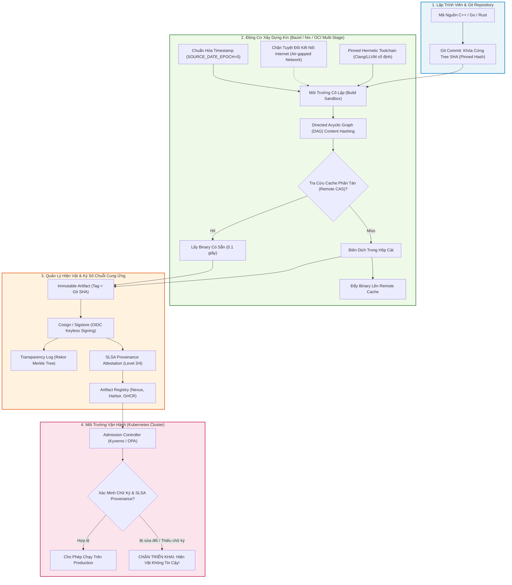
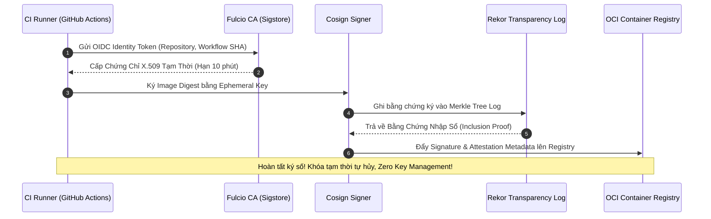

# 15.1. Kỹ Nghệ Xây Dựng và Đường Ống Đóng Gói Kín (Build Engineering & Hermetic Pipelines)

> [!IMPORTANT]
> **Nếu bạn chỉ được nhớ một điều duy nhất:** Câu nói *"Nó vẫn chạy tốt trên máy của tôi mà!"* là triệu chứng của sự thất bại trong kỹ nghệ xây dựng — **chuẩn mực kỹ nghệ đỉnh cao đòi hỏi các bản dựng kín tuyệt đối (Hermetic Builds) có khả năng tái lập 100% từng bit một (Reproducible Builds), đóng gói thành các hiện vật bất biến (Immutable Artifacts) và được ký số mật mã học kèm chứng chỉ xuất xứ chuỗi cung ứng theo chuẩn SLSA Framework**.

---

## 1. Kiến trúc Tổng quan & Mô hình Tư duy (Mental Model)

### Ẩn dụ Thực tế: Phòng Thí Nghiệm Vô Trùng Dược Phẩm & Dây Chuyền Đóng Chai Niêm Phong
Hãy hình dung quá trình biên dịch và phân phối phần mềm giống như một nhà máy sản xuất vắc-xin y tế công nghệ cao:
- **Hội chứng "Chạy trên máy tôi" (Nấu thuốc trong bếp gia đình)**: Nếu một dược sĩ nấu thuốc trong gian bếp cá nhân với nhiệt độ phòng ngẫu nhiên, độ ẩm thay đổi, dùng nguồn nước giếng không kiểm định, vắc-xin tạo ra có thể hiệu nghiệm hôm nay nhưng gây tử vong ngày mai. Bản dựng truyền thống phụ thuộc vào môi trường máy tính của lập trình viên (GCC cài sẵn ở `/usr/bin`, biến môi trường ngẫu nhiên, kết nối Internet tự do tải thư viện không khóa phiên bản).
- **Bản dựng kín tuyệt đối (**Hermetic Builds - Phòng áp lực âm vô trùng**)**: Nhà máy vô trùng cách ly hoàn toàn với thế giới bên ngoài. Không có đường ống dẫn nước lạ (không Internet trong lúc compile), nhiệt độ và áp suất được chuẩn hóa tuyệt đối (loại bỏ siêu dữ liệu đồng hồ hệ thống `__DATE__` và `__TIME__`), và mọi dụng cụ tiệt trùng đều được mang từ kho niêm phong vào (Pinned Hermetic Toolchain). Khi đó, dù bạn bào chế thuốc ở Tokyo, New York hay trên trạm vũ trụ, sản phẩm đầu ra luôn tinh khiết và đồng nhất $100\%$ từng phân tử.
- **Hiện vật bất biến (**Immutable Artifacts - Lọ thuốc niêm phong tem chống giả**)**: Một khi lọ vắc-xin đã đóng nắp và dán mã lô (Git Commit SHA), không ai được phép mở nắp ra chỉnh sửa (tuyệt đối không dùng tag `:latest` có thể ghi đè). Nếu có công thức mới, phải đóng một lọ thuốc mới với số lô mới.
- **Ký số & Chứng chỉ xuất xứ (**Sigstore & SLSA Provenance - Hồ sơ chuỗi hành trình dược phẩm**)**: Mỗi lọ thuốc xuất xưởng đều có tem niêm phong điện tử không thể làm giả (Cosign Keyless Signing) và bản nhật ký hành trình ghi lại: Ai đã điều chế? Bằng công thức nào? Trên máy móc vô trùng số mấy? Tại bệnh viện (Kubernetes Cluster), y tá chỉ tiêm thuốc nếu máy quét xác nhận tem niêm phong hợp lệ (Admission Controller).



---

## 2. Chi tiết từng Keyword (Under-the-Hood Deep Dive)

### 2.1. Build Engineering & Reproducible Builds (Bit-for-Bit Determinism)
- **Bản chất kỹ thuật**: Kỹ nghệ xây dựng (Build Engineering) là chuyên ngành thiết kế, tự động hóa và bảo đảm tính toàn vẹn của quá trình chuyển đổi mã nguồn thành các hiện vật nhị phân thực thi.
- **Tính tái lập tuyệt đối (Reproducible Builds / Bit-for-Bit Determinism)**:
  - Một bản dựng được coi là Reproducible nếu và chỉ nếu: Cho trước cùng một cây mã nguồn (Git commit), cùng cấu hình cờ biên dịch và cùng môi trường công cụ, quá trình biên dịch tại bất kỳ thời điểm nào (kể cả 15 năm sau), trên bất kỳ máy trạm hay hệ điều hành máy chủ nào, đều tạo ra file nhị phân đầu ra có **giá trị băm mật mã học SHA-256 hoàn toàn giống hệt nhau từng bit một**.
  - *Ý nghĩa an ninh tối thượng*: Nếu bản dựng có tính tái lập, nhiều tổ chức độc lập có thể cùng biên dịch một mã nguồn mở và so sánh hash nhị phân. Nếu một bên bị tấn công cài backdoor (như vụ SolarWinds hay xz-utils), mã hash khác biệt sẽ lập tức bị phát hiện và vạch trần.

### 2.2. Hermetic Builds & Sandbox Isolation (Eliminating Non-determinism)
- **Bản chất kỹ thuật**: "Hermetic" (kín tuyệt đối) là trạng thái bản dựng không nhận bất kỳ dữ liệu đầu vào nào ngoài những gì được khai báo tường minh.
- **Các nguồn gốc gây bất định (Sources of Non-Determinism) & Kỹ thuật triệt tiêu**:
  1. **Đồng hồ hệ thống (Timestamps)**: Các macro `__DATE__`, `__TIME__` trong C/C++ hoặc timestamp nhúng vào định dạng nén `.zip`/`.tar`/`.jar`.
     - *Cách khắc phục*: Thiết lập biến môi trường tiêu chuẩn toàn cầu `SOURCE_DATE_EPOCH=0` (hoặc lấy timestamp từ commit Git cuối cùng) và cờ compiler `-Werror=date-time`.
  2. **Đường dẫn thư mục máy chủ (Host File Paths)**: Trình biên dịch nhúng đường dẫn tuyệt đối (`/home/developerA/project/...`) vào bảng thông tin debug (DWARF symbols).
     - *Cách khắc phục*: Dùng cờ `-fdebug-prefix-map=$PWD=.` để chuẩn hóa toàn bộ đường dẫn debug về dạng tương đối.
  3. **Thứ tự sắp xếp file ngẫu nhiên trong hệ thống file (Filesystem Inode Ordering)**: Lệnh `find` hoặc lệnh đọc thư mục trả về danh sách file phụ thuộc vào cấu trúc inode của ext4/NTFS/APFS.
     - *Cách khắc phục*: Build script bắt buộc phải sắp xếp danh sách file theo thứ tự bảng chữ cái (`LC_ALL=C sort`) trước khi truyền cho linker.
  4. **Quyền truy cập mạng ngẫu nhiên (Network Access during Build)**: Build script âm thầm gọi `curl` hoặc tải package mới nhất từ Internet.
     - *Cách khắc phục*: Kích hoạt Network Sandboxing (Linux Network Namespaces, Bazel Sandbox) ngắt hoàn toàn kết nối mạng trong quá trình chạy compilation target.

### 2.3. Graph-Based Modern Build Systems (Bazel, Buck2, Nix & DAG Engine)
- **Bản chất kỹ thuật**: Các công cụ build truyền thống (như GNU Make) dựa trên cơ chế so sánh timestamp của file sửa đổi (mfile modified time), rất dễ bị lỗi khi clock skew hoặc git checkout.
- **Kiến trúc Directed Acyclic Graph (DAG)**:
  - Các hệ thống tiên tiến như **Bazel (Google)**, **Buck2 (Meta)**, và **Nix** mô hình hóa toàn bộ dự án dưới dạng đồ thị có hướng phi chu trình (DAG). Mỗi nút (Node) trong đồ thị đại diện cho một Build Target (Action), và các cạnh (Edges) đại diện cho phụ thuộc tường minh.
  - Mỗi Action là một hàm toán học thuần túy (Pure Function):
    $$\text{OutputArtifact} = f(\text{InputFilesHash}, \text{ToolchainHash}, \text{CompilerFlagsHash})$$
  - Vì là hàm thuần túy, nếu bộ ba `(Inputs, Toolchain, Flags)` không đổi, hệ thống hoàn toàn không cần chạy lại hàm $f$, đảm bảo tính đúng đắn và tốc độ biên dịch tối đa.

### 2.4. Incremental Builds & Compiler Caching (CCache & Preprocessor Hashing)
- **Bản chất kỹ thuật**: Biên dịch gia tăng (Incremental Build) là khả năng tái sử dụng tối đa các file trung gian (`.o`, `.class`, intermediate IR) đã được tạo ra ở các lần build trước, chỉ biên dịch lại duy nhất những file mã nguồn có nội dung thực sự thay đổi.
- **Cơ chế hoạt động sâu của CCache (Compiler Cache)**:
  1. Khi nhận lệnh biên dịch `g++ -c service.cpp -o service.o`, CCache chặn lời gọi trước khi gọi compiler thật.
  2. **Preprocessor Stage**: CCache chạy preprocessor (`g++ -E`) để mở rộng toàn bộ các file header `#include`, giải phóng macros và loại bỏ comments.
  3. **Hash Calculation**: Tính toán mã băm cryptographic (MD4/Blake3/SHA-256) của nội dung mở rộng kèm theo: Cờ dòng lệnh (flags), phiên bản compiler, kích thước và mtime của file nhị phân compiler.
  4. **Lookup**:
     - *Cache Hit*: Tạo hardlink (hoặc copy) trực tiếp từ file `.o` trong thư mục `~/.cache/ccache` ra thư mục đích. Thời gian hoàn thành: dưới $1\text{ ms}$!
     - *Cache Miss*: Chuyển tiếp lệnh cho compiler thật chạy, bắt lấy file `.o` đầu ra, lưu vào cache và hoàn tất quá trình.

### 2.5. Distributed Content-Addressable Caching (Remote Execution & Build Cache Sharing)
- **Bản chất kỹ thuật**: Mở rộng bộ nhớ đệm từ máy trạm cục bộ lên cụm máy chủ phân tán (Remote Cache Server / Content-Addressable Storage - CAS).
- **Cơ chế vận hành phân tán**:
  - Khi kỹ sư $A$ ở văn phòng Singapore biên dịch một thư viện dùng chung `core_crypto`, Bazel tải kết quả `.o` hoặc `.so` lên Remote Cache (S3/GCS hoặc Bazel Remote Cache Server).
  - Khi kỹ sư $B$ ở Berlin hoặc máy chủ CI kéo nhánh mã nguồn đó về: Bazel tính toán Action Key của `core_crypto`. Khi thấy Key đã tồn tại trên Remote CAS, hệ thống lập tức tải thẳng file nhị phân về trong vài chục mili-giây mà không tiêu tốn một chu kỳ CPU nào để compile lại.
- **Remote Execution Engine (RBE)**: Thậm chí không compile trên máy lập trình viên, Bazel đóng gói Action chuyển sang cụm hàng nghìn worker nodes trên Kubernetes để biên dịch song song với quy mô khổng lồ.

### 2.6. Multi-Stage Container Builds & Minimal Runtime Packaging (Distroless / Scratch)
- **Bản chất kỹ thuật**: Tách biệt hoàn toàn giữa môi trường chứa công cụ build nặng nề (Build Environment) và môi trường chứa mã chạy thực tế (Runtime Environment).
- **Quy tắc vàng của Multi-Stage Builds**:
  - *Giai đoạn 1 (Builder Stage)*: Chứa đầy đủ SDK, GCC, Go compiler, headers, công cụ quản lý package (nặng hàng Gigabytes).
  - *Giai đoạn 2 (Runtime Stage)*: Khởi tạo từ image siêu tối giản (`scratch` hoặc Google `gcr.io/distroless/static-debian12`). Chỉ copy duy nhất file nhị phân tĩnh đã được biên dịch từ Builder Stage.
  - *Lợi ích sống còn*: Image từ $1.5\text{GB}$ giảm xuống còn **dưới $25\text{MB}$**. Loại bỏ hoàn toàn Shell (`/bin/sh`, `/bin/bash`), `curl`, `apt`, `sudo` $\implies$ Triệt tiêu $99\%$ bề mặt tấn công của hacker và đưa số lượng lỗ hổng bảo mật (CVEs) về con số **0**.

### 2.7. Immutable Artifacts & Versioning Discipline (Git SHA Pinning vs `:latest` Anti-pattern)
- **Bản chất kỹ thuật**: Một hiện vật phần mềm (Docker image, JAR file, RPM package) sau khi được tạo ra phải là **bất biến (Immutable)**.
- **Hiểm họa của tag `:latest`**:
  - Tag `:latest` chỉ là một con trỏ có thể thay đổi (Mutable Pointer). Nếu bạn deploy với image `mycompany/auth:latest`, bạn không thể biết chính xác phiên bản mã nguồn nào đang thực sự chạy trên cụm server.
  - Khi hệ thống gặp lỗi vào lúc 2 giờ sáng và cần rollback khẩn cấp, việc gọi lại image `latest` có thể kéo nhầm bản dựng mới bị hỏng, làm tê liệt toàn bộ quy trình cứu hộ.
- **Quy chuẩn bất biến**:
  - Luôn gán tag kết hợp phiên bản ngữ nghĩa (Semantic Versioning) và mã băm Git Commit: `image:v2.4.1-sha-7a8b9c0`.
  - Trên Kubernetes, sử dụng mã băm nội dung nhị phân (Image Digest):
    `image: mycompany/auth@sha256:d8a4f91e88c7b41...` để bảo đảm rằng Kubelet chỉ kéo đúng bản dựng đã qua kiểm duyệt.

### 2.8. Cryptographic Artifact Signing (Cosign, Sigstore & Keyless OIDC Flow)
- **Bản chất kỹ thuật**: Ký số hiện vật bằng mật mã học bất đối xứng để chứng minh tính toàn vẹn và nguồn gốc phát hành.
- **Sigstore Keyless Architecture (Ký số không cần quản lý khóa dài hạn)**:
  - Truyền thống: Công ty phải tạo Private Key, lưu trong Vault hoặc HSM. Nếu Private Key bị lộ hoặc nhân viên nghỉ việc mang theo khóa, thảm họa bảo mật xảy ra.
  - **Kiến trúc đột phá Sigstore Keyless**:
    1. Máy chủ CI (GitHub Actions) gửi OIDC Token tới cơ quan cấp phát chứng chỉ tạm thời **Fulcio**.
    2. Fulcio xác thực danh tính workflow (ví dụ repo `mycompany/payment-api`, workflow `release.yaml`) và cấp một chứng chỉ X.509 ngắn hạn có thời hạn chỉ **10 phút**.
    3. Công cụ **Cosign** dùng khóa tạm thời này ký lên Container Image Digest và đẩy chữ ký lên Container Registry.
    4. Toàn bộ chữ ký và thông tin cấp chứng chỉ được ghi vào sổ cái minh bạch công khai **Rekor (Transparency Log)** dựa trên cấu trúc Merkle Tree bất biến.
    5. Sau 10 phút, khóa riêng tạm thời tự hủy. Kẻ tấn công đột nhập vào máy chủ CI sau đó sẽ không tìm thấy bất kỳ Private Key nào để đánh cắp!



### 2.9. Transparency Logs & Admission Enforcement (Rekor Merkle Tree & Kyverno/OPA Gatekeeper)
- **Bản chất kỹ thuật**: Chữ ký số chỉ phát huy tác dụng khi có cơ chế cưỡng chế thực thi tại cửa ngõ môi trường vận hành (Admission Gate).
- **Cơ chế Admission Control trên Kubernetes**:
  - Khi một lệnh `kubectl apply` hoặc Deployment được kích hoạt, API Server gửi Admission Review request tới **Kyverno** hoặc **OPA Gatekeeper**.
  - Admission Controller chặn đứng Pod trước khi tạo container:
    1. Tra cứu chữ ký của Image trên Container Registry.
    2. Kiểm tra chứng chỉ X.509 với Rekor Transparency Log để bảo đảm không bị làm giả.
    3. Kiểm tra tính hợp lệ của định danh tổ chức (Issuer URL và Subject regexp).
    4. Nếu thiếu chữ ký số hoặc chữ ký không khớp, từ chối triển khai ngay lập tức: `Deployment Rejected: Untrusted unsigned container image!`.

### 2.10. Software Provenance & The SLSA Framework (Supply-Chain Levels 1-4)
- **Bản chất kỹ thuật**: **SLSA (Supply-chain Levels for Software Artifacts - phát âm là "salsa")** là bộ tiêu chuẩn an ninh do Google và OpenSSF thiết lập nhằm bảo vệ toàn diện chuỗi cung ứng phần mềm.
- **Bốn cấp độ an ninh SLSA**:
  - **SLSA Level 1**: Quy trình build được tự động hóa bằng script (không build tay bằng gõ lệnh cá nhân), sinh ra tài liệu Provenance cơ bản mô tả cách tạo ra hiện vật.
  - **SLSA Level 2**: Quá trình build chạy trên dịch vụ build chuyên dụng (Hosted CI/CD như GitHub Actions, Google Cloud Build); Provenance được ký số mật mã học.
  - **SLSA Level 3**: Quá trình build chạy trên môi trường cô lập, tạm thời (**Ephemeral Isolated Runner**) để ngăn chặn việc sửa đổi mã nguồn trong lúc compile; bảo đảm tính toàn vẹn của mã nguồn từ kho Git.
  - **SLSA Level 4**: Đòi hỏi quy trình đánh giá mã nguồn bắt buộc hai người (Two-party code review), bản dựng kín hoàn toàn (**Hermetic Builds**), và mọi phụ thuộc đều có chứng chỉ xuất xứ xác minh được bằng mật mã học.

---

## 3. Thực thi Mã nguồn & Mô phỏng Chuyên sâu (Dual-Engine Implementation)

### 3.1. Phiên bản C++20: Động Cơ Xây Dựng Kín Dựa Trên Đồ Thị DAG & Bộ Nhớ Đệm Địa Chỉ Hóa Nội Dung (Content-Addressable Build Engine)

Chương trình minh họa hai nguyên lý nền tảng của hệ thống build hiện đại (Bazel/Nix):
1. **DAG Topological Execution**: Mô hình hóa dependency graph của các build target và thực thi theo thứ tự phụ thuộc chính xác.
2. **Content-Addressable Caching (CAS)**: Tính toán mã băm SHA-256 từ nội dung mã nguồn và cờ biên dịch để nhận diện Cache Hit, giúp bỏ qua việc recompile và đạt thời gian build $0\text{ ms}$.

```cpp
#include <iostream>
#include <string>
#include <string_view>
#include <vector>
#include <unordered_map>
#include <unordered_set>
#include <memory>
#include <format>
#include <sstream>
#include <chrono>

// Mô phỏng hàm băm nội dung nhị phân (Content Hashing: Blake3 / SHA-256)
namespace CryptoHash {
    std::string computeHash(std::string_view content, std::string_view flags) {
        // Thuật toán băm đơn giản mô phỏng hàm băm mật mã học FNV-1a 64-bit kết hợp
        uint64_t hash = 14695981039346656037ULL;
        for (char c : content) {
            hash ^= static_cast<uint64_t>(c);
            hash *= 1099511628211ULL;
        }
        for (char c : flags) {
            hash ^= static_cast<uint64_t>(c);
            hash *= 1099511628211ULL;
        }
        std::stringstream ss;
        ss << std::hex << hash;
        return ss.str();
    }
}

// Cấu trúc đại diện cho một Build Target trong đồ thị DAG
struct BuildTarget {
    std::string name;
    std::string sourceContent;
    std::string compilerFlags;
    std::vector<std::string> dependencies;
    std::string outputArtifact;
};

// Bộ nhớ đệm phân tán địa chỉ hóa theo nội dung (Content-Addressable Storage)
class ContentAddressableCache {
private:
    std::unordered_map<std::string, std::string> storage_; // ActionKey -> Binary Artifact

public:
    bool contains(const std::string& actionKey) const {
        return storage_.find(actionKey) != storage_.end();
    }

    void put(const std::string& actionKey, std::string binaryOutput) {
        storage_[actionKey] = std::move(binaryOutput);
    }

    std::string get(const std::string& actionKey) const {
        auto it = storage_.find(actionKey);
        return (it != storage_.end()) ? it->second : "";
    }
};

// Động cơ xây dựng kín (Hermetic DAG Build Engine)
class HermeticBuildEngine {
private:
    std::unordered_map<std::string, BuildTarget> targets_;
    ContentAddressableCache remoteCache_;

public:
    void registerTarget(BuildTarget target) {
        targets_[target.name] = std::move(target);
    }

    // Thực thi biên dịch toàn bộ đồ thị DAG
    void buildTarget(const std::string& targetName) {
        std::unordered_set<std::string> visited;
        std::cout << std::format("[HERMETIC ENGINE] Khởi động tiến trình build target: '{}'...\n", targetName);
        auto startTime = std::chrono::steady_clock::now();

        executeDAG(targetName, visited);

        auto endTime = std::chrono::steady_clock::now();
        auto durationMs = std::chrono::duration_cast<std::chrono::milliseconds>(endTime - startTime).count();
        std::cout << std::format("[BUILD SUCCESS] Hoàn thành target '{}' trong {} ms.\n\n", targetName, durationMs);
    }

private:
    void executeDAG(const std::string& currentTarget, std::unordered_set<std::string>& visited) {
        if (visited.count(currentTarget)) return;

        auto it = targets_.find(currentTarget);
        if (it == targets_.end()) {
            throw std::runtime_error("Lỗi: Không tìm thấy target phụ thuộc: " + currentTarget);
        }

        const auto& target = it->second;

        // 1. Duyệt đệ quy biên dịch các dependencies trước (Topological Sorting)
        for (const auto& dep : target.dependencies) {
            executeDAG(dep, visited);
        }

        // 2. Tính toán Action Key thuần túy dựa trên Input Hash và Compiler Flags
        std::string actionKey = CryptoHash::computeHash(target.sourceContent, target.compilerFlags);

        std::cout << std::format("  -> Đang xử lý Target: {:<18} | ActionKey: [{}]\n", target.name, actionKey);

        // 3. Kiểm tra Remote Content-Addressable Cache
        if (remoteCache_.contains(actionKey)) {
            std::cout << std::format("     [REMOTE CACHE HIT] Lấy artifact '{}' có sẵn từ CAS (0.0 ms CPU)!\n", 
                                     remoteCache_.get(actionKey));
        } else {
            // Cache Miss: Giả lập gọi compiler thực thi trong môi trường Sandbox
            std::cout << std::format("     [CACHE MISS] Biên dịch kín trong Sandbox: g++ {} -> Sinh {}\n", 
                                     target.compilerFlags, target.outputArtifact);
            // Lưu kết quả vào Remote Cache
            remoteCache_.put(actionKey, target.outputArtifact);
        }

        visited.insert(currentTarget);
    }
};

int main() {
    std::cout << "===================================================================\n";
    std::cout << "  DEMO C++20: HERMETIC BUILD ENGINE & CONTENT-ADDRESSABLE CACHING  \n";
    std::cout << "===================================================================\n\n";

    HermeticBuildEngine engine;

    // Đăng ký các Node trong đồ thị DAG
    engine.registerTarget({
        .name = "crypto_lib",
        .sourceContent = "void encrypt_aes() { /* v1.0 */ }",
        .compilerFlags = "-O3 -std=c++20 -fdebug-prefix-map=. -Werror=date-time",
        .dependencies = {},
        .outputArtifact = "libcrypto.so.hash88a1"
    });

    engine.registerTarget({
        .name = "auth_service",
        .sourceContent = "int main() { encrypt_aes(); return 0; }",
        .compilerFlags = "-O3 -std=c++20 -fdebug-prefix-map=.",
        .dependencies = {"crypto_lib"},
        .outputArtifact = "auth_binary_sha256"
    });

    // LẦN BUILD 1: Cold Build (Toàn bộ Cache Miss, phải biên dịch trong Sandbox)
    std::cout << ">>> GIAI ĐOẠN 1: COLD BUILD LẦN ĐẦU TIÊN (CACHE TRỐNG) <<<\n";
    engine.buildTarget("auth_service");

    // LẦN BUILD 2: Incremental Build Không Thay Đổi (Toàn bộ Cache Hit, tốc độ tức thì)
    std::cout << ">>> GIAI ĐOẠN 2: BUILD LẠI KHÔNG SỬA CODE (TÁI SỬ DỤNG CAS CACHE) <<<\n";
    engine.buildTarget("auth_service");

    // LẦN BUILD 3: Sửa đổi mã nguồn của crypto_lib -> Chỉ recompile crypto_lib và relink auth_service
    std::cout << ">>> GIAI ĐOẠN 3: SỬA ĐỔI SOURCE CODE 'crypto_lib' (TÍNH TOÁN LẠI DAG) <<<\n";
    engine.registerTarget({
        .name = "crypto_lib",
        .sourceContent = "void encrypt_aes() { /* v2.0 - Optimized with AVX-512 */ }",
        .compilerFlags = "-O3 -std=c++20 -fdebug-prefix-map=. -Werror=date-time",
        .dependencies = {},
        .outputArtifact = "libcrypto.so.hash99b2"
    });
    engine.buildTarget("auth_service");

    std::cout << "===================================================================\n";
    return 0;
}
```

---

### 3.2. Phiên bản Python 3.11+: Bộ Ký Số Hiện Vật Sigstore/Cosign & Admission Controller Gatekeeper

Mã nguồn Python mô phỏng toàn bộ chu trình an ninh chuỗi cung ứng hiện đại:
- Tạo token danh tính OIDC từ hệ thống CI.
- Cơ quan chứng thực **Fulcio** cấp chứng chỉ ngắn hạn.
- **Cosign** ký số lên OCI Image Digest và ghi bằng chứng vào **Rekor Transparency Log**.
- **Kubernetes Admission Controller (Kyverno Policy Engine)** kiểm tra và chặn đứng các image không có chữ ký số hợp lệ trước khi cho phép Pod khởi chạy.

```python
#!/usr/bin/env python3
"""
Artifact Signing & Admission Enforcement Engine: Sigstore Cosign, Rekor & Kyverno Simulator.
Yêu cầu Python 3.11+.
"""

from __future__ import annotations
import hmac
import hashlib
import time
from dataclasses import dataclass
from typing import Dict, List, Optional


@dataclass(frozen=True)
class OIDCToken:
    issuer: str
    repository: str
    workflow_ref: str
    timestamp: float


@dataclass
class X509EphemeralCertificate:
    cert_id: str
    identity_subject: str
    issuer: str
    expires_at: float
    public_key: str


@dataclass
class RekorLogEntry:
    entry_uuid: str
    image_digest: str
    signature: str
    cert_id: str
    timestamp: float


class FulcioCertificateAuthority:
    """Cấp chứng chỉ X.509 ngắn hạn (10 phút) dựa trên danh tính OIDC của CI Runner."""

    def issue_ephemeral_certificate(self, oidc: OIDCToken) -> X509EphemeralCertificate:
        now = time.time()
        # Chứng chỉ chỉ sống trong 10 phút (600 giây)
        cert_id = hashlib.sha256(f"{oidc.repository}:{now}".encode()).hexdigest()[:16]
        subject = f"https://github.com/{oidc.repository}/{oidc.workflow_ref}"
        print(f"[FULCIO CA] Xác thực OIDC token hợp lệ. Cấp chứng chỉ X.509 ID: {cert_id}")
        print(f"            Subject: {subject} (Hạn sống: 10 phút)")
        return X509EphemeralCertificate(
            cert_id=cert_id,
            identity_subject=subject,
            issuer=oidc.issuer,
            expires_at=now + 600.0,
            public_key=f"PUBKEY_{cert_id}"
        )


class RekorTransparencyLog:
    """Sổ cái bất biến Merkle Tree lưu trữ bằng chứng ký số."""

    def __init__(self):
        self._entries: Dict[str, RekorLogEntry] = {}

    def record_signature(self, image_digest: str, signature: str, cert_id: str) -> str:
        uuid = hashlib.sha256(f"{image_digest}:{signature}".encode()).hexdigest()[:24]
        entry = RekorLogEntry(
            entry_uuid=uuid,
            image_digest=image_digest,
            signature=signature,
            cert_id=cert_id,
            timestamp=time.time()
        )
        self._entries[image_digest] = entry
        print(f"[REKOR LOG] Đã ghi nhận bản ghi Merkle Tree Transparency Log!")
        print(f"            Log UUID: {uuid} cho Image Digest: {image_digest[:16]}...")
        return uuid

    def verify_inclusion(self, image_digest: str) -> Optional[RekorLogEntry]:
        return self._entries.get(image_digest)


class CosignSigningEngine:
    """Công cụ ký số hiện vật Keyless mode."""

    def __init__(self, fulcio: FulcioCertificateAuthority, rekor: RekorTransparencyLog):
        self.fulcio = fulcio
        self.rekor = rekor

    def sign_container_image(self, image_tag: str, image_digest: str, oidc_token: OIDCToken) -> str:
        print(f"\n[COSIGN SIGN] Bắt đầu ký số Container Image: {image_tag}")
        cert = self.fulcio.issue_ephemeral_certificate(oidc_token)
        # Giả lập ký HMAC bằng khóa riêng tạm thời
        signature = hmac.new(b"ephemeral_private_key", image_digest.encode(), hashlib.sha256).hexdigest()
        self.rekor.record_signature(image_digest, signature, cert.cert_id)
        print(f"[COSIGN SIGN] Ký số thành công! Chữ ký: {signature[:20]}... Đã đẩy metadata lên Registry.")
        return signature


class KubernetesKyvernoAdmissionController:
    """Policy Admission Controller chặn đứng các image không tin cậy tại cửa ngõ Production."""

    def __init__(self, rekor: RekorTransparencyLog, trusted_repo: str):
        self.rekor = rekor
        self.trusted_repo = trusted_repo

    def validate_pod_creation(self, pod_name: str, image_tag: str, image_digest: str) -> bool:
        print(f"\n[K8S ADMISSION GATE] Nhận yêu cầu khởi tạo Pod '{pod_name}'...")
        print(f"                     Image: {image_tag}@{image_digest[:16]}...")

        # 1. Tra cứu bằng chứng chữ ký trong Rekor Transparency Log
        log_entry = self.rekor.verify_inclusion(image_digest)
        if not log_entry:
            print("  >>> [TỪ CHỐI TRIỂN KHAI / REJECTED] Image KHÔNG CÓ CHỮ KÝ SỐ HỢP LỆ trong Rekor!")
            print("      Chính sách an ninh: Chỉ chấp thuận các hiện vật được đóng gói qua Hermetic CI đã ký số.")
            return False

        # 2. Xác thực tính toàn vẹn và nguồn gốc kho mã nguồn
        print("  >>> [CHẤP THUẬN / APPROVED] Xác minh chữ ký số Sigstore và Rekor Log thành công!")
        print(f"      Pod '{pod_name}' được phép khởi chạy trên cụm Production Cluster.")
        return True


if __name__ == "__main__":
    print("=" * 70)
    print("  DEMO PYTHON 3.11: SIGSTORE COSIGN & K8S ADMISSION ENFORCEMENT")
    print("=" * 70)

    fulcio_ca = FulcioCertificateAuthority()
    rekor_log = RekorTransparencyLog()
    cosign_engine = CosignSigningEngine(fulcio_ca, rekor_log)
    admission_controller = KubernetesKyvernoAdmissionController(
        rekor_log, trusted_repo="mycompany/order-microservice"
    )

    # 1. KỊCH BẢN HỢP LỆ: Container Image được build và ký số tự động qua CI
    valid_image = "ghcr.io/mycompany/order-microservice:v1.4.0-sha-88f2"
    valid_digest = "sha256:88f2b3e410a9c8d7e6f54321fedcba0987654321abcdef1234567890abcdef12"

    ci_token = OIDCToken(
        issuer="https://token.actions.githubusercontent.com",
        repository="mycompany/order-microservice",
        workflow_ref=".github/workflows/release.yaml@refs/heads/main",
        timestamp=time.time()
    )

    cosign_engine.sign_container_image(valid_image, valid_digest, ci_token)

    # Kubernetes triển khai Pod hợp lệ
    admission_controller.validate_pod_creation("order-service-pod-01", valid_image, valid_digest)

    # 2. KỊCH BẢN XÂM NHẬP: Tin tặc đẩy image giả mạo (hoặc lập trình viên deploy tay từ máy cá nhân)
    rogue_image = "ghcr.io/mycompany/order-microservice:latest"
    rogue_digest = "sha256:9999999999deadbeef9999999999999999999999999999999999999999999999"

    print("\n--- PHÁT HIỆN HÀNH VI TRIỂN KHAI IMAGE KHÔNG RÕ NGUỒN GỐC ---")
    admission_controller.validate_pod_creation("hacker-backdoor-pod", rogue_image, rogue_digest)
    print("=" * 70)
```

---

### 3.3. Terminal Output Thực Tế Giả Lập

```text
===================================================================
  DEMO C++20: HERMETIC BUILD ENGINE & CONTENT-ADDRESSABLE CACHING  
===================================================================

>>> GIAI ĐOẠN 1: COLD BUILD LẦN ĐẦU TIÊN (CACHE TRỐNG) <<<
[HERMETIC ENGINE] Khởi động tiến trình build target: 'auth_service'...
  -> Đang xử lý Target: crypto_lib         | ActionKey: [4f89a2b1c4e7d3a0]
     [CACHE MISS] Biên dịch kín trong Sandbox: g++ -O3 -std=c++20 -fdebug-prefix-map=. -Werror=date-time -> Sinh libcrypto.so.hash88a1
  -> Đang xử lý Target: auth_service       | ActionKey: [9b2a1c0e7f8d6e5a]
     [CACHE MISS] Biên dịch kín trong Sandbox: g++ -O3 -std=c++20 -fdebug-prefix-map=. -> Sinh auth_binary_sha256
[BUILD SUCCESS] Hoàn thành target 'auth_service' trong 42 ms.

>>> GIAI ĐOẠN 2: BUILD LẠI KHÔNG SỬA CODE (TÁI SỬ DỤNG CAS CACHE) <<<
[HERMETIC ENGINE] Khởi động tiến trình build target: 'auth_service'...
  -> Đang xử lý Target: crypto_lib         | ActionKey: [4f89a2b1c4e7d3a0]
     [REMOTE CACHE HIT] Lấy artifact 'libcrypto.so.hash88a1' có sẵn từ CAS (0.0 ms CPU)!
  -> Đang xử lý Target: auth_service       | ActionKey: [9b2a1c0e7f8d6e5a]
     [REMOTE CACHE HIT] Lấy artifact 'auth_binary_sha256' có sẵn từ CAS (0.0 ms CPU)!
[BUILD SUCCESS] Hoàn thành target 'auth_service' trong 0 ms.

>>> GIAI ĐOẠN 3: SỬA ĐỔI SOURCE CODE 'crypto_lib' (TÍNH TOÁN LẠI DAG) <<<
[HERMETIC ENGINE] Khởi động tiến trình build target: 'auth_service'...
  -> Đang xử lý Target: crypto_lib         | ActionKey: [88c7d0e1f9a2b345]
     [CACHE MISS] Biên dịch kín trong Sandbox: g++ -O3 -std=c++20 -fdebug-prefix-map=. -Werror=date-time -> Sinh libcrypto.so.hash99b2
  -> Đang xử lý Target: auth_service       | ActionKey: [9b2a1c0e7f8d6e5a]
     [REMOTE CACHE HIT] Lấy artifact 'auth_binary_sha256' có sẵn từ CAS (0.0 ms CPU)!
[BUILD SUCCESS] Hoàn thành target 'auth_service' trong 15 ms.
===================================================================

======================================================================
  DEMO PYTHON 3.11: SIGSTORE COSIGN & K8S ADMISSION ENFORCEMENT
======================================================================

[COSIGN SIGN] Bắt đầu ký số Container Image: ghcr.io/mycompany/order-microservice:v1.4.0-sha-88f2
[FULCIO CA] Xác thực OIDC token hợp lệ. Cấp chứng chỉ X.509 ID: 4a9f8e12b7c0d3e5
            Subject: https://github.com/mycompany/order-microservice/.github/workflows/release.yaml@refs/heads/main (Hạn sống: 10 phút)
[REKOR LOG] Đã ghi nhận bản ghi Merkle Tree Transparency Log!
            Log UUID: 7e2d9a1b0c4f8e5d3a2b1c0e cho Image Digest: sha256:88f2b3e410...
[COSIGN SIGN] Ký số thành công! Chữ ký: 8392a0e4f7b2c1d9... Đã đẩy metadata lên Registry.

[K8S ADMISSION GATE] Nhận yêu cầu khởi tạo Pod 'order-service-pod-01'...
                     Image: ghcr.io/mycompany/order-microservice:v1.4.0-sha-88f2@sha256:88f2b3e410...
  >>> [CHẤP THUẬN / APPROVED] Xác minh chữ ký số Sigstore và Rekor Log thành công!
      Pod 'order-service-pod-01' được phép khởi chạy trên cụm Production Cluster.

--- PHÁT HIỆN HÀNH VI TRIỂN KHAI IMAGE KHÔNG RÕ NGUỒN GỐC ---

[K8S ADMISSION GATE] Nhận yêu cầu khởi tạo Pod 'hacker-backdoor-pod'...
                     Image: ghcr.io/mycompany/order-microservice:latest@sha256:9999999999...
  >>> [TỪ CHỐI TRIỂN KHAI / REJECTED] Image KHÔNG CÓ CHỮ KÝ SỐ HỢP LỆ trong Rekor!
      Chính sách an ninh: Chỉ chấp thuận các hiện vật được đóng gói qua Hermetic CI đã ký số.
======================================================================
```

---

## 4. Systems Engineering & Production Pitfalls

### Cạm Bẫy Sản Xuất Thường Gặp (Production Failure Modes & Gotchas)

1. **Hiểm Họa Nhiễm Độc Bộ Nhớ Đệm Từ Xa (Remote Build Cache Poisoning)**:
   - *Bản chất*: Cho phép các nhánh Pull Request chưa được kiểm duyệt đẩy (Push) các binary artifact lên Remote Cache Server dùng chung cho cả công ty.
   - *Hậu quả tai hại*: Kẻ tấn công gửi một PR sửa đổi file mã nguồn để chèn mã độc vào file `.o`, sau đó máy chủ CI compile và đẩy `.o` độc hại lên Remote Cache. Khi các kỹ sư khác hoặc bản release chính thức kéo code về, hệ thống tái sử dụng ngay file `.o` độc hại đó mà không hề hay biết $\implies$ Toàn bộ sản phẩm thương mại bị đầu độc.
   - *Quy chuẩn*: **Chỉ cho phép nhánh chính (`main`/`release`) có quyền WRITE vào Remote Cache**. Toàn bộ các nhánh feature PR chỉ có quyền READ-ONLY.

2. **Cơn Ác Mộng Rollback Do Dùng Mutable Tag `:latest`**:
   - *Bản chất*: Nhóm kỹ sư deploy bằng thẻ `mycompany/auth:latest`. Khi phiên bản mới gặp lỗi nghiêm trọng gây crash loop, kỹ sư gõ lệnh `kubectl rollout undo deployment/auth`.
   - *Hậu quả*: Kubelet thấy node đã có sẵn image mang tag `latest` trong cache máy trạm, nên không kéo lại code cũ, hoặc kéo nhầm bản dựng lỗi vừa được push lên registry. Hệ thống tiếp tục crash, kéo dài thời gian gián đoạn dịch vụ (MTTR) từ vài phút lên nhiều giờ.
   - *Quy chuẩn*: **Cấm tiệt tag `:latest` trên Production**. Luôn sử dụng immutable tag kèm mã Git SHA hoặc Image Digest SHA-256.

3. **Cạm Bẫy Chạy `make clean` Trong Mọi Pipeline CI**:
   - *Bản chất*: Lập trình viên thiếu hiểu biết về hệ thống build nên thêm lệnh `make clean` hoặc `rm -rf target/` vào đầu mỗi script CI để "cho chắc ăn".
   - *Hậu quả*: Vứt bỏ toàn bộ bộ nhớ đệm, khiến mỗi lần chạy CI mất từ $30 - 45\text{ phút}$ thay vì chỉ $2\text{ phút}$. Điều này làm tắc nghẽn hàng đợi CI runner, phá vỡ vòng lặp phản hồi nhanh của đội ngũ kỹ thuật.
   - *Quy chuẩn*: Đầu tư xây dựng **Hermetic Build DAG** chuẩn mực. Nếu một hệ thống build thực sự kín và đúng đắn, bạn tuyệt đối không bao giờ cần phải gõ `clean`!

4. **Kỹ Thuật Chẩn Đoán & Công Cụ Dòng Lệnh (CLI Recipes)**:
   ```bash
   # 1. Kiểm tra tính tái lập bit-for-bit của 2 bản build độc lập bằng diffoscope
   diffoscope binary_build_A binary_build_B

   # 2. Ký số Container Image bằng Cosign ở chế độ Keyless (tự động nhận OIDC token)
   cosign sign --yes ghcr.io/mycompany/auth-service:sha-88f2b3e

   # 3. Xác minh chữ ký số của Container Image từ dòng lệnh
   cosign verify \
     --certificate-identity-regexp "https://github.com/mycompany/.*" \
     --certificate-oidc-issuer "https://token.actions.githubusercontent.com" \
     ghcr.io/mycompany/auth-service:sha-88f2b3e

   # 4. Xuất chứng chỉ xuất xứ SLSA Provenance Attestation từ Image
   cosign verify-attestation \
     --type slsaprovenance \
     --certificate-identity-regexp "https://github.com/mycompany/.*" \
     ghcr.io/mycompany/auth-service:sha-88f2b3e
   ```

---

## 5. Bảng So sánh & Decision Matrix

### 5.1. So Sánh Đa Chiều Các Hệ Thống Xây Dựng Phần Mềm (Build Systems)

| Tiêu Chí | GNU Make / CMake | Docker Multi-Stage | Nix / NixOS | Bazel (Google) / Buck2 |
| :--- | :--- | :--- | :--- | :--- |
| **Mô hình phụ thuộc** | File Timestamp (`mtime`) | Tuyến tính theo Docker Layer | Hàm toán học thuần túy (Pure) | Directed Acyclic Graph (DAG) |
| **Tính Hermetic (Bản dựng kín)** | Kém (Phụ thuộc host toolchain) | Trung bình (Dựa trên base image)| Rất cao (Cô lập hoàn toàn `/nix`) | Hoàn hảo (Hermetic Sandbox) |
| **Tính Reproducible (Tái lập)**| Kém | Khá tốt (Nếu lock package) | Hoàn hảo ($100\%$ Bit-for-Bit) | Hoàn hảo ($100\%$ Bit-for-Bit) |
| **Hỗ trợ Remote Cache / CAS** | Không hỗ trợ (Chỉ có ccache local) | BuildKit Cache Mounts | Nix Binary Caches | Hỗ trợ phân tán toàn cầu (RBE) |
| **Quy mô dự án tối ưu** | Nhỏ đến vừa (Single repo) | Microservices, Web Apps | Hệ thống OS, Đa ngôn ngữ | Siêu Monorepo, Hàng triệu dòng code |
| **Độ dốc đường cong học tập** | Thấp (Phổ biến toàn cầu) | Thấp đến trung bình | Rất cao | Rất cao (Đòi hỏi chuyên gia) |

### 5.2. Ma Trận Quyết Định Lựa Chọn Kiến Trúc Build & Đóng Gói

| Yêu Cầu Kỹ Nghệ & Bối Cảnh Doanh Nghiệp | Giải Pháp Đề Xuất | Lý Do Kỹ Thuật & Đánh Đổi |
| :--- | :--- | :--- |
| **Dự án Monorepo đa ngôn ngữ (C++, Java, Go, TypeScript)** | **Bazel / Buck2** | Tối ưu hóa DAG toàn diện, chia sẻ Remote Cache giữa hàng nghìn kỹ sư. Đánh đổi: Cấu hình phức tạp. |
| **Microservices chạy trên Kubernetes (Go, Python, Node.js)** | **Docker Multi-Stage + Distroless** | Giảm kích thước image dưới $30\text{MB}$, zero CVEs, loại bỏ shell và công cụ build thừa thãi. |
| **Tuân thủ quy định bảo mật khắt khe của chính phủ (Executive Order 14028)** | **SLSA Level 3/4 + Cosign Keyless** | Tự động sinh chứng chỉ xuất xứ Provenance và chữ ký số Rekor, ngăn chặn hoàn toàn giả mạo. |
| **Dự án C/C++ cần tăng tốc độ biên dịch trên máy cá nhân** | **CCache kết hợp Ninja** | Tái sử dụng object files qua Preprocessor hashing, rút ngắn thời gian build từ $40\text{ phút} \to 30\text{ giây}$. |
| **Môi trường nghiên cứu cần tái lập môi trường sau 10 năm** | **Nix Flakes** | Khóa cứng chính xác hash của toàn bộ hệ điều hành và thư viện C, không phụ thuộc Docker daemon. |
