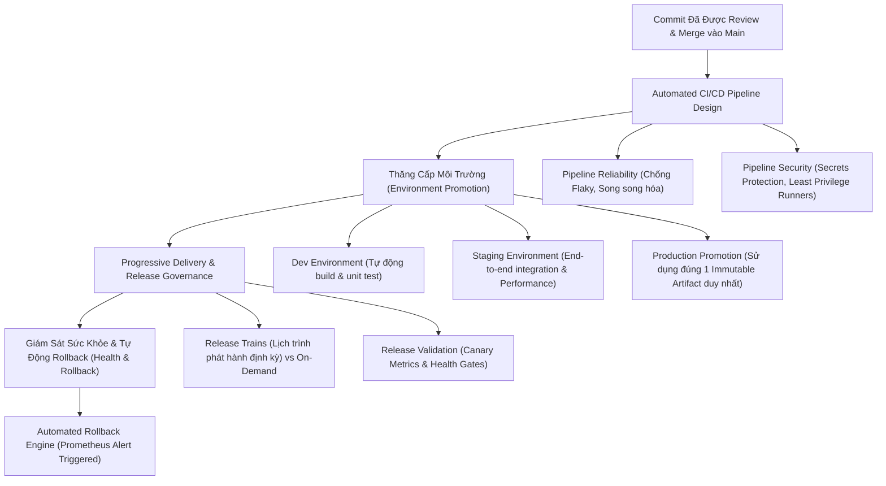
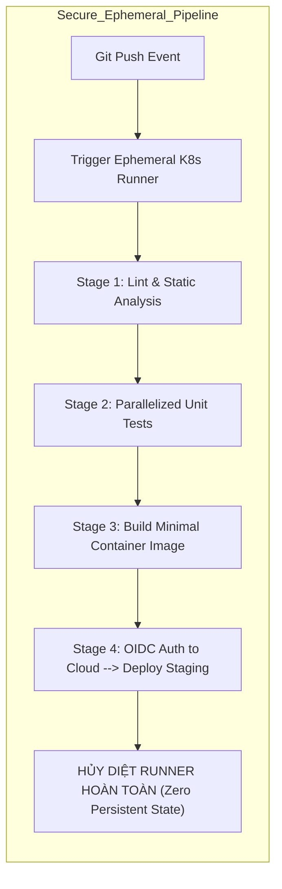
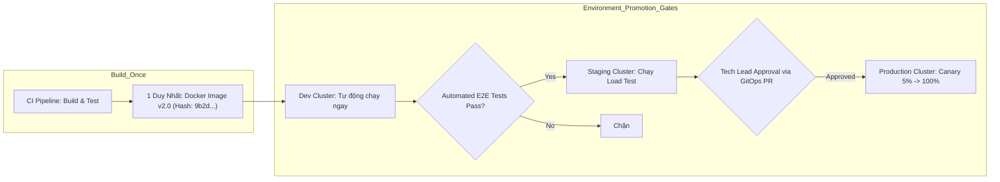
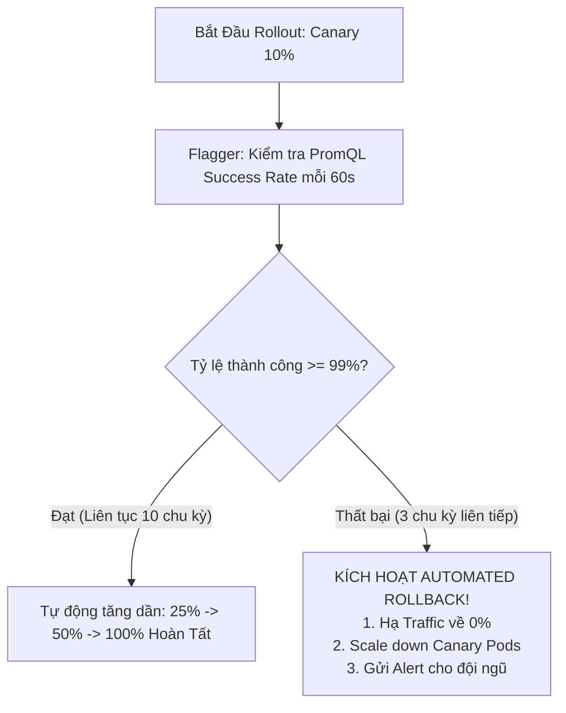

# 15.2. Chuyển Giao Liên Tục và Triển Khai Cấp Tiến (Continuous Delivery & Progressive Rollout)

## Tổng quan về Continuous Delivery & Progressive Rollout
Trong thế giới công nghệ phát triển với tốc độ chóng mặt, khả năng đưa một ý tưởng kinh doanh từ một dòng mã nguồn trên máy trạm của lập trình viên đến tận tay người dùng cuối trên production một cách an toàn, nhanh chóng và có thể lặp lại (**Continuous Delivery - CD**) là vũ khí cạnh tranh sống còn của doanh nghiệp. Sự khác biệt cốt lõi giữa **Continuous Delivery** (Mã nguồn luôn ở trạng thái sẵn sàng release nhưng cần nút bấm phê duyệt kinh doanh) và **Continuous Deployment** (Mọi commit vượt qua pipeline đều được tự động deploy thẳng lên production không cần con người can thiệp) phản ánh mức độ tự động hóa của tổ chức. Kỹ sư chuyên nghiệp thiết kế các đường ống phân phối (**CI/CD Pipelines**) với độ tin cậy và bảo mật tối đa, vận hành mô hình tàu phát hành (**Release Trains**), chuẩn hóa quy trình thăng cấp môi trường (**Environment Promotion: Dev $\rightarrow$ Staging $\rightarrow$ Prod**), và tích hợp giám sát sức khỏe release tự động (**Release Health Monitoring & Automated Rollback**).



---

## 2. Chi tiết từng Keyword (Under-the-Hood Deep Dive)

---

### 1. CI/CD Pipeline Design: Reliability, Security & Pipeline Optimization

#### 1. Khái niệm bản chất (What & Why)
* **CI/CD Pipeline Design (Thiết kế đường ống tích hợp và chuyển giao liên tục)**: Kiến trúc tự động hóa kết nối chuỗi các công đoạn: Tải mã nguồn $\rightarrow$ Linting $\rightarrow$ Biên dịch $\rightarrow$ Chạy Unit Test $\rightarrow$ Quét bảo mật (SAST/SCA) $\rightarrow$ Đóng gói Container $\rightarrow$ Chạy Integration Test $\rightarrow$ Triển khai hạ tầng.
* **Pipeline Reliability (Độ tin cậy của đường ống)**: Bản thân hệ thống CI/CD là một phần mềm phức tạp. Nếu pipeline thường xuyên bị sập vì máy chủ hết dung lượng đĩa, mạng chập chờn hoặc test chập chờn (Flaky), lập trình viên sẽ mất niềm tin và tìm cách lách qua các chốt kiểm duyệt.
* **Pipeline Security (Bảo mật đường ống CI/CD - OWASP Top 10 CI/CD Risks)**: Bảo vệ hệ thống CI/CD khỏi việc bị tin tặc biến thành bàn đạp tấn công. Các rủi ro hàng đầu: Lộ Secret trong log, Runner bị nhiễm mã độc, hoặc kẻ tấn công gửi Pull Request độc hại để đọc trộm biến môi trường (`GITHUB_TOKEN`).
* **Continuous Delivery vs Continuous Deployment**:
  - **Continuous Delivery**: Mã nguồn liên tục được kiểm thử và tích hợp, sẵn sàng deploy lên production bất kỳ lúc nào, nhưng quyết định phát hành cuối cùng thuộc về con người (Manual Approval Gate).
  - **Continuous Deployment**: 100% tự động hóa từ đầu đến cuối. Một khi commit vượt qua toàn bộ các bài test của pipeline, nó sẽ tự động chạy thẳng lên production phục vụ người dùng thực tế mà không cần con người bấm nút.

#### 2. Cơ chế hoạt động sâu (Under the hood / Hardcore Internals)
- **Bảo Mật Máy Chủ CI Bằng Ephemeral Runners & OIDC Identity**:
  - Không bao giờ sử dụng các máy chủ CI dùng chung lâu dài (Persistent Static Runners): Một job độc hại có thể cài trojan ngầm vào thư mục `/tmp` và lây nhiễm sang job của các dự án khác.
  - **Ephemeral Containers / K8s Job Runners**: Mỗi lần chạy một pipeline, hệ thống tự động khởi tạo một container hoàn toàn mới trong RAM. Khi pipeline kết thúc (Pass hoặc Fail), container đó bị hủy diệt hoàn toàn, xóa sạch mọi dấu vết.
  - Sử dụng **OIDC (OpenID Connect Federation)** thay vì lưu trữ vĩnh viễn khóa Cloud Credentials (`AWS_ACCESS_KEY_ID`):
    Máy chủ CI trao đổi OIDC token ngắn hạn (15 phút) với AWS STS (Security Token Service) để nhận quyền tạm thời qua vai trò IAM Role, triệt tiêu hoàn toàn rủi ro rò rỉ khóa bí mật dài hạn.

#### 3. Sơ đồ minh họa (Mermaid Diagram)


#### 4. Code ví dụ thực chiến (GitHub Actions Workflow: CI/CD Pipeline Chuẩn Mực Với OIDC và Least Privilege)
```yaml
name: Production Secure Delivery Pipeline

on:
  push:
    branches: [ main ]

# Nguyên tắc Least Privilege: Chỉ cấp quyền tối thiểu tuyệt đối cho token CI
permissions:
  id-token: write # Cần thiết cho xác thực OIDC không dùng password
  contents: read

jobs:
  test-and-build:
    runs-on: ubuntu-latest
    steps:
      - name: Checkout Code
        uses: actions/checkout@v4

      - name: Setup Compiler / Toolchain
        uses: actions/setup-node@v4
        with:
          node-version: 20
          cache: 'npm'

      - name: Chạy Kiểm Thử Tự Động (Quality Gate)
        run: |
          npm ci
          npm run test:coverage

      - name: Xác thực OIDC An Toàn Với AWS Đám Mây (Không lưu Secret dài hạn)
        uses: aws-actions/configure-aws-credentials@v4
        with:
          role-to-assume: arn:aws:iam::123456789012:role/GitHubActionsDeploymentRole
          aws-region: ap-southeast-1

      - name: Build và Ký Số Image Bằng Cosign
        run: |
          echo "Build & Đẩy hiện vật bất biến lên Production Registry..."
```

#### 5. Ưu / Nhược điểm, Pitfalls & Anti-patterns
- **Anti-pattern: "Rebuilding the Artifact for Each Environment"**: Biên dịch lại mã nguồn khi chuyển từ môi trường Staging sang Production (ví dụ: gõ `npm run build:staging` rồi lại gõ `npm run build:prod`). Điều này phá vỡ tính đảm bảo của kiểm thử: Mã nhị phân chạy trên Production KHÔNG PHẢI là mã nhị phân vừa được kiểm thử trên Staging! **Bắt buộc build đúng 1 hiện vật duy nhất và chỉ thay đổi file cấu hình môi trường**.

#### 6. Ứng dụng thực tế trong Backend / Systems
- **Quy trình Deployment tại GitHub**: Mỗi ngày GitHub triển khai hàng trăm lần trực tiếp lên production thông qua hệ thống ChatOps và Continuous Deployment tự động, mỗi lần deploy chỉ chứa từ 1 đến 3 commits nhỏ.

---

### 2. Environment Promotion, Release Trains & Progressive Governance

#### 1. Khái niệm bản chất (What & Why)
* **Environment Promotion (Thăng cấp môi trường)**: Quy trình chuyển dịch có kiểm soát của một hiện vật bất biến qua chuỗi các môi trường có mức độ tiệm cận thực tế tăng dần:
  $$\textbf{Dev} \quad \longrightarrow \quad \textbf{Staging} \quad \longrightarrow \quad \textbf{Canary} \quad \longrightarrow \quad \textbf{Production}$$
  Mỗi môi trường là một chốt chặn kiểm duyệt (Quality Gate): Chỉ khi hiện vật vượt qua bài kiểm tra ở môi trường trước thì nó mới được phép thăng cấp sang môi trường sau.
* **Release Trains (Mô hình tàu phát hành)**: Phương pháp phát hành phần mềm theo một lịch trình thời gian cố định và đều đặn (ví dụ: "Chuyến tàu release khởi hành vào đúng 10:00 sáng thứ Ba hàng tuần"):
  - Nếu tính năng của bạn đã hoàn thành và vượt qua toàn bộ test trước giờ tàu chạy $\implies$ Bạn được lên tàu.
  - Nếu tính năng chưa xong $\implies$ Bạn ở lại ga và chờ chuyến tàu tiếp theo vào tuần sau. Không bao giờ có chuyện "hoãn tàu" để chờ một tính năng đang code dở dang!
* **Release Governance & Approvals**: Các chính sách tuân thủ bắt buộc trong doanh nghiệp: Phê duyệt từ Compliance Officer, đối chiếu mã commit, kiểm toán thay đổi (Change Management Audit) để đáp ứng các tiêu chuẩn quốc tế (SOC2, ISO 27001).

#### 2. Cơ chế hoạt động sâu (Under the hood / Hardcore Internals)
- **Kiến Trúc GitOps trong Environment Promotion (ArgoCD / Flux)**:
  - Trong kỷ nguyên Cloud Native, việc thăng cấp môi trường không được thực hiện bằng cách chạy lệnh `kubectl apply` từ máy tính cá nhân.
  - Sử dụng triết lý **GitOps (Mọi trạng thái hạ tầng được khai báo trong Git)**:
    - Có một repo Git chuyên biệt: `infrastructure-config`.
    - Thư mục `environments/staging/values.yaml`: Khai báo `image:tag: v1.4.0-sha-a1b2`.
    - Khi Staging kiểm thử thành công, một bot tự động tạo Pull Request sửa file `environments/production/values.yaml` cập nhật tag lên `v1.4.0-sha-a1b2`.
    - Sau khi PR được Tech Lead bấm Approve $\implies$ **ArgoCD Controller** bên trong cụm Kubernetes tự động kéo trạng thái mới về và tiến hành đồng bộ hóa (Reconciliation Loop) Zero-Downtime!

#### 3. Sơ đồ minh họa (Mermaid Diagram)


#### 4. Code ví dụ thực chiến (YAML: GitOps ArgoCD Application Thăng Cấp Môi Trường)
```yaml
apiVersion: argoproj.io/v1alpha1
kind: Application
metadata:
  name: order-service-production
  namespace: argocd
spec:
  project: default
  source:
    repoURL: 'https://github.com/mycompany/infrastructure-fleet.git'
    targetRevision: main
    path: environments/production/order-service # Khai báo trạng thái Production trong Git
  destination:
    server: 'https://kubernetes.default.svc'
    namespace: production
  syncPolicy:
    automated:
      prune: true
      selfHeal: true # Tự động sửa chữa nếu có ai chỉnh sửa thủ công trên cụm K8s
    syncOptions:
      - CreateNamespace=true
```

#### 5. Ưu / Nhược điểm, Pitfalls & Anti-patterns
- **Anti-pattern: "Snowflake Environments" (Môi trường bông tuyết)**: Môi trường Staging và Production có cấu hình phần cứng, phiên bản database và hệ điều hành hoàn toàn khác nhau. Kết quả: Chạy thử nghiệm trên Staging rất tốt nhưng vừa deploy lên Production là bị lỗi sập mạng ngay lập tức. Luôn sử dụng **Infrastructure as Code (Terraform)** để bảo đảm tính đồng nhất giữa các môi trường.

#### 6. Ứng dụng thực tế trong Backend / Systems
- **Release Trains tại Spotify & Meta**: Toàn bộ ứng dụng di động và hệ thống backend của Spotify vận hành theo lịch trình Release Train hàng tuần nghiêm ngặt, loại bỏ hoàn toàn các cuộc tranh luận căng thẳng về việc "khi nào nên phát hành".

---

### 3. Automated Rollback & Release Health Monitoring

#### 1. Khái niệm bản chất (What & Why)
* **Release Health Monitoring (Giám sát sức khỏe bản phát hành)**: Việc theo dõi liên tục và tự động các chỉ số vận hành quan trọng (SLIs: Tỷ lệ lỗi $5xx$, Độ trễ p99, Mức tiêu hao CPU/RAM, Tỷ lệ Crash của app) trong suốt quá trình và ngay sau khi bản release mới vừa được triển khai.
* **Automated Rollback (Tự động đảo ngược)**: Cơ chế kỹ thuật tự động hoàn tác hệ thống về phiên bản ổn định trước đó mà **hoàn toàn không cần sự can thiệp của con người**, ngay khi các chỉ số sức khỏe của bản release mới bị suy giảm vượt quá ngưỡng cho phép.
* **Analysis Windows & Health Gates**: Khoảng thời gian theo dõi bắt buộc (ví dụ: Đứng yên ở mức Canary 10% trong vòng 15 phút). Nếu trong 15 phút đó không có bất kỳ vi phạm SLO nào xảy ra, hệ thống mới tự động thăng cấp lên 25%.

#### 2. Cơ chế hoạt động sâu (Under the hood / Hardcore Internals)
- **Thuật Toán Đánh Giá Sức Khỏe Tự Động của Flagger & Prometheus**:
  - Trong quá trình Canary Rollout, Flagger (Kubernetes Progressive Delivery Operator) thực thi các truy vấn PromQL định kỳ mỗi $1\text{ phút}$:
    ```promql
    # Đo tỷ lệ thành công của phiên bản Canary v2
    sum(rate(http_requests_total{app="order-service-canary", status!~"5.."}[1m])) 
    / 
    sum(rate(http_requests_total{app="order-service-canary"}[1m])) * 100
    ```
  - Nếu giá trị trả về $< 99.0\%$ (tỷ lệ lỗi $> 1\%$):
    1. Flagger ghi nhận một lần vi phạm (**Failed Check: 1/3**).
    2. Nếu số lần vi phạm liên tiếp đạt ngưỡng cấu hình (ví dụ: **3 lần liên tiếp**):
    3. Flagger lập tức gửi lệnh tới Service Mesh: **Hạ tỷ lệ traffic của Canary về $0\%$ tức thì**!
    4. Gửi thông báo cảnh báo khẩn cấp tới kênh Slack: *"Phát hiện lỗi trên bản Canary v2.1! Đã kích hoạt Automated Rollback thành công trong 10 giây!"*.

#### 3. Sơ đồ minh họa (Mermaid Diagram)


#### 4. Code ví dụ thực chiến (YAML: Cấu hình Kubernetes Flagger Tự Động Rollback Dựa Trên Metrics)
```yaml
apiVersion: flagger.app/v1beta1
kind: Canary
metadata:
  name: order-service
  namespace: production
spec:
  targetRef:
    apiVersion: apps/v1
    kind: Deployment
    name: order-service
  service:
    port: 8080
  analysis:
    interval: 1m      # Đánh giá metrics mỗi 1 phút
    threshold: 3     # Cho phép tối đa 3 lần check fail trước khi ROLLBACK
    maxWeight: 50     # Mức canary tối đa trước khi thăng cấp hoàn toàn
    stepWeight: 10    # Mỗi bước tăng 10% traffic
    metrics:
      - name: request-success-rate
        thresholdRange:
          min: 99.0   # Tỷ lệ thành công tối thiểu phải là 99.0%
        interval: 1m
      - name: request-duration
        thresholdRange:
          max: 250    # Độ trễ p99 tối đa cho phép là 250ms
        interval: 1m
```

#### 5. Ưu / Nhược điểm, Pitfalls & Anti-patterns
- **Anti-pattern: "Manual Rollback by Re-running CI"**: Khi production bị lỗi, kỹ sư phải tìm lại commit cũ, bấm trigger build lại từ đầu mất 25 phút. Trong khi đó khách hàng đang bị gián đoạn giao dịch. Một quy trình CD chuẩn phải hỗ trợ **Instant Rollback dưới 30 giây** bằng cách trỏ lại vào Container Image bất biến cũ đã có sẵn trên Registry.

#### 6. Ứng dụng thực tế trong Backend / Systems
- **Hệ thống Triển khai Apollo tại Meta**: Tự động phát hiện lỗi hồi quy về thời lượng pin hoặc độ trễ của ứng dụng di động và tự động dừng (halt) hoặc rollback các bản rollout trên quy mô hàng tỷ thiết bị mà không cần con người can thiệp.

---

## Tổng kết Chương 15.2
Chuyển giao liên tục và triển khai cấp tiến là đỉnh cao của sự trưởng thành về năng lực tự động hóa trong kỹ nghệ phần mềm. Bằng cách thiết kế các đường ống CI/CD bền bỉ và bảo mật bằng danh tính OIDC, thăng cấp hiện vật bất biến qua chuỗi môi trường chuẩn hóa bằng triết lý GitOps, và trao quyền cho các hệ thống giám sát tự động kích hoạt Rollback khi có bất thường, người kỹ sư giải phóng tổ chức khỏi nỗi sợ hãi mỗi khi release và tạo ra một cỗ máy chuyển giao giá trị kinh doanh với tốc độ ánh sáng.
