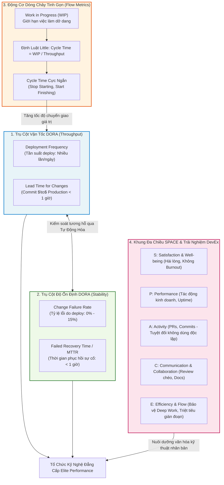
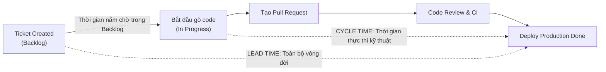

# 16.1. Khung Đo Lường Hiệu Suất Kỹ Nghệ: DORA, SPACE và Dòng Chảy Giá Trị (Productivity Frameworks: DORA, SPACE & Flow Metrics)

> [!IMPORTANT]
> **Nếu bạn chỉ được nhớ một điều duy nhất:** Đo lường sai lầm sẽ phá hủy văn hóa kỹ thuật (Định luật Goodhart: *"Khi một thước đo trở thành mục tiêu, nó không còn là một thước đo tốt nữa"*) — **năng suất kỹ nghệ chân chính không đo bằng số dòng code hay số commit, mà được định hình bởi Bộ tứ chỉ số DORA (cân bằng hoàn hảo giữa Vận tốc và Độ ổn định), Khung đa chiều SPACE (nhân bản và toàn diện), và Các chỉ số dòng chảy tinh gọn Flow Metrics (siết chặt giới hạn WIP theo Định luật Little để tối ưu hóa thời gian chu kỳ Cycle Time)**.

---

## 1. Kiến trúc Tổng quan & Mô hình Tư duy (Mental Model)

### Ẩn dụ Thực tế: Bảng Điều Khiển Viễn Trắc Đội Đua F1 & Hệ Thống Giao Thông Cao Tốc
Hãy hình dung việc đo lường năng lực của một tổ chức kỹ nghệ phần mềm tương tự như việc quản lý một đội đua xe Công thức 1 (F1) hoặc vận hành một tuyến đường cao tốc thông minh:
- **Thước đo ngây thơ thế kỷ trước (Đếm số lần đạp chân ga)**: Đánh giá một kỹ sư bằng "Số dòng code viết ra (LOC)" hoặc "Số lượng ticket đã đóng" cũng nực cười như việc trao cúp cho tay đua F1 nào "nhấn chân ga nhiều lần nhất trong một vòng đua". Kỹ sư có thể copy-paste code rác vô nghĩa để tăng LOC, hoặc bẻ nhỏ một công việc đơn giản thành hàng chục ticket rỗng (Gaming the metrics). Thực tế, một kỹ sư xuất sắc nhất thường là người **xóa bỏ 2,000 dòng code phức tạp**, thay thế bằng một hàm thuật toán 20 dòng thanh lịch và ổn định.
- **Bộ tứ DORA (**DORA Metrics - Vận tốc & Phanh an toàn của xe F1**)**:
  - *Deployment Frequency (Tần suất sang số & nhịp tim động cơ)*: Xe sang số liên tục, mượt mà trên đường đua (deploy nhiều lần mỗi ngày theo lô nhỏ).
  - *Lead Time for Changes (Thời gian phản hồi chân ga)*: Từ lúc người lái đạp ga đến lúc xe vút đi (từ lúc commit code đến khi chạy trên production dưới 1 giờ).
  - *Change Failure Rate - CFR (Tỷ lệ xe bị mất lái hoặc nổ lốp)*: Tỷ lệ các lần tăng tốc gây ra tai nạn (tỷ lệ deploy gây lỗi).
  - *Failed Deployment Recovery Time / MTTR (Thời gian đội cứu hộ kéo xe trở lại cuộc đua)*: Khi xe bị trượt bánh, đội kỹ thuật mất bao nhiêu phút để đưa xe tiếp tục thi đấu (khôi phục hệ thống qua automated rollback)?
- **Dòng chảy tinh gọn & Định luật Little (**Flow Metrics & Tuyến cao tốc không kẹt xe**)**:
  - Một tuyến đường cao tốc có 100 chiếc xe chạy ở vận tốc $100\text{ km/h}$ sẽ thông thoáng. Nhưng nếu bạn cố nhét thêm 1,000 chiếc xe vào cùng một lúc (**Work In Progress - WIP cao**), tuyến đường sẽ kẹt cứng và vận tốc di chuyển tụt về $0\text{ km/h}$ (**Cycle Time tăng vọt**). Để xe chạy nhanh nhất, giải pháp không phải là xây thêm làn xe tốn kém, mà là **đặt rào chắn giới hạn số lượng xe được vào cao tốc cùng lúc (WIP Limits)**!



---

## 2. Chi tiết từng Keyword (Under-the-Hood Deep Dive)

### 2.1. The Engineering Productivity Paradox & Goodhart's Law (Fallacy of LOC and Ticket Counting)
- **Nghịch lý đo lường năng suất (Productivity Paradox)**: Năng suất của người làm việc trí óc (Knowledge Worker) không tuân theo quy luật dây chuyền sản xuất cơ bắp của thời đại công nghiệp. Trong sản xuất xe hơi, làm ra 100 chiếc xe tốt hơn 10 chiếc. Nhưng trong phần mềm, viết thêm 10,000 dòng code thường đồng nghĩa với việc tạo ra thêm nợ kỹ thuật (Technical Debt), tăng chi phí bảo trì và sinh thêm bề mặt lỗi.
- **Định luật Goodhart (Goodhart's Law)**: *"Khi một thước đo trở thành mục tiêu, nó sẽ không còn là một thước đo tốt nữa"*.
  - Nếu chọn số dòng code (LOC) làm KPI: Lập trình viên sẽ viết những câu lệnh `if-else` dài dòng, lặp code và thêm comment rác.
  - Nếu chọn số bug sửa được: Lập trình viên sẽ thỏa hiệp ngầm với tester để tạo ra các bug ngớ ngẩn rồi tự tay đóng lại để nhận thưởng.
  - Nếu chọn số Pull Requests: Lập trình viên sẽ bẻ 1 dòng code sửa lỗi chính tả thành 5 PRs riêng biệt.
- **Quy tắc vàng**: Không bao giờ sử dụng một thước đo đơn lẻ để đánh giá một kỹ sư. Mọi hệ số đo lường phải được thiết kế theo cặp cân bằng (Paired Metrics).

### 2.2. The DORA Golden Metrics: Throughput & Stability in Equilibrium
- **Nguồn gốc khoa học**: Bộ chỉ số DORA được nghiên cứu và kiểm chứng bởi Tiến sĩ **Nicole Forsgren**, **Jez Humble** và **Gene Kim** thông qua khảo sát thực nghiệm trên hơn $32,000$ tổ chức toàn cầu suốt gần một thập kỷ (tập hợp trong cuốn sách kinh điển *Accelerate* và báo cáo *State of DevOps* của Google Cloud).
- **Phát hiện chấn động bác bỏ quan niệm cổ điển**:
  - *Quan niệm sai lầm*: "Muốn hệ thống ổn định và ít lỗi thì phải đi thật chậm, phải tổ chức họp Change Advisory Board (CAB) hàng tuần và kiểm thử thủ công cả tháng!".
  - *Sự thật khoa học*: **Các tổ chức dẫn đầu thế giới (Elite Performers) có tốc độ phân phối nhanh hơn gấp 200 lần, đồng thời có tỷ lệ lỗi thấp hơn 3 lần và khôi phục sự cố nhanh hơn gấp 1,000 lần** so với các tổ chức chậm chạp.
  - *Lý do*: Tốc độ cao đạt được nhờ chia nhỏ kích thước lô hàng (Batch Size) và tự động hóa toàn diện CI/CD. Lô hàng càng nhỏ thì rủi ro càng thấp, review càng kỹ và rollback càng tức thì.

### 2.3. Deep Dive into the 4 DORA Dimensions (DF, LTFC, CFR, MTTR) & Global Benchmarks
1. **Deployment Frequency (DF - Tần suất triển khai - Băng thông)**:
   - Tần suất các đợt phát hành mã nguồn thành công lên môi trường Production thực tế. Phản ánh nhịp đập chuyển giao giá trị của tổ chức.
2. **Lead Time for Changes (LTFC - Thời gian chuyển giao thay đổi - Vận tốc)**:
   - Khoảng thời gian từ khi commit đầu tiên được tạo ra trên Git cho đến khi đoạn mã đó chính thức chạy phục vụ người dùng trên Production. Bao gồm: Coding time $\to$ PR Review time $\to$ CI Pipeline time $\to$ Deployment time.
3. **Change Failure Rate (CFR - Tỷ lệ thay đổi gây lỗi - Độ ổn định)**:
   - Tỷ lệ phần trăm các lần triển khai lên Production dẫn đến sự cố suy giảm dịch vụ nghiêm trọng cần can thiệp khẩn cấp (Rollback, Hotfix, Outage):
     $$\text{CFR} = \frac{\text{Số lần Deploy gây sự cố Production}}{\text{Tổng số lần Deploy trong kỳ}} \times 100\%$$
4. **Failed Deployment Recovery Time / MTTR (Thời gian khôi phục triển khai hỏng - Phục hồi)**:
   - Khoảng thời gian từ lúc sự cố do deploy được phát hiện cho tới khi dịch vụ được phục hồi trở lại trạng thái bình thường (thông qua Automated Rollback, Feature Flags hoặc Blue/Green Traffic Switching).

#### Bảng Tiêu Chuẩn Năng Lực DORA Toàn Cầu (State of DevOps Report)

| Chỉ Số DORA | Elite Performers | High Performers | Medium Performers | Low Performers |
| :--- | :---: | :---: | :---: | :---: |
| **Deployment Frequency** | **Theo yêu cầu (Nhiều lần/ngày)** | 1 lần/tuần đến 1 lần/tháng | 1 lần/tháng đến 6 tháng | Ít hơn 1 lần/6 tháng |
| **Lead Time for Changes** | **$< 1$ Giờ** | 1 ngày đến 1 tuần | 1 tuần đến 1 tháng | 1 tháng đến 6 tháng |
| **Change Failure Rate** | **$0\% - 15\%$** | $16\% - 30\%$ | $16\% - 30\%$ | $46\% - 60\%$ |
| **Recovery Time (MTTR)** | **$< 1$ Giờ** | Dưới 1 ngày | Dưới 1 ngày | Hơn 1 tuần đến 1 tháng |

### 2.4. The SPACE Framework: A Multidimensional & Human-Centric Paradigm
- **Nguồn gốc**: Đề xuất năm 2021 bởi Nicole Forsgren (GitHub), Margaret-Anne Storey (University of Victoria) và các nhà nghiên cứu Microsoft Research để bổ khuyết cho DORA: Đưa con người và sức khỏe tinh thần vào trọng tâm của phương trình năng suất.
- **Năm chiều không gian (SPACE Dimensions)**:
  1. **S - Satisfaction and Well-being (Hài lòng & Sức khỏe tinh thần)**: Đo lường mức độ hạnh phúc của kỹ sư đối với công cụ, quy trình làm việc và mức độ cân bằng cuộc sống (Burnout check, eNPS).
  2. **P - Performance (Kết quả & Tác động kinh doanh)**: Đánh giá chất lượng của sản phẩm được tạo ra thay vì chỉ đếm khối lượng (Độ tin cậy của dịch vụ, Customer Adoption, SLA/SLO).
  3. **A - Activity (Hoạt động kỹ thuật)**: Đếm các thao tác định lượng (Số PRs đã merge, số lần review code, số commits). *Quy tắc: Không bao giờ dùng riêng Activity để phán xét cá nhân!*.
  4. **C - Communication and Collaboration (Giao tiếp & Cộng tác)**: Đánh giá tốc độ và chất lượng của sự kết nối giữa các thành viên (Thời gian chờ review PR, mức độ đóng góp tài liệu RFC, chất lượng tri thức chia sẻ).
  5. **E - Efficiency and Flow (Hiệu quả & Trạng thái dòng chảy)**: Khả năng làm việc liền mạch của kỹ sư với ít điểm nghẽn, ít cuộc họp gián đoạn nhất có thể.

### 2.5. Developer Experience (DevEx) & Feedback Loops
- **Bản chất kỹ thuật**: Trải nghiệm nhà phát triển (**DevEx**) là cảm xúc và nhận thức tổng thể của kỹ sư khi tương tác với hệ thống công cụ, quy trình và môi trường kỹ thuật nội bộ của công ty.
- **Ba trụ cột cốt lõi của DevEx**:
  1. **Fast Feedback Loops (Vòng lặp phản hồi siêu tốc)**:
     - Khi sửa 1 dòng code: Local build và hot-reload phải phản hồi trong $2 - 5\text{ giây}$.
     - Khi chạy Unit Test: Phản hồi trong dưới $30\text{ giây}$.
     - Khi đẩy PR: CI Pipeline phải hoàn tất trong dưới $10\text{ phút}$.
     - Nếu một vòng lặp phản hồi kéo dài $45\text{ phút}$, kỹ sư sẽ mở mạng xã hội hoặc chuyển sang việc khác, phá vỡ hoàn toàn sự tập trung.
  2. **Reduced Cognitive Load (Giảm thiểu tải nhận thức)**.
  3. **Flow State Preservation (Bảo tồn trạng thái dòng chảy)**.

### 2.6. Developer Cognitive Load & Team Topologies (Intrinsic, Extraneous, Germane)
- **Lý thuyết tải nhận thức (Cognitive Load Theory áp dụng vào Kỹ nghệ phần mềm)**:
  - Não bộ con người có dung lượng bộ nhớ làm việc (Working Memory) hữu hạn. Khi quá tải nhận thức xảy ra, kỹ sư sẽ mệt mỏi, dễ mắc lỗi logic ngớ ngẩn và chậm chạp.
- **Ba loại tải nhận thức**:
  1. **Intrinsic Cognitive Load (Tải nội tại)**: Năng lượng cần thiết để nắm bắt bản chất của bài toán nghiệp vụ (ví dụ: cách tính lãi suất ngân hàng phức tạp). Đây là tải có ích, không thể loại bỏ.
  2. **Extraneous Cognitive Load (Tải ngoại lai / Tạp âm kỹ thuật)**: Năng lượng bị lãng phí vào các cấu hình rườm rà, thủ tục hành chính, công cụ CI khó dùng, quy trình deploy 40 bước thủ công, hệ thống tài liệu lỗi thời. **Mục tiêu của Platform Engineering là đưa tải ngoại lai này về mức $0$!**.
  3. **Germane Cognitive Load (Tải kiến tạo)**: Năng lượng dành cho việc tư duy trừu tượng, thiết kế mẫu kiến trúc sạch (Design Patterns) và tái cấu trúc mã nguồn để hệ thống bền vững.

### 2.7. Deep Work, Context Switching Cost & Flow State Preservation
- **Chi phí đắt đỏ của sự chuyển đổi ngữ cảnh (Context Switching Cost)**:
  - Khi một kỹ sư đang đắm chìm trong trạng thái tập trung sâu (**Flow State / Deep Work**), toàn bộ cây kiến trúc của bài toán được nạp đầy vào RAM của não bộ.
  - Nghiên cứu của **Đại học California, Irvine (Gloria Mark)** chỉ ra rằng: Khi bị gián đoạn bởi một câu hỏi vu vơ trên Slack hoặc một cuộc họp bất thình lình, kỹ sư mất trung bình **$23\text{ phút và 15 giây}$** chỉ để đưa não bộ quay trở lại trạng thái tập trung ban đầu!
  - Nếu một ngày làm việc bị băm vụn bởi 5 cuộc họp xen kẽ mỗi 30 phút, kỹ sư sẽ rơi vào trạng thái "Tê liệt nhận thức" (Cognitive Fragmentation) và không thể viết được bất kỳ dòng code cốt lõi nào.
- **Giải pháp thực chiến**:
  - Thiết lập quy chế **"Focus Wednesdays" (Thứ Tư không họp)**.
  - Gom toàn bộ các cuộc họp vào một buổi chiều duy nhất trong tuần để bảo vệ các khối thời gian $3 - 4\text{ giờ}$ liên tục cho Deep Work.

### 2.8. Lean Flow Metrics: Lead Time vs. Cycle Time Breakdown
- **Bắt nguồn từ Hệ thống sản xuất Toyota (TPS / Kanban)**: Quản lý dòng chảy giá trị (Value Stream Mapping) nhằm loại bỏ sự lãng phí (Waste / Muda) trong quá trình sản xuất phần mềm.
- **Phân định ranh giới then chốt**:
  - **Lead Time (Thời gian từ đầu đến cuối)**: Khoảng thời gian từ lúc ý tưởng hoặc ticket được khách hàng/Product Manager tạo ra (Ticket Created) cho tới khi tính năng được bàn giao xong trên Production. Nó bao gồm cả **thời gian ticket nằm chờ chết trong Backlog** hàng tháng trời.
  - **Cycle Time (Thời gian chu kỳ thực thi)**: Khoảng thời gian từ lúc kỹ sư thực sự kéo ticket sang trạng thái `In Progress` (bắt đầu gõ code) cho tới khi tính năng chạy trên Production.
  - *Ý nghĩa phân tích*: Nếu Lead Time là 60 ngày nhưng Cycle Time chỉ có 3 ngày, điều đó chứng minh vấn đề chậm trễ không nằm ở năng lực của đội ngũ kỹ sư, mà nằm ở **hàng đợi phê duyệt sản phẩm của ban quản lý (Upstream Bottleneck)**!



### 2.9. Little's Law & The Mathematical Power of WIP Limits
- **Định luật Little (John Little - Viện Công nghệ MIT, 1961)**:
  $$W = \frac{L}{\lambda} \quad \Longleftrightarrow \quad \text{Cycle Time} = \frac{\text{Work in Progress (WIP)}}{\text{Throughput}}$$
  Trong đó:
  - $\text{Cycle Time}$: Thời gian trung bình để hoàn thành một nhiệm vụ.
  - $\text{WIP}$: Số lượng nhiệm vụ đang làm dở dang trong cùng một thời điểm.
  - $\text{Throughput}$: Số lượng nhiệm vụ hoàn thành trong một đơn vị thời gian.
- **Hệ quả kỹ thuật mang tính cách mạng**:
  - Nếu Throughput của nhóm là cố định (ví dụ: nhóm giải quyết được $5\text{ tasks/tuần}$):
    - Khi nhóm nhận cùng lúc 25 tasks dở dang ($\text{WIP} = 25$): $\text{Cycle Time} = \frac{25}{5} = \mathbf{5\text{ tuần}}$! (Kỹ sư liên tục nhảy việc, task bị nghẽn ở review, chất lượng thảm hại).
    - Khi nhóm siết chặt kỷ luật Kanban, đặt giới hạn $\text{WIP} = 5$: $\text{Cycle Time} = \frac{5}{5} = \mathbf{1\text{ tuần}}$! (Nhanh gấp 5 lần mà không cần tuyển thêm một nhân sự nào!).
  - **Triết lý Kanban cốt lõi**: *"Stop Starting, Start Finishing"* (Dừng bắt đầu việc mới, tập trung kết thúc dứt điểm việc cũ).

### 2.10. Work Item Aging & Bottleneck Elimination in Kanban Systems
- **Work Item Aging (Tuổi thọ của hạng mục công việc)**: Số ngày một nhiệm vụ đã trôi qua kể từ khi nó được bắt đầu làm mà vẫn chưa thể hoàn thành.
- **Tại sao Work Item Aging là chỉ số dự báo quan trọng nhất trong Daily Standup?**:
  - Thay vì hỏi nhau câu hỏi nhàm chán: *"Hôm qua làm gì, hôm nay làm gì?"*, nhóm tập trung nhìn vào biểu đồ Work Item Aging:
  - Nếu một task có thời gian Cycle Time trung bình là 3 ngày nhưng hiện tại đã bước sang ngày thứ 8 mà vẫn kẹt ở cột `Code Review`, nhóm lập tức nhận diện đây là một điểm tắc nghẽn (Bottleneck). Toàn đội dừng việc đang làm để hỗ trợ review và thông luồng cho task đó ngay trong ngày.

---

## 3. Thực thi Mã nguồn & Mô phỏng Chuyên sâu (Dual-Engine Implementation)

### 3.1. Phiên bản C++20: Bộ Tính Toán Chỉ Số Vàng DORA & Mô Phỏng Định Luật Little (DORA Engine & Queuing Dynamics)

Chương trình minh họa đầy đủ:
1. **DORA Metrics Engine**: Phân tích lịch sử triển khai và sự cố, tính toán 4 chỉ số DF, LTFC, CFR, MTTR và tự động phân loại cấp độ tổ chức (Elite, High, Medium, Low).
2. **Little's Law Simulation Engine**: Mô phỏng sự khác biệt kinh ngạc về thời gian chu kỳ (Cycle Time) giữa một nhóm làm việc theo cảm tính (High WIP) và một nhóm áp dụng kỷ luật Kanban nghiêm ngặt (WIP Limits).

```cpp
#include <iostream>
#include <string>
#include <string_view>
#include <vector>
#include <numeric>
#include <chrono>
#include <format>
#include <iomanip>

// ============================================================================
// PHẦN 1: BỘ PHÂN TÍCH CHỈ SỐ VÀNG DORA (DORA METRICS ANALYZER)
// ============================================================================

enum class DoraTier {
    ELITE,
    HIGH,
    MEDIUM,
    LOW
};

struct DeploymentEvent {
    std::string deploymentId;
    double leadTimeHours;      // Thời gian từ commit đầu đến khi deploy prod
    bool isFailure;            // Có gây sự cố sập dịch vụ không?
    double recoveryTimeHours;  // Thời gian khắc phục sự cố (MTTR)
};

class DoraMetricsAnalyzer {
private:
    std::vector<DeploymentEvent> history_;

public:
    void recordDeployment(DeploymentEvent event) {
        history_.push_back(std::move(event));
    }

    [[nodiscard]] double calculateDeploymentFrequencyPerDay(int windowDays) const {
        if (windowDays <= 0) return 0.0;
        return static_cast<double>(history_.size()) / windowDays;
    }

    [[nodiscard]] double calculateAverageLeadTimeHours() const {
        if (history_.empty()) return 0.0;
        double sum = std::accumulate(history_.begin(), history_.end(), 0.0,
            [](double acc, const DeploymentEvent& e) { return acc + e.leadTimeHours; });
        return sum / history_.size();
    }

    [[nodiscard]] double calculateChangeFailureRatePercent() const {
        if (history_.empty()) return 0.0;
        size_t failCount = 0;
        for (const auto& e : history_) {
            if (e.isFailure) failCount++;
        }
        return (static_cast<double>(failCount) / history_.size()) * 100.0;
    }

    [[nodiscard]] double calculateMTTRHours() const {
        double totalRecovery = 0.0;
        size_t failCount = 0;
        for (const auto& e : history_) {
            if (e.isFailure) {
                totalRecovery += e.recoveryTimeHours;
                failCount++;
            }
        }
        return (failCount == 0) ? 0.0 : (totalRecovery / failCount);
    }

    [[nodiscard]] DoraTier evaluateTier(int windowDays) const {
        double df = calculateDeploymentFrequencyPerDay(windowDays);
        double lt = calculateAverageLeadTimeHours();
        double cfr = calculateChangeFailureRatePercent();
        double mttr = calculateMTTRHours();

        // Tiêu chuẩn Elite: DF >= 1/ngày, LT <= 1h, CFR <= 15%, MTTR <= 1h
        if (df >= 1.0 && lt <= 1.0 && cfr <= 15.0 && mttr <= 1.0) {
            return DoraTier::ELITE;
        }
        if (df >= 0.2 && lt <= 168.0 && cfr <= 30.0 && mttr <= 24.0) {
            return DoraTier::HIGH;
        }
        if (cfr <= 30.0 && mttr <= 168.0) {
            return DoraTier::MEDIUM;
        }
        return DoraTier::LOW;
    }

    static std::string_view tierToString(DoraTier tier) {
        switch (tier) {
            case DoraTier::ELITE:  return "ELITE PERFORMER (Đẳng Cấp Thế Giới)";
            case DoraTier::HIGH:   return "HIGH PERFORMER (Năng Lực Cao)";
            case DoraTier::MEDIUM: return "MEDIUM PERFORMER (Trung Bình)";
            case DoraTier::LOW:    return "LOW PERFORMER (Cần Cải Tổ Khẩn Cấp)";
        }
        return "UNKNOWN";
    }
};

// ============================================================================
// PHẦN 2: MÔ PHỎNG ĐỊNH LUẬT LITTLE & HỆ THỐNG DÒNG CHẢY KANBAN
// ============================================================================

class LittleLawSimulator {
public:
    static double calculateCycleTime(int workInProgress, double throughputPerDay) {
        if (throughputPerDay <= 0.0) return 0.0;
        // Cycle Time = WIP / Throughput
        return static_cast<double>(workInProgress) / throughputPerDay;
    }

    static void simulateComparison(double teamThroughputPerDay) {
        std::cout << "\n--- MÔ PHỎNG ĐỊNH LUẬT LITTLE (CYCLE TIME = WIP / THROUGHPUT) ---\n";
        std::cout << std::format("Năng lực thông lượng của nhóm: {:.1f} tasks hoàn thành / ngày\n\n", teamThroughputPerDay);

        int highWip = 24; // Nhóm nhận quá nhiều việc dở dang (Multitasking vô tội vạ)
        int lowWip = 4;   // Nhóm siết chặt giới hạn WIP Limits (Kỷ luật Kanban)

        double cycleTimeHigh = calculateCycleTime(highWip, teamThroughputPerDay);
        double cycleTimeLow = calculateCycleTime(lowWip, teamThroughputPerDay);

        std::cout << std::format("  * Kịch bản 1 (Vô Kỷ Luật - WIP = {}): Cycle Time = {:.1f} ngày ({:.1f} tuần)\n", 
                                 highWip, cycleTimeHigh, cycleTimeHigh / 5.0);
        std::cout << "    -> Hệ quả: Kỹ sư bị phân mảnh não bộ, task kẹt nghẽn ở khâu review hàng tuần.\n\n";

        std::cout << std::format("  * Kịch bản 2 (Kanban WIP Limits = {}): Cycle Time = {:.1f} ngày\n", 
                                 lowWip, cycleTimeLow);
        std::cout << "    -> Hệ quả: Cả nhóm tập trung dứt điểm từng task ('Stop Starting, Start Finishing').\n";
        std::cout << std::format("    -> TỐC ĐỘ GIAO HÀNG TĂNG GẤP: {:.1f} LẦN!\n", cycleTimeHigh / cycleTimeLow);
    }
};

int main() {
    std::cout << "===================================================================\n";
    std::cout << "  DEMO C++20: DORA GOLDEN METRICS ANALYZER & LITTLE'S LAW FLOW     \n";
    std::cout << "===================================================================\n\n";

    DoraMetricsAnalyzer analyzer;
    int windowDays = 14;

    // Giả lập 28 lượt deploy trong 14 ngày của một đội ngũ kỹ nghệ hiện đại (2 lần/ngày)
    for (int i = 1; i <= 28; ++i) {
        bool failed = (i == 9 || i == 21); // Chỉ có 2 lần bị sự cố rollback (CFR = 7.1%)
        double recovery = failed ? 0.35 : 0.0; // Khôi phục trong 21 phút (0.35h) nhờ Automated Rollback
        analyzer.recordDeployment({
            .deploymentId = std::format("deploy-sha-{:04d}", i),
            .leadTimeHours = 0.55, // Trung bình 33 phút từ lúc commit đến khi lên Production
            .isFailure = failed,
            .recoveryTimeHours = recovery
        });
    }

    double df = analyzer.calculateDeploymentFrequencyPerDay(windowDays);
    double lt = analyzer.calculateAverageLeadTimeHours();
    double cfr = analyzer.calculateChangeFailureRatePercent();
    double mttr = analyzer.calculateMTTRHours();
    DoraTier tier = analyzer.evaluateTier(windowDays);

    std::cout << std::format("=== BÁO CÁO NĂNG LỰC DORA ({0} NGÀY QUA) ===\n", windowDays);
    std::cout << std::format("1. Deployment Frequency : {:.2f} deploys / ngày (Tổng: 28 deploys)\n", df);
    std::cout << std::format("2. Lead Time for Changes: {:.2f} giờ ({:.1f} phút)\n", lt, lt * 60.0);
    std::cout << std::format("3. Change Failure Rate  : {:.1f}%\n", cfr);
    std::cout << std::format("4. MTTR / Recovery Time : {:.2f} giờ ({:.1f} phút)\n", mttr, mttr * 60.0);
    std::cout << "-------------------------------------------------------------------\n";
    std::cout << std::format("XẾP HẠNG TỔ CHỨC        : {}\n", DoraMetricsAnalyzer::tierToString(tier));
    std::cout << "===================================================================\n";

    // Chạy mô phỏng Little's Law
    LittleLawSimulator::simulateComparison(2.0);
    std::cout << "===================================================================\n";

    return 0;
}
```

---

### 3.2. Phiên bản Python 3.11+: Bộ Đo Lường Ma Sát Trải Nghiệm Lập Trình Viên (DevEx & SPACE Friction Auditor)

Mã nguồn Python xây dựng một hệ thống đánh giá ma sát kỹ thuật (Technical Friction) và sức khỏe DevEx:
- Thu thập các chỉ số thời gian trễ của **Feedback Loops** (Local build, CI pipeline, PR review time).
- Tính toán mức độ **Cognitive Load** và chi phí phân mảnh thời gian do các cuộc họp đột xuất (**Context Switching Penalty**).
- Đưa ra khuyến nghị kỹ thuật cụ thể nhằm bảo vệ trạng thái **Flow State**.

```python
#!/usr/bin/env python3
"""
Developer Experience (DevEx) & SPACE Framework Friction Auditor.
Yêu cầu Python 3.11+.
"""

from __future__ import annotations
from dataclasses import dataclass, field
from typing import List, Dict


@dataclass(frozen=True)
class FeedbackLoopMetrics:
    local_build_seconds: float
    unit_test_run_seconds: float
    ci_pipeline_minutes: float
    pr_review_wait_hours: float


@dataclass(frozen=True)
class CognitiveLoadMetrics:
    daily_meeting_count: int
    longest_uninterrupted_block_hours: float
    documentation_clarity_score: float  # 1.0 (Rất tệ) -> 5.0 (Tuyệt vời)
    deployment_manual_steps: int


@dataclass
class DevExAuditReport:
    feedback_health: str
    cognitive_load_health: str
    flow_state_risk: str
    actionable_recommendations: List[str] = field(default_factory=list)


class DeveloperExperienceAuditor:
    """Công cụ đánh giá sức khỏe trải nghiệm lập trình viên và ma sát vận hành."""

    # Ngưỡng chuẩn mực DevEx tối ưu
    MAX_LOCAL_BUILD_SEC = 10.0
    MAX_CI_PIPELINE_MIN = 15.0
    MAX_PR_WAIT_HOURS = 4.0
    MIN_FLOW_BLOCK_HOURS = 3.5

    def audit_engineering_health(
        self, feedback: FeedbackLoopMetrics, cognitive: CognitiveLoadMetrics
    ) -> DevExAuditReport:
        recommendations: List[str] = []

        # 1. Đánh giá Feedback Loops
        fb_issues = 0
        if feedback.local_build_seconds > self.MAX_LOCAL_BUILD_SEC:
            recommendations.append(
                f"[TỐI ƯU LOCAL BUILD] Local build quá chậm ({feedback.local_build_seconds}s > 10s). "
                "Cần đầu tư CCache/Bazel Cache Mounts."
            )
            fb_issues += 1

        if feedback.ci_pipeline_minutes > self.MAX_CI_PIPELINE_MIN:
            recommendations.append(
                f"[TỐI ƯU CI PIPELINE] CI Pipeline kéo dài {feedback.ci_pipeline_minutes} phút. "
                "Gây phá vỡ trạng thái tập trung. Chia nhỏ test stages và chạy song song (Test Sharding)."
            )
            fb_issues += 1

        if feedback.pr_review_wait_hours > self.MAX_PR_WAIT_HOURS:
            recommendations.append(
                f"[TĂNG TỐC CODE REVIEW] PR nằm chờ review {feedback.pr_review_wait_hours} giờ. "
                "Siết chặt giới hạn kích thước PR (< 250 lines) và gắn KPI SLA review chéo."
            )
            fb_issues += 1

        feedback_health = "XUẤT SẮC" if fb_issues == 0 else ("TRUNG BÌNH" if fb_issues == 1 else "BÁO ĐỘNG ĐỎ")

        # 2. Đánh giá Tải nhận thức và Trạng thái dòng chảy (Flow State)
        cog_issues = 0
        if cognitive.longest_uninterrupted_block_hours < self.MIN_FLOW_BLOCK_HOURS:
            # Chi phí chuyển đổi ngữ cảnh: 23 phút 15 giây mỗi lần họp
            total_context_switch_penalty_min = cognitive.daily_meeting_count * 23.25
            recommendations.append(
                f"[BẢO VỆ FLOW STATE] Khối làm việc sâu chỉ đạt {cognitive.longest_uninterrupted_block_hours}h. "
                f"Kỹ sư mất ~{total_context_switch_penalty_min:.0f} phút/ngày do gián đoạn họp hành. "
                "Cần ban hành quy chế 'Focus Day' (Thứ Tư không họp)."
            )
            cog_issues += 1

        if cognitive.deployment_manual_steps > 0:
            recommendations.append(
                f"[TRIỆT TIÊU TẢI NGOẠI LAI] Quy trình deploy còn {cognitive.deployment_manual_steps} bước thủ công. "
                "Tự động hóa hoàn toàn qua GitOps / CD Pipeline."
            )
            cog_issues += 1

        cog_health = "TỐI ƯU" if cog_issues == 0 else ("CẦN CẢI THIỆN" if cog_issues == 1 else "QUÁ TẢI NGHIÊM TRỌNG")
        flow_risk = "THẤP" if cog_issues == 0 else ("TRUNG BÌNH" if cog_issues == 1 else "CỰC KỲ NGUY HIỂM")

        return DevExAuditReport(
            feedback_health=feedback_health,
            cognitive_load_health=cog_health,
            flow_state_risk=flow_risk,
            actionable_recommendations=recommendations,
        )


if __name__ == "__main__":
    print("=" * 70)
    print("  BÁO CÁO KIỂM TOÁN SỨC KHỎE DEVEX & KHUNG SPACE (PYTHON 3.11+)")
    print("=" * 70)

    auditor = DeveloperExperienceAuditor()

    # Dữ liệu thực tế đo đạc tại một nhóm kỹ nghệ gặp vấn đề ma sát
    current_feedback = FeedbackLoopMetrics(
        local_build_seconds=45.0,        # Quá chậm (45s)
        unit_test_run_seconds=12.0,      # Tốt
        ci_pipeline_minutes=28.0,        # Rất chậm (28 phút)
        pr_review_wait_hours=18.5,       # Tắc nghẽn nghiêm trọng (gần 1 ngày)
    )

    current_cognitive = CognitiveLoadMetrics(
        daily_meeting_count=4,                  # 4 cuộc họp cắt vụn ngày làm việc
        longest_uninterrupted_block_hours=1.5,  # Chỉ có 1.5 giờ liên tục (Không đủ cho Deep Work)
        documentation_clarity_score=2.8,       # Tài liệu rời rạc
        deployment_manual_steps=5,              # 5 bước deploy gõ tay
    )

    report = auditor.audit_engineering_health(current_feedback, current_cognitive)

    print(f"\n1. Tình trạng Vòng lặp Phản hồi (Feedback Loops) : {report.feedback_health}")
    print(f"2. Tình trạng Tải Nhận Thức (Cognitive Load)    : {report.cognitive_load_health}")
    print(f"3. Nguy cơ Đứt Gãy Dòng Chảy (Flow State Risk)    : {report.flow_state_risk}")
    print("\n--- CÁC HÀNH ĐỘNG KỸ THUẬT CẦN ĐẦU TƯ NGAY LẬP TỨC ---")
    for i, rec in enumerate(report.actionable_recommendations, 1):
        print(f"  {i}. {rec}")
    print("=" * 70)
```

---

### 3.3. Terminal Output Thực Tế Giả Lập

```text
===================================================================
  DEMO C++20: DORA GOLDEN METRICS ANALYZER & LITTLE'S LAW FLOW     
===================================================================

=== BÁO CÁO NĂNG LỰC DORA (14 NGÀY QUA) ===
1. Deployment Frequency : 2.00 deploys / ngày (Tổng: 28 deploys)
2. Lead Time for Changes: 0.55 giờ (33.0 phút)
3. Change Failure Rate  : 7.1%
4. MTTR / Recovery Time : 0.35 giờ (21.0 phút)
-------------------------------------------------------------------
XẾP HẠNG TỔ CHỨC        : ELITE PERFORMER (Đẳng Cấp Thế Giới)
===================================================================

--- MÔ PHỎNG ĐỊNH LUẬT LITTLE (CYCLE TIME = WIP / THROUGHPUT) ---
Năng lực thông lượng của nhóm: 2.0 tasks hoàn thành / ngày

  * Kịch bản 1 (Vô Kỷ Luật - WIP = 24): Cycle Time = 12.0 ngày (2.4 tuần)
    -> Hệ quả: Kỹ sư bị phân mảnh não bộ, task kẹt nghẽn ở khâu review hàng tuần.

  * Kịch bản 2 (Kanban WIP Limits = 4): Cycle Time = 2.0 ngày
    -> Hệ quả: Cả nhóm tập trung dứt điểm từng task ('Stop Starting, Start Finishing').
    -> TỐC ĐỘ GIAO HÀNG TĂNG GẤP: 6.0 LẦN!
===================================================================

======================================================================
  BÁO CÁO KIỂM TOÁN SỨC KHỎE DEVEX & KHUNG SPACE (PYTHON 3.11+)
======================================================================

1. Tình trạng Vòng lặp Phản hồi (Feedback Loops) : BÁO ĐỘNG ĐỎ
2. Tình trạng Tải Nhận Thức (Cognitive Load)    : QUÁ TẢI NGHIÊM TRỌNG
3. Nguy cơ Đứt Gãy Dòng Chảy (Flow State Risk)    : CỰC KỲ NGUY HIỂM

--- CÁC HÀNH ĐỘNG KỸ THUẬT CẦN ĐẦU TƯ NGAY LẬP TỨC ---
  1. [TỐI ƯU LOCAL BUILD] Local build quá chậm (45.0s > 10s). Cần đầu tư CCache/Bazel Cache Mounts.
  2. [TỐI ƯU CI PIPELINE] CI Pipeline kéo dài 28.0 phút. Gây phá vỡ trạng thái tập trung. Chia nhỏ test stages và chạy song song (Test Sharding).
  3. [TĂNG TỐC CODE REVIEW] PR nằm chờ review 18.5 giờ. Siết chặt giới hạn kích thước PR (< 250 lines) và gắn KPI SLA review chéo.
  4. [BẢO VỆ FLOW STATE] Khối làm việc sâu chỉ đạt 1.5h. Kỹ sư mất ~93 phút/ngày do gián đoạn họp hành. Cần ban hành quy chế 'Focus Day' (Thứ Tư không họp).
  5. [TRIỆT TIÊU TẢI NGOẠI LAI] Quy trình deploy còn 5 bước thủ công. Tự động hóa hoàn toàn qua GitOps / CD Pipeline.
======================================================================
```

---

## 4. Systems Engineering & Production Pitfalls

### Các Cạm Bẫy Quản Trị & Vận Hành Kỹ Thuật (Production Pitfalls & Anti-Patterns)

1. **Hiểm Họa Vũ Khí Hóa DORA Metrics (Weaponizing Metrics to Punish Engineers)**:
   - *Bản chất*: Quản lý sử dụng tỷ lệ Change Failure Rate (CFR) hoặc số lượng bugs để trừ lương, cắt thưởng hoặc khiển trách kỹ sư trong các đợt đánh giá định kỳ.
   - *Hậu quả tai hại*: Kỹ sư rơi vào tâm lý sợ hãi và phản ứng tự vệ bằng cách **ngừng deploy**. Họ gộp tất cả thay đổi lại, kiểm thử thủ công kéo dài cả tháng và chỉ deploy một lần mỗi quý. Hậu quả là Deployment Frequency sụp đổ, Lead Time kéo dài hàng tháng, kích thước lô hàng phình to khổng lồ, và tổ chức từ nhóm Elite tụt dốc không phanh xuống mức Low Performer.
   - *Quy chuẩn*: DORA là công cụ **chẩn đoán sức khỏe hệ sinh thái** để ban giám đốc đầu tư thêm nguồn lực tự động hóa, tuyệt đối không bao giờ dùng làm công cụ phán xét phẩm chất cá nhân.

2. **Cơn Ác Mộng "Gian Lận Số Commit" (Gaming Activity Metrics)**:
   - *Bản chất*: Lãnh đạo đánh giá mức độ chăm chỉ của kỹ sư bằng số lượng Commits hoặc số Pull Requests hàng tuần trên GitHub dashboard.
   - *Hậu quả*: Kỹ sư bẻ một dòng code sửa lỗi CSS thành 20 commits vụn vặt (`fix typo 1`, `fix typo 2`, `indentation`), tự tạo bot tự động commit hoặc sửa file README để duy trì chuỗi xanh trên GitHub, làm rác rưởi lịch sử Git mà không mang lại bất kỳ giá trị kinh doanh nào.

3. **Ảo Tưởng Đa Nhiệm & Thảm Họa Phình To WIP (The Multitasking Illusion)**:
   - *Bản chất*: Ban quản lý nghĩ rằng bắt một kỹ sư cùng lúc phụ trách 5 dự án khác nhau sẽ tận dụng tối đa 100% thời gian rảnh.
   - *Hậu quả*: Kỹ sư liên tục bị đứt đoạn tư duy (Context Switching Penalty). Chi phí chuyển đổi ngữ cảnh ngốn mất hơn $40\%$ năng lượng não bộ, khiến cả 5 dự án đều bị trễ hạn, chất lượng mã nguồn xuống cấp trầm trọng.

4. **Kỹ Thuật Chẩn Đoán & Đo Đạc Bằng Dòng Lệnh (CLI Recipes)**:
   ```bash
   # 1. Đo lường tần suất Deploy lên Production trong 30 ngày qua bằng GitHub CLI
   gh release list --limit 100 --json publishedAt | jq -r '.[].publishedAt' | cut -d'T' -f1 | sort | uniq -c

   # 2. Đo thời gian trung bình chạy CI Pipeline trên GitHub Actions (Đơn vị: phút)
   gh run list --workflow="Production CI" --status=success --limit 30 --json durationMs | \
     jq '[.[].durationMs / 60000] | add / length'

   # 3. Tính toán tỷ lệ Hotfix sau các đợt phát hành để ước tính Change Failure Rate
   git log --oneline --since="30 days ago" | grep -Ei "hotfix|revert|fix\(prod\)" | wc -l

   # 4. Trích xuất thời gian tồn tại trung bình của các Pull Request (PR Age)
   gh pr list --state=merged --limit 50 --json createdAt,mergedAt | \
     jq '[.[] | ((.mergedAt | fromdateiso8601) - (.createdAt | fromdateiso8601)) / 3600] | add / length'
   ```

---

## 5. Bảng So sánh & Decision Matrix

### 5.1. So Sánh Đa Chiều Các Khung Đo Lường Năng Lực Kỹ Thuật (Productivity Frameworks)

| Bộ Khung | Đơn Vị Nghiên Cứu | Trọng Tâm Đo Lường | Đối Tượng Đánh Giá | Khả Năng Bị Gian Lận |
| :--- | :--- | :--- | :--- | :---: |
| **DORA Metrics** | Google Cloud / DORA Team | Tốc độ & Độ ổn định phân phối phần mềm | Toàn bộ Tổ chức & Đội ngũ | Rất Thấp (Gắn liền với Prod)|
| **SPACE Framework** | GitHub & Microsoft Research | 5 chiều toàn diện: Con người & Hiệu quả | Đội ngũ & Cá nhân | Rất Thấp (Đo đa chiều) |
| **DevEx Framework** | Abi Noda & Margaret Storey | Ma sát kỹ thuật, Feedback loop & Flow | Trải nghiệm Lập trình viên | Rất Thấp (Đo sự hài lòng) |
| **Flow Metrics (Kanban)**| Toyota Production System | Lead Time, Cycle Time, WIP, Thông lượng | Chuỗi giá trị (Value Stream) | Thấp (Dựa trên Định luật Little)|
| **Velocity (Story Points)**| Agile / Scrum Alliance | Tốc độ đốt task trong Sprint | Dự báo nội bộ nhóm | Cực Kỳ Cao (Point Inflation) |
| **Lines of Code (LOC)** | Đo lường công nghiệp cũ | Chiều dài mã nguồn viết ra | Cá nhân | Cực Kỳ Nguy Hiểm (Code rác)|

### 5.2. Ma Trận Quyết Định Lựa Chọn Chỉ Số Kỹ Thuật Theo Nỗi Đau Doanh Nghiệp

| Vấn Đề Nhức Nhối Của Tổ Chức | Bộ Chỉ Số Trọng Tâm Cần Theo Dõi | Hành Động Kỹ Nghệ Cần Đầu Tư |
| :--- | :--- | :--- |
| **Tính năng mất hàng tháng trời mới đến tay khách hàng** | **Lead Time for Changes & Cycle Time** | Chia nhỏ kích thước PR (< 200 dòng), tự động hóa toàn bộ CI/CD. |
| **Mỗi lần deploy là cả công ty nín thở lo sợ sập hệ thống** | **Change Failure Rate & MTTR (DORA)** | Xây dựng Canary Deployment, Automated Rollback, Feature Flags. |
| **Kỹ sư kêu ca kiệt sức, mất cả ngày chờ máy tính chạy** | **Feedback Loops & Cognitive Load (DevEx)**| Tối ưu hóa Build Caching, trang bị máy trạm cấu hình cao, giảm họp. |
| **Công việc bị tồn đọng nghẽn ứ, task làm mãi không xong** | **WIP Limits & Work Item Aging (Kanban)**| Siết chặt giới hạn WIP theo Định luật Little: *"Stop Starting, Start Finishing"*. |
| **Kỹ sư phàn nàn bị stress nặng và có ý định nhảy việc** | **Satisfaction & Well-being (SPACE)** | Khảo sát eNPS ẩn danh, thiết lập ngày "Thứ Tư không họp" bảo vệ Deep Work. |
