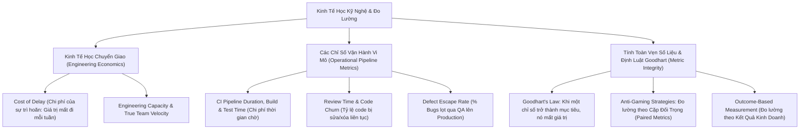
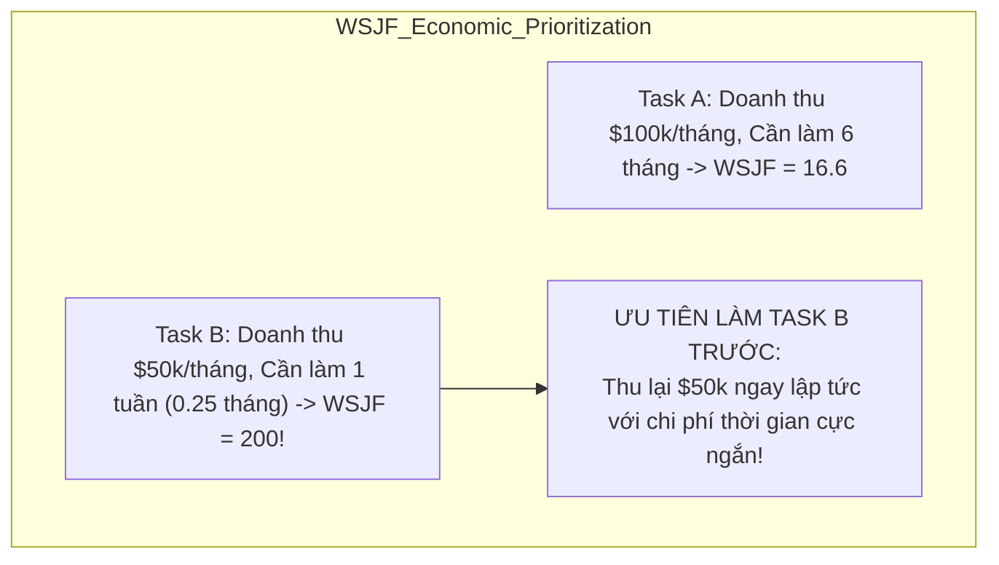
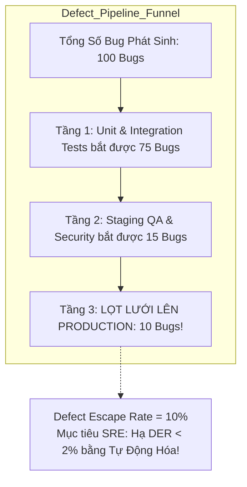
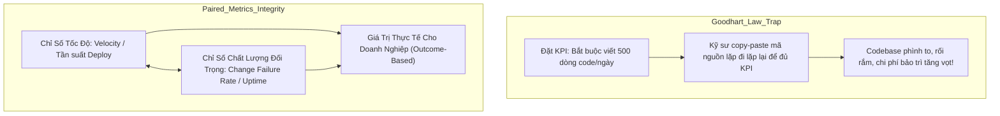

# 16.2. Kinh Tế Học Kỹ Thuật và Tính Toàn Vẹn Của Các Chỉ Số (Engineering Economics & Metric Integrity)

## Tổng quan về Engineering Economics & Metric Integrity
Mọi dòng mã nguồn được viết ra trong môi trường doanh nghiệp đều phải chịu sự chi phối của các quy luật kinh tế học (**Engineering Economics**): từ chi phí cơ hội của việc trì hoãn phát hành (**Cost of Delay**), chi phí nhân sự kỹ thuật, cho tới các tổn thất tài chính khi phát sinh sự cố trên production. Để tối ưu hóa hoạt động kỹ thuật, tổ chức đo lường các chỉ số vận hành chi tiết: **Code Churn**, **Review Time**, **Build Time**, **CI Pipeline Duration**, **Defect Escape Rate**, và **Team Velocity**. Tuy nhiên, thách thức nguy hiểm nhất của việc đo lường là hiện tượng thao túng chỉ số (**Metric Gaming**) dưới tác động của **Định luật Goodhart (Goodhart's Law)**. Kỹ sư trưởng thành phân biệt rạch ròi giữa việc đo lường đầu ra hoạt động (Output) và đo lường kết quả giá trị thực tế (**Outcome-Based Measurement**), bảo đảm tính toàn vẹn của số liệu và thúc đẩy văn hóa cải tiến liên tục (**Continuous Improvement**).



---

## 2. Chi tiết từng Keyword (Under-the-Hood Deep Dive)

---

### 1. Engineering Economics: Cost of Delay & Engineering Capacity

#### 1. Khái niệm bản chất (What & Why)
* **Engineering Economics (Kinh tế học kỹ nghệ)**: Môn khoa học ứng dụng các nguyên lý tài chính vào việc ra quyết định kỹ thuật: đánh giá tổng chi phí sở hữu (TCO), tỷ suất hoàn vốn (ROI), và phân bổ nguồn lực kỹ sư sao cho tối đa hóa giá trị kinh doanh.
* **Cost of Delay (CoD - Chi phí của sự trì hoãn - Don Reinertsen)**: Thước đo định lượng số tiền mà doanh nghiệp bị **thất thoát hoặc mất đi mỗi tuần (hoặc mỗi ngày) khi một tính năng chưa được đưa ra thị trường**.
  - Ví dụ: Một tính năng mới dự kiến mang lại doanh thu $\$50,000/\text{tuần}$. Nếu việc release bị trễ 4 tuần do CI/CD chậm chạp hoặc tranh cãi kỹ thuật rườm rà $\implies$ Cost of Delay là $\$200,000$ tiền mặt bị bốc hơi vĩnh viễn!
* **WSJF (Weighted Shortest Job First - Phương pháp ưu tiên công việc theo SAFe)**:
  Thuật toán kinh tế học xác định thứ tự ưu tiên các dự án kỹ thuật bằng cách lấy Chi phí của sự trì hoãn chia cho Thời lượng thực hiện:
  $$\text{WSJF Score} = \frac{\text{Cost of Delay}}{\text{Job Size / Duration}}$$
  Một công việc có CoD cực lớn nhưng chỉ mất 1 tuần để làm sẽ có điểm WSJF cao ngất ngưởng và bắt buộc phải được ưu tiên làm ngay lập tức!
* **Engineering Capacity (Dung lượng kỹ thuật)**: Tổng lượng thời gian và năng lượng thực tế mà đội ngũ có thể dành cho công việc hiệu quả trong một Sprint, sau khi đã trừ đi các chi phí cố định (Họp hành, hỗ trợ khách hàng khẩn cấp, trực on-call, nghỉ phép).

#### 2. Cơ chế hoạt động sâu (Under the hood / Hardcore Internals)
- **Tác Động Của Build Time & CI Duration Lên Chi Phí Lương Kỹ Sư**:
  - Giả sử một công ty có $100$ kỹ sư, lương trung bình $\$50/\text{giờ}$.
  - Mỗi kỹ sư chạy CI pipeline 4 lần một ngày.
  - *Kịch bản tồi*: CI pipeline chạy mất $30\text{ phút}$. Kỹ sư bị ngắt mạch tập trung, ngồi lướt web hoặc uống cà phê.
    - Thời gian chết mỗi ngày: $100 \times 4 \times 0.5\text{h} = 200\text{ giờ/ngày}$.
    - Thiệt hại tài chính: $200\text{h} \times \$50 = \$10,000/\text{ngày} \approx \textbf{\$2.4 Triệu USD/năm}$ bị lãng phí chỉ vì CI chậm!
  - *Đầu tư tối ưu*: Chi $\$100,000$ nâng cấp máy chủ CI đa lõi và bộ nhớ đệm Bazel, giảm thời gian CI xuống còn $3\text{ phút}$.
    - Tiết kiệm được hơn $\$2$ triệu USD mỗi năm! Đây là bài toán kinh tế học kỹ thuật sắc bén nhất để thuyết phục ban giám đốc đầu tư vào hạ tầng CI/CD.

#### 3. Sơ đồ minh họa (Mermaid Diagram)


#### 4. Code ví dụ thực chiến (C++20: Thuật Toán Tính Điểm Kinh Tế WSJF Cho Product Backlog)
```cpp
#include <iostream>
#include <string>
#include <vector>
#include <algorithm>

struct BacklogFeature {
    std::string name;
    double costOfDelayPerWeek; // Giá trị kinh doanh mất đi mỗi tuần trễ hạn ($)
    double durationWeeks;       // Thời gian ước tính để hoàn thành (Tuần)

    double calculateWsjf() const noexcept {
        if (durationWeeks <= 0.0) return 0.0;
        return costOfDelayPerWeek / durationWeeks;
    }
};

int main() {
    std::vector<BacklogFeature> features = {
        {"Tự động hóa hoàn tiền (Refund Bot)", 20000.0, 1.0}, // CoD = $20k, Time = 1 tuần
        {"Viết lại toàn bộ kiến trúc microservice", 30000.0, 12.0}, // CoD = $30k, Time = 12 tuần
        {"Tích hợp Apple Pay một chạm", 50000.0, 2.0} // CoD = $50k, Time = 2 tuần
    };

    // Sắp xếp Backlog theo tối đa hóa giá trị kinh tế (WSJF)
    std::sort(features.begin(), features.end(), [](const auto& a, const auto& b) {
        return a.calculateWsjf() > b.calculateWsjf();
    });

    std::cout << "=== BẢNG ƯU TIÊN SẢN PHẨM THEO KINH TẾ HỌC WSJF ===\n";
    for (const auto& f : features) {
        std::cout << "Tính năng: " << f.name 
                  << " | WSJF Score: " << f.calculateWsjf() << "\n";
    }
    return 0;
}
```

#### 5. Ưu / Nhược điểm, Pitfalls & Anti-patterns
- **Anti-pattern: Sunk Cost Fallacy (Ảo tưởng chi phí chìm)**: Tiếp tục rót tiền và nhân lực vào một dự án thất bại chỉ vì "chúng ta đã lỡ đầu tư 2 năm và hàng triệu USD vào nó rồi". Kỹ sư kinh tế học dũng cảm cắt lỗ ngay lập tức khi phát hiện giá trị tương lai không còn bù đắp được chi phí.

#### 6. Ứng dụng thực tế trong Backend / Systems
- **Black Friday Capacity Planning tại Amazon**: Tính toán Cost of Delay của việc hệ thống sập trong ngày siêu khuyến mãi Black Friday (khoảng $\$100,000$ cho mỗi giây downtime) để quyết định đầu tư hàng triệu USD vào việc mở rộng cụm máy chủ dự phòng trước 3 tháng.

---

### 2. Operational Metrics: CI Duration, Code Churn & Defect Escape Rate

#### 1. Khái niệm bản chất (What & Why)
* **CI Pipeline Duration, Build Time & Test Execution Time**: Tổng thời gian từ khi lập trình viên đẩy code lên Git cho đến khi toàn bộ các bài kiểm tra tự động hoàn tất và trả về kết quả màu xanh. Mục tiêu tối thượng của DevEx là giữ thời gian này dưới **10 phút**.
* **Review Time (Thời gian review mã nguồn)**: Khoảng thời gian từ khi Pull Request được mở cho đến khi nó nhận được phản hồi review đầu tiên và được approve. Đây thường là điểm nghẽn lớn nhất trong chu kỳ Cycle Time (thường chiếm tới 60-70% tổng thời gian!).
* **Code Churn (Độ khuấy động mã nguồn)**: Tổng số dòng code được thêm mới, sửa đổi hoặc xóa bỏ trong một khoảng thời gian nhất định:
  - Nếu một file có tỷ lệ Code Churn quá cao (liên tục bị viết đi viết lại hàng tuần), đó là dấu hiệu của yêu cầu nghiệp vụ không rõ ràng hoặc thiết kế kiến trúc bị sai lệch.
* **Defect Escape Rate (Tỷ lệ lỗi lọt lưới - DER)**: Tỷ lệ phần trăm các lỗi phần mềm được phát hiện bởi **người dùng thực tế trên production** so với tổng số lỗi phát hiện trong toàn bộ vòng đời:
  $$\text{DER} = \frac{\text{Số lỗi phát hiện trên Production}}{\text{Số lỗi trên Prod} + \text{Số lỗi phát hiện bởi QA/CI}} \times 100\%$$
  Thước đo chuẩn xác nhất về chất lượng thực sự của hệ thống kiểm thử tự động.

#### 2. Cơ chế hoạt động sâu (Under the hood / Hardcore Internals)
- **Phân Tích Đoán Lỗi Bằng Code Churn & Git Forensics**:
  - Dữ liệu lịch sử Git chỉ ra rằng: Các file mã nguồn có **tỷ lệ Code Churn cao kết hợp với kích thước file lớn** chính là nơi ẩn náu của **80% số lỗi nghiêm trọng nhất** trên production:
    ```bash
    # Liệt kê 5 file có độ khuấy động code (Churn) cao nhất trong 90 ngày qua
    git log --since="90 days ago" --name-only --pretty=format: | \
      sort | uniq -c | sort -nr | head -5
    ```
  - Những file này là ứng viên số 1 bắt buộc phải được tái cấu trúc (Refactoring) và bổ sung Unit Test bảo hộ.

#### 3. Sơ đồ minh họa (Mermaid Diagram)


#### 4. Code ví dụ thực chiến (TypeScript: Tính Toán Defect Escape Rate Tự Động Từ Issue Tracker)
```typescript
interface DefectReport {
  defectId: string;
  discoveredIn: 'UNIT_TEST' | 'STAGING_QA' | 'PRODUCTION_INCIDENT';
  severity: 'CRITICAL' | 'MAJOR' | 'MINOR';
}

function calculateDefectEscapeRate(defects: DefectReport[]): {
  totalDefects: number;
  productionEscapedCount: number;
  defectEscapeRatePercentage: number;
} {
  const total = defects.length;
  if (total === 0) return { totalDefects: 0, productionEscapedCount: 0, defectEscapeRatePercentage: 0 };

  const prodCount = defects.filter(d => d.discoveredIn === 'PRODUCTION_INCIDENT').length;
  const rate = (prodCount / total) * 100.0;

  return {
    totalDefects: total,
    productionEscapedCount: prodCount,
    defectEscapeRatePercentage: parseFloat(rate.toFixed(2))
  };
}

const sprintDefects: DefectReport[] = [
  { defectId: "BUG-1", discoveredIn: "UNIT_TEST", severity: "MINOR" },
  { defectId: "BUG-2", discoveredIn: "UNIT_TEST", severity: "MAJOR" },
  { defectId: "BUG-3", discoveredIn: "STAGING_QA", severity: "CRITICAL" },
  { defectId: "BUG-4", discoveredIn: "PRODUCTION_INCIDENT", severity: "CRITICAL" }
];

const report = calculateDefectEscapeRate(sprintDefects);
console.log(`Defect Escape Rate của Sprint: ${report.defectEscapeRatePercentage}% (Mục tiêu: < 5%)`);
```

#### 5. Ưu / Nhược điểm, Pitfalls & Anti-patterns
- **Anti-pattern: Zero Defect Illusion (Ảo tưởng không có lỗi)**: Tự hào khoe rằng Defect Escape Rate bằng 0% chỉ vì hệ thống không có công cụ giám sát hay logging để phát hiện lỗi người dùng đang gặp phải!

#### 6. Ứng dụng thực tế trong Backend / Systems
- **Tối ưu hóa CI Duration tại Uber**: Uber xây dựng hệ thống phân tích phụ thuộc mã nguồn để chỉ chạy những bài kiểm thử có liên quan trực tiếp đến các file vừa thay đổi trong commit (Test Impact Analysis), giảm thời gian chạy CI từ 40 phút xuống còn 4 phút.

---

### 3. Metric Integrity: Goodhart's Law & Outcome-Based Measurement

#### 1. Khái niệm bản chất (What & Why)
* **Goodhart's Law (Định luật Goodhart của nhà kinh tế học Charles Goodhart)**:
  $$\textbf{"When a measure becomes a target, it ceases to be a good measure."}$$
  *(Khi một chỉ số đo lường bị biến thành một mục tiêu để đánh giá và thưởng phạt, nó lập tức đánh mất giá trị đo lường khách quan ban đầu của nó).*
* **Metric Gaming (Thao túng chỉ số)**: Hiện tượng con người tối ưu hóa hành vi của mình một cách thiển cận để đạt được chỉ số đề ra, bất chấp việc hành vi đó gây tổn hại nghiêm trọng đến mục tiêu thực tế của tổ chức.
  - Ví dụ kinh điển:
    - Nếu đo hiệu suất bằng "Số lượng bugs được đóng": Kỹ sư QA và Dev sẽ thông đồng với nhau tạo ra hàng trăm bug ngớ ngẩn (như lỗi chính tả) rồi tự fix và tự đóng để nhận tiền thưởng!
    - Nếu đo hiệu suất bằng "Code Coverage 90%": Kỹ sư sẽ viết các bài test không có lệnh assert nào chỉ để phủ dòng code.
* **Outcome-Based Measurement (Đo lường dựa trên kết quả)**: Chuyển dịch từ việc đo lường đầu ra hoạt động thô (**Outputs**: số dòng code, số commit, số tickets) sang đo lường tác động thực tế (**Outcomes**: dịch vụ có đạt SLO 99.9% không, độ trễ có giảm không, người dùng có thanh toán mượt mà hơn không).
* **Paired Metrics (Đo lường theo cặp đối trọng)**: Phương pháp hữu hiệu nhất để vô hiệu hóa Định luật Goodhart: **Luôn luôn đo lường một chỉ số tốc độ đi kèm với một chỉ số chất lượng đối trọng** (ví dụ: Đo *Deployment Frequency* bắt buộc phải đi kèm với *Change Failure Rate*; đo *Velocity* phải đi kèm với *Defect Escape Rate*).

#### 2. Cơ chế hoạt động sâu (Under the hood / Hardcore Internals)
- **Tại sao Team Velocity Trong Scrum Không Phải Là Thước Đo Năng Suất?**:
  - **Velocity (Story Points hoàn thành mỗi Sprint)** là một chỉ số ước lượng tương đối mang tính nội bộ của duy nhất nhóm đó, nhằm mục đích lên kế hoạch dung lượng (Capacity Planning).
  - Khi ban quản trị lấy Velocity làm KPI thi đua giữa các nhóm:
    - Hiện tượng **Point Inflation (Lạm phát điểm)** lập tức bùng nổ: Một task trước đây ước lượng là 3 points, nhóm sẽ tự động nâng lên thành 8 points để "tăng Velocity gấp đôi" trên báo cáo Excel!
    - Thực tế năng lực chuyển giao phần mềm không tăng lên một chút nào. Kỹ sư trưởng thành kiên quyết bảo vệ tính toàn vẹn của số liệu và bác bỏ việc so sánh Velocity giữa các nhóm khác nhau.

#### 3. Sơ đồ minh họa (Mermaid Diagram)


#### 4. Code ví dụ thực chiến (C++20: Paired Metric Evaluation Framework)
```cpp
#include <iostream>

// Kỹ thuật Paired Metrics: Đánh giá đồng thời cả Tốc độ và Chất lượng để chống Metric Gaming
struct EngineeringSquadMetrics {
    int deploymentsPerWeek;
    double changeFailureRatePercentage; // Chỉ số đối trọng
};

bool isPerformanceHealthy(const EngineeringSquadMetrics& m) {
    // Không thể gian lận: Tần suất deploy cao CHỈ được coi là tốt nếu tỷ lệ lỗi thấp!
    bool isSpeedGood = (m.deploymentsPerWeek >= 10);
    bool isQualityGood = (m.changeFailureRatePercentage <= 5.0);

    return isSpeedGood && isQualityGood;
}

int main() {
    // Trường hợp 1: Deploy nhiều nhưng lỗi liên tục (Gaming Speed)
    EngineeringSquadMetrics teamA{50, 25.0};
    // Trường hợp 2: Cân bằng hoàn hảo theo chuẩn DORA
    EngineeringSquadMetrics teamB{15, 2.0};

    std::cout << "Đội A (Deploy 50 lần, Lỗi 25%): " 
              << (isPerformanceHealthy(teamA) ? "ĐẠT" : "KHÔNG ĐẠT (Tốc độ ảo, chất lượng kém!)") << "\n";
    std::cout << "Đội B (Deploy 15 lần, Lỗi 2%): " 
              << (isPerformanceHealthy(teamB) ? "ĐẠT CHUẨN ELITE (Chất lượng và tốc độ cân bằng)" : "KHÔNG ĐẠT") << "\n";
    return 0;
}
```

#### 5. Ưu / Nhược điểm, Pitfalls & Anti-patterns
- **Anti-pattern: Weaponizing Metrics (Biến chỉ số thành vũ khí trừng phạt)**: Sử dụng các chỉ số kỹ thuật để khiển trách hoặc trừ lương cá nhân. Kỹ sư sẽ lập tức che giấu dữ liệu, không báo cáo bug, và tìm mọi cách bẻ cong số liệu để bảo vệ bản thân.

#### 6. Ứng dụng thực tế trong Backend / Systems
- **Văn hóa Dữ Liệu tại Netflix & Google**: Khẳng định các chỉ số kỹ thuật sinh ra là để phục vụ cho việc **học hỏi và cải tiến liên tục (Continuous Improvement)** của chính đội ngũ kỹ thuật, không phải là công cụ kiểm soát vi mô của người quản lý.

---

## Tổng kết Chương 16.2
Kinh tế học kỹ nghệ và tính toàn vẹn của các chỉ số là thước đo của sự chín chắn trong lãnh đạo kỹ thuật. Bằng việc thấu hiểu chi phí sâu sắc của sự trì hoãn qua Cost of Delay, tối ưu hóa các điểm nghẽn vận hành trong đường ống CI/CD, và thiết lập các cặp chỉ số đối trọng để vô hiệu hóa định luật Goodhart, người kỹ sư bảo đảm rằng mọi nỗ lực kỹ thuật đều hướng tới việc tạo ra giá trị kinh doanh thực chất và xây dựng một nền văn hóa kỹ nghệ lành mạnh, minh bạch và không ngừng tiến bộ.
