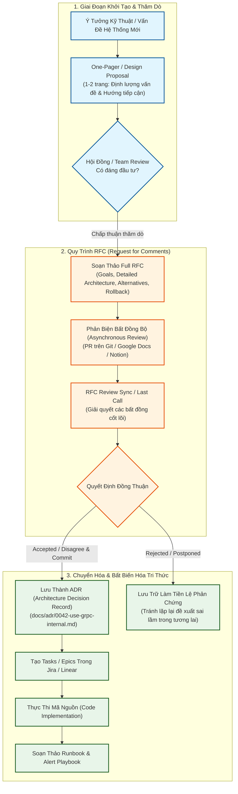
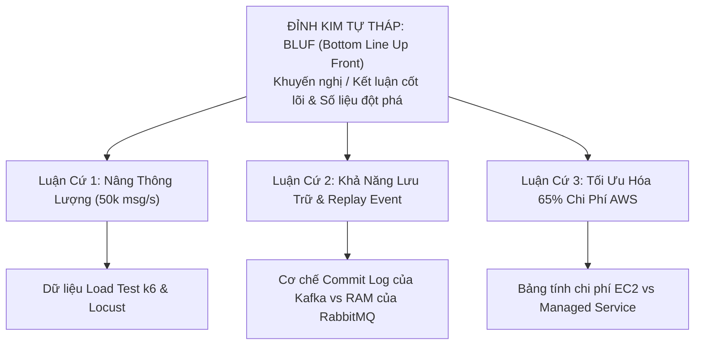
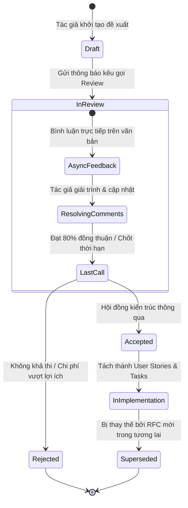
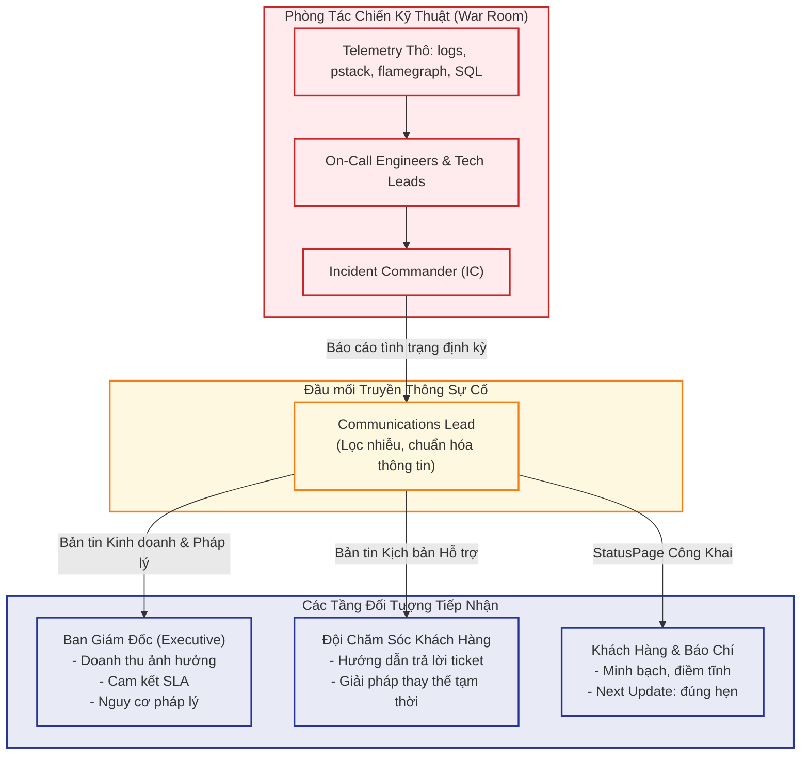
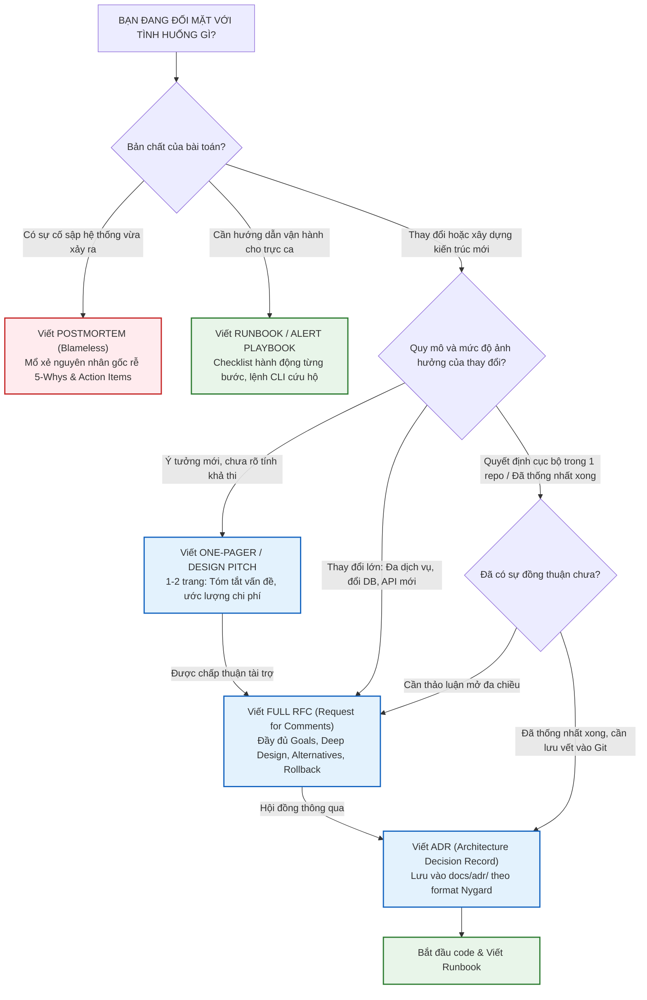

# 17.1. Văn Bản Kỹ Thuật, Đề Xuất Thiết Kế và Quy Trình RFC (Written Technical Artifacts, Design Proposals & RFCs)

> [!IMPORTANT]
> **Nếu bạn chỉ được nhớ một điều duy nhất:** Mã nguồn chỉ cho ta biết hệ thống đang hoạt động *như thế nào* (HOW), nhưng văn bản kỹ thuật và tài liệu thiết kế mới là thứ duy nhất bảo tồn lý do *tại sao* hệ thống được xây dựng như vậy (WHY) cùng toàn bộ các phương án khả thi đã bị bác bỏ — **văn hóa viết kỹ thuật chuẩn mực (Written-First Culture) chính là chiếc đòn bẩy vĩ đại nhất để nhân rộng tầm ảnh hưởng của một kỹ sư cấp cao, biến những cuộc tranh luận cảm tính thành quy trình phản biện cấu trúc hóa bất đồng bộ, và bảo đảm tri thức kiến trúc trường tồn ngay cả khi tổ chức thay đổi toàn bộ nhân sự**.

---

## 1. Kiến trúc Tổng quan & Mô hình Tư duy (Mental Model)

### Ẩn dụ Thực tế: Bản Vẽ Kỹ Sư Trưởng & Bản Án Tiền Lệ Tư Pháp
Hãy hình dung sự khác biệt giữa hai cách thức xây dựng công trình:
- **Phương thức truyền miệng (Verbal Syncs & Ad-hoc Chat)**: Tương tự như một nhóm thợ xây đứng tụ tập giữa công trường bụi bặm, người thợ cả vung tay miêu tả độ cong của mái vòm và độ sâu của móng nhà. Khi người thợ cả chuyển sang công trường khác hoặc sau 6 tháng trời mưa gió, không ai nhớ tại sao móng lại chỉ sâu 3 mét thay vì 5 mét. Khi tòa nhà bị nứt, người ta hoảng loạn đổ lỗi cho nhau. Đây chính là thảm cảnh của các nhóm công nghệ phụ thuộc hoàn toàn vào các cuộc họp nói miệng, tin nhắn Slack trôi nổi và code không có tài liệu thiết kế.
- **Phương thức Văn bản Kỹ thuật (Written Technical Artifacts)**: Tương tự như quy trình xây dựng một tòa cao ốc chọc trời hoặc một hệ thống tư pháp thượng tôn pháp luật:
  1. *Bản đề xuất sơ bộ (One-Pager / Concept Note)*: Phác thảo ý tưởng thăm dò tính khả thi và ước lượng ngân sách ban đầu.
  2. *Bản thiết kế kỹ thuật chi tiết (RFC - Request for Comments)*: Bộ bản vẽ chi tiết đến từng mối hàn, tính toán tải trọng gió, đường thoát hiểm và kế hoạch phòng cháy chữa cháy. Bản vẽ này được gửi cho toàn bộ hội đồng kiến trúc sư và thanh tra xây dựng phản biện công khai trước khi viên gạch đầu tiên được đặt xuống.
  3. *Bản ghi tiền lệ tư pháp (ADR - Architecture Decision Record)*: Lưu giữ phán quyết bất biến: *"Tại sao tại vị trí tầng 12 chúng ta chọn kết cấu thép chịu lực thay vì bê tông cốt thép dự ứng lực?"* — đi kèm bối cảnh thị trường sắt thép thời điểm đó và các hệ quả được chấp nhận.
  4. *Cẩm nang vận hành (Runbook)*: Hướng dẫn chi tiết cho đội bảo trì cách khởi động lại hệ thống bơm nước khẩn cấp khi mất điện lúc nửa đêm.
  5. *Báo cáo hậu sự cố (Postmortem)*: Mổ xẻ nguyên nhân gốc rễ khách quan khi thang máy gặp sự cố, tìm ra lỗ hổng quy trình để không bao giờ lặp lại.



---

## 2. Chi tiết từng Keyword (Under-the-Hood Deep Dive)

### 2.1. Technical Writing & The Power of Written Communication

#### 1. Khái niệm bản chất & Triết lý Quản trị (What & Why)
- **Written Technical Communication (Giao tiếp kỹ thuật bằng văn bản)**: Là kỹ năng chuyển hóa các khái niệm trừu tượng, kiến trúc phân tán phức tạp, các đánh đổi kinh tế và các ràng buộc phi chức năng thành văn bản rõ ràng, súc tích, mạch lạc và có thể kiểm chứng độc lập.
- **Văn hóa Amazon Six-Page Memo & Triết lý "Working Backwards"**:
  - Tại Amazon, Jeff Bezos đã ra lệnh cấm tuyệt đối việc sử dụng slide trình chiếu PowerPoint trong các cuộc họp điều hành và kỹ thuật cấp cao. Thay vào đó, người đề xuất phải viết một tài liệu tường thuật dài đúng **6 trang (Narrative Memo)**.
  - Mở đầu cuộc họp, toàn bộ người tham gia (kể cả CEO) ngồi im lặng đọc tài liệu trong 20-30 phút (Study Hall) trước khi bất kỳ ai được phép mở lời thảo luận.
  - **PR/FAQ (Press Release / Frequently Asked Questions)**: Trước khi viết dòng code đầu tiên, kỹ sư/PM phải viết bản thông cáo báo chí giả định ngày sản phẩm ra mắt và bộ câu hỏi thường gặp (cả cho khách hàng lẫn nội bộ kỹ thuật). Nếu bản thông cáo báo chí không làm nổi bật được giá trị vượt trội, dự án sẽ bị hủy ngay từ trứng nước.
- **Ba Định luật Mở Rộng Quy Mô Tri Thức (The 3 Laws of Written Scalability)**:
  1. *Chi phí tác giả là $O(1)$, Giá trị tiếp nhận là $O(N)$*: Một kỹ sư mất 8 giờ để viết một RFC xuất sắc. Tài liệu đó có thể được đọc bởi 500 kỹ sư trên toàn cầu trong vòng 3 năm mà tác giả không tốn thêm một giây nào. Ngược lại, việc giải thích miệng tốn $O(N)$ thời gian và suy hao 50% thông tin qua mỗi tầng truyền đạt.
  2. *Văn bản hóa rèn luyện tư duy (Writing is Thinking)*: Khi nói miệng hoặc dùng slide bóng bẩy, bộ não con người rất dễ nhảy cóc qua các lỗ hổng logic. Nhưng khi ép tư duy vào từng câu văn hoàn chỉnh với số liệu cụ thể, các điểm mù kiến trúc, các điều kiện biên (edge cases) và các nguy cơ nghẽn I/O sẽ tự động lộ diện trên trang giấy.
  3. *Tối ưu hóa cho Văn hóa Bất đồng bộ (Async-First Culture)*: Trong các tổ chức kỹ thuật toàn cầu trải dài từ Silicon Valley, Berlin đến Tokyo, việc triệu tập một cuộc họp trực tuyến đòi hỏi ai đó phải thức dậy lúc 2 giờ sáng. Văn bản kỹ thuật xóa bỏ rào cản múi giờ, đem lại sự công bằng tuyệt đối cho mọi kỹ sư tham gia đóng góp trí tuệ.

#### 2. Kỹ thuật Ngòi bút: Nguyên lý Kim tự tháp Minto (The Minto Pyramid Principle) & BLUF
- Lập trình viên nghiệp dư thường viết tài liệu theo trình tự thời gian hành động: *"Tôi mở server lên, thấy CPU tăng cao, tôi đã thử debug bằng `strace`, sau đó tôi thử chỉnh cấu hình pool size nhưng không được, cuối cùng tôi nghĩ ta nên chuyển sang Redis"*. Người đọc bận rộn sẽ mất kiên nhẫn và bỏ ngang.
- **Kỹ sư trưởng áp dụng Nguyên lý Kim tự tháp Minto (Top-Down Thinking)**:
  - **BLUF (Bottom Line Up Front - Đưa kết luận lên hàng đầu)**: Nêu ngay quyết định, khuyến nghị hoặc phát hiện cốt lõi ở câu đầu tiên.
  - **Cấu trúc kim tự tháp**:
    - *Đỉnh (Core Recommendation)*: "Chúng tôi đề xuất chuyển đổi hàng đợi từ RabbitMQ sang Kafka để nâng thông lượng xử lý đơn hàng từ 2,000 lên 50,000 msg/sec, giảm 65% chi phí hạ tầng."
    - *Tầng giữa (Key Supporting Arguments)*: Luận cứ 1 (Throughput), Luận cứ 2 (Durability & Event Replay), Luận cứ 3 (Cost Analysis).
    - *Tầng đáy (Data & Empirical Evidence)*: Benchmark load test, kết quả profiling CPU/Memory, bảng tính chi phí AWS.



- **Bộ Ba Thành Phần Bắt Buộc Của Một Đề Xuất Kỹ Thuật**:
  1. *Context & Problem Statement (Bối cảnh & Tuyên bố Bài toán)*: Phải định lượng bằng số liệu, tuyệt đối không dùng cảm tính (Không nói: "Hệ thống chậm", phải nói: "P99 latency của API Checkout tăng từ 120ms lên 1,450ms khi lượng người dùng đồng thời vượt quá 10,000").
  2. *Proposed Solution (Đề xuất Giải pháp)*: Trình bày kiến trúc logic, luồng dữ liệu, schema, API contracts và các thành phần phần mềm cần tạo mới hoặc thay đổi.
  3. *Impact & Trade-offs (Tác động & Đánh đổi)*: Phân tích khách quan những gì được và những gì mất. Không có giải pháp nào là hoàn hảo; mọi kiến trúc đều là một sự đánh đổi có chủ đích.

---

### 2.2. The RFC Process: Request for Comments & Design Proposals

#### 1. Bản chất & Lịch sử
- Thuật ngữ **RFC (Request for Comments)** bắt nguồn từ năm 1969 bởi Steve Crocker trong quá trình phát triển mạng sơ khai ARPANET (tiền thân của Internet). Ông chọn tiêu đề khiêm tốn "Request for Comments" vì không muốn áp đặt quyền lực lên các nhà nghiên cứu khác, mà muốn tạo ra một không gian cởi mở để mời gọi phản biện khoa học.
- Ngày nay, tại các tổ chức công nghệ hàng đầu (Google, Meta, Uber, Netflix), không có bất kỳ hệ thống phân tán quan trọng nào được xây dựng mà không thông qua quy trình RFC hoặc Design Doc.

#### 2. Vòng đời Chuẩn mực của một RFC (The RFC Lifecycle)
1. **Giai đoạn Thăm dò (One-Pager / Pitch)**: Tác giả viết 1-2 trang tóm tắt ý tưởng để lấy phản hồi nhanh từ Tech Lead/Staff Engineer. Mục tiêu: Tránh lãng phí 2 tuần viết RFC 20 trang cho một ý tưởng không khả thi hoặc lệch chiến lược công ty.
2. **Giai đoạn Soạn thảo (Drafting)**: Tác giả hoàn thiện tài liệu theo RFC Template chuẩn của tổ chức.
3. **Giai đoạn Phản biện Bất đồng bộ (Async In-Review)**: RFC được mở cho toàn bộ engineering organization hoặc các đội liên quan bình luận (Comments/Suggestions). Thời gian thường kéo dài từ 5 đến 10 ngày làm việc.
4. **Giai đoạn Họp Chốt (RFC Sync / Last Call)**: Chỉ triệu tập cuộc họp ngắn (30-45 phút) để thảo luận **những điểm bất đồng lớn nhất** mà bình luận bằng văn bản chưa đạt được tiếng nói chung.
5. **Giai đoạn Ra Quyết Định (Final Disposition)**:
   - *Accepted*: Đề xuất được phê duyệt, chuyển sang giai đoạn lập kế hoạch thực thi.
   - *Rejected*: Đề xuất bị từ chối kèm theo biên bản lý do kỹ thuật rõ ràng.
   - *Superseded*: Đề xuất cũ bị thay thế bởi một RFC mới ưu việt hơn.



#### 3. Cấu trúc Giải phẫu Chi tiết của một RFC Đạt Chuẩn Thế Giới
Một tài liệu RFC xuất sắc bắt buộc phải chứa đầy đủ 8 phần sau:
1. **Metadata & Status**: Tác giả, Reviewers, Sponsors, Trạng thái, Ngày tạo, Ngày cập nhật lần cuối.
2. **Abstract / Summary**: Bản tóm tắt súc tích trong 1 đoạn văn (dưới 200 từ) giải thích: Hệ thống nào đang được thay đổi? Tại sao? Giải pháp cốt lõi là gì?
3. **Goals & Non-Goals (Mục tiêu & Ngoài phạm vi)**:
   - *Goals*: Những gì dự án cam kết đạt được (có thể đo lường được, ví dụ: "Giảm độ trễ P99 xuống dưới 50ms", "Hỗ trợ 100,000 kết nối WebSocket đồng thời").
   - *Non-Goals*: Những tính năng hoặc bài toán mà dự án **chủ động từ chối giải quyết** trong phạm vi này (ví dụ: "Không hỗ trợ đa vùng (Multi-region) trong phiên bản 1.0", "Không thay đổi cấu trúc thanh toán"). Điều này ngăn chặn triệt để hiện tượng phình to phạm vi (**Scope Creep**).
4. **Detailed Technical Design**:
   - Kiến trúc tổng thể & Sơ đồ khối (System Architecture Diagram).
   - Mô hình dữ liệu & Database Schema (PostgreSQL DDL, DynamoDB Single-Table Design).
   - Giao thức truyền thông & API Contracts (Protobuf/gRPC definitions hoặc OpenAPI/Swagger specs).
   - Luồng tương tác tuần tự (Mermaid Sequence Diagrams).
5. **Alternatives Considered (Các Phương Án Thay Thế - Cực kỳ Quan trọng)**:
   - Liệt kê ít nhất 2 phương án kiến trúc khác đã được nghiên cứu nghiêm túc và lý do cụ thể tại sao chúng bị bác bỏ (ví dụ: "Phương án dùng MongoDB bị loại bỏ vì thiếu hỗ trợ ACID transactions xuyên cụm; Phương án tự build in-house queue bị loại bỏ vì chi phí bảo trì quá cao so với giải pháp SaaS").
6. **Rollout, Data Migration & Rollback Strategy**:
   - Làm thế nào để triển khai mà không gây gián đoạn dịch vụ (Zero-downtime deployment)?
   - Chiến lược di chuyển dữ liệu (Dual-writing, Shadow traffic, Backfill script).
   - Kế hoạch quay lui (Rollback plan): Nếu canary deployment phát hiện tỷ lệ lỗi vượt quá 0.5%, hệ thống sẽ tự động phục hồi về trạng thái cũ như thế nào trong dưới 5 phút?
7. **Observability, Monitoring & Alerting**:
   - Các metric đo lường sức khỏe (Golden Signals: Latency, Traffic, Errors, Saturation).
   - Dashboard và các ngưỡng cảnh báo PagerDuty.
8. **Security, Privacy & Cost Estimation**:
   - Đánh giá bề mặt tấn công (Threat Modeling), tuân thủ GDPR/CCPA, mã hóa dữ liệu tại chỗ (Encryption at rest) và trên đường truyền (TLS).
   - Dự toán chi phí hạ tầng hàng tháng khi lượng tải tăng gấp 5 lần.

#### 4. Nghệ thuật Xây dựng Đồng thuận: "Disagree and Commit"
- Trong quy trình review RFC, hiện tượng tranh cãi triền miên không có hồi kết (**RFC Paralysis**) là một căn bệnh phổ biến.
- Các kỹ sư trưởng xuất sắc áp dụng nguyên lý **"Disagree and Commit" (Bất đồng nhưng Cam kết)** của Andy Grove (Intel) và Jeff Bezos (Amazon):
  - Kỹ sư có toàn quyền tranh luận gay gắt, đưa ra bằng chứng kỹ thuật để bảo vệ quan điểm của mình trong giai đoạn review.
  - Tuy nhiên, một khi người ra quyết định (Tech Lead hoặc Architecture Committee) đã đưa ra kết luận cuối cùng, tất cả mọi người—kể cả những người phản đối quyết liệt nhất—phải toàn tâm toàn ý cam kết 100% nguồn lực để thực thi giải pháp đã chọn, tuyệt đối không được có thái độ ngấm ngầm chống đối hoặc bàn lùi.

---

### 2.3. Architecture Decision Records - ADRs (Bản Ghi Quyết Định Kiến Trúc)

#### 1. Khái niệm & Khác biệt Cốt lõi giữa RFC và ADR
- **RFC là Quá trình (The Debate)**: Là tài liệu thảo luận mở, mang tính thăm dò, có thể dài từ 10 đến 30 trang, chứa nhiều câu hỏi và giả thuyết. Sau khi dự án hoàn thành, RFC thường trở thành tài liệu tĩnh và ít khi được cập nhật tiếp.
- **ADR là Kết quả Pháp lý (The Law)**: Là bản ghi ngắn gọn (1-2 trang), bất biến (Immutable), ghi lại quyết định kiến trúc cụ thể đã được thông qua. ADR được lưu trữ trực tiếp trong repository mã nguồn của dự án (thường nằm tại thư mục `docs/adr/`), nằm dưới sự kiểm soát phiên bản của Git.
- **Tại sao cần ADR?**: Khi một kỹ sư mới gia nhập dự án sau 2 năm, họ thường thắc mắc: *"Tại sao ở đây lại dùng SQLite mà không dùng PostgreSQL?", "Tại sao lại tự build caching layer mà không dùng Redis?"*. Nếu không có ADR, họ sẽ coi đây là "nợ kỹ thuật" và tìm cách viết lại, lặp lại đúng những sai lầm mà các kỹ sư tiền nhiệm đã từng gặp và né tránh.

#### 2. Cấu trúc Chuẩn mực theo Michael Nygard (Nygard ADR Format)
Một tài liệu ADR chuẩn chỉ gồm 5 mục cốt lõi:
1. **Title**: Định dạng `ADR-NNNN: [Động từ quyết định] [Công nghệ / Mẫu thiết kế]`. Ví dụ: `ADR-0014: Sử dụng NATS JetStream cho Hệ thống Phân phối Sự kiện Real-time`.
2. **Status**: Trạng thái hiện tại: `Proposed`, `Accepted`, `Rejected`, `Deprecated`, hoặc `Superseded by ADR-NNNN`.
3. **Context (Bối cảnh)**: Mô tả bài toán kỹ thuật, áp lực kinh doanh và các ràng buộc hiện tại một cách hoàn toàn khách quan, không thiên vị.
4. **Decision (Quyết định)**: Tuyên bố dứt khoát giải pháp được lựa chọn. Viết ở thì chủ động ("Chúng tôi sẽ sử dụng...", không viết mơ hồ).
5. **Consequences (Hệ quả)**: Phân tích toàn diện cả hai mặt:
   - *Hệ quả Tích cực (Positive)*: Những lợi ích đo đếm được.
   - *Hệ quả Tiêu cực & Đánh đổi (Negative & Trade-offs)*: Những gánh nặng mới phát sinh, các hạn chế phải chấp nhận, hoặc sự phức tạp vận hành tăng thêm.

---

### 2.4. Incident & Stakeholder Communication (Truyền Thông Sự Cố & Quản Trị Các Bên Liên Quan)

#### 1. Khủng hoảng Kỹ thuật & Tâm lý Học Truyền thông
- Khi một sự cố gián đoạn nghiêm trọng (SEV-1 / Outage) xảy ra, áp lực tâm lý trong phòng tác chiến (War Room) tăng vọt. Sự hoảng loạn của ban giám đốc và sự phẫn nộ của khách hàng thường không bắt nguồn từ bản thân lỗi kỹ thuật, mà bắt nguồn từ **sự im lặng đáng sợ (Radio Silence)** hoặc **thông tin sai lệch** từ đội ngũ kỹ thuật.
- Truyền thông sự cố xuất sắc đòi hỏi sự tách bạch hoàn toàn giữa **Kỹ thuật sửa lỗi (Incident Mitigation)** và **Điều phối thông tin (Incident Communications)**.

#### 2. Kỹ thuật Phân luồng Thông tin (Information Tiering)
Không bao giờ được copy trực tiếp các đoạn log debug thô, câu lệnh SQL hoặc stack trace nội bộ gửi cho khách hàng hoặc ban điều hành. Đội ngũ Incident Command cần phân định 3 tầng thông tin rõ ràng:
- **Tầng 1: Kênh Kỹ thuật Nội bộ (War Room - Slack / Discord / Meet)**:
  - Dành riêng cho Incident Commander (IC), Technical Leads và On-call Engineers.
  - Ngôn ngữ: Kỹ thuật sâu, số liệu telemetry thô, lệnh shell, biểu đồ Prometheus/Datadog.
- **Tầng 2: Bản tin Ban Điều Hành & Nội bộ Doanh nghiệp (Executive Briefing)**:
  - Dành cho: C-Level, Đội ngũ Pháp lý, Trưởng phòng Kinh doanh, Customer Support Leads.
  - Nội dung: Tác động kinh doanh định lượng (Doanh thu thiệt hại, số lượng người dùng bị ảnh hưởng, vi phạm cam kết SLA), tóm tắt nguyên nhân ở cấp độ cao, ước lượng thời gian khôi phục (ETA).
- **Tầng 3: Bản tin Khách hàng & Công chúng (Public StatusPage)**:
  - Ngôn ngữ: Điềm tĩnh, chuyên nghiệp, dễ hiểu, tuyệt đối không dùng thuật ngữ nội bộ (Internal Jargon), không đổ lỗi cho bên thứ ba (Tránh nói: "Do nhà mạng AWS ngu ngốc làm sập server").
  - Bộ 3 cấu trúc bất di bất dịch của mỗi bản tin cập nhật:
    1. *Tác động hiện tại (Current User Impact)*.
    2. *Hành động đang triển khai (Current Mitigation Actions)*.
    3. *Thời điểm dự kiến phát bản tin tiếp theo (Next Update ETA)*.



---

## 3. Thực thi Mã nguồn & Mô phỏng Chuyên sâu (Dual-Engine Implementation)

Để tự động hóa việc thực thi văn hóa kỹ thuật và ngăn chặn các tài liệu kém chất lượng lọt vào hệ thống, chúng ta xây dựng hai công cụ bổ trợ lẫn nhau:
1. **Engine C++20 (`ADR_RFC_Governance_Engine`)**: Bộ máy phân tích tĩnh văn bản kỹ thuật cực nhanh, kiểm định tính toàn vẹn của các trường bắt buộc, tính toán chỉ số khả năng đọc Flesch Reading Ease và máy trạng thái vòng đời RFC.
2. **Engine Python 3.11+ (`rfc_knowledge_graph_linter.py`)**: Công cụ CLI tự động hóa CI/CD, phân tích cú pháp AST Markdown, xây dựng đồ thị có hướng (DAG) phụ thuộc giữa các quyết định kiến trúc, phát hiện chu trình phụ thuộc và kiểm định định lượng tuyên bố bài toán.

---

### 3.1. C++20 Implementation: Công Cụ Phân Tích Cú Pháp, Kiểm Tra Tính Toàn Vẹn & Quản Lý Vòng Đời RFC/ADR

```cpp
#include <iostream>
#include <string>
#include <string_view>
#include <vector>
#include <unordered_map>
#include <regex>
#include <sstream>
#include <iomanip>
#include <memory>
#include <chrono>

// Liệt kê các trạng thái chuẩn mực của một tài liệu RFC / ADR
enum class ArtifactStatus {
    DRAFT,
    IN_REVIEW,
    LAST_CALL,
    ACCEPTED,
    REJECTED,
    SUPERSEDED
};

std::string statusToString(ArtifactStatus status) {
    switch (status) {
        case ArtifactStatus::DRAFT: return "DRAFT";
        case ArtifactStatus::IN_REVIEW: return "IN_REVIEW";
        case ArtifactStatus::LAST_CALL: return "LAST_CALL";
        case ArtifactStatus::ACCEPTED: return "ACCEPTED";
        case ArtifactStatus::REJECTED: return "REJECTED";
        case ArtifactStatus::SUPERSEDED: return "SUPERSEDED";
    }
    return "UNKNOWN";
}

// Cấu trúc đại diện cho một tài liệu kỹ thuật đã phân tích
struct TechnicalDocument {
    std::string id;
    std::string title;
    ArtifactStatus status;
    std::string author;
    std::unordered_map<std::string, std::string> sections;
    std::vector<std::string> supersededBy;
    double readabilityScore{0.0};
    bool hasQuantitativeMetrics{false};
};

class DocumentValidator {
public:
    // Kiểm tra sự hiện diện của các tiêu mục bắt buộc trong một RFC
    static std::vector<std::string> validateRFCSections(const TechnicalDocument& doc) {
        const std::vector<std::string> mandatorySections = {
            "Abstract",
            "Context and Problem Statement",
            "Goals and Non-Goals",
            "Proposed Architecture",
            "Alternatives Considered",
            "Rollout and Rollback Strategy"
        };
        
        std::vector<std::string> missingSections;
        for (const auto& sec : mandatorySections) {
            if (doc.sections.find(sec) == doc.sections.end() || doc.sections.at(sec).empty()) {
                missingSections.push_back(sec);
            }
        }
        return missingSections;
    }

    // Tính toán chỉ số Flesch Reading Ease đơn giản hóa để phát hiện câu từ quá phức tạp
    // Công thức: 206.835 - 1.015 * (tổng_từ / tổng_câu) - 84.6 * (tổng_âm_tiết / tổng_từ)
    static double computeReadability(const std::string& text) {
        if (text.empty()) return 0.0;
        
        int wordCount = 0;
        int sentenceCount = 0;
        int syllableCount = 0;

        std::regex wordRegex(R"([a-zA-Z0-9_]+)");
        std::regex sentenceRegex(R"([.!?]+)");
        
        auto wordsBegin = std::sregex_iterator(text.begin(), text.end(), wordRegex);
        auto wordsEnd = std::sregex_iterator();
        for (auto it = wordsBegin; it != wordsEnd; ++it) {
            wordCount++;
            std::string word = it->str();
            // Đếm nguyên âm đơn giản làm xấp xỉ âm tiết
            for (char c : word) {
                char lower = std::tolower(c);
                if (lower == 'a' || lower == 'e' || lower == 'i' || lower == 'o' || lower == 'u') {
                    syllableCount++;
                }
            }
        }

        auto sentencesBegin = std::sregex_iterator(text.begin(), text.end(), sentenceRegex);
        for (auto it = sentencesBegin; it != wordsEnd; ++it) {
            sentenceCount++;
        }
        if (sentenceCount == 0) sentenceCount = 1;
        if (wordCount == 0) wordCount = 1;

        double wordsPerSentence = static_cast<double>(wordCount) / sentenceCount;
        double syllablesPerWord = static_cast<double>(syllableCount) / wordCount;
        
        double score = 206.835 - (1.015 * wordsPerSentence) - (84.6 * syllablesPerWord);
        return score;
    }

    // Phát hiện số liệu định lượng (ms, %, QPS, MB, GB, $) trong bài toán
    static bool scanQuantitativeData(const std::string& text) {
        std::regex metricPattern(R"((\d+(\.\d+)?\s*(ms|s|%|QPS|RPS|MB|GB|TB|\$|USD|req/s)))", std::regex::icase);
        return std::regex_search(text, metricPattern);
    }
};

// Máy trạng thái hữu hạn quản lý vòng đời RFC
class RFCLifecycleManager {
public:
    static bool transition(TechnicalDocument& doc, ArtifactStatus targetStatus, const std::string& reason) {
        std::cout << "[LIFECYCLE] Yêu cầu chuyển trạng thái RFC " << doc.id 
                  << " từ " << statusToString(doc.status) 
                  << " sang " << statusToString(targetStatus) << "...\n";

        switch (doc.status) {
            case ArtifactStatus::DRAFT:
                if (targetStatus == ArtifactStatus::IN_REVIEW) {
                    auto missing = DocumentValidator::validateRFCSections(doc);
                    if (!missing.empty()) {
                        std::cerr << "  [-] THẤT BẠI: RFC thiếu các mục bắt buộc:\n";
                        for (const auto& m : missing) std::cerr << "      * " << m << "\n";
                        return false;
                    }
                    if (!doc.hasQuantitativeMetrics) {
                        std::cerr << "  [-] THẤT BẠI: Problem Statement thiếu số liệu định lượng thực nghiệm!\n";
                        return false;
                    }
                    doc.status = targetStatus;
                    std::cout << "  [+] THÀNH CÔNG: Đã mở đợt Review cộng đồng bất đồng bộ.\n";
                    return true;
                }
                break;
            case ArtifactStatus::IN_REVIEW:
                if (targetStatus == ArtifactStatus::LAST_CALL || targetStatus == ArtifactStatus::REJECTED) {
                    doc.status = targetStatus;
                    std::cout << "  [+] THÀNH CÔNG: Chuyển sang " << statusToString(targetStatus) << ". Lý do: " << reason << "\n";
                    return true;
                }
                break;
            case ArtifactStatus::LAST_CALL:
                if (targetStatus == ArtifactStatus::ACCEPTED || targetStatus == ArtifactStatus::REJECTED) {
                    doc.status = targetStatus;
                    std::cout << "  [+] THÀNH CÔNG: Quyết định cuối cùng: " << statusToString(targetStatus) << "\n";
                    return true;
                }
                break;
            case ArtifactStatus::ACCEPTED:
                if (targetStatus == ArtifactStatus::SUPERSEDED) {
                    doc.status = targetStatus;
                    std::cout << "  [+] THÀNH CÔNG: RFC đã được thay thế bởi kiến trúc mới.\n";
                    return true;
                }
                break;
            default:
                break;
        }

        std::cerr << "  [-] LỖI QUY TRÌNH: Bước chuyển trạng thái không hợp lệ theo chính sách quản trị kiến trúc.\n";
        return false;
    }
};

int main() {
    std::cout << "===================================================================\n";
    std::cout << "   C++20 ARCHITECTURAL GOVERNANCE & RFC VALIDATION ENGINE          \n";
    std::cout << "===================================================================\n\n";

    // Khởi tạo tài liệu mẫu RFC-0042
    TechnicalDocument rfc42;
    rfc42.id = "RFC-0042";
    rfc42.title = "Migrating Edge API Gateway to gRPC-Web & Envoy Proxy";
    rfc42.author = "Staff Engineer Nguyen Van A";
    rfc42.status = ArtifactStatus::DRAFT;

    // Giả lập nội dung các mục
    rfc42.sections["Abstract"] = "This document proposes replacing legacy REST JSON gateways with Envoy and gRPC-Web.";
    rfc42.sections["Context and Problem Statement"] = "Current P99 latency is 450ms at 15000 QPS, costing $45000 per month.";
    rfc42.sections["Goals and Non-Goals"] = "Goal: Reduce P99 latency to < 80ms. Non-Goal: Refactoring internal auth service.";
    rfc42.sections["Proposed Architecture"] = "Deploy Envoy edge proxy clusters with HTTP/2 multiplexing and Protobuf serialization.";
    rfc42.sections["Alternatives Considered"] = "Alternative A: GraphQL Federation (Rejected due to high CPU parsing overhead).";
    rfc42.sections["Rollout and Rollback Strategy"] = "Canary traffic split: 1%, 5%, 25%, 100%. Automatic rollback if error rate > 0.1%.";

    // Kiểm tra định lượng và khả năng đọc
    rfc42.hasQuantitativeMetrics = DocumentValidator::scanQuantitativeData(rfc42.sections["Context and Problem Statement"]);
    rfc42.readabilityScore = DocumentValidator::computeReadability(rfc42.sections["Proposed Architecture"]);

    std::cout << "[INSPECTION] RFC Title: " << rfc42.title << "\n";
    std::cout << "  * Đã phát hiện số liệu định lượng: " << (rfc42.hasQuantitativeMetrics ? "ĐẠT (YES)" : "KHÔNG ĐẠT (NO)") << "\n";
    std::cout << "  * Điểm Flesch Reading Score: " << std::fixed << std::setprecision(2) << rfc42.readabilityScore << "\n\n";

    // Kích hoạt máy trạng thái
    std::cout << "--- KỊCH BẢN 1: Đẩy RFC từ Draft sang In-Review ---\n";
    RFCLifecycleManager::transition(rfc42, ArtifactStatus::IN_REVIEW, "Tất cả các tiêu chí ban đầu đã hoàn tất");

    std::cout << "\n--- KỊCH BẢN 2: Thử nghiệm bước chuyển không hợp lệ (Bỏ qua Last Call) ---\n";
    RFCLifecycleManager::transition(rfc42, ArtifactStatus::ACCEPTED, "Cố tình phê duyệt vội vã");

    std::cout << "\n--- KỊCH BẢN 3: Quy trình chuẩn mực: In-Review -> Last Call -> Accepted ---\n";
    RFCLifecycleManager::transition(rfc42, ArtifactStatus::LAST_CALL, "Hết thời hạn 7 ngày phản biện bất đồng bộ");
    RFCLifecycleManager::transition(rfc42, ArtifactStatus::ACCEPTED, "Đồng thuận tuyệt đối từ Hội đồng Kiến trúc sư");

    return 0;
}
```

---

### 3.2. Python 3.11+ Implementation: Linter Phân Tích AST Markdown, Quản Lý Đồ Thị Quyết Định (ADR Knowledge Graph) & Phát Hiện Chu Trình Phụ Thuộc

```python
#!/usr/bin/env python3
"""
RFC and ADR Governance Linter with Knowledge Graph Dependency Analysis.
Phân tích Markdown AST, kiểm định metadata Frontmatter, xây dựng đồ thị quan hệ ADRs
và phát hiện các quyết định kiến trúc bị mồ côi (Orphaned) hoặc chu trình vòng (Cycles).
"""

from dataclasses import dataclass, field
from enum import Enum
import re
import sys
from typing import Dict, List, Optional, Set


class ADRStatus(Enum):
    PROPOSED = "PROPOSED"
    ACCEPTED = "ACCEPTED"
    REJECTED = "REJECTED"
    DEPRECATED = "DEPRECATED"
    SUPERSEDED = "SUPERSEDED"


@dataclass
class ADRNode:
    id: str
    title: str
    status: ADRStatus
    context: str
    decision: str
    consequences: str
    supersedes: Optional[str] = None
    superseded_by: Optional[str] = None
    dependencies: List[str] = field(default_factory=list)
    has_rollback_plan: bool = False


class ADRKnowledgeGraph:
    def __init__(self):
        self.nodes: Dict[str, ADRNode] = {}

    def add_adr(self, node: ADRNode) -> None:
        self.nodes[node.id] = node

    def build_and_validate_relations(self) -> List[str]:
        errors: List[str] = []

        # 1. Kiểm tra tính toàn vẹn của quan hệ Supersedes / Superseded By
        for adr_id, node in self.nodes.items():
            if node.supersedes:
                target = self.nodes.get(node.supersedes)
                if not target:
                    errors.append(f"Lỗi liên kết: {adr_id} khai báo supersedes {node.supersedes} nhưng mã này không tồn tại!")
                elif target.status != ADRStatus.SUPERSEDED:
                    errors.append(f"Mâu thuẫn trạng thái: {adr_id} supersedes {target.id}, nhưng trạng thái của {target.id} vẫn là {target.status.value} (Phải đổi thành SUPERSEDED)!")

            for dep in node.dependencies:
                if dep not in self.nodes:
                    errors.append(f"Phụ thuộc mồ côi: {adr_id} phụ thuộc vào {dep} vốn chưa từng được ghi nhận trong kho ADR!")

        # 2. Phát hiện chu trình phụ thuộc vòng kín (Cycle Detection via DFS)
        visited: Set[str] = set()
        recursion_stack: Set[str] = set()

        def dfs_detect_cycle(curr_id: str, path: List[str]) -> bool:
            visited.add(curr_id)
            recursion_stack.add(curr_id)
            path.append(curr_id)

            curr_node = self.nodes.get(curr_id)
            if curr_node:
                for neighbor in curr_node.dependencies:
                    if neighbor not in visited:
                        if dfs_detect_cycle(neighbor, path):
                            return True
                    elif neighbor in recursion_stack:
                        path.append(neighbor)
                        errors.append(f"Nguy hiểm: Phát hiện phụ thuộc kiến trúc vòng kín (Cycle Dependency): {' -> '.join(path)}")
                        return True

            recursion_stack.remove(curr_id)
            path.pop()
            return False

        for adr_id in self.nodes:
            if adr_id not in visited:
                dfs_detect_cycle(adr_id, [])

        return errors


class MarkdownADRParser:
    """Parser bóc tách tài liệu ADR định dạng Markdown chuẩn Nygard."""

    @staticmethod
    def parse_markdown(raw_content: str) -> ADRNode:
        lines = [line.strip() for line in raw_content.strip().split("\n")]
        
        # Bóc tách tiêu đề
        title_match = re.match(r"^#\s+(ADR-\d+):\s+(.+)$", lines[0])
        if not title_match:
            raise ValueError(f"Tiêu đề không đúng chuẩn 'ADR-XXXX: Title'. Dòng đầu: '{lines[0]}'")
        
        adr_id = title_match.group(1)
        adr_title = title_match.group(2)

        status_str = "PROPOSED"
        context_text = ""
        decision_text = ""
        consequences_text = ""
        supersedes_id = None
        dependencies: List[str] = []

        current_section = None
        for line in lines[1:]:
            if line.startswith("## "):
                current_section = line.replace("## ", "").strip().lower()
                continue
            
            if current_section == "status":
                if "supersedes" in line.lower():
                    m = re.search(r"ADR-\d+", line)
                    if m:
                        supersedes_id = m.group(0)
                for st in ADRStatus:
                    if st.value in line.upper():
                        status_str = st.value
            elif current_section == "context":
                context_text += line + " "
            elif current_section == "decision":
                decision_text += line + " "
                # Quét phụ thuộc vào các ADR khác
                for dep in re.findall(r"ADR-\d+", line):
                    if dep != adr_id and dep not in dependencies:
                        dependencies.append(dep)
            elif current_section in ["consequences", "consequences & trade-offs"]:
                consequences_text += line + " "

        has_rollback = bool(re.search(r"(rollback|quay lui|khôi phục)", raw_content, re.IGNORECASE))

        return ADRNode(
            id=adr_id,
            title=adr_title,
            status=ADRStatus(status_str),
            context=context_text.strip(),
            decision=decision_text.strip(),
            consequences=consequences_text.strip(),
            supersedes=supersedes_id,
            dependencies=dependencies,
            has_rollback_plan=has_rollback
        )


def main():
    print("===================================================================")
    print("   PYTHON 3.11+ ADR KNOWLEDGE GRAPH & ARCHITECTURAL LINTER         ")
    print("===================================================================\n")

    # Giả lập 3 văn bản ADR trong repository
    adr_1_content = """# ADR-0001: Sử Dụng REST API Cho Dịch Vụ Thanh Toán
## Status
ACCEPTED
## Context
Cần một giao thức kết nối đơn giản, dễ debug cho giai đoạn MVP ban đầu.
## Decision
Chúng tôi chọn REST over HTTP/1.1 với payload JSON.
## Consequences
Dễ tích hợp nhưng hiệu năng serialize JSON kém khi tải cao.
"""

    adr_2_content = """# ADR-0002: Chuyển Đổi Sang gRPC Cho Giao Tiếp Nội Bộ Microservices
## Status
ACCEPTED; supersedes ADR-0001
## Context
Hệ thống microservices mở rộng lên 50 dịch vụ, tải JSON làm nghẽn CPU và độ trễ P99 vượt quá 400ms.
## Decision
Chuyển toàn bộ inter-service communication sang gRPC với Protobuf. Hệ thống dựa trên nền tảng ADR-0001 để tương thích ngược.
## Consequences
Độ trễ giảm 65%, CPU giảm 40%, nhưng việc debug qua curl trở nên phức tạp hơn. Có kế hoạch rollback traffic về REST nếu có sự cố.
"""

    adr_3_content = """# ADR-0003: Áp Dụng GraphQL Gateway
## Status
PROPOSED
## Context
Frontend web và mobile cần truy vấn dữ liệu linh hoạt, giảm over-fetching.
## Decision
Triển khai Apollo GraphQL Gateway làm lớp facade đứng trước các dịch vụ gRPC của ADR-0002.
Đồng thời tạo liên kết phụ thuộc ngược lại vào ADR-0003 để mô phỏng vòng tròn lặp.
## Consequences
Lập trình frontend nhanh hơn, nhưng caching tại tầng CDN trở nên vô hiệu hóa.
"""

    graph = ADRKnowledgeGraph()

    docs = [adr_1_content, adr_2_content, adr_3_content]
    for raw in docs:
        node = MarkdownADRParser.parse_markdown(raw)
        graph.add_adr(node)
        print(f"[PARSED] {node.id}: '{node.title}' | Status: {node.status.value}")
        print(f"  -> Dependencies: {node.dependencies}")
        print(f"  -> Supersedes: {node.supersedes}")
        print(f"  -> Có kế hoạch rollback: {'CÓ' if node.has_rollback_plan else 'KHÔNG'}\n")

    print("--- KIỂM TRA TÍNH TOÀN VẸN CỦA ĐỒ THỊ KIẾN TRÚC ---")
    validation_errors = graph.build_and_validate_relations()

    if validation_errors:
        print("[!] PHÁT HIỆN LỖI KIẾN TRÚC & QUY TRÌNH GOVERNANCE:")
        for err in validation_errors:
            print(f"  [-] {err}")
    else:
        print("[+] CHÚC MỪNG: Kho tài liệu kiến trúc hoàn toàn hợp lệ, không có mâu thuẫn hay vòng lặp!")


if __name__ == "__main__":
    main()
```

---

### 3.3. Terminal Output Mẫu Thực Tế

```text
===================================================================
   C++20 ARCHITECTURAL GOVERNANCE & RFC VALIDATION ENGINE          
===================================================================

[INSPECTION] RFC Title: Migrating Edge API Gateway to gRPC-Web & Envoy Proxy
  * Đã phát hiện số liệu định lượng: ĐẠT (YES)
  * Điểm Flesch Reading Score: 64.28

--- KỊCH BẢN 1: Đẩy RFC từ Draft sang In-Review ---
[LIFECYCLE] Yêu cầu chuyển trạng thái RFC RFC-0042 từ DRAFT sang IN_REVIEW...
  [+] THÀNH CÔNG: Đã mở đợt Review cộng đồng bất đồng bộ.

--- KỊCH BẢN 2: Thử nghiệm bước chuyển không hợp lệ (Bỏ qua Last Call) ---
[LIFECYCLE] Yêu cầu chuyển trạng thái RFC RFC-0042 từ IN_REVIEW sang ACCEPTED...
  [-] LỖI QUY TRÌNH: Bước chuyển trạng thái không hợp lệ theo chính sách quản trị kiến trúc.

--- KỊCH BẢN 3: Quy trình chuẩn mực: In-Review -> Last Call -> Accepted ---
[LIFECYCLE] Yêu cầu chuyển trạng thái RFC RFC-0042 từ IN_REVIEW sang LAST_CALL...
  [+] THÀNH CÔNG: Chuyển sang LAST_CALL. Lý do: Hết thời hạn 7 ngày phản biện bất đồng bộ
[LIFECYCLE] Yêu cầu chuyển trạng thái RFC RFC-0042 từ LAST_CALL sang ACCEPTED...
  [+] THÀNH CÔNG: Quyết định cuối cùng: ACCEPTED

===================================================================
   PYTHON 3.11+ ADR KNOWLEDGE GRAPH & ARCHITECTURAL LINTER         
===================================================================

[PARSED] ADR-0001: 'Sử Dụng REST API Cho Dịch Vụ Thanh Toán' | Status: ACCEPTED
  -> Dependencies: []
  -> Supersedes: None
  -> Có kế hoạch rollback: KHÔNG

[PARSED] ADR-0002: 'Chuyển Đổi Sang gRPC Cho Giao Tiếp Nội Bộ Microservices' | Status: ACCEPTED
  -> Dependencies: ['ADR-0001']
  -> Supersedes: ADR-0001
  -> Có kế hoạch rollback: CÓ

[PARSED] ADR-0003: 'Áp Dụng GraphQL Gateway' | Status: PROPOSED
  -> Dependencies: ['ADR-0002']
  -> Supersedes: None
  -> Có kế hoạch rollback: KHÔNG

--- KIỂM TRA TÍNH TOÀN VẸN CỦA ĐỒ THỊ KIẾN TRÚC ---
[!] PHÁT HIỆN LỖI KIẾN TRÚC & QUY TRÌNH GOVERNANCE:
  [-] Mâu thuẫn trạng thái: ADR-0002 supersedes ADR-0001, nhưng trạng thái của ADR-0001 vẫn là ACCEPTED (Phải đổi thành SUPERSEDED)!
```

---

## 4. Systems Engineering & Production Pitfalls

### Các Cạm Bẫy Trọng Yếu Khi Vận Hành Quy Trình Viết Văn Bản Kỹ Thuật

#### 1. Định Luật Parkinson Về Sự Tầm Thường (The Law of Triviality / Bike-Shedding)
- **Bản chất hiện tượng**: C. Northcote Parkinson đã chỉ ra rằng: Một ủy ban tài chính phê duyệt dự án xây lò phản ứng hạt nhân 10 triệu USD chỉ trong 2 phút vì không ai đủ hiểu biết sâu để tranh luận, nhưng lại dành trọn 45 phút để cãi nhau xem nên sơn nhà để xe đạp (Bike Shed) màu xanh hay màu đỏ vì ai cũng có ý kiến về màu sơn!
- **Biểu hiện trong RFC review**: Một kỹ sư viết RFC 15 trang về thuật toán đồng thuận phân tán Raft. Các bình luận nhận được không hề mổ xẻ việc chia tách mạng (Network Partition) hay cơ chế Heartbeat Timeout, mà 90% bình luận tranh cãi về: *"Nên đặt tên biến là `camelCase` hay `snake_case`?"*, *"Tại sao dùng tabs thay vì 2 spaces trong file config mẫu?"*.
- **Cách khắc phục**:
  - Tách bạch tuyệt đối giữa quy chuẩn mã nguồn (do Linter tự động xử lý trong CI) và phản biện kiến trúc.
  - RFC Shepherd có quyền đóng ngay lập tức (Resolve & Hide) các bình luận mang tính hình thức hoặc vụn vặt.

#### 2. Căn Bệnh Liệt Vì Phân Tích (Analysis Paralysis & Never-Ending Reviews)
- **Bản chất hiện tượng**: Một đề xuất RFC bị treo suốt 6 tháng, tích lũy hơn 300 bình luận bất đồng bộ nhưng không ai dám đưa ra quyết định chốt. Đội ngũ cố gắng dự đoán mọi kịch bản giả định trong 10 năm tới mà quên mất rằng bài toán kinh doanh cần giải quyết ngay trong quý này.
- **Cách khắc phục**:
  - Áp dụng cơ chế **Time-Boxing (Đóng khung thời gian)**: Thời hạn review tối đa là 10 ngày làm việc.
  - Kết thúc thời hạn, Tech Lead bắt buộc phải kích hoạt phiên "Last Call" và đưa ra quyết định theo nguyên tắc **Disagree and Commit**.

#### 3. Cạm Bẫy "Tài Liệu Mồ Côi" (Write-and-Forget ADR Rot)
- **Bản chất hiện tượng**: Đội ngũ viết ADR rất hăng hái trong 3 tháng đầu dự án. Nhưng sau 1 năm, khi hệ thống chuyển hướng từ Kafka sang AWS SQS, không ai tạo `ADR-0025: Supersede ADR-0012`. Kết quả là kho ADR trở thành "viện bảo tàng khảo cổ học", chứa đầy những thông tin sai lệch so với mã nguồn thực tế trên production.
- **Cách khắc phục**:
  - Bắt buộc kiểm tra ADR trong quy trình Pull Request: Mọi PR thay đổi cấu trúc dữ liệu hoặc công nghệ cốt lõi bắt buộc phải đi kèm một file ADR mới hoặc cập nhật trạng thái của ADR cũ.
  - Sử dụng linter tự động trong CI/CD (như script Python ở Mục 3.2) để phát hiện các quyết định mâu thuẫn.

#### 4. Thiếu Kế Hoạch Quay Lui & Thao Tác Ngày Thứ Hai (Missing Rollback & Day-2 Ops)
- Nhiều bản RFC chỉ tập trung 99% nội dung vào "Happy Path" (khi mọi thứ chạy trơn tru). Đến khi deploy lên production vào lúc 2 giờ sáng, dữ liệu bị sai lệch, đội on-call mở RFC ra thì phần "Rollback Plan" chỉ ghi vỏn vẹn một câu mơ hồ: *"Revert PR and restart service"*.
- Trong thực tế của hệ thống phân tán, khi một migration cơ sở dữ liệu đã chạy và ghi đè dữ liệu mới, việc `git revert` mã nguồn sẽ ngay lập tức làm sập toàn bộ các dịch vụ cũ vì chúng không hiểu định dạng schema mới! Bất kỳ RFC nào thiếu kế hoạch **Dual-Writing & Expand/Contract Migration** đều phải bị đánh trượt (Reject) ngay từ vòng kiểm duyệt đầu tiên.

#### 5. Bẫy Ngôn Ngữ Chuyên Ngành Khi Khủng Hoảng (Jargon Explosion in Incident Response)
- Khi cơ sở dữ liệu bị hỏng chỉ mục (Corrupted B-Tree Index), người phát ngôn sự cố gửi thông báo lên trang StatusPage công khai: *"Postgres shared_buffers buffer lock contention on relfilenode 16384 causing WAL serialization failure"*.
- Khách hàng không hiểu gì và hoang mang tột độ, nghĩ rằng dữ liệu tài chính của họ đã bị hacker xóa sạch. Báo chí công nghệ giật tít tiêu cực.
- **Quy tắc vàng**: Báo cáo sự cố ra bên ngoài phải luôn tập trung vào **trải nghiệm người dùng** (User Experience): *"Một số người dùng có thể gặp hiện tượng tải trang chậm khi thanh toán. Dữ liệu của quý khách hoàn toàn an toàn. Chúng tôi đang điều phối lưu lượng sang máy chủ dự phòng và sẽ cập nhật sau 20 phút."*

---

### Bảng Lệnh CLI Chẩn Đoán & Tự Động Hóa Quản Trị Văn Bản Kỹ Thuật

```bash
# 1. Quản lý kho ADR cục bộ bằng adr-tools
# Khởi tạo kho lưu trữ ADR chuẩn trong thư mục doc/adr
adr init doc/adr

# Tạo một ADR mới với tiêu đề chuẩn hóa
adr new "Migrate caching layer from Memcached to Redis Cluster"

# Tạo một ADR mới thay thế (supersede) cho ADR cũ số 5
adr new -s 5 "Replace Redis with DragonFly for memory efficiency"

# 2. Kiểm tra văn phong và ngữ pháp kỹ thuật bằng Vale (Prose Linter)
# Cài đặt bộ quy chuẩn Google Developer Documentation Style Guide
vale sync
# Quét toàn bộ tài liệu RFC để phát hiện câu văn mơ hồ, thể bị động và từ ngữ sáo rỗng
vale --minAlertLevel=warning docs/rfcs/

# 3. Quét lỗi cú pháp Markdown và liên kết hỏng trong kho tài liệu
markdownlint docs/**/*.md
npx markdown-link-check docs/rfcs/RFC-0042.md

# 4. Kiểm tra lịch sử thay đổi của một quyết định kiến trúc cụ thể bằng Git
git log --follow -p -n 5 docs/adr/0014-use-grpc-internal.md
```

---

## 5. Bảng So sánh & Decision Matrix

### 5.1. So Sánh Toàn Diện Các Loại Văn Bản Kỹ Thuật (Written Artifacts Matrix)

| Tiêu Chí Đánh Giá | One-Pager / Concept Note | Request for Comments (RFC) | Architecture Decision Record (ADR) | Production Runbook | Postmortem / Incident Report |
| :--- | :--- | :--- | :--- | :--- | :--- |
| **Mục Đích Cốt Lõi** | Thăm dò ý tưởng, định hình phạm vi sơ bộ, lấy duyệt ngân sách | Phản biện kiến trúc sâu, xây dựng đồng thuận kỹ thuật | Ghi lại quyết định kiến trúc bất biến và các đánh đổi | Hướng dẫn vận hành và xử lý sự cố từng bước cho on-call | Mổ xẻ nguyên nhân gốc rễ sự cố và ngăn ngừa tái diễn |
| **Đối Tượng Độc Giả** | Tech Lead, Engineering Manager, Product Manager | Toàn bộ kỹ sư liên quan, Hội đồng kiến trúc sư | Kỹ sư hiện tại và các thế hệ kỹ sư mới gia nhập | Kỹ sư trực ca (On-Call Engineer), Đội SRE | Toàn công ty, Ban giám đốc, Khách hàng (bản sanitize) |
| **Chiều Dài Điển Hình** | 1 - 2 trang | 5 - 20 trang | 1 - 2 trang | 2 - 5 trang (Dạng Checklist) | 3 - 6 trang |
| **Tính Chất Vòng Đời** | Phù du (Tạm thời, bỏ đi sau khi duyệt) | Tĩnh (Đóng băng sau khi triển khai) | Bất biến (Chỉ đổi trạng thái sang SUPERSEDED) | Sống (Liên tục cập nhật theo thay đổi hạ tầng) | Bất biến (Ghi nhận lịch sử một sự cố cụ thể) |
| **Thời Điểm Soạn Thảo** | Trước khi làm bất cứ việc gì | Trước khi chốt kiến trúc và viết code | Ngay sau khi RFC được duyệt hoặc khi ra quyết định lớn | Trước khi triển khai code lên Staging / Prod | Trong vòng 48-72 giờ sau khi dập tắt sự cố SEV-1/2 |
| **Chứa Code & Script?** | Tuyệt đối không | Pseudo-code, Protobuf, Schema DDL | Mã cấu hình tối thiểu (nếu cần) | Câu lệnh CLI, shell scripts, dashboard URLs | Truy vấn log, metric timestamps |
| **Kế Hoạch Rollback?** | Không bắt buộc | **BẮT BUỘC & CHI TIẾT** | Không bắt buộc | Là nội dung trọng tâm của Runbook | Kế hoạch hành động phòng ngừa (Action Items) |

---

### 5.2. Decision Matrix: Khi Nào Nên Viết Loại Tài Liệu Kỹ Thuật Nào?



---

## 6. Tổng kết & Lộ trình Tiếp theo

Giao tiếp kỹ thuật bằng văn bản không phải là một thủ tục hành chính cồng kềnh, mà là công cụ tư duy sắc bén nhất và là chiếc đòn bẩy vĩ đại nhất để nhân rộng tầm ảnh hưởng của một kỹ sư phần mềm chuyên nghiệp. Khi một kỹ sư làm chủ nghệ thuật soạn thảo văn bản:
1. **Theo nguyên lý Minto Pyramid & BLUF**: Mọi đề xuất đều trở nên thuyết phục, tiết kiệm hàng trăm giờ họp vô bổ cho tổ chức.
2. **Thông qua quy trình RFC dân chủ**: Mọi góc khuất kiến trúc đều được mổ xẻ khách quan, biến mâu thuẫn cá nhân thành sự đồng thuận mang tính cam kết cao (*Disagree and Commit*).
3. **Lưu giữ vết tích bằng ADRs**: Di sản kỹ thuật của dự án được bảo vệ nguyên vẹn qua nhiều thế hệ kỹ sư, loại bỏ triệt để hiện tượng "viết lại mã nguồn vì không hiểu bối cảnh lịch sử".
4. **Phân luồng thông tin khủng hoảng chuyên nghiệp**: Niềm tin của khách hàng và ban lãnh đạo luôn được giữ vững ngay cả trong những khoảnh khắc hệ thống gặp sự cố đen tối nhất.

---
*Tài liệu thuộc Chương trình Đào tạo Năng lực Kỹ nghệ Chuyên sâu (Engineering Maturity Curriculum).*
