# 17.2. Interpersonal Dynamics and Technical Alignment

> [!IMPORTANT]
> **Nếu bạn chỉ được nhớ một điều duy nhất:** Kỹ nghệ phần mềm thực chất là một môn thể thao đồng đội phức tạp: mã nguồn chỉ là phương tiện biểu đạt cuối cùng; sự thành bại của một kiến trúc phân tán lớn có tới $80\%$ phụ thuộc vào năng lực **Giao tiếp, Đàm phán và Đồng thuận Kỹ thuật (Technical Alignment)** giữa những con người có cái tôi và mục tiêu khác nhau. Theo **Định luật Conway (1967)**, cấu trúc phần mềm luôn sao chép y nguyên cấu trúc giao tiếp của tổ chức tạo ra nó; do đó, muốn hóa giải kiến trúc rối rắm, trước hết phải tái cấu trúc cách các nhóm kỹ sư tương tác (**Inverse Conway Maneuver**). Một kỹ sư trưởng thành luôn thực hành văn hóa **"Bất đồng nhưng Cam kết" (Disagree and Commit)**: phản biện nảy lửa dựa trên dữ liệu trong giai đoạn thảo luận, nhưng khi quyết định đã chốt, gác bỏ cái tôi sang một bên và dồn $100\%$ tâm lực để giúp giải pháp đó thành công rực rỡ.

---

## 1. Kiến trúc Tổng quan & Mô hình Tư duy (Mental Model)

### Ẩn Dụ Đời Sống: Ban Nhạc Giao Hưởng Đỉnh Cao & Đội Thám Hiểm Rừng Sâu
1. **Định Luật Conway (Tiếng vọng từ vách đá)**: Nếu bạn cử 4 nhóm kỹ sư làm việc riêng rẽ trong 4 tòa nhà khác nhau để phát triển một trình biên dịch C++, họ chắc chắn sẽ tạo ra một trình biên dịch gồm đúng 4 giai đoạn độc lập (Lexer, Parser, Optimizer, Code Generator) với các định dạng trung gian cồng kềnh. Phần mềm phản chiếu chính xác ranh giới địa lý và giao tiếp xã hội của con người.
2. **Hệ Số Xe Bus - Bus Factor (Ngọn đuốc duy nhất trong hang tối)**: Một đội thám hiểm gồm 10 người đi vào hang sâu. Chỉ duy nhất 1 người cầm bản đồ và bật lửa (The Lone Hero / Single Point of Failure). Nếu chẳng may người đó sẩy chân rơi xuống vực (nghỉ việc hoặc ốm đột xuất), cả 9 người còn lại sẽ bị kẹt lại trong bóng tối vĩnh viễn (Dự án tê liệt). Một đội ngũ trưởng thành luôn sao chép bản đồ cho ít nhất 3 người và chia sẻ ngọn lửa liên tục qua tài liệu hóa và Pair Programming (**Bus Factor $\ge 3$**).
3. **Radical Candor (Mũi kim bác sĩ phẫu thuật)**: Bạn thấy đồng nghiệp có một lỗi logic bảo mật nghiêm trọng trong Pull Request.
   - *Đồng cảm tai hại (Ruinous Empathy)*: Sợ làm bạn buồn nên bấm Approve bừa, để rồi lỗ hổng bị hacker khai thác làm công ty mất triệu đô.
   - *Công kích độc hại (Obnoxious Aggression)*: Nhục mạ bạn trước toàn team: "Ai viết đoạn code ngu ngốc này thế?".
   - *Chân thành thẳng thắn (Radical Candor)*: Xuất phát từ sự quan tâm sâu sắc tới sự nghiệp của bạn và đưa ra phản hồi trực diện, mang tính xây dựng: "Tôi quan tâm đến bạn và hệ thống của chúng ta; đoạn code này đang có nguy cơ race condition tại dòng 42, chúng ta hãy cùng ngồi lại giải quyết nó".

```mermaid
flowchart TD
    subgraph SociotechnicalPillars ["Bốn Trụ Cột Tương Tác Xã Hội Kỹ Thuật (Sociotechnical Pillars)"]
        direction TB
        P1["1. Giao Tiếp Kỹ Thuật Thực Chiến\n(Writing Culture, Async-First, Feynman)"]
        P2["2. Văn Hóa Phản Hồi Radical Candor\n(Care Personally + Challenge Directly)"]
        P3["3. Đồng Thuận Kiến Trúc Alignment\n(RFCs, ADRs, Disagree and Commit)"]
        P4["4. An Toàn Tâm Lý & Không Đổ Lỗi\n(Psychological Safety & Blameless)"]
    end

    subgraph ConwayFeedbackLoop ["Vòng Lặp Tương Tác Định Luật Conway"]
        TeamStructure["Cấu Trúc Tổ Chức / Đội Ngũ"] <-->|Định Luật Conway| SoftArch["Cấu Trúc Kiến Trúc Phần Mềm"]
        SoftArch -->|Inverse Conway Maneuver| Reorg["Tái Cấu Trúc Team Theo Domain Bounded Contexts"]
        Reorg --> TeamStructure
    end

    subgraph BusFactorStrategy ["Chiến Lược Tăng Cường Bus Factor"]
        LoneWolf["Bus Factor = 1\n(Silo Tri Thức Nguy Hiểm)"] --> Actions["1. Viết Architecture Decision Records (ADRs)\n2. Pair Programming & Code Reviews\n3. Luân Chuyển On-Call Rotation"]
        Actions --> SafeTeam["Bus Factor >= 3\n(Tổ Chức Bền Vững Độc Lập)"]
    end
```



---

## 2. Chi tiết từng Keyword (Under-the-Hood Deep Dive)

### 2.1. Core Interpersonal & Influence Skills for Senior / Staff+ Engineers
Khi một kỹ sư thăng tiến lên cấp bậc Senior, Staff hoặc Principal Engineer, tiêu chuẩn đánh giá chuyển dịch từ *Năng lực viết code cá nhân* sang **Năng lực tạo ảnh hưởng mà không cần quyền lực chức danh (Influence Without Authority)**:
- **Kỹ Thuật Feynman Trong Giao Tiếp Kỹ Thuật**: Năng lực giải thích các khái niệm hệ thống phức tạp nhất (như giao thức Raft, bộ lọc Bloom, hoặc MESI protocol) bằng ngôn ngữ giản dị, trong sáng mà một thực tập sinh hoặc một Giám đốc Kinh doanh (Business Stakeholder) đều có thể thấu hiểu ngay lập tức. Khả năng gọt giũa thuật ngữ chuyên môn là đỉnh cao của sự thấu cảm kỹ thuật.
- **Văn Hóa Giao Tiếp Ưu Tiên Bất Đồng Bộ (Async-First Writing Culture)**:
  - Thay vì tổ chức các cuộc họp vô bổ kéo dài hàng giờ làm đứt gãy luồng làm việc sâu (Deep Work), các tổ chức công nghệ hàng đầu (Stripe, Amazon, GitLab) chuyển sang văn hóa **Tài liệu hóa bằng văn bản (Narrative Writing / 6-Page Memo)**.
  - Mọi đề xuất kiến trúc lớn bắt buộc phải được soạn thảo dưới dạng **RFC (Request for Comments)** gửi cho toàn bộ các bên liên quan đọc và bình luận bất đồng bộ trong 5 ngày làm việc trước khi đưa ra quyết định.
- **Tách Biệt Cái Tôi Khỏi Mã Nguồn (Ego-less Engineering)**:
  - Mã nguồn bạn viết ra không phải là con người bạn. Nhận thức sâu sắc rằng một lời chỉ trích trên Pull Request là nhằm mục đích nâng cao chất lượng của hệ thống, không phải là một sự tấn công cá nhân. Khi mắc sai lầm, chủ động thừa nhận cởi mở: *"Tôi đã đánh giá sai tình huống này, cảm ơn bạn đã chỉ ra"*.

### 2.2. Conway's Law & The Bus Factor Metric (Inverse Conway Maneuver)
- **Định Luật Melvin Conway (1967)**:
  $$\text{Software Architecture}(S) \cong \text{Communication Structure}(O)$$
  - *Hệ quả sâu sắc*: Bạn không thể thiết kế một kiến trúc Microservices tinh gọn nếu tổ chức của bạn vẫn duy trì cơ cấu quyền lực tập trung dạng tháp ngà. Một nhóm phân chia theo tầng kỹ năng (Nhóm DBA riêng, Nhóm Frontend riêng, Nhóm Backend riêng) tất yếu sẽ sinh ra các kiến trúc nguyên khối phân tầng với độ trễ chuyển giao thông tin cực lớn.
- **Nghịch Đảo Định Luật Conway (Inverse Conway Maneuver)**:
  - Thay vì để kiến trúc phần mềm bị trôi dạt theo cơ cấu tổ chức sẵn có, các nhà lãnh đạo kỹ thuật chủ động **Tái cấu trúc các đội ngũ kỹ sư trước** theo các ranh giới nghiệp vụ độc lập (**Cross-functional Stream-aligned Teams theo Bounded Contexts của DDD**). Mỗi nhóm sở hữu trọn vẹn từ Frontend, Backend đến Hạ tầng và Cơ sở dữ liệu. Nhờ đó, kiến trúc phần mềm tự động phân rã thành các dịch vụ độc lập, lỏng lẻo (Loosely Coupled Microservices).
- **Chỉ Số Bus Factor (Hệ Số Xe Bus)**:
  Đo lường mức độ rủi ro mất mát tri thức của một dự án:
  $$\text{Bus Factor} = \min \{ |S| : S \subset \text{Team}, \quad \text{Knowledge}(S) \ge \text{SystemCriticalThreshold} \}$$
  - *Dấu hiệu nhận diện Bus Factor = 1*: Chỉ có duy nhất 1 kỹ sư biết cách deploy hệ thống lên production, chỉ có 1 người hiểu được module thanh toán, hoặc mọi PR liên quan đến module đó đều bắt buộc phải chờ đúng người đó duyệt.
  - *Biện pháp nâng cao Bus Factor*: Áp dụng quy tắc xoay vòng phân công (Task Rotation), bắt buộc ghi lại tài liệu kiến trúc (ADR), tổ chức các buổi chia sẻ kỹ thuật nội bộ (Tech Talks), và thực hiện Pair Programming giữa kỹ sư kỳ cựu và thành viên mới.

### 2.3. Radical Candor Framework: Caring Personally while Challenging Directly
Mô hình hai trục tọa độ do Kim Scott phát triển, định hình chuẩn mực giao tiếp hiệu quả cao:
```
                              THÁCH THỨC TRỰC DIỆN (Challenge Directly)
                                                 ▲
                                                 │
                      CÔNG KÍCH ĐỘC HẠI          │        CHÂN THÀNH THẲNG THẮN
                    (Obnoxious Aggression)       │          (RADICAL CANDOR)
                   - Chỉ trích gay gắt, thô lỗ   │       - Quan tâm chân thành
                   - Làm nhục trước đám đông     │       - Phản hồi trực diện, rõ ràng
                   - "Brilliant Jerk" behavior   │       - Cùng nhau tìm giải pháp
                                                 │
      ◄──────────────────────────────────────────┼──────────────────────────────────────────►
                                                 │               QUAN TÂM CÁ NHÂN
                                                 │               (Care Personally)
                       THAO TÚNG DỐI TRÁ         │          ĐỒNG CẢM TAI HẠI
                    (Manipulative Insincerity)   │         (Ruinous Empathy)
                   - Nói xấu sau lưng            │       - Sợ làm mất lòng đồng nghiệp
                   - Khen giả tạo trước mặt      │       - Né tránh nói ra sự thật
                   - Chính trị công sở           │       - Dung dưỡng cho sai sót
                                                 │
                                                 ▼
```
- **Quy Tắc Thực Hành Phản Hồi Theo Mô Hình SBI (Situation - Behavior - Impact)**:
  - *Situation (Bối cảnh)*: "Trong buổi họp Post-Mortem sự cố thanh toán hôm qua..."
  - *Behavior (Hành vi cụ thể)*: "...bạn đã ngắt lời khi kỹ sư sơ cấp đang trình bày và gọi phương án của họ là ngớ ngẩn..."
  - *Impact (Tác động thực tế)*: "...điều đó khiến các thành viên khác e dè không dám đóng góp ý kiến và làm giảm sự an toàn tâm lý của cả nhóm".

### 2.4. Constructive Disagreement & Disagree and Commit Principle
- **Bất Đồng Mang Tính Xây Dựng (Constructive Disagreement)**:
  - Bất đồng không phải là dấu hiệu của sự chia rẽ mà là dấu hiệu của một đội ngũ kỹ thuật thông minh và tận tâm. Nếu trong một phòng họp kiến trúc có 5 kỹ sư và cả 5 đều đồng ý ngay lập tức với phương án đầu tiên, thì có tới 4 người đang không chịu suy nghĩ!
  - Tranh luận phải dựa trên **Số liệu đo đạc (Data-Driven)**, các bằng chứng benchmark thực tế và phân tích đánh đổi (Trade-off Matrix), tuyệt đối không dựa vào linh cảm cá nhân hay quyền uy chức vụ (HiPPO - Highest Paid Person's Opinion).
- **Nguyên Tắc Vàng: "Disagree and Commit" (Andy Grove / Jeff Bezos)**:
  - Trong giai đoạn thảo luận: Mỗi kỹ sư có **trách nhiệm đạo đức bắt buộc phải nói ra sự thật**, bảo vệ quan điểm kỹ thuật đến cùng nếu thấy có rủi ro cho hệ thống.
  - Thời điểm chốt hạ quyết định: Sau khi mọi góc nhìn đã được mổ xẻ và người ra quyết định (Tech Lead/Architect) đã lựa chọn con đường: Mọi cuộc tranh cãi phải dừng lại ngay lập tức. Toàn bộ các bên phản đối phải **Cam kết 100% nỗ lực (Full Commitment)** để đưa phương án đã chọn thành công.
  - *Hành vi cấm kỵ*: Thụ động phá hoại, ngồi khoanh tay chờ phương án thất bại để nói câu: *"Tôi đã bảo từ trước rồi mà không nghe!"*.

- **Dự Án Aristotle Của Google & Nền Tảng An Toàn Tâm Lý (Psychological Safety)**:
  - Google thực hiện nghiên cứu kéo dài nhiều năm trên hàng trăm đội ngũ kỹ sư để trả lời câu hỏi: *"Điều gì tạo nên một đội ngũ xuất sắc nhất?"*. Kết quả đáng kinh ngạc: Yếu tố số 1 không phải là IQ của từng cá nhân, không phải bằng cấp từ Stanford/MIT, mà là **Sự An Toàn Tâm Lý (Psychological Safety - Amy Edmondson)**.
  - An toàn tâm lý là niềm tin vững chắc rằng không ai trong nhóm bị trừng phạt, chế giễu hay làm nhục khi họ thừa nhận sai lầm, đặt câu hỏi ngớ ngẩn, hoặc đưa ra ý tưởng điên rồ. Trong một môi trường an toàn tâm lý, các kỹ sư chủ động báo cáo lỗi sớm trước khi nó biến thành thảm họa.
- **Giải Phẫu Cấu Trúc Bản Báo Cáo Không Đổ Lỗi (Blameless Post-Mortem Standard)**:
  Khi hệ thống Production gặp sự cố P1, buổi họp kiểm điểm không bao giờ được biến thành phiên tòa đấu tố:
  ```text
  1. Tóm Tắt Sự Cố (Executive Summary): Mức độ ảnh hưởng (Khách hàng, doanh thu, thời gian gián đoạn).
  2. Dòng Thời Gian Chi Tiết (Detailed Timeline): Từng phút từ khi sự cố phát sinh -> phát hiện -> dập lửa.
  3. Phân Tích Nguyên Nhân Cốt Lõi (5 Whys Root Cause Analysis): Truy tìm lỗ hổng của quy trình/công cụ.
  4. Những Điểm Làm Tốt & Chưa Tốt (What went well / What went wrong).
  5. Kế Hoạch Hành Động Ngăn Chặn (Action Items): Gán người chịu trách nhiệm và deadline cụ thể.
  ```
  Nguyên tắc tối thượng của Etsy/Google SRE: *"Nếu một kỹ sư gõ nhầm một lệnh làm sập toàn bộ database, lỗi 100% thuộc về hệ thống và công cụ đã cho phép một lệnh sai lầm phá hủy cả cụm máy chủ, lỗi KHÔNG thuộc về con người!"*

### 2.5. Principled Negotiation (Harvard Negotiation Project & BATNA)
Khi giải quyết các xung đột kỹ thuật gay gắt (ví dụ: Frontend muốn GraphQL, Backend muốn gRPC; hoặc Product Owner đòi tính năng gấp, Kỹ sư đòi refactor nợ kỹ thuật):
- Bốn nguyên tắc đàm phán của Roger Fisher và William Ury:
  1. **Tách con người ra khỏi vấn đề (Separate the people from the problem)**: Cùng nhau nhìn về phía bản vẽ kiến trúc như một bài toán khách quan, coi nhau là đồng đội cùng giải một câu đố thay vì coi nhau là đối thủ.
  2. **Tập trung vào Lợi ích cốt lõi thay vì Lập trường cứng nhắc (Focus on Interests, not Positions)**:
     - *Lập trường (Position)*: "Chúng tôi dứt khoát phải dùng MongoDB!".
     - *Lợi ích (Interest)*: "Chúng tôi cần một cấu trúc dữ liệu schema linh hoạt để thử nghiệm sản phẩm trong 2 tháng tới". Hiểu được lợi ích cốt lõi sẽ mở ra hàng loạt phương án dung hòa (ví dụ: dùng cột JSONB trong PostgreSQL).
  3. **Sáng tạo các phương án đôi bên cùng có lợi (Invent options for mutual gain)**: Thỏa thuận phân kỳ giai đoạn (Phase 1 release MVP, Phase 2 trả nợ kỹ thuật).
  4. **Dựa vào các tiêu chuẩn khách quan (Insist on objective criteria)**: Đưa ra các chỉ số SLA, ngân sách chi phí đám mây, độ trễ p99 để quyết định thay vì dùng cảm tính.
- **BATNA (Best Alternative to a Negotiated Agreement)**: Xác định trước phương án dự phòng tốt nhất nếu đàm phán đổ vỡ, giúp bạn giữ vững sự tự tin và không chấp nhận các thỏa hiệp kỹ thuật tồi tệ.

---

## 3. Thực thi Mã nguồn & Mô phỏng Chuyên sâu (Dual-Engine Implementation)

### Engine 1: C++20 Mô Phỏng Đánh Giá Mức Độ Bao Phủ Tri Thức & Hệ Số Bus Factor
Chương trình C++20 phân tích ma trận sở hữu mã nguồn của các thành viên trong nhóm, tự động tính toán chỉ số Bus Factor và cảnh báo các module có nguy cơ tê liệt:

```cpp
#include <iostream>
#include <vector>
#include <string>
#include <unordered_map>
#include <unordered_set>
#include <algorithm>
#include <iomanip>

struct ModuleKnowledge {
    std::string module_name;
    std::vector<std::string> experts; // Các kỹ sư nắm vững module
};

class BusFactorCalculator {
public:
    static void evaluate_team(const std::vector<ModuleKnowledge>& codebase, 
                              const std::vector<std::string>& all_engineers) {
        std::cout << "=== Báo Cáo Phân Tích Độ Bao Phủ Tri Thức & Bus Factor ===\n\n";

        std::unordered_map<std::string, int> module_bus_factors;
        std::unordered_map<std::string, std::vector<std::string>> engineer_critical_modules;

        for (const auto& mod : codebase) {
            int bf = static_cast<int>(mod.experts.size());
            module_bus_factors[mod.module_name] = bf;

            std::cout << "Module: " << std::left << std::setw(28) << mod.module_name 
                      << " | Bus Factor = " << bf;

            if (bf == 1) {
                std::cout << " [NGUY HIỂM: SILO TRI THỨC! Chuyên gia duy nhất: " 
                          << mod.experts[0] << "]\n";
                engineer_critical_modules[mod.experts[0]].push_back(mod.module_name);
            } else if (bf >= 3) {
                std::cout << " [AN TOÀN - Bền vững]\n";
            } else {
                std::cout << " [CẢNH BÁO - Cần bổ sung backup]\n";
            }
        }

        // Tìm kiếm các "Siêu Anh Hùng" (The Lone Heroes) nắm giữ quá nhiều nút thắt cổ chai
        std::cout << "\n--- Phân Tích Rủi Ro Điểm Nghẽn Nhân Sự (Single Points of Failure) ---\n";
        for (const auto& [eng, mods] : engineer_critical_modules) {
            if (mods.size() >= 2) {
                std::cerr << "  -> CẢNH BÁO ĐỎ: Kỹ sư [" << eng << "] là người duy nhất nắm giữ " 
                          << mods.size() << " modules cốt lõi! Cần khẩn cấp Pair Programming.\n";
            }
        }
    }
};

int main() {
    std::cout << "=== C++20 Bus Factor & Team Knowledge Coverage Engine ===\n";

    std::vector<std::string> team = {"Alice (Staff)", "Bob (Senior)", "Charlie (Mid)", "Dave (Junior)"};

    std::vector<ModuleKnowledge> project_architecture = {
        {"Payment_Engine_Core",       {"Alice (Staff)"}},                           // BF = 1 (Tử huyệt!)
        {"User_Authentication_OAuth", {"Alice (Staff)", "Bob (Senior)"}},           // BF = 2
        {"Order_Checkout_Pipeline",   {"Alice (Staff)"}},                           // BF = 1 (Tử huyệt!)
        {"Inventory_Warehouse_Sync",  {"Bob (Senior)", "Charlie (Mid)", "Dave (Junior)"}}, // BF = 3 (An toàn)
        {"Search_Catalog_Indexer",    {"Charlie (Mid)"}}                            // BF = 1 (Tử huyệt!)
    };

    BusFactorCalculator::evaluate_team(project_architecture, team);

    std::cout << "\nKết luận: Toàn bộ hệ thống có Bus Factor thực tế = 1. Cần hành động ngay!\n";
    return 0;
}
```

#### Terminal Output Mẫu (C++20 Engine):
```text
=== C++20 Bus Factor & Team Knowledge Coverage Engine ===
=== Báo Cáo Phân Tích Độ Bao Phủ Tri Thức & Bus Factor ===

Module: Payment_Engine_Core          | Bus Factor = 1 [NGUY HIỂM: SILO TRI THỨC! Chuyên gia duy nhất: Alice (Staff)]
Module: User_Authentication_OAuth    | Bus Factor = 2 [CẢNH BÁO - Cần bổ sung backup]
Module: Order_Checkout_Pipeline      | Bus Factor = 1 [NGUY HIỂM: SILO TRI THỨC! Chuyên gia duy nhất: Alice (Staff)]
Module: Inventory_Warehouse_Sync     | Bus Factor = 3 [AN TOÀN - Bền vững]
Module: Search_Catalog_Indexer       | Bus Factor = 1 [NGUY HIỂM: SILO TRI THỨC! Chuyên gia duy nhất: Charlie (Mid)]

--- Phân Tích Rủi Ro Điểm Nghẽn Nhân Sự (Single Points of Failure) ---
  -> CẢNH BÁO ĐỎ: Kỹ sư [Alice (Staff)] là người duy nhất nắm giữ 2 modules cốt lõi! Cần khẩn cấp Pair Programming.

Kết luận: Toàn bộ hệ thống có Bus Factor thực tế = 1. Cần hành động ngay!
```

---

### Engine 2: Python 3.11+ Phân Tích Lịch Sử Git Tìm Điểm Mù Tri Thức (Git Bus Factor Simulator)
Mô phỏng thuật toán quét lịch sử commit của Git để tự động nhận diện mức độ tập trung quyền sở hữu mã nguồn của các tác giả:

```python
from collections import defaultdict
from typing import Dict, List, Tuple

class GitBusFactorSimulator:
    """Bộ công cụ mô phỏng phân tích quyền sở hữu mã nguồn từ Git Log."""
    def __init__(self, commit_history: List[Tuple[str, str, int]]):
        # Tuple: (filename, author, lines_added_or_modified)
        self.history = commit_history

    def analyze_knowledge_distribution(self) -> Dict[str, Dict]:
        file_author_lines = defaultdict(lambda: defaultdict(int))
        file_total_lines = defaultdict(int)

        for filename, author, lines in self.history:
            file_author_lines[filename][author] += lines
            file_total_lines[filename] += lines

        report = {}
        for filename, authors in file_author_lines.items():
            total = file_total_lines[filename]
            # Sắp xếp các tác giả theo tỷ lệ đóng góp giảm dần
            sorted_authors = sorted(
                authors.items(), key=lambda item: item[1], reverse=True
            )
            
            primary_author, primary_lines = sorted_authors[0]
            ownership_pct = (primary_lines / total) * 100

            # Tiêu chuẩn: Nếu 1 người viết > 80% code -> Bus Factor = 1
            is_at_risk = ownership_pct >= 80.0
            report[filename] = {
                "primary_author": primary_author,
                "ownership_pct": ownership_pct,
                "total_lines": total,
                "authors_count": len(sorted_authors),
                "is_at_risk": is_at_risk
            }
        return report

if __name__ == "__main__":
    print("=== Python 3.11+ Git Commit Knowledge Silo Analyzer ===")
    
    # Dữ liệu mô phỏng log git của 3 tệp tin cốt lõi
    mock_git_log = [
        # Tệp 1: Do Alice viết gần như toàn bộ
        ("core/payment_engine.py", "Alice", 950),
        ("core/payment_engine.py", "Bob", 30),
        ("core/payment_engine.py", "Charlie", 20),
        
        # Tệp 2: Được phát triển chung bởi nhiều kỹ sư
        ("api/order_routes.py", "Alice", 300),
        ("api/order_routes.py", "Bob", 400),
        ("api/order_routes.py", "Charlie", 300),
        
        # Tệp 3: Do Dave viết một mình trong góc khuất
        ("infra/k8s_deployer.py", "Dave", 500)
    ]

    analyzer = GitBusFactorSimulator(mock_git_log)
    analysis = analyzer.analyze_knowledge_distribution()

    print(f"\n{'Tệp Tin Mã Nguồn':<26} | {'Chuyên Gia Sở Hữu':<12} | {'Tỷ Lệ Sở Hữu':<14} | {'Đánh Giá Rủi Ro'}")
    print("-" * 80)
    for filename, data in analysis.items():
        risk_str = "NGUY HIỂM (Bus Factor = 1)" if data["is_at_risk"] else "Lành mạnh (Tri thức phân tán)"
        print(f"{filename:<26} | {data['primary_author']:<12} | {data['ownership_pct']:<13.1f}% | {risk_str}")

    print("\nHành động: Lên lịch Code Review chéo và yêu cầu viết tài liệu vận hành ngay!")
```

#### Terminal Output Mẫu (Python 3.11+ Engine):
```text
=== Python 3.11+ Git Commit Knowledge Silo Analyzer ===

Tệp Tin Mã Nguồn           | Chuyên Gia Sở Hữu | Tỷ Lệ Sở Hữu   | Đánh Giá Rủi Ro
--------------------------------------------------------------------------------
core/payment_engine.py     | Alice        | 95.0         % | NGUY HIỂM (Bus Factor = 1)
api/order_routes.py        | Bob          | 40.0         % | Lành mạnh (Tri thức phân tán)
infra/k8s_deployer.py      | Dave         | 100.0        % | NGUY HIỂM (Bus Factor = 1)

Hành động: Lên lịch Code Review chéo và yêu cầu viết tài liệu vận hành ngay!
```

---

## 4. Systems Engineering & Production Pitfalls

### 4.1. Cạm Bẫy Dung Dưỡng "The Brilliant Jerk" (Kẻ Xuất Chúng Nhưng Độc Hại)
- **Cơ chế**: Một kỹ sư có trình độ kỹ thuật thượng thừa, viết code cực nhanh và giải quyết được các bài toán khó nhất, nhưng có thái độ ngạo mạn, liên tục coi thường đồng nghiệp, chế giễu câu hỏi của kỹ sư sơ cấp và từ chối tài liệu hóa công việc của mình.
- **Hậu quả tàn khốc**:
  - Phá hủy hoàn toàn **Sự an toàn tâm lý (Psychological Safety)** của tổ chức.
  - Các kỹ sư tiềm năng xung quanh sẽ sợ hãi, ngừng đóng góp ý tưởng sáng tạo và lần lượt nộp đơn nghỉ việc (Brain Drain).
  - Dự án bị bắt cóc làm con tin (Hostage): Chỉ có duy nhất "Brilliant Jerk" mới sửa được code của chính anh ta!
- **Bài học từ Netflix Culture Deck**: *"Do not tolerate brilliant jerks. The cost to teamwork is too high."* (Tuyệt đối không dung dưỡng những kẻ xuất chúng nhưng độc hại. Cái giá phải trả cho tinh thần đồng đội là quá đắt đỏ!). Thà sa thải một Brilliant Jerk để xây dựng một đội ngũ gồm những kỹ sư giỏi có tinh thần hợp tác cao.

### 4.2. Bảo Vệ Thời Gian Làm Việc Sâu Trước Thảm Họa Quá Tải Giao Tiếp (Deep Work Protection)
- Một kỹ sư phần mềm cần ít nhất **$2 - 3\text{ giờ liên tục}$** không bị ngắt quãng để xây dựng mô hình trạng thái tinh thần (Mental Model) trong não bộ trước khi viết các thuật toán phức tạp.
- Nếu cứ 15 phút lại bị ngắt quãng bởi thông báo Slack hoặc một cuộc họp bất chợt, bộ não bị rơi vào tình trạng **Phân mảnh ngữ cảnh (Context Fragmentation)**, dẫn tới việc mệt mỏi kiệt sức và dễ sinh ra các lỗi logic ngớ ngẩn.
- **Giải pháp**: Thiết lập "Ngày Không Họp" (No-Meeting Wednesdays), quy ước kênh khẩn cấp (chỉ gọi điện thoại khi Production sập P1, còn lại trao đổi bất đồng bộ trên Slack/PR).

### 4.3. Các Lệnh Chẩn Đoán Production Thực Chiến (CLI Diagnostics)
```bash
# 1. Đo lường tỷ lệ phân phối commit của các tác giả trong toàn bộ kho Git
git shortlog -sn --all --no-merges | head -10

# 2. Tìm kiếm tác giả chính sở hữu một tệp tin tử huyệt để phân công người review chéo
git log --pretty=format:'%an' -- core/payment_engine.py | sort | uniq -c | sort -nr

# 3. Xem chi tiết ai đã sửa từng dòng mã cụ thể để tìm chuyên gia nhờ hỗ trợ
git blame -w -M -C -L 40,60 core/payment_engine.py
```

---

## 5. Bảng So sánh & Decision Matrix

| Khung Phương Pháp | Mục Tiêu Cốt Lõi | Nguy Cơ Tiềm Ẩn | Kịch Bản Áp Dụng | Chuẩn Mực Hành Vi |
| :--- | :--- | :--- | :--- | :--- |
| **Radical Candor** | Cung cấp phản hồi trung thực, xây dựng | Trở thành công kích độc hại nếu thiếu Care | Đánh giá hiệu suất, 1-on-1, Code Review | Trực diện, riêng tư, mang tính giải pháp |
| **Disagree & Commit**| Đưa ra quyết định nhanh, dứt điểm | Oán hận âm thầm nếu thiếu văn hóa cởi mở | Chốt kiến trúc công nghệ, định hướng sản phẩm| Tranh luận nảy lửa trước, đồng lòng sau |
| **Principled Negot.**| Hóa giải xung đột quyền lợi giữa các nhóm| Thỏa hiệp nửa vời nếu không rõ mục tiêu | Bất đồng giữa Engineering và Product/Biz | Tập trung vào Lợi ích, dựa vào SLA chuẩn |
| **Blameless Postmortem**| Học hỏi từ sự cố Production, vá hệ thống| Thoái thác trách nhiệm cá nhân nếu hiểu sai | Sau mỗi sự cố P1/P2 trên môi trường Live | Tập trung vào quy trình/công cụ, không phạt người |

> [!TIP]
> **Quy Tắc Vàng Ra Quyết Định Thiết Kế (Engineering Decision Rule)**:
> 1. Luôn tách biệt rạch ròi giữa con người và mã nguồn: **Code Review là để cải thiện chất lượng phần mềm, không phải là nơi thể hiện cái tôi cá nhân**.
> 2. Khi phát hiện một module cốt lõi có **Bus Factor = 1**, hãy coi đó là một lỗi khẩn cấp cấp độ P1 tương đương với lỗ hổng bảo mật: khẩn cấp lên lịch Pair Programming và ghi lại Runbook trước khi phát triển tính năng mới.
> 3. Tuyệt đối tuân thủ nguyên tắc **"Disagree and Commit"**: Khi quyết định đã được đưa ra, không có chỗ cho sự bàn lùi hay phá hoại thụ động; sự thành công của tổ chức phụ thuộc vào sự cam kết đồng lòng của từng cá nhân.
