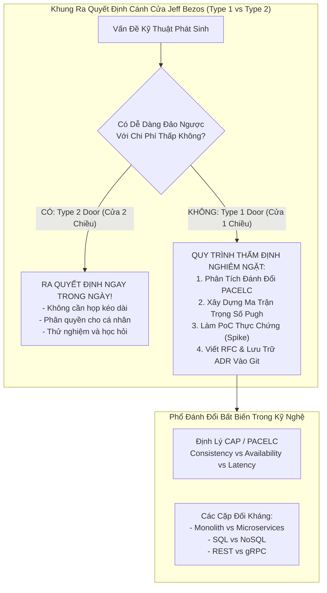

# 18.1. Decision Frameworks and Trade-off Analysis

> [!IMPORTANT]
> **Nếu bạn chỉ được nhớ một điều duy nhất:** Trong kiến trúc phần mềm và kỹ nghệ hệ thống, **không hề có "giải pháp hoàn hảo"; chỉ có các điểm đánh đổi (There are no solutions, only trade-offs - Thomas Sowell)**. Một kỹ sư non trẻ luôn tìm kiếm "viên đạn bạc" (Silver Bullet) hoặc chạy theo xu hướng công nghệ thời thượng (Resume-Driven Development); một kỹ sư trưởng thành định lượng các điểm đánh đổi dựa trên bối cảnh nghiệp vụ bằng **Ma trận quyết định có trọng số (Pugh Matrix)** và phổ đánh đổi bất biến **CAP/PACELC**. Để tổ chức phát triển nhanh mà không gặp thảm họa, mọi quyết định phải được phân loại theo **Cánh Cửa 1 Chiều vs 2 Chiều (Type 1 vs Type 2 Doors của Jeff Bezos)**: Quyết định Type 2 phải được chốt trong vài giờ, trong khi quyết định Type 1 phải được thẩm định nghiêm ngặt và bất biến hóa vào Git thông qua **Hồ sơ quyết định kiến trúc (Architecture Decision Records - ADR)**.

---

## 1. Kiến trúc Tổng quan & Mô hình Tư duy (Mental Model)

### Ẩn Dụ Đời Sống: Mua Căn Nhà Đầu Tiên & Cánh Cửa Sân Bay Một Chiều
1. **Bản Chất Đánh Đổi (Tam Giác Bất Khả Thi Của Cuộc Sống)**: Khi mua nhà, ai cũng muốn: (1) Nhà ở trung tâm thành phố, (2) Diện tích rộng rãi có sân vườn, (3) Giá thành siêu rẻ. Bạn chỉ có thể chọn tối đa 2 trong 3 yếu tố! Nếu muốn nhà trung tâm rộng rãi, giá bắt buộc phải đắt đỏ; nếu muốn nhà rẻ và rộng, bạn phải chấp nhận đi xa 30km. Trong hệ thống phân tán, định lý CAP và định lý PACELC là các quy luật vật lý tương tự: Bạn không thể vừa đòi hỏi Nhất Quán Tuyệt Đối (Consistency), Sẵn Sàng 100% (Availability), lại vừa muốn Độ Trễ Bằng 0 (Latency) khi có phân mảnh mạng!
2. **Cánh Cửa 1 Chiều vs 2 Chiều (Type 1 vs Type 2 Decisions - Jeff Bezos)**:
   - **Type 2 (Cánh cửa 2 chiều)**: Giống như bước vào một căn phòng thử quần áo. Nếu mặc vào thấy không hợp, bạn chỉ việc cởi ra, mở cửa bước trở lại (Đổi thư viện HTTP client, đổi kích thước Connection Pool, thử nghiệm một thuật toán nén mới). Chi phí quay xe gần như bằng 0. *Hành động*: Giao quyền cho kỹ sư quyết định ngay trong 30 phút, tuyệt đối không họp hành kéo dài làm tê liệt tốc độ (Analysis Paralysis).
   - **Type 1 (Cánh cửa 1 chiều)**: Giống như nhảy dù ra khỏi máy bay. Bạn không thể nhảy ngược trở lại vào khoang hành khách (Chọn Sharding Key cho Database chứa 500 triệu đơn hàng, ký hợp đồng đám mây 5 năm, chọn ngôn ngữ cốt lõi cho toàn bộ backend). Chi phí quay xe có thể làm phá sản công ty. *Hành động*: Bắt buộc phải làm Proof-of-Concept (PoC), viết RFC, phân tích ma trận trọng số và phản biện đa chiều kỹ lưỡng.
3. **ADR (Cuốn Nhật Ký Thám Hiểm Hàng Hải)**: Thuyền trưởng ghi lại: "Ngày 15/11, gặp bão lớn ở hướng Đông, quyết định bẻ lái sang hướng Tây. Hậu quả: tốn thêm 3 ngày lương thực nhưng bảo toàn được mạng sống của toàn bộ thủy thủ đoàn". Hai năm sau, một thuyền phó mới lên tàu đọc nhật ký sẽ hiểu chính xác tại sao con tàu lại đi đường vòng, không bao giờ tự ý bẻ lái vào tâm bão cũ.



---

## 2. Chi tiết từng Keyword (Under-the-Hood Deep Dive)

### 2.1. Weighted Decision Matrix & Pugh Matrix (Mathematical Scoring & Objective Criteria)
Khi đứng trước nhiều phương án công nghệ ứng viên ($\text{Option}_1, \dots, \text{Option}_m$), việc quyết định bằng cảm tính hoặc theo sở thích cá nhân là dấu hiệu của sự thiếu trưởng thành kỹ thuật. Ma trận quyết định có trọng số (Pugh Matrix) mang lại cơ sở định lượng toán học minh bạch:
- **Công Thức Tính Điểm Toàn Diện**:
  Xác định $n$ tiêu chí đánh giá với các trọng số $w_i \in (0, 1]$ thỏa mãn điều kiện chuẩn hóa $\sum_{i=1}^{n} w_i = 1$:
  $$\text{Total Score}(O_j) = \sum_{i=1}^{n} w_i \times s_{ij}$$
  Trong đó:
  - $w_i$: Mức độ ưu tiên của tiêu chí $i$ đối với doanh nghiệp (ví dụ: Độ trễ Latency = 0.35, Chi phí Cloud = 0.25, Độ hoàn thiện cộng đồng = 0.20, Độ phức tạp vận hành = 0.20).
  - $s_{ij}$: Điểm số đánh giá của giải pháp $j$ theo tiêu chí $i$ trên thang điểm chuẩn từ 1 đến 10 (được chứng minh bằng số liệu benchmark thực tế).
- **Phân Tích Độ Nhạy (Sensitivity Analysis)**: Thử nghiệm thay đổi nhẹ các trọng số $w_i$ ($\pm 10\%$). Nếu phương án chiến thắng vẫn giữ nguyên vị trí số 1, quyết định đó có độ vững chắc rất cao (Robust Decision).

### 2.2. Distributed Systems Trade-offs: CAP Theorem & PACELC Extension (Abadi Theorem)
- **Giới Hạn Của Định Lý CAP Cổ Điển (Eric Brewer, 2000)**:
  - Khẳng định một hệ phân tán chỉ có thể chọn 2 trong 3 đặc tính: **C (Consistency - Nhất quán tuyến tính)**, **A (Availability - Sẵn sàng 100%)**, và **P (Partition Tolerance - Chịu đựng phân mảnh mạng)**.
  - *Thực tế khắc nghiệt*: Trong môi trường mạng máy tính vật lý, cáp quang có thể đứt, switch có thể sập, do đó **$P$ là điều kiện bắt buộc của tự nhiên, không thể từ chối**! Do đó, CAP thực chất chỉ là sự lựa chọn giữa **CP** (chấp nhận từ chối phục vụ để bảo vệ tính toàn vẹn dữ liệu) hoặc **AP** (chấp nhận dữ liệu cũ để luôn trả lời client).
- **Mở Rộng Định Lý PACELC (Daniel Abadi, 2012)**:
  - Vạch trần điểm mù lớn nhất của CAP: CAP chỉ đề cập đến hành vi của hệ thống **khi có sự cố mạng xảy ra (If Partition - P)**. Nhưng trong $99.99\%$ thời gian hoạt động bình thường của hệ thống **khi không có sự cố mạng (Else - E)** thì sao?
  - **Mệnh Đề PACELC**:
    $$\text{If } \mathbf{P} \implies \text{Trade-off between } [\mathbf{A} \text{ vs } \mathbf{C}]; \quad \mathbf{E}\text{lse} \implies \text{Trade-off between } [\mathbf{L} \text{ vs } \mathbf{C}]$$
    - *PC/EC (ví dụ Bigtable, Spanner, PostgreSQL Master-Replica)*: Khi mạng đứt, chọn Consistency; khi mạng bình thường, chấp nhận độ trễ Latency ($L$) để chờ đồng bộ dữ liệu giữa các node bảo đảm tính nhất quán cao.
    - *PA/EL (ví dụ DynamoDB, Cassandra, Couchbase)*: Khi mạng đứt, chọn Availability; khi mạng bình thường, chọn độ trễ cực thấp ($L$) bằng cách đọc/ghi trên node cục bộ và chấp nhận dữ liệu eventual consistency.

### 2.3. Decision Reversibility: Type 1 vs Type 2 Doors (Jeff Bezos Framework)
- Khung tư duy quản trị nổi tiếng trong thư gửi cổ đông Amazon năm 2016:
  - **Quyết Định Loại 1 (Type 1 Decisions - Cánh cửa 1 chiều)**:
    - Mang tính chiến lược, thay đổi cơ cấu hạ tầng không thể cứu vãn.
    - *Ví dụ*: Chuyển đổi từ Monolith sang Microservices, chọn giải pháp lưu trữ chính cho dữ liệu khách hàng, thiết kế schema bảng phân vùng hàng tỷ records.
    - *Nguyên tắc thực thi*: Yêu cầu phân tích phản biện đa chiều ("Thử làm luật sư của quỷ - Devil's Advocate"), xây dựng Spike Prototype đo lường thực tế, tham vấn các Principal Engineers bên ngoài nhóm.
  - **Quyết Định Loại 2 (Type 2 Decisions - Cánh cửa 2 chiều)**:
    - Chiếm tới $95\%$ các quyết định hàng ngày trong kỹ thuật phần mềm.
    - *Ví dụ*: Đổi tên endpoint API, tách một hàm thành 2 hàm nhỏ, chọn thư viện parser JSON, cấu hình lại tham số bộ đệm.
    - *Căn bệnh của tổ chức quan liêu*: Áp dụng quy trình duyệt gắt gao của Type 1 cho các quyết định Type 2, bắt kỹ sư phải viết báo cáo 20 trang chỉ để thay đổi một tham số timeout, bóp nghẹt hoàn toàn tinh thần đổi mới sáng tạo.

### 2.4. Core Architectural Battles: Monolith vs Microservices, SQL vs NoSQL & REST vs gRPC
Mọi kỹ sư hệ thống bắt buộc phải nắm rõ bản đồ đánh đổi của các trận chiến kiến trúc kinh điển:
1. **Modular Monolith vs Microservices**:
   - *Monolith*: Chi phí triển khai cực thấp, debug dễ dàng, giao tiếp qua lời gọi hàm nội bộ CPU nano-giây (Zero Network Overhead), tính toàn vẹn ACID hoàn hảo. Nhưng khó scale độc lập và ranh giới module dễ bị xói mòn nếu kỷ luật nhóm kém.
   - *Microservices*: Cho phép các nhóm độc lập triển khai, tự do chọn công nghệ phù hợp, scale từng phần tải. Nhưng đánh đổi lại bằng: độ trễ mạng phân tán (Network Hops), thảm họa giao dịch phân tán (Saga/2PC), chi phí vận hành K8s/Service Mesh khổng lồ và khó debug phân tán.
2. **SQL (Quan Hệ) vs NoSQL (Document / Key-Value)**:
   - *SQL*: Đảm bảo toàn vẹn dữ liệu tuyệt đối (ACID), khả năng truy vấn phức tạp linh hoạt (JOIN, Aggregations), chuẩn hóa schema. Nhưng khó mở rộng ngang (Horizontal Sharding) khi dữ liệu vượt hàng chục Terabytes.
   - *NoSQL*: Mở rộng quy mô phân tán quy mô Petabyte cực dễ (Auto-sharding, Partition Keys), độ trễ đọc/ghi siêu thấp. Nhưng đánh đổi: hy sinh ACID transactions xuyên bảng, không có JOIN, logic toàn vẹn dữ liệu bị đẩy lên tầng ứng dụng gánh vác.
3. **REST (JSON over HTTP/1.1) vs gRPC (Protobuf over HTTP/2)**:
   - *REST*: Đơn giản, thân thiện con người (Human-readable JSON), tương thích hoàn hảo với mọi trình duyệt Web và công cụ debug `curl`. Nhưng nhược điểm: payload nặng nề (chuỗi văn bản lặp lại tên trường), độ trễ cao, thiếu kiểu dữ liệu tĩnh nghiêm ngặt.
   - *gRPC*: Định dạng nhị phân siêu nén (Protocol Buffers), tận dụng Multiplexing của HTTP/2, streaming hai chiều, kiểm tra kiểu dữ liệu tĩnh tại thời điểm biên dịch. Lựa chọn số 1 cho giao tiếp giữa các Microservices nội bộ tốc độ cao.

### 2.5. Architecture Decision Records (ADR - Michael Nygard Standard & Git-driven Architecture)
- **Nguồn Gốc**: Được định hình bởi Michael Nygard (2011). Một bản ghi văn bản ngắn gọn (khoảng 1-2 trang Markdown) mô tả một quyết định kiến trúc quan trọng được lưu trực tiếp trong thư mục `docs/adr/` của kho Git mã nguồn.
- **Cấu Trúc Chuẩn Mực 5 Thành Phần Bắt Buộc Của Một Bản ADR**:
  ```markdown
  # ADR-[Số thứ tự]: [Tiêu đề Quyết định]
  
  ## Trạng thái (Status)
  [Proposed | Accepted | Superseded by ADR-xxxx | Deprecated]
  
  ## Bối cảnh (Context)
  Mô tả bài toán kỹ thuật, áp lực kinh doanh và các ràng buộc thực tế dẫn đến quyết định này.
  
  ## Quyết định (Decision)
  Chúng tôi quyết định chọn [Giải pháp X] thay vì [Giải pháp Y và Z].
  
  ## Các Phương Án Đã Bị Bác Bỏ (Alternatives Considered)
  Liệt kê các công nghệ đã xem xét và lý do chính xác tại sao chúng bị loại bỏ.
  
  ## Hậu Quả & Đánh Đổi Chấp Nhận (Consequences & Trade-offs)
  - Tác động tích cực (Lợi ích thu được).
  - Tác động tiêu cực (Khoản nợ kỹ thuật hoặc chi phí vận hành mới chấp nhận gánh vác).
  ```

---

## 3. Thực thi Mã nguồn & Mô phỏng Chuyên sâu (Dual-Engine Implementation)

### Engine 1: C++20 Weighted Decision Matrix Engine với Phân Tích Độ Nhạy
Mã nguồn C++20 triển khai khung tính toán ma trận quyết định có trọng số chuẩn mực, hỗ trợ chuẩn hóa điểm và phân tích độ nhạy:

```cpp
#include <iostream>
#include <vector>
#include <string>
#include <numeric>
#include <iomanip>
#include <algorithm>

struct EvaluationCriterion {
    std::string name;
    double weight; // Trọng số w_i (tổng = 1.0)
};

struct ArchitectureCandidate {
    std::string name;
    std::vector<double> raw_scores; // Điểm số từ 1 đến 10 cho từng tiêu chí
};

class WeightedDecisionMatrix {
public:
    WeightedDecisionMatrix(std::vector<EvaluationCriterion> criteria)
        : criteria_(std::move(criteria)) {
        // Kiểm tra tính chuẩn hóa của trọng số
        double sum_weights = 0.0;
        for (const auto& c : criteria_) sum_weights += c.weight;
        if (std::abs(sum_weights - 1.0) > 1e-4) {
            std::cerr << "[Cảnh báo] Tổng trọng số chưa chuẩn hóa: " << sum_weights << "\n";
        }
    }

    void evaluate(const std::vector<ArchitectureCandidate>& candidates) const {
        std::cout << "=== Bảng Phân Tích Ma Trận Quyết Định Có Trọng Số (Pugh Matrix) ===\n\n";

        // In tiêu đề các tiêu chí
        std::cout << std::left << std::setw(24) << "Phương Án Kỹ Thuật";
        for (const auto& c : criteria_) {
            std::cout << " | " << std::setw(15) << (c.name + " (" + std::to_string(static_cast<int>(c.weight * 100)) + "%)");
        }
        std::cout << " | " << std::setw(12) << "TỔNG ĐIỂM\n";
        std::cout << std::string(95, '-') << "\n";

        std::string winning_candidate;
        double highest_score = -1.0;

        for (const auto& cand : candidates) {
            double total_weighted_score = 0.0;
            std::cout << std::left << std::setw(24) << cand.name;

            for (size_t i = 0; i < criteria_.size(); ++i) {
                double score = cand.raw_scores[i];
                total_weighted_score += score * criteria_[i].weight;
                std::cout << " | " << std::right << std::setw(13) << std::fixed << std::setprecision(1) << score << "  ";
            }

            std::cout << " | " << std::right << std::setw(8) << std::fixed << std::setprecision(2) 
                      << total_weighted_score << " pt\n";

            if (total_weighted_score > highest_score) {
                highest_score = total_weighted_score;
                winning_candidate = cand.name;
            }
        }

        std::cout << std::string(95, '-') << "\n";
        std::cout << ">>> KẾT LUẬN KIẾN TRÚC: Phương án [" << winning_candidate 
                  << "] chiến thắng với tổng điểm: " << highest_score << " / 10.0 <<<\n";
    }

private:
    std::vector<EvaluationCriterion> criteria_;
};

int main() {
    std::cout << "=== C++20 Architecture Decision Matrix Simulator ===\n";

    // Kịch bản lựa chọn Kiến trúc Giao tiếp Microservices
    std::vector<EvaluationCriterion> criteria = {
        {"Độ Trễ Sub-ms",        0.35}, // Trọng số 35%
        {"Throughput IOPS",      0.25}, // Trọng số 25%
        {"Dễ Dàng Debug / Tool", 0.20}, // Trọng số 20%
        {"Kiểu Dữ Liệu Tĩnh",   0.20}  // Trọng số 20%
    };

    WeightedDecisionMatrix matrix(criteria);

    std::vector<ArchitectureCandidate> options = {
        {"REST / JSON (HTTP/1.1)", {6.0, 5.5, 9.5, 3.0}},
        {"gRPC / Protobuf (HTTP/2)",{9.5, 9.0, 6.0, 9.5}},
        {"GraphQL (Apollo / POST)", {5.0, 6.0, 8.5, 7.5}}
    };

    matrix.evaluate(options);
    return 0;
}
```

#### Terminal Output Mẫu (C++20 Engine):
```text
=== C++20 Architecture Decision Matrix Simulator ===
=== Bảng Phân Tích Ma Trận Quyết Định Có Trọng Số (Pugh Matrix) ===

Phương Án Kỹ Thuật       | Độ Trễ Sub-ms (35%) | Throughput IOPS (25%) | Dễ Dàng Debug / Tool (20%) | Kiểu Dữ Liệu Tĩnh (20%) | TỔNG ĐIỂM   
-----------------------------------------------------------------------------------------------
REST / JSON (HTTP/1.1)   |           6.0   |           5.5   |           9.5   |           3.0   |     5.98 pt
gRPC / Protobuf (HTTP/2) |           9.5   |           9.0   |           6.0   |           9.5   |     8.68 pt
GraphQL (Apollo / POST)  |           5.0   |           6.0   |           8.5   |           7.5   |     6.45 pt
-----------------------------------------------------------------------------------------------
>>> KẾT LUẬN KIẾN TRÚC: Phương án [gRPC / Protobuf (HTTP/2)] chiến thắng với tổng điểm: 8.68 / 10.0 <<<
```

---

### Engine 2: Python 3.11+ ADR Validator & Markdown Linter Cho Kho Git
Script Python tự động kiểm tra tính tuân thủ tiêu chuẩn ADR (Architecture Decision Record) trong pipeline CI/CD:

```python
import os
import re
from typing import List, Dict

class ADRValidator:
    """Bộ kiểm tra tính hợp lệ của các bản ghi ADR trong kho Git."""
    REQUIRED_SECTIONS = [
        r"^#\s+ADR-\d+:",            # Tiêu đề dạng: # ADR-0001: ...
        r"^##\s+Trạng thái|^##\s+Status",
        r"^##\s+Bối cảnh|^##\s+Context",
        r"^##\s+Quyết định|^##\s+Decision",
        r"^##\s+Hậu quả|^##\s+Consequences"
    ]

    @classmethod
    def validate_content(cls, filename: str, content: str) -> Dict[str, bool]:
        report = {}
        for pattern in cls.REQUIRED_SECTIONS:
            match = re.search(pattern, content, re.MULTILINE)
            section_name = pattern.replace(r"^#\s+", "").replace(r"^##\s+", "").replace(r"\s+", " ")
            report[section_name] = bool(match)
        return report

if __name__ == "__main__":
    print("=== Python 3.11+ Architecture Decision Record (ADR) Linter ===")

    # Bản ADR mẫu chuẩn mực
    sample_valid_adr = """# ADR-0012: Sử Dụng PostgreSQL Partitioning Cho Lịch Sử Giao Dịch

## Trạng thái (Status)
Accepted (Chấp thuận bởi Lead Architect ngày 15/11/2026)

## Bối cảnh (Context)
Bảng giao dịch `transactions` đã vượt ngưỡng 200 triệu dòng, kích thước index B+ Tree vượt quá dung lượng RAM của máy chủ, khiến độ trễ ghi p99 tăng vọt lên 450ms.

## Quyết định (Decision)
Chúng tôi quyết định áp dụng Native Declarative Table Partitioning theo tháng dựa trên cột `created_at`.

## Các Phương Án Đã Bị Bác Bỏ (Alternatives Considered)
- Sharding ngang bằng Citus: Quá phức tạp trong việc duy trì vận hành cụm tại thời điểm hiện tại.
- Di chuyển sang Cassandra: Thiếu hỗ trợ ACID transaction cần thiết cho sổ cái tài chính.

## Hậu quả & Đánh Đổi Chấp Nhận (Consequences)
- Tích cực: Độ trễ ghi phục hồi về < 10ms, index mỗi phân vùng nằm trọn trong RAM.
- Tiêu cực: Các câu truy vấn không có điều kiện `created_at` sẽ phải quét toàn bộ các phân vùng (Full Partition Scan).
"""

    print("Đang kiểm định tệp: docs/adr/0012-use-postgres-partitioning.md...\n")
    validation_results = ADRValidator.validate_content("0012-adr.md", sample_valid_adr)

    all_passed = True
    for section, passed in validation_results.items():
        status_icon = "✓ HỢP LỆ" if passed else "✗ THIẾU BẮT BUỘC"
        if not passed: all_passed = False
        print(f"  [{status_icon}] Phần mục: {section}")

    print(f"\nKết Quả Đánh Giá: ADR Hợp Chuẩn 100%? {all_passed}")
    if all_passed:
        print("Bản ghi kiến trúc sẵn sàng để commit vào kho Git chính thức!")
```

#### Terminal Output Mẫu (Python 3.11+ Engine):
```text
=== Python 3.11+ Architecture Decision Record (ADR) Linter ===
Đang kiểm định tệp: docs/adr/0012-use-postgres-partitioning.md...

  [✓ HỢP LỆ] Phần mục: ADR-\d+:
  [✓ HỢP LỆ] Phần mục: Trạng thái|## Status
  [✓ HỢP LỆ] Phần mục: Bối cảnh|## Context
  [✓ HỢP LỆ] Phần mục: Quyết định|## Decision
  [✓ HỢP LỆ] Phần mục: Hậu quả|## Consequences

Kết Quả Đánh Giá: ADR Hợp Chuẩn 100%? True
Bản ghi kiến trúc sẵn sàng để commit vào kho Git chính thức!
```

---

## 4. Systems Engineering & Production Pitfalls

### 4.1. Cạm Bẫy Tê Liệt Vì Phân Tích (Analysis Paralysis)
- **Cơ chế**: Đội ngũ kỹ sư sợ hãi trách nhiệm sai lầm, liên tục yêu cầu làm thêm benchmark, tổ chức hàng chục cuộc họp thảo luận không hồi kết giữa hai phương án tương đương nhau.
- **Hệ quả kinh doanh**: 3 tháng trôi qua mà không viết được một dòng code nào, đối thủ cạnh tranh đã ra mắt tính năng và chiếm lĩnh toàn bộ thị trường.
- **Biện pháp phá bỡ bế tắc**: Áp dụng quy tắc **"Thời Gian Đóng Khung (Timeboxing)"**: Cho phép nghiên cứu tối đa 1 tuần (Spike). Khi hết giờ, người chịu trách nhiệm kỹ thuật cao nhất (Tech Lead) bắt buộc phải đưa ra quyết định dựa trên các dữ liệu hiện có theo nguyên tắc Type 2 Door.

### 4.2. Cạm Bẫy Chạy Theo Xu Hướng (Resume-Driven Development - RDD)
- Kỹ sư lựa chọn một công nghệ hoàn toàn không phù hợp với quy mô thực tế của công ty (ví dụ: công ty chỉ có 500 khách hàng mỗi ngày nhưng lại triển khai cụm Kubernetes đa vùng, Kafka phân tán, và Istio Service Mesh phức tạp) chỉ vì muốn làm đẹp hồ sơ xin việc (CV / Resume) cá nhân!
- **Hậu quả**: Chi phí hóa đơn đám mây tăng gấp 10 lần, hệ thống quá phức tạp khiến việc sửa lỗi mất hàng ngày trời.
- **Liều thuốc đặc trị**: Bắt buộc viết ADR bảo vệ trước hội đồng kiến trúc với câu hỏi then chốt: *"Tại sao một cơ sở dữ liệu PostgreSQL đơn giản lại không giải quyết được bài toán này?"*.

### 4.3. Các Lệnh Chẩn Đoán Production Thực Chiến (CLI Diagnostics)
```bash
# 1. Khởi tạo và quản lý hồ sơ ADR trong dự án bằng adr-tools
adr init docs/adr
adr new "Migrate Internal Services to gRPC"

# 2. Liệt kê danh sách các quyết định kiến trúc đã được phê duyệt
adr list

# 3. Tìm kiếm lịch sử commit các quyết định ADR trong kho Git
git log --oneline --grep="ADR-"

# 4. Kiểm tra tính toàn vẹn cú pháp các tệp quy tắc kiến trúc YAML bằng yamllint
yamllint -d relaxed .github/workflows/adr-lint.yml
```

---

## 5. Bảng So sánh & Decision Matrix

| Khung Ra Quyết Định | Bản Chất Kỹ Thuật | Tốc Độ Ra Quyết Định | Mức Độ Rủi Ro | Kịch Bản Áp Dụng Chuẩn |
| :--- | :--- | :--- | :--- | :--- |
| **Pugh Matrix** | Định lượng điểm số có trọng số toán học | Chậm (Cần số liệu đo đạc) | Rất thấp (Minh bạch khách quan) | Chọn lựa công nghệ nền tảng lớn |
| **Type 1 / Type 2 Doors**| Đánh giá tính khả biến và chi phí đảo ngược| **Cực nhanh cho Type 2** | Kiểm soát theo phân loại | Vận hành dự án hàng ngày trong Sprint |
| **Spike / PoC Thực Nghiệm**| Viết mã thử nghiệm nhanh trong 2-3 ngày | Trung bình | Thấp (Có số liệu thực chứng) | Thẩm định các thư viện/framework mới |
| **Architecture Decision Record**| Bất biến hóa quyết định vào lịch sử Git | Bền vững dài hạn | Triệt tiêu lặp lại sai lầm cũ | Mọi quyết định thay đổi kiến trúc cốt lõi |

> [!TIP]
> **Quy Tắc Vàng Ra Quyết Định Thiết Kế (Engineering Decision Rule)**:
> 1. Nhận diện chính xác cánh cửa: Nếu là **Type 2 Door (Cửa 2 chiều)**, hãy ra quyết định ngay trong ngày và bắt tay vào thử nghiệm; nếu là **Type 1 Door**, bắt buộc làm PoC và viết ADR.
> 2. Luôn định lượng các quyết định công nghệ quan trọng bằng **Ma trận quyết định có trọng số (Pugh Matrix)** để tránh rơi vào bẫy cảm tính hoặc chạy theo xu hướng nhất thời (RDD).
> 3. Trong hệ phân tán: Luôn phân tích hệ thống qua lăng kính **PACELC** để biết rõ hệ thống của mình đánh đổi điều gì khi mạng bình thường và khi mạng gặp sự cố.

> [!NOTE]
> **Quy Tắc Quản Trị ADR Trong Vòng Đời Phần Mềm (ADR Immutability)**:
> Một bản ADR một khi đã được chấp thuận (`Accepted`) và hòa vào nhánh `main` của kho Git sẽ trở thành một tài liệu lịch sử bất biến. Nếu sau này nhóm quyết định thay đổi kiến trúc (ví dụ: chuyển từ gRPC sang REST cho các public clients), tuyệt đối không sửa đổi nội dung tệp ADR cũ. Thay vào đó, tạo một bản ghi mới `ADR-0045`, đánh dấu trạng thái bản ghi cũ thành `Superseded by ADR-0045`.
