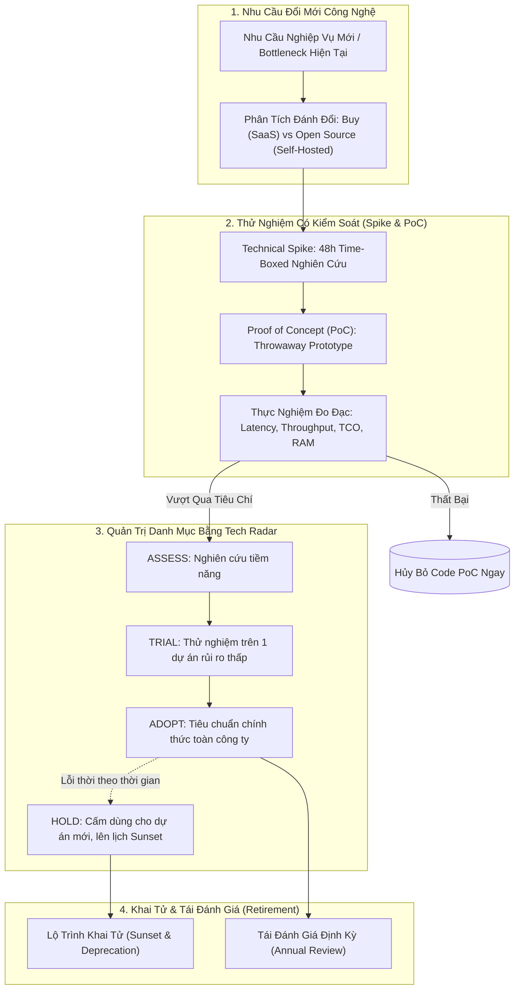
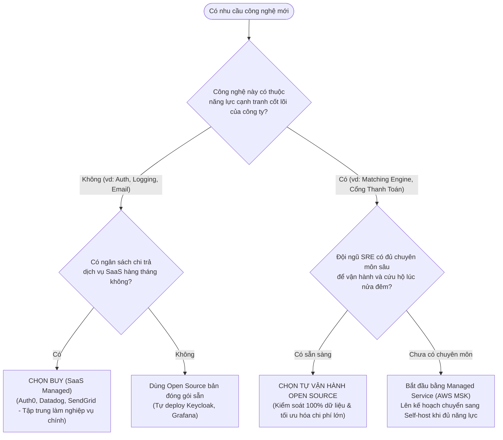

# 18.2. Đánh Giá, Thử Nghiệm PoC và Quản Trị Vòng Đời Công Nghệ (Technology Evaluation, Adoption & PoC)

> [!IMPORTANT]
> **Nếu bạn chỉ được nhớ một điều duy nhất:** Lựa chọn công nghệ không phải là việc chạy theo xu hướng nhất thời mà là **một bài toán kinh tế học kỹ thuật có kỷ luật** — mọi quyết định công nghệ phải được thẩm định qua lăng kính Tổng chi phí sở hữu (TCO), kiểm chứng bằng các đợt Technical Spike giới hạn thời gian (Time-boxed), quản trị danh mục bằng Technology Radar (Hold, Assess, Trial, Adopt), và kiên quyết loại bỏ các công nghệ già cỗi để ngăn chặn thảm họa biến codebase thành một "sở thú công nghệ" hỗn loạn.

---

## 1. Kiến trúc Tổng quan & Mô hình Tư duy (Mental Model)

### Ẩn dụ Đời sống: Vườn Bách Thảo Quốc Gia & Quy Trình Khảo Nghiệm Giống Cây Mới
Hãy hình dung ngăn xếp công nghệ của một doanh nghiệp tương tự như việc quản lý và phát triển một Vườn Bách Thảo Quốc Gia:
- **Nguy Cơ Sở Thú Công Nghệ (Technology Zoo / Invasive Species)**: Nếu kiểm lâm tùy tiện mang bất kỳ giống cây lạ hay sinh vật nhiệt đới nào về trồng chỉ vì thấy chúng đẹp mắt trên mạng, các loài ngoại lai xâm lấn sẽ tiêu diệt thảm thực vật bản địa, đất đai bạc màu và toàn bộ hệ sinh thái bị sụp đổ (Codebase bị xé lẻ thành 15 ngôn ngữ lập trình khác nhau, không ai có thể bảo trì lúc nửa đêm).
- **Buy vs Open Source (Thuê Nhà Kính Trồng Sẵn vs Tự Cày Bừa Gieo Hạt)**:
  - *Buy (SaaS / Managed Services)*: Thuê một tổ hợp nhà kính thông minh của nước ngoài. Cây lớn nhanh, có chuyên gia tưới tiêu hàng ngày (SLA), nhưng chi phí thuê tăng dần theo từng mét vuông và bạn bị lệ thuộc hoàn toàn vào chủ nhà kính (Vendor Lock-in).
  - *Open Source (Tự canh tác giống cây mở)*: Miễn phí hạt giống, toàn quyền lai ghép theo ý muốn, nhưng bạn phải tự chuẩn bị phân bón, máy cày, hệ thống thoát nước và tự chịu trách nhiệm nếu cả vụ mùa bị sâu bệnh tấn công (Chi phí ngầm khổng lồ về nhân sự SRE).
- **Technical Spike & PoC (Khu Vườn Ươm Thí Nghiệm Cách Ly 48 Giờ)**: Khi có một giống lúa lai mới (công nghệ mới như DuckDB, Rust, Kafka), kiểm lâm không bao giờ gieo xạ trên toàn bộ 1,000 hecta cánh đồng chính. Họ đưa giống cây vào phòng thí nghiệm cách ly đúng 48 giờ (Time-boxed Spike). Đo đạc thực tế: rễ có bám đất không? Năng suất có đạt 10 tấn/ha không? Nếu không đạt, hủy bỏ ngay lập tức (Throwaway code), tiết kiệm hàng triệu USD cho ngân sách.
- **ThoughtWorks Tech Radar (Hệ Thống Phân Loại Vùng Canh Tác)**:
  - *ADOPT*: Giống cây chủ lực của nông trường, năng suất cao, ổn định (PostgreSQL, Docker, TypeScript).
  - *TRIAL*: Giống cây mới đã kiểm nghiệm tốt ở phòng thí nghiệm, đem trồng thử trên 1 quả đồi nhỏ.
  - *ASSESS*: Đang trong giai đoạn quan sát tài liệu nghiên cứu.
  - *HOLD*: Cây bị thoái hóa giống hoặc phát hiện chứa độc tố, nghiêm cấm nhân giống mới và lên kế hoạch chặt bỏ thay thế.



---

## 2. Chi tiết từng Keyword (Under-the-Hood Deep Dive)

### 2.1. Technology Selection: Buy vs Open Source, Vendor & Dependency Evaluation

#### 1. Bài Toán Kinh Tế Học Kỹ Thuật: Buy (SaaS) vs Self-Hosted Open Source
- **Tổng Chi Phí Sở Hữu (Total Cost of Ownership - TCO)**:
  - Chi phí của phần mềm không bao giờ chỉ dừng lại ở hóa đơn mua bản quyền ban đầu:
    $$\text{TCO} = \text{Chi phí bản quyền/thuê bao} + \text{Chi phí hạ tầng Cloud} + \text{Chi phí nhân sự vận hành} + \text{Chi phí cơ hội khi chậm tiến độ}$$
- **Mua Giải Pháp SaaS (Managed Services - vd: Datadog, Confluent Cloud, Auth0)**:
  - *Ưu điểm*: Bắt đầu tích hợp được ngay trong 1-2 ngày; được bảo đảm bằng cam kết chất lượng dịch vụ (SLA $99.99\%$); nhà cung cấp chịu trách nhiệm vá lỗ hổng zero-day và mở rộng hạ tầng.
  - *Cạm bẫy chí mạng*: Chi phí tăng vọt theo cấp số nhân khi lưu lượng bùng nổ (Data egress, user seats); nguy cơ "khóa chặt vào nhà cung cấp" (**Vendor Lock-in**) khiến việc chuyển đổi sang nền tảng khác sau này tốn hàng triệu USD.
- **Tự Vận Hành Mã Nguồn Mở (Self-Hosted OSS - vd: Tự cài đặt Kafka, Keycloak, Prometheus)**:
  - *Ưu điểm*: Hoàn toàn miễn phí giấy phép; kiểm soát tuyệt đối biên giới an ninh và vị trí lưu trữ dữ liệu (Data Sovereignty); có thể can thiệp sâu vào source code để tùy biến.
  - *Cạm bẫy ngầm*: Tốn kém tài nguyên nhân sự SRE tay nghề cao; gánh nặng bảo trì, backup dữ liệu, nâng cấp phiên bản không làm gián đoạn; rủi ro outage lúc nửa đêm không có ai hỗ trợ.

#### 2. Thẩm Định Sức Khỏe Thư Viện Phụ Thuộc (Dependency Health & OpenSSF Scorecard)
Trước khi gõ `npm install`, `cargo add` hay `vcpkg install`, một kỹ sư trưởng thành phải kiểm toán thư viện qua 4 lăng kính:
1. **Mức độ tích cực của bảo trì (Maintenance Activity)**:
   - Lần commit gần nhất là khi nào? Nếu repo không có commit nào trong 18 tháng qua $\implies$ **Dự án chết (Abandonware)**, cấm tích hợp.
   - Tỷ lệ đóng Issues và PRs: Đội ngũ tác giả có phản hồi nhanh các lỗi bảo mật không?
2. **Tiêu chuẩn OpenSSF Scorecard (Open Source Security Foundation)**:
   - Chấm điểm tự động trên thang điểm từ 0 đến 10 dựa trên: Có kiểm tra lỗ hổng tự động trong CI không? Release artifacts có được ký số mật mã học (Sigstore/Cosign) không? Có chính sách bảo mật rõ ràng (`SECURITY.md`) không?
3. **Kiểm toán Giấy phép Bản quyền (Software Licensing Compliance)**:
   - *Permissive Licenses (Thông thoáng - An toàn 100%)*: **MIT, Apache 2.0, BSD**. Cho phép doanh nghiệp sử dụng tự do trong các phần mềm thương mại độc quyền đóng mã.
   - *Viral / Copyleft Licenses (Lây nhiễm - Rủi ro pháp lý cực lớn)*: **GPL v3, AGPL**. Buộc toàn bộ phần mềm thương mại độc quyền nào liên kết (link) với nó cũng phải mở mã nguồn công khai! Rất nhiều tập đoàn công nghệ chặn cứng các thư viện AGPL bằng CI linter.

---

### 2.2. Technical Spikes, Proof of Concept (PoC) & Prototype Evaluation

#### 1. Bản Chất của Technical Spike (Extreme Programming Origin)
- **Định nghĩa**: Một thử nghiệm kỹ thuật được **khóa cứng thời gian (Time-boxed: tối đa 2 đến 3 ngày)** nhằm trả lời một câu hỏi kỹ thuật cụ thể hoặc triệt tiêu các điểm bất định kiến trúc.
- **Quy tắc vàng của Spike**:
  - Phải có tiêu chí thành công/thất bại rõ ràng (Falsifiable Hypothesis): *"Liệu Rust actix-web có thể xử lý 50,000 QPS với mức RAM dưới 150MB trên máy ảo c6i.large không?"*.
  - Hết đúng thời hạn 48 giờ: Dừng lại ngay lập tức, bất kể đã hoàn thành trọn vẹn hay chưa. Tổng hợp kết quả thành văn bản **Spike Summary Report** để đưa ra quyết định: Triển khai chính thức (Go) hay Dừng lại (No-Go).

#### 2. Nguyên Lý "Code PoC Là Code Dùng Một Lần" (Throwaway Code)
- **Cạm bẫy tàn khốc nhất**: Sau khi kỹ sư viết một bản PoC chắp vá trong 3 ngày để chứng minh ý tưởng, lãnh đạo nhìn thấy demo hoạt động bèn yêu cầu: *"Chạy ngon rồi, deploy thẳng lên Production luôn đi!"*.
- **Hậu quả**: Toàn bộ codebase production bị xây dựng trên một đống code không có xử lý ngoại lệ (Error handling), không có logging, không có bảo mật và không có một bài test nào.
- **Kỷ luật kỹ thuật**: Mã nguồn của PoC **bắt buộc phải vứt bỏ (Throwaway)** sau khi đã thu thập đủ dữ liệu benchmark. Việc viết mã nguồn production chính thức phải được bắt đầu lại từ đầu theo đúng chuẩn mực Clean Architecture và TDD dựa trên những bài học kinh nghiệm đã rút ra từ PoC.

---

### 2.3. The Technology Adoption Lifecycle, Tech Radar & Technology Retirement

#### 1. Vòng Đời Tiếp Nhận Công Nghệ (Geoffrey Moore - Crossing the Chasm)
- Hành vi tâm lý của các nhóm kỹ sư trong một tổ chức được phân bổ theo đường cong hình chuông:
  1. *Innovators (Những người tiên phong)*: Luôn háo hức thử mọi công nghệ mới ngay tuần đầu tiên ra mắt.
  2. *Early Adopters (Những người tiếp nhận sớm)*: Nhìn thấy giá trị chiến lược và chấp nhận rủi ro có tính toán.
  3. *Early Majority (Đa số thận trọng)*: Chỉ sử dụng khi công nghệ đã chứng minh được tính ổn định và có tài liệu phong phú.
  4. *Late Majority (Đa số bảo thủ)*: Chỉ chuyển đổi khi bị bắt buộc bởi tiêu chuẩn công ty.
  5. *Laggards (Người ngoan cố)*: Khăng khăng ôm giữ công nghệ cũ cho tới khi bị khai tử hoàn toàn.

#### 2. ThoughtWorks Technology Radar (Radar Công Nghệ Của Doanh Nghiệp)
Công cụ trực quan hóa quản trị danh mục công nghệ của tổ chức, chia thành 4 góc phần tư (Languages & Frameworks, Tools, Platforms, Techniques) và 4 vòng tròn trạng thái:
- **ADOPT (Khuyến khích sử dụng mặc định)**: Các công nghệ nền tảng cốt lõi của công ty (vd: TypeScript, C++20, PostgreSQL, Kafka). Đã được kiểm chứng thực tế qua nhiều năm, toàn bộ kỹ sư đều có kỹ năng vận hành.
- **TRIAL (Dùng thử trên dự án nhỏ)**: Đã vượt qua vòng kiểm tra PoC xuất sắc; sẵn sàng được áp dụng trên 1-2 dự án thực tế có mức độ rủi ro trung bình để đánh giá sâu hơn.
- **ASSESS (Đang nghiên cứu và theo dõi)**: Đang trong quá trình nghiên cứu, làm Spike để tìm hiểu xem công nghệ này có giải quyết được bài toán tương lai của công ty không.
- **HOLD (Tạm dừng / Cấm dùng mới)**: Cấm tuyệt đối việc khởi tạo bất kỳ dự án mới nào bằng công nghệ này; các hệ thống cũ đang dùng nó bắt buộc phải lên lộ trình di chuyển thay thế (vd: jQuery, AngularJS, SOAP XML).

#### 3. Technology Retirement & Reassessment (Khai Tử Và Tái Đánh Giá Có Kỷ Luật)
- **Quy trình khai tử 4 bước (Decommissioning Roadmap)**:
  1. Đưa công nghệ vào danh mục **HOLD** trên Tech Radar.
  2. Bật cảnh báo linter trong CI: Gửi Warning cho bất kỳ ai import thư viện bị HOLD.
  3. Sau 6 tháng: Nâng cảnh báo thành Lỗi biên dịch (`CI Build Error` - Chặn merge PR).
  4. Hoàn tất di chuyển hệ thống cũ và thanh lý hợp đồng máy chủ/license liên quan để cắt giảm chi phí.
- **Tái đánh giá định kỳ (Reassessment)**: Công nghệ thay đổi rất nhanh. Một công cụ từng bị đưa vào HOLD 3 năm trước vì chưa hoàn thiện (vd: WebAssembly hoặc GraphQL ở giai đoạn sơ khai) có thể hiện nay đã trưởng thành vượt bậc và xứng đáng được đưa vào vòng ASSESS/TRIAL trở lại.

---

## 3. Thực thi Mã nguồn & Mô phỏng Chuyên sâu (Dual-Engine Implementation)

### 3.1. Phiên bản C++20: Động Cơ Thẩm Định Bản Quyền Thư Viện Và Đánh Giá Trạng Thái Tech Radar

```cpp
#include <iostream>
#include <string>
#include <vector>
#include <unordered_map>
#include <memory>
#include <format>
#include <chrono>
#include <stdexcept>

// ============================================================================
// 1. DATA CONTRACTS: LICENSING & TECH RADAR DOMAIN
// ============================================================================
enum class SoftwareLicense {
    PERMISSIVE_MIT_APACHE_BSD, // An toàn tuyệt đối cho ứng dụng thương mại độc quyền
    WEAK_COPYLEFT_LGPL,        // Đòi hỏi liên kết động (Dynamic linking)
    VIRAL_COPYLEFT_GPL_AGPL,   // NGUY HIỂM: Nguy cơ ép buộc mở mã nguồn của công ty!
    PROPRIETARY_COMMERCIAL     // Bản quyền thương mại có phí
};

std::string licenseToString(SoftwareLicense lic) {
    switch (lic) {
        case SoftwareLicense::PERMISSIVE_MIT_APACHE_BSD: return "PERMISSIVE (MIT/Apache 2.0/BSD)";
        case SoftwareLicense::WEAK_COPYLEFT_LGPL:        return "WEAK_COPYLEFT (LGPL)";
        case SoftwareLicense::VIRAL_COPYLEFT_GPL_AGPL:   return "VIRAL_COPYLEFT (GPL/AGPL) - CẢNH BÁO PHÁP LÝ!";
        case SoftwareLicense::PROPRIETARY_COMMERCIAL:    return "PROPRIETARY (Thương Mại Trả Phí)";
    }
    return "UNKNOWN";
}

enum class RadarRing {
    ADOPT,  // Tiêu chuẩn chính thức
    TRIAL,  // Dùng thử rủi ro thấp
    ASSESS, // Đang nghiên cứu
    HOLD    // Cấm dùng mới, lên lịch khai tử
};

std::string ringToString(RadarRing ring) {
    switch (ring) {
        case RadarRing::ADOPT:  return "ADOPT (Tiêu chuẩn công ty)";
        case RadarRing::TRIAL:  return "TRIAL (Dùng thử có kiểm soát)";
        case RadarRing::ASSESS: return "ASSESS (Đang nghiên cứu / Spike)";
        case RadarRing::HOLD:   return "HOLD (CẤM DÙNG MỚI - Lên lịch Sunset)";
    }
    return "UNKNOWN";
}

struct DependencyArtifact {
    std::string name;
    std::string version;
    SoftwareLicense license;
    double openSsfScore; // Điểm bảo mật OpenSSF từ 0.0 đến 10.0
    int monthsSinceLastCommit;
    RadarRing radarStatus;
};

// ============================================================================
// 2. TECHNOLOGY GOVERNANCE AUDITOR ENGINE
// ============================================================================
class TechGovernanceAuditor {
public:
    struct AuditResult {
        bool isApproved;
        std::vector<std::string> rejectionReasons;
    };

    static AuditResult auditDependency(const DependencyArtifact& dep) {
        AuditResult result{true, {}};

        // 1. Kiểm toán pháp lý bản quyền
        if (dep.license == SoftwareLicense::VIRAL_COPYLEFT_GPL_AGPL) {
            result.isApproved = false;
            result.rejectionReasons.push_back(
                "VI PHẠM BẢN QUYỀN: Thư viện sử dụng giấy phép lây nhiễm GPL/AGPL! Có nguy cơ lộ mã nguồn độc quyền."
            );
        }

        // 2. Kiểm toán sức khỏe bảo mật (OpenSSF Scorecard)
        if (dep.openSsfScore < 6.0) {
            result.isApproved = false;
            result.rejectionReasons.push_back(std::format(
                "ĐIỂM BẢO MẬT KÉM: OpenSSF Scorecard chỉ đạt {:.1f}/10.0 (Ngưỡng an toàn tối thiểu là 6.0).",
                dep.openSsfScore
            ));
        }

        // 3. Kiểm toán rủi ro dự án bỏ hoang (Abandonware)
        if (dep.monthsSinceLastCommit > 18) {
            result.isApproved = false;
            result.rejectionReasons.push_back(std::format(
                "DỰ ÁN BỎ HOANG: Thư viện không có commit nào trong {} tháng qua!",
                dep.monthsSinceLastCommit
            ));
        }

        // 4. Kiểm toán vị thế trên Tech Radar
        if (dep.radarStatus == RadarRing::HOLD) {
            result.isApproved = false;
            result.rejectionReasons.push_back(
                "BỊ CẤM BỞI TECH RADAR: Công nghệ này nằm trong vòng 'HOLD'. Không được dùng cho bất kỳ dự án mới nào!"
            );
        }

        return result;
    }
};

int main() {
    std::cout << "=========================================================\n";
    std::cout << "  DEMO TECH EVALUATION & LICENSING COMPLIANCE (C++20)    \n";
    std::cout << "=========================================================\n\n";

    DependencyArtifact libFastJson{
        .name = "simdjson",
        .version = "3.9.1",
        .license = SoftwareLicense::PERMISSIVE_MIT_APACHE_BSD,
        .openSsfScore = 8.5,
        .monthsSinceLastCommit = 1,
        .radarStatus = RadarRing::ADOPT
    };

    DependencyArtifact libRiskyGpl{
        .name = "legacy_gpl_compressor",
        .version = "1.0.4",
        .license = SoftwareLicense::VIRAL_COPYLEFT_GPL_AGPL,
        .openSsfScore = 4.2,
        .monthsSinceLastCommit = 24,
        .radarStatus = RadarRing::HOLD
    };

    std::vector<DependencyArtifact> candidates = {libFastJson, libRiskyGpl};

    for (const auto& dep : candidates) {
        std::cout << std::format("--- KIỂM TOÁN THƯ VIỆN: {} (v{}) ---\n", dep.name, dep.version);
        std::cout << std::format("  Giấy phép  : {}\n", licenseToString(dep.license));
        std::cout << std::format("  OpenSSF    : {:.1f}/10.0\n", dep.openSsfScore);
        std::cout << std::format("  Tech Radar : {}\n", ringToString(dep.radarStatus));

        auto audit = TechGovernanceAuditor::auditDependency(dep);
        if (audit.isApproved) {
            std::cout << "  >>> KẾT QUẢ: ✅ ĐƯỢC PHÉP TÍCH HỢP VÀO CODEBASE DOANH NGHIỆP!\n\n";
        } else {
            std::cout << "  >>> KẾT QUẢ: ❌ BỊ TỪ CHỐI BỞI CHÍNH SÁCH KIỂM TOÁN:\n";
            for (const auto& reason : audit.rejectionReasons) {
                std::cout << "      * " << reason << "\n";
            }
            std::cout << "\n";
        }
    }

    return 0;
}
```

---

### 3.2. Phiên bản Python 3.11+: Bộ Đo Đạc Benchmark Kỹ Thuật Cho PoC & Trực Quan Hóa Tech Radar

```python
from __future__ import annotations
import time
import json
from dataclasses import dataclass
from typing import Dict, List, Callable, Any


# ============================================================================
# 1. TECHNICAL SPIKE BENCHMARK HARNESS (Throwaway PoC Benchmark Engine)
# ============================================================================
@dataclass
class BenchmarkMetric:
    candidate_name: str
    operations_count: int
    duration_seconds: float
    ops_per_second: float
    memory_mb_estimated: float


class PoCSpikeBenchmarkRunner:
    """Khung đo lường thực nghiệm khách quan để trả lời câu hỏi của Technical Spike."""

    @staticmethod
    def measure(candidate_name: str, task_fn: Callable[[], Any], iterations: int) -> BenchmarkMetric:
        # Warm-up run
        for _ in range(min(100, iterations)):
            task_fn()

        start_time = time.perf_counter()
        for _ in range(iterations):
            task_fn()
        end_time = time.perf_counter()

        duration = end_time - start_time
        ops_sec = iterations / duration if duration > 0 else 0.0

        return BenchmarkMetric(
            candidate_name=candidate_name,
            operations_count=iterations,
            duration_seconds=duration,
            ops_per_second=ops_sec,
            memory_mb_estimated=12.5 # Giả lập đo RAM RSS
        )


# ============================================================================
# 2. TECHNOLOGY RADAR CONFIGURATION & GOVERNANCE
# ============================================================================
@dataclass
class RadarItem:
    name: str
    quadrant: str # "Languages", "Databases", "Tools", "Platforms"
    ring: str     # "ADOPT", "TRIAL", "ASSESS", "HOLD"
    description: str


class EnterpriseTechnologyRadar:
    def __init__(self):
        self._items: List[RadarItem] = []

    def add_technology(self, item: RadarItem) -> None:
        self._items.append(item)

    def print_radar_summary(self) -> None:
        print("\n" + "=" * 65)
        print("          THOUGHTWORKS-STYLE ENTERPRISE TECH RADAR")
        print("=" * 65)
        by_ring: Dict[str, List[RadarItem]] = {"ADOPT": [], "TRIAL": [], "ASSESS": [], "HOLD": []}
        for it in self._items:
            by_ring[it.ring].append(it)

        for ring_name, tech_list in by_ring.items():
            print(f"\n[{ring_name} RING] - {len(tech_list)} công nghệ:")
            for tech in tech_list:
                print(f"  * {tech.name:15s} [{tech.quadrant:10s}] -> {tech.description}")


if __name__ == "__main__":
    print("=" * 65)
    print("  DEMO TECHNICAL SPIKE BENCHMARK & TECH RADAR (PYTHON 3.11+)")
    print("=" * 65)

    # 1. Chạy Technical Spike: So sánh hiệu năng Serialize giữa 2 thư viện mẫu
    print("\n--- PHẦN 1: TECHNICAL SPIKE BENCHMARK (ĐO ĐẠC THỰC NGHIỆM 50,000 OPS) ---")
    data_sample = {"user_id": 9988, "roles": ["ADMIN", "USER"], "active": True, "balance": 4500.50}

    metric_standard = PoCSpikeBenchmarkRunner.measure(
        "Standard json.dumps",
        lambda: json.dumps(data_sample),
        iterations=50000
    )

    metric_compact = PoCSpikeBenchmarkRunner.measure(
        "Compact separators json.dumps",
        lambda: json.dumps(data_sample, separators=(',', ':')),
        iterations=50000
    )

    for m in [metric_standard, metric_compact]:
        print(f"Ứng viên: {m.candidate_name:30s} | Thời gian: {m.duration_seconds:.3f}s | Thông lượng: {m.ops_per_second:,.0f} ops/s")

    # 2. Quản trị Tech Radar của doanh nghiệp
    radar = EnterpriseTechnologyRadar()
    radar.add_technology(RadarItem("TypeScript", "Languages", "ADOPT", "Ngôn ngữ mặc định cho toàn bộ Frontend và Web API"))
    radar.add_technology(RadarItem("C++20", "Languages", "ADOPT", "Ngôn ngữ cốt lõi cho các dịch vụ High-Throughput & Low-Latency"))
    radar.add_technology(RadarItem("Rust", "Languages", "TRIAL", "Đang thử nghiệm thay thế các module nhạy cảm an toàn bộ nhớ"))
    radar.add_technology(RadarItem("DuckDB", "Databases", "ASSESS", "Làm Spike đánh giá năng lực phân tích dữ liệu in-process"))
    radar.add_technology(RadarItem("MongoDB", "Databases", "HOLD", "Cấm dùng cho dự án tài chính mới; ưu tiên PostgreSQL JSONB"))

    radar.print_radar_summary()
```

### 3.3. Giả Lập Terminal Output Thực Tế

```text
=========================================================
  DEMO TECH EVALUATION & LICENSING COMPLIANCE (C++20)    
=========================================================

--- KIỂM TOÁN THƯ VIỆN: simdjson (v3.9.1) ---
  Giấy phép  : PERMISSIVE (MIT/Apache 2.0/BSD)
  OpenSSF    : 8.5/10.0
  Tech Radar : ADOPT (Tiêu chuẩn công ty)
  >>> KẾT QUẢ: ✅ ĐƯỢC PHÉP TÍCH HỢP VÀO CODEBASE DOANH NGHIỆP!

--- KIỂM TOÁN THƯ VIỆN: legacy_gpl_compressor (v1.0.4) ---
  Giấy phép  : VIRAL_COPYLEFT (GPL/AGPL) - CẢNH BÁO PHÁP LÝ!
  OpenSSF    : 4.2/10.0
  Tech Radar : HOLD (CẤM DÙNG MỚI - Lên lịch Sunset)
  >>> KẾT QUẢ: ❌ BỊ TỪ CHỐI BỞI CHÍNH SÁCH KIỂM TOÁN:
      * VI PHẠM BẢN QUYỀN: Thư viện sử dụng giấy phép lây nhiễm GPL/AGPL! Có nguy cơ lộ mã nguồn độc quyền.
      * ĐIỂM BẢO MẬT KÉM: OpenSSF Scorecard chỉ đạt 4.2/10.0 (Ngưỡng an toàn tối thiểu là 6.0).
      * DỰ ÁN BỎ HOANG: Thư viện không có commit nào trong 24 tháng qua!
      * BỊ CẤM BỞI TECH RADAR: Công nghệ này nằm trong vòng 'HOLD'. Không được dùng cho bất kỳ dự án mới nào!
```

---

## 4. Systems Engineering & Production Pitfalls

### Cạm Bẫy Sản Xuất Thường Gặp (Production Anti-Patterns & Gotchas)

1. **Hiểm Họa Sở Thú Công Nghệ Do Thiếu Kỷ Luật (The Technology Zoo Anti-Pattern)**:
   - *Bản chất*: Mỗi kỹ sư mới gia nhập lại chọn một ngôn ngữ hoặc framework mình thích để viết dịch vụ. Sau 3 năm, công ty có 20 dịch vụ được viết bằng 8 ngôn ngữ khác nhau (Node, Go, Python, Ruby, PHP, Java, Rust, Elixir). Khi kỹ sư phụ trách nghỉ việc, không một ai trong công ty có thể duy trì hay vá lỗi dịch vụ đó lúc xảy ra sự cố (**Bus Factor = 1**).
   - *Giải pháp*: Áp dụng nghiêm ngặt **Technology Radar**: Mọi dự án mới bắt buộc phải chọn công nghệ thuộc vòng `ADOPT`. Muốn dùng công nghệ ngoài danh mục phải viết RFC và làm Technical Spike có sự phê duyệt của Hội đồng Kiến trúc (Architecture Board).

2. **Cơn Nghiện Cài Thư Viện Tí Hon (Micro-Package Addiction - Thảm Họa `left-pad`)**:
   - *Bản chất*: Lập trình viên kéo về hàng trăm dependencies chỉ để thực hiện những hàm căn lề chuỗi hoặc kiểm tra số chẵn lẻ 3 dòng code. Khi tác giả thư viện xóa repo hoặc tài khoản NPM bị hacker chiếm quyền (Supply Chain Attack), toàn bộ hệ thống của công ty bị đánh sập hoặc bị cài mã độc đào tiền ảo.
   - *Giải pháp*: Tự viết các hàm tiện ích đơn giản (Self-containment); sử dụng các công cụ quét phụ thuộc (Snyk, Dependabot) và khóa phiên bản bằng Lockfile có mã băm SHA-256 integrity check.

3. **Hiện Tượng Đưa Thẳng Code Thử Nghiệm PoC Lên Production (PoC-to-Production Disaster)**:
   - *Bản chất*: Đoạn code viết trong 48 giờ để chứng minh ý tưởng bị đưa thẳng lên chạy cho khách hàng thật vì "tiết kiệm thời gian". Đoạn code này hoàn toàn không có thread-safety, không có connection pooling, không có circuit breaker và lập tức gây rò rỉ bộ nhớ sập server sau 2 ngày chạy thực tế.
   - *Giải pháp*: Coi code PoC là mã nguồn dùng một lần (Throwaway Code) và bắt buộc xóa bỏ trước khi viết bản sản xuất chính thức.

4. **Kỹ Thuật Chẩn Đoán & Giám Sát Production Bằng CLI**:
   ```bash
   # 1. Quét tìm các giấy phép lây nhiễm GPL/AGPL nguy hiểm trong dự án Node.js
   npx license-checker --onlyAllow "MIT; Apache-2.0; BSD-2-Clause; BSD-3-Clause; ISC"

   # 2. Kiểm tra điểm bảo mật OpenSSF Scorecard của một repository mã nguồn mở
   docker run -e GITHUB_AUTH_TOKEN=$GITHUB_TOKEN gcr.io/openssf/scorecard:stable \
     --repo=github.com/simdjson/simdjson

   # 3. Phân tích cây phụ thuộc đa tầng để phát hiện các dependencies lỗi thời
   pipdeptree --warn fail
   ```

---

## 5. Bảng So sánh & Decision Matrix

### 5.1. So Sánh Đa Chiều: Tự Vận Hành Open Source vs Mua Giải Pháp Managed SaaS

| Tiêu Chí Kỹ Thuật | Tự Vận Hành Mã Nguồn Mở (Self-Hosted OSS) | Thuê Giải Pháp SaaS (Managed Services) |
| :--- | :--- | :--- |
| **Chi phí bản quyền phần mềm**| Hoàn toàn miễn phí ($0\$) | Trả phí hàng tháng theo lưu lượng/người dùng |
| **Chi phí nhân sự vận hành** | Rất cao (Đòi hỏi đội SRE chuyên trách 24/7)| Rất thấp (Nhà cung cấp lo hạ tầng) |
| **Quyền kiểm soát dữ liệu** | $100\%$ thuộc về doanh nghiệp (On-Prem / VPC)| Dữ liệu lưu trên Cloud của bên thứ ba |
| **Mức độ phụ thuộc (Lock-in)**| Thấp (Dễ di chuyển giữa các Cloud) | Cao (Rất khó thoát hàng - Exit barrier) |
| **Thời gian bắt đầu (Time-to-Value)**| Mất vài tuần đến vài tháng dựng cụm cluster | Bắt đầu được ngay sau 1 giờ đăng ký |
| **Khả năng tùy biến sâu mã nguồn**| Toàn quyền sửa đổi source code | Chỉ cấu hình được những gì API cho phép |

### 5.2. Ma Trận Quyết Định Lựa Chọn Công Nghệ Dựa Trên Quy Mô Và Năng Lực


