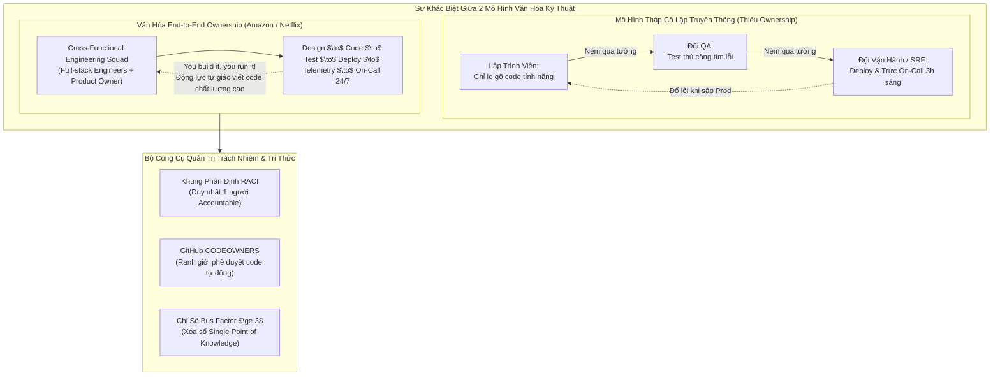
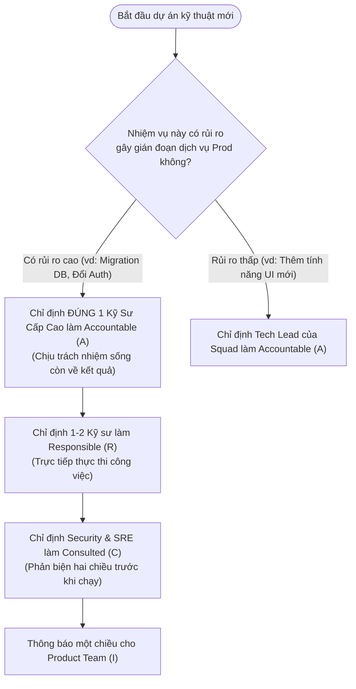

# 19.1. Tinh Thần Sở Hữu Kỹ Thuật và Trách Nhiệm Giải Trình (Technical Ownership & Accountability)

> [!IMPORTANT]
> **Nếu bạn chỉ được nhớ một điều duy nhất:** Sự khác biệt căn bản giữa một lập trình viên gia công theo đầu việc và một Kỹ sư phần mềm chuyên nghiệp nằm ở **tinh thần sở hữu trọn vẹn (End-to-End Ownership: "You build it, you run it")** — người kỹ sư đích thực chịu trách nhiệm toàn diện cho hệ thống từ dòng code đầu tiên, qua bài test, lên production cho tới chuông báo động lúc nửa đêm; đồng thời triệt tiêu điểm nghẽn tri thức cá nhân (SPOK) để duy trì chỉ số an toàn tổ chức (Bus Factor $\ge 3$).

---

## 1. Kiến trúc Tổng quan & Mô hình Tư duy (Mental Model)

### Ẩn dụ Đời sống: Người Thuê Nhà Tạm Bợ vs Chủ Nhân Căn Hộ Cao Cấp
Hãy hình dung văn hóa kỹ nghệ phần mềm thông qua thái độ chăm sóc một ngôi nhà:
- **Người Thuê Nhà Tạm Bợ (Thiếu Tinh Thần Sở Hữu - No Ownership)**: Khi thấy đường ống nước bị rò rỉ dưới bồn rửa, người thuê nhà chỉ dán tạm một miếng băng dính rách hoặc mặc kệ: *"Nhà này có phải của mình đâu, nước ngập sàn thì chủ nhà chịu!"* (Lập trình viên gõ code xong bấm `git push`, lỗi rò rỉ bộ nhớ trên Production thì coi là việc của đội SRE/QA).
- **Chủ Nhân Ngôi Nhà (End-to-End Ownership - "You build it, you run it")**: Người chủ tự tay kiểm tra từng van áp suất, lắp hệ thống cảm biến báo cháy tự động, và lập tức sửa triệt để điểm rò rỉ vì hiểu rằng: nước ngập sẽ làm hỏng toàn bộ nền móng ngôi nhà của chính mình (Kỹ sư tự giác viết unit test, cấu hình circuit breaker, và sẵn sàng nhận cuộc gọi on-call lúc 3 giờ sáng để cứu hộ dịch vụ).
- **Mô Hình Phân Định RACI (Kíp Lái Tàu Ngầm Hạt Nhân)**:
  - *Responsible (Người Thao Tác Bánh Lái - R)*: Thủy thủ trực tiếp gạt cần điều khiển độ sâu theo lệnh.
  - *Accountable (Thuyền Trưởng Duy Nhất - A)*: Người duy nhất chịu trách nhiệm sinh mệnh của toàn bộ 150 thủy thủ trước Bộ Tư lệnh Hải quân. Nếu tàu ngầm va vào đá ngầm, thuyền trưởng là người duy nhất phải giải trình trước tòa án quân sự, không có chuyện đổ lỗi cho hoa tiêu.
  - *Consulted (Sĩ Quan Định Vị Sonar - C)*: Báo cáo tín hiệu sóng âm và vật cản trước khi thuyền trưởng ra quyết định.
  - *Informed (Toàn Bộ Thủy Thủ Đoàn - I)*: Được phát loa thông báo tàu chuẩn bị lặn xuống 300 mét.
- **Chỉ Số An Toàn Tri Thức - Bus Factor (Bảo Vệ Đội Ngũ Phi Hành Gia)**: Trên trạm vũ trụ quốc tế ISS, nếu chỉ có duy nhất 1 phi hành gia biết cách vận hành hệ thống tạo oxy (**Bus Factor = 1 / Single Point of Knowledge**), thì một cơn đau ruột thừa đột ngột của người đó sẽ cướp đi sinh mạng của toàn bộ phi hành đoàn! Vì vậy, NASA bắt buộc tối thiểu 3 người phải được đào tạo thuần thục quy trình vận hành và mọi thao tác đều phải có tài liệu chuẩn mực trong cẩm nang bay.



---

## 2. Chi tiết từng Keyword (Under-the-Hood Deep Dive)

### 2.1. End-to-End Ownership: Code, Service, Operational & Production Ownership

#### 1. Triết Lý "You Build It, You Run It" (Werner Vogels, CTO Amazon)
- **Bản chất tâm lý học hành vi**:
  - Khi một lập trình viên biết rằng sự cố Production sẽ được chuyển cho "đội khác" xử lý, họ sẽ vô thức ưu tiên tốc độ gõ code và bỏ qua các trường hợp biên (Edge Cases, Null Safety, Resource Leak).
  - Nhưng khi chính lập trình viên đó là người **cầm điện thoại PagerDuty reo chuông vào lúc 3:00 sáng Chủ Nhật** nếu dịch vụ bị sập:
    - Họ sẽ lập tức viết đầy đủ Unit Tests, Integration Tests và Stress Tests.
    - Họ sẽ chủ động thêm Logging cấu trúc, gắn Metrics p99 Latency và cấu hình Graceful Shutdown mà không cần bất kỳ ai phải nhắc nhở!
  - *End-to-End Ownership biến trách nhiệm vận hành thành động lực nội tại tối thượng để nâng cao chất lượng mã nguồn*.

#### 2. Phân Cấp Các Tầng Sở Hữu Kỹ Thuật (Layers of Ownership)
1. **Code Ownership (Sở hữu Mã nguồn)**:
   - *Strong Code Ownership*: Mỗi thư mục hoặc module kiến trúc có một cá nhân hoặc một squad cụ thể làm chủ (khai báo qua file `.github/CODEOWNERS`). Mọi Pull Request sửa đổi vào vùng code này bắt buộc phải có chữ ký phê duyệt (Approval) của Owner mới được phép merge.
   - *Collective Code Ownership (Sở hữu Tập thể của XP)*: Bất kỳ kỹ sư nào cũng có quyền và nghĩa vụ sửa lỗi, dọn dẹp nợ kỹ thuật (Boy Scout Rule) trên toàn bộ codebase khi nhìn thấy điều bất hợp lý, với sự bảo vệ của bộ kiểm thử tự động toàn diện.
2. **Service & Operational Ownership (Sở hữu Dịch vụ & Vận hành)**:
   - Squad sở hữu dịch vụ chịu trách nhiệm từ việc thiết kế API, viết tài liệu Runbook, định nghĩa hợp đồng SLA/SLO, cho tới việc quản lý chi phí tài nguyên Cloud (FinOps) của dịch vụ đó.
3. **Production Ownership (Làm chủ Môi trường Sản xuất)**:
   - Môi trường Production là nơi duy nhất tạo ra doanh thu và giá trị kinh doanh. Kỹ sư có Production Ownership không bao giờ coi việc deploy thành công là kết thúc: họ chủ động quan sát Grafana Dashboard trong 30 phút sau khi deploy, kiểm tra tỷ lệ lỗi HTTP 5xx, và trực tiếp điều hành xử lý sự cố nếu có bất thường.

---

### 2.2. Accountability vs Responsibility & The RACI Framework

#### 1. Phân Biệt Sâu Sắc: Responsibility vs Accountability
- **Responsibility (Trách nhiệm thực thi - The Doer)**:
  - Là người trực tiếp cầm bàn phím gõ code, viết script migration hoặc cấu hình server.
  - Có thể được chia sẻ giữa nhiều người (ví dụ: 3 kỹ sư cùng nhau thực hiện tính năng thanh toán).
- **Accountability (Trách nhiệm giải trình cuối cùng - The Owner)**:
  - Là người duy nhất chịu trách nhiệm toàn diện trước ban giám đốc và khách hàng về kết quả cuối cùng (thành công hay thất bại, đúng hạn hay trễ hạn, an toàn hay bảo mật kém).
  - **Quy tắc vàng bất biến**: **Tại một thời điểm, chỉ có DUY NHẤT MỘT NGƯỜI chịu Accountability cho một hạng mục!**
    *"If everyone is accountable, no one is accountable"* (Nếu tất cả cùng chịu trách nhiệm cuối cùng, thì trên thực tế không có ai chịu trách nhiệm cả — mọi người sẽ đùn đẩy cho nhau khi có sự cố).

#### 2. Khung Phân Định RACI (RACI Matrix) Chuẩn Mực

| Chữ Cái | Vai Trò Kỹ Thuật | Số Lượng Người Tối Ưu | Bản Chất Tương Tác |
| :---: | :--- | :---: | :--- |
| **R** | **Responsible** (Người làm việc) | $\ge 1$ người | Trực tiếp bắt tay vào thực hiện công việc kỹ thuật |
| **A** | **Accountable** (Người chịu trách nhiệm cuối) | **Chính xác 1 người** | Đưa ra quyết định cuối cùng, chịu trách nhiệm kết quả |
| **C** | **Consulted** (Người được tham vấn) | Nhóm nhỏ chuyên gia | Trao đổi hai chiều (Two-way communication): Security, SRE |
| **I** | **Informed** (Người được cập nhật thông tin)| Các bên liên quan | Cập nhật một chiều (One-way communication): PM, Ban giám đốc |

- **Mô hình DRI (Directly Responsible Individual - Apple)**: Tại Apple, mọi dòng code, mọi quyết định thiết kế và mọi buổi họp đều có một cá nhân cụ thể được chỉ định làm DRI. Không có khái niệm mơ hồ "nhóm chúng tôi đang xem xét", luôn có một cái tên cụ thể đứng ra giải trình trước Steve Jobs và ban điều hành.

---

### 2.3. Knowledge Distribution, Bus Factor & Single Point of Knowledge (SPOK)

#### 1. Chỉ Số Xe Buýt (Bus Factor / Truck Factor)
- **Định nghĩa toán học**: Số lượng kỹ sư chủ chốt tối thiểu trong dự án mà nếu họ đột ngột bị xe buýt đâm (hoặc trúng xổ số nghỉ việc, hoặc bị ốm dài ngày), toàn bộ dự án sẽ **ngay lập tức rơi vào cảnh tê liệt** vì không còn ai hiểu cách bảo trì hoặc sửa chữa hệ thống.
- **Phân loại mức độ rủi ro**:
  - $\text{Bus Factor} = 1$: **Mức độ Nguy hiểm Tột cùng (Critical Outage Risk)**. Một kỹ sư nghỉ việc là toàn bộ công ty hoảng loạn.
  - $\text{Bus Factor} = 2$: Tạm chấp nhận cho nhóm nhỏ dưới 5 người.
  - $\text{Bus Factor} \ge 3$: **Mức độ An toàn Trưởng thành (Resilient Organization)**. Bất kỳ ai nghỉ phép, hệ thống vẫn duy trì vận hành ổn định.

#### 2. Triệt Tiêu Điểm Nghẽn Tri Thức Đơn Lẻ (Single Point of Knowledge - SPOK)
- **Hiện tượng Găm giữ kiến thức (Knowledge Hoarding Anti-Pattern)**: Kỹ sư cố tình không viết tài liệu, từ chối chia sẻ bí quyết kỹ thuật vì ảo tưởng rằng: *"Nếu chỉ có mình biết làm điều này, công ty sẽ không bao giờ dám sa thải mình"*. Trong các tổ chức kỹ thuật trưởng thành, hành vi này bị coi là vi phạm nghiêm trọng đạo đức kỹ thuật và là lý do hàng đầu để loại bỏ nhân sự độc hại.
- **4 Chiến Lược Kỹ Thuật Nâng Cao Bus Factor**:
  1. *Documentation as Code & Living Runbooks*: Mọi tri thức cứu hộ phải được viết thành Markdown lưu trong Git, biến tri thức cá nhân thành tài sản vĩnh viễn của tổ chức.
  2. *Mandatory Peer Review*: Không một ai được phép tự merge code của mình mà không có ít nhất 1 kỹ sư khác đọc hiểu và phê duyệt.
  3. *Rotating On-Call & Module Rotation*: Luân chuyển ca trực và luân chuyển phân hệ phụ trách giữa các kỹ sư sau mỗi 6 tháng.
  4. *Pair Programming & Shadowing*: Cử một kỹ sư khác cùng ngồi xem và thao tác trong các kịch bản triển khai phức tạp.

---

## 3. Thực thi Mã nguồn & Mô phỏng Chuyên sâu (Dual-Engine Implementation)

### 3.1. Phiên bản C++20: Động Cơ Thẩm Định Khung RACI Và Trình Phân Giải Quy Trình Phê Duyệt CODEOWNERS

```cpp
#include <iostream>
#include <string>
#include <vector>
#include <unordered_map>
#include <memory>
#include <format>
#include <algorithm>
#include <stdexcept>

// ============================================================================
// 1. DATA CONTRACTS: RACI MATRIX & CODEOWNERS RESOLVER
// ============================================================================
enum class RaciRole {
    RESPONSIBLE, // Người thực thi
    ACCOUNTABLE, // Người chịu trách nhiệm cuối cùng (DUY NHẤT 1)
    CONSULTED,   // Chuyên gia tham vấn
    INFORMED     // Người nhận thông báo
};

struct TaskAssignment {
    std::string engineerName;
    RaciRole role;
};

struct ProjectTask {
    std::string taskName;
    std::vector<TaskAssignment> assignments;
};

// ============================================================================
// 2. RACI INTEGRITY VALIDATOR ENGINE
// ============================================================================
class RaciGovernanceEngine {
public:
    static bool validateTask(const ProjectTask& task, std::vector<std::string>& outViolations) {
        bool isValid = true;
        int accountableCount = 0;
        int responsibleCount = 0;

        for (const auto& a : task.assignments) {
            if (a.role == RaciRole::ACCOUNTABLE) {
                accountableCount++;
            } else if (a.role == RaciRole::RESPONSIBLE) {
                responsibleCount++;
            }
        }

        // Kiểm toán quy tắc vàng RACI
        if (accountableCount == 0) {
            outViolations.push_back(std::format(
                "LỖI RACI CHÍ MẠNG: Nhiệm vụ '{}' không có ai chịu trách nhiệm Accountable (Chủ sở hữu)! Rủi ro vô chủ.",
                task.taskName
            ));
            isValid = false;
        } else if (accountableCount > 1) {
            outViolations.push_back(std::format(
                "LỖI PHÂN TÁN TRÁCH NHIỆM: Nhiệm vụ '{}' có {} người cùng chịu trách nhiệm Accountable! Vi phạm nguyên tắc duy nhất một chủ nhân.",
                task.taskName, accountableCount
            ));
            isValid = false;
        }

        if (responsibleCount == 0) {
            outViolations.push_back(std::format(
                "CẢNH BÁO: Nhiệm vụ '{}' không có ai chịu trách nhiệm thực thi (Responsible)!",
                task.taskName
            ));
            isValid = false;
        }

        return isValid;
    }
};

// ============================================================================
// 3. GITHUB CODEOWNERS RESOLVER SIMULATION
// ============================================================================
class CodeownersResolver {
private:
    std::unordered_map<std::string, std::vector<std::string>> ownershipRules_;

public:
    void addRule(std::string pathPrefix, std::vector<std::string> owners) {
        ownershipRules_[std::move(pathPrefix)] = std::move(owners);
    }

    std::vector<std::string> resolveRequiredReviewers(const std::string& modifiedFile) const {
        for (const auto& [prefix, owners] : ownershipRules_) {
            if (modifiedFile.rfind(prefix, 0) == 0) { // Kiểm tra tiền tố đường dẫn
                return owners;
            }
        }
        return {"@general-engineering-team"};
    }
};

int main() {
    std::cout << "=========================================================\n";
    std::cout << "  DEMO TECHNICAL OWNERSHIP: RACI & CODEOWNERS (C++20)    \n";
    std::cout << "=========================================================\n\n";

    // 1. Thử nghiệm thẩm định Ma trận RACI
    ProjectTask validTask{
        .taskName = "Nâng cấp cụm Database PostgreSQL 16 Zero-Downtime",
        .assignments = {
            {"Alice (Lead Architect)", RaciRole::ACCOUNTABLE}, // Duy nhất 1 Accountable
            {"Bob (Senior SRE)", RaciRole::RESPONSIBLE},
            {"Charlie (DBA)", RaciRole::RESPONSIBLE},
            {"David (Security Lead)", RaciRole::CONSULTED},
            {"CTO & Product Managers", RaciRole::INFORMED}
        }
    };

    ProjectTask brokenTask{
        .taskName = "Tối ưu hóa chi phí Cloud AWS FinOps",
        .assignments = {
            {"Bob (Senior SRE)", RaciRole::ACCOUNTABLE},
            {"Charlie (Platform Lead)", RaciRole::ACCOUNTABLE}, // VI PHẠM: 2 người Accountable!
            {"Alice (Dev)", RaciRole::RESPONSIBLE}
        }
    };

    std::vector<ProjectTask> projectTasks = {validTask, brokenTask};

    for (const auto& t : projectTasks) {
        std::cout << std::format("--- KIỂM TOÁN RACI: '{}' ---\n", t.taskName);
        std::vector<std::string> errors;
        if (RaciGovernanceEngine::validateTask(t, errors)) {
            std::cout << "  >>> KẾT QUẢ: ✅ HỢP LỆ! Phân định trách nhiệm rành mạch 100%.\n\n";
        } else {
            std::cout << "  >>> KẾT QUẢ: ❌ THẤT BẠI! Phát hiện vi phạm quản trị:\n";
            for (const auto& err : errors) {
                std::cout << "      * " << err << "\n";
            }
            std::cout << "\n";
        }
    }

    // 2. Thử nghiệm phân giải quyền sở hữu mã nguồn CODEOWNERS
    std::cout << "--- PHÂN GIẢI QUYỀN SỞ HỮU MÃ NGUỒN (GITHUB CODEOWNERS) ---\n";
    CodeownersResolver resolver;
    resolver.addRule("/src/auth/", {"@security-team", "@alice-staff-sec"});
    resolver.addRule("/src/billing/", {"@core-billing-squad"});
    resolver.addRule("/infra/terraform/", {"@platform-sre"});

    std::vector<std::string> modifiedFiles = {
        "/src/auth/jwt_validator.cpp",
        "/src/billing/stripe_gateway.cpp",
        "/docs/readme.md"
    };

    for (const auto& file : modifiedFiles) {
        auto owners = resolver.resolveRequiredReviewers(file);
        std::cout << std::format("File sửa đổi: {:35s} -> Người phê duyệt bắt buộc: ", file);
        for (const auto& o : owners) std::cout << o << " ";
        std::cout << "\n";
    }

    return 0;
}
```

---

### 3.2. Phiên bản Python 3.11+: Bộ Đo Lường Tự Động Bus Factor & Rủi Ro SPOK Từ Lịch Sử Git

```python
from __future__ import annotations
import math
from dataclasses import dataclass
from typing import Dict, List, Tuple


@dataclass
class AuthorCommitStat:
    author_name: str
    commits_count: int
    percentage: float


class BusFactorAnalyzer:
    """Phân tích mức độ tập trung tri thức (Knowledge Concentration) và tính toán Bus Factor."""

    @staticmethod
    def calculate_bus_factor(commit_counts: Dict[str, int], risk_threshold_percent: float = 75.0) -> Tuple[int, List[AuthorCommitStat], str]:
        total_commits = sum(commit_counts.values())
        if total_commits == 0:
            return 0, [], "Không có dữ liệu commit"

        # Sắp xếp các tác giả theo số lượng commit giảm dần
        sorted_authors = sorted(commit_counts.items(), key=lambda x: x[1], reverse=True)
        stats: List[AuthorCommitStat] = []
        cumulative_commits = 0
        bus_factor = 0

        for author, count in sorted_authors:
            pct = (count / total_commits) * 100.0
            stats.append(AuthorCommitStat(author_name=author, commits_count=count, percentage=round(pct, 1)))

        # Tính Bus Factor: Số lượng tác giả tối thiểu chiếm trên ngưỡng risk_threshold_percent (vd: 75%)
        running_sum = 0
        for stat in stats:
            running_sum += stat.commits_count
            bus_factor += 1
            if (running_sum / total_commits) * 100.0 >= risk_threshold_percent:
                break

        # Đánh giá mức độ an toàn
        if bus_factor == 1:
            risk_assessment = "🚨 CẢNH BÁO ĐỎ: BUS FACTOR = 1 (Tồn tại Single Point of Knowledge nguy hiểm!)"
        elif bus_factor == 2:
            risk_assessment = "⚠️ CẢNH BÁO VÀNG: BUS FACTOR = 2 (Rủi ro vừa phải, cần đào tạo kế nhiệm)"
        else:
            risk_assessment = f"✅ AN TOÀN: BUS FACTOR = {bus_factor} (Tri thức được phân phối đồng đều)"

        return bus_factor, stats, risk_assessment


if __name__ == "__main__":
    print("=" * 65)
    print("   DEMO BUS FACTOR & KNOWLEDGE DISTRIBUTION ANALYZER (PYTHON)")
    print("=" * 65)

    # Kịch bản 1: Module Thanh Toán Bị Độc Quyền Tri Thức (SPOK)
    print("\n--- 1. PHÂN TÍCH MODULE: /src/billing/ (DỮ LIỆU 90 NGÀY QUA) ---")
    billing_commits = {
        "Senior_Dave_Guru": 185, # Dave chiếm hầu hết mọi commit!
        "Junior_Alice": 12,
        "Mid_Bob": 8
    }

    bf1, stats1, assessment1 = BusFactorAnalyzer.calculate_bus_factor(billing_commits)
    print(f"Tổng số commits: {sum(billing_commits.values())}")
    for s in stats1:
        print(f"  * Tác giả: {s.author_name:20s} | {s.commits_count:3d} commits ({s.percentage:5.1f}%)")
    print(f"Chỉ số Bus Factor: {bf1}")
    print(f"Đánh giá rủi ro  : {assessment1}")

    # Kịch bản 2: Module Lõi Phân Tán Tri Thức Hoàn Hảo Nhờ Pair Programming
    print("\n--- 2. PHÂN TÍCH MODULE: /src/core_engine/ (HỆ THỐNG TRƯỞNG THÀNH) ---")
    core_commits = {
        "Engineer_Sarah": 65,
        "Engineer_Michael": 58,
        "Engineer_Alex": 52,
        "Engineer_Elena": 45
    }

    bf2, stats2, assessment2 = BusFactorAnalyzer.calculate_bus_factor(core_commits)
    print(f"Tổng số commits: {sum(core_commits.values())}")
    for s in stats2:
        print(f"  * Tác giả: {s.author_name:20s} | {s.commits_count:3d} commits ({s.percentage:5.1f}%)")
    print(f"Chỉ số Bus Factor: {bf2}")
    print(f"Đánh giá rủi ro  : {assessment2}")
```

### 3.3. Giả Lập Terminal Output Thực Tế

```text
=========================================================
  DEMO TECHNICAL OWNERSHIP: RACI & CODEOWNERS (C++20)    
=========================================================

--- KIỂM TOÁN RACI: 'Nâng cấp cụm Database PostgreSQL 16 Zero-Downtime' ---
  >>> KẾT QUẢ: ✅ HỢP LỆ! Phân định trách nhiệm rành mạch 100%.

--- KIỂM TOÁN RACI: 'Tối ưu hóa chi phí Cloud AWS FinOps' ---
  >>> KẾT QUẢ: ❌ THẤT BẠI! Phát hiện vi phạm quản trị:
      * LỖI PHÂN TÁN TRÁCH NHIỆM: Nhiệm vụ 'Tối ưu hóa chi phí Cloud AWS FinOps' có 2 người cùng chịu trách nhiệm Accountable! Vi phạm nguyên tắc duy nhất một chủ nhân.

--- PHÂN GIẢI QUYỀN SỞ HỮU MÃ NGUỒN (GITHUB CODEOWNERS) ---
File sửa đổi: /src/auth/jwt_validator.cpp         -> Người phê duyệt bắt buộc: @security-team @alice-staff-sec 
File sửa đổi: /src/billing/stripe_gateway.cpp     -> Người phê duyệt bắt buộc: @core-billing-squad 
File sửa đổi: /docs/readme.md                     -> Người phê duyệt bắt buộc: @general-engineering-team 
```

---

## 4. Systems Engineering & Production Pitfalls

### Cạm Bẫy Sản Xuất Thường Gặp (Production Anti-Patterns & Gotchas)

1. **Hiệu Ứng Bàng Quan Khi Xảy Ra Sự Cố Sản Xuất (The Bystander Effect Outage)**:
   - *Bản chất*: Trong kênh Slack `#incident-war-room` có mặt 40 kỹ sư, hệ thống đang báo lỗi sập cổng thanh toán. Vì ai cũng nghĩ *"Chắc có người khác đang sửa rồi"*, suốt 45 phút không có ai gõ một dòng lệnh kiểm tra nào.
   - *Giải pháp*: Áp dụng quy tắc chỉ định **Incident Commander (IC)** ngay lập tức theo mô hình RACI: người trực ca on-call nhận alert phải tuyên bố công khai: *"Tôi là IC cho sự cố này và tôi chịu trách nhiệm điều phối giải quyết"*.

2. **Cơn Ác Mộng Của "Găm Giữ Kiến Thức Để Giữ Chỗ" (Knowledge Hoarding Anti-Pattern)**:
   - *Bản chất*: Một kỹ sư kỳ cựu cố tình viết code phức tạp khó hiểu, không viết Runbook và giữ kín mật khẩu production để biến mình thành "người không thể thay thế".
   - *Hậu quả*: Dự án trở thành con tin của một cá nhân; khi người đó đòi tăng lương gấp 3 lần hoặc nghỉ việc đột ngột, toàn bộ hoạt động kinh doanh bị tê liệt.
   - *Giải pháp*: Đánh giá hiệu suất kỹ sư (Performance Review) dựa trên tiêu chí: *"Bạn đã giúp đỡ và đào tạo được bao nhiêu đồng nghiệp hiểu và vận hành được hệ thống của bạn?"*.

3. **Bẫy Sở Hữu Tập Thể Biến Thành Vô Chủ (Collective Ownership Becoming Nobody's Ownership)**:
   - *Bản chất*: Lạm dụng khẩu hiệu "Sở hữu tập thể" của Extreme Programming nhưng không có ranh giới rõ ràng, dẫn đến việc không ai chịu trách nhiệm dọn rác, nâng cấp phiên bản bảo mật hay dọn dẹp các thư viện lỗi thời.
   - *Giải pháp*: Kết hợp Strong Ownership cho các tầng kiến trúc cốt lõi qua `.github/CODEOWNERS` với Collective Ownership cho việc đóng góp tính năng thông qua quy trình InnerSource.

4. **Kỹ Thuật Chẩn Đoán & Giám Sát Production Bằng CLI**:
   ```bash
   # 1. Trích xuất tỷ lệ đóng góp của tác giả dẫn đầu trong module src/auth (Kiểm tra Bus Factor)
   git shortlog -sn --since="90 days ago" src/auth/ | head -n 5

   # 2. Thẩm định cú pháp file CODEOWNERS trong GitHub repository
   npx codeowners-checker

   # 3. Quét tìm các file mã nguồn mồ côi (Orphaned files) không có chủ sở hữu trong CODEOWNERS
   git ls-files | while read -r f; do git check-attr -a "$f" | grep -q "owners" || echo "Không có Owner: $f"; done
   ```

---

## 5. Bảng So sánh & Decision Matrix

### 5.1. So Sánh Hai Mô Hình Sở Hữu Mã Nguồn (Code Ownership Models)

| Tiêu Chí Kỹ Thuật | Sở Hữu Tập Thể (Collective Ownership) | Sở Hữu Nghiêm Ngặt (Strong Code Ownership) |
| :--- | :--- | :--- |
| **Quyền sửa đổi code** | Bất kỳ ai trong công ty cũng có thể sửa | Chỉ chủ sở hữu (CODEOWNERS) mới được duyệt |
| **Tốc độ merge PR** | Nhanh chóng (Review bởi đồng nghiệp bất kỳ) | Phụ thuộc vào tốc độ phản hồi của Owner |
| **Tính đồng nhất kiến trúc** | Dễ bị suy thoái nếu thiếu quy chuẩn | Rất cao (Owner kiểm soát chặt thiết kế) |
| **Rủi ro Bus Factor** | Thấp (Nhiều người cùng chạm vào code) | Cao (Nếu module chỉ có 1 chủ sở hữu duy nhất) |
| **Môi trường phù hợp nhất** | Startup, MVP, nhóm nhỏ dưới 15 người | Doanh nghiệp lớn, hệ thống Core tài chính/bảo mật |

### 5.2. Ma Trận Quyết Định Phân Định Trách Nhiệm RACI


