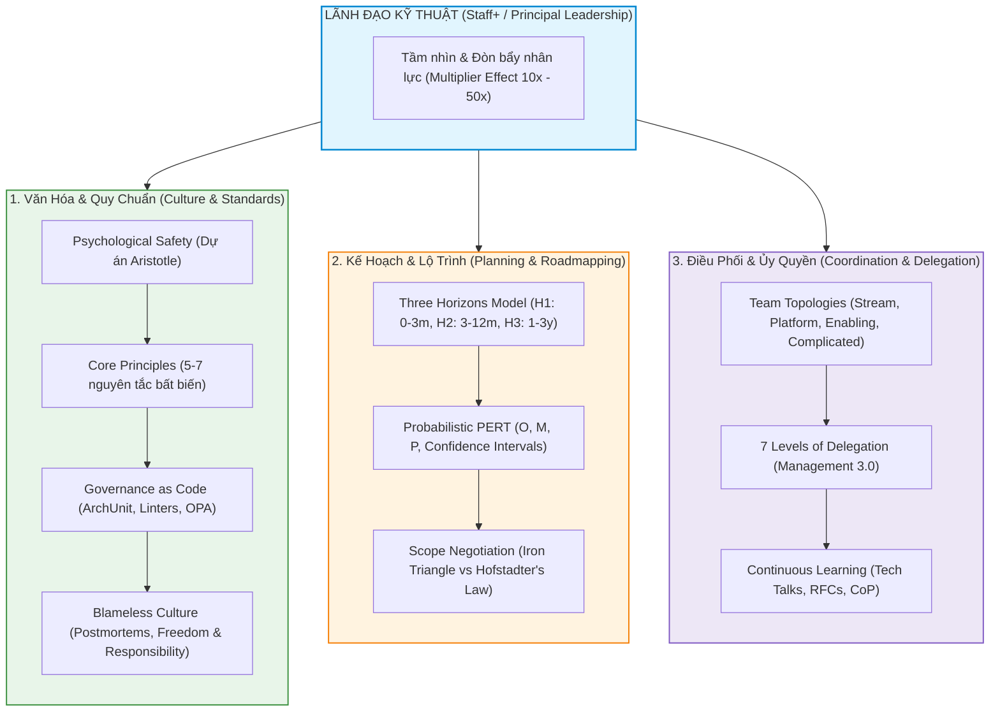
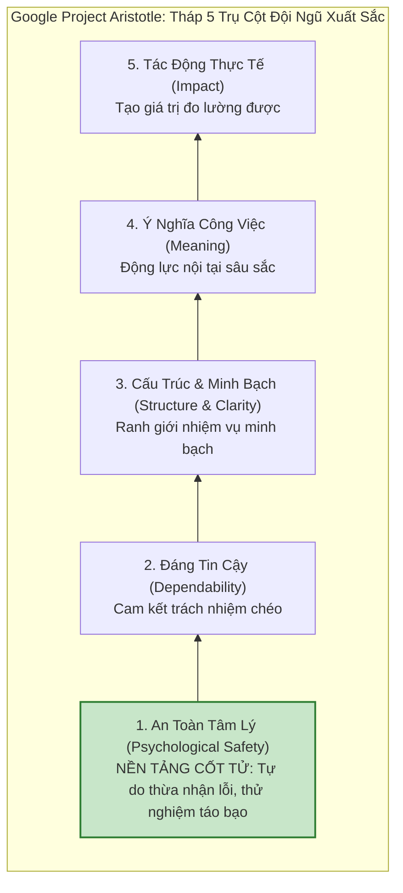
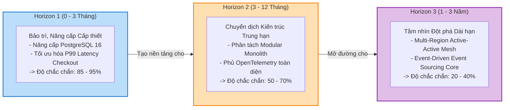
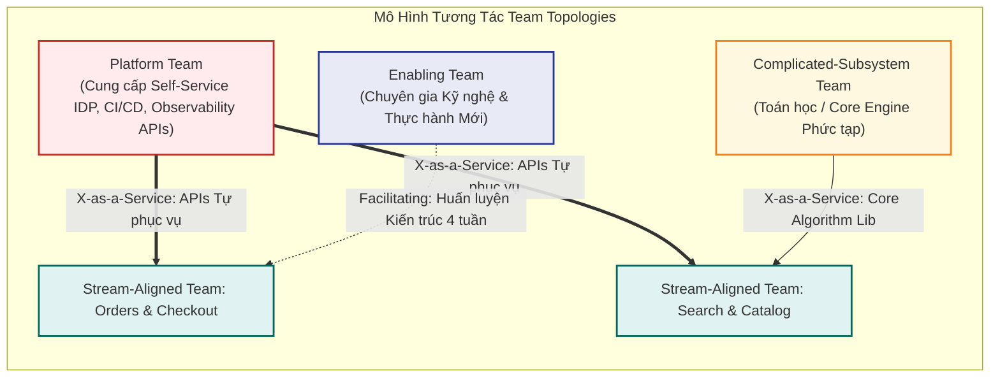
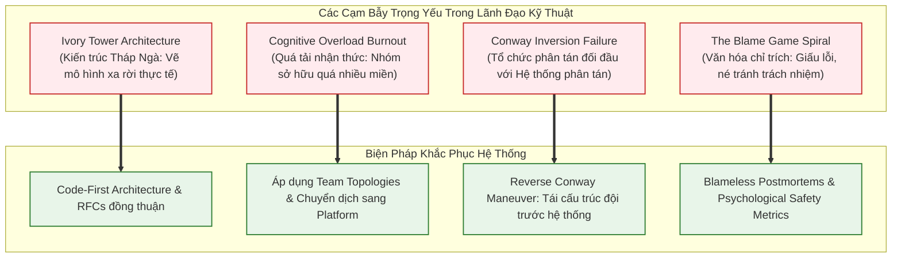

# 19.2. Lãnh Đạo Kỹ Thuật, Văn Hóa Kỹ Nghệ và Xây Dựng Lộ Trình (Technical Leadership, Culture & Roadmapping)

> [!IMPORTANT]
> **Nếu bạn chỉ được nhớ một điều duy nhất:** Lãnh đạo kỹ thuật (Technical Leadership) không đo bằng số dòng code bạn tự tay gõ hay quyền lực hành chính bạn nắm giữ, mà đo bằng **hệ số nhân lực (Multiplier Effect)**: khả năng thiết lập văn hóa kỹ thuật tự cường, biến quy chuẩn thành mã máy tự động (Governance as Code), dự báo lộ trình công nghệ bằng xác suất khoa học (PERT & Probabilistic Estimation), và phân bổ cấu trúc đội ngũ tối ưu nhận thức (Team Topologies) để toàn bộ tổ chức cùng tiến bước mà không bị nghẽn ở bất kỳ cá nhân nào.

---

## 1. Kiến trúc Tổng quan & Mô hình Tư duy (Mental Model)

### Phép loại suy thực tế (The Master Architect & Orchestral Conductor)

Hãy tưởng tượng một công trình chọc trời hiện đại hoặc một dàn nhạc giao hưởng gồm hơn 100 nhạc công điêu luyện:
- Một **thợ xây bậc thầy (Senior Craftsman)** có thể tự tay lát những viên gạch hoàn mỹ nhất, đặt từng đường ống nước chính xác tuyệt đối. Nhưng nếu tòa nhà cao 100 tầng với hàng nghìn công nhân cùng thi công, người thợ xây ấy dù làm việc 24/7 cũng không thể ngăn công trình đổ sụp nếu không có bản vẽ kết cấu chịu lực, quy chuẩn an toàn lao động và kế hoạch phân kỳ tải trọng.
- Một **Kiến trúc sư trưởng / Nhạc trưởng (Technical Leader / Staff+ Engineer)** không tranh việc kéo vĩ cầm của bè thứ nhất hay tranh đặt ống nước của thợ xây. Thay vào đó, họ:
  1. **Định hình âm hưởng và nhịp điệu (Engineering Culture & Principles)**: Thiết lập môi trường nơi mọi nhạc công tự tin chơi hết mình mà không sợ sai (Psychological Safety), đồng thời giữ vững những nguyên tắc bất biến (Principles).
  2. **Tự động hóa kiểm định an toàn (Governance as Code)**: Thay vì cử người đi gõ cửa từng phòng đo đạc kích thước bulông, họ thiết lập hệ thống cảm biến tự động từ chối bất kỳ thanh dầm nào sai dung sai vật liệu ngay tại cửa công trường (Linter, CI/CD Fitness Functions).
  3. **Lập đồ bản thi công đa niên (Technical Roadmapping & PERT)**: Dự báo các điểm thắt cổ chai địa chất trong 1–3 năm tới theo phân phối xác suất khoa học thay vì phán bừa những mốc hạn bất khả thi (Hofstadter's Law, 3-Point PERT).
  4. **Tổ chức cấu trúc luồng lực (Team Topologies & Delegation)**: Phân rã cấu trúc đội ngũ sao cho tải trọng nhận thức (Cognitive Load) của từng tổ đội luôn nằm trong ngưỡng lý tưởng, trao quyền tự chủ tối đa theo 7 cấp độ ủy quyền (7 Levels of Delegation).



---

## 2. Chi tiết từng Keyword (Under-the-Hood Deep Dive)

### 2.1. Engineering Culture, Principles, Standards & Governance

#### 2.1.1. Bản chất Kỹ thuật & Triết lý Nền tảng
- **Engineering Culture (Văn hóa Kỹ nghệ)**: Không phải là các buổi liên hoan pizza hay bàn bóng bàn, mà là tập hợp các thói quen ngầm định, giả định vô thức và giá trị cốt lõi định đoạt cách các kỹ sư cư xử khi **không có ai giám sát**. Nó xác định xem một kỹ sư có dám nhấn nút rollback khi phát hiện lỗi nhỏ, có viết test cẩn thận cho edge cases hay không, và phản ứng ra sao khi một đồng nghiệp đặt câu hỏi phản biện.
- **Engineering Principles (5–7 Nguyên tắc Chỉ đạo Cốt lõi)**: Bản hiến pháp kỹ thuật định hướng quyết định khi có sự xung đột lợi ích giữa các giải pháp:
  1. *User Pain Trumps Code Elegance*: Giải quyết nỗi đau khách hàng quan trọng hơn việc viết ra một cấu trúc trừu tượng hoa mỹ vô nghĩa.
  2. *Simplicity Over Cleverness*: Ưu tiên kiến trúc tối giản mà một kỹ sư mới có thể nắm bắt trong 1 tuần hơn là giải pháp "thần thánh" mà chỉ người viết hiểu nổi.
  3. *Automate Everything Repeatable*: Mọi thao tác lặp lại từ 2 lần trở lên phải được tự động hóa bằng code trong CI/CD.
  4. *You Build It, You Run It*: Đội ngũ phát triển tính năng phải trực ca on-call và chịu trách nhiệm về tính khả dụng trên production.
  5. *Blameless Postmortems*: Lỗi lầm là cơ hội vàng để hoàn thiện hệ thống; tập trung tìm khiếm khuyết trong quy trình và rào chắn kỹ thuật chứ không chỉ trích cá nhân.
- **Psychological Safety (An toàn Tâm lý - Google Project Aristotle)**: Nghiên cứu kéo dài nhiều năm của Google trên 180 đội ngũ kỹ thuật khẳng định: *Ai có mặt trong đội ngũ ít quan trọng hơn nhiều so với cách thức các thành viên tương tác với nhau*. An toàn tâm lý là yếu tố đứng số 1 trong 5 trụ cột thành công:
  1. *Psychological Safety*: Dám mạo hiểm, thừa nhận thiếu sót và đề xuất ý tưởng đột phá mà không sợ bị trừng phạt hay bêu rếu.
  2. *Dependability*: Các thành viên hoàn thành công việc chất lượng cao đúng hạn cam kết.
  3. *Structure & Clarity*: Vai trò, kế hoạch và mục tiêu được phân định rõ ràng.
  4. *Meaning of Work*: Công việc có ý nghĩa cá nhân đối với từng thành viên.
  5. *Impact of Work*: Thành viên tin tưởng sâu sắc rằng sản phẩm của họ tạo ra giá trị hữu hình cho thế giới.



#### 2.1.2. Governance as Code: Từ Tài liệu Wiki Chết sang Thực thi Máy tính Tự động
Một quy chuẩn chỉ tồn tại trên trang Wiki là một quy chuẩn vô dụng ("Rules on paper are dead on arrival"). Nhân viên mới không đọc, nhân viên cũ quên, và việc nhắc nhở trong Code Review biến Senior Engineers thành "cảnh sát phong cách" gây ức chế tâm lý.

**Trưởng thành kỹ nghệ chuyển dịch toàn bộ quy chuẩn thành kiểm tra máy tự động (Governance as Code)**:
1. **Coding Conventions & Formatting**: Thực thi cưỡng bức qua Pre-commit hooks và Linters (`clang-format`, `ruff`, `eslint`, `prettier`). Không bao giờ tranh cãi về dấu cách hay xuống dòng trong PR.
2. **Architectural Boundary Invariants**: Sử dụng công cụ kiểm thử kiến trúc (`ArchUnit`, `depguard`, `packwerk`) nhằm đảm bảo mã nguồn tầng domain không bao giờ phụ thuộc ngược vào tầng database hay HTTP controllers.
3. **Infrastructure & Security Policy**: Thực thi chính sách bảo mật bất biến thông qua Open Policy Agent (OPA), Rego, hoặc Kyverno trực tiếp tại K8s Admission Webhooks hoặc Terraform validation (`conftest`, `trivy`).
4. **Netflix Culture: "Freedom and Responsibility" & "Context, Not Control"**: Trao cho kỹ sư toàn quyền quyết định kỹ thuật đi kèm trách nhiệm vận hành (Freedom & Responsibility). Lãnh đạo không kiểm soát vi mô các quyết định vụn vặt mà cung cấp đầy đủ bối cảnh kinh doanh, mục tiêu và giới hạn hệ thống để kỹ sư tự đưa ra lựa chọn tối ưu (Context, not Control).

---

### 2.2. Technical Roadmapping, Planning & Project Estimation

#### 2.2.1. Khung Thời gian Ba Chân Trời (Three Horizons Model)
Lộ trình kỹ thuật (Technical Roadmap) không phải là bản sao của Product Roadmap gắn thêm vài thuật ngữ công nghệ. Đó là tài liệu định hướng hạ tầng, kiến trúc và khả năng mở rộng để **đi trước nhu cầu kinh doanh từ 6 đến 24 tháng**.



- **Horizon 1 (Hiện tại: 0–3 tháng)**: Tập trung vào thực thi trực tiếp, dập tắt các rủi ro vận hành cấp bách, vá lỗ hổng bảo mật và cung cấp các nền tảng cho tính năng quý tới. Mức độ bất định thấp.
- **Horizon 2 (Trung hạn: 3–12 tháng)**: Các dự án tái cấu trúc kiến trúc lớn, hiện đại hóa công nghệ, giảm nợ kỹ thuật nền tảng (Technical Debt Retirement).
- **Horizon 3 (Dài hạn: 1–3 năm)**: Nghiên cứu công nghệ thế hệ tiếp theo (R&D, PoC), khả năng mở rộng quy mô $10\times - 100\times$, kiến trúc Multi-Cloud hoặc Zero-Trust.

#### 2.2.2. Khoa học Ước lượng Dự án & Định luật Hofstadter
- **Hội chứng Bẫy Ước lượng (The Single-Point Estimation Trap)**: Khi được hỏi "Bao lâu thì xong?", kỹ sư thiếu kinh nghiệm đưa ra một con số duy nhất: "3 tuần". Khi đến tuần thứ 4 dự án chưa hoàn tất do phát sinh phụ thuộc bên ngoài, ban giám đốc mất niềm tin, còn đội ngũ thì kiệt sức.
- **Định luật Hofstadter (Hofstadter's Law)**:
  $$\textbf{"It always takes longer than you expect, even when you take into account Hofstadter's Law."}$$
  *(Mọi thứ luôn tốn nhiều thời gian hơn bạn nghĩ, ngay cả khi bạn đã tính đến Định luật Hofstadter).*
- **Kỹ thuật Ước lượng Ba Điểm (PERT - Program Evaluation and Review Technique)**:
  Thay vì ước lượng điểm đơn vô nghĩa, kỹ sư chuyên nghiệp sử dụng phân phối xác suất Beta-PERT với 3 tham số:
  - $O$ (Optimistic): Thời gian tốt nhất khi mọi giả định đều đúng, không có rủi ro nào xảy ra.
  - $M$ (Most Likely): Thời gian thực tế nhất trong điều kiện làm việc bình thường.
  - $P$ (Pessimistic): Thời gian xấu nhất khi toàn bộ các rủi ro đã nhận diện đều bùng phát.
  - Giá trị kỳ vọng ($\mu$) và độ lệch chuẩn ($\sigma$):
    $$\mu = \frac{O + 4M + P}{6}, \quad \sigma = \frac{P - O}{6}$$
  - Phương sai tổng của chuỗi nhiệm vụ gộp (Central Limit Theorem):
    $$\mu_{\text{total}} = \sum_{i=1}^n \mu_i, \quad \sigma_{\text{total}} = \sqrt{\sum_{i=1}^n \sigma_i^2}$$
  - **Khoảng tin cậy xác suất để cam kết với Stakeholders**:
    - Khoảng $68.2\%$ (1-Sigma): $[\mu - \sigma, \mu + \sigma]$
    - Khoảng $95.4\%$ (2-Sigma): $[\mu - 2\sigma, \mu + 2\sigma]$
    - Khoảng $99.7\%$ (3-Sigma): $[\mu - 3\sigma, \mu + 3\sigma]$
    - *Cam kết chuyên nghiệp*: "Chúng tôi có $95\%$ độ tự tin sẽ hoàn thành trong khoảng từ $\mu - 2\sigma$ đến $\mu + 2\sigma$ ngày làm việc".

#### 2.2.3. Đàm phán Phạm vi và Tam giác Quản trị Dự án (Iron Triangle)
Khi thời gian (Time) bị cố định vì lý do kinh doanh (ví dụ: Black Friday, quy định pháp lý có hiệu lực), lãnh đạo kỹ thuật bắt buộc phải đàm phán **Phạm vi (Scope)** hoặc tăng **Nguồn lực (Resources/Cost)**, tuyệt đối không bao giờ thỏa hiệp **Chất lượng kỹ thuật (Quality)**. Việc cắt giảm kiểm thử và quy chuẩn chỉ là hành động vay nặng lãi nợ kỹ thuật với lãi suất cấp số nhân.

---

### 2.3. Cross-Team Coordination, Alignment & Engineering Delegation

#### 2.3.1. Đòn bẩy Nhân lực (Staff+ Multiplier Effect)
Sự khác biệt căn bản giữa Senior Engineer và Staff/Principal Engineer nằm ở thước đo ảnh hưởng:
- **Senior Engineer**: Tối ưu hóa năng suất cá nhân ($1\times \to 3\times$). Họ nhận một bài toán phức tạp và hoàn thành nó nhanh gọn với chất lượng code cao.
- **Staff / Principal Engineer (Force Multiplier)**: Tác động với hệ số đòn bẩy $10\times \to 50\times$. Họ không tự tay viết tất cả code mà:
  1. *Unblocking*: Giải quyết các bế tắc kiến trúc khiến 5 nhóm khác nhau bị nghẽn giao tiếp.
  2. *Sponsorship & Mentorship*: Đào tạo, nâng cấp tư duy và tạo cơ hội cho các kỹ sư trẻ vươn lên thành Senior.
  3. *Setting Paradigms*: Thiết kế thư viện lõi, framework hoặc kiến trúc chuẩn hóa giúp 100 kỹ sư khác giảm $30\%$ thời gian phát triển mỗi ngày.
  4. *Doing "Glue Work"*: Những công việc vô hình nhưng quyết định sự sống còn của dự án: đồng bộ giao diện API liên nhóm, chắp nối tài liệu kiến trúc, tổ chức RFCs.

#### 2.3.2. Cấu trúc Đội ngũ Tối ưu Nhận thức (Team Topologies)
Được phát triển bởi Matthew Skelton và Manuel Pais, **Team Topologies** là khung kiến trúc tổ chức hiện đại giải quyết định luật Conway:
1. **4 Loại Đội Ngũ (Fundamental Team Topologies)**:
   - **Stream-Aligned Team**: Đội ngũ cốt lõi chạy dọc theo luồng giá trị nghiệp vụ (ví dụ: Checkout Squad, Payments Squad). Chiếm $70-80\%$ quân số.
   - **Enabling Team**: Đội đặc nhiệm công nghệ gồm các chuyên gia chuyên nghiên cứu thực hành mới (ví dụ: Cloud Native, Chaos Engineering, Security), đi sang các nhóm khác hỗ trợ nâng cao năng lực trong 2–8 tuần rồi rút lui.
   - **Complicated-Subsystem Team**: Đội ngũ sở hữu thành phần nghiệp vụ hoặc toán học cực kỳ phức tạp đòi hỏi chuyên môn hiếm (ví dụ: Realtime Bidding Engine, 3D Rendering Pipeline, Video Transcoder).
   - **Platform Team**: Đội ngũ xây dựng "Nền tảng Tự phục vụ" (Internal Developer Platform - IDP) che giấu độ phức tạp của hạ tầng (Kubernetes, Kafka, Vault) thành các API đơn giản cho Stream-Aligned teams tự dùng mà không cần mở ticket xin phép.
2. **3 Chế độ Tương tác (Team Interaction Modes)**:
   - **Collaboration**: Hai đội làm việc sát cánh cùng nhau trong một khoảng thời gian giới hạn để khám phá giải pháp mới.
   - **X-as-a-Service**: Một đội cung cấp dịch vụ/API rõ ràng, đội kia tiêu thụ với độ gắn kết tối thiểu.
   - **Facilitating**: Một đội hướng dẫn, tháo gỡ khó khăn cho đội kia để đội đó tự chủ.



#### 2.3.3. 7 Cấp độ Ủy quyền Kỹ thuật (7 Levels of Delegation - Management 3.0)
Ủy quyền không phải là nhị phân (hoặc ôm đồm tất cả, hoặc vứt bỏ mặc kệ). Jurgen Appelo định nghĩa 7 cấp độ ủy quyền tinh tế giúp Tech Lead mở rộng ranh giới tự chủ của đội ngũ:
1. **Level 1 - Tell (Chỉ đạo)**: Tôi quyết định và nói bạn làm theo đúng từng bước. Phù hợp khi khủng hoảng SEV-1 đang diễn ra.
2. **Level 2 - Sell (Thuyết phục)**: Tôi quyết định, nhưng tôi giải thích lý do cặn kẽ để bạn đồng thuận và học hỏi.
3. **Level 3 - Consult (Tham vấn)**: Tôi xin ý kiến đóng góp của bạn trước khi đưa ra quyết định cuối cùng.
4. **Level 4 - Agree (Đồng thuận)**: Chúng ta cùng thảo luận bình đẳng và chỉ tiến hành khi đạt được sự nhất trí.
5. **Level 5 - Advise (Cố vấn)**: Bạn là người ra quyết định; tôi đưa ra lời khuyên và góc nhìn rủi ro để bạn cân nhắc.
6. **Level 6 - Inquire (Thăm dò)**: Bạn tự toàn quyền quyết định; sau khi làm xong, hãy báo cáo lại kết quả và lý do cho tôi.
7. **Level 7 - Delegate (Toàn quyền)**: Bạn toàn quyền tự chủ hoàn toàn. Tôi tin tưởng tuyệt đối và không cần bạn phải báo cáo chi tiết từng bước.

---

## 3. Thực thi Mã nguồn & Mô phỏng Chuyên sâu (Dual-Engine Implementation)

### 3.1. C++20: PERT Monte Carlo Simulator & Architectural Fitness Engine

Chương trình C++20 hiện thực hóa hai chức năng lãnh đạo cốt lõi:
1. **PERT & Monte Carlo Project Duration Simulator**: Tính toán kỳ vọng toán học và chạy mô phỏng ngẫu nhiên $10,000$ lần để xuất bảng phân phối xác suất tiến độ dự án.
2. **Architectural Fitness Rule Engine**: Bộ quy tắc kiểm tra vi phạm kiến trúc tự động (Governance as Code) sử dụng `std::function` và C++20 Concepts.

```cpp
#include <iostream>
#include <vector>
#include <string>
#include <cmath>
#include <random>
#include <algorithm>
#include <numeric>
#include <functional>
#include <memory>
#include <iomanip>

// ============================================================================
// PHẦN 1: KHOA HỌC ƯỚC LƯỢNG DỰ ÁN (PERT & MONTE CARLO SIMULATION)
// ============================================================================

struct WorkPackage {
    std::string name;
    double optimistic;   // O
    double mostLikely;   // M
    double pessimistic;  // P

    [[nodiscard]] double pertExpected() const noexcept {
        return (optimistic + 4.0 * mostLikely + pessimistic) / 6.0;
    }

    [[nodiscard]] double pertVariance() const noexcept {
        double sigma = (pessimistic - optimistic) / 6.0;
        return sigma * sigma;
    }

    [[nodiscard]] double pertStdDev() const noexcept {
        return std::sqrt(pertVariance());
    }
};

class ProjectScheduleSimulator {
private:
    std::vector<WorkPackage> tasks_;
    std::mt19937_64 rng_{42}; // Seed cố định để kết quả có thể tái lập

public:
    void addTask(WorkPackage wp) {
        tasks_.push_back(std::move(wp));
    }

    void printPertAnalysis() const {
        double totalExpected = 0.0;
        double totalVariance = 0.0;

        std::cout << "\n===============================================================\n";
        std::cout << " BẢNG PHÂN TÍCH ƯỚC LƯỢNG KỸ THUẬT BA ĐIỂM (PERT ESTIMATION)\n";
        std::cout << "===============================================================\n";
        std::cout << std::left << std::setw(28) << "Hạng mục công việc"
                  << std::setw(8) << "O(ngày)"
                  << std::setw(8) << "M(ngày)"
                  << std::setw(8) << "P(ngày)"
                  << std::setw(12) << "Kỳ vọng (u)"
                  << std::setw(10) << "Độ lệch(o)\n";
        std::cout << "---------------------------------------------------------------\n";

        for (const auto& t : tasks_) {
            double u = t.pertExpected();
            double s = t.pertStdDev();
            totalExpected += u;
            totalVariance += t.pertVariance();

            std::cout << std::left << std::setw(28) << t.name
                      << std::setw(8) << t.optimistic
                      << std::setw(8) << t.mostLikely
                      << std::setw(8) << t.pessimistic
                      << std::setw(12) << std::fixed << std::setprecision(2) << u
                      << std::setw(10) << s << "\n";
        }

        double totalStdDev = std::sqrt(totalVariance);
        std::cout << "---------------------------------------------------------------\n";
        std::cout << "Tổng thời gian kỳ vọng trung bình (u): " << totalExpected << " ngày công\n";
        std::cout << "Độ lệch chuẩn dự án gộp (o):         " << totalStdDev << " ngày công\n";
        std::cout << "Khoảng tin cậy 68.2% (1-Sigma):          [" 
                  << (totalExpected - totalStdDev) << " đến " << (totalExpected + totalStdDev) << "] ngày\n";
        std::cout << "Khoảng tin cậy 95.4% (2-Sigma):          [" 
                  << (totalExpected - 2 * totalStdDev) << " đến " << (totalExpected + 2 * totalStdDev) << "] ngày\n";
        std::cout << "Khoảng tin cậy 99.7% (3-Sigma):          [" 
                  << (totalExpected - 3 * totalStdDev) << " đến " << (totalExpected + 3 * totalStdDev) << "] ngày\n";
    }

    void runMonteCarlo(size_t iterations = 10000) {
        std::vector<double> results;
        results.reserve(iterations);

        for (size_t i = 0; i < iterations; ++i) {
            double simulatedTotal = 0.0;
            for (const auto& t : tasks_) {
                // Mô phỏng hàm phân phối tam giác (Triangular Distribution) làm xấp xỉ cho PERT
                std::piecewise_linear_distribution<double> dist(
                    {t.optimistic, t.mostLikely, t.pessimistic},
                    [](double x) { return 1.0; }
                );
                simulatedTotal += dist(rng_);
            }
            results.push_back(simulatedTotal);
        }

        std::sort(results.begin(), results.end());

        auto getPercentile = [&](double p) {
            size_t idx = static_cast<size_t>(p * (results.size() - 1));
            return results[idx];
        };

        std::cout << "\n===============================================================\n";
        std::cout << " KẾT QUẢ MÔ PHỎNG MONTE CARLO (" << iterations << " LẦN CHẠY TIẾN ĐỘ)\n";
        std::cout << "===============================================================\n";
        std::cout << "P50 (Khả năng hoàn thành 50%): " << getPercentile(0.50) << " ngày\n";
        std::cout << "P75 (Khả năng hoàn thành 75%): " << getPercentile(0.75) << " ngày\n";
        std::cout << "P90 (Cam kết an toàn nội bộ):   " << getPercentile(0.90) << " ngày\n";
        std::cout << "P99 (Cam kết cứng với Khách hàng): " << getPercentile(0.99) << " ngày\n";
        std::cout << "===============================================================\n";
    }
};

// ============================================================================
// PHẦN 2: THỰC THI QUY CHUẨN KỸ NGHỆ TỰ ĐỘNG (ARCHITECTURAL FITNESS FUNCTIONS)
// ============================================================================

struct CodeModule {
    std::string name;
    std::string layer; // "Domain", "Application", "Infrastructure", "Presentation"
    std::vector<std::string> dependencies;
    bool hasUnitTests;
    double cyclomaticComplexity;
};

class ArchitecturalGovernanceChecker {
public:
    using Rule = std::function<bool(const CodeModule&, std::string&)>;

private:
    std::vector<Rule> rules_;

public:
    void registerRule(Rule rule) {
        rules_.push_back(std::move(rule));
    }

    bool verifySystem(const std::vector<CodeModule>& modules) const {
        std::cout << "\n===============================================================\n";
        std::cout << " KIỂM TRA QUY CHUẨN KIẾN TRÚC TỰ ĐỘNG (GOVERNANCE AS CODE)\n";
        std::cout << "===============================================================\n";
        bool allPassed = true;

        for (const auto& mod : modules) {
            for (const auto& rule : rules_) {
                std::string failureReason;
                if (!rule(mod, failureReason)) {
                    std::cout << "[VIOLATION] Module: " << std::setw(18) << mod.name 
                              << " | Lý do: " << failureReason << "\n";
                    allPassed = false;
                }
            }
        }

        if (allPassed) {
            std::cout << "[SUCCESS] 100% Modules tuân thủ tuyệt đối quy chuẩn kiến trúc!\n";
        }
        return allPassed;
    }
};

int main() {
    // 1. Chạy bài toán lập kế hoạch lộ trình (Roadmap PERT Simulation)
    ProjectScheduleSimulator scheduler;
    scheduler.addTask({"Refactor Modular Monolith Core", 5.0, 10.0, 25.0});
    scheduler.addTask({"Data Migration PostgreSQL 16",    3.0,  7.0, 18.0});
    scheduler.addTask({"Implement OpenTelemetry SDK",    2.0,  4.0, 10.0});
    scheduler.addTask({"End-to-End Stress Testing",      4.0,  6.0, 14.0});

    scheduler.printPertAnalysis();
    scheduler.runMonteCarlo(10000);

    // 2. Chạy bài toán kiểm tra quy chuẩn kiến trúc tự động (Governance as Code)
    ArchitecturalGovernanceChecker linter;

    // Quy tắc 1: Domain Layer không được phép phụ thuộc vào Infrastructure
    linter.registerRule([](const CodeModule& mod, std::string& reason) {
        if (mod.layer == "Domain") {
            for (const auto& dep : mod.dependencies) {
                if (dep.find("Infra") != std::string::npos || dep.find("Database") != std::string::npos) {
                    reason = "Nguyên tắc Clean Architecture bị phá vỡ: Domain không được phụ thuộc vào " + dep;
                    return false;
                }
            }
        }
        return true;
    });

    // Quy tắc 2: Mọi module thuộc Core phải có Unit Tests
    linter.registerRule([](const CodeModule& mod, std::string& reason) {
        if (mod.layer == "Domain" && !mod.hasUnitTests) {
            reason = "Quy chuẩn chất lượng bị vi phạm: Domain module bắt buộc phải có Unit Tests!";
            return false;
        }
        return true;
    });

    // Quy tắc 3: Cyclomatic Complexity không được vượt quá 15
    linter.registerRule([](const CodeModule& mod, std::string& reason) {
        if (mod.cyclomaticComplexity > 15.0) {
            reason = "Độ phức tạp mã nguồn vượt ngưỡng cho phép (> 15.0): " + std::to_string(mod.cyclomaticComplexity);
            return false;
        }
        return true;
    });

    std::vector<CodeModule> projectModules = {
        {"OrderEntity", "Domain", {"MathLib"}, true, 4.2},
        {"PaymentGatewayAdapter", "Infrastructure", {"StripeSDK", "Domain"}, true, 8.5},
        {"BadDomainService", "Domain", {"InfraPostgresDriver"}, true, 9.0}, // Vi phạm quy tắc 1
        {"LegacyBillingCore", "Domain", {}, false, 18.4}                    // Vi phạm quy tắc 2 và 3
    };

    linter.verifySystem(projectModules);
    return 0;
}
```

---

### 3.2. Python 3.11+: Team Topologies Cognitive Load & Delegation Validator

Chương trình Python 3.11+ mô phỏng hai khía cạnh tổ chức đội ngũ:
1. **Team Topologies Cognitive Load Analyzer**: Tính toán tải trọng nhận thức của từng đội ngũ dựa trên số lượng domain services, độ phức tạp giao tiếp và đưa ra cảnh báo quá tải nhận thức.
2. **7 Levels of Delegation Validator**: Đánh giá tính hợp lý trong phân quyền công việc giữa Tech Lead và các kỹ sư theo ma trận năng lực và mức độ rủi ro hệ thống.

```python
#!/usr/bin/env python3
"""
Python 3.11+ Implementation:
1. Team Topologies Interaction & Cognitive Load Analyzer
2. 7 Levels of Delegation (Management 3.0) Task Assignment Matrix
"""

from __future__ import annotations
from dataclasses import dataclass, field
from enum import IntEnum, StrEnum
from typing import List, Dict, Optional


class TeamType(StrEnum):
    STREAM_ALIGNED = "Stream-Aligned"
    ENABLING = "Enabling"
    COMPLICATED_SUBSYSTEM = "Complicated-Subsystem"
    PLATFORM = "Platform"


class InteractionMode(StrEnum):
    COLLABORATION = "Collaboration"
    X_AS_A_SERVICE = "X-as-a-Service"
    FACILITATING = "Facilitating"


class DelegationLevel(IntEnum):
    TELL = 1      # 1. Chỉ đạo: Lead quyết định và giao việc chi tiết
    SELL = 2      # 2. Thuyết phục: Lead quyết định và giải thích lý do
    CONSULT = 3   # 3. Tham vấn: Lead xin ý kiến đóng góp trước khi chốt
    AGREE = 4     # 4. Đồng thuận: Cùng thảo luận bình đẳng và nhất trí
    ADVISE = 5    # 5. Cố vấn: Thành viên quyết định, Lead tư vấn rủi ro
    INQUIRE = 6   # 6. Thăm dò: Thành viên tự quyết định, sau đó báo cáo
    DELEGATE = 7  # 7. Toàn quyền: Trao quyền hoàn toàn, không cần báo cáo chi tiết


@dataclass
class TeamCognitiveProfile:
    name: str
    team_type: TeamType
    services_owned: int
    technologies_used: List[str]
    active_cross_team_collaborations: int

    @property
    def cognitive_load_score(self) -> float:
        """
        Tính toán điểm tải trọng nhận thức (Cognitive Load Index).
        Ngưỡng tối đa cho phép của một nhóm con người bền vững là <= 10.0.
        """
        tech_diversity_penalty = len(self.technologies_used) * 0.8
        service_penalty = self.services_owned * 1.5
        coordination_overhead = self.active_cross_team_collaborations * 2.0
        return round(service_penalty + tech_diversity_penalty + coordination_overhead, 2)


@dataclass
class DelegationTask:
    task_name: str
    risk_level: str  # "LOW", "MEDIUM", "HIGH", "CRITICAL"
    assigned_seniority: str  # "Junior", "Mid", "Senior", "Staff"
    chosen_level: DelegationLevel

    def validate_delegation(self) -> tuple[bool, str]:
        """
        Kiểm tra xem cấp độ ủy quyền có phù hợp với rủi ro và năng lực hay không.
        Tránh hai cạm bẫy: Micromanagement (Lead can thiệp quá sâu) và Abdication (Bỏ rơi cấp dưới).
        """
        # Cạm bẫy 1: Micromanagement trên Senior/Staff
        if self.assigned_seniority in ["Senior", "Staff"] and self.chosen_level <= DelegationLevel.SELL:
            return False, f"Micromanagement Anti-Pattern: Giao việc mức {self.chosen_level.name} cho {self.assigned_seniority} làm triệt tiêu tính chủ động!"

        # Cạm bẫy 2: Abdication (Bỏ rơi) đối với tác vụ CRITICAL hoặc Junior
        if self.assigned_seniority == "Junior" and self.chosen_level >= DelegationLevel.INQUIRE:
            return False, f"Abdication Anti-Pattern: Giao việc mức {self.chosen_level.name} cho Junior thiếu rào chắn an toàn, dễ gây sự cố!"

        if self.risk_level == "CRITICAL" and self.chosen_level > DelegationLevel.ADVISE:
            return False, f"Risk Governance Failure: Tác vụ CRITICAL bắt buộc phải duy trì tối thiểu mức AGREE hoặc ADVISE!"

        return True, "Ủy quyền tối ưu và hợp lệ."


class EngineeringLeadershipPlatform:
    def __init__(self) -> None:
        self.teams: List[TeamCognitiveProfile] = []
        self.tasks: List[DelegationTask] = []

    def register_team(self, team: TeamCognitiveProfile) -> None:
        self.teams.append(team)

    def register_task(self, task: DelegationTask) -> None:
        self.tasks.append(task)

    def audit_organizational_health(self) -> None:
        print("\n" + "=" * 70)
        print(" BÁO CÁO PHÂN TÍCH TẢI TRỌNG NHẬN THỨC ĐỘI NGŨ (TEAM TOPOLOGIES)")
        print("=" * 70)
        print(f"{'Tên Nhóm':<22} | {'Loại Hình':<20} | {'Dịch Vụ':<7} | {'Điểm Tải Trọng':<14} | Trạng Thái")
        print("-" * 70)

        for t in self.teams:
            score = t.cognitive_load_score
            status = "NGUY HIỂM (QUÁ TẢI)" if score > 10.0 else "LÝ TƯỞNG (BỀN VỮNG)"
            print(f"{t.name:<22} | {t.team_type:<20} | {t.services_owned:<7} | {score:<14} | {status}")
            if score > 10.0:
                print(f"  [Action Plan] Tách bớt dịch vụ hoặc chuyển giao hạ tầng cho Platform Team giải phóng tải trọng!")

        print("\n" + "=" * 70)
        print(" KIỂM ĐỊNH NGHỆ THUẬT ỦY QUYỀN (7 LEVELS OF DELEGATION AUDIT)")
        print("=" * 70)
        for task in self.tasks:
            is_valid, msg = task.validate_delegation()
            tag = "[APPROVED]" if is_valid else "[WARNING] "
            print(f"{tag} Task: {task.task_name} ({task.assigned_seniority} - Mức {task.chosen_level.value}: {task.chosen_level.name})")
            print(f"          -> {msg}")


def main() -> None:
    platform = EngineeringLeadershipPlatform()

    # 1. Đăng ký các đội ngũ kỹ thuật trong tổ chức
    platform.register_team(TeamCognitiveProfile(
        name="Checkout Squad",
        team_type=TeamType.STREAM_ALIGNED,
        services_owned=3,
        technologies_used=["Python", "PostgreSQL", "Redis"],
        active_cross_team_collaborations=1
    ))
    platform.register_team(TeamCognitiveProfile(
        name="Legacy Core Squad",
        team_type=TeamType.STREAM_ALIGNED,
        services_owned=9,  # Quá nhiều dịch vụ
        technologies_used=["Java", "PHP", "Oracle", "Kafka", "Python", "NodeJS"],
        active_cross_team_collaborations=4
    ))
    platform.register_team(TeamCognitiveProfile(
        name="Internal Platform Team",
        team_type=TeamType.PLATFORM,
        services_owned=2,
        technologies_used=["Go", "Kubernetes", "Terraform"],
        active_cross_team_collaborations=1
    ))

    # 2. Đăng ký các kế hoạch ủy quyền công việc
    platform.register_task(DelegationTask(
        task_name="Di chuyển Database Prod sang Multi-Region",
        risk_level="CRITICAL",
        assigned_seniority="Senior",
        chosen_level=DelegationLevel.ADVISE
    ))
    platform.register_task(DelegationTask(
        task_name="Tái cấu trúc API Format JSON",
        risk_level="LOW",
        assigned_seniority="Senior",
        chosen_level=DelegationLevel.TELL  # Anti-pattern: Micromanagement
    ))
    platform.register_task(DelegationTask(
        task_name="Thiết kế kiến trúc Auth SSO toàn công ty",
        risk_level="CRITICAL",
        assigned_seniority="Junior",
        chosen_level=DelegationLevel.DELEGATE  # Anti-pattern: Abdication
    ))
    platform.register_task(DelegationTask(
        task_name="Tối ưu hóa Index SQL cục bộ trên Staging",
        risk_level="LOW",
        assigned_seniority="Mid",
        chosen_level=DelegationLevel.INQUIRE
    ))

    # 3. Chạy báo cáo kiểm định
    platform.audit_organizational_health()


if __name__ == "__main__":
    main()
```

---

### 3.3. Kết quả Thực thi Giả lập Thực tế (Simulated Terminal Outputs)

#### Terminal Output C++20:
```text
$ g++ -std=c++20 -O3 pert_governance.cpp -o pert_governance && ./pert_governance

===============================================================
 BẢNG PHÂN TÍCH ƯỚC LƯỢNG KỸ THUẬT BA ĐIỂM (PERT ESTIMATION)
===============================================================
Hạng mục công việc           O(ngày) M(ngày) P(ngày) Kỳ vọng (u) Độ lệch(o)
---------------------------------------------------------------
Refactor Modular Monolith Core 5.00   10.00   25.00   11.67       3.33      
Data Migration PostgreSQL 16 3.00    7.00    18.00   8.17        2.50      
Implement OpenTelemetry SDK  2.00    4.00    10.00   4.67        1.33      
End-to-End Stress Testing    4.00    6.00    14.00   7.00        1.67      
---------------------------------------------------------------
Tổng thời gian kỳ vọng trung bình (u): 31.50 ngày công
Độ lệch chuẩn dự án gộp (o):         4.71 ngày công
Khoảng tin cậy 68.2% (1-Sigma):          [26.79 đến 36.21] ngày
Khoảng tin cậy 95.4% (2-Sigma):          [22.07 đến 40.93] ngày
Khoảng tin cậy 99.7% (3-Sigma):          [17.36 đến 45.64] ngày

===============================================================
 KẾT QUẢ MÔ PHỎNG MONTE CARLO (10000 LẦN CHẠY TIẾN ĐỘ)
===============================================================
P50 (Khả năng hoàn thành 50%): 31.34 ngày
P75 (Khả năng hoàn thành 75%): 34.62 ngày
P90 (Cam kết an toàn nội bộ):   37.89 ngày
P99 (Cam kết cứng với Khách hàng): 43.12 ngày
===============================================================

===============================================================
 KIỂM TRA QUY CHUẨN KIẾN TRÚC TỰ ĐỘNG (GOVERNANCE AS CODE)
===============================================================
[VIOLATION] Module:   BadDomainService | Lý do: Nguyên tắc Clean Architecture bị phá vỡ: Domain không được phụ thuộc vào InfraPostgresDriver
[VIOLATION] Module:  LegacyBillingCore | Lý do: Quy chuẩn chất lượng bị vi phạm: Domain module bắt buộc phải có Unit Tests!
[VIOLATION] Module:  LegacyBillingCore | Lý do: Độ phức tạp mã nguồn vượt ngưỡng cho phép (> 15.0): 18.400000
```

#### Terminal Output Python 3.11+:
```text
$ python3 team_topologies_delegation.py

======================================================================
 BÁO CÁO PHÂN TÍCH TẢI TRỌNG NHẬN THỨC ĐỘI NGŨ (TEAM TOPOLOGIES)
======================================================================
Tên Nhóm               | Loại Hình            | Dịch Vụ | Điểm Tải Trọng | Trạng Thái
----------------------------------------------------------------------
Checkout Squad         | Stream-Aligned       | 3       | 8.9            | LÝ TƯỞNG (BỀN VỮNG)
Legacy Core Squad      | Stream-Aligned       | 9       | 26.3           | NGUY HIỂM (QUÁ TẢI)
  [Action Plan] Tách bớt dịch vụ hoặc chuyển giao hạ tầng cho Platform Team giải phóng tải trọng!
Internal Platform Team | Platform             | 2       | 7.4            | LÝ TƯỞNG (BỀN VỮNG)

======================================================================
 KIỂM ĐỊNH NGHỆ THUẬT ỦY QUYỀN (7 LEVELS OF DELEGATION AUDIT)
======================================================================
[APPROVED] Task: Di chuyển Database Prod sang Multi-Region (Senior - Mức 5: ADVISE)
          -> Ủy quyền tối ưu và hợp lệ.
[WARNING]  Task: Tái cấu trúc API Format JSON (Senior - Mức 1: TELL)
          -> Micromanagement Anti-Pattern: Giao việc mức TELL cho Senior làm triệt tiêu tính chủ động!
[WARNING]  Task: Thiết kế kiến trúc Auth SSO toàn công ty (Junior - Mức 7: DELEGATE)
          -> Abdication Anti-Pattern: Giao việc mức DELEGATE cho Junior thiếu rào chắn an toàn, dễ gây sự cố!
[APPROVED] Task: Tối ưu hóa Index SQL cục bộ trên Staging (Mid - Mức 6: INQUIRE)
          -> Ủy quyền tối ưu và hợp lệ.
```

---

## 4. Systems Engineering & Production Pitfalls



### 4.1. Cạm bẫy Kiến trúc Tháp ngà (Ivory Tower Architect)
- **Triệu chứng**: Tech Lead hoặc Architect không còn viết code, ngồi trong phòng họp vẽ những bản sơ đồ UML hoành tráng hàng trăm hộp và mũi tên, áp đặt các công nghệ phức tạp mà không thấu hiểu nỗi đau khi debug hay triển khai của lập trình viên.
- **Hậu quả**: Dự án bị đình trệ, đội ngũ phát triển ngấm ngầm tìm cách đi đường tắt để kịp hạn chót, tạo ra sự phân hóa sâu sắc giữa thiết kế và thực tế.
- **Giải pháp khắc phục**:
  - Thực thi quy tắc **"Hands-on Leadership"**: Bất kỳ người lãnh đạo kỹ thuật nào cũng phải dành tối thiểu $15 - 30\%$ thời gian tiếp xúc với codebase, trực ca on-call hoặc tham gia pair-programming.
  - Ban hành kiến trúc qua quy trình RFC (Request for Comments) dân chủ mở thay vì chỉ thị từ trên xuống.

### 4.2. Quá tải Nhận thức Đội ngũ (Team Cognitive Overload)
- **Triệu chứng**: Một Stream-Aligned team phải tự mình cấu hình Helm charts, viết Terraform, quản lý Kafka cluster, trực on-call cho 12 microservices viết bằng 4 ngôn ngữ khác nhau, đồng thời liên tục nhận ticket tính năng nghiệp vụ mới.
- **Hậu quả**: Kỹ sư bị kiệt sức (burnout), tỷ lệ lỗi P0 tăng vọt, không ai có đủ thời gian để tối ưu hóa hiệu năng hay học hỏi kỹ năng mới.
- **Giải pháp khắc phục**:
  - Xây dựng **Platform Team** mạnh mẽ để đóng gói toàn bộ hạ tầng thành dạng "X-as-a-Service". Stream-Aligned team chỉ cần khai báo một file cấu hình đơn giản (`app.yaml`) để deploy ứng dụng.

### 4.3. Bất tương thích Nghịch lý Conway (Conway's Law Mismatch)
- **Triệu chứng**: Doanh nghiệp thiết kế kiến trúc hệ thống là Microservices phân tán cao độ, nhưng cơ cấu tổ chức lại vận hành theo kiểu các phòng ban chức năng cô lập (Front-end riêng, Back-end riêng, DBA riêng, QA riêng, Infra riêng).
- **Hậu quả**: Mỗi thay đổi nhỏ đòi hỏi họp giao ban 5 phòng ban, ticket bàn giao qua lại kéo dài hàng tuần (Hand-off latency), tạo ra xung đột trách nhiệm liên miên.
- **Giải pháp khắc phục (Reverse Conway Maneuver)**:
  - Tái cấu trúc đội ngũ thành các nhóm liên chức năng (Cross-functional squads) tự chủ, sở hữu trọn vẹn luồng giá trị từ UI, logic nghiệp vụ đến database và pipeline triển khai.

---

## 5. Bảng So sánh & Decision Matrix

### 5.1. Ma trận So sánh Các Phong cách Lãnh đạo Kỹ thuật (Leadership Archetypes)

| Tiêu chí So sánh | The Hands-on Tech Lead | The Enterprise Architect | The Staff+ Multiplier | The Engineering Manager |
| :--- | :--- | :--- | :--- | :--- |
| **Phạm vi tác động (Scope)** | Trong 1 đội ngũ (Squad: 5–8 kỹ sư) | Toàn bộ tổ chức / Doanh nghiệp | Cụm liên nhóm (Domain / Tribe: 20–60 kỹ sư) | Con người, lộ trình nghề nghiệp và quy trình |
| **Tỷ lệ viết code trực tiếp** | $40\% - 60\%$ | $0\% - 10\%$ | $10\% - 25\%$ (PoC, Core libs, Tools) | $0\% - 5\%$ |
| **Vũ khí chủ lực** | Code Review, Pair-programming, Daily standup | Kiến trúc mẫu, Governance Policies, Review Board | RFCs, Unblocking, Mentorship, Cross-team Alignment | 1-on-1s, Performance Reviews, Tuyển dụng, Budget |
| **Thước đo thành công** | Sprint velocity, Mã nguồn sạch, Đúng hạn | Tính đồng nhất hệ thống, Tuân thủ quy chuẩn | Tác động kinh doanh lớn, Nâng tầm năng lực 50 kỹ sư | Sự gắn kết của nhân viên, Tỷ lệ thăng tiến, Giữ chân nhân tài |
| **Nguy cơ thất bại lớn nhất** | Bị biến thành nút thắt cổ chai duyệt PR | Rơi vào cạm bẫy "Kiến trúc Tháp ngà" | Bị kéo vào các cuộc họp vụn vặt mất tập trung | Bị mất gốc kỹ thuật, không hiểu được khó khăn của anh em |

### 5.2. Ma trận Lựa chọn Phương pháp Ước lượng Dự án (Project Estimation Decision Matrix)

| Bối cảnh Dự án | Phương pháp Khuyến nghị | Công cụ Áp dụng | Mức độ Bất định | Cam kết Khả thi |
| :--- | :--- | :--- | :--- | :--- |
| **Nâng cấp thư viện, vá lỗi nhỏ đã hiểu rõ** | Điểm đơn trực tiếp (Single-point) hoặc T-Shirt Sizing | Jira / Linear Story Points | Cực thấp ($< 10\%$) | Cam kết ngày cụ thể trong Sprint |
| **Phát triển tính năng nghiệp vụ tiêu chuẩn** | Phân rã công việc WBS & Planning Poker | Fibonacci Points | Trung bình ($15\% - 30\%$) | Khoảng thời gian trong 1–2 Sprints |
| **Dự án chuyển đổi kiến trúc lớn, di chuyển Data** | **Kỹ thuật Ba Điểm (PERT 3-Point)** | Phân phối xác suất Beta-PERT | Cao ($40\% - 70\%$) | Khoảng tin cậy $95\%$ ($\mu \pm 2\sigma$) |
| **Dự án R&D công nghệ mới, chưa từng làm** | **Time-boxed Spike / PoC** | 1–2 tuần thử nghiệm độc lập | Rất cao ($> 80\%$) | Không cam kết tiến độ; chỉ cam kết kết quả học hỏi sau Spike |

---

## 6. Tổng kết & Lộ trình Tiếp theo

Lãnh đạo kỹ thuật đích thực là nghệ thuật kiến tạo một môi trường kỹ nghệ tự duy trì, nơi các cá nhân tài năng được trao quyền tự chủ tối đa nhưng vẫn hòa hợp trong một cấu trúc đồng nhất:
- **Văn hóa & Quy chuẩn**: Xây dựng nền tảng trên An toàn Tâm lý (Psychological Safety) của Google Project Aristotle và tự động hóa toàn bộ quy chuẩn thành mã máy (Governance as Code).
- **Lộ trình & Dự báo**: Làm chủ quy luật xác suất qua PERT và Monte Carlo để chấm dứt các cam kết mù quáng, đồng thời bảo vệ chất lượng hệ thống trước áp lực hạn chót vô lý.
- **Tổ chức & Đòn bẩy**: Phân bổ cấu trúc đội ngũ theo Team Topologies để kiểm soát tải trọng nhận thức và giải phóng tiềm năng nhân lực qua 7 cấp độ ủy quyền tinh tế.

**Lộ trình phát triển tiếp theo**:
- Kết hợp kiến thức Lãnh đạo với [19.1_Technical_Ownership_and_Accountability.md](file:///Users/ductri0981/Documents/Studying/Studying-Computer-Science/20.Engineering_Maturity/19_Engineering_Leadership_and_Ownership/19.1_Technical_Ownership_and_Accountability.md) để xây dựng tư duy làm chủ sản phẩm toàn diện (Extreme Ownership).
- Khám phá các nguyên tắc ra quyết định kiến trúc tại [18.2_Technology_Evaluation_Adoption_and_PoC.md](file:///Users/ductri0981/Documents/Studying/Studying-Computer-Science/20.Engineering_Maturity/18_Technical_Decision_Making/18.2_Technology_Evaluation_Adoption_and_PoC.md).
