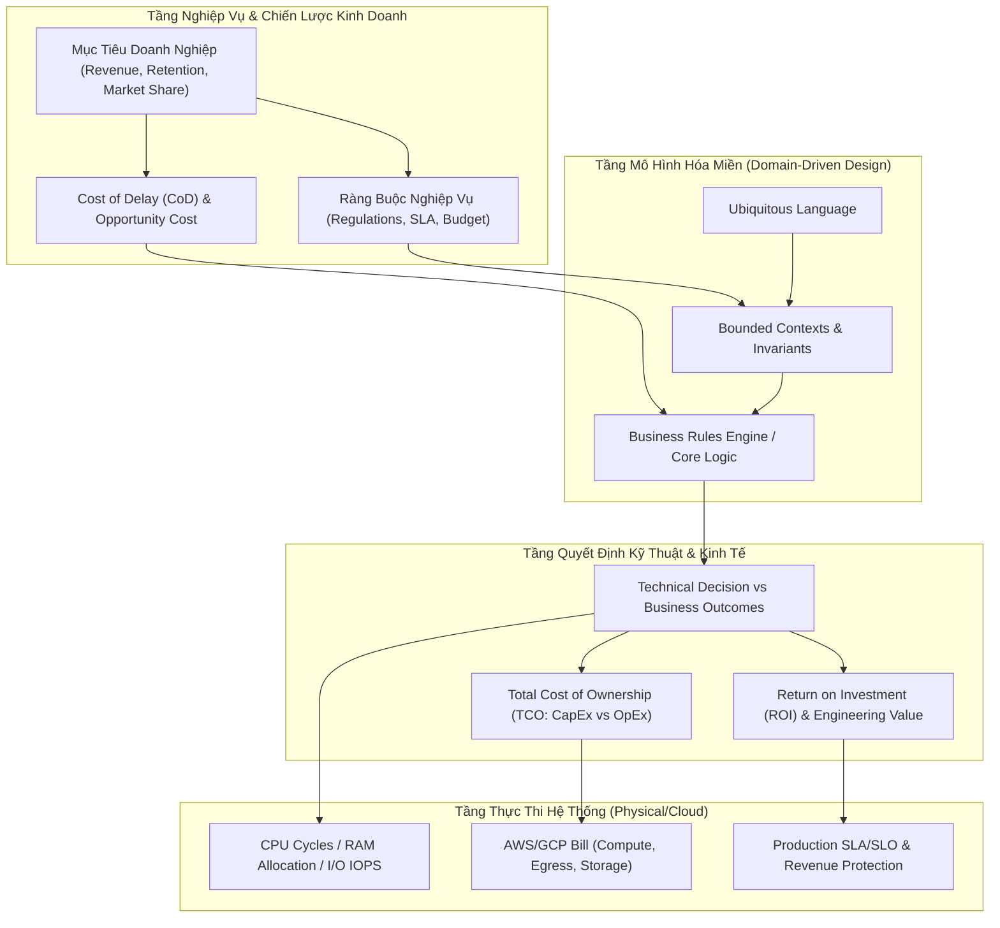
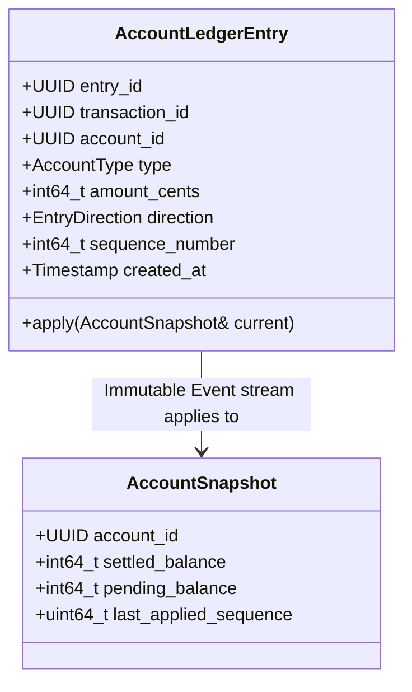
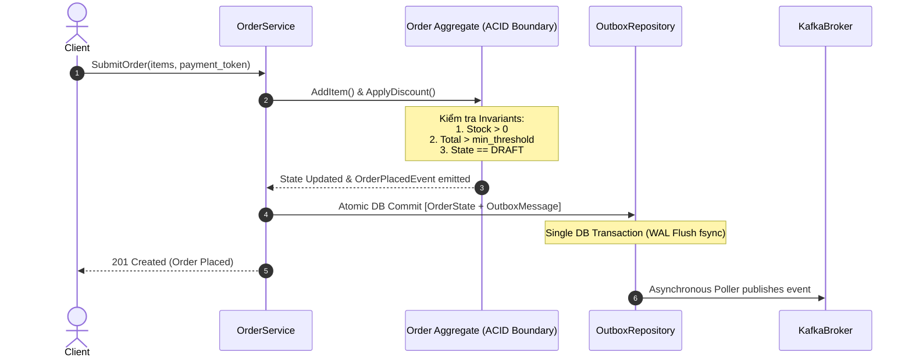
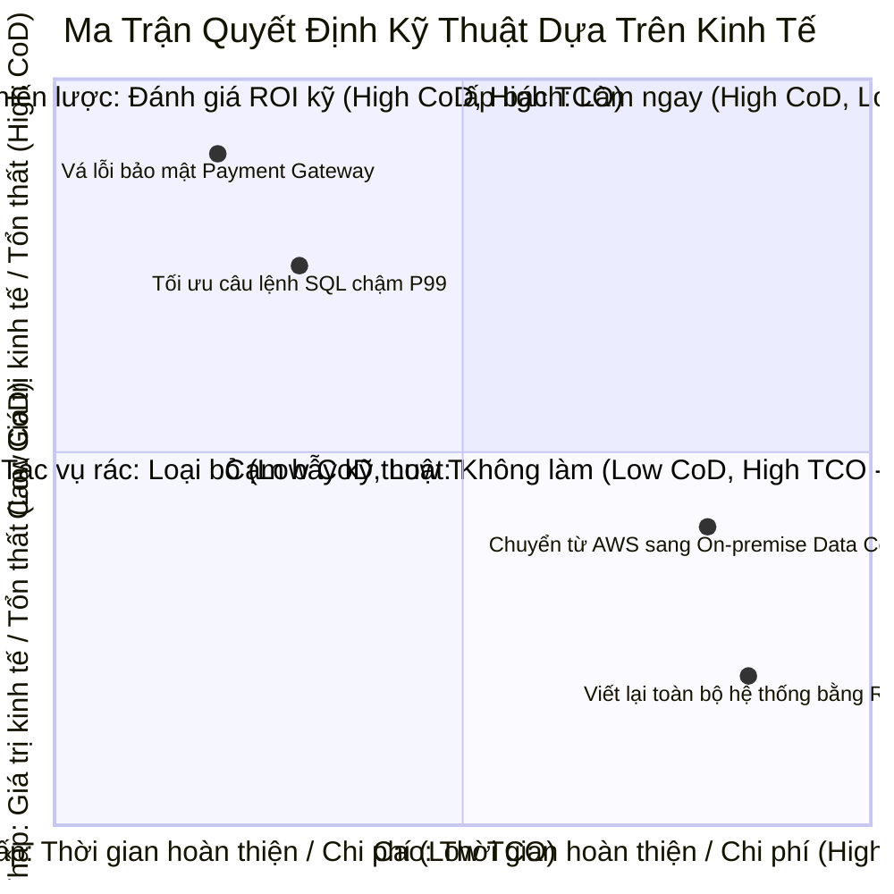
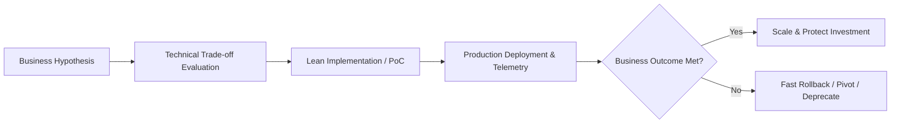

# 20.1. Mô Hình Hóa Miền Nghiệp Vụ & Kinh Tế Kỹ Thuật (Business Domain Modeling & Engineering Economics)

Chương này đi sâu vào mối liên kết hữu cơ giữa kỹ thuật phần mềm cấp cao (Senior/Staff Engineering) và bài toán kinh tế kinh doanh. Một kỹ sư trưởng thành không bao giờ tối ưu hóa mã nguồn trong chân không (vacuum); mọi quyết định từ cấu trúc dữ liệu, kiến trúc phân tán đến chu kỳ CPU tiêu thụ đều gắn liền trực tiếp với lợi nhuận, chi phí cơ hội, và dòng tiền của doanh nghiệp.

---

## 1. Tổng quan Kiến trúc & Tư duy Kinh tế Kỹ thuật



---

## 2. Chi tiết từng Keyword (Under-the-Hood Deep Dive)

### Nhóm 1: Product Thinking, Business Thinking, Business Requirements, Domain Understanding & Domain Knowledge

#### 1. Khái niệm & Bản chất (What & Why)
- **Product Thinking**: Tư duy nhìn nhận phần mềm như một sản phẩm giải quyết nỗi đau (pain points) thực tế của người dùng và mang lại giá trị có thể đo lường, thay vì chỉ là một tập hợp các tính năng (feature factory).
- **Business Thinking**: Năng lực hiểu rõ mô hình tạo ra doanh thu (revenue engine), biên lợi nhuận (profit margin), chi phí vận hành (burn rate), và lợi thế cạnh tranh cốt lõi (moat) của công ty.
- **Business Requirements**: Tập hợp các yêu cầu cấp cao định nghĩa mục tiêu kinh doanh mà hệ thống phải đáp ứng (ví dụ: "Giảm thời gian đối soát giao dịch tài chính từ 24h xuống còn 5 phút để giảm thiểu rủi ro tỷ giá").
- **Domain Understanding & Domain Knowledge**: Tri thức chuyên sâu về bản chất của một ngành công nghiệp cụ thể (Fintech, Edtech, E-commerce, AdTech, Logistics). Bao gồm luật lệ (compliance), thuật ngữ, chu trình kế toán/vận hành và các ngoại lệ thương mại thực tế.

#### 2. Cơ chế hoạt động & Phân tích chuyên sâu (Under-the-Hood)
Trong hệ thống backend, sự thiếu hụt Domain Understanding dẫn đến hiện tượng **Anemic Domain Model** (mô hình miền thiếu máu) hoặc **Model-Reality Mismatch**:
- **Data Model Contamination**: Khi kỹ sư không hiểu bản chất kế toán (Double-entry bookkeeping), họ thiết kế bảng `balances` chỉ có một cột số dư `amount` và cập nhật bằng lệnh `UPDATE accounts SET balance = balance + 100`. Dưới góc độ hệ điều hành và DB engine, thao tác này tạo row-level lock contention, không có audit trail, và vi phạm nguyên lý bất biến tài chính. Người hiểu domain sẽ thiết kế mô hình dạng **Journal Ledger Append-Only** với hai chân Debit/Credit, loại bỏ write locks và tối ưu hóa cho I/O sequential disk writes.
- **Cognitive Load & Latency Cost**: Mã nguồn phản ánh sai lệch domain rules sẽ phát sinh hàng nghìn câu lệnh `if-else` lồng nhau để vá lỗi nghiệp vụ tại tầng API gateway/controller. Điều này gây branch misprediction tại CPU instruction pipeline và phình to binary size (`.text` segment cache thrashing).

#### 3. Sơ đồ tư duy Domain Modeling vs Database Design



#### 4. Mã nguồn minh họa (C++20): High-Performance Immutable Financial Ledger Entry

```cpp
#include <iostream>
#include <string>
#include <chrono>
#include <cstdint>
#include <concepts>
#include <expected>
#include <vector>

enum class Direction : uint8_t { DEBIT = 0, CREDIT = 1 };
enum class Currency : uint16_t { USD = 840, VND = 704, EUR = 978 };

struct Money {
    int64_t subunits; // Lưu trữ đơn vị tiền tệ nhỏ nhất (cents/hào), chống sai số IEEE-754 float
    Currency currency;

    constexpr auto operator<=>(const Money&) const = default;
};

// Domain Invariant: Giao dịch kế toán kép bắt buộc Tổng Nợ = Tổng Có (Sum Debit == Sum Credit)
struct LedgerLeg {
    std::string account_id;
    Money amount;
    Direction direction;
};

class AccountingJournalTransaction {
public:
    enum class ValidationError {
        UnbalancedLegs,
        MultiCurrencyMismatch,
        EmptyTransaction
    };

    static std::expected<AccountingJournalTransaction, ValidationError> Create(
        std::string tx_id,
        std::vector<LedgerLeg> legs
    ) {
        if (legs.empty()) return std::unexpected(ValidationError::EmptyTransaction);

        int64_t debit_sum = 0;
        int64_t credit_sum = 0;
        Currency base_curr = legs.front().amount.currency;

        for (const auto& leg : legs) {
            if (leg.amount.currency != base_curr) {
                return std::unexpected(ValidationError::MultiCurrencyMismatch);
            }
            if (leg.direction == Direction::DEBIT) {
                debit_sum += leg.amount.subunits;
            } else {
                credit_sum += leg.amount.subunits;
            }
        }

        if (debit_sum != credit_sum) {
            return std::unexpected(ValidationError::UnbalancedLegs);
        }

        return AccountingJournalTransaction(std::move(tx_id), std::move(legs));
    }

    [[nodiscard]] const std::string& GetTransactionId() const noexcept { return tx_id_; }
    [[nodiscard]] const std::vector<LedgerLeg>& GetLegs() const noexcept { return legs_; }

private:
    AccountingJournalTransaction(std::string tx_id, std::vector<LedgerLeg> legs)
        : tx_id_(std::move(tx_id)), legs_(std::move(legs)) {}

    std::string tx_id_;
    std::vector<LedgerLeg> legs_;
};

int main() {
    std::vector<LedgerLeg> balanced_entries{
        {"acc_user_123", Money{5000, Currency::USD}, Direction::DEBIT},
        {"acc_merchant_888", Money{5000, Currency::USD}, Direction::CREDIT}
    };

    auto result = AccountingJournalTransaction::Create("tx_order_9999", balanced_entries);
    if (result) {
        std::cout << "[SUCCESS] Giao dịch kế toán kép hợp lệ! Transaction ID: " 
                  << result->GetTransactionId() << "\n";
    } else {
        std::cerr << "[ERROR] Giao dịch vi phạm Domain Rule!\n";
    }
    return 0;
}
```

#### 5. Anti-Patterns & Cạm bẫy
- **CRUD-First Syndrome**: Bắt đầu bằng việc mở MySQL Workbench vẽ bảng trước khi thảo luận với Domain Experts. Hậu quả là database schema áp đặt tư duy kinh doanh, khiến các nghiệp vụ phức tạp bị ép uổng thành chuỗi thao tác mutating state hỗn loạn.
- **Ignoring Regulatory Frictions**: Xây dựng kiến trúc thanh toán xuyên biên giới mà không tính đến các ràng buộc GDPR (Data Residency), PCI-DSS (Cardholder Data Environment isolation), hoặc báo cáo thuế tự động, dẫn đến việc phải đập bỏ toàn bộ database khi công ty mở rộng sang EU hoặc Mỹ.

#### 6. Ứng dụng Backend & Distributed Systems
- Phân chia database schemas theo Domain Bounded Contexts. Tránh việc một microservice Orders trực tiếp query vào bảng `users` hoặc `inventory` bằng Foreign Keys liên cơ sở dữ liệu.
- Thiết kế Event Sourcing và CQRS cho các hệ thống Core Banking, nơi mọi nghiệp vụ thay đổi trạng thái đều là các Append-Only events được bảo đảm trật tự bằng Kafka Partition Keys.

---

### Nhóm 2: Domain-Driven Design, Business Domain Modeling, Business Rules & Business Constraints

#### 1. Khái niệm & Bản chất (What & Why)
- **Domain-Driven Design (DDD)**: Phương pháp luận kiến trúc tập trung vào việc mô hình hóa phần mềm dựa trên thực tế phức tạp của nghiệp vụ, thiết lập sự đồng thuận ngôn ngữ giữa chuyên gia nghiệp vụ và kỹ sư lập trình.
- **Business Domain Modeling**: Tiến trình trừu tượng hóa các thực thể, mối quan hệ và luồng vận hành của doanh nghiệp thành các Aggregate Roots, Entities, Value Objects và Domain Services trong code.
- **Business Rules**: Các quy tắc logic chi phối cách thức dữ liệu được tạo ra, biến đổi hoặc duy trì tính toàn vẹn (ví dụ: "Khách hàng VIP được giảm 15% nếu giỏ hàng trên 1.000.000 VNĐ nhưng không áp dụng đồng thời với mã Flash Sale").
- **Business Constraints**: Các giới hạn bất khả kháng do luật pháp, thị trường hoặc hạ tầng tài chính áp đặt (ví dụ: "Số tiền chuyển khoản tối đa trong 1 ngày qua Napas là 500.000.000 VNĐ", hoặc "Tài khoản không được có số dư âm trừ khi có hạn mức thấu chi").

#### 2. Cơ chế hoạt động & Phân tích chuyên sâu (Under-the-Hood)
- **Aggregates & Transaction Boundaries**: Aggregate Root trong DDD xác lập ranh giới giao dịch ACID. Dưới tầng lưu trữ, một Aggregate nên nằm trọn vẹn trong một bản ghi lưu trữ hoặc một shard đơn lẻ để tránh **Distributed 2PC Transactions** (Two-Phase Commit). Phá vỡ ranh giới Aggregate dẫn đến việc phải lock nhiều microservices, làm tăng thời gian giữ lock từ vài microsecond lên hàng trăm millisecond do network RTT, gây nghẽn pool kết nối cơ sở dữ liệu (HikariCP/pgBouncer exhaustion).
- **Invariants Enforcement via Type System**: Đẩy việc kiểm tra Business Constraints từ tầng Runtime (validation logic chạy sau khi query database) về tầng Compile-Time thông qua hệ thống Type Safety (Domain Primitives / Value Objects). Việc sử dụng các kiểu dữ liệu đại số (Algebraic Data Types) giúp loại bỏ hoàn toàn khả năng biểu diễn trạng thái không hợp lệ (Making Illegal States Unrepresentable).

#### 3. Sơ đồ Aggregate Transaction Boundary



#### 4. Mã nguồn minh họa (TypeScript): Robust Domain Modeling với Invariants & Type Branding

```typescript
// Định nghĩa Branded Types để bảo vệ Business Invariants tại Compile-Time
type Brand<K, T> = K & { readonly __brand: T };

export type OrderId = Brand<string, 'OrderId'>;
export type MoneyAmount = Brand<number, 'MoneyAmount'>;

export function createMoney(val: number): MoneyAmount {
  if (val < 0 || !Number.isInteger(val)) {
    throw new Error(`[BusinessConstraintViolation] Tiền phải là số nguyên dương (subunits): ${val}`);
  }
  return val as MoneyAmount;
}

export enum OrderStatus {
  DRAFT = 'DRAFT',
  CONFIRMED = 'CONFIRMED',
  CANCELLED = 'CANCELLED'
}

export interface OrderItem {
  readonly sku: string;
  readonly unitPrice: MoneyAmount;
  readonly quantity: number;
}

// Aggregate Root bảo vệ Invariants
export class OrderAggregate {
  private readonly _id: OrderId;
  private _status: OrderStatus;
  private _items: OrderItem[];
  private _discountApplied: boolean;

  constructor(id: OrderId) {
    this._id = id;
    this._status = OrderStatus.DRAFT;
    this._items = [];
    this._discountApplied = false;
  }

  // Business Rule: Không thể thêm sản phẩm khi đơn hàng đã chốt
  public addItem(item: OrderItem): void {
    if (this._status !== OrderStatus.DRAFT) {
      throw new Error(`[BusinessRuleViolation] Không thể sửa đơn hàng ở trạng thái ${this._status}`);
    }
    if (item.quantity <= 0) {
      throw new Error('[BusinessConstraintViolation] Số lượng mặt hàng phải > 0');
    }
    this._items.push(item);
  }

  // Business Rule: Chỉ áp dụng Voucher một lần duy nhất và đơn tối thiểu 200,000 VND
  public applyVoucherDiscount(discountRate: number): void {
    if (this._discountApplied) {
      throw new Error('[BusinessRuleViolation] Đơn hàng đã được áp dụng mã giảm giá!');
    }
    const subtotal = this.calculateSubtotal();
    if (subtotal < 200_000) {
      throw new Error('[BusinessRuleViolation] Đơn hàng chưa đạt ngưỡng tối thiểu 200.000 để áp dụng voucher');
    }
    this._discountApplied = true;
  }

  public calculateSubtotal(): MoneyAmount {
    const rawSum = this._items.reduce((acc, curr) => acc + (curr.unitPrice * curr.quantity), 0);
    return createMoney(rawSum);
  }

  public confirm(): void {
    if (this._items.length === 0) {
      throw new Error('[BusinessRuleViolation] Không thể chốt đơn hàng rỗng');
    }
    this._status = OrderStatus.CONFIRMED;
  }

  get id(): OrderId { return this._id; }
  get status(): OrderStatus { return this._status; }
}
```

#### 5. Anti-Patterns & Cạm bẫy
- **God Aggregate**: Tạo ra một Aggregate chứa quá nhiều thực thể (ví dụ: nạp toàn bộ lịch sử 10.000 giao dịch của User vào `UserAggregate` để tính điểm thưởng). Điều này làm phình to memory heap, tăng serialization/deserialization overhead (JSON/Protobuf), và gây ra tranh chấp Optimistic Lock Version liên tục thất bại.
- **Domain Logic Leaking into UI/BFF**: Viết logic tính thuế, hoa hồng trực tiếp trên React Frontend hoặc tầng Node.js BFF (Backend-for-Frontend). Khi có thêm kênh Mobile App hoặc đối tác gọi qua API B2B, các business rules này bị phân mảnh, dẫn đến việc người dùng có thể gian lận mã giảm giá bằng cách bypass frontend validation.

#### 6. Ứng dụng Backend & Distributed Systems
- Sử dụng **Transactional Outbox Pattern** kết hợp với Change Data Capture (Debezium/Postgres WAL) để đảm bảo Domain Events luôn được publish ra message broker chính xác khi trạng thái Aggregate được ghi nhận vào ổ cứng.
- Đặt các Domain Invariants vào code lõi thuần túy (Pure Domain Layer) độc lập hoàn toàn với Frameworks (Spring Boot, NestJS, Gin) và Database Driver để cho phép unit test chạy với tốc độ microseconds mà không cần mock IO.

---

### Nhóm 3: Cost of Delay, Return on Investment (ROI), Total Cost of Ownership (TCO) & Opportunity Cost

#### 1. Khái niệm & Bản chất (What & Why)
- **Cost of Delay (CoD)**: Tổn thất kinh tế phải gánh chịu theo thời gian (tính theo tuần/tháng) khi một tính năng hoặc hệ thống không được đưa ra thị trường kịp thời. 
  $$\text{CoD} = \frac{\Delta \text{Revenue Loss} + \Delta \text{Customer Churn} + \Delta \text{Operational Cost}}{\Delta t}$$
- **Return on Investment (ROI)**: Tỷ số đo lường hiệu quả tài chính của một khoản đầu tư kỹ thuật so với chi phí đã bỏ ra:
  $$\text{ROI} = \frac{\text{Net Financial Benefit} - \text{Total Technical Cost}}{\text{Total Technical Cost}} \times 100\%$$
- **Total Cost of Ownership (TCO)**: Toàn bộ chi phí trực tiếp và gián tiếp để phát triển, vận hành, bảo trì, cấp phép phần mềm và trả lương đội ngũ trong suốt vòng đời của hệ thống.
  $$\text{TCO} = \text{CapEx (Initial Dev)} + \text{OpEx (Cloud, Licenses)} + \text{Maintenance Cost (Bug fixing, On-call)} + \text{Depreciation}$$
- **Opportunity Cost**: Giá trị của cơ hội tốt nhất tiếp theo bị bỏ lỡ khi đội ngũ kỹ sư quyết định phân bổ thời gian và tài nguyên vào việc làm một tác vụ kỹ thuật khác (ví dụ: dành 6 tháng tự viết custom distributed database thay vì sử dụng Managed PostgreSQL và tập trung hoàn thiện core product).

#### 2. Cơ chế hoạt động & Phân tích chuyên sâu (Under-the-Hood)
- **Kinh tế học của Kiến trúc Microservices vs Monolith**:
  - Xây dựng Microservices từ Day 1: Tăng chi phí CapEx (hạ tầng Kubernetes, CI/CD phức tạp, distributed tracing, observability tooling) và OpEx (cloud compute overhead do memory footprint của nhiều runtime JVM/Node.js riêng biệt). Nếu tải hệ thống chỉ đạt 10 RPS, TCO trên mỗi giao dịch sẽ gấp 50 lần so với chạy một Monolith trên một instance VM duy nhất.
  - Phân tích CPU Memory Utilization: Một service viết bằng Java/Spring Boot tiêu tốn ~512MB RAM chỉ để khởi động JVM runtime. Tách thành 20 microservices yêu cầu ít nhất 10GB RAM chỉ cho overhead, tương đương ~$80/tháng trên AWS EC2, chưa tính chi phí network egress inter-AZ (Availability Zone data transfer cost: $0.01/GB).
- **Cost of Delay trong Weighted Shortest Job First (WSJF)**:
  $$\text{WSJF} = \frac{\text{Cost of Delay}}{\text{Job Duration / Complexity}}$$
  Các tác vụ có CoD cao và thời gian làm ngắn phải được ưu tiên chạy ngay trên CPU hàng đợi phát triển để tối đa hóa dòng tiền ròng của công ty.

#### 3. Sơ đồ Ma trận Phân tích Kinh tế Kỹ thuật (TCO vs Cost of Delay)



#### 4. Mã nguồn minh họa (TypeScript): Công cụ tính toán TCO & Cost of Delay cho Architectural Decisions

```typescript
export interface SystemArchitectureOption {
  readonly name: string;
  readonly initialDevMonths: number;
  readonly teamSize: number;
  readonly avgMonthlySalaryPerDev: number;
  readonly monthlyCloudCost: number;
  readonly monthlyMaintenanceCost: number;
  readonly estimatedMonthlyRevenueUnlocked: number;
}

export class ArchitectureEconomicAnalyzer {
  public static calculateTCO(option: SystemArchitectureOption, lifespanMonths: number): number {
    const initialCapEx = option.initialDevMonths * option.teamSize * option.avgMonthlySalaryPerDev;
    const ongoingOpEx = (option.monthlyCloudCost + option.monthlyMaintenanceCost) * lifespanMonths;
    return initialCapEx + ongoingOpEx;
  }

  public static calculateNetROI(option: SystemArchitectureOption, lifespanMonths: number): number {
    const tco = this.calculateTCO(option, lifespanMonths);
    const activeProductionMonths = Math.max(0, lifespanMonths - option.initialDevMonths);
    const totalRevenue = activeProductionMonths * option.estimatedMonthlyRevenueUnlocked;
    const netProfit = totalRevenue - tco;
    return (netProfit / tco) * 100;
  }

  public static calculateCostOfDelay(monthlyRevenue: number, delayMonths: number): number {
    return monthlyRevenue * delayMonths;
  }
}

// Case Study: Tự xây dựng Custom Message Queue vs Sử dụng AWS SQS/Kafka Managed
const buildInHouse: SystemArchitectureOption = {
  name: "Custom In-House Queue",
  initialDevMonths: 4,
  teamSize: 3,
  avgMonthlySalaryPerDev: 4000,
  monthlyCloudCost: 300, // Chi phí EC2 tự quản lý
  monthlyMaintenanceCost: 2000, // Chi phí bảo trì, on-call fix crash
  estimatedMonthlyRevenueUnlocked: 20000
};

const useManagedService: SystemArchitectureOption = {
  name: "Managed Cloud SQS",
  initialDevMonths: 0.5,
  teamSize: 1,
  avgMonthlySalaryPerDev: 4000,
  monthlyCloudCost: 800, // Managed service đắt hơn về resource bill
  monthlyMaintenanceCost: 200, // Ít tốn công bảo trì
  estimatedMonthlyRevenueUnlocked: 20000
};

const lifespan = 24; // 2 năm
console.log(`TCO (In-House 24m): $${ArchitectureEconomicAnalyzer.calculateTCO(buildInHouse, lifespan)}`);
console.log(`ROI (In-House 24m): ${ArchitectureEconomicAnalyzer.calculateNetROI(buildInHouse, lifespan).toFixed(2)}%`);

console.log(`TCO (Managed 24m): $${ArchitectureEconomicAnalyzer.calculateTCO(useManagedService, lifespan)}`);
console.log(`ROI (Managed 24m): ${ArchitectureEconomicAnalyzer.calculateNetROI(useManagedService, lifespan).toFixed(2)}%`);
```

#### 5. Anti-Patterns & Cạm bẫy
- **Not-Invented-Here (NIH) Syndrome**: Tâm lý kỹ sư bài trừ các thư viện hoặc dịch vụ có sẵn để tự viết lại một phiên bản "tối ưu hơn". Chi phí cơ hội bị đốt cháy vào việc duy trì mã nguồn này vượt xa giá tiền mua license gấp hàng chục lần.
- **Ignoring Cloud Egress Traps**: Thiết kế hệ thống microservices cross-region mà không tính toán chi phí Data Transfer Out của Cloud Providers. Hóa đơn hàng tháng có thể tăng vọt $50,000 chỉ vì dữ liệu uncompressed JSON được bắn liên tục giữa US-East và US-West.

#### 6. Ứng dụng Backend & Distributed Systems
- Đưa tính toán **FinOps** vào quá trình thiết kế hệ thống. Mỗi pull request liên quan đến hạ tầng Terraform phải chạy qua Infracost để dự toán sự tăng/giảm của hóa đơn điện toán đám mây trước khi merge vào production.

---

### Nhóm 4: Engineering Economics, Technical Decisions vs Business Outcomes & Engineering Value Delivery

#### 1. Khái niệm & Bản chất (What & Why)
- **Engineering Economics**: Môn khoa học ứng dụng các nguyên lý tài chính, phân tích dòng tiền chiết khấu (Discounted Cash Flow) và tối ưu hóa tài nguyên vào các bài toán kỹ thuật phần mềm.
- **Technical Decisions vs Business Outcomes**: Khả năng phân biệt giữa "thành tựu kỹ thuật" (ví dụ: hệ thống viết bằng ngôn ngữ mới lạ, latency giảm từ 2ms xuống 0.5ms) và "kết quả kinh doanh" (ví dụ: chuyển đổi đơn hàng tăng 2%, giảm thời gian giải quyết khiếu nại khách hàng). Quyết định kỹ thuật chỉ có giá trị khi nó đóng góp vào kết quả kinh doanh.
- **Engineering Value Delivery**: Tốc độ và chất lượng chuyển giao giá trị thực tế đến tay người dùng cuối, được đo lường thông qua lead time, độ tin cậy và sự hài lòng của khách hàng, chứ không phải số dòng code hay số commit trên Git.

#### 2. Cơ chế hoạt động & Phân tích chuyên sâu (Under-the-Hood)
- **Amortization of Architectural Refactoring**: Một đợt refactoring lớn kéo dài 6 tháng có chi phí vốn rất lớn. Nếu tính toán khấu hao, hệ thống mới phải giúp giảm bớt số lượng bugs nghiêm trọng P0/P1 hoặc cho phép công ty scale lượng người dùng lên gấp 10 lần mà không phải tăng gấp đôi số lượng kỹ sư. Dưới góc độ hệ điều hành và DB:
  - Tối ưu hóa Database Indexing: Một indexbtree chuẩn xác có thể giảm tải Disk I/O từ `O(N)` Full Table Scan xuống `O(log N)` Index Lookup. Điều này cho phép hạ cấu hình database từ `db.r5.8xlarge` ($3,000/tháng) xuống `db.r5.xlarge` ($380/tháng), trực tiếp tiết kiệm $31,440/năm cho công ty với chỉ 2 ngày công kỹ sư.
  - Tỷ lệ ROI của việc tối ưu hóa thuật toán: $\text{Effort} = 16 \text{ hours} \rightarrow \text{Savings} = \$31,440/\text{year}$. Đây là ví dụ kinh điển của việc quyết định kỹ thuật gắn liền trực tiếp với kết quả kinh doanh.

#### 3. Sơ đồ Luồng Chuyển Giao Giá Trị (Engineering Value Delivery Flow)



#### 4. Mã nguồn minh họa (C++20): Đo lường Chi phí Tài nguyên & Hiệu quả Xử lý (Resource Cost Profiler)

```cpp
#include <iostream>
#include <chrono>
#include <vector>
#include <numeric>
#include <iomanip>

struct SystemWorkloadMetric {
    uint64_t total_requests_processed;
    double execution_duration_seconds;
    double cost_per_cpu_core_hour_usd; // e.g., AWS c6i.large = ~$0.085/core/hr
};

class EngineeringEconomicsProfiler {
public:
    static void PrintFinancialEfficiency(const SystemWorkloadMetric& metric) {
        double hours_elapsed = metric.execution_duration_seconds / 3600.0;
        double total_cloud_cost_spent = hours_elapsed * metric.cost_per_cpu_core_hour_usd;
        double cost_per_million_requests = (metric.total_requests_processed == 0) ? 0.0 :
            (total_cloud_cost_spent / static_cast<double>(metric.total_requests_processed)) * 1'000'000.0;

        std::cout << "--- BÁO CÁO KINH TẾ HỆ THỐNG PHẦN MỀM ---\n";
        std::cout << "Tổng Request xử lý        : " << metric.total_requests_processed << "\n";
        std::cout << "Thời gian chạy (seconds)  : " << std::fixed << std::setprecision(4) << metric.execution_duration_seconds << " s\n";
        std::cout << "Chi phí đám mây thực tế   : $" << std::fixed << std::setprecision(6) << total_cloud_cost_spent << " USD\n";
        std::cout << "Chi phí trên 1M Requests  : $" << std::fixed << std::setprecision(6) << cost_per_million_requests << " USD\n";
        std::cout << "-------------------------------------------\n";
    }
};

int main() {
    constexpr uint64_t BATCH_SIZE = 5'000'000;
    std::vector<int32_t> data(BATCH_SIZE, 1);

    auto start_time = std::chrono::high_resolution_clock::now();

    // Workload mô phỏng: Vectorized Accumulation
    int64_t sum = std::accumulate(data.begin(), data.end(), 0LL);

    auto end_time = std::chrono::high_resolution_clock::now();
    std::chrono::duration<double> duration = end_time - start_time;

    SystemWorkloadMetric metric{
        .total_requests_processed = BATCH_SIZE,
        .execution_duration_seconds = duration.count(),
        .cost_per_cpu_core_hour_usd = 0.0425 // $0.0425 USD per vCPU hour
    };

    EngineeringEconomicsProfiler::PrintFinancialEfficiency(metric);
    return 0;
}
```

#### 5. Anti-Patterns & Cạm bẫy
- **Resume-Driven Development (RDD)**: Chọn công nghệ vì kỹ sư muốn làm đẹp CV thay vì nhu cầu thực tế của sản phẩm. Ví dụ: dựng cụm Kubernetes và Istio Service Mesh nhiều node cho một ứng dụng nội bộ chỉ có 20 nhân viên văn phòng sử dụng, gây lãng phí hàng nghìn USD tiền hạ tầng và hàng trăm giờ bảo trì mỗi năm.
- **Premature Horizontal Scaling**: Thay vì tối ưu hóa bộ nhớ và connection pooling trong database, kỹ sư vội vã scale out thêm hàng chục instance backend. Hành động này che giấu leak memory và lock contention, đồng thời làm tăng chi phí hạ tầng theo hàm số mũ.

#### 6. Ứng dụng Backend & Distributed Systems
- Triển khai **Unit Economics Dashboard** (Datadog/Grafana kết hợp AWS Cost Explorer) để đo lường chỉ số **Cost-per-Transaction** theo thời gian thực. Bất kỳ sự gia tăng đột biến nào của chỉ số chi phí tài nguyên trên mỗi đơn hàng đều kích hoạt cảnh báo tương tự như cảnh báo Service Latency hay Error Rate.

---

## 3. Tổng kết & Bảng Tra Cứu Thực Chiến

| Thuật ngữ / Khái niệm | Ý nghĩa cốt lõi đối với Kỹ sư | Metric / Công cụ đo lường | Hành động thực chiến hàng ngày |
| :--- | :--- | :--- | :--- |
| **Product & Business Thinking** | Hiểu được tại sao code được viết và cách công ty kiếm tiền | Net Revenue, Customer LTV, Churn Rate | Chủ động đặt câu hỏi "Tính năng này giúp tăng doanh thu hay giảm chi phí nào?" |
| **Domain-Driven Design** | Mô hình hóa chính xác thực tế nghiệp vụ vào code | Ubiquitous Language, Aggregate Invariants | Không để Database Schema quyết định logic nghiệp vụ; tách biệt rõ ràng Bounded Contexts |
| **Cost of Delay (CoD)** | Chi phí mất đi khi sản phẩm/tính năng ra mắt chậm trễ | WSJF, Lost Revenue / Week | Ưu tiên làm những tính năng rủi ro thấp nhưng mang lại giá trị tức thì để unlock dòng tiền |
| **Total Cost of Ownership** | Toàn bộ chi phí để sinh ra và nuôi sống một dòng code | CapEx, OpEx, Maintenance Hours | Chọn công nghệ có cộng đồng lớn, dễ tuyển dụng, hạn chế tự viết custom tooling nội bộ |
| **Engineering Economics** | Đánh giá quyết định kỹ thuật bằng thước đo tài chính | Cost per Transaction, Cloud Egress Bill | Đo lường chi phí điện toán đám mây cho mỗi pull request qua FinOps tooling |
| **Value Delivery** | Đưa phần mềm chạy ổn định tới tay người dùng cuối | Lead Time for Changes, DORA Metrics | Giảm bớt batch size, deploy liên tục các thay đổi nhỏ có thể kiểm soát và kiểm thử được |
