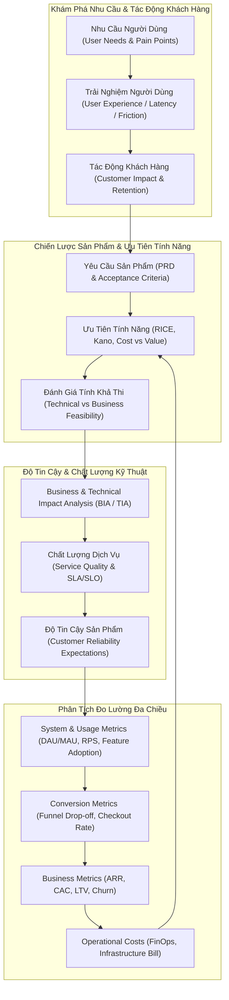
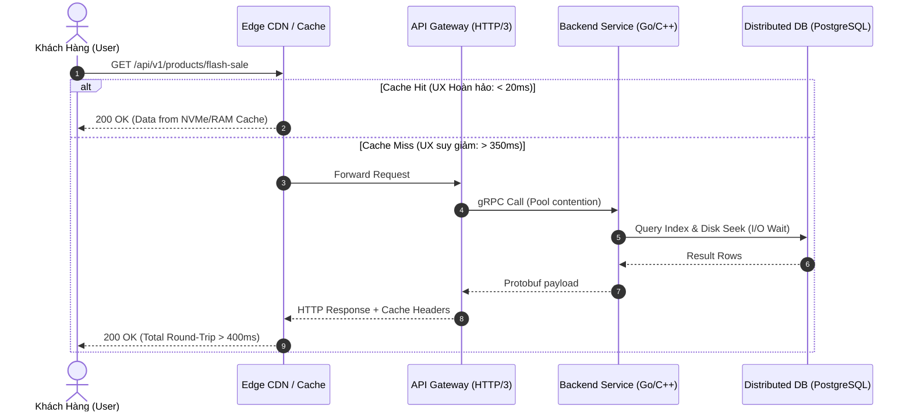
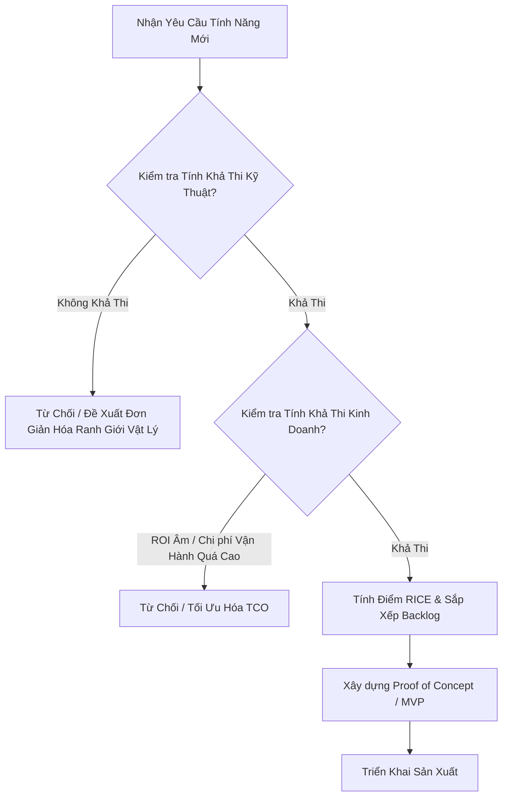
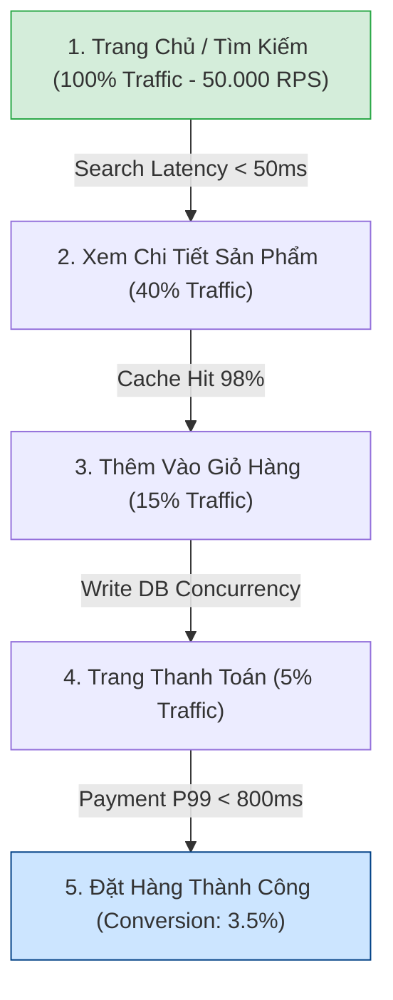
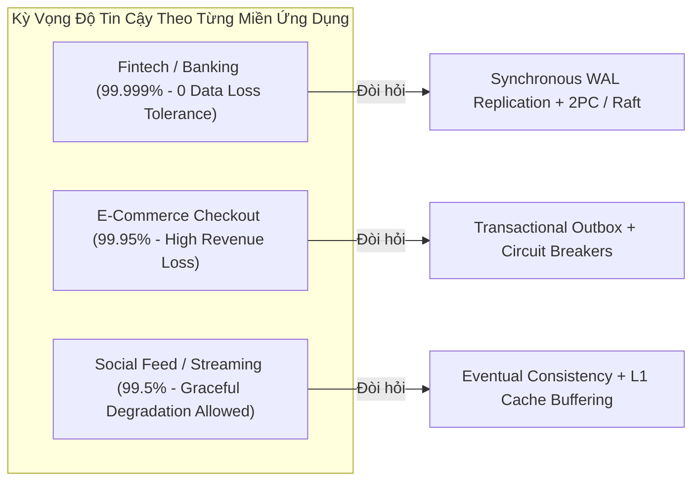

# 20.2. Chiến Lược Sản Phẩm & Trọng Tâm Khách Hàng (Product Strategy & Customer Centricity)

Phần mềm được sinh ra để phục vụ con người và giải quyết các bài toán kinh doanh. Một kỹ sư cấp cao phải có năng lực kết nối trực tiếp các thông số kỹ thuật hạ tầng (latency P99, cache hit ratio, concurrency locks) với trải nghiệm của người dùng thực tế và hiệu quả chiến lược của sản phẩm.

---

## 1. Tổng quan Vòng lặp Giá trị Sản phẩm & Kỹ thuật



---

## 2. Chi tiết từng Keyword (Under-the-Hood Deep Dive)

### Nhóm 1: User Needs, User Experience, Customer Impact, Business Impact Analysis & Technical Impact Analysis

#### 1. Khái niệm & Bản chất (What & Why)
- **User Needs**: Nhu cầu căn bản và nỗi đau tiềm ẩn của người dùng mà sản phẩm cần giải quyết. Người dùng không cần một cơ chế "distributed websocket cluster", họ cần biết tức thì khi nào tài xế Grab tới điểm hẹn.
- **User Experience (UX)**: Cảm nhận tổng thể của người dùng khi tương tác với hệ thống. Về mặt kỹ thuật, UX bị chi phối mạnh mẽ bởi độ trễ (latency), tính nhất quán giao diện (UI state reconciliation), và tính minh bạch khi xảy ra lỗi.
- **Customer Impact**: Mức độ ảnh hưởng tích cực hoặc tiêu cực mà một sự kiện kỹ thuật (tính năng mới, downtime, lỗi bảo mật) tạo ra trên đời sống/công việc của khách hàng.
- **Business Impact Analysis (BIA)**: Đánh giá thiệt hại tài chính, pháp lý và uy tín nếu một chức năng hoặc toàn bộ hệ thống ngừng hoạt động (ví dụ: 1 giờ downtime sàn thương mại điện tử vào Black Friday làm mất 2.000.000 USD doanh thu).
- **Technical Impact Analysis (TIA)**: Phân tích ảnh hưởng của một sự thay đổi kỹ thuật lên kiến trúc hiện tại, bao gồm tải CPU, dung lượng lưu trữ, băng thông mạng và độ phức tạp mã nguồn.

#### 2. Cơ chế hoạt động & Phân tích chuyên sâu (Under-the-Hood)
- **Mối tương quan giữa System Latency và UX/Conversion**:
  - Nghiên cứu của Google và Amazon chỉ ra rằng: Mỗi 100ms gia tăng trong độ trễ trang web (Time to First Byte - TTFB) làm giảm tỷ lệ chuyển đổi (conversion rate) đi 1%, và mỗi 1000ms độ trễ làm tăng tỷ lệ thoát (bounce rate) lên 32%.
  - Dưới góc độ hệ điều hành mạng và phân tán: Để giảm TTFB từ 300ms xuống 50ms, kỹ sư backend cần:
    1. Giảm thiểu TLS Handshake overhead bằng cách sử dụng **TLS 1.3** (1-RTT hoặc 0-RTT Session Resumption).
    2. Tận dụng **HTTP/2 Multiplexing** hoặc **HTTP/3 (QUIC)** qua giao thức UDP để loại bỏ hiện tượng TCP Head-of-Line Blocking tại tầng mạng chập chờn.
    3. Đẩy dữ liệu ra Edge CDN (Cloudflare Workers/CloudFront) kết hợp Stale-While-Revalidate caching, giúp phục vụ data từ L1 Edge Cache RAM mà không cần gọi ngược về Origin Database.

#### 3. Sơ đồ Tác động Kỹ thuật lên Trải nghiệm Khách hàng



#### 4. Mã nguồn minh họa (TypeScript): Khung phân tích BIA & TIA Tự động cho Release Gate

```typescript
export interface ServiceComponent {
  name: string;
  isMissionCritical: boolean;
  rpoMinutes: number; // Recovery Point Objective
  rtoMinutes: number; // Recovery Time Objective
  hourlyDowntimeCostUsd: number;
}

export interface ProposedTechnicalChange {
  changeId: string;
  targetService: string;
  estimatedMemoryDeltaMb: number;
  estimatedCpuDeltaCores: number;
  requiresDatabaseLock: boolean;
  estimatedMigrationDowntimeSec: number;
}

export class ImpactAnalysisEngine {
  public static evaluateChangeRisk(
    service: ServiceComponent,
    change: ProposedTechnicalChange
  ): { riskLevel: 'LOW' | 'MEDIUM' | 'CRITICAL'; maxFinancialExposure: number; reason: string } {
    const downtimeHours = change.estimatedMigrationDowntimeSec / 3600.0;
    const maxExposure = downtimeHours * service.hourlyDowntimeCostUsd;

    if (change.requiresDatabaseLock && service.isMissionCritical) {
      return {
        riskLevel: 'CRITICAL',
        maxFinancialExposure: maxExposure,
        reason: `Khóa Database trực tiếp trên dịch vụ cốt lõi (${service.name}) có nguy cơ làm gián đoạn thanh toán và gây sụp connection pool.`
      };
    }

    if (maxExposure > 10_000 || change.estimatedMigrationDowntimeSec > (service.rtoMinutes * 60)) {
      return {
        riskLevel: 'MEDIUM',
        maxFinancialExposure: maxExposure,
        reason: `Downtime dự kiến (${change.estimatedMigrationDowntimeSec}s) vượt quá ngưỡng chi phí an toàn.`
      };
    }

    return {
      riskLevel: 'LOW',
      maxFinancialExposure: maxExposure,
      reason: 'Thay đổi có mức độ rủi ro kiểm soát được, không gây gián đoạn SLA.'
    };
  }
}

// Case Study kiểm thử
const paymentService: ServiceComponent = {
  name: "Core Payment Gateway",
  isMissionCritical: true,
  rpoMinutes: 0, // Không chấp nhận mất dữ liệu
  rtoMinutes: 1, // Không chấp nhận downtime quá 1 phút
  hourlyDowntimeCostUsd: 120_000 // Thiệt hại $2000/phút
};

const dangerousMigration: ProposedTechnicalChange = {
  changeId: "CHG-9021",
  targetService: "Core Payment Gateway",
  estimatedMemoryDeltaMb: 256,
  estimatedCpuDeltaCores: 2,
  requiresDatabaseLock: true,
  estimatedMigrationDowntimeSec: 180 // 3 phút downtime
};

const evaluation = ImpactAnalysisEngine.evaluateChangeRisk(paymentService, dangerousMigration);
console.log(`[RISK ASSESSMENT]: ${evaluation.riskLevel}`);
console.log(`Thiệt hại tối đa: $${evaluation.maxFinancialExposure.toFixed(2)}`);
console.log(`Lý do: ${evaluation.reason}`);
```

#### 5. Anti-Patterns & Cạm bẫy
- **Internal Optimization Fallacy**: Đội ngũ kỹ sư dành 3 tháng tối ưu hóa thuật toán nén log của hệ thống nội bộ để tiết kiệm $50 tiền đĩa cứng, trong khi chức năng Checkout thanh toán của khách hàng đang bị giật lag mất 4 giây khiến tỷ lệ hủy đơn tăng vọt 15%.
- **Zero-Communication Technical Releases**: Triển khai các bản cập nhật lớn hoặc bảo trì có downtime mà không tiến hành Business Impact Analysis với đội Sales/Customer Support, dẫn đến việc tổng đài chăm sóc khách hàng bị nghẽn mạch khi người dùng gặp lỗi đột ngột.

#### 6. Ứng dụng Backend & Distributed Systems
- Áp dụng **Graceful Degradation** trong kiến trúc backend. Khi database rơi vào tình trạng quá tải (CPU > 90%), hệ thống tự động ngắt các tính năng phụ trợ (ví dụ: đề xuất gợi ý sản phẩm liên quan) để ưu tiên toàn bộ tài nguyên cho luồng chính (Thanh toán đơn hàng), bảo vệ trải nghiệm cốt lõi của khách hàng.

---

### Nhóm 2: Product Requirements, Product Prioritization, Feature Prioritization, Technical Feasibility & Business Feasibility

#### 1. Khái niệm & Bản chất (What & Why)
- **Product Requirements (PRD)**: Bản đặc tả chi tiết về bài toán người dùng cần giải quyết, mục tiêu thành công, các kịch bản tương tác và các ràng buộc phi chức năng.
- **Product & Feature Prioritization**: Nghệ thuật và khoa học sắp xếp thứ tự thực thi các tính năng nhằm tối đa hóa giá trị kinh doanh với tài nguyên kỹ thuật có hạn (sử dụng các mô hình như RICE, MoSCoW, hoặc Kano Model).
- **Technical Feasibility**: Khả năng hiện thực hóa một yêu cầu bằng công nghệ hiện có, trong giới hạn về thời gian, kỹ năng của đội ngũ, và ranh giới vật lý (định luật Amdahl, CAP Theorem, tốc độ ánh sáng trên đường truyền cáp quang).
- **Business Feasibility**: Tính khả thi về mặt kinh tế: liệu chi phí phát triển và vận hành tính năng đó có thấp hơn đáng kể so với lợi nhuận thu về, và mô hình đó có phù hợp với chiến lược dài hạn của công ty hay không.

#### 2. Cơ chế hoạt động & Phân tích chuyên sâu (Under-the-Hood)
- **Phân tích RICE Framework dưới góc độ Kỹ thuật**:
  $$\text{RICE Score} = \frac{\text{Reach} \times \text{Impact} \times \text{Confidence}}{\text{Effort}}$$
  Trong đó, $\text{Effort}$ (công sức kỹ sư) thường bị đánh giá thấp do không tính đến:
  1. **Schema Migration Risk**: Chi phí migration dữ liệu lịch sử với hàng tỷ bản ghi mà không được lock bảng.
  2. **Observability & On-call Burden**: Chi phí cấu hình metrics, alert rules, và thời gian trực tổng đài ứng cứu khi tính năng mới ra mắt.
  3. **Regression Testing & CI/CD Pipeline Bloat**: Thời gian test suite chạy trên CI/CD bị kéo dài, làm chậm nhịp độ delivery của cả công ty.
- **Technical Feasibility vs Vật Lý Phân Tán**: Một Product Manager có thể yêu cầu: "Hệ thống phải có dữ liệu đồng bộ tức thời (Strong Consistency) giữa 3 Data Centers tại Singapore, Frankfurt và Virginia với thời gian phản hồi API < 10ms". Một kỹ sư cấp cao phải chỉ ra ngay sự phi lý về mặt vật lý: Thời gian ánh sáng di chuyển khứ hồi (RTT) giữa Singapore và Frankfurt qua cáp quang là ~140ms, do đó yêu cầu này là **Technically Infeasible** trừ khi chấp nhận Eventual Consistency.

#### 3. Sơ đồ Khung Đánh Giá Khả Thi (Feasibility Evaluation Matrix)



#### 4. Mã nguồn minh họa (TypeScript): Thuật toán RICE Prioritization Engine

```typescript
export interface FeatureCandidate {
  readonly id: string;
  readonly name: string;
  readonly reach: number;        // Số người dùng chạm tới trong 1 quý
  readonly impact: 0.25 | 0.5 | 1 | 2 | 3; // Minimal, Low, Medium, High, Massive
  readonly confidence: number;   // 0.5 (50%), 0.8 (80%), 1.0 (100%)
  readonly effortWeeks: number;  // Số dev-weeks để hoàn thành từ Dev tới Production
}

export class PrioritizationEngine {
  public static calculateRICE(candidate: FeatureCandidate): number {
    if (candidate.effortWeeks <= 0) {
      throw new Error("Effort phải lớn hơn 0 để tránh chia cho 0");
    }
    return (candidate.reach * candidate.impact * candidate.confidence) / candidate.effortWeeks;
  }

  public static rankFeatures(candidates: FeatureCandidate[]): Array<FeatureCandidate & { riceScore: number }> {
    return candidates
      .map(feature => ({
        ...feature,
        riceScore: this.calculateRICE(feature)
      }))
      .sort((a, b) => b.riceScore - a.riceScore);
  }
}

// Dữ liệu ứng viên tính năng
const candidates: FeatureCandidate[] = [
  {
    id: "FEAT-1",
    name: "Tích hợp Apple Pay 1-Click Checkout",
    reach: 50_000,
    impact: 2, // High impact on conversion
    confidence: 0.8,
    effortWeeks: 4
  },
  {
    id: "FEAT-2",
    name: "Viết lại Auth Service bằng Rust để giảm 5ms latency",
    reach: 50_000,
    impact: 0.25, // Minimal user visible impact
    confidence: 1.0,
    effortWeeks: 12
  },
  {
    id: "FEAT-3",
    name: "Tính năng gửi thông báo hoàn tiền tức thì qua SMS",
    reach: 10_000,
    impact: 1, // Medium impact
    confidence: 0.8,
    effortWeeks: 1
  }
];

const ranked = PrioritizationEngine.rankFeatures(candidates);
console.log("=== BẢNG XẾP HẠNG ƯU TIÊN TÍNH NĂNG (RICE) ===");
for (const item of ranked) {
  console.log(`[RICE: ${item.riceScore.toFixed(0)}] ${item.name} (Effort: ${item.effortWeeks} tuần)`);
}
```

#### 5. Anti-Patterns & Cạm bẫy
- **The "Yes-Man" Engineer**: Chấp nhận mọi yêu cầu phi lý từ Product Manager mà không thực hiện đánh giá Technical Feasibility, dẫn đến việc hứa hẹn deadline bất khả thi, ép đội ngũ làm việc kiệt sức và cho ra đời mã nguồn chắp vá đầy lỗi.
- **Pet Projects over Value**: Kỹ sư trưởng ngụy tạo điểm số ưu tiên để ép đưa các dự án kỹ thuật cá nhân (Pet Projects) vào roadmap công ty dù nó không mang lại bất kỳ giá trị nào cho bài toán kinh doanh hiện tại.

#### 6. Ứng dụng Backend & Distributed Systems
- Sử dụng mô hình **Spike Solution / PoC có timebox**: Trước khi cam kết thực hiện một tính năng phức tạp (ví dụ: triển khai Full-Text Search đa ngôn ngữ trên hàng trăm triệu sản phẩm), dành tối đa 3 ngày để dựng PoC kiểm tra benchmark tải I/O và memory trên Elasticsearch để xác nhận Technical Feasibility trước khi đưa vào sprint chính thức.

---

### Nhóm 3: Product Metrics, Business Metrics, System Usage Metrics, Conversion Metrics & Operational Costs

#### 1. Khái niệm & Bản chất (What & Why)
- **Product Metrics**: Các chỉ số đo lường mức độ tương tác và hành vi của người dùng với sản phẩm (DAU - Daily Active Users, MAU, Feature Adoption Rate, Retention Cohort).
- **Business Metrics**: Các chỉ số sức khỏe tài chính của doanh nghiệp (ARR - Annual Recurring Revenue, MRR, CAC - Customer Acquisition Cost, CLV/LTV - Customer Lifetime Value, Gross Margin).
- **System Usage Metrics**: Tải thực tế mà người dùng áp đặt lên hạ tầng máy chủ (Requests Per Second - RPS, Ingress/Egress Bandwidth, DB IOPS, Connection Count, Queue Depth).
- **Conversion Metrics**: Tỷ lệ phần trăm người dùng chuyển đổi từ một bước này sang bước tiếp theo trong hành trình khách hàng (Checkout Funnel Conversion, Sign-up to Activation Rate).
- **Operational Costs (OpEx)**: Chi phí thực tế để duy trì hoạt động hàng ngày của hệ thống (Cloud compute, data transfer, licenses SaaS, lương on-call, chi phí bảo trì).

#### 2. Cơ chế hoạt động & Phân tích chuyên sâu (Under-the-Hood)
- **Mối liên hệ giữa Conversion Funnel Drop-off và Backend Tail Latency**:
  - Khi người dùng bấm nút "Đặt Hàng", backend thực hiện một chuỗi các thao tác: Query giỏ hàng, gọi Fraud Detection API, lock tồn kho, và gọi Payment Gateway của bên thứ ba.
  - Nếu phân vị trễ **P99 Latency** vượt quá 3000ms, tỷ lệ timeout của client-side HTTP request tăng cao. Người dùng bấm liên tục vào nút đặt hàng (Click Spreading), gây ra **Thundering Herd** lên server. Điều này dẫn đến sự sụt giảm tức thì của **Conversion Metrics** từ 65% xuống còn 30%, trực tiếp làm sụt giảm **Business Metrics (MRR)**.
- **Hệ thức FinOps: Chi phí trên từng Đơn hàng (Unit Cost)**:
  $$\text{Unit Cost} = \frac{\text{Tổng OpEx Hạ Tầng (Cloud + Licenses)}}{\text{Tổng Số Giao Dịch Thành Công}}$$
  Nếu một đợt cập nhật code làm tăng thuật toán từ $O(N)$ lên $O(N^2)$, Unit Cost trên mỗi giao dịch tăng từ $\$0.005$ lên $\$0.05$. Đối với một sàn thương mại điện tử xử lý 10 triệu đơn/tháng, chi phí đám mây phát sinh thêm là $\$450,000/\text{tháng}$, có thể xóa sạch toàn bộ biên lợi nhuận ròng của công ty.

#### 3. Sơ đồ Phễu Chuyển Đổi & Điểm Nghẽn Kỹ Thuật (Conversion Funnel vs System Performance)



#### 4. Mã nguồn minh họa (TypeScript): Unified Telemetry Metrics Tracker (Kết nối Tech & Business)

```typescript
export interface BusinessTransactionTelemetry {
  readonly transactionId: string;
  readonly userId: string;
  readonly executionTimeMs: number;
  readonly isSuccess: boolean;
  readonly orderValueUsd: number;
  readonly cloudComputeCostEstimatedUsd: number;
}

export class BusinessTelemetryCollector {
  private static totalRevenue = 0;
  private static totalComputeCost = 0;
  private static successfulOrders = 0;
  private static failedOrders = 0;
  private static latencySamples: number[] = [];

  public static recordTransaction(event: BusinessTransactionTelemetry): void {
    this.totalComputeCost += event.cloudComputeCostEstimatedUsd;
    this.latencySamples.push(event.executionTimeMs);

    if (event.isSuccess) {
      this.successfulOrders++;
      this.totalRevenue += event.orderValueUsd;
    } else {
      this.failedOrders++;
    }
  }

  public static generateExecutiveReport(): void {
    const totalTransactions = this.successfulOrders + this.failedOrders;
    const conversionRate = totalTransactions === 0 ? 0 : (this.successfulOrders / totalTransactions) * 100;
    const grossMargin = this.totalRevenue - this.totalComputeCost;
    
    // Sắp xếp tính P99 Latency
    this.latencySamples.sort((a, b) => a - b);
    const p99Index = Math.floor(this.latencySamples.length * 0.99);
    const p99Latency = this.latencySamples[p99Index] || 0;

    console.log("=== BÁO CÁO HỢP NHẤT KỸ THUẬT & DOANH NGHIỆP ===");
    console.log(`Doanh số ròng (Revenue)   : $${this.totalRevenue.toFixed(2)} USD`);
    console.log(`Chi phí hạ tầng (Cloud)   : $${this.totalComputeCost.toFixed(4)} USD`);
    console.log(`Biên lợi nhuận gộp        : $${grossMargin.toFixed(2)} USD`);
    console.log(`Tỷ lệ hoàn tất đơn hàng   : ${conversionRate.toFixed(2)}%`);
    console.log(`Độ trễ P99 Backend        : ${p99Latency.toFixed(2)} ms`);
    console.log(`Tỷ lệ đơn lỗi (Error Rate): ${((this.failedOrders / (totalTransactions || 1)) * 100).toFixed(2)}%`);
  }
}

// Mô phỏng luồng telemetry
BusinessTelemetryCollector.recordTransaction({
  transactionId: "TX-101",
  userId: "U-1",
  executionTimeMs: 45.2,
  isSuccess: true,
  orderValueUsd: 150.00,
  cloudComputeCostEstimatedUsd: 0.0012
});

BusinessTelemetryCollector.recordTransaction({
  transactionId: "TX-102",
  userId: "U-2",
  executionTimeMs: 1250.0, // Timeout hoặc nghẽn DB
  isSuccess: false,
  orderValueUsd: 320.00,
  cloudComputeCostEstimatedUsd: 0.0045
});

BusinessTelemetryCollector.generateExecutiveReport();
```

#### 5. Anti-Patterns & Cạm bẫy
- **Dashboard Siloing**: Đội kỹ sư chỉ nhìn vào dashboard CPU/RAM/Network của Kubernetes, trong khi đội kinh doanh nhìn vào Google Analytics và Stripe Dashboard. Không có sự liên kết dữ liệu để phát hiện rằng CPU đột biến 100% lúc 2h chiều đã trực tiếp làm rơi 500 khách hàng ở bước Checkout.
- **Vanity Metrics Addiction**: Tự hào về việc hệ thống đạt 100.000 RPS (Request Per Second) trong khi 95% trong số đó là traffic bot cào dữ liệu rác không mang lại bất kỳ doanh thu nào nhưng lại tiêu tốn hàng nghìn USD tiền CDN bandwidth.

#### 6. Ứng dụng Backend & Distributed Systems
- Gắn **Business Metadata** (ví dụ: `tenant_id`, `order_tier`, `cart_value`) vào OpenTelemetry Tracing Spans. Điều này cho phép lọc các trace chậm nhất theo mức độ giá trị đơn hàng, giúp kỹ sư ưu tiên khắc phục sự cố ảnh hưởng đến nhóm khách hàng có giá trị cao nhất (VIP Customers).

---

### Nhóm 4: Customer Reliability Expectations, Service Quality & Product Reliability

#### 1. Khái niệm & Bản chất (What & Why)
- **Customer Reliability Expectations**: Mức độ tin cậy vô hình mà khách hàng mặc định kỳ vọng vào sản phẩm của bạn. Khách hàng sẵn sàng chấp nhận một ứng dụng xem video thi thoảng bị giật 1 giây, nhưng sẽ kiện ngay lập tức nếu tiền chuyển khoản ngân hàng bị biến mất hoặc xuất hiện sai lệch.
- **Service Quality**: Tập hợp các tiêu chuẩn chất lượng đo lường được của một dịch vụ phần mềm, bao gồm tính sẵn sàng (Availability), tính đúng đắn (Correctness), độ trễ (Latency), và tính toàn vẹn dữ liệu (Durability).
- **Product Reliability**: Khả năng của toàn bộ sản phẩm (kể cả các luồng vận hành thủ công, tích hợp bên thứ ba) trong việc duy trì trải nghiệm nhất quán, không lỗi lầm trong suốt thời gian cam kết.

#### 2. Cơ chế hoạt động & Phân tích chuyên sâu (Under-the-Hood)
- **Kỳ vọng độ tin cậy và Chiến lược High Availability**:
  - Để đáp ứng kỳ vọng độ tin cậy của khách hàng doanh nghiệp (B2B Enterprise), hệ thống phải đạt mức sẵn sàng **99.99% ("Four Nines")**, tương đương thời gian downtime tối đa chỉ là **4.38 phút mỗi tháng**.
  - Dưới góc độ hạ tầng phân tán: Để đạt được Four Nines, hệ thống bắt buộc phải:
    1. Triển khai **Multi-Region Active-Active** hoặc **Multi-AZ Replication** với cơ chế tự động Failover bằng Raft/Paxos consensus.
    2. Sử dụng **Chaos Engineering** (bắn hạ ngẫu nhiên các node bằng Chaos Mesh) trong môi trường staging để chứng minh hệ thống tự phục hồi mà không cần can thiệp con người.
    3. Thiết kế **Circuit Breaker** (như Hystrix/Resilience4j pattern) để cô lập sự cố khi dịch vụ đối tác (e.g., SMS Gateway, Ngân hàng đối tác) bị tê liệt, ngăn chặn hiện tượng Cascading Failure kéo sập toàn bộ hệ thống lõi.

#### 3. Sơ đồ Ranh Giới Tin Cậy Khách Hàng (Reliability Expectations Boundary)



#### 4. Mã nguồn minh họa (C++20): Resilient Fallback Engine Bảo Vệ Trải Nghiệm Khách Hàng

```cpp
#include <iostream>
#include <string>
#include <functional>
#include <chrono>
#include <thread>
#include <expected>

enum class ServiceStatus { Available, Degraded, Failed };

struct ProductRecommendation {
    std::string item_id;
    std::string title;
    bool is_personalized;
};

class ResilientRecommendationService {
public:
    // Fallback Pattern bảo vệ Product Reliability
    static std::vector<ProductRecommendation> GetRecommendationsWithFallback(
        const std::string& user_id,
        std::function<std::expected<std::vector<ProductRecommendation>, std::string>()> ml_engine_call
    ) {
        // Thử gọi AI/ML Service phức tạp
        auto result = ml_engine_call();

        if (result.has_value()) {
            return result.value();
        }

        // Khi dịch vụ ML quá tải/sập, không báo lỗi 500 cho người dùng!
        // Fallback về danh sách sản phẩm Best-Seller lưu trong bộ nhớ tĩnh (L1 Cache)
        std::cerr << "[WARNING] ML Service gặp sự cố: " << result.error() 
                  << ". Kích hoạt Graceful Degradation Fallback!\n";

        return GetStaticBestSellers();
    }

private:
    static std::vector<ProductRecommendation> GetStaticBestSellers() {
        return {
            {"ITEM-001", "Bàn Phím Cơ Ergonomic Không Dây (Phổ Biến Nhất)", false},
            {"ITEM-002", "Màn Hình 4K 144Hz Chuyên Đồ Họa", false}
        };
    }
};

int main() {
    // Giả lập tình huống dịch vụ ML Recommendation bị sập (P99 Timeout / Crash)
    auto faulty_ml_call = []() -> std::expected<std::vector<ProductRecommendation>, std::string> {
        return std::unexpected("ML Cluster Out of Memory (OOMKilled)");
    };

    auto items = ResilientRecommendationService::GetRecommendationsWithFallback("usr_9921", faulty_ml_call);

    std::cout << "--- DANH SÁCH SẢN PHẨM HIỂN THỊ CHO KHÁCH HÀNG ---\n";
    for (const auto& item : items) {
        std::cout << "- [" << item.item_id << "] " << item.title 
                  << " (Cá nhân hóa: " << (item.is_personalized ? "Có" : "Không") << ")\n";
    }
    return 0;
}
```

#### 5. Anti-Patterns & Cạm bẫy
- **Treating All Endpoints Equally**: Áp đặt một chính sách SLA cào bằng cho tất cả API. Ví dụ: cố gắng duy trì Five Nines (99.999%) cho API lấy ảnh avatar đại diện của người dùng (tốn kém hàng triệu USD chi phí hạ tầng) trong khi chỉ dành Three Nines cho API nạp tiền tài khoản.
- **Fail-Loud to Customers**: Khi một microservice phụ trợ gặp sự cố, hệ thống trả về ngay màn hình trắng hoặc trang báo lỗi `500 Internal Server Error` làm gián đoạn toàn bộ hành trình của người dùng, thay vì âm thầm fallback sang dữ liệu cache hoặc ẩn module đó đi.

#### 6. Ứng dụng Backend & Distributed Systems
- Thiết lập cơ chế **Client-Side Throttling & Exponential Backoff with Full Jitter** trong các SDK kết nối dịch vụ. Khi hệ thống bắt đầu chạm ngưỡng giới hạn phục vụ, bảo vệ backend khỏi sự sụp đổ dây chuyền (Cascading Collapse) bằng cách điều tiết lưu lượng người dùng một cách có trật tự.

---

## 3. Tổng kết & Bảng Tra Cứu Thực Chiến

| Thuật ngữ / Khái niệm | Trọng tâm phân tích | Rủi ro nếu bỏ qua | Thực hành kỹ thuật chuẩn |
| :--- | :--- | :--- | :--- |
| **User Needs & UX** | Trải nghiệm người dùng và thời gian phản hồi hệ thống | Người dùng rời bỏ nền tảng do chậm chạp và khó chịu | Tối ưu P99 latency, HTTP/3, TLS 1.3, Edge CDN caching |
| **BIA & TIA** | Phân tích tác động kinh doanh & kỹ thuật trước khi sửa đổi | Gây downtime không mong muốn, thiệt hại doanh số | Chạy BIA checklist cho các thay đổi database schema và migration lớn |
| **Product Prioritization** | Lựa chọn tính năng theo giá trị và chi phí | Đốt tài nguyên vào các tính năng ít người dùng | Sử dụng RICE framework, tính toán chính xác chi phí kỹ thuật (Effort) |
| **Technical Feasibility** | Tính khả thi dựa trên giới hạn vật lý và công nghệ | Thất bại dự án giữa chừng, trễ deadline nghiêm trọng | Làm PoC/Spike có timebox để benchmark I/O và memory |
| **Business Telemetry** | Gắn kết metrics kỹ thuật với metrics tài chính | Kỹ sư mù mờ về giá trị của code mình viết ra | Đưa metadata đơn hàng và doanh số vào distributed traces |
| **Product Reliability** | Độ tin cậy tổng thể của sản phẩm dưới mắt khách hàng | Mất khách hàng vĩnh viễn, vi phạm SLA pháp lý | Graceful degradation, Circuit Breakers, Multi-AZ failover |
