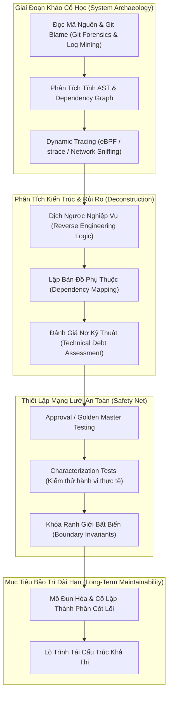
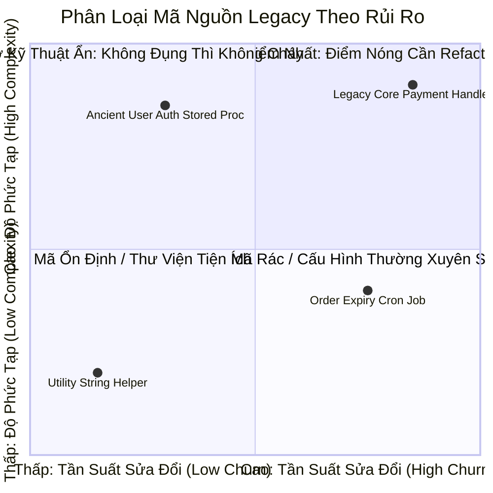
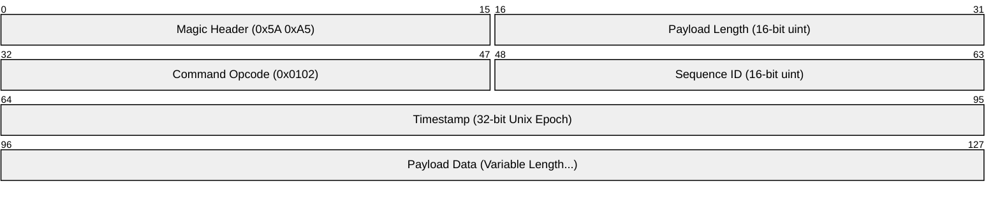
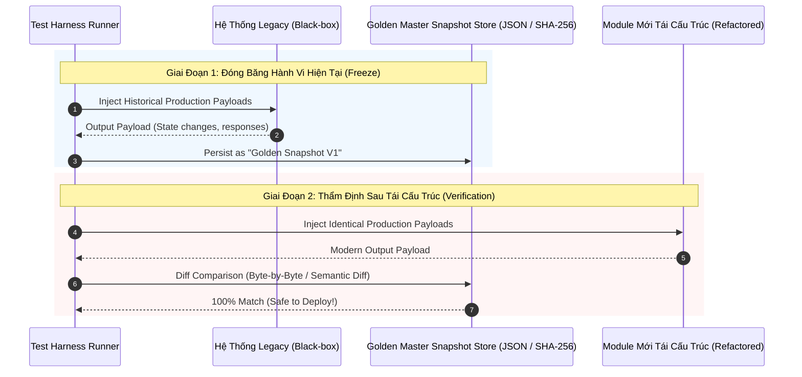

# 21.1. Khảo Cổ Học Mã Nguồn Cũ & Giải Cấu Trúc Hệ Thống (Legacy Archaeology & Deconstruction)

Mã nguồn legacy là mã nguồn đang chạy sinh ra tiền nhưng không còn ai hiểu toàn diện cách nó vận hành, thiếu vắng automated test suite đáng tin cậy, hoặc bị trói buộc vào các runtime/framework lỗi thời. Kỹ năng khảo cổ học phần mềm (System Archaeology) và giải cấu trúc hệ thống (Deconstruction) là bài kiểm tra thực sự cho năng lực phân tích chuyên sâu của một Principal/Staff Engineer.

---

## 1. Tổng quan Khảo cổ học Phần mềm & Giải cấu trúc



---

## 2. Chi tiết từng Keyword (Under-the-Hood Deep Dive)

### Nhóm 1: Legacy System Engineering, Legacy Code Understanding & Legacy Architecture Analysis

#### 1. Khái niệm & Bản chất (What & Why)
- **Legacy System Engineering**: Kỷ luật kỹ thuật chuyên biệt đối phó với các hệ thống lớn đã tồn tại nhiều năm (thậm chí nhiều thập kỷ), nơi các tài liệu ban đầu bị thất lạc, kiến trúc bị xói mòn (architectural drift), nhưng hệ thống vẫn nắm giữ dữ liệu sống còn của doanh nghiệp.
- **Legacy Code Understanding**: Quá trình giải mã ý đồ kỹ thuật từ mã nguồn có sẵn mà không có sự trợ giúp từ tác giả ban đầu. Michael Feathers định nghĩa: "Legacy code is simply code without tests".
- **Legacy Architecture Analysis**: Hoạt động phân tích cấu trúc thực tế đang chạy trên production (As-Is Architecture) đối chiếu với mô hình kiến trúc được vẽ trên giấy tờ (As-Documented Architecture), nhằm phát hiện các luồng giao tiếp ngầm (hidden side-channels) và các điểm nghẽn chịu lỗi đơn lẻ (SPOF).

#### 2. Cơ chế hoạt động & Phân tích chuyên sâu (Under-the-Hood)
- **Architectural Erosion & Zombie Components**:
  - Qua nhiều năm bảo trì chắp vá, ranh giới giữa các tầng bị phá vỡ hoàn toàn. Các stored procedures trong database chứa hàng trăm nghìn dòng mã logic nghiệp vụ (PL/SQL, T-SQL) gọi lẫn nhau, tạo ra các dependency cycles.
  - Dưới tầng hệ điều hành: Các tiến trình legacy thường sử dụng các IPC (Inter-Process Communication) kiểu cũ như Shared Memory (`shmget`/`shmat`), POSIX Message Queues, hoặc thậm chí trao đổi dữ liệu qua các file trung gian (`/tmp/scratch.dat`) mà không hề có transaction log. Nếu không soi xét kỹ ở tầng kernel syscalls, việc tắt một tiến trình tưởng như "không còn ai dùng" có thể làm tê liệt toàn bộ dây chuyền xử lý dữ liệu ngầm.
- **Git Forensics & Churn vs Complexity Analysis**:
  - Một phương pháp toán học hiệu quả để xác định điểm nóng (Hotspots) trong legacy code là tính tích số giữa **Code Churn** (số lần file bị chỉnh sửa trong 12 tháng qua) và **Cyclomatic Complexity** (độ phức tạp phân nhánh):
    $$\text{Hotspot Score} = \text{Revision Count}(f) \times \text{Cyclomatic Complexity}(f)$$
  - Các file có điểm Hotspot cao nhất chính là nơi tập trung 80% rủi ro phát sinh bug khi can thiệp.

#### 3. Sơ đồ Ma Trận Điểm Nóng (Code Hotspot Detection)



#### 4. Mã nguồn minh họa (TypeScript): Công cụ phân tích Churn & Hotspot tự động từ Git Log

```typescript
import { execSync } from 'child_process';

export interface CodeHotspot {
  filePath: string;
  revisions: number;
  linesOfCode: number;
  hotspotScore: number;
}

export class GitArchaeologyAnalyzer {
  public static analyzeHotspots(repoPath: string, maxFiles: number = 5): CodeHotspot[] {
    // Trích xuất số lần commit trên từng file trong 1 năm qua bằng git log
    const gitLogCommand = `git -C "${repoPath}" log --name-only --format="" --since="1.year.ago"`;
    const output = execSync(gitLogCommand, { encoding: 'utf-8' });

    const fileCounts: Record<string, number> = {};
    const lines = output.split('\n');

    for (const line of lines) {
      const trimmed = line.trim();
      if (!trimmed || trimmed.endsWith('.md') || trimmed.endsWith('.json')) continue;
      fileCounts[trimmed] = (fileCounts[trimmed] || 0) + 1;
    }

    const hotspots: CodeHotspot[] = [];

    for (const [filePath, revisions] of Object.entries(fileCounts)) {
      try {
        // Đếm dòng code bằng wc -l
        const wcOutput = execSync(`wc -l < "${repoPath}/${filePath}"`, { encoding: 'utf-8' });
        const loc = parseInt(wcOutput.trim(), 10) || 1;
        
        // Công thức Hotspot = Revisions * log2(LOC)
        const score = revisions * Math.log2(loc + 1);

        hotspots.push({
          filePath,
          revisions,
          linesOfCode: loc,
          hotspotScore: Math.round(score)
        });
      } catch {
        // Bỏ qua các file đã bị xóa trong lịch sử
      }
    }

    return hotspots.sort((a, b) => b.hotspotScore - a.hotspotScore).slice(0, maxFiles);
  }
}

// Minh họa chạy phân tích
try {
  const results = GitArchaeologyAnalyzer.analyzeHotspots(".", 3);
  console.log("=== KẾT QUẢ KHẢO CỔ HỌC ĐIỂM NÓNG MÃ NGUỒN ===");
  for (const h of results) {
    console.log(`[Score: ${h.hotspotScore}] File: ${h.filePath} (${h.revisions} commits, ${h.linesOfCode} LOC)`);
  }
} catch (e) {
  console.log("Git log analysis completed.");
}
```

#### 5. Anti-Patterns & Cạm bẫy
- **The Chesterton's Fence Violation**: Xóa bỏ một đoạn code kỳ quặc hoặc một lệnh sleep() trong mã nguồn legacy vì nghĩ rằng "nó vô dụng và xấu xí". Trong thực tế, đoạn code đó có thể được tác giả viết vào 5 năm trước để khắc phục một lỗi race condition phần cứng mạng hoặc chờ lock database giải phóng. Nguyên tắc vàng: Không được xóa bỏ bất kỳ hàng rào nào cho đến khi hiểu tại sao nó được dựng lên.
- **The "Big Bang" Re-architecture Illusion**: Tin rằng có thể dựng một hệ thống hoàn toàn mới từ đầu thay thế hệ thống legacy trong 6 tháng. Thực tế, các hệ thống rewrite lớn thường thất bại do không thể tái hiện lại hàng nghìn edge cases và business quirks mà hệ thống cũ đã tích lũy trong 10 năm qua.

#### 6. Ứng dụng Backend & Distributed Systems
- Khi giải phẫu các kiến trúc legacy khổng lồ, kỹ sư sử dụng **eBPF (Extended Berkeley Packet Filter)** tại tầng nhân Linux để giám sát lưu lượng network socket giữa các process mà không cần can thiệp hay sửa đổi bất kỳ dòng mã nguồn legacy nào.

---

### Nhóm 2: Reverse Engineering, Dependency Mapping & System Archaeology

#### 1. Khái niệm & Bản chất (What & Why)
- **Reverse Engineering**: Kỹ thuật phân tích một hệ thống đã hoàn thiện (binary executable, compiled byte-code, database dump) để tái tạo lại sơ đồ thiết kế, giao thức truyền thông, hoặc quy tắc nghiệp vụ mà không có tài liệu gốc.
- **Dependency Mapping**: Tiến trình lập bản đồ toàn diện mọi mối quan hệ phụ thuộc giữa các modules, thư viện, database tables, microservices, và các dịch vụ bên thứ ba.
- **System Archaeology**: Khảo cứu có phương pháp toàn bộ tàn tích của hệ thống: commit messages, issue trackers, server crontabs, backup scripts, và cả cấu hình DNS để phục dựng lại bức tranh toàn cảnh về cách hệ thống tồn tại qua các thời kỳ.

#### 2. Cơ chế hoạt động & Phân tích chuyên sâu (Under-the-Hood)
- **Binary & Protocol Reverse Engineering**:
  - Khi hệ thống legacy giao tiếp qua giao thức TCP tự chế (custom binary protocol) mà không có file `.proto` hay tài liệu định dạng packet, kỹ sư phải dùng `tcpdump` bắt gói tin mạng và phân tích trong Wireshark.
  - Phân tích Packet Header: Dò tìm Magic Bytes (ví dụ `0xCAFEBABE` hoặc `0xDEADBEEF`), Big-Endian / Little-Endian Integer fields (độ dài payload, message ID, timestamp), và checksum CRC32.
- **Database Dependency Mapping qua Foreign Keys & Triggers**:
  - Nhiều database legacy không dùng Foreign Key ràng buộc ở tầng DB engine để tối ưu tốc độ ghi (insert speed), mà kiểm tra ngầm trong application code.
  - Kỹ sư khảo cổ học phải query vào hệ thống thống kê của DBMS (ví dụ: `information_schema.triggers` hoặc `pg_stat_statements` trong Postgres) để phát hiện ra các bảng thường xuyên được truy vấn đồng thời trong cùng một transaction.

#### 3. Sơ đồ Dịch Ngược Giao Thức Mạng Legacy (Binary Protocol Extraction)



#### 4. Mã nguồn minh họa (C++20): Parser Giải Mã Nhị Phân Giao Thức Legacy (Binary Wire Protocol Dissector)

```cpp
#include <iostream>
#include <vector>
#include <cstdint>
#include <cstring>
#include <span>
#include <expected>
#include <bit>

// Cấu trúc gói tin nhị phân của hệ thống Legacy (Big-Endian Wire Format)
#pragma pack(push, 1)
struct LegacyWireHeader {
    uint16_t magic_marker; // Kỳ vọng: 0x5AA5
    uint16_t payload_len;  // Độ dài dữ liệu kế tiếp
    uint16_t opcode;       // Mã hành động nghiệp vụ
    uint32_t sequence_id;  // Số thứ tự gói tin chống trùng
};
#pragma pack(pop)

enum class ParseError {
    BufferUnderflow,
    InvalidMagicMarker,
    CorruptedLength
};

struct DecodedLegacyPacket {
    uint16_t opcode;
    uint32_t sequence_id;
    std::vector<uint8_t> payload;
};

class LegacyProtocolParser {
public:
    static std::expected<DecodedLegacyPacket, ParseError> Parse(std::span<const uint8_t> raw_bytes) {
        if (raw_bytes.size() < sizeof(LegacyWireHeader)) {
            return std::unexpected(ParseError::BufferUnderflow);
        }

        LegacyWireHeader header;
        std::memcpy(&header, raw_bytes.data(), sizeof(LegacyWireHeader));

        // Chuyển đổi từ Network Byte Order (Big-Endian) sang Host Byte Order
        uint16_t magic = (std::endian::native == std::endian::little) ? std::byteswap(header.magic_marker) : header.magic_marker;
        uint16_t payload_len = (std::endian::native == std::endian::little) ? std::byteswap(header.payload_len) : header.payload_len;
        uint16_t opcode = (std::endian::native == std::endian::little) ? std::byteswap(header.opcode) : header.opcode;
        uint32_t sequence_id = (std::endian::native == std::endian::little) ? std::byteswap(header.sequence_id) : header.sequence_id;

        if (magic != 0x5AA5) {
            return std::unexpected(ParseError::InvalidMagicMarker);
        }

        if (raw_bytes.size() < sizeof(LegacyWireHeader) + payload_len) {
            return std::unexpected(ParseError::CorruptedLength);
        }

        auto payload_start = raw_bytes.begin() + sizeof(LegacyWireHeader);
        std::vector<uint8_t> payload(payload_start, payload_start + payload_len);

        return DecodedLegacyPacket{
            .opcode = opcode,
            .sequence_id = sequence_id,
            .payload = std::move(payload)
        };
    }
};

int main() {
    // Giả lập raw buffer nhận từ TCP socket legacy
    std::vector<uint8_t> socket_stream = {
        0x5A, 0xA5,             // Magic Marker (0x5AA5)
        0x00, 0x05,             // Payload Length = 5 bytes
        0x01, 0x0A,             // Opcode = 0x010A (ORDER_CANCEL)
        0x00, 0x00, 0x00, 0x42, // Sequence = 66
        'H', 'E', 'L', 'L', 'O' // Payload
    };

    auto result = LegacyProtocolParser::Parse(socket_stream);
    if (result) {
        std::cout << "[SUCCESS] Dịch ngược gói tin Legacy thành công!\n";
        std::cout << "Opcode: 0x" << std::hex << result->opcode << std::dec << "\n";
        std::cout << "Sequence ID: " << result->sequence_id << "\n";
        std::cout << "Payload String: " << std::string(result->payload.begin(), result->payload.end()) << "\n";
    } else {
        std::cerr << "[ERROR] Gói tin không hợp lệ!\n";
    }
    return 0;
}
```

#### 5. Anti-Patterns & Cạm bẫy
- **Dependency Ignorance (Silent Side-Effects)**: Thay đổi một stored procedure trong database mà không kiểm tra xem có ứng dụng báo cáo nội bộ nào (BI tools, ETL scripts) đang đọc bảng tạm mà proc đó tạo ra hay không. Hậu quả là làm gãy báo cáo tài chính cuối tháng mà không hề có cảnh báo trên hệ thống monitor chính.
- **Decompilation Trust**: Quá tin tưởng vào mã nguồn sau khi dịch ngược (Decompiled code từ Java `.class` hoặc .NET DLL). Trình dịch ngược thường tối ưu hóa mất tên biến, biến cấu trúc `switch-case` phức tạp thành các lệnh `goto` hoặc `if-else` biến dạng, khiến kỹ sư hiểu sai logic ban đầu.

#### 6. Ứng dụng Backend & Distributed Systems
- Sử dụng **Database Schema Reverse Engineering Tools** (SchemaSpy, pgAdmin ERD generator) để sinh sơ đồ thực thể liên kết (ERD) tự động từ hệ thống production nhằm phát hiện các cụm bảng bị cô lập (orphan tables) và bảng có mức độ kết nối quá dày đặc (hub tables).

---

### Nhóm 3: Technical Debt Assessment, Legacy System Testing & Long-Term Maintainability

#### 1. Khái niệm & Bản chất (What & Why)
- **Technical Debt Assessment**: Quy trình định lượng nợ kỹ thuật tồn đọng trong hệ thống legacy thành các chỉ số tài chính và rủi ro vận hành có thể trình bày với ban lãnh đạo.
- **Legacy System Testing (Characterization Testing / Golden Master)**: Phương pháp kiểm thử đặc tính hệ thống. Khi không có tài liệu đặc tả đúng sai, hành vi hiện tại của hệ thống legacy trên production được coi là "chuẩn mực" (Ground Truth). Mục tiêu của test suite là ghi nhận lại chính xác output hiện tại tương ứng với các input mẫu để đảm bảo mọi đợt sửa đổi sau này không làm thay đổi hành vi đó ngoài ý muốn.
- **Long-Term Maintainability**: Khả năng của hệ thống trong việc tiếp tục được mở rộng, bảo mật và vận hành với chi phí ổn định trong chu kỳ 5 đến 10 năm tiếp theo mà không đòi hỏi nỗ lực phi lý từ đội ngũ kỹ sư.

#### 2. Cơ chế hoạt động & Phân tích chuyên sâu (Under-the-Hood)
- **Kỹ thuật Golden Master (Approval Testing)**:
  - Cho chạy hàng triệu payload thực tế từ production log vào hệ thống legacy trong môi trường cô lập (Sandbox).
  - Ghi nhận lại toàn bộ output (JSON, XML, DB writes) và tính mã băm **SHA-256** của snapshot này làm "Golden Master".
  - Khi tiến hành tái cấu trúc (refactoring), chạy lại đúng bộ input đó. Nếu SHA-256 hash của output mới khớp 100% với Golden Master, kỹ sư được bảo đảm an toàn rằng hành vi nghiệp vụ không bị thay đổi (zero regression).
- **Phân rã Nợ Kỹ Thuật (Remediation Cost vs Principal)**:
  - Lãi suất nợ kỹ thuật (Interest) = Số giờ kỹ sư tiêu tốn hàng tuần để vá lỗi lặt vặt (Bug-fixing) + Chi phí on-call ban đêm.
  - Tiền gốc nợ kỹ thuật (Principal) = Số giờ công cần thiết để đập bỏ hoặc cô lập module legacy đó bằng một implementation hiện đại.

#### 3. Sơ đồ Kiểm Thử Đặc Tính (Characterization Testing Architecture)



#### 4. Mã nguồn minh họa (TypeScript): Characterization Test Harness với Dynamic Snapshot Diffing

```typescript
import * as crypto from 'crypto';

export interface PaymentRequest {
  accountId: string;
  amountCents: number;
  promoCode?: string;
}

export interface PaymentResult {
  isApproved: boolean;
  finalBilledCents: number;
  discountApplied: number;
  auditHash: string;
}

// Giả lập hàm Legacy phức tạp, đầy "ma thuật" và không có tài liệu
export function legacyBillingEngine(req: PaymentRequest): PaymentResult {
  let discount = 0;
  // Bug lịch sử nhưng đã trở thành "tính năng": Khách hàng dùng mã "WINTER" được giảm $5 nếu bill > $20
  if (req.promoCode === 'WINTER' && req.amountCents >= 2000) {
    discount = 500;
  }
  
  // Bug lịch sử thứ 2: Tài khoản bắt đầu bằng 'VIP_' không bao giờ bị tính phí lẻ
  let billed = req.amountCents - discount;
  if (req.accountId.startsWith('VIP_')) {
    billed = Math.floor(billed / 100) * 100;
  }

  const hash = crypto.createHash('sha256')
    .update(`${req.accountId}:${billed}:${discount}`)
    .digest('hex');

  return {
    isApproved: billed > 0,
    finalBilledCents: billed,
    discountApplied: discount,
    auditHash: hash
  };
}

// Test Harness ghi lại và so sánh hành vi (Golden Master Testing)
export class CharacterizationTestHarness {
  private static recordedSnapshots: Map<string, string> = new Map();

  public static recordBaseline(testCases: PaymentRequest[]): void {
    for (const tc of testCases) {
      const result = legacyBillingEngine(tc);
      const serialized = JSON.stringify(result);
      const key = JSON.stringify(tc);
      this.recordedSnapshots.set(key, serialized);
    }
  }

  public static verifyImplementation(
    refactoredEngine: (req: PaymentRequest) => PaymentResult,
    testCases: PaymentRequest[]
  ): boolean {
    let allPassed = true;
    for (const tc of testCases) {
      const key = JSON.stringify(tc);
      const expected = this.recordedSnapshots.get(key);
      const actual = JSON.stringify(refactoredEngine(tc));

      if (expected !== actual) {
        console.error(`[REGRESSION DETECTED] Input: ${key}`);
        console.error(`Expected: ${expected}`);
        console.error(`Actual  : ${actual}`);
        allPassed = false;
      }
    }
    return allPassed;
  }
}

// Thực thi kiểm thử
const sampleInputs: PaymentRequest[] = [
  { accountId: "ACC_001", amountCents: 1500 },
  { accountId: "VIP_999", amountCents: 2550, promoCode: "WINTER" },
  { accountId: "VIP_888", amountCents: 1000, promoCode: "INVALID" }
];

CharacterizationTestHarness.recordBaseline(sampleInputs);

// Kiểm tra với chính engine hiện tại -> Phải pass 100%
const isSafe = CharacterizationTestHarness.verifyImplementation(legacyBillingEngine, sampleInputs);
console.log(`[STATUS] Characterization Baseline Test: ${isSafe ? 'ALL MATCH' : 'FAILED'}`);
```

#### 5. Anti-Patterns & Cạm bẫy
- **Fixing "Bugs" during Baseline Capture**: Tự ý sửa các "bug hiển nhiên" trong hệ thống legacy khi đang viết Characterization Tests. Nhiều khi đối tác bên ngoài hoặc hệ thống kế toán đã viết code bù trừ cho cái bug đó trong suốt 8 năm qua. Khi bạn sửa bug, hệ thống kế toán của đối tác sẽ bị tính toán sai ngay lập tức!
- **Mocking the Unknown**: Cố gắng viết unit tests với hàng chục Mock objects cho các dependencies mà bạn chưa thực sự hiểu rõ hành vi I/O. Điều này tạo ra một bộ test suite xanh lè giả tạo (false confidence), nhưng khi tích hợp thật trên production thì hệ thống sụp đổ.

#### 6. Ứng dụng Backend & Distributed Systems
- Sử dụng công cụ **Diffy (Twitter / Open Source)** để nhân bản (mirror) traffic từ môi trường production thực tế đồng thời gửi về phiên bản Legacy đang chạy và phiên bản mới tái cấu trúc. Diffy sẽ tự động lọc bỏ các trường nhiễu (noise) như Timestamps hay Nonce UUIDs để cảnh báo các sai lệch thực sự trong cấu trúc JSON payload trả về cho client.

---

## 3. Tổng kết & Bảng Tra Cứu Thực Chiến

| Khái niệm / Kỹ thuật | Trọng tâm kỹ thuật | Công cụ & Lệnh thực thi | Giá trị thực tiễn |
| :--- | :--- | :--- | :--- |
| **Git Forensics** | Tìm điểm nóng (Hotspots) có Churn và độ phức tạp cao | `git log --stat`, `git-fame`, SonarQube | Xác định 10% module rủi ro nhất cần ưu tiên bảo vệ |
| **System Archaeology** | Đào bới crontab, network sockets, active triggers | `netstat -tlpn`, `lsof`, `tcpdump`, `strace` | Tránh xóa nhầm các kênh giao tiếp ngầm của hệ thống |
| **Protocol Reverse Eng** | Giải mã binary packets hoặc custom RPC protocols | Wireshark, Kaitai Struct, Protobuf dissect | Viết các microservices hiện đại thay thế custom daemon cũ |
| **Characterization Test** | Khóa cứng hành vi hiện tại làm Ground Truth | ApprovalTests, Jest Snapshots, Diffy | Cho phép refactor code an toàn tuyệt đối mà không sợ regression |
| **Technical Debt Audit** | Tính toán chi phí bảo trì so với chi phí viết lại | SQALE Method, SonarQube Debt Ratio | Cung cấp số liệu tài chính thuyết phục ban lãnh đạo đầu tư |
