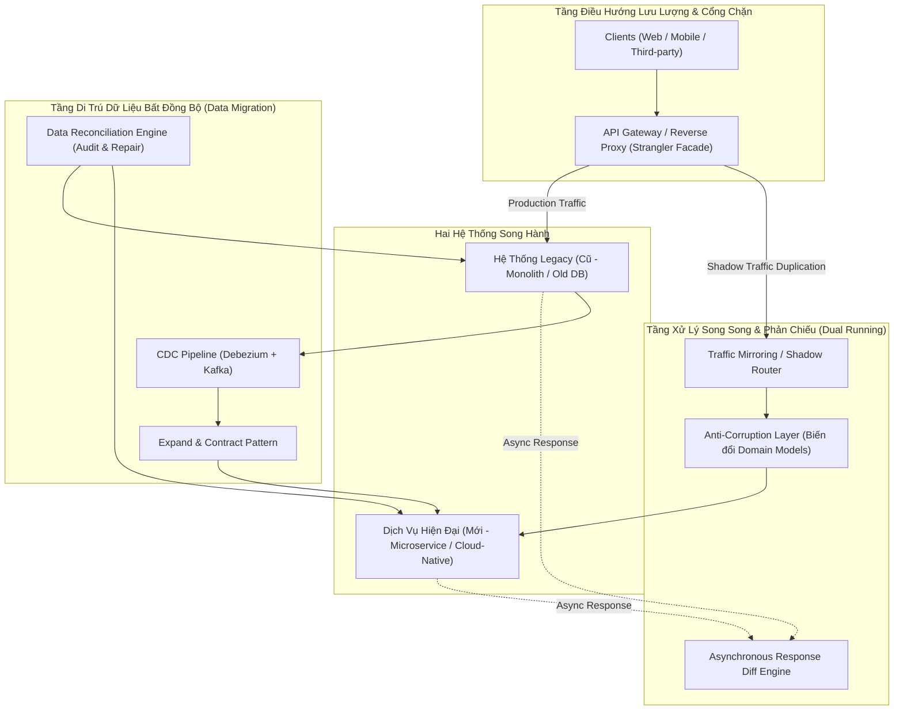
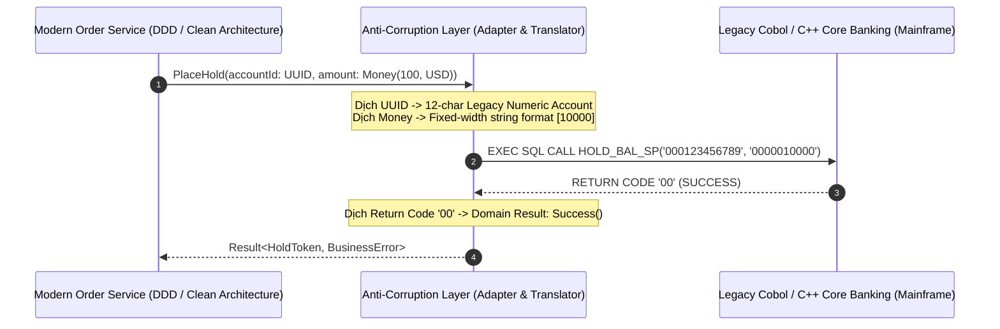
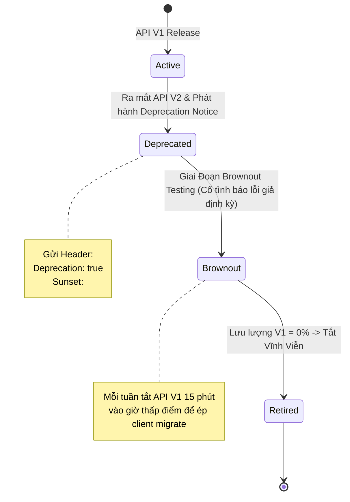
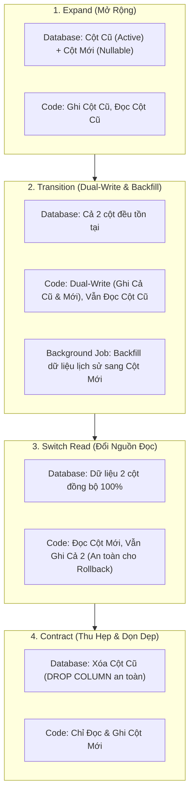
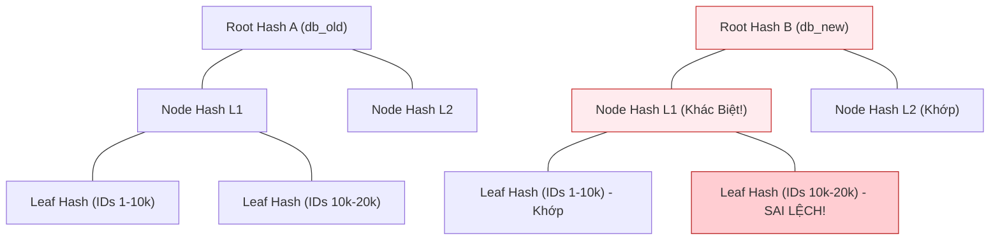

# 21.2. Mẫu Hình Hiện Đại Hóa & Di Chuyển Lưu Lượng (Modernization Patterns & Traffic Migration)

Hiện đại hóa hệ thống legacy là nghệ thuật "thay động cơ máy bay phản lực khi nó đang bay ở độ cao 10.000 mét". Mọi thao tác từ chuyển đổi ngôn ngữ, nâng cấp framework đến di trú hàng terabyte dữ liệu sang kiến trúc mới đều phải diễn ra một cách tiệm tiến (incremental), không làm gián đoạn doanh thu và bảo đảm tính toàn vẹn dữ liệu tuyệt đối (Zero Data Loss).

---

## 1. Tổng quan Kiến trúc Hiện đại hóa Tiệm tiến



---

## 2. Chi tiết từng Keyword (Under-the-Hood Deep Dive)

### Nhóm 1: Architectural Modernization Patterns (Strangler Fig, Branch by Abstraction, Anti-Corruption Layer & Incremental Modernization)

#### 1. Khái niệm & Bản chất (What & Why)
- **Legacy System Modernization & Incremental Modernization**: Chiến lược nâng cấp từng phần nhỏ có kiểm soát, thay vì "Big Bang Rewrite" rủi ro cao. Mỗi bước chuyển đổi đều mang lại giá trị vận hành tức thì.
- **Strangler Fig Pattern (Cây Đề Bóp Cổ)**: Mẫu hình kiến trúc đặt một lớp facade (API Gateway) chắn trước hệ thống cũ. Từng endpoint hoặc cụm tính năng mới được viết trên hệ thống hiện đại; gateway sẽ điều hướng traffic dần dần sang hệ thống mới cho đến khi hệ thống cũ bị teo tóp và tắt hẳn.
- **Branch by Abstraction**: Kỹ thuật tái cấu trúc ngay trong một codebase đơn lẻ: tạo một interface trừu tượng bọc quanh thành phần cũ, tạo implementation mới song song, chuyển hướng luồng gọi bằng feature flags, và cuối cùng dỡ bỏ code cũ mà không làm vỡ main trunk.
- **Anti-Corruption Layer (ACL)**: Tầng chuyển ngữ và ánh xạ dữ liệu nằm giữa hai hệ thống có mô hình miền (Domain Model) khác nhau, ngăn chặn các khái niệm rác, naming conventions méo mó từ hệ thống legacy làm ô nhiễm mã nguồn kiến trúc mới.

#### 2. Cơ chế hoạt động & Phân tích chuyên sâu (Under-the-Hood)
- **Kernel & Gateway-Level Request Interception**:
  - Tại tầng Reverse Proxy (Envoy / NGINX / Cloudflare Workers), Strangler Facade chặn HTTP request ở L7.
  - Sử dụng header routing (ví dụ: `X-Modernized-Feature: true` hoặc cookie session) để điều hướng các user thử nghiệm (canary group) sang cụm microservice mới, trong khi 99% người dùng thông thường vẫn trỏ về máy chủ Monolith cũ.
  - Dưới tầng memory và network stack: Proxy duy trì connection pool độc lập tới cả hai cụm để ngăn chặn việc timeout của một bên làm cạn kiệt ephemeral ports hoặc file descriptors (`sysctl net.ipv4.ip_local_port_range`).
- **Chi phí dịch thuật của ACL (Translation Overhead)**:
  - ACL tiêu tốn chu kỳ CPU để parse JSON từ REST API mới, chuyển đổi thành XML SOAP hoặc binary RPC của hệ thống legacy và ngược lại. Cần sử dụng bộ parser không cấp phát bộ nhớ động (Zero-copy parsing) để hạn chế Garbage Collection pauses trên high-throughput proxies.

#### 3. Sơ đồ Anti-Corruption Layer Biến Đổi Dữ Liệu



#### 4. Mã nguồn minh họa (TypeScript): Anti-Corruption Layer & Branch by Abstraction Pattern

```typescript
// 1. Hệ thống Legacy (Data model thô sơ, format lỗi thời)
export interface LegacyCustomerRecord {
  CUST_ID_NUM: string;
  FULL_NM_UPPER: string;
  ACC_BAL_STR: string; // "0000540050" -> $5,400.50
}

export class LegacyCustomerDatabase {
  public static queryLegacy(idNum: string): LegacyCustomerRecord {
    return {
      CUST_ID_NUM: idNum,
      FULL_NM_UPPER: "NGUYEN VAN A",
      ACC_BAL_STR: "0000540050"
    };
  }
}

// 2. Mô hình miền hiện đại (Clean DDD Model)
export interface ModernCustomer {
  readonly id: string;
  readonly fullName: string;
  readonly balanceCents: bigint;
}

// 3. Trừu tượng hóa (Branch by Abstraction Interface)
export interface CustomerRepository {
  findCustomerById(id: string): Promise<ModernCustomer>;
}

// 4. Anti-Corruption Layer đóng vai trò Adapter cách ly rác legacy
export class AntiCorruptionCustomerAdapter implements CustomerRepository {
  public async findCustomerById(id: string): Promise<ModernCustomer> {
    // Chuyển UUID/Modern ID sang Legacy ID format
    const legacyKey = id.replace(/[^0-9]/g, '').padStart(10, '0').slice(0, 10);
    
    // Gọi hệ thống cũ
    const rawLegacy = LegacyCustomerDatabase.queryLegacy(legacyKey);

    // Chuyển dịch và làm sạch dữ liệu (Sanitization & Normalization)
    const cents = BigInt(rawLegacy.ACC_BAL_STR);
    const normalizedName = rawLegacy.FULL_NM_UPPER
      .toLowerCase()
      .split(' ')
      .map(w => w.charAt(0).toUpperCase() + w.slice(1))
      .join(' ');

    return {
      id: id,
      fullName: normalizedName,
      balanceCents: cents
    };
  }
}

// 5. Implementation Hiện Đại Hoàn Toàn (Sẽ thay thế adapter trong tương lai)
export class ModernPostgresCustomerRepository implements CustomerRepository {
  public async findCustomerById(id: string): Promise<ModernCustomer> {
    // Truy vấn trực tiếp từ bảng PostgreSQL mới
    return {
      id,
      fullName: "Nguyễn Văn A",
      balanceCents: 540050n
    };
  }
}

// 6. Router quyết định nhánh thực thi qua Feature Flag (Branch by Abstraction)
export class CustomerService {
  constructor(
    private readonly modernRepo: CustomerRepository,
    private readonly aclAdapter: CustomerRepository,
    private readonly useModernDb: boolean
  ) {}

  public async getCustomerProfile(id: string): Promise<ModernCustomer> {
    if (this.useModernDb) {
      return this.modernRepo.findCustomerById(id);
    }
    return this.aclAdapter.findCustomerById(id);
  }
}
```

#### 5. Anti-Patterns & Cạm bẫy
- **Leaky ACL (Lớp dịch thủng)**: Để các kiểu dữ liệu dị biệt của legacy (như các mã lỗi numeric bí ẩn `-99`, `null` thay vì empty list, format ngày tháng epoch 2 chữ số) lọt qua ACL đi thẳng vào domain model của dịch vụ mới. Điều này làm mất hoàn toàn ý nghĩa của việc cách ly.
- **The Strangler Bottleneck**: Đặt quá nhiều business logic phức tạp vào tầng Strangler Facade Proxy. Proxy chỉ nên làm nhiệm vụ định tuyến (routing) và kiểm tra cờ (flags); nếu nhồi nhét logic vào proxy, bạn sẽ vô tình biến proxy thành một "Monolith thứ hai".

#### 6. Ứng dụng Backend & Distributed Systems
- Sử dụng **Envoy Proxy với Dynamic Route Configuration (xDS)** để thay đổi tỷ lệ điều hướng lưu lượng từ 0% sang 100% về phía cụm dịch vụ mới trong thời gian thực mà không cần restart tiến trình proxy (Zero-reload configuration).

---

### Nhóm 2: The Migration Spectrum & Compatibility (Database, API, Runtime, Framework, Language & Backward Compatibility)

#### 1. Khái niệm & Bản chất (What & Why)
- **The Migration Spectrum**: Toàn bộ các cấp độ di trú trong kỹ thuật phần mềm:
  - **Database & Data Migration**: Chuyển đổi schema và di dời dữ liệu từ RDBMS cũ sang distributed database hiện đại.
  - **API Migration**: Nâng cấp từ SOAP/XML sang RESTful/JSON hoặc gRPC/Protobuf.
  - **Runtime & Language Migration**: Chuyển đổi ngôn ngữ lập trình (ví dụ: từ Python 2 sang Python 3, từ Java sang Go/Rust, từ PHP sang Node.js).
  - **Framework & Infrastructure Migration**: Nâng cấp version framework (Spring Boot 2 -> 3) hoặc chuyển từ On-premise VM lên Kubernetes trên Cloud.
- **Compatibility Layers & Backward Compatibility**: Cơ chế duy trì tính tương thích với các client cũ đang chạy ngoài thị trường (Mobile app chưa cập nhật, đối tác B2B) mà không kìm hãm sự phát triển của hệ thống nội bộ.
- **Deprecation Strategy**: Chiến lược thông báo, đo lường và chính thức khai tử các endpoint/tính năng cũ theo các mốc thời gian rõ ràng (Deprecation Headers, Sunset Headers RFC 8594).

#### 2. Cơ chế hoạt động & Phân tích chuyên sâu (Under-the-Hood)
- **Database Schema Migration Zero-Downtime**:
  - Không bao giờ chạy các lệnh DDL độc hại như: `ALTER TABLE orders ADD COLUMN status VARCHAR(50) DEFAULT 'PENDING' NOT NULL;` trên bảng chứa 50 triệu dòng trong MySQL < 8.0 hoặc PostgreSQL cũ. Lệnh này đòi hỏi **Metadata Exclusive Lock (`AccessExclusiveLock`)**, làm nghẽn toàn bộ các câu lệnh `SELECT` và `INSERT` đang chờ, gây cạn kiệt pool kết nối chỉ trong vài giây.
  - Quy trình chuẩn Zero-Downtime: Thêm cột cho phép `NULL` trước mà không gán default value, sau đó dùng background worker backfill dữ liệu theo từng batch nhỏ (ví dụ 1000 dòng/batch), và cuối cùng mới thêm ràng buộc `NOT NULL` sau khi dữ liệu đã đầy đủ.
- **HTTP Deprecation Protocols (RFC 8594)**:
  - Trả về header tiêu chuẩn trên các API sắp bị khai tử:
    ```http
    Deprecation: @1735689600
    Sunset: Wed, 31 Dec 2026 23:59:59 GMT
    Link: <https://api.example.com/docs/v2-migration>; rel="sunset"
    ```
  - Cấu hình API Gateway theo dõi tỷ lệ gọi các deprecated endpoints; khi lưu lượng giảm về 0, hệ thống an toàn tắt hoàn toàn API cũ.

#### 3. Sơ đồ Tiến Trình Khai Tử API An Toàn (API Sunset Lifecycle)



#### 4. Mã nguồn minh họa (TypeScript): Middleware Deprecation Header & Brownout Injection

```typescript
export interface RequestContext {
  path: string;
  headers: Record<string, string>;
}

export interface HttpResponse {
  status: number;
  headers: Record<string, string>;
  body: string;
}

export class ApiLifecycleMiddleware {
  // RFC 8594 Sunset Date: 2026-12-31
  private static readonly SUNSET_TIMESTAMP = "Wed, 31 Dec 2026 23:59:59 GMT";
  private static readonly DEPRECATION_LINK = '<https://docs.myapi.com/v2-migration>; rel="sunset"';

  public static handleV1Request(ctx: RequestContext, isBrownoutActive: boolean): HttpResponse {
    // 1. Brownout Testing: Cố tình ngắt dịch vụ 1% thời gian để client nhận thức API sắp chết
    if (isBrownoutActive) {
      return {
        status: 410, // 410 Gone hoặc 503 Service Unavailable
        headers: {
          'Content-Type': 'application/json',
          'Sunset': this.SUNSET_TIMESTAMP
        },
        body: JSON.stringify({
          error: "BROWNOUT_TEST",
          message: "API v1 đang trong giai đoạn brownout định kỳ. Vui lòng migrate sang API v2 ngay lập tức!"
        })
      };
    }

    // 2. Phục vụ request bình thường kèm Deprecation Header theo chuẩn RFC 8594
    return {
      status: 200,
      headers: {
        'Content-Type': 'application/json',
        'Deprecation': 'true',
        'Sunset': this.SUNSET_TIMESTAMP,
        'Link': this.DEPRECATION_LINK
      },
      body: JSON.stringify({ data: "Legacy payload" })
    };
  }
}
```

#### 5. Anti-Patterns & Cạm bẫy
- **Perpetual Deprecation (Khai tử nửa vời)**: Gắn nhãn `@deprecated` trên code hoặc tài liệu nhưng không bao giờ đưa ra ngày `Sunset` chính thức. Các đối tác và đội frontend sẽ tiếp tục gọi endpoint cũ vô thời hạn, khiến bạn phải duy trì hai hệ thống song song trong nhiều năm.
- **Breaking Database Column Renames**: Đổi tên cột trong database bằng lệnh `RENAME COLUMN` khi code backend cũ vẫn đang chạy. Toàn bộ các câu query của backend cũ sẽ ném lỗi `Unknown column` ngay lập tức.

#### 6. Ứng dụng Backend & Distributed Systems
- Áp dụng **Backward-Compatible Protobuf Field Numbering**: Trong gRPC/Protobuf, không bao giờ thay đổi tag number của các field đã phát hành. Khi cần bỏ một field, đánh dấu nó là `reserved` để trình biên dịch ngăn chặn việc tái sử dụng tag number đó trong tương lai.

---

### Nhóm 3: Traffic Routing, Dual Running & Parallel Change (Shadow Traffic, Traffic Mirroring & Expand-and-Contract)

#### 1. Khái niệm & Bản chất (What & Why)
- **Dual Running**: Vận hành đồng thời cả hệ thống cũ và mới trên môi trường production, cùng xử lý các luồng công việc thực tế để kiểm chứng sự tương đồng về hành vi.
- **Shadow Traffic (Traffic Mirroring / Dark Launching)**: Kỹ thuật nhân bản (clone) luồng HTTP request hoặc message từ người dùng thật: một bản gửi tới hệ thống chính (Legacy) để trả lời người dùng, một bản gửi ngầm tới hệ thống mới (Modern) để kiểm tra hiệu năng và độ ổn định mà không để người dùng nhận biết.
- **Parallel Change (Expand and Contract)**: Mẫu hình 3 giai đoạn để thực hiện các thay đổi kiến trúc lớn mà không gây downtime:
  1. **Expand**: Mở rộng hệ thống để hỗ trợ đồng thời cả format cũ và format mới (Ví dụ: hỗ trợ cả cột `full_name` và cặp cột `first_name, last_name`).
  2. **Transition**: Viết code ghi đồng thời (Dual Write) vào cả hai nơi và backfill dữ liệu cũ sang mới.
  3. **Contract**: Chuyển toàn bộ luồng đọc sang format mới và xóa bỏ cột/code cũ.

#### 2. Cơ chế hoạt động & Phân tích chuyên sâu (Under-the-Hood)
- **Asynchronous Traffic Mirroring tại tầng Kernel/Proxy**:
  - Tại NGINX (`mirror` module) hoặc Envoy Proxy (`request_mirror_policies`): Request body được sao chép sang một TCP socket mới.
  - Cơ chế **Fire-and-Forget**: Proxy không chờ response từ shadow service. Kết quả trả về của shadow service bị drop ngay lập tức tại tầng proxy socket buffer, không ảnh hưởng đến độ trễ trả về cho client.
  - Rủi ro Side-Effect: **Shadow Traffic BẮT BUỘC phải là Read-Only** hoặc phải được cấu hình mock các third-party sinks. Nếu mirror một request `POST /pay` sang shadow service mà không mock, tài khoản của khách hàng sẽ bị trừ tiền hai lần!
- **Expand-and-Contract Database Evolution**:
  - Giai đoạn 1 (Expand): Tạo cột mới `phone_e164`.
  - Giai đoạn 2 (Dual Write): Code backend ghi vào cả `phone_raw` và `phone_e164`.
  - Giai đoạn 3 (Backfill): Chạy job chạy nền đọc từng chunk 10.000 dòng để convert dữ liệu cũ.
  - Giai đoạn 4 (Read Switch): Đổi code đọc chỉ đọc từ `phone_e164`.
  - Giai đoạn 5 (Contract): Chạy migration xóa cột `phone_raw`.

#### 3. Sơ đồ Tiến Trình Expand and Contract



#### 4. Mã nguồn minh họa (C++20): High-Throughput Shadow Traffic Router với Worker Thread Pool

```cpp
#include <iostream>
#include <string>
#include <vector>
#include <queue>
#include <mutex>
#include <condition_variable>
#include <thread>
#include <functional>

struct HttpRequest {
    std::string method;
    std::string path;
    std::string payload;
    bool is_mutation; // POST, PUT, DELETE
};

class ShadowTrafficDispatcher {
public:
    ShadowTrafficDispatcher(size_t queue_capacity = 1000) 
        : stop_(false), max_capacity_(queue_capacity) {
        worker_ = std::thread(&ShadowTrafficDispatcher::WorkerLoop, this);
    }

    ~ShadowTrafficDispatcher() {
        {
            std::unique_lock<std::mutex> lock(mutex_);
            stop_ = true;
        }
        cv_.notify_all();
        if (worker_.joinable()) worker_.join();
    }

    // Dispatcher xử lý request chính và bắn shadow bất đồng bộ
    void HandleRequest(const HttpRequest& req) {
        // 1. Phục vụ request chính (Primary Production Path)
        ProcessPrimary(req);

        // 2. Không bao giờ mirror các request làm thay đổi dữ liệu nếu không có sandbox an toàn!
        if (req.is_mutation) {
            return; 
        }

        // 3. Đẩy vào non-blocking queue cho worker thread bắn sang Shadow Cluster
        {
            std::unique_lock<std::mutex> lock(mutex_);
            if (shadow_queue_.size() < max_capacity_) {
                shadow_queue_.push(req);
                cv_.notify_one();
            } else {
                // Drop shadow request nếu queue đầy, TUYỆT ĐỐI không block primary thread
                std::cerr << "[WARN] Shadow Queue đầy, drop traffic mirror để bảo vệ Primary Latency!\n";
            }
        }
    }

private:
    void ProcessPrimary(const HttpRequest& req) {
        // Xử lý logic chính trả lời khách hàng
    }

    void WorkerLoop() {
        while (true) {
            HttpRequest req;
            {
                std::unique_lock<std::mutex> lock(mutex_);
                cv_.wait(lock, [this] { return stop_ || !shadow_queue_.empty(); });

                if (stop_ && shadow_queue_.empty()) return;

                req = std::move(shadow_queue_.front());
                shadow_queue_.pop();
            }

            // Gửi sang Modernized Shadow Service (Simulated IO)
            SendToModernShadowService(req);
        }
    }

    void SendToModernShadowService(const HttpRequest& req) {
        // Giả lập bắn request sang cụm service mới và ghi nhận telemetry
    }

    std::queue<HttpRequest> shadow_queue_;
    std::mutex mutex_;
    std::condition_variable cv_;
    std::thread worker_;
    bool stop_;
    size_t max_capacity_;
};

int main() {
    ShadowTrafficDispatcher dispatcher(500);

    dispatcher.HandleRequest({"GET", "/api/v1/user/profile", "", false});
    dispatcher.HandleRequest({"POST", "/api/v1/user/checkout", "amount=500", true});

    std::cout << "[SUCCESS] Traffic Mirroring Dispatcher đang vận hành ngầm bảo vệ hệ thống chính.\n";
    return 0;
}
```

#### 5. Anti-Patterns & Cạm bẫy
- **Synchronous Shadowing**: Chờ cả Primary Service và Shadow Service phản hồi rồi mới trả kết quả về cho client. Nếu Shadow Service bị deadlock hoặc slow query, toàn bộ người dùng thật trên production sẽ bị nghẽn và timeout theo!
- **Accidental Third-Party Calls in Shadow**: Service mới trong môi trường shadow nhận được request mirrored nhưng lại gọi API thật của Stripe hoặc SendGrid, khiến khách hàng nhận được email thông báo đơn hàng rác hoặc bị trừ tiền hai lần.

#### 6. Ứng dụng Backend & Distributed Systems
- Sử dụng **Kafka Parallel Consumer Groups**: Hệ thống cũ và mới cùng subscribe vào cùng một Kafka Topic dữ liệu. Bằng cách gán consumer group khác nhau, cả hai hệ thống cùng tiêu thụ toàn bộ sự kiện thực tế độc lập mà không can thiệp vào tiến trình của nhau.

---

### Nhóm 4: Verification, Data Reconciliation & Rollback Planning (Validation, Reconciliation & Rollback)

#### 1. Khái niệm & Bản chất (What & Why)
- **Migration Validation**: Tiến trình kiểm tra tự động nhằm chứng minh dữ liệu và hành vi của hệ thống mới trùng khớp 100% với hệ thống cũ trước khi thực hiện chuyển đổi chính thức.
- **Data Reconciliation (Đối soát & Hàn gắn dữ liệu)**: Bộ công cụ chạy ngầm quét liên tục hai cơ sở dữ liệu (cũ và mới), so sánh các bản ghi theo Primary Key và phát hiện các trường dữ liệu bị lệch (drift), sau đó tự động áp dụng logic sửa chữa (repair).
- **Rollback Planning**: Kế hoạch chi tiết, có thể tự động hóa, định nghĩa chính xác cách thức quay ngược lưu lượng và phục hồi dữ liệu về hệ thống cũ nếu hệ thống mới phát sinh lỗi nghiêm trọng sau khi cutover.

#### 2. Cơ chế hoạt động & Phân tích chuyên sâu (Under-the-Hood)
- **Merkle Tree Data Reconciliation Algorithm**:
  - Khi so sánh 100 triệu bản ghi giữa database MySQL cũ và PostgreSQL mới, việc query từng dòng qua mạng sẽ làm sập băng thông và database IOPS.
  - Giải pháp tối ưu: Xây dựng **Merkle Tree (Hash Tree)** trên các partition dữ liệu (ví dụ: chia theo ngày hoặc theo range ID 10.000 bản ghi).
  - So sánh Root Hash của hai bên: Nếu Root Hash khớp nhau, 100% dữ liệu đồng nhất. Nếu Root Hash khác nhau, đệ quy đi xuống các nhánh con để tìm chính xác dải ID bị sai lệch, chỉ tải và sửa chữa đúng vài bản ghi bị lệch đó.
- **Rollback Trap - Reverse Dual-Write**:
  - Sai lầm chết người trong Rollback: Sau khi chuyển 100% traffic sang hệ thống mới, hệ thống cũ bị ngắt hoàn toàn. Khi hệ thống mới chạy được 4 tiếng và phát sinh lỗi, bạn muốn rollback về hệ thống cũ nhưng toàn bộ dữ liệu mới sinh ra trong 4 tiếng đó chưa được đồng bộ ngược về DB cũ!
  - **Quy tắc Rollback An Toàn**: Sau khi cutover sang hệ thống mới, BẮT BUỘC phải duy trì cơ chế **Reverse Dual-Write** (ghi ngược dữ liệu mới từ New DB về Old DB) ít nhất trong 2 đến 4 tuần cho đến khi hệ thống mới hoàn toàn ổn định.

#### 3. Sơ đồ Cây Merkle So Sánh Dữ Liệu Phân Tán (Merkle Tree Reconciliation)



#### 4. Mã nguồn minh họa (TypeScript): Engine Đối Soát Dữ Liệu Tự Động (Data Reconciliation & Self-Healing)

```typescript
import * as crypto from 'crypto';

export interface DatabaseRecord {
  id: string;
  balanceCents: number;
  status: string;
  updatedAtTimestamp: number;
}

export class DataReconciliationEngine {
  public static computeRecordHash(record: DatabaseRecord): string {
    return crypto.createHash('md5')
      .update(`${record.id}:${record.balanceCents}:${record.status}`)
      .digest('hex');
  }

  public static reconcileBatches(
    legacyBatch: DatabaseRecord[],
    modernBatch: DatabaseRecord[]
  ): { synced: number; mismatches: Array<{ id: string; reason: string }>; repaired: number } {
    const modernMap = new Map<string, DatabaseRecord>();
    for (const r of modernBatch) {
      modernMap.set(r.id, r);
    }

    let synced = 0;
    let repaired = 0;
    const mismatches: Array<{ id: string; reason: string }> = [];

    for (const oldRec of legacyBatch) {
      const newRec = modernMap.get(oldRec.id);

      if (!newRec) {
        mismatches.push({ id: oldRec.id, reason: "Bản ghi bị thiếu trong Modern Database" });
        // Tự động hàn gắn (Self-healing repair)
        this.repairMissingInModern(oldRec);
        repaired++;
        continue;
      }

      const oldHash = this.computeRecordHash(oldRec);
      const newHash = this.computeRecordHash(newRec);

      if (oldHash !== newHash) {
        mismatches.push({ 
          id: oldRec.id, 
          reason: `Sai lệch nội dung: Old[bal=${oldRec.balanceCents}, stat=${oldRec.status}] vs New[bal=${newRec.balanceCents}, stat=${newRec.status}]` 
        });
        
        // Quy tắc hòa giải: Bản ghi có timestamp mới hơn sẽ ghi đè
        if (oldRec.updatedAtTimestamp > newRec.updatedAtTimestamp) {
          this.repairOverwriteModern(oldRec);
        } else {
          this.repairOverwriteLegacy(newRec);
        }
        repaired++;
      } else {
        synced++;
      }
    }

    return { synced, mismatches, repaired };
  }

  private static repairMissingInModern(record: DatabaseRecord): void {
    // Logic đẩy bản ghi thiếu sang DB mới
  }

  private static repairOverwriteModern(record: DatabaseRecord): void {
    // Logic cập nhật DB mới theo DB cũ
  }

  private static repairOverwriteLegacy(record: DatabaseRecord): void {
    // Logic cập nhật ngược lại DB cũ theo DB mới
  }
}

// Case Study mô phỏng
const oldData: DatabaseRecord[] = [
  { id: "ACC-1", balanceCents: 5000, status: "ACTIVE", updatedAtTimestamp: 100 },
  { id: "ACC-2", balanceCents: 12000, status: "PENDING", updatedAtTimestamp: 105 }
];

const newData: DatabaseRecord[] = [
  { id: "ACC-1", balanceCents: 5000, status: "ACTIVE", updatedAtTimestamp: 100 },
  { id: "ACC-2", balanceCents: 12000, status: "ACTIVE", updatedAtTimestamp: 110 } // Mới hơn và đã active
];

const report = DataReconciliationEngine.reconcileBatches(oldData, newData);
console.log(`=== BÁO CÁO ĐỐI SOÁT DỮ LIỆU ===`);
console.log(`Bản ghi đồng nhất : ${report.synced}`);
console.log(`Sai lệch phát hiện: ${report.mismatches.length}`);
console.log(`Đã tự động hàn gắn: ${report.repaired}`);
```

#### 5. Anti-Patterns & Cạm bẫy
- **No-Way-Back Cutover**: Cắt đứt hoàn toàn cầu nối với hệ thống cũ ngay sau khi đổi DNS sang hệ thống mới. Khi hệ thống mới gặp sự cố tràn bộ nhớ (OOM) dưới áp lực tải thực tế, đội ngũ không có đường lui, buộc phải chịu đựng hàng giờ downtime trong hoảng loạn.
- **Ignoring Data Drift**: Cho rằng nếu đã cấu hình CDC (Change Data Capture) thì dữ liệu giữa hai DB sẽ luôn tự động khớp 100%. Trong thực tế, các sự cố mạng chập chờn, queue overflow hoặc format lỗi âm thầm làm rớt các event mà không phát ra lỗi, tạo ra sự sai lệch ngầm tích tụ theo thời gian.

#### 6. Ứng dụng Backend & Distributed Systems
- Lên lịch chạy các cron jobs **Continuous Data Reconciliation** sử dụng Apache Spark hoặc BigQuery để đối soát hàng đêm giữa dữ liệu MySQL lõi và Data Warehouse hiện đại, xuất cảnh báo Slack tức thì khi độ lệch vượt quá 0.001%.

---

## 3. Tổng kết & Bảng Tra Cứu Thực Chiến

| Chiến lược / Mẫu hình | Bản chất cốt lõi | Rủi ro lớn nhất | Nguyên tắc thực chiến bắt buộc |
| :--- | :--- | :--- | :--- |
| **Strangler Fig** | Thay thế tiệm tiến qua Reverse Proxy Facade | Proxy trở thành single point of failure | Proxy chỉ route, không chứa business logic |
| **Anti-Corruption Layer** | Adapter chuyển dịch ngôn ngữ và domain model | Tốn CPU/Memory serialization | Dùng zero-copy parsing, cô lập hoàn toàn domain rác |
| **Expand & Contract** | Di chuyển database schema không downtime | Lock bảng do lệnh DDL ẩu | Add nullable column -> Dual Write -> Backfill -> Switch -> Drop |
| **Shadow Traffic** | Mirror request thực tế kiểm thử service mới | Side-effect gọi nhầm third-party thật | Chỉ mirror GET/Read-only, cô lập toàn bộ write sinks |
| **Data Reconciliation** | Quét và hàn gắn sai lệch giữa 2 database | Quét toàn bộ DB gây nghẽn I/O | Dùng Merkle Trees hoặc Hash Partitions theo timestamp |
| **Rollback Strategy** | Đảm bảo luôn có đường lui an toàn về hệ thống cũ | Mất dữ liệu sinh ra trên hệ thống mới | Bắt buộc duy trì Reverse Dual-Write sau cutover |
