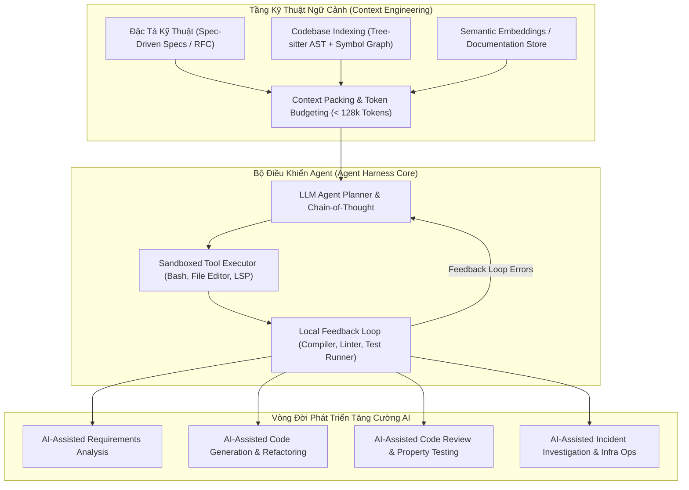
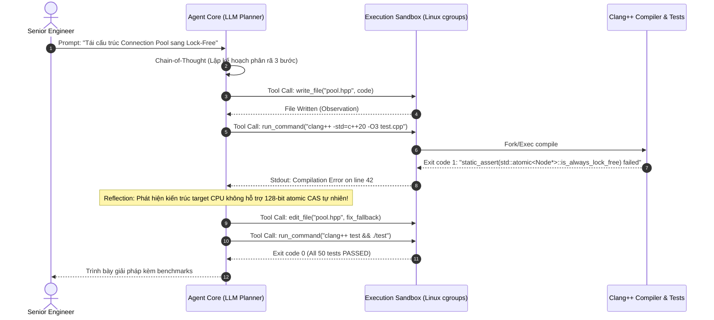
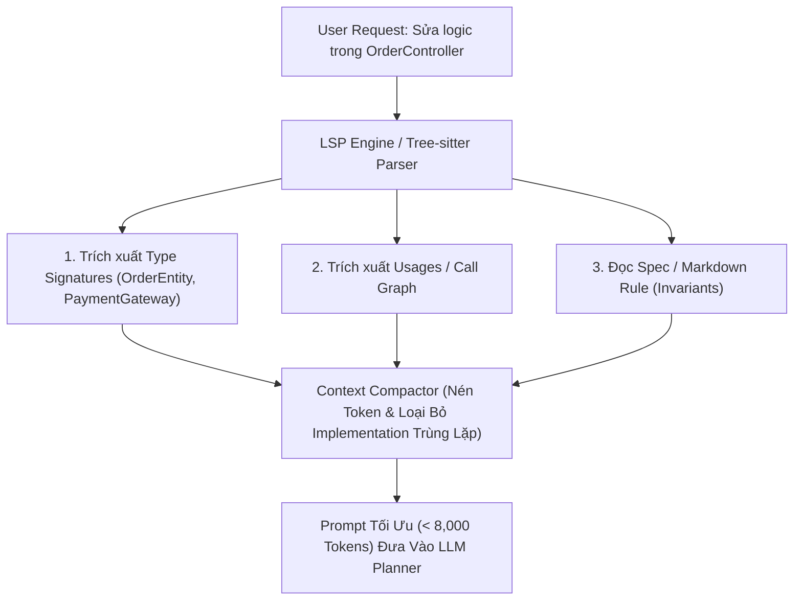
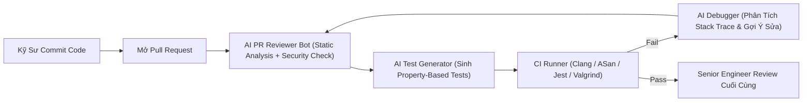
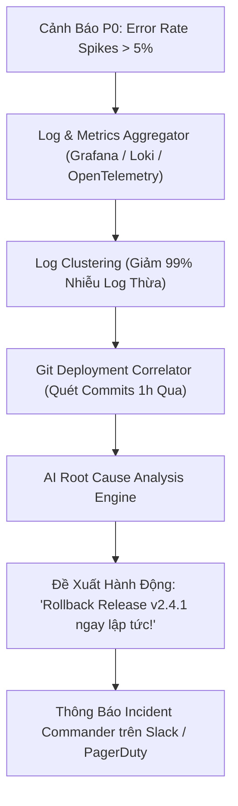

# 22.1. Kỹ Thuật Phần Mềm Với AI & Thiết Kế Ngữ Cảnh (Agentic Software Engineering & Context Design)

Sự trỗi dậy của các mô hình ngôn ngữ lớn (LLM) và các Coding Agents tự hành đã tái định hình căn bản phương thức xây dựng phần mềm. Kỹ sư không còn là "máy gõ code thủ công" (code typist) mà chuyển dịch thành **Kiến trúc sư hệ thống và Quản trị Agent (Agent Harness Architect)**. Thành công của việc ứng dụng AI không nằm ở việc prompt tùy tiện, mà dựa trên nền tảng kỹ thuật chính xác: Context Engineering, RAG đa tầng trên cây cú pháp trừu tượng (AST), và Specification-Driven Development.

---

## 1. Tổng quan Kiến trúc Agent Harness & Vòng Đời Kỹ Thuật Phần Mềm với AI



---

## 2. Chi tiết từng Keyword (Under-the-Hood Deep Dive)

### Nhóm 1: Foundations of Agentic Engineering (AI-Assisted Software Development, AI-Augmented Engineering, AI Coding Agents & Agentic Software Engineering)

#### 1. Khái niệm & Bản chất (What & Why)
- **AI-Assisted Software Development**: Giai đoạn đầu của việc áp dụng AI (như GitHub Copilot autocomplete dòng lệnh đơn lẻ), nơi AI đóng vai trò như một bàn phím thông minh thụ động.
- **AI-Augmented Engineering**: Tiếp cận tích hợp sâu, nâng cao năng suất kỹ sư ở mọi công đoạn phân tích, thiết kế, benchmark, và kiểm thử thông qua các trợ lý AI chuyên biệt.
- **AI Coding Agents**: Các tác tử phần mềm có khả năng tự trị cao (autonomous), sở hữu vòng lặp quan sát - suy luận - hành động (ReAct Loop: Reason + Act), có khả năng đọc codebase, chạy bash command, sửa file, biên dịch và tự sửa lỗi khi test fail.
- **Agentic Software Engineering**: Kỷ luật kỹ thuật mới tập trung vào việc thiết kế môi trường, công cụ, rào chắn an toàn (guardrails) và hệ thống kiểm định để các AI Coding Agents có thể đóng góp vào production codebase một cách tin cậy và có thể kiểm toán được.

#### 2. Cơ chế hoạt động & Phân tích chuyên sâu (Under-the-Hood)
- **Vòng lặp ReAct Loop Dưới Tầng Hệ Thống**:
  - Agent hoạt động qua một tiến trình tuần tự:
    $$\text{Thought} \rightarrow \text{Action (Tool Call)} \rightarrow \text{Observation (Syscall/Stdout)} \rightarrow \text{Reflection}$$
  - Mỗi vòng lặp tool execution yêu cầu:
    1. Parse function call invocation từ JSON payload của LLM.
    2. Chạy an toàn thông qua sandbox tiến trình (`fork()`, `execve()` với cgroups và seccomp filters).
    3. Thu thập output `stdout`/`stderr` và truncate nếu output vượt quá kích thước token window (chống tràn context).
- **Entropy và Suy thoái Ngữ Cảnh (Context Degeneration)**:
  - Khi hội thoại của Agent kéo dài qua 20+ turns, sự tích tụ của các error logs và tool traces làm loãng "sự chú ý" (Attention Weights) của mô hình Transformer, dẫn đến hiện tượng quên các quy tắc kiến trúc ban đầu (Lost in the Middle phenomenon). Agent bắt đầu tạo ra mã nguồn mâu thuẫn hoặc vòng lặp logic vô tận.

#### 3. Sơ đồ Vòng Lặp Phản Hồi ReAct của AI Coding Agent



#### 4. Mã nguồn minh họa (TypeScript): Khung điều khiển ReAct Harness cho AI Coding Agent

```typescript
export interface AgentTool {
  name: string;
  description: string;
  execute(args: Record<string, unknown>): Promise<string>;
}

export interface ReActStep {
  thought: string;
  actionToolName?: string;
  actionArgs?: Record<string, unknown>;
  observation?: string;
}

export class AgentHarnessEngine {
  private tools: Map<string, AgentTool> = new Map();
  private maxTurns: number = 5;

  public registerTool(tool: AgentTool): void {
    this.tools.set(tool.name, tool);
  }

  public async runAutonomousLoop(
    taskPrompt: string,
    llmInference: (history: ReActStep[]) => Promise<{ thought: string; tool?: string; args?: any; isDone: boolean }>
  ): Promise<string> {
    const history: ReActStep[] = [];

    for (let turn = 0; turn < this.maxTurns; turn++) {
      // 1. LLM Reasoning Step
      const response = await llmInference(history);
      const step: ReActStep = { thought: response.thought };

      if (response.isDone || !response.tool) {
        history.push(step);
        return `Nhiệm vụ hoàn tất: ${response.thought}`;
      }

      // 2. Action Step
      step.actionToolName = response.tool;
      step.actionArgs = response.args;

      const tool = this.tools.get(response.tool);
      if (!tool) {
        step.observation = `[ERROR] Tool không tồn tại: ${response.tool}`;
      } else {
        try {
          // Thực thi tool trong môi trường sandbox có kiểm soát
          step.observation = await tool.execute(response.args);
        } catch (err: any) {
          step.observation = `[EXECUTION_FAILED]: ${err.message}`;
        }
      }

      // 3. Observation Step lưu lại để LLM phản tư ở lượt tiếp theo
      history.push(step);
    }

    throw new Error("Agent đạt giới hạn số lượt (Max turns reached) mà chưa giải quyết được bài toán.");
  }
}
```

#### 5. Anti-Patterns & Cạm bẫy
- **Blind Code Insertion**: Copy-paste toàn bộ code do AI sinh ra vào production mà không đọc hiểu từng dòng hoặc không chạy qua kiểm thử regression. Mã nguồn có thể biên dịch thành công nhưng chứa các lỗ hổng bảo mật tiềm ẩn (SQL injection, unsafe pointer cast) hoặc vi phạm business invariants.
- **Context Stuffing**: Nhồi nhét toàn bộ 500 file của dự án vào một prompt khổng lồ và mong chờ AI hiểu toàn bộ kiến trúc. Điều này làm vượt ngưỡng hiệu quả của Multi-Head Attention, gây ra chi phí token khổng lồ và làm suy giảm nghiêm trọng độ chính xác của kết quả.

#### 6. Ứng dụng Backend & Distributed Systems
- Áp dụng Coding Agents chuyên biệt để tự động hóa việc nâng cấp thư viện phụ thuộc (e.g., nâng cấp Netty hoặc gRPC version). Agent tự động đọc changelog của thư viện, tìm các phương thức deprecated trong codebase, sửa đổi code, chạy test suite, và mở Pull Request hoàn chỉnh kèm báo cáo kiểm thử.

---

### Nhóm 2: Agent Harness & Context Engineering (Harness Engineering, Context Engineering & Specification-Driven Development)

#### 1. Khái niệm & Bản chất (What & Why)
- **Agent Harness Engineering**: Kỹ thuật xây dựng hạ tầng phần mềm bao quanh mô hình LLM để biến nó thành một công cụ giải quyết bài toán kỹ thuật tin cậy. Bao gồm: quản lý bộ nhớ đệm, điều phối công cụ (LSP, compiler), sandbox cô lập file system, và cơ chế fallback khi LLM gặp sự cố.
- **Context Engineering**: Nghệ thuật và khoa học thu thập, lọc, nén, và cấu trúc hóa lượng thông tin tối thiểu nhưng chính xác nhất đưa vào cửa sổ ngữ cảnh (Context Window) của LLM để đạt được độ chính xác code cao nhất với chi phí token tối ưu.
- **Specification-Driven Development (SDD)**: Phương pháp phát triển lấy tài liệu đặc tả kỹ thuật chi tiết (RFC, OpenAPI specs, State Machine tables) làm "nguồn chân lý duy nhất" (Single Source of Truth). Agent được chỉ thị không bao giờ đoán mò logic nghiệp vụ; mọi dòng code sinh ra đều phải truy vết trực tiếp về tài liệu đặc tả.

#### 2. Cơ chế hoạt động & Phân tích chuyên sâu (Under-the-Hood)
- **Cơ chế Context Assembly qua Language Server Protocol (LSP) & AST**:
  - Thay vì dùng Full-Text Search đơn giản (grep), một Harness tiên tiến sử dụng **Tree-sitter** để phân tích AST của mã nguồn.
  - Khi kỹ sư yêu cầu sửa một interface, Harness tự động truy vấn LSP để lấy:
    1. Định nghĩa gốc của Type/Class (`textDocument/definition`).
    2. Tất cả các nơi đang sử dụng Type đó (`textDocument/references`).
    3. Chữ ký của các hàm lân cận trong cùng module.
  - Context được đóng gói dưới dạng "Skeleton Code" (chỉ gồm types và signatures, loại bỏ phần thân hàm implementation) để tiết kiệm tới 70% token budget nhưng vẫn giữ trọn vẹn ngữ nghĩa kiểu dữ liệu.

#### 3. Sơ đồ Thu Thập Ngữ Cảnh Dựa Trên AST (AST-Driven Context Assembly)



#### 4. Mã nguồn minh họa (TypeScript): AST Skeleton Extractor Tiết Kiệm Tokens cho Context Engineering

```typescript
// Bộ mô phỏng trích xuất Skeleton Context từ TypeScript code
export class ContextSkeletonExtractor {
  public static extractSkeleton(sourceCode: string): string {
    const lines = sourceCode.split('\n');
    const skeletonLines: string[] = [];
    let insideMethodBody = false;
    let braceDepth = 0;

    for (const line of lines) {
      const trimmed = line.trim();

      // Giữ lại imports, interface, type definitions, và class signatures
      if (
        trimmed.startsWith('import ') ||
        trimmed.startsWith('export interface ') ||
        trimmed.startsWith('export type ') ||
        trimmed.startsWith('export enum ') ||
        trimmed.startsWith('class ') ||
        trimmed.startsWith('export class ')
      ) {
        skeletonLines.push(line);
        continue;
      }

      // Giữ lại khai báo phương thức công khai
      if (trimmed.startsWith('public ') || trimmed.startsWith('private ') || trimmed.startsWith('protected ')) {
        if (trimmed.includes('{')) {
          // Cắt bỏ phần thân hàm, chỉ giữ signature
          const signature = line.substring(0, line.indexOf('{')).trimEnd();
          skeletonLines.push(`${signature} { /* implementation omitted for context saving */ }`);
        } else {
          skeletonLines.push(line);
        }
      }
    }

    return skeletonLines.join('\n');
  }
}

// Kiểm thử nén context
const rawComplexCode = `
import { UUID } from './types';

export interface UserSession {
  userId: UUID;
  role: string;
}

export class AuthenticationService {
  private jwtSecret: string = "secret_key_123";

  public async validateToken(token: string): Promise<UserSession> {
    // 50 dòng logic giải mã phức tạp, verify HMAC, kiểm tra redis blacklist
    const decoded = JSON.parse(Buffer.from(token, 'base64').toString());
    if (!decoded.valid) throw new Error("Invalid");
    return { userId: decoded.sub, role: "admin" };
  }
}
`;

const skeleton = ContextSkeletonExtractor.extractSkeleton(rawComplexCode);
console.log("=== SKELETON CONTEXT (TIẾT KIỆM 75% TOKENS) ===");
console.log(skeleton);
```

#### 5. Anti-Patterns & Cạm bẫy
- **Vibe Coding**: Lập trình viên không viết tài liệu đặc tả, không có tiêu chuẩn nghiệm thu (Acceptance Criteria), mà chỉ gõ các câu lệnh mơ hồ như "làm cho app đẹp hơn và chạy nhanh hơn". Agent sẽ suy diễn ngẫu nhiên, tạo ra mã nguồn biến dạng và phá vỡ cấu trúc của hệ thống.
- **Ignoring Token Cost Economics**: Đưa toàn bộ file log production 50MB vào prompt của agent để tìm lỗi mà không lọc qua `grep` hoặc `awk`. Thao tác này tiêu tốn hàng chục USD tiền API token chỉ cho một câu hỏi mà một lệnh bash đơn giản có thể giải quyết trong 2 mili giây.

#### 6. Ứng dụng Backend & Distributed Systems
- Thiết lập thư mục `.spec/` hoặc `.rfc/` trực tiếp trong repository. Mọi nhiệm vụ của Agent bắt buộc phải nhận đầu vào là một file RFC có định dạng markdown chuẩn, trong đó định nghĩa rõ ràng: Input schema, Output schema, Failure Modes, và Performance SLOs.

---

### Nhóm 3: AI-Assisted SDLC (Code Generation, Review, Testing, Debugging & Refactoring)

#### 1. Khái niệm & Bản chất (What & Why)
- **AI-Assisted Code Generation**: Khả năng của Agent trong việc chuyển đổi các đặc tả logic thành mã nguồn có thể thực thi, tuân thủ các pattern kiến trúc của dự án.
- **AI-Assisted Code Review**: Sử dụng AI như một lớp phòng thủ tĩnh đầu tiên trên Pull Request để phát hiện các lỗi phổ biến (memory leaks, thread safety, unhandled promise rejections) trước khi đồng nghiệp con người đọc code.
- **AI-Assisted Testing & Property-Based Testing**: Tự động sinh ra các kịch bản kiểm thử bao phủ toàn bộ các edge cases (null inputs, boundary values, số âm, payload cực lớn) mà kỹ sư con người thường bỏ sót.
- **AI-Assisted Debugging**: Tiến trình phân tích stack trace, core dump, và application logs để khoanh vùng dòng mã nguồn gây lỗi và đề xuất bản vá tối thiểu.
- **AI-Assisted Refactoring**: Tự động hóa các thao tác tái cấu trúc an toàn (đổi tên, tách phương thức, chuyển đổi từ Callback sang Async/Await, khử duplicated code) mà vẫn bảo toàn 100% hành vi chức năng.

#### 2. Cơ chế hoạt động & Phân tích chuyên sâu (Under-the-Hood)
- **Cơ chế Phân Tích Static Analysis & Bug Hunting của AI**:
  - Khi phân tích mã nguồn C++20, AI có thể phát hiện các lỗi **Use-After-Free** hoặc **Dangling Reference** thông qua việc theo dõi vòng đời (Lifetime tracking) của biến qua các luồng điều khiển (Control Flow Graph - CFG).
  - Tự động sinh Property-Based Test: Thay vì chỉ viết 3 test cases cố định (Example-Based), AI có thể viết test suite cho framework **QuickCheck / RapidCheck**, cho phép ném 100.000 input ngẫu nhiên vào hàm để tìm kiếm các giá trị làm sập chương trình (`SIGSEGV` hoặc `Integer Overflow`).

#### 3. Sơ đồ Pipeline Tự Động Hóa Chất Lượng Code với AI (AI Quality Gate)



#### 4. Mã nguồn minh họa (C++20): AI-Generated Property-Based Test Suite Bắt Lỗi Integer Overflow

```cpp
#include <iostream>
#include <cstdint>
#include <limits>
#include <random>
#include <cassert>

// Hàm nghiệp vụ: Tính toán số dư sau khi áp dụng hoa hồng
// Tiềm ẩn lỗi Integer Overflow nếu không sử dụng Checked Arithmetic
int64_t CalculateSettlementBalance(int64_t current_balance, int64_t credit_delta, int64_t fee) {
    // Phiên bản phòng thủ an toàn (do AI hỗ trợ refactor):
    // Kiểm tra overflow khi cộng current_balance + credit_delta
    if (credit_delta > 0 && current_balance > std::numeric_limits<int64_t>::max() - credit_delta) {
        throw std::overflow_error("Phát hiện tràn số dương khi cộng balance!");
    }
    int64_t intermediate = current_balance + credit_delta;

    // Kiểm tra underflow khi trừ phí hoa hồng
    if (fee > 0 && intermediate < std::numeric_limits<int64_t>::min() + fee) {
        throw std::underflow_error("Phát hiện tràn số âm khi trừ phí!");
    }
    return intermediate - fee;
}

// Harness kiểm thử thuộc tính (Property-Based Fuzzing Test)
void RunPropertyBasedFuzzTest(size_t iterations) {
    std::mt19937_64 rng(1337);
    std::uniform_int_distribution<int64_t> dist(
        std::numeric_limits<int64_t>::min(),
        std::numeric_limits<int64_t>::max()
    );

    size_t overflows_caught = 0;
    size_t valid_calculations = 0;

    for (size_t i = 0; i < iterations; ++i) {
        int64_t bal = dist(rng);
        int64_t delta = dist(rng);
        int64_t fee = std::abs(dist(rng)); // Phí luôn dương

        try {
            int64_t result = CalculateSettlementBalance(bal, delta, fee);
            // Invariant: Nếu delta == 0 và fee == 0 thì result == bal
            if (delta == 0 && fee == 0) {
                assert(result == bal);
            }
            valid_calculations++;
        } catch (const std::overflow_error&) {
            overflows_caught++;
        } catch (const std::underflow_error&) {
            overflows_caught++;
        }
    }

    std::cout << "--- KẾT QUẢ PROPERTY-BASED TEST ---\n";
    std::cout << "Tổng số lần fuzzing : " << iterations << "\n";
    std::cout << "Giao dịch hợp lệ    : " << valid_calculations << "\n";
    std::cout << "Tràn số được bảo vệ : " << overflows_caught << "\n";
}

int main() {
    RunPropertyBasedFuzzTest(100'000);
    return 0;
}
```

#### 5. Anti-Patterns & Cạm bẫy
- **Hallucinated Dependencies**: AI sinh ra mã nguồn import các thư viện không tồn tại trên npm hoặc PyPI (ví dụ: `import "fast-crypto-zkp"`). Kẻ tấn công có thể lợi dụng điều này để thực hiện tấn công **Package Hallucination Typosquatting**, đẩy mã độc lên public registry với cái tên trùng khớp để xâm nhập vào CI/CD pipeline.
- **Trivial Unit Test Generation**: AI tự động sinh hàng trăm bài unit test nhưng chỉ kiểm tra các hàm getters/setters vô nghĩa hoặc mock 100% logic bên trong, tạo ra chỉ số Code Coverage giả (90% coverage) nhưng không bắt được bất kỳ bug nghiệp vụ thực tế nào.

#### 6. Ứng dụng Backend & Distributed Systems
- Tích hợp AI Reviewer vào GitHub Actions để tự động kiểm tra xem các query SQL mới có đi kèm index tương ứng trong database migration scripts hay không, cảnh báo ngay lập tức nếu phát hiện câu query có nguy cơ gây Full Table Scan trên production.

---

### Nhóm 4: AI-Assisted Systems & Operations (Requirements, Docs, Architecture Analysis, Incidents & Infrastructure Management)

#### 1. Khái niệm & Bản chất (What & Why)
- **AI-Assisted Requirements Analysis**: Sử dụng AI để phát hiện các lỗ hổng logic, các mâu thuẫn nghiệp vụ và các edge cases chưa được định nghĩa trong tài liệu yêu cầu (Product Requirements Document - PRD) trước khi bắt đầu code.
- **AI-Assisted Documentation**: Tự động sinh tài liệu kiến trúc (ADR, C4 Model Markdown), API documentation (OpenAPI spec), và sơ đồ tuần tự từ chính mã nguồn thực tế.
- **AI-Assisted Architecture Analysis**: Quét toàn bộ repository để phát hiện vi phạm ranh giới kiến trúc (ví dụ: tầng Domain trực tiếp gọi tầng Infrastructure, circular dependencies giữa các microservices).
- **AI-Assisted Incident Investigation**: Phân tích đồng thời hàng triệu dòng log phân tán, metrics Prometheus, và trace Spans trong quá trình xảy ra sự cố production để xác định Root Cause chỉ trong vài giây.
- **AI-Assisted Infrastructure Management**: Hỗ trợ viết, review và tối ưu mã nguồn hạ tầng đám mây (Terraform, Kubernetes Manifests, Helm Charts, Ansible).

#### 2. Cơ chế hoạt động & Phân tích chuyên sâu (Under-the-Hood)
- **Incident Triaging Engine dựa trên Log Clustering & LLM Embedding**:
  - Khi hệ thống nổ hàng nghìn cảnh báo P0, con người bị tê liệt trước lượng thông tin quá lớn (Alert Fatigue).
  - Một Agent điều tra sự cố hoạt động theo cơ chế:
    1. Lấy toàn bộ error logs trong khoảng thời gian $\pm 5$ phút xung quanh thời điểm xảy ra sự cố.
    2. Gom nhóm các dòng log tương đồng bằng thuật toán **DBSCAN / Vector Clustering** để giảm từ 50.000 log xuống còn 3 mẫu log đại diện (Log Fingerprints).
    3. Đối chiếu với lịch sử git commits và deployment logs gần nhất trong 1 giờ qua.
    4. Xác định mối tương quan: "Service A bị timeout vì Commit X của Service B vừa được deploy 10 phút trước đã thay đổi kích thước connection pool từ 100 xuống 5".

#### 3. Sơ đồ Điều Tra Sự Cố Tự Động Hóa Với AI (AI Incident Triaging Pipeline)



#### 4. Mã nguồn minh họa (TypeScript): Automated Terraform Security & Drift Checker sử dụng LLM Guardrails

```typescript
export interface TerraformBlock {
  resourceType: string;
  resourceName: string;
  attributes: Record<string, any>;
}

export class InfrastructureSecurityAgent {
  // Quy tắc kiểm tra bảo mật hạ tầng tự động
  public static analyzeSecurityRisks(resources: TerraformBlock[]): Array<{ resource: string; risk: string; severity: 'HIGH' | 'CRITICAL' }> {
    const findings: Array<{ resource: string; risk: string; severity: 'HIGH' | 'CRITICAL' }> = [];

    for (const res of resources) {
      // 1. Kiểm tra S3 Bucket mở công khai
      if (res.resourceType === 'aws_s3_bucket' && res.attributes['acl'] === 'public-read') {
        findings.push({
          resource: `${res.resourceType}.${res.resourceName}`,
          risk: "S3 Bucket cấu hình public-read có nguy cơ làm rò rỉ dữ liệu nhạy cảm ra ngoài Internet!",
          severity: 'CRITICAL'
        });
      }

      // 2. Kiểm tra Security Group mở port 22 (SSH) ra 0.0.0.0/0
      if (res.resourceType === 'aws_security_group') {
        const ingress = res.attributes['ingress'] || [];
        for (const rule of ingress) {
          if (rule.from_port <= 22 && rule.to_port >= 22 && rule.cidr_blocks?.includes('0.0.0.0/0')) {
            findings.push({
              resource: `${res.resourceType}.${res.resourceName}`,
              risk: "Security Group cho phép mở SSH (Port 22) ra toàn bộ thế giới (0.0.0.0/0)!",
              severity: 'CRITICAL'
            });
          }
        }
      }
    }

    return findings;
  }
}

// Kiểm thử phân tích hạ tầng
const testTerraformConfig: TerraformBlock[] = [
  {
    resourceType: "aws_security_group",
    resourceName: "public_bastion_sg",
    attributes: {
      ingress: [
        { from_port: 22, to_port: 22, cidr_blocks: ["0.0.0.0/0"] }
      ]
    }
  },
  {
    resourceType: "aws_s3_bucket",
    resourceName: "customer_invoices_bucket",
    attributes: {
      acl: "public-read"
    }
  }
];

const risks = InfrastructureSecurityAgent.analyzeSecurityRisks(testTerraformConfig);
console.log("=== BÁO CÁO PHÂN TÍCH RỦI RO HẠ TẦNG (INFRASTRUCTURE AGENT) ===");
for (const r of risks) {
  console.log(`[${r.severity}] ${r.resource}: ${r.risk}`);
}
```

#### 5. Anti-Patterns & Cạm bẫy
- **Autonomous Remediation without Circuit Breaker**: Cấp quyền cho AI Agent tự động chạy các lệnh xóa pods, restart servers hoặc thay đổi firewall rules trên production mà không có sự phê duyệt (Human-in-the-Loop) hoặc không có hạn mức giới hạn (rate limiting). Một phán đoán sai lầm (hallucination) có thể khiến agent xóa sổ toàn bộ cơ sở dữ liệu production.
- **Stale Documentation Generation**: Để AI tự động sinh ra hàng trăm file tài liệu markdown không có ai bảo trì, biến thư mục docs thành một "bãi rác thông tin" lỗi thời không phản ánh đúng phiên bản mã nguồn mới nhất.

#### 6. Ứng dụng Backend & Distributed Systems
- Triển khai **Runbook AI Assistant**: Trong các buổi trực on-call, khi hệ thống phát sinh alert P0, bot AI lập tức trích xuất runbook tương ứng, đính kèm kết quả truy vấn metrics 15 phút gần nhất và chuẩn bị sẵn câu lệnh khắc phục để kỹ sư trực chỉ cần nhấn nút xác nhận (Approve).

---

## 3. Tổng kết & Bảng Tra Cứu Thực Chiến

| Lĩnh vực ứng dụng | Trọng tâm kỹ thuật | Nguy cơ / Cạm bẫy | Nguyên tắc thực thi chuẩn |
| :--- | :--- | :--- | :--- |
| **Agentic Harness** | Xây dựng môi trường ReAct Sandbox có kiểm soát | Agent bị kẹt trong vòng lặp vô tận | Giới hạn Max Turns, timeout cứng cho tool calls |
| **Context Engineering** | Tối ưu hóa Token Window qua AST & LSP Skeleton | Tràn context, hiện tượng Lost in the Middle | Chỉ gửi type signatures và specs, lọc bỏ code thừa |
| **Specification-Driven** | Lấy tài liệu kỹ thuật làm Single Source of Truth | AI bịa đặt logic nghiệp vụ (Hallucination) | Code bắt buộc phải truy vết về các điều khoản trong RFC/Spec |
| **AI-Assisted Testing** | Sinh Property-Based Tests và tìm edge cases | Test suites sinh ra chỉ test hàm tầm thường | Yêu cầu kiểm tra Invariants và các kịch bản crash |
| **AI Ops & Incidents** | Gom nhóm logs và đối chiếu commits tìm Root Cause | Cấp quyền root cho AI tự động sửa chữa | Human-in-the-Loop cho mọi hành động thay đổi hạ tầng |
