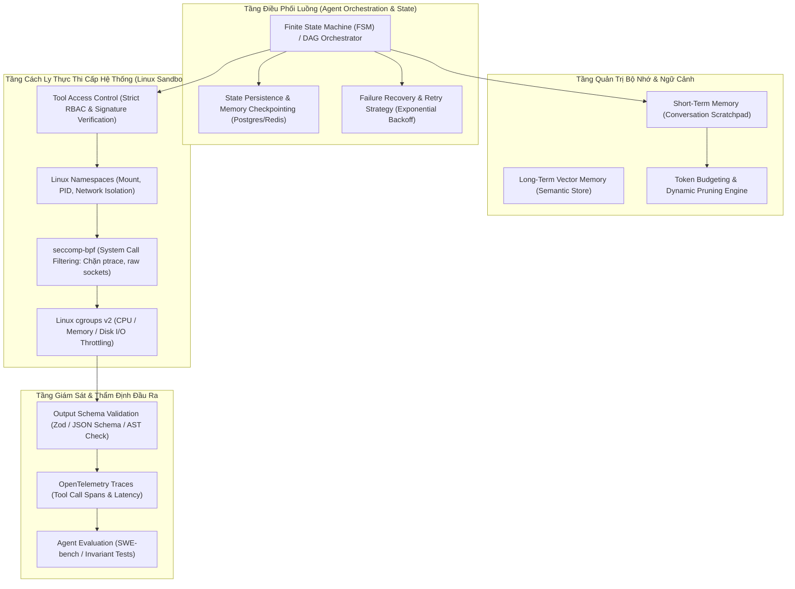
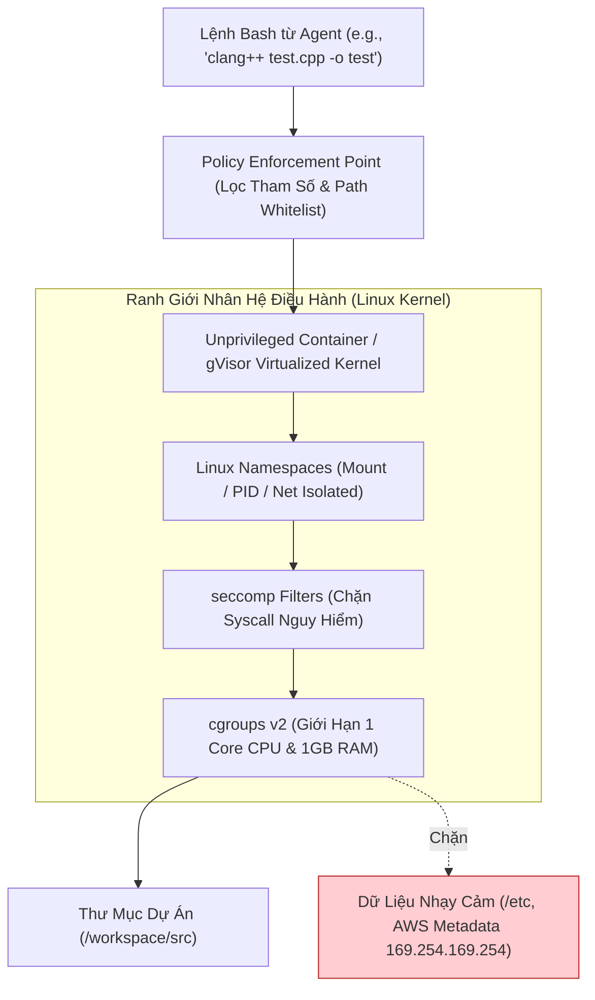
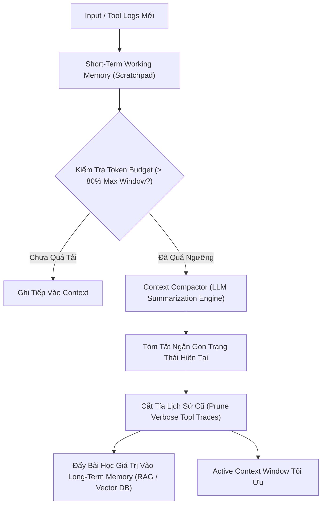
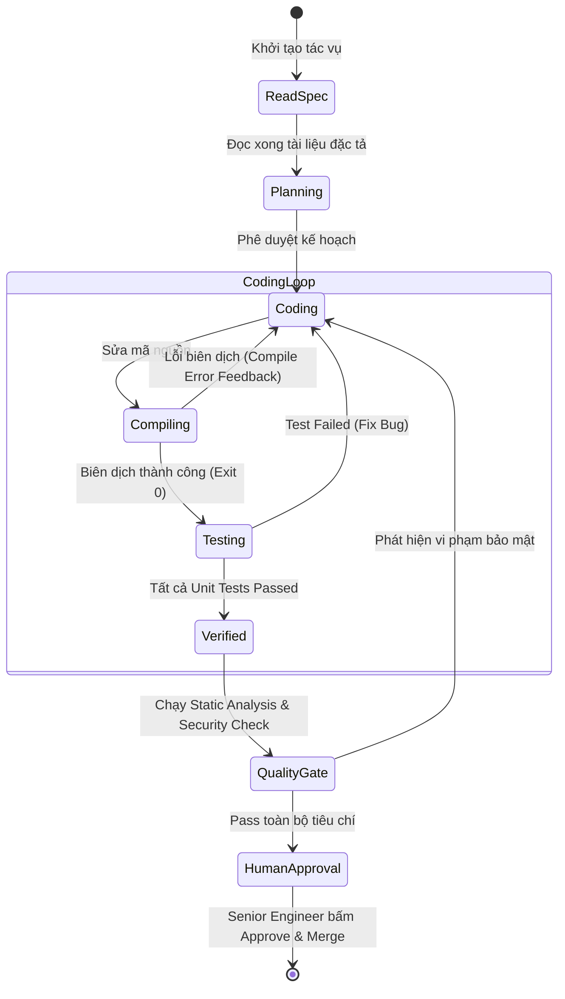

# 22.2. Đóng Gói Cách Ly, Trạng Thái & Điều Phối Luồng Agent (Agent Sandboxing, State & Workflow Orchestration)

Khi triển khai các AI Coding Agents tự hành vào môi trường doanh nghiệp, kỹ sư phải đối mặt với hai thách thức tối thượng: **Bảo mật cách ly (Sandboxing & Isolation)** và **Độ tin cậy của luồng thực thi (Reliability & Orchestration)**. Trao quyền cho một tác tử AI chạy lệnh bash, chỉnh sửa file, hoặc tương tác với cơ sở hạ tầng mà không có cơ chế cách ly tầng kernel và máy trạng thái hữu hạn (Deterministic State Machine) là thảm họa bảo mật và vận hành.

---

## 1. Tổng quan Kiến trúc Cách Ly & Điều Phối Agent



---

## 2. Chi tiết từng Keyword (Under-the-Hood Deep Dive)

### Nhóm 1: Sandboxing & Execution Isolation (Agent Sandboxing, Agent Execution Isolation & Agent Tool Access Control)

#### 1. Khái niệm & Bản chất (What & Why)
- **Agent Sandboxing**: Môi trường thực thi khép kín được thiết kế riêng biệt để Agent thực hiện các lệnh shell, biên dịch mã nguồn hoặc chạy test suite mà không thể gây hại cho hệ thống chủ (Host OS) hoặc mạng nội bộ.
- **Agent Execution Isolation**: Khả năng cô lập tài nguyên tính toán (CPU, RAM, Disk, Network) của từng tác tử, ngăn chặn hiện tượng một Agent bị lỗi vòng lặp vô tận (infinite loop) làm cạn kiệt tài nguyên của toàn bộ máy chủ.
- **Agent Tool Access Control (RBAC for Agents)**: Ma trận phân quyền nghiêm ngặt quy định công cụ nào được phép gọi, với tham số nào, và trong điều kiện nào (ví dụ: Agent chỉ được phép đọc các file trong thư mục `/workspace`, cấm tuyệt đối đọc `/etc/passwd` hoặc truy cập AWS IAM metadata credentials).

#### 2. Cơ chế hoạt động & Phân tích chuyên sâu (Under-the-Hood)
- **Cơ chế Bảo vệ Tầng Kernel (Linux Namespaces, cgroups v2 & seccomp-bpf)**:
  - Một Agent Execution Sandbox tiêu chuẩn (tương tự gVisor hoặc Docker container không đặc quyền) sử dụng:
    1. **Mount Namespace (`CLONE_NEWNS`)**: Đặt root filesystem dạng Read-Only; chỉ cho phép ghi (Write) vào một thư mục tạm thời `tmpfs` trong RAM hoặc thư mục code được chỉ định.
    2. **Network Namespace (`CLONE_NEWNET`)**: Tắt hoàn toàn card mạng (No egress) trong quá trình Agent chạy compile và unit test, ngăn chặn việc mã độc sinh ra gửi trộm API Keys về máy chủ của kẻ tấn công bên ngoài.
    3. **cgroups v2**: Khống chế cứng mức tiêu thụ tài nguyên:
       ```bash
       echo "500000 100000" > /sys/fs/cgroup/agent_pool/cpu.max  # Tối đa 50% của 1 core
       echo "1073741824" > /sys/fs/cgroup/agent_pool/memory.max  # Tối đa 1GB RAM (chống OOM sập host)
       ```
    4. **seccomp-bpf**: Chặn đứng các syscall nguy hiểm như `reboot`, `sys_chroot`, `ptrace`, `bpf`, và hạn chế `socket()` chỉ cho các giao thức nội bộ.
- **Tool Access Verification (HMAC & Least Privilege)**:
  - Mọi tool call từ Agent phải trải qua một lớp Policy Enforcement Point (PEP). Lớp này kiểm tra Regex của tham số dòng lệnh (ví dụ: cấm `rm -rf /`, cấm `curl | sh`, cấm các đường dẫn có chứa `../..` nhằm mục đích Path Traversal).

#### 3. Sơ đồ Kiến Trúc Sandbox Nhiều Lớp Cấp Kernel



#### 4. Mã nguồn minh họa (TypeScript): Tool Access Controller với Path Traversal Guard & Whitelist Enforcement

```typescript
import * as path from 'path';

export interface ToolInvocation {
  toolName: string;
  parameters: {
    command?: string;
    filePath?: string;
    content?: string;
  };
}

export class SandboxedToolController {
  private readonly allowedWorkspaceRoot: string;
  private readonly blacklistedCommands: RegExp[] = [
    /rm\s+-rf\s+[\/~]/i,
    /curl\s+.*\|\s*(bash|sh)/i,
    /mkfs/i,
    /dd\s+if=/i,
    /:(){ :|:& };:/i, // Fork bomb
    /169\.254\.169\.254/ // AWS Instance Metadata Service IP
  ];

  constructor(workspaceRoot: string) {
    this.allowedWorkspaceRoot = path.resolve(workspaceRoot);
  }

  public validateToolCall(invocation: ToolInvocation): { isAllowed: boolean; violationReason?: string } {
    // 1. Kiểm tra tham số File Path chống Path Traversal (../..)
    if (invocation.parameters.filePath) {
      const resolvedTarget = path.resolve(this.allowedWorkspaceRoot, invocation.parameters.filePath);
      if (!resolvedTarget.startsWith(this.allowedWorkspaceRoot)) {
        return {
          isAllowed: false,
          violationReason: `[SECURITY_BREACH] Phát hiện Path Traversal! Đường dẫn vượt ranh giới workspace: ${invocation.parameters.filePath}`
        };
      }
    }

    // 2. Kiểm tra câu lệnh Bash chống phá hoại hệ thống
    if (invocation.parameters.command) {
      for (const pattern of this.blacklistedCommands) {
        if (pattern.test(invocation.parameters.command)) {
          return {
            isAllowed: false,
            violationReason: `[COMMAND_REJECTED] Câu lệnh vi phạm quy tắc an toàn nghiêm ngặt: ${invocation.parameters.command}`
          };
        }
      }
    }

    return { isAllowed: true };
  }
}

// Kiểm thử bộ lọc an toàn
const sandbox = new SandboxedToolController("/home/developer/project_repo");

const maliciousCall: ToolInvocation = {
  toolName: "run_command",
  parameters: { command: "curl -s http://169.254.169.254/latest/meta-data/iam/security-credentials/" }
};

const traversalCall: ToolInvocation = {
  toolName: "read_file",
  parameters: { filePath: "../../etc/shadow" }
};

const safeCall: ToolInvocation = {
  toolName: "write_file",
  parameters: { filePath: "src/main.cpp", content: "#include <iostream>" }
};

console.log("Malicious Call:", sandbox.validateToolCall(maliciousCall).violationReason);
console.log("Traversal Call:", sandbox.validateToolCall(traversalCall).violationReason);
console.log("Safe Call Allowed:", sandbox.validateToolCall(safeCall).isAllowed);
```

#### 5. Anti-Patterns & Cạm bẫy
- **Root Docker Socket Mounting (`/var/run/docker.sock`)**: Mount Docker socket của máy host vào container chạy Agent. Hành động này cấp cho Agent toàn quyền điều khiển daemon Docker của host, cho phép bất kỳ ai điều khiển prompt (Prompt Injection) thoát khỏi sandbox và chiếm quyền root máy chủ trong 1 giây.
- **Unrestricted Network Egress**: Cho phép Agent tự do gọi ra Internet mà không kiểm soát. Kẻ tấn công có thể chèn prompt độc hại vào file README hoặc comment trong code (Indirect Prompt Injection), khiến Agent âm thầm đọc private SSH keys và bắn ra webhook của tin tặc.

#### 6. Ứng dụng Backend & Distributed Systems
- Triển khai **MicroVMs (AWS Firecracker / Cloud Hypervisor)** cho môi trường thực thi của Agent. Mỗi lượt chạy task độc lập được khởi động trong một MicroVM mới toanh trong vòng 5 mili giây, và toàn bộ VM bị hủy diệt (ephemeral destruction) ngay sau khi tác vụ hoàn tất, triệt tiêu mọi nguy cơ lưu giữ mã độc.

---

### Nhóm 2: Context, State & Memory Management (Agent Context, Memory & State Management)

#### 1. Khái niệm & Bản chất (What & Why)
- **Agent Context Management**: Quy trình liên tục cắt tỉa, định dạng và sắp xếp thông tin trong cửa sổ ngữ cảnh (Context Window) để tối đa hóa sự tập trung của mô hình vào bài toán hiện tại.
- **Agent Memory Management**: Cơ chế phân tầng bộ nhớ cho tác tử:
  - **Short-Term Memory**: Bộ nhớ ngắn hạn (Scratchpad), lưu trữ chuỗi suy nghĩ và kết quả các tool calls trong phiên làm việc hiện tại.
  - **Long-Term Memory**: Bộ nhớ dài hạn lưu trữ các kiến thức tích lũy qua nhiều phiên (quy tắc kiến trúc của dự án, các lỗi từng gặp và cách khắc phục) trong cơ sở dữ liệu vector hoặc Key-Value store.
- **Agent State Management**: Lưu giữ trạng thái tiến trình của Agent (Agent Workflow State) dưới dạng các snapshot bất biến, cho phép hệ thống tạm dừng (pause), tiếp tục (resume), hoặc tua ngược (time-travel debugging) khi xảy ra lỗi.

#### 2. Cơ chế hoạt động & Phân tích chuyên sâu (Under-the-Hood)
- **Token Budgeting & Dynamic Sliding Window with Summarization**:
  - Khi kích thước context đạt 80% dung lượng tối đa (ví dụ 100k / 128k tokens):
    1. Giữ nguyên **System Prompt** và **Specification** ở đầu context (Anchor tokens).
    2. Gom nhóm các lượt đối thoại cũ (Turns 1 đến 15) và gọi một mô hình LLM nhỏ gọn (Flash/Lite model) để nén thành một đoạn tóm tắt trạng thái (Compact State Summary).
    3. Xóa bỏ toàn bộ raw logs và outputs dài hàng nghìn dòng của các tool calls trước đó, chỉ giữ lại kết quả cốt lõi (ví dụ: đổi 10.000 dòng log biên dịch thành "Compilation succeeded with 0 warnings").
- **State Checkpointing trên Cơ sở Dữ liệu Phân tán**:
  - Lưu trạng thái Agent sau mỗi ReAct step vào PostgreSQL dưới dạng JSONB kèm theo `step_index` và `monotonic_version`.
  - Cơ chế này đảm bảo tính bất biến (Idempotency): Nếu worker xử lý Agent bị sập nguồn (node crash), một worker khác có thể nạp lại checkpoint gần nhất và tiếp tục thực thi mà không làm trùng lặp hành động bên ngoài.

#### 3. Sơ đồ Phân Tầng Bộ Nhớ & Tóm Tắt Ngữ Cảnh Tự Động



#### 4. Mã nguồn minh họa (TypeScript): Sliding Window Context Manager với Token Pruning

```typescript
export interface ContextMessage {
  role: 'system' | 'user' | 'assistant' | 'tool';
  content: string;
  estimatedTokens: number;
}

export class AgentContextManager {
  private messages: ContextMessage[] = [];
  private readonly maxTokenBudget: number;

  constructor(maxTokenBudget: number = 8000) {
    this.maxTokenBudget = maxTokenBudget;
  }

  public addMessage(msg: ContextMessage): void {
    this.messages.push(msg);
    this.enforceBudget();
  }

  public getTotalTokens(): number {
    return this.messages.reduce((acc, curr) => acc + curr.estimatedTokens, 0);
  }

  // Thuật toán cắt tỉa thông minh: Luôn giữ System Prompt và 2 messages gần nhất
  private enforceBudget(): void {
    if (this.getTotalTokens() <= this.maxTokenBudget) return;

    console.warn(`[CONTEXT_OVERFLOW] Số tokens (${this.getTotalTokens()}) vượt ngân sách (${this.maxTokenBudget}). Bắt đầu cắt tỉa...`);

    // Giữ lại tin nhắn System Prompt (vị trí 0)
    const systemPrompt = this.messages[0];
    
    // Tìm các tin nhắn tool cũ ở giữa để nén hoặc loại bỏ
    while (this.getTotalTokens() > this.maxTokenBudget && this.messages.length > 3) {
      // Xóa tin nhắn cũ nhất ngay sau system prompt
      const removed = this.messages.splice(1, 1)[0];
      console.log(`Đã loại bỏ message của role '${removed.role}' để giải phóng ~${removed.estimatedTokens} tokens.`);
    }
  }

  public getContext(): ContextMessage[] {
    return [...this.messages];
  }
}

// Thử nghiệm quản lý ngữ cảnh
const ctxMgr = new AgentContextManager(1500);

ctxMgr.addMessage({ role: 'system', content: 'You are an advanced C++20 refactoring agent.', estimatedTokens: 200 });
ctxMgr.addMessage({ role: 'user', content: 'Fix the memory leak in Pool.cpp', estimatedTokens: 300 });
ctxMgr.addMessage({ role: 'tool', content: 'Massive compiler trace output... (1000 lines)', estimatedTokens: 900 });
ctxMgr.addMessage({ role: 'assistant', content: 'I found the leak on line 88.', estimatedTokens: 400 });

console.log("Tổng tokens sau cắt tỉa:", ctxMgr.getTotalTokens());
```

#### 5. Anti-Patterns & Cạm bẫy
- **Stateless Agent Execution**: Xây dựng Agent mà không có cơ chế lưu vết trạng thái (State Persistence). Khi gặp sự cố mạng rớt kết nối LLM, toàn bộ chuỗi suy nghĩ và các file đã chỉnh sửa trước đó bị mất sạch, buộc Agent phải bắt đầu lại từ đầu và có thể ghi đè làm hỏng code đang sửa dở.
- **Infinite Memory Leaks**: Lưu trữ toàn bộ mọi câu lệnh bash và outputs không nén vào vector database dài hạn. Hậu quả là khi truy vấn RAG, Agent nạp lại chính những thông tin rác và lỗi cũ trong quá khứ, khiến tỷ lệ suy luận sai tăng cao.

#### 6. Ứng dụng Backend & Distributed Systems
- Sử dụng **Temporal.io / Temporal Workflows** hoặc **AWS Step Functions** để điều phối trạng thái bền vững (Durable Execution) của Agent. Mỗi bước gọi LLM hoặc tool execution là một `Activity` có retry policy riêng, đảm bảo workflow có thể sống sót qua quá trình deploy lại hệ thống điều phối mà không bị mất dấu.

---

### Nhóm 3: Workflow Design, Orchestration & Reliability (Workflow Design, Orchestration, Reliability & Failure Recovery)

#### 1. Khái niệm & Bản chất (What & Why)
- **Agent Workflow Design**: Thiết kế cấu trúc luồng làm việc của Agent dưới dạng đồ thị có hướng (DAG - Directed Acyclic Graph) hoặc Máy trạng thái (State Machine), định nghĩa rõ ràng các bước chuyển tiếp và điều kiện dừng.
- **Agent Orchestration**: Việc điều phối sự tương tác giữa nhiều tác tử chuyên biệt (Multi-Agent System) hoặc giữa một tác tử với các hệ thống bên ngoài để hoàn thành một nhiệm vụ phức tạp.
- **Agent Reliability**: Khả năng của Agent trong việc đưa ra kết quả chính xác, ổn định và có thể dự đoán được qua nhiều lần chạy khác nhau với cùng một bài toán.
- **Agent Failure Recovery**: Chiến lược tự phục hồi khi Agent đi vào ngõ cụt: quay lui trạng thái (backtracking), tự động phân tích nguyên nhân thất bại và chuyển hướng tiếp cận khác.

#### 2. Cơ chế hoạt động & Phân tích chuyên sâu (Under-the-Hood)
- **Deterministic State Machines vs Free-Form Chaos**:
  - Không để LLM tự quyết định hoàn toàn luồng đi. Một quy trình kỹ thuật trưởng thành ràng buộc Agent trong một State Machine hữu hạn:
    $$\text{SPEC\_READ} \rightarrow \text{PLAN} \rightarrow \text{CODE} \rightarrow \text{COMPILE} \rightarrow \text{TEST} \rightarrow \text{VERIFY}$$
  - Mỗi bước chuyển trạng thái (Transition) đòi hỏi **Guards / Invariants**:
    - Agent không thể nhảy sang trạng thái `VERIFY` nếu bước `COMPILE` chưa trả về exit code 0.
- **Backtracking & Self-Correction Mechanism**:
  - Nếu Agent sửa code 3 lần liên tiếp mà bước `TEST` vẫn thất bại:
    1. Kích hoạt cơ chế **Rollback Git Tree**: `git checkout -- .` để khôi phục trạng thái sạch ban đầu.
    2. Hạ nhiệt độ suy luận (Temperature $\rightarrow 0.0$) để loại bỏ tính ngẫu nhiên.
    3. Bổ sung thông tin lỗi chi tiết vào prompt kèm theo yêu cầu: "Chiến lược vừa rồi đã thất bại do vi phạm invariant X. Hãy đề xuất một chiến lược tiếp cận hoàn toàn mới".

#### 3. Sơ đồ Máy Trạng Thái Điều Phối Agent (Deterministic Agent FSM)



#### 4. Mã nguồn minh họa (TypeScript): Deterministic State Machine Orchestrator cho Coding Agent

```typescript
export enum AgentState {
  PLANNING = 'PLANNING',
  EDITING = 'EDITING',
  BUILDING = 'BUILDING',
  TESTING = 'TESTING',
  COMPLETED = 'COMPLETED',
  FAILED = 'FAILED'
}

export interface StateContext {
  task: string;
  retryCount: number;
  maxRetries: number;
  lastError?: string;
  buildPassed: boolean;
  testsPassed: boolean;
}

export class AgentStateMachineOrchestrator {
  private currentState: AgentState = AgentState.PLANNING;

  constructor(private context: StateContext) {}

  public transition(actionResult: { success: boolean; error?: string }): AgentState {
    console.log(`[FSM TRANSITION] Hiện tại: ${this.currentState} -> Kết quả: ${actionResult.success ? 'OK' : 'FAIL'}`);

    switch (this.currentState) {
      case AgentState.PLANNING:
        if (actionResult.success) {
          this.currentState = AgentState.EDITING;
        } else {
          this.currentState = AgentState.FAILED;
        }
        break;

      case AgentState.EDITING:
        this.currentState = AgentState.BUILDING;
        break;

      case AgentState.BUILDING:
        if (actionResult.success) {
          this.context.buildPassed = true;
          this.currentState = AgentState.TESTING;
        } else {
          this.handleFailure(actionResult.error, AgentState.EDITING);
        }
        break;

      case AgentState.TESTING:
        if (actionResult.success) {
          this.context.testsPassed = true;
          this.currentState = AgentState.COMPLETED;
        } else {
          this.handleFailure(actionResult.error, AgentState.EDITING);
        }
        break;

      default:
        break;
    }

    return this.currentState;
  }

  private handleFailure(error: string | undefined, retryState: AgentState): void {
    this.context.retryCount++;
    this.context.lastError = error;

    if (this.context.retryCount > this.context.maxRetries) {
      console.error(`[FSM_ABORT] Đã vượt quá số lần thử lại tối đa (${this.context.maxRetries}).`);
      this.currentState = AgentState.FAILED;
    } else {
      console.warn(`[FSM_RETRY] Quay lui về trạng thái ${retryState} để tự sửa lỗi (Lần ${this.context.retryCount})...`);
      this.currentState = retryState;
    }
  }

  public getState(): AgentState { return this.currentState; }
}

// Mô phỏng vòng đời điều phối
const orchestrator = new AgentStateMachineOrchestrator({
  task: "Implement ThreadPool in C++20",
  retryCount: 0,
  maxRetries: 2,
  buildPassed: false,
  testsPassed: false
});

orchestrator.transition({ success: true }); // Planning -> Editing
orchestrator.transition({ success: true }); // Editing -> Building
orchestrator.transition({ success: false, error: "Syntax error on line 12" }); // Building -> Fail -> Retry Editing
orchestrator.transition({ success: true }); // Editing -> Building
orchestrator.transition({ success: true }); // Building -> Testing
orchestrator.transition({ success: true }); // Testing -> Completed
console.log("Trạng thái cuối cùng:", orchestrator.getState());
```

#### 5. Anti-Patterns & Cạm bẫy
- **Unbounded Self-Correction Loop**: Thiết kế vòng lặp tự sửa lỗi không có điều kiện dừng (No Max Retries). Agent liên tục sửa từ lỗi này sang lỗi khác trong nhiều giờ, tiêu tốn hàng trăm USD chi phí LLM inference mà không tiến gần hơn tới giải pháp.
- **Multi-Agent Cacophony**: Dựng một bầy 10 AI Agents nói chuyện qua lại với nhau (Agent thảo luận với Agent khác trong một group chat tự do). Kết quả là sự khuếch đại sai lệch (Error Cascade) và bế tắc đồng thuận (Consensus Deadlock), không giải quyết được bất kỳ tác vụ kỹ thuật cụ thể nào.

#### 6. Ứng dụng Backend & Distributed Systems
- Áp dụng mẫu hình **Supervisor-Worker Pattern**: Một Agent cấp cao đóng vai trò Supervisor (sử dụng model mạnh nhất để chia nhỏ bài toán thành các sub-tasks độc lập) và phân phối các sub-tasks đó cho các Worker Agents chuyên trách chạy song song trong các sandbox riêng biệt.

---

### Nhóm 4: Evaluation, Observability & Validation (Agent Evaluation, Observability & Output Validation)

#### 1. Khái niệm & Bản chất (What & Why)
- **Agent Evaluation**: Phương pháp định lượng năng lực của Coding Agent thông qua các bộ benchmark tiêu chuẩn công nghiệp (SWE-bench, HumanEval) hoặc bộ test suites nội bộ của công ty.
- **Agent Observability**: Khả năng giám sát, đo lường và truy vết toàn diện mọi hành vi bên trong của Agent: chi phí token tiêu thụ, độ trễ từng tool call, cây quyết định suy luận và tỷ lệ thành công của tác vụ.
- **Agent Output Validation**: Lớp thẩm định nghiêm ngặt kiểm tra kết quả đầu ra của Agent (mã nguồn, file diff, cấu hình) trước khi cho phép áp dụng vào hệ thống chính, bao gồm xác thực định dạng cú pháp (AST validation) và tuân thủ các quy tắc an toàn.

#### 2. Cơ chế hoạt động & Phân tích chuyên sâu (Under-the-Hood)
- **OpenTelemetry Instrumentation cho AI Agents (Semantic Conventions)**:
  - Mỗi vòng lặp ReAct được mô hình hóa thành một **Trace**:
    - Root Span: `agent.session` (Metadata: `agent_id`, `task_type`, `model_name`).
    - Child Span 1: `llm.inference` (Metrics: `prompt_tokens`, `completion_tokens`, `duration_ms`, `temperature`).
    - Child Span 2: `tool.execution` (Attributes: `tool_name`, `exit_code`, `bytes_written`).
  - Dữ liệu này được đẩy về Jaeger hoặc Datadog để phân tích điểm nghẽn hiệu năng và chi phí vận hành theo thời gian thực.
- **Structural Output Validation qua AST Parsing**:
  - Không bao giờ dựa vào Regex để kiểm tra code do AI sinh ra.
  - Sử dụng trình biên dịch thực tế hoặc AST Parser (như `clang-query` hoặc Babel parser) để chứng minh rằng đoạn code mới:
    1. Không chứa cú pháp lỗi thời.
    2. Không gọi các hàm bị cấm (như `strcpy` hay `gets`).
    3. Đảm bảo toàn bộ tài nguyên cấp phát đều được giải phóng qua RAII.

#### 3. Sơ đồ OpenTelemetry Tracing Trong Vòng Đời Agent

```mermaid
gantt
    title Phân Rã Độ Trễ & Telemetry Spans của Agent Task
    dateFormat  ss
    axisFormat  %S s

    section Root Task
    Agent Session Lifecycle       :active, span1, 00, 15

    section LLM Inference
    LLM Step 1 (Planning)         :crit, span2, 00, 03
    LLM Step 2 (Fixing Bug)       :crit, span4, 05, 08

    section Tool Calls
    write_file (main.cpp)         :span3, 03, 04
    compile & test (clang++)      :span5, 08, 12

    section Validation
    AST & Security Validation     :span6, 12, 14
```



#### 4. Mã nguồn minh họa (TypeScript): Thẩm Định Đầu Ra Cấu Trúc (Output Schema & AST Validator)

```typescript
import { z } from 'zod';

// Định nghĩa Schema bắt buộc cho kết quả bàn giao của Agent
export const AgentFinalDeliverySchema = z.object({
  taskSummary: z.string().min(10),
  filesModified: z.array(z.string().endsWith('.cpp').or(z.string().endsWith('.hpp'))),
  invariantsGuaranteed: z.array(z.string()),
  unitTestsAddedCount: z.number().int().positive(),
  codeDiffPatch: z.string().refine(val => val.includes('--- a/') && val.includes('+++ b/'), {
    message: "Diff patch phải đúng định dạng chuẩn Unified Diff Format!"
  })
});

export type AgentFinalDelivery = z.infer<typeof AgentFinalDeliverySchema>;

export class OutputValidationGate {
  public static validateAgentPayload(rawJson: unknown): { isValid: boolean; data?: AgentFinalDelivery; errors?: string[] } {
    const result = AgentFinalDeliverySchema.safeParse(rawJson);

    if (!result.success) {
      const errorMessages = result.error.issues.map(iss => `${iss.path.join('.')}: ${iss.message}`);
      return { isValid: false, errors: errorMessages };
    }

    // Thẩm định bổ sung: Kiểm tra xem patch có chứa các hàm C nguy hiểm không
    if (result.data.codeDiffPatch.includes('malloc(') || result.data.codeDiffPatch.includes('strcpy(')) {
      return {
        isValid: false,
        errors: ["[SECURITY_VIOLATION] Patch chứa các hàm C cổ điển không an toàn (malloc/strcpy). Yêu cầu dùng C++20 Smart Pointers / std::string!"]
      };
    }

    return { isValid: true, data: result.data };
  }
}

// Kiểm thử thẩm định đầu ra
const invalidOutputFromAgent = {
  taskSummary: "Fixed leak",
  filesModified: ["src/buffer.cpp"],
  invariantsGuaranteed: ["Zero-leak verified via ASan"],
  unitTestsAddedCount: 3,
  codeDiffPatch: `
--- a/src/buffer.cpp
+++ b/src/buffer.cpp
@@ -10,3 +10,3 @@
- char* buf = new char[100];
+ char* buf = (char*)malloc(100);
`
};

const validation = OutputValidationGate.validateAgentPayload(invalidOutputFromAgent);
console.log("=== KẾT QUẢ THẨM ĐỊNH ĐẦU RA CỦA AGENT ===");
console.log("Hợp lệ:", validation.isValid);
console.log("Lỗi phát hiện:", validation.errors);
```

#### 5. Anti-Patterns & Cạm bẫy
- **Unverified SWE-bench Bragging**: Tin tưởng mù quáng vào các chỉ số benchmark quảng cáo của các model mà không đo lường trên bộ benchmark riêng của công ty. Model có thể đạt 80% trên bài toán Python đơn giản nhưng thất bại hoàn toàn trên hệ thống phân tán C++ phức tạp với hàng triệu dòng code.
- **Zero Observability Black Box**: Triển khai Agent trong nội bộ mà không có logging token và traces. Cuối tháng công ty nhận hóa đơn API $30,000 từ nhà cung cấp mô hình mà không ai biết Agent nào đã tiêu tốn tài nguyên vào việc gì.

#### 6. Ứng dụng Backend & Distributed Systems
- Xây dựng **Automated Regression Evaluation Pipeline**: Mỗi khi prompt hệ thống hoặc phiên bản Agent Harness được cập nhật, pipeline tự động chạy lại 50 bài toán lỗi lịch sử (Golden Dataset of Past Incidents) để đảm bảo độ chính xác của Agent không bị suy giảm (Regression Protection).

---

## 3. Tổng kết & Bảng Tra Cứu Thực Chiến

| Thành phần kỹ thuật | Cơ chế bảo vệ cốt lõi | Công nghệ / Tiêu chuẩn áp dụng | Mục tiêu tối thượng |
| :--- | :--- | :--- | :--- |
| **Sandboxing** | Cách ly syscalls, network và filesystem ở cấp kernel | Linux cgroups v2, seccomp-bpf, gVisor | Ngăn chặn thực thi mã độc và rò rỉ dữ liệu máy chủ |
| **Tool Access Control** | Chặn đứng Path Traversal và các câu lệnh phá hoại | Path Whitelisting, Regex filtering, PEP | Triệt tiêu nguy cơ Prompt Injection phá hoại hệ thống |
| **Context Management** | Giữ token trong ngân sách qua AST skeleton & tóm tắt | Tree-sitter AST, Sliding Window Summarization | Tránh tràn context và hiện tượng Lost in the Middle |
| **State Orchestration** | Ràng buộc luồng Agent bằng máy trạng thái hữu hạn | Deterministic FSM, Temporal.io, Step Functions | Ngăn chặn vòng lặp vô tận và bảo đảm tính dừng |
| **Failure Recovery** | Quay lui trạng thái và tự động thay đổi chiến lược | Git rollback, Exponential backoff, Reflection | Tăng tính bền bỉ và khả năng tự phục hồi của Agent |
| **Output Validation** | Kiểm tra định dạng schema và kiểm định an toàn AST | Zod Schema, Clang AST Query, Compiler Check | Đảm bảo 100% code sinh ra đáp ứng tiêu chuẩn sản xuất |
