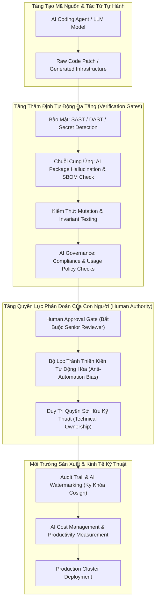
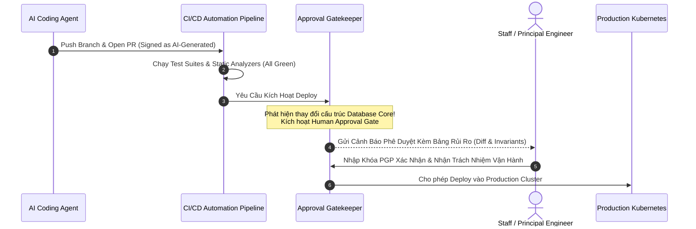
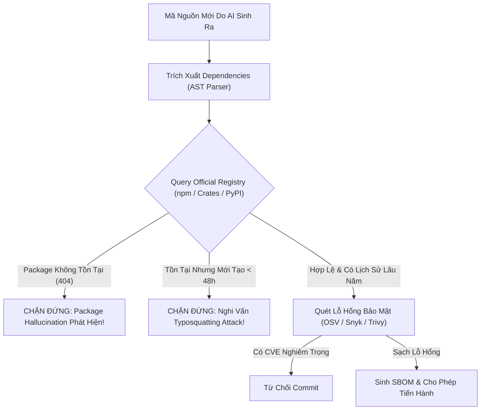
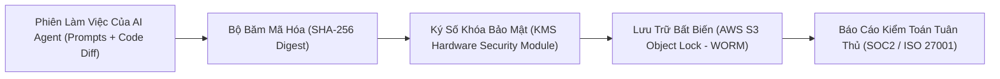
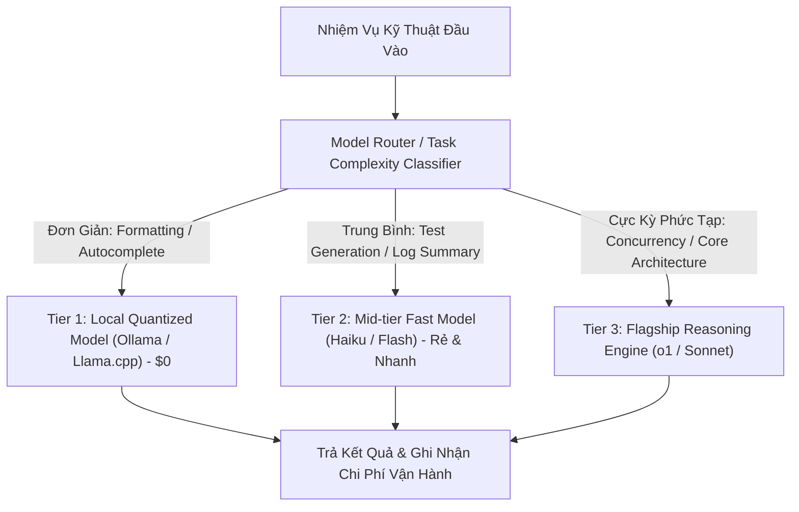

# 22.3. Quản Trị AI, Thẩm Định Mã Nguồn & Quyền Quyết Định Con Người (AI Governance, Code Verification & Human Authority)

Sự hiện diện của AI trong chu trình phát triển phần mềm không làm giảm bớt trách nhiệm giải trình của kỹ sư; ngược lại, nó đòi hỏi **Năng lực phán đoán kỹ thuật (Engineering Judgment)** và **Kỷ luật quản trị (Governance)** ở mức độ khắt khe hơn bao giờ hết. Mã nguồn do AI sinh ra dù tinh vi đến đâu vẫn chỉ là một đề xuất (suggestion). Con người là người duy nhất chịu trách nhiệm pháp lý, đạo đức và vận hành khi mã nguồn đó chạy trên môi trường sản xuất.

---

## 1. Tổng quan Khung Quản Trị AI & Cổng Phê Duyệt Con Người



---

## 2. Chi tiết từng Keyword (Under-the-Hood Deep Dive)

### Nhóm 1: Human-in-the-Loop, Authority & Ownership (Human-in-the-Loop, Approval Gates, Authority, Judgment, Ownership & Automation Bias)

#### 1. Khái niệm & Bản chất (What & Why)
- **Human-in-the-Loop (HITL) Engineering**: Mô hình cộng tác trong đó con người giữ vai trò kiểm soát ở các ngã rẽ quyết định quan trọng, đảm bảo không có bất kỳ hành động mang tính phá hủy hoặc thay đổi trạng thái sản xuất nào được thực hiện hoàn toàn tự động bởi AI.
- **Human Approval Gates**: Các chốt chặn kỹ thuật bắt buộc trên CI/CD pipeline, yêu cầu chữ ký số hoặc phê duyệt rõ ràng từ kỹ sư con người có thẩm quyền trước khi mã nguồn được merge hoặc deploy.
- **Human Decision Authority & Engineering Judgment**: Quyền lực tối thượng và năng lực phán đoán của kỹ sư trong việc cân nhắc các yếu tố phi chức năng, rủi ro xã hội, đạo đức và sự đánh đổi dài hạn mà AI không thể tính toán được.
- **Maintaining Technical Ownership**: Nguyên tắc kỹ sư phải nắm rõ từng chi tiết cấu trúc dữ liệu, luồng điều khiển và hành vi chịu lỗi của mã nguồn trong hệ thống, không bao giờ coi mã nguồn do AI sinh ra là một "hộp đen ma thuật".
- **Avoiding Automation Bias (Tránh thiên kiến tự động hóa)**: Xu hướng tâm lý con người tin tưởng mù quáng vào kết quả do máy tính hoặc AI sinh ra vì nghĩ rằng "nó biên dịch được và viết dài như thế thì chắc chắn đúng".

#### 2. Cơ chế hoạt động & Phân tích chuyên sâu (Under-the-Hood)
- **Kỹ thuật Phá vỡ Thiên Kiến Tự Động Hóa (Cognitive Friction Injection)**:
  - Khi một Pull Request hoàn toàn do AI sinh ra được đưa lên hệ thống review:
    - Nếu hệ thống chỉ hiển thị một nút "Approve" đơn giản, tỷ lệ kỹ sư bấm duyệt sau khi lướt qua chỉ trong 10 giây lên tới 75% (hiện tượng Rubber-Stamping).
    - Để ngăn chặn điều này, hệ thống áp dụng **Cognitive Friction**: Kỹ sư bắt buộc phải trả lời 2 câu hỏi kiểm tra độ hiểu sâu (Comprehension Check) trước khi nút Approve được kích hoạt (ví dụ: "Đoạn code mới có thay đổi độ phức tạp thời gian từ $O(N)$ sang $O(N^2)$ ở hàm nào?").
- **Audit Trail & Cryptographic Provenance qua Cosign / Sigstore**:
  - Mỗi commit do AI sinh ra phải được gắn metadata rõ ràng: `X-Generated-By: Agent-Claude-3.5-Sonnet`.
  - Khi kỹ sư con người review và chấp thuận, họ dùng khóa riêng PGP/SSH cá nhân để ký lên commit đó. Dưới góc độ pháp lý và bảo mật, chữ ký số này xác lập rằng: Con người nhận toàn bộ trách nhiệm nếu commit đó gây ra sự cố.

#### 3. Sơ đồ Cổng Phê Duyệt Con Người Đa Tầng (Multi-Tier Approval Gate)



#### 4. Mã nguồn minh họa (TypeScript): Human Approval Gatekeeper với Cryptographic Signature Check

```typescript
import * as crypto from 'crypto';

export interface CodeChangePayload {
  changeId: string;
  sourceType: 'AI_AGENT' | 'HUMAN_AUTHOR';
  agentModelName?: string;
  filesModified: string[];
  affectsCoreFinancialLedger: boolean;
  codeDiff: string;
}

export class GovernanceApprovalGatekeeper {
  public static evaluateDeploymentPrerequisites(
    payload: CodeChangePayload,
    humanApprover?: { engineerId: string; role: 'JUNIOR' | 'SENIOR' | 'STAFF'; pgpSignature: string }
  ): { canDeploy: boolean; blockerReason?: string } {
    // 1. Nếu code do AI sinh ra chạm vào thành phần cốt lõi -> Bắt buộc Human Review cấp Staff
    if (payload.sourceType === 'AI_AGENT' && payload.affectsCoreFinancialLedger) {
      if (!humanApprover) {
        return {
          canDeploy: false,
          blockerReason: "[GATE_BLOCKED] Code do AI sinh ra tác động đến Core Ledger bắt buộc phải có sự phê duyệt trực tiếp của con người!"
        };
      }

      if (humanApprover.role !== 'STAFF') {
        return {
          canDeploy: false,
          blockerReason: `[PERMISSION_DENIED] Phê duyệt yêu cầu cấp độ STAFF Engineer trở lên. Cấp bậc hiện tại: ${humanApprover.role}`
        };
      }

      // Xác minh chữ ký số của Engineer để đảm bảo tính giải trình (Non-repudiation)
      const isSignatureValid = this.verifyPgpSignature(payload.changeId, humanApprover.pgpSignature);
      if (!isSignatureValid) {
        return {
          canDeploy: false,
          blockerReason: "[SECURITY_ALERT] Chữ ký số PGP của người phê duyệt không hợp lệ!"
        };
      }
    }

    return { canDeploy: true };
  }

  private static verifyPgpSignature(changeId: string, signature: string): boolean {
    // Giả lập xác thực chữ ký mật mã học
    return signature.startsWith("SIG_VALID_");
  }
}

// Kiểm thử cổng phê duyệt
const aiLedgerChange: CodeChangePayload = {
  changeId: "CHG-8812",
  sourceType: 'AI_AGENT',
  agentModelName: "Claude-3.5-Sonnet",
  filesModified: ["src/ledger/transaction_engine.cpp"],
  affectsCoreFinancialLedger: true,
  codeDiff: "+ double balance = old_balance + delta;" // Code nguy hiểm dùng double cho tiền tệ!
};

const attempt1 = GovernanceApprovalGatekeeper.evaluateDeploymentPrerequisites(aiLedgerChange);
console.log("Thử deploy tự động:", attempt1.blockerReason);

const attempt2 = GovernanceApprovalGatekeeper.evaluateDeploymentPrerequisites(aiLedgerChange, {
  engineerId: "eng_staff_tri",
  role: 'STAFF',
  pgpSignature: "SIG_VALID_KEY_9901"
});
console.log("Deploy sau khi Staff Engineer ký nhận:", attempt2.canDeploy ? "CHẤP THUẬN DEPLOY" : "BỊ CHẶN");
```

#### 5. Anti-Patterns & Cạm bẫy
- **Rubber-Stamp Approvals**: Kỹ sư con người nhấn nút Approve hàng chục Pull Request của AI mỗi ngày mà không thèm đọc dòng diff nào. Khi sự cố production xảy ra, kỹ sư đổ lỗi: "Do AI nó viết sai chứ tôi không biết". Điều này vi phạm nghiêm trọng đạo đức nghề nghiệp và nguyên tắc Technical Ownership.
- **Complete Disempowerment (Mất quyền kiểm soát)**: Ban lãnh đạo công ty ép buộc đội ngũ kỹ sư phải áp dụng code của AI sinh ra để kịp tiến độ, phớt lờ cảnh báo của kỹ sư về các lỗ hổng kiến trúc và bảo mật.

#### 6. Ứng dụng Backend & Distributed Systems
- Cấu hình Branch Protection Rules trên GitHub/GitLab: Các branch chính (`main`, `release/*`) bắt buộc phải có ít nhất 2 chữ ký review từ con người, và cấm tuyệt đối bot accounts được tự động merge code mà không có human approval token.

---

### Nhóm 2: Verification, Security & Hallucination Defense (Permissions, Verification, Security, Testing, Hallucinations & Supply Chain)

#### 1. Khái niệm & Bản chất (What & Why)
- **AI Agent Permissions**: Nguyên tắc đặc quyền tối thiểu (Least Privilege) áp dụng cho AI: không bao giờ cấp quyền ghi trực tiếp vào production database, không cấp quyền xóa buckets S3, và chỉ cấp access tokens có thời hạn tính bằng phút (Short-lived ephemeral tokens).
- **AI-Generated Code Verification & Testing**: Hệ thống kiểm định đa chiều độc lập với LLM để chứng minh tính đúng đắn về mặt logic và hiệu năng của code sinh ra.
- **AI-Generated Code Security**: Phát hiện các lỗ hổng bảo mật đặc thù do AI vô tình đưa vào (CWE-89 SQL Injection, CWE-79 XSS, CWE-798 Hardcoded Secrets, CWE-120 Buffer Overflow).
- **AI Hallucination Management**: Chiến lược phát hiện và vô hiệu hóa các thông tin hư cấu do LLM tự bịa đặt ra (các hàm không có trong thư viện, các tham số cấu hình sai lệch).
- **AI Dependency Risk & Supply Chain Security**: Ngăn chặn rủi ro Agent sử dụng các thư viện rác, thư viện bị bỏ hoang hoặc bị tấn công chuỗi cung ứng (Package Hallucination Typosquatting).

#### 2. Cơ chế hoạt động & Phân tích chuyên sâu (Under-the-Hood)
- **Cơ chế Package Hallucination Defense qua SBOM (Software Bill of Materials)**:
  - Khi AI sinh ra mã nguồn có các câu lệnh `import` hoặc `require`:
    1. Trích xuất danh sách tất cả các packages được khai báo trong `package.json`, `go.mod`, hoặc `CMakeLists.txt`.
    2. Truy vấn trực tiếp vào Package Registry chính thức (npm registry API, crates.io, Maven Central) để kiểm tra:
       - Package có thực sự tồn tại hay không? (Nếu 404 $\rightarrow$ Chặn đứng vì là Package Hallucination).
       - Ngày xuất bản của package: Nếu package mới được tạo ra trong vòng 48 giờ qua, kích hoạt cảnh báo đỏ vì nguy cơ cao là kẻ tấn công đã phát hiện ra tên package bị hallucinate và vừa đẩy mã độc lên.
       - Tác giả và số lượng lượt tải hàng tuần (Download counts).
- **Mutation Testing làm thước đo thẩm định Code do AI sinh ra**:
  - Không thể tin vào bộ Unit Test do chính AI sinh ra để kiểm tra code của chính nó.
  - Sử dụng công cụ **Mutation Testing (Stryker / Mull)**: Cố tình tiêm các đột biến logic (đổi `>` thành `<`, đổi `+` thành `-`, xóa một lệnh gán) vào mã nguồn của AI. Nếu các bài test do AI viết không phát hiện ra sự thay đổi này (Mutants survived), chứng tỏ bộ test đó vô giá trị và bị từ chối ngay lập tức.

#### 3. Sơ đồ Kiểm Thẩm Định Chuỗi Cung Ứng Mã Nguồn AI (AI Supply Chain Guard)



#### 4. Mã nguồn minh họa (TypeScript): Automated AI Dependency & Hallucination Verifier

```typescript
export interface DependencyReport {
  packageName: string;
  version: string;
  existsInRegistry: boolean;
  ageInDays: number;
  weeklyDownloads: number;
  isSafeToUse: boolean;
  riskReason?: string;
}

export class AiSupplyChainValidator {
  // Giả lập kiểm tra kho lưu trữ Registry chính thức
  public static async verifyDependency(packageName: string, requestedVersion: string): Promise<DependencyReport> {
    // 1. Kiểm tra danh sách đen các package hallucinated phổ biến
    const registryDatabase: Record<string, { age: number; downloads: number }> = {
      "lodash": { age: 3600, downloads: 40_000_000 },
      "express": { age: 4000, downloads: 30_000_000 },
      "fast-safe-crypto-ai": { age: 1, downloads: 5 } // Mới tạo hôm qua!
    };

    const packageMeta = registryDatabase[packageName];

    if (!packageMeta) {
      return {
        packageName,
        version: requestedVersion,
        existsInRegistry: false,
        ageInDays: 0,
        weeklyDownloads: 0,
        isSafeToUse: false,
        riskReason: `[PACKAGE_HALLUCINATION] Thư viện '${packageName}' hoàn toàn không tồn tại trên public registry! AI đã bịa đặt tên package.`
      };
    }

    if (packageMeta.age < 3) {
      return {
        packageName,
        version: requestedVersion,
        existsInRegistry: true,
        ageInDays: packageMeta.age,
        weeklyDownloads: packageMeta.downloads,
        isSafeToUse: false,
        riskReason: `[TYPOSQUATTING_RISK] Thư viện mới xuất hiện ${packageMeta.age} ngày trước với lượt tải cực thấp. Nguy cơ chứa mã độc chuỗi cung ứng!`
      };
    }

    return {
      packageName,
      version: requestedVersion,
      existsInRegistry: true,
      ageInDays: packageMeta.age,
      weeklyDownloads: packageMeta.downloads,
      isSafeToUse: true
    };
  }
}

// Chạy kiểm định dependencies sinh ra bởi AI
async function runChecks() {
  const depsToVerify = ["lodash", "fast-crypto-super-fast", "fast-safe-crypto-ai"];

  for (const dep of depsToVerify) {
    const report = await AiSupplyChainValidator.verifyDependency(dep, "1.0.0");
    if (!report.isSafeToUse) {
      console.error(`CẢNH BÁO: ${report.riskReason}`);
    } else {
      console.log(`AN TOÀN: ${report.packageName} hợp lệ.`);
    }
  }
}

runChecks();
```

#### 5. Anti-Patterns & Cạm bẫy
- **Copying Exploitable Snippets**: AI học từ hàng triệu public repositories trên GitHub, bao gồm cả những repo sinh viên và các đoạn mã mẫu chứa lỗ hổng bảo mật kinh điển. Nếu không quét tĩnh (SAST), các đoạn code này sẽ mang theo lỗi SQL injection hay buffer overflow nguyên bản vào hệ thống của bạn.
- **Ignoring Leakage of Secrets in Prompt**: Lập trình viên vô tình nạp các file cấu hình chứa AWS Access Keys, Database Passwords hoặc JWT Secrets vào prompt của AI Agent. Các bí mật này có thể bị lưu giữ trong lịch sử log của nhà cung cấp mô hình hoặc bị trích xuất bởi các kỹ thuật Jailbreak bên ngoài.

#### 6. Ứng dụng Backend & Distributed Systems
- Thiết lập **Pre-Commit Secret Scanning (TruffleHog / GitGuardian)** chạy ngay trên máy trạm của kỹ sư trước khi bất kỳ đoạn code nào (dù do AI hay con người viết) có thể được commit vào git tree.

---

### Nhóm 3: Governance, Compliance, Auditability & Accountability (Policies, Auditability, Accountability & Standards)

#### 1. Khái niệm & Bản chất (What & Why)
- **AI Governance**: Khung chính sách, tiêu chuẩn kỹ thuật và quy trình kiểm soát được doanh nghiệp thiết lập nhằm quản lý rủi ro và tối đa hóa giá trị của việc ứng dụng AI trong toàn bộ tổ chức.
- **AI Usage Policies**: Các văn bản quy định rõ ràng: Những dự án nào được phép dùng AI? Dữ liệu nào của khách hàng tuyệt đối cấm không được nạp vào mô hình đám mây? Công cụ AI nào được công ty cấp phép chính thức?
- **AI Auditability (Tính có thể kiểm toán)**: Năng lực truy vết ngược lại chính xác: Đoạn code này được sinh ra bởi mô hình nào, tại thời điểm nào, với prompt nào, và ai là kỹ sư con người đã ký duyệt nó.
- **AI Accountability (Trách nhiệm giải trình)**: Nguyên tắc pháp lý và tổ chức bất biến: Một mô hình máy học hay tác tử AI không phải là một pháp nhân. Trách nhiệm trước pháp luật, khách hàng và cổ đông khi xảy ra sự cố luôn thuộc về con người (Kỹ sư, Engineering Manager, CTO).
- **AI Engineering Standards**: Bộ quy chuẩn kỹ thuật nội bộ quy định định dạng code, tiêu chí kiểm thử, tài liệu bắt buộc và quy chuẩn an toàn cho mọi phần mềm được hỗ trợ bởi AI.

#### 2. Cơ chế hoạt động & Phân tích chuyên sâu (Under-the-Hood)
- **Immutable Audit Logging qua Tamper-Proof Storage**:
  - Toàn bộ các phiên làm việc của AI Coding Agents (System Prompt, Context, User Prompts, Tool Invocations, File Diffs) phải được tuần tự hóa thành các file JSONL có cấu trúc.
  - Các file log này được ký mã hóa bằng **HMAC-SHA256** hoặc lưu trữ trên **WORM Storage (Write Once, Read Many)** như AWS S3 Object Lock ở chế độ Compliance Mode. Không một ai (kể cả quản trị viên hệ thống) có thể xóa hoặc sửa đổi lịch sử này trong vòng 5 năm, phục vụ công tác thanh tra của các tổ chức kiểm toán độc lập (SOC 2 Type II, ISO 27001).

#### 3. Sơ đồ Khung Kiểm Toán & Lưu Trữ Dấu Vết AI (Tamper-Proof AI Audit Trail)



#### 4. Mã nguồn minh họa (TypeScript): Tamper-Proof Audit Trail Logger cho AI Operations

```typescript
import * as crypto from 'crypto';

export interface AuditRecord {
  readonly recordId: string;
  readonly timestamp: string;
  readonly engineerId: string;
  readonly agentModel: string;
  readonly promptHash: string;
  readonly codePatchHash: string;
  readonly previousRecordSignature: string;
}

export class TamperProofAuditLog {
  private chain: Array<AuditRecord & { signature: string }> = [];
  private readonly secretKey: string;

  constructor(secretHmacKey: string) {
    this.secretKey = secretHmacKey;
  }

  public appendEntry(
    engineerId: string,
    agentModel: string,
    rawPrompt: string,
    rawPatch: string
  ): void {
    const promptHash = crypto.createHash('sha256').update(rawPrompt).digest('hex');
    const patchHash = crypto.createHash('sha256').update(rawPatch).digest('hex');
    const prevSig = this.chain.length === 0 ? "GENESIS_BLOCK" : this.chain[this.chain.length - 1].signature;

    const record: AuditRecord = {
      recordId: `AUDIT-${this.chain.length + 1}`,
      timestamp: new Date().toISOString(),
      engineerId,
      agentModel,
      promptHash,
      codePatchHash: patchHash,
      previousRecordSignature: prevSig
    };

    // Tạo chữ ký số HMAC nối chuỗi với bản ghi trước (Blockchain-like Hash Chain)
    const payloadToSign = `${record.recordId}|${record.timestamp}|${record.engineerId}|${record.promptHash}|${record.codePatchHash}|${record.previousRecordSignature}`;
    const signature = crypto.createHmac('sha256', this.secretKey).update(payloadToSign).digest('hex');

    this.chain.push({ ...record, signature });
  }

  public verifyIntegrity(): boolean {
    for (let i = 0; i < this.chain.length; i++) {
      const current = this.chain[i];
      const prevSig = i === 0 ? "GENESIS_BLOCK" : this.chain[i - 1].signature;

      if (current.previousRecordSignature !== prevSig) {
        console.error(`[AUDIT_CORRUPTED] Chuỗi liên kết bị phá vỡ tại bản ghi ${current.recordId}!`);
        return false;
      }

      const payload = `${current.recordId}|${current.timestamp}|${current.engineerId}|${current.promptHash}|${current.codePatchHash}|${current.previousRecordSignature}`;
      const expectedSig = crypto.createHmac('sha256', this.secretKey).update(payload).digest('hex');

      if (current.signature !== expectedSig) {
        console.error(`[AUDIT_TAMPERED] Dữ liệu bị giả mạo tại bản ghi ${current.recordId}!`);
        return false;
      }
    }
    return true;
  }
}

// Kiểm thử tính bất biến
const audit = new TamperProofAuditLog("enterprise_audit_master_secret");
audit.appendEntry("eng_ductri", "Claude-3.5-Sonnet", "Refactor ThreadPool", "diff --git a/pool.cpp...");
audit.appendEntry("eng_alex", "GPT-4o", "Add Auth Middleware", "diff --git a/auth.ts...");

console.log("=== KIỂM TOÁN TÍNH TOÀN VẸN CỦA DẤU VẾT AI ===");
console.log("Tính toàn vẹn chuỗi:", audit.verifyIntegrity() ? "HỢP LỆ VÀ NGUYÊN VẸN" : "PHÁT HIỆN GIAN LẬN");
```

#### 5. Anti-Patterns & Cạm bẫy
- **Shadow AI**: Các kỹ sư tự ý sao chép mã nguồn độc quyền của công ty hoặc dữ liệu khách hàng nhạy cảm (PII) đưa vào các công cụ AI cá nhân miễn phí trên web mà chưa được công ty phê duyệt bảo mật, dẫn đến việc dữ liệu bị rò rỉ ra ngoài tổ chức.
- **Policy on Paper Only**: Doanh nghiệp ban hành một tài liệu chính sách AI dài 50 trang nhưng không có bất kỳ công cụ kỹ thuật tự động nào (Linters, CI/CD Gates) để thực thi chính sách đó trong công việc hàng ngày của kỹ sư.

#### 6. Ứng dụng Backend & Distributed Systems
- Cấu hình **Data Loss Prevention (DLP) Proxy**: Mọi request từ mạng nội bộ công ty gửi tới các domain của OpenAI/Anthropic/Google bắt buộc phải đi qua một Gateway DLP nội bộ để tự động bôi đen (mask) các số thẻ tín dụng, API keys, và email trước khi rời khỏi mạng doanh nghiệp.

---

### Nhóm 4: Productivity, Economics & Workflow Optimization (Cost Management, Productivity, Tool Selection & Workflow Optimization)

#### 1. Khái niệm & Bản chất (What & Why)
- **AI Cost Management (FinOps for AI)**: Chiến lược kiểm soát và tối ưu hóa ngân sách tài chính chi trả cho các nhà cung cấp mô hình LLM và hạ tầng tính toán của tác tử.
- **AI Productivity Measurement**: Phương pháp đo lường khoa học tác động thực tế của AI lên hiệu suất của đội ngũ kỹ sư, tránh việc nhầm lẫn giữa "viết nhiều dòng code hơn" với "tạo ra nhiều giá trị hơn".
- **AI Tool Selection**: Quy trình đánh giá có phương pháp để lựa chọn đúng công cụ AI cho từng bài toán kỹ thuật (ví dụ: dùng mô hình nhỏ chạy cục bộ để code completion, dùng mô hình reasoning lớn để phân tích kiến trúc).
- **AI Workflow Optimization**: Tinh chỉnh chu trình làm việc hàng ngày của kỹ sư để kết hợp mượt mà giữa tự động hóa của AI và tư duy phản biện của con người, giảm thiểu thời gian chờ đợi (context-switching và latency).

#### 2. Cơ chế hoạt động & Phân tích chuyên sâu (Under-the-Hood)
- **Tối Ưu Hóa Chi Phí qua Model Tiering & Prompt Caching**:
  - Không bao giờ dùng mô hình flagship đắt đỏ ($15 / triệu tokens) cho mọi tác vụ tầm thường.
  - Chiến lược phân tầng (Model Routing):
    1. **Tier 1 (Local / Slop-Filtering Model - ví dụ Qwen-2.5-Coder 7B)**: Chạy trên GPU máy trạm, dùng cho autocomplete và định dạng cú pháp cơ bản (Chi phí = $0).
    2. **Tier 2 (Mid-tier Fast Model - ví dụ Claude Haiku / Gemini Flash)**: Dùng cho việc tóm tắt logs, phân loại bugs, viết unit tests đơn giản ($0.25 / triệu tokens).
    3. **Tier 3 (Flagship Reasoning Model - ví dụ Claude Sonnet / OpenAI o1)**: Chỉ kích hoạt khi cần giải quyết các bài toán hóc búa về kiến trúc phân tán, lock-free concurrency, hoặc chứng minh tính đúng đắn của thuật toán.
  - Sử dụng **Prompt Caching**: Tận dụng cơ chế lưu cache KV của LLM API để giảm tới 90% chi phí cho các tokens cố định (System Prompt, Project Architecture Rules).

#### 3. Sơ đồ Điều Phối Mô Hình Theo Chi Phí (Cost-Aware Model Routing)



#### 4. Mã nguồn minh họa (TypeScript): Cost-Aware Model Router & Token Budget Allocator

```typescript
export type TaskComplexity = 'TRIVIAL' | 'MODERATE' | 'CRITICAL_ARCHITECTURAL';

export interface ModelEndpoint {
  name: string;
  costPer1kInputTokensUsd: number;
  costPer1kOutputTokensUsd: number;
}

export class CostAwareModelRouter {
  private static endpoints: Record<TaskComplexity, ModelEndpoint> = {
    TRIVIAL: { name: "local-qwen-coder-7b", costPer1kInputTokensUsd: 0.0, costPer1kOutputTokensUsd: 0.0 },
    MODERATE: { name: "claude-3-haiku", costPer1kInputTokensUsd: 0.00025, costPer1kOutputTokensUsd: 0.00125 },
    CRITICAL_ARCHITECTURAL: { name: "claude-3-5-sonnet", costPer1kInputTokensUsd: 0.003, costPer1kOutputTokensUsd: 0.015 }
  };

  public static routeTask(complexity: TaskComplexity, estimatedTokens: { input: number; output: number }): { selectedModel: string; estimatedCostUsd: number } {
    const endpoint = this.endpoints[complexity];
    const cost = ((estimatedTokens.input / 1000) * endpoint.costPer1kInputTokensUsd) +
                 ((estimatedTokens.output / 1000) * endpoint.costPer1kOutputTokensUsd);

    return {
      selectedModel: endpoint.name,
      estimatedCostUsd: cost
    };
  }
}

// Mô phỏng định tuyến tác vụ
const tasks = [
  { name: "Định dạng lại file linter", complexity: 'TRIVIAL' as TaskComplexity, tokens: { input: 1000, output: 500 } },
  { name: "Sinh test cases cho hàm tính tiền", complexity: 'MODERATE' as TaskComplexity, tokens: { input: 4000, output: 1500 } },
  { name: "Thiết kế thuật toán phân tán Paxos", complexity: 'CRITICAL_ARCHITECTURAL' as TaskComplexity, tokens: { input: 8000, output: 3000 } }
];

console.log("=== ĐIỀU PHỐI MÔ HÌNH THÔNG MINH THEO CHI PHÍ (FINOPS) ===");
for (const t of tasks) {
  const result = CostAwareModelRouter.routeTask(t.complexity, t.tokens);
  console.log(`Tác vụ: "${t.name}" -> Model: ${result.selectedModel} | Chi phí ước tính: $${result.estimatedCostUsd.toFixed(6)} USD`);
}
```

#### 5. Anti-Patterns & Cạm bẫy
- **Measuring Productivity by Lines of Code (LOC)**: Đánh giá hiệu suất của kỹ sư dựa trên số dòng code hoặc số pull request tăng lên sau khi trang bị AI. Việc này khuyến khích kỹ sư sinh ra một lượng khổng lồ "mã nguồn rác" (code bloat), làm tăng chi phí bảo trì và nợ kỹ thuật của toàn công ty. Thước đo đúng đắn là **DORA Metrics** (Lead Time for Changes, Change Failure Rate) và sự ổn định của production.
- **All-In on Single Vendor**: Gắn chặt toàn bộ quy trình nội bộ vào một API độc quyền của một nhà cung cấp LLM duy nhất. Khi nhà cung cấp đó tăng giá gấp đôi hoặc gặp sự cố ngừng hoạt động toàn cầu, toàn bộ hoạt động kỹ thuật của công ty bị đình trệ.

#### 6. Ứng dụng Backend & Distributed Systems
- Xây dựng **Centralized AI Proxy Gateway (LiteLLM / Portkey)** trong hạ tầng nội bộ. Toàn bộ các công cụ lập trình của kỹ sư đều trỏ về Proxy này để tự động kiểm soát hạn mức (Rate Limiting per team), cân bằng tải giữa các nhà cung cấp, và tự động failover sang mô hình dự phòng khi một nhà cung cấp gặp sự cố.

---

## 3. Tổng kết & Bảng Tra Cứu Thực Chiến

| Trụ cột quản trị | Thách thức cốt lõi | Biện pháp bảo vệ kỹ thuật | Trách nhiệm cuối cùng |
| :--- | :--- | :--- | :--- |
| **Human Authority** | Hiện tượng Rubber-Stamping và thiên kiến tự động hóa | Bắt buộc Human Approval Gate, Cognitive Friction | Kỹ sư con người chịu trách nhiệm pháp lý và vận hành |
| **Code Verification** | AI sinh ra lỗ hổng bảo mật và package ảo | SAST, SBOM verification, Mutation Testing | Không tin tưởng bất kỳ đoạn code nào chưa qua test suite |
| **Supply Chain Defense** | Package Hallucination & Typosquatting | Quét package registry, chặn package mới tạo < 48h | Bảo vệ CI/CD pipeline khỏi các cuộc tấn công ngầm |
| **Governance & Audit** | Khó khăn trong việc kiểm toán khi xảy ra sự cố | Tamper-proof WORM audit logging, Hash Chaining | Đảm bảo tính minh bạch tuyệt đối trước các tổ chức kiểm toán |
| **AI FinOps** | Bùng nổ chi phí API LLM không thể kiểm soát | Model Routing (Local -> Mid -> Flagship), Caching | Tối ưu hóa giá trị kinh doanh trên từng USD chi trả |
| **Productivity Measurement** | Bẫy số lượng dòng code (Code Bloat) | Đo lường bằng DORA Metrics và Business Outcomes | Trọng tâm vào chất lượng chuyển giao giá trị thực tế |
