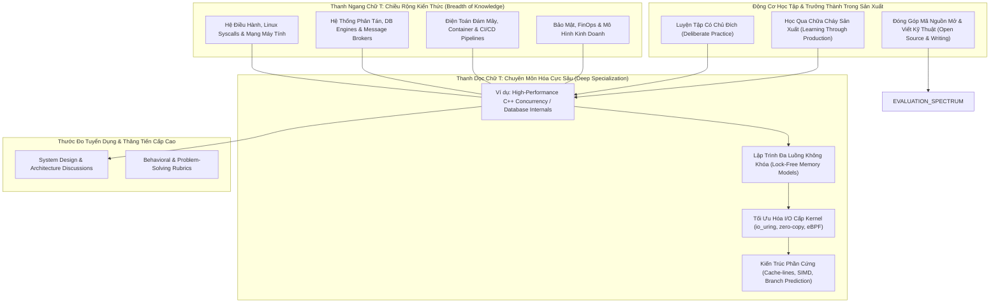
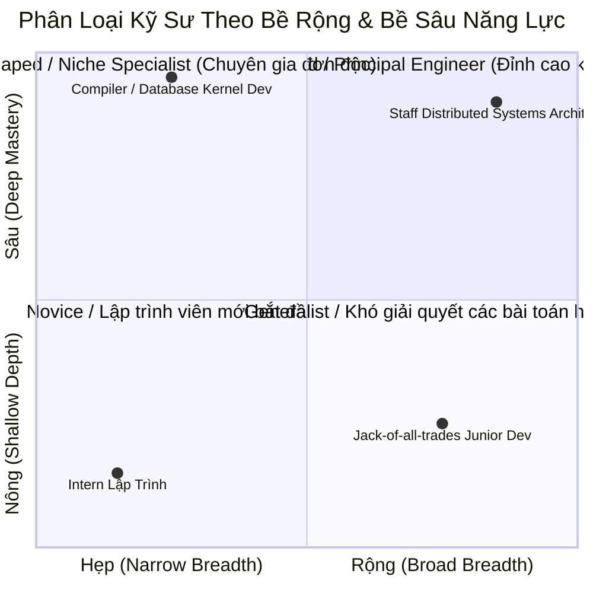
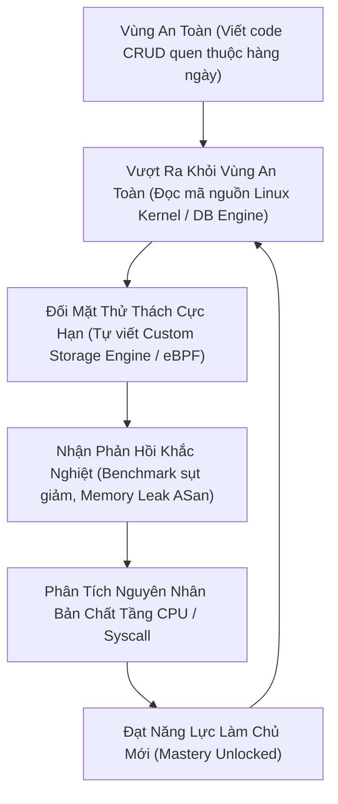
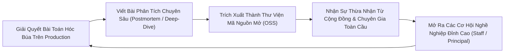
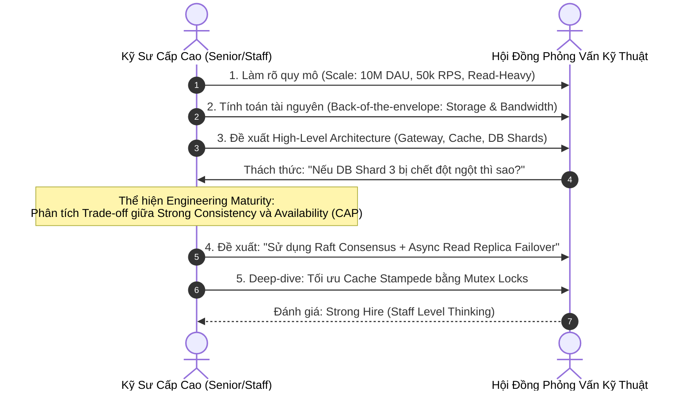

# 23.1. Lộ Trình Nghề Nghiệp & Chuyên Môn Hóa Sâu (Career Pathing & Deep Specialization)

Sự nghiệp kỹ thuật phần mềm không phải là một chuỗi ngày tăng level tự động dựa trên số năm kinh nghiệm (Years of Experience - YoE). Sự khác biệt căn bản giữa một lập trình viên 10 năm kinh nghiệm và một người có "1 năm kinh nghiệm lặp lại 10 lần" nằm ở **Chuyên môn hóa sâu (Deep Specialization)**, **Mô hình năng lực chữ T (T-Shaped Skills)**, và năng lực làm chủ hệ thống trong lửa đạn môi trường sản xuất (Production Mastery).

---

## 1. Tổng quan Khung Năng Lực Chữ T & Tiến Hóa Nghề Nghiệp



---

## 2. Chi tiết từng Keyword (Under-the-Hood Deep Dive)

### Nhóm 1: Career Taxonomy & Skill Architecture (Career Development, Skill Development, T-Shaped Skills, Deep Specialization & Breadth)

#### 1. Khái niệm & Bản chất (What & Why)
- **Engineering Career Development**: Quá trình tiến hóa có chủ đích của một kỹ sư qua các nấc thang năng lực: Junior $\rightarrow$ Mid $\rightarrow$ Senior $\rightarrow$ Staff $\rightarrow$ Principal $\rightarrow$ Distinguished Engineer / Fellow (hoặc rẽ nhánh sang Engineering Management).
- **Technical Skill Development**: Việc liên tục nâng cấp các năng lực kỹ thuật cơ bản và nâng cao để bắt kịp sự phát triển của công nghệ và bài toán của tổ chức.
- **T-Shaped Skills**: Mô hình năng lực lý tưởng cho một kỹ sư cấp cao:
  - **Thanh ngang (Breadth)**: Hiểu biết rộng về toàn bộ bức tranh công nghệ (Networking, Frontend, DevOps, Security, Databases, Cloud). Đủ để trao đổi và tích hợp mượt mà với bất kỳ chuyên gia nào.
  - **Thanh dọc (Depth)**: Đạt đến trình độ đỉnh cao thế giới trong 1 hoặc 2 lĩnh vực hẹp (ví dụ: tối ưu hóa cơ chế đồng thuận Raft trong distributed storage, hoặc thiết kế bộ nhớ lock-free trong C++).
- **Deep Specialization & Breadth of Knowledge**: Sự cân bằng biện chứng giữa việc không bị biến thành "Generalist hời hợt" (biết mỗi thứ một tí nhưng không làm chủ cái gì) và không bị rơi vào "Hyper-Specialist lạc hậu" (chuyên sâu vào một công nghệ chết và không thể thích nghi khi thị trường thay đổi).

#### 2. Cơ chế hoạt động & Phân tích chuyên sâu (Under-the-Hood)
- **Cơ chế Phân Tầng Năng Lực (The Dreyfus Model of Skill Acquisition)**:
  - **Novice / Advanced Beginner (Junior)**: Dựa vào quy tắc máy móc (Rules-based). Cần hướng dẫn chi tiết cách dùng thư viện hoặc framework.
  - **Competent / Proficient (Mid / Senior)**: Hiểu nguyên lý và ngữ cảnh. Tự thiết kế hệ thống, phân tích trade-offs và tối ưu hóa hiệu năng.
  - **Expert / Master (Staff / Principal)**: Hành động dựa trên trực giác kỹ thuật sâu sắc (Intuition) được tôi luyện qua hàng nghìn giờ phân tích sự cố production. Có khả năng nhìn xuyên qua các lớp trừu tượng (Leaky Abstractions) xuống tận tầng Assembly, CPU Cache, và Linux Kernel.
- **Giá Trị Kinh Tế Của Thanh Dọc (The Monopoly of Deep Technical Mastery)**:
  - Khi một hệ thống nổ sự cố bí ẩn làm mất hàng triệu USD (ví dụ: memory corruption ngầm do race condition giữa nhiều threads), 99% kỹ sư bề nổi sẽ bất lực. Kỹ sư có thanh dọc sâu về C++ Memory Model (`std::memory_order_acquire/release`) và OS Virtual Memory Paging sẽ là người duy nhất có thể debug core dump bằng `gdb` để cứu sống hệ thống.

#### 3. Sơ đồ Ma Trận Năng Lực Chữ T (T-Shaped Competency Profile)



#### 4. Mã nguồn minh họa (C++20): Deep Specialization - Triển Khai Bộ Nhớ Lock-Free Ring Buffer Cực Hạn

```cpp
#include <iostream>
#include <vector>
#include <atomic>
#include <memory>
#include <new>
#include <optional>
#include <thread>
#include <cassert>

// Minh chứng cho "Thanh Dọc Sâu": Hiểu rõ Hardware Cache-Line và C++ Memory Ordering
#if defined(__cpp_lib_hardware_interference_size)
    using std::hardware_destructive_interference_size;
#else
    constexpr size_t hardware_destructive_interference_size = 64; // Chuẩn x86 cache line
#endif

template <typename T, size_t Capacity>
class LockFreeSingleProducerSingleConsumerQueue {
    static_assert((Capacity & (Capacity - 1)) == 0, "Capacity bắt buộc phải là lũy thừa của 2 để tối ưu phép chia lấy dư bằng bitwise AND!");

public:
    LockFreeSingleProducerSingleConsumerQueue() : head_(0), tail_(0) {
        ring_buffer_ = static_cast<T*>(::operator new[](sizeof(T) * Capacity));
    }

    ~LockFreeSingleProducerSingleConsumerQueue() {
        T dummy;
        while (Pop(dummy));
        ::operator delete[](ring_buffer_);
    }

    // Producer Thread
    bool Push(const T& item) {
        const size_t current_tail = tail_.load(std::memory_order_relaxed);
        const size_t current_head = head_.load(std::memory_order_acquire); // Đồng bộ với Consumer

        if ((current_tail - current_head) >= Capacity) {
            return false; // Queue đầy
        }

        new (&ring_buffer_[current_tail & BUFFER_MASK]) T(item);
        tail_.store(current_tail + 1, std::memory_order_release); // Công bố dữ liệu cho Consumer
        return true;
    }

    // Consumer Thread
    bool Pop(T& value) {
        const size_t current_head = head_.load(std::memory_order_relaxed);
        const size_t current_tail = tail_.load(std::memory_order_acquire); // Đồng bộ với Producer

        if (current_head == current_tail) {
            return false; // Queue rỗng
        }

        value = std::move(ring_buffer_[current_head & BUFFER_MASK]);
        ring_buffer_[current_head & BUFFER_MASK].~T();
        head_.store(current_head + 1, std::memory_order_release); // Báo cho Producer slot đã trống
        return true;
    }

private:
    static constexpr size_t BUFFER_MASK = Capacity - 1;
    T* ring_buffer_;

    // Chống False Sharing giữa các CPU Cores bằng cách padding cache-line riêng biệt
    alignas(hardware_destructive_interference_size) std::atomic<size_t> tail_;
    alignas(hardware_destructive_interference_size) std::atomic<size_t> head_;
};

int main() {
    LockFreeSingleProducerSingleConsumerQueue<int64_t, 1024> spsc_queue;

    std::thread producer([&]() {
        for (int64_t i = 1; i <= 100'000; ++i) {
            while (!spsc_queue.Push(i)) {
                std::this_thread::yield();
            }
        }
    });

    std::thread consumer([&]() {
        int64_t received = 0;
        int64_t expected = 1;
        while (expected <= 100'000) {
            if (spsc_queue.Pop(received)) {
                assert(received == expected);
                expected++;
            } else {
                std::this_thread::yield();
            }
        }
    });

    producer.join();
    consumer.join();

    std::cout << "[SUCCESS] Lock-Free SPSC Queue hoàn tất 100.000 giao dịch không có data race!\n";
    return 0;
}
```

#### 5. Anti-Patterns & Cạm bẫy
- **The Tutorial Purgatory (Ngục tù hướng dẫn)**: Dành hàng tháng xem hết video tutorial này đến khóa học khác nhưng không bao giờ tự tay xây dựng một hệ thống hoàn chỉnh từ đầu. Kiến thức thu được chỉ là bề nổi thụ động và biến mất ngay khi gặp lỗi thực tế.
- **The Shiny Object Syndrome**: Liên tục nhảy việc hoặc đổi công nghệ theo xu hướng mạng xã hội (vừa học Go được 2 tháng lại nhảy sang Rust, rồi nhảy sang Zig, rồi nhảy sang AI) mà không bao giờ đào sâu vào bản chất bên dưới (Hệ điều hành, Mạng, Kiến trúc máy tính). Hậu quả là sau 5 năm vẫn là một kỹ sư nghiệp dư ở mọi ngôn ngữ.

#### 6. Ứng dụng Backend & Distributed Systems
- Định hình lộ trình phát triển: Nếu chọn chuyên sâu về Distributed Systems, hãy bắt đầu bằng việc đọc và triển khai lại các bài báo khoa học kinh điển (Raft Consensus, Google Spanner, DynamoDB, MapReduce) bằng C++20 hoặc Go, sau đó tự tay viết test harness giả lập rớt mạng và phân mảnh dữ liệu (Network Partitions).

---

### Nhóm 2: Learning Methodologies & Production Mastery (Continuous Learning, Deliberate Practice, Projects & Production)

#### 1. Khái niệm & Bản chất (What & Why)
- **Continuous Learning**: Khả năng duy trì một chu trình tiếp nạp và sàng lọc tri thức mới có phương pháp trong suốt cuộc đời làm nghề, không để bản thân bị lỗi thời trước các làn sóng công nghệ mới.
- **Deliberate Practice (Luyện tập có chủ đích)**: Phương pháp học tập tập trung vào những vùng kỹ năng mình đang yếu nhất, vượt ra khỏi vùng an toàn (Comfort Zone), đi kèm phản hồi tức thì (Instant Feedback) để sửa sai liên tục.
- **Learning Through Projects**: Học bằng cách tự tay thiết kế và xây dựng một sản phẩm hoàn chỉnh từ con số 0 (Zero to Production), giải quyết toàn bộ các rắc rối về CI/CD, cơ sở dữ liệu và bảo mật.
- **Learning Through Production**: Trường học khắc nghiệt và danh giá nhất của kỹ sư phần mềm. Việc trực tiếp đối mặt với các sự cố sập server, nghẽn I/O, rò rỉ bộ nhớ dưới hàng trăm nghìn người dùng thật rèn giũa năng lực phản xạ và bản lĩnh kỹ thuật mà không cuốn sách nào có thể dạy được.

#### 2. Cơ chế hoạt động & Phân tích chuyên sâu (Under-the-Hood)
- **Vòng lặp Luyện tập Có Chủ Đích (The OODA Loop of Engineering Growth)**:
  $$\text{Observe (Quan sát điểm nghẽn)} \rightarrow \text{Orient (Tìm hiểu bản chất kernel/hardware)} \rightarrow \text{Decide (Tái thiết kế)} \rightarrow \text{Act (Benchmark đo lường)}$$
- **Học từ Sự cố Sản xuất (Failure-Driven Learning)**:
  - Khi một hệ thống gặp sự cố OOMKilled trên Kubernetes:
    1. Không chỉ đơn giản là tăng RAM pod từ 1GB lên 2GB để "chữa cháy tạm thời".
    2. Một kỹ sư có tư duy Deliberate Practice sẽ:
       - Dump heap memory bằng `jcmd` hoặc `gperftools`.
       - Dùng `valgrind --tool=massif` để phân tích đồ thị cấp phát bộ nhớ.
       - Phát hiện ra rằng thư viện JSON parser đang tạo ra hàng triệu bản copy string tạm thời trên heap thay vì dùng `std::string_view` (Zero-copy).
       - Tái cấu trúc lại mã nguồn và giảm mức tiêu thụ RAM đi 85%.

#### 3. Sơ đồ Vòng Lặp Luyện Tập Có Chủ Đích Trong Kỹ Thuật



#### 4. Mã nguồn minh họa (TypeScript): Khung Mô Phỏng Hệ Thống Giám Sát Học Tập & Benchmark Hiệu Năng

```typescript
export interface EngineeringExperiment {
  name: string;
  baselineLatencyMs: number;
  optimizedLatencyMs: number;
  allocationsBytes: number;
  rootCauseIdentified: string;
}

export class DeliberatePracticeHarness {
  public static evaluateImprovement(exp: EngineeringExperiment): void {
    const latencyReduction = ((exp.baselineLatencyMs - exp.optimizedLatencyMs) / exp.baselineLatencyMs) * 100;
    
    console.log(`=== KẾT QUẢ THỰC NGHIỆM: ${exp.name} ===`);
    console.log(`Độ trễ ban đầu       : ${exp.baselineLatencyMs.toFixed(2)} ms`);
    console.log(`Độ trễ sau tối ưu    : ${exp.optimizedLatencyMs.toFixed(2)} ms (-${latencyReduction.toFixed(1)}%)`);
    console.log(`Bộ nhớ tiêu thụ      : ${(exp.allocationsBytes / 1024).toFixed(1)} KB`);
    console.log(`Bản chất kỹ thuật học được: ${exp.rootCauseIdentified}`);

    if (latencyReduction > 50 && exp.allocationsBytes === 0) {
      console.log(`[ĐÁNH GIÁ]: Đạt cấp độ Master! Đạt được Zero-Allocation và giảm hơn 50% độ trễ.`);
    }
  }
}

// Báo cáo một buổi deliberate practice
DeliberatePracticeHarness.evaluateImprovement({
  name: "Chuyển đổi chuỗi HTTP Parser từ Substring Heap sang Zero-Copy StringView",
  baselineLatencyMs: 14.5,
  optimizedLatencyMs: 2.1,
  allocationsBytes: 0,
  rootCauseIdentified: "Loại bỏ hoàn toàn syscall malloc/free trên vòng lặp đón nhận TCP packets, chuyển sang con trỏ offset trên ring-buffer có sẵn."
});
```

#### 5. Anti-Patterns & Cạm bẫy
- **Copy-Paste StackOverflow / AI Slop without Reflection**: Khi gặp lỗi lạ, lập trình viên copy dòng code gợi ý từ AI hoặc StackOverflow vào dán cho đến khi test pass mà không bỏ thời gian tìm hiểu TẠI SAO nó lại chạy được. Hành vi này hoàn toàn triệt tiêu cơ hội học hỏi và khiến kỹ sư mãi mãi phụ thuộc.
- **Blaming the Environment**: Đổ lỗi cho "do mạng lag", "do AWS bị lỗi", "do compiler bug" khi hệ thống sập, thay vì đào sâu vào metrics và kernel trace để tìm ra nguyên nhân gốc rễ (Root Cause).

#### 6. Ứng dụng Backend & Distributed Systems
- Tham gia các đợt **On-call Rotation** và chủ trì các buổi **Postmortem Review**. Coi mỗi sự cố production là một cơ hội vàng được trả lương để mổ xẻ hành vi thực tế của hệ thống phân tán dưới áp lực cực hạn.

---

### Nhóm 3: Proof of Competence, Portfolio & Open Source (Portfolio, OSS Contribution, Writing & Blogging)

#### 1. Khái niệm & Bản chất (What & Why)
- **Engineering Portfolio & Technical Portfolio**: Bằng chứng hữu hình về năng lực giải quyết vấn đề kỹ thuật của một kỹ sư, vượt trội hơn bất kỳ bản CV bóng bẩy nào.
- **Open Source Contribution**: Việc đóng góp mã nguồn, sửa lỗi, tối ưu hiệu năng hoặc viết tài liệu cho các dự án phần mềm mã nguồn mở uy tín (Linux kernel, Kubernetes, Envoy, ClickHouse, SQLite). Đây là chứng chỉ năng lực được công nhận toàn cầu.
- **Technical Writing & Engineering Blogging**: Năng lực chắt lọc, hệ thống hóa và truyền tải các khái niệm kỹ thuật phức tạp thành các bài viết chuyên sâu, rõ ràng và mạch lạc. Richard Feynman từng khẳng định: "Nếu bạn không thể giải thích một điều gì đó một cách đơn giản, bạn chưa thực sự hiểu nó".

#### 2. Cơ chế hoạt động & Phân tích chuyên sâu (Under-the-Hood)
- **Tác Động Lan Tỏa của Mã Nguồn Mở (The Compounding Flywheel of OSS)**:
  - Một Pull Request sửa lỗi race condition trong mã nguồn của Apache Kafka hoặc Redis:
    1. Phải trải qua quy trình review khắt khe của các kỹ sư hàng đầu thế giới (Maintainers).
    2. Buộc kỹ sư phải tuân thủ các tiêu chuẩn code cao nhất thế giới (Memory sanitizers, thread sanitizers, strict API contracts).
    3. Khi PR được merge, mã nguồn của bạn bảo vệ hàng triệu máy chủ trên khắp hành tinh. Đây là "Proof of Work" kỹ thuật mạnh mẽ nhất trong mắt các tập đoàn công nghệ lớn.
- **Kỹ thuật Viết Kỹ thuật Sâu Sắc (Deep-Dive Technical Post Architecture)**:
  - Không viết các bài tóm tắt hời hợt kiểu "Làm quen với Docker trong 5 phút".
  - Một bài viết kỹ thuật đỉnh cao cấu trúc theo mô hình:
    $$\text{Triệu chứng Production} \rightarrow \text{Mổ xẻ Assembly / Kernel Trace} \rightarrow \text{Thiết kế Thử nghiệm Đo lường} \rightarrow \text{Giải pháp Kiến trúc} \rightarrow \text{Bài học Rút ra}$$

#### 3. Sơ đồ Bánh Đà Uy Tín Kỹ Thuật (Engineering Credibility Flywheel)



#### 4. Mã nguồn minh họa (TypeScript): Công cụ Sinh Tài Liệu Kỹ Thuật Tự Động Từ Mã Nguồn (Markdown Doc Generator)

```typescript
export interface ApiEndpointSpec {
  method: 'GET' | 'POST' | 'PUT' | 'DELETE';
  path: string;
  p99LatencySlaMs: number;
  concurrencyLimit: number;
  description: string;
}

export class TechnicalDocumentationPublisher {
  public static generateProductionMarkdownReport(serviceName: string, endpoints: ApiEndpointSpec[]): string {
    let md = `# Tài Liệu Kiến Trúc & Vận Hành: ${serviceName}\n\n`;
    md += `*Tự động trích xuất từ mã nguồn - Ngày cập nhật: ${new Date().toISOString().split('T')[0]}*\n\n`;
    md += `## 1. Danh Sách Giao Diện API & Cam Kết SLA\n\n`;
    md += `| Phương thức | Đường dẫn API | SLA Trễ P99 | Giới Hạn Concurrency | Ý Nghĩa Kỹ Thuật |\n`;
    md += `| :--- | :--- | :--- | :--- | :--- |\n`;

    for (const ep of endpoints) {
      md += `| \`${ep.method}\` | \`${ep.path}\` | \`${ep.p99LatencySlaMs}ms\` | \`${ep.concurrencyLimit} req/s\` | ${ep.description} |\n`;
    }

    md += `\n> [!IMPORTANT]\n> Mọi thay đổi vượt quá SLA trên đều phải được thông qua Architecture Review Board.\n`;
    return md;
  }
}

// Chạy sinh tài liệu
const sampleApis: ApiEndpointSpec[] = [
  { method: 'POST', path: '/v1/transfers', p99LatencySlaMs: 250, concurrencyLimit: 5000, description: "Giao dịch chuyển tiền liên ngân hàng bảo đảm ACID" },
  { method: 'GET', path: '/v1/balances', p99LatencySlaMs: 25, concurrencyLimit: 20000, description: "Tra cứu số dư tài khoản phục vụ từ bộ nhớ đệm L1" }
];

console.log(TechnicalDocumentationPublisher.generateProductionMarkdownReport("Core Banking Engine", sampleApis));
```

#### 5. Anti-Patterns & Cạm bẫy
- **Empty GitHub Green Wall**: Dùng script tự động commit mỗi ngày một dấu chấm để làm xanh bảng GitHub. Các Senior/Staff hiring managers chỉ cần nhìn vào nội dung commit 1 giây là nhận ra sự gian lận và đánh trượt ngay lập tức vì sự thiếu trung thực.
- **Plagiarized Tech Content**: Sao chép nội dung từ các bài blog tiếng Anh dịch sang tiếng Việt mà không ghi nguồn hoặc không hề hiểu bản chất của những gì mình viết.

#### 6. Ứng dụng Backend & Distributed Systems
- Duy trì một blog kỹ thuật cá nhân hoặc viết engineering blog cho công ty. Chia sẻ những bài học về việc cứu sập database, tối ưu hóa câu lệnh query, hoặc cách debug một memory leak bí ẩn. Đây chính là tài sản thương hiệu cá nhân bền bỉ nhất của bạn.

---

### Nhóm 4: The Interview Spectrum & High-Level Alignment (Interviews: System Design, DSA, Backend, Behavioral, Problem-Solving & Architecture)

#### 1. Khái niệm & Bản chất (What & Why)
- **Data Structures and Algorithms (DSA) Interviews**: Vòng kiểm tra nền tảng tư duy logic, năng lực tối ưu độ phức tạp thời gian/không gian ($O(N)$, $O(\log N)$) và khả năng viết mã sạch, không lỗi biên giới (Edge-case safety).
- **System Design Interviews**: Bài kiểm tra năng lực thiết kế hệ thống quy mô lớn (Large-Scale Distributed Systems), bao gồm phân rã microservices, chọn database (SQL vs NoSQL), chiến lược caching, cơ chế đồng thuận, và tính toán tải (Back-of-the-envelope estimation).
- **Backend Engineering Interviews**: Đi sâu vào các khía cạnh thực chiến: Concurrency, Database Transactions (Isolation Levels), Networking (TCP/HTTP/gRPC), và RESTful API Design.
- **Behavioral & Leadership Interviews**: Đánh giá sự trưởng thành về mặt văn hóa, năng lực giao tiếp, giải quyết xung đột, tinh thần sở hữu (Ownership) và khả năng dẫn dắt đội ngũ (Leadership).
- **Architecture Discussion & Problem-Solving**: Cuộc đối thoại ngang hàng giữa các kỹ sư cấp cao về các bài toán mở, nơi không có đáp án đúng duy nhất, chỉ có sự phân tích thấu đáo về các đánh đổi (Trade-offs).

#### 2. Cơ chế hoạt động & Phân tích chuyên sâu (Under-the-Hood)
- **Khung Trả Lời System Design Chuẩn Cấp Staff (RADIO Framework)**:
  1. **R - Requirements Clarification**: Làm rõ Functional và Non-functional requirements (SLA, Availability 99.99%, Read/Write Ratio, Data Retention).
  2. **A - Architecture High-Level**: Vẽ sơ đồ khối tổng quan, luồng dữ liệu (Data Flow) từ Client qua Gateway tới Database.
  3. **D - Data Model & Storage**: Lựa chọn loại DB, thiết kế Primary Keys, Partition Keys để tránh Hot Shard.
  4. **I - Interface / API Design**: Định nghĩa hợp đồng API rõ ràng (REST/gRPC specs).
  5. **O - Optimizations & Deep Dives**: Đi sâu vào các điểm nghẽn chịu tải cực hạn (Cache Invalidation, Replication Lag, Distributed Locks, SPOF).
- **Behavioral STAR Method Dưới Góc Độ Kỹ Sư Trưởng Thành**:
  - Không bao giờ nói "Chúng tôi đã làm...". Một Senior/Staff phải nêu rõ:
    - **Situation**: Bối cảnh thảm họa hoặc thách thức lớn của dự án.
    - **Task**: Trách nhiệm cụ thể được giao hoặc tự nhận.
    - **Action**: Các quyết định kỹ thuật quyết đoán dựa trên dữ liệu và nguyên lý cốt lõi.
    - **Result**: Kết quả đo lường được bằng tiền bạc, uptime hoặc năng suất của toàn bộ tổ chức.

#### 3. Sơ đồ Luồng Phỏng Vấn Kiến Trúc Hệ Thống Cấp Senior/Staff



#### 4. Mã nguồn minh họa (TypeScript): Công Cụ Tính Toán Nhanh Quy Mô Hệ Thống (Back-of-the-Envelope Calculator)

```typescript
export interface SystemScaleInput {
  dailyActiveUsers: number;
  avgRequestsPerUserDay: number;
  readToWriteRatio: number; // e.g., 10 nghĩa là 10 Reads / 1 Write
  avgPayloadSizeBytes: number;
  retentionYears: number;
}

export class SystemDesignEstimator {
  public static calculateScale(input: SystemScaleInput): void {
    const totalRequestsPerDay = input.dailyActiveUsers * input.avgRequestsPerUserDay;
    const avgRps = totalRequestsPerDay / 86400;
    const peakRps = avgRps * 2.5; // Giả định hệ số đỉnh 2.5x

    const writesPerDay = totalRequestsPerDay / (input.readToWriteRatio + 1);
    const readsPerDay = totalRequestsPerDay - writesPerDay;

    const dailyStorageBytes = writesPerDay * input.avgPayloadSizeBytes;
    const totalStorageYearsTb = (dailyStorageBytes * 365 * input.retentionYears) / (1024 ** 4);

    const networkIngressMbPerSec = (peakRps * input.avgPayloadSizeBytes) / (1024 ** 2);

    console.log("=== BẢNG TÍNH TOÁN QUY MÔ HỆ THỐNG (BACK-OF-THE-ENVELOPE) ===");
    console.log(`Lưu lượng trung bình (RPS) : ${avgRps.toFixed(0)} req/s`);
    console.log(`Lưu lượng đỉnh điểm (Peak)  : ${peakRps.toFixed(0)} req/s`);
    console.log(`Write QPS                  : ${(writesPerDay / 86400).toFixed(0)} writes/s`);
    console.log(`Dung lượng lưu trữ / năm    : ${(dailyStorageBytes * 365 / (1024 ** 4)).toFixed(2)} TB/năm`);
    console.log(`Tổng dung lượng ${input.retentionYears} năm      : ${totalStorageYearsTb.toFixed(2)} TB`);
    console.log(`Băng thông đỉnh dự kiến     : ${networkIngressMbPerSec.toFixed(2)} MB/s`);
  }
}

// Ước tính hệ thống tương tự Twitter / Threads
SystemDesignEstimator.calculateScale({
  dailyActiveUsers: 50_000_000,
  avgRequestsPerUserDay: 40,
  readToWriteRatio: 100, // 100 reads / 1 write
  avgPayloadSizeBytes: 1024, // 1 KB per tweet
  retentionYears: 5
});
```

#### 5. Anti-Patterns & Cạm bẫy
- **Buzzword Dropping**: Tuôn ra hàng loạt từ khóa thời thượng (Kafka, Kubernetes, GraphQL, Blockchain, Cassandra) trong buổi phỏng vấn thiết kế mà không giải thích được lý do tại sao lại dùng chúng, hoặc không nêu được nhược điểm của chúng. Người phỏng vấn sẽ ngay lập tức nhận ra đây là kiến thức chắp vá.
- **Defensiveness in Technical Discussions**: Trở nên gay gắt hoặc bảo thủ khi người phỏng vấn hoặc đồng nghiệp phản biện giải pháp của bạn. Một kỹ sư cấp cao luôn đón nhận phản biện với thái độ cởi mở: "Đó là một góc nhìn rất thú vị, hãy cùng phân tích xem phương án của bạn có ưu thế gì về chi phí hạ tầng so với phương án hiện tại".

#### 6. Ứng dụng Backend & Distributed Systems
- Khi tham gia các buổi phỏng vấn hoặc thảo luận kiến trúc, luôn bắt đầu bằng việc xác lập các **Guarantees** và **Invariants** của hệ thống (ví dụ: Exactly-Once vs At-Least-Once delivery, Eventual vs Linearizable consistency). Việc làm chủ các khái niệm nền tảng này khẳng định đẳng cấp kỹ sư trưởng thành thực thụ.

---

## 3. Tổng kết & Bảng Tra Cứu Thực Chiến

| Nấc thang năng lực | Trọng tâm học tập & Thực hành | Thước đo thành công | Dấu ấn kỹ thuật cá nhân |
| :--- | :--- | :--- | :--- |
| **Junior $\rightarrow$ Mid** | Nắm vững DSA, Syntax, Clean Code, Unit Tests | Độc lập hoàn thành tính năng, ít bug | Code sạch, tuân thủ SOLID, hiểu rõ git |
| **Mid $\rightarrow$ Senior** | Làm chủ Database Internals, Linux OS, Concurrency | Thiết kế dịch vụ chịu tải cao, on-call vững vàng | Tối ưu P99 latency, giải quyết triệt để race conditions |
| **Senior $\rightarrow$ Staff** | T-Shaped Depth, System Architecture, Economics | Định hình kiến trúc toàn bộ công ty, cố vấn thế hệ sau | Viết RFC xuất sắc, giảm 40% chi phí hạ tầng đám mây |
| **Open Source & Portfolio** | Đóng góp vào các dự án mở nền tảng của thế giới | PRs được merge vào các repo uy tín toàn cầu | Trở thành Maintainer hoặc chuyên gia đầu ngành |
| **System Design Mastery** | Năng lực phân tích Trade-offs trong hệ thống lớn | Vượt qua các bài phỏng vấn Staff/Principal | Làm chủ RADIO framework, giải quyết bài toán triệu người dùng |
