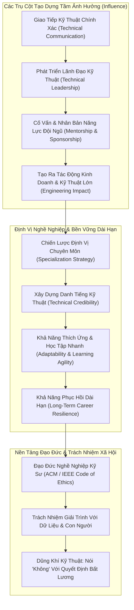
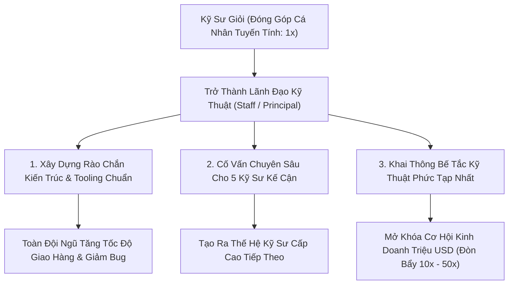
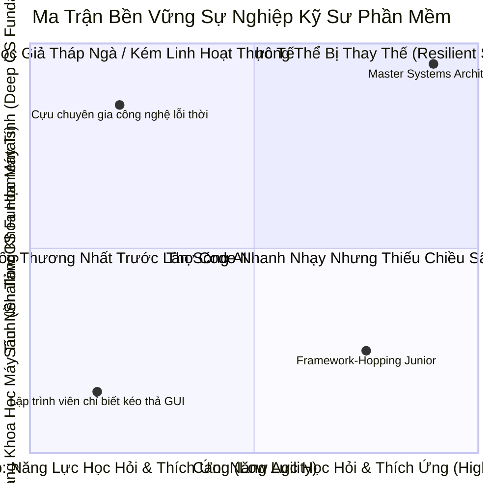
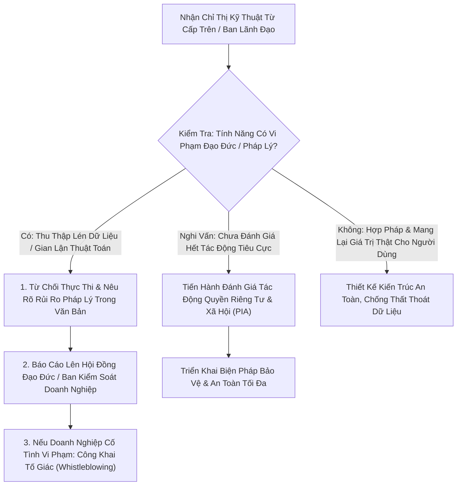

# 23.2. Tầm Ảnh Hưởng Kỹ Thuật, Danh Tiếng & Đạo Đức Nghề Nghiệp (Engineering Influence, Reputation & Professional Ethics)

Đỉnh cao của sự trưởng thành kỹ thuật (Engineering Maturity) không chỉ đo bằng độ sâu của những dòng mã nguồn hay những kiến trúc phân tán phức tạp. Nó nằm ở **Tầm ảnh hưởng (Engineering Influence)**, **Độ tin cậy kỹ thuật (Technical Credibility)**, và trên hết là **Đạo đức nghề nghiệp cùng Tinh thần trách nhiệm (Professional Ethics & Engineering Responsibility)** đối với hệ thống, người dùng và xã hội.

---

## 1. Tổng quan Tầm Ảnh Hưởng Kỹ Thuật & Khung Đạo Đức Kỹ Sư



---

## 2. Chi tiết từng Keyword (Under-the-Hood Deep Dive)

### Nhóm 1: Influence, Communication & Leadership Development (Technical Communication, Leadership Development, Mentorship & Engineering Impact)

#### 1. Khái niệm & Bản chất (What & Why)
- **Technical Communication**: Năng lực biểu đạt chính xác, khúc chiết các ý tưởng, rủi ro và giải pháp kỹ thuật cho nhiều đối tượng khán giả khác nhau: từ kỹ sư sơ cấp, đồng nghiệp ngang hàng tới ban giám đốc điều hành (C-level).
- **Technical Leadership Development**: Quá trình chuyển hóa từ việc "tự mình làm tốt công việc" sang việc "định hướng, khai thông bế tắc và tạo động lực để toàn bộ tổ chức làm việc xuất sắc". Lãnh đạo kỹ thuật không đồng nghĩa với chức danh quản lý con người (People Management); đó là vai trò dẫn dắt bằng năng lực chuyên môn và tầm nhìn (Leading by Expertise).
- **Mentorship (Cố vấn & Dẫn dắt)**: Hành động chủ động đầu tư thời gian để đào tạo, nâng đỡ các kỹ sư thế hệ sau, giúp họ vượt qua các rào cản kỹ thuật và trưởng thành nhanh chóng. Một Staff Engineer được đo lường bằng số lượng kỹ sư họ đã nâng tầm lên Senior.
- **Engineering Impact**: Dấu ấn hữu hình và bền vững mà kỹ sư để lại cho tổ chức. Không đo bằng số commit hay số giờ ngồi ở văn phòng, mà đo bằng: Downtime hệ thống giảm bao nhiêu phần trăm? Tốc độ phát triển của 200 kỹ sư khác tăng bao nhiêu lần nhờ framework bạn thiết kế? Doanh nghiệp tiết kiệm được bao nhiêu triệu USD chi phí hạ tầng?

#### 2. Cơ chế hoạt động & Phân tích chuyên sâu (Under-the-Hood)
- **Kỹ thuật Giao tiếp Đa Tần Số (Multi-Frequency Communication)**:
  - Khi một kỹ sư trình bày về một quyết định kiến trúc:
    - **Tần số Kỹ thuật (Technical Frequency)**: Thảo luận với Tech Lead về: CPU Cache Misses, B-Tree vs LSM-Tree, Memory Alignment, Connection Pooling saturation.
    - **Tần số Kinh doanh (Executive Frequency)**: Thảo luận với VP of Engineering / CTO về: Khấu hao chi phí đám mây (TCO reduction), Rủi ro vi phạm hợp đồng SLA với khách hàng doanh nghiệp, Khả năng mở rộng dung lượng người dùng lên 5x trong quý tiếp theo.
  - Sự thất bại trong giao tiếp kỹ thuật xảy ra khi kỹ sư mang chi tiết thanh ghi CPU hoặc con trỏ C++ ra giải thích cho Giám đốc Sản phẩm khi họ hỏi "Tại sao tính năng này bị trễ 2 tuần?".
- **Cơ chế Nhân bản Bản thân qua Cố vấn (The Multiplier Effect)**:
  - Một kỹ sư giỏi làm việc 60 giờ/tuần chỉ đóng góp được 60 giờ công sức cá nhân (Tuyến tính).
  - Một Staff Engineer dành 20 giờ/tuần để viết tài liệu chuẩn hóa, xây dựng template dự án và cố vấn cho 5 kỹ sư khác sẽ tạo ra đòn bẩy gấp 10 lần: nâng năng suất của 5 người đó lên 30%, tương đương bổ sung thêm 60 giờ làm việc chất lượng cao cho công ty mà không cần tuyển thêm người.

#### 3. Sơ đồ Hiệu Ứng Đòn Bẩy Của Lãnh Đạo Kỹ Thuật (The Engineering Multiplier Flywheel)



#### 4. Mã nguồn minh họa (TypeScript): Khung Đo Lường Tác Động Kỹ Thuật (Engineering Impact Metrics Analyzer)

```typescript
export interface EngineeringContribution {
  contributorId: string;
  contributorRole: 'SENIOR' | 'STAFF' | 'PRINCIPAL';
  directCommitsCount: number;
  engineersMentoredCount: number;
  reusableFrameworkAdoptionCount: number; // Số dịch vụ đang dùng framework do họ viết
  infrastructureSavingsAnnualUsd: number;
  majorIncidentsResolvedCount: number;
}

export class EngineeringImpactEvaluator {
  public static calculateOrganizationalLeverage(contrib: EngineeringContribution): {
    leverageScore: number;
    impactTier: 'INDIVIDUAL_CONTRIBUTOR' | 'TEAM_MULTIPLIER' | 'ORGANIZATIONAL_LEADER';
    narrative: string;
  } {
    // Công thức tính đòn bẩy tổ chức: Không ưu tiên số commit đơn thuần
    const individualOutput = contrib.directCommitsCount * 0.1;
    const mentorshipMultiplier = contrib.engineersMentoredCount * 25.0;
    const ecosystemAdoption = contrib.reusableFrameworkAdoptionCount * 15.0;
    const financialImpact = contrib.infrastructureSavingsAnnualUsd / 10_000.0;

    const totalLeverage = individualOutput + mentorshipMultiplier + ecosystemAdoption + financialImpact;

    if (totalLeverage > 150) {
      return {
        leverageScore: Math.round(totalLeverage),
        impactTier: 'ORGANIZATIONAL_LEADER',
        narrative: `Tác động ở quy mô toàn doanh nghiệp! Đã tiết kiệm $${contrib.infrastructureSavingsAnnualUsd} USD và cố vấn thành công ${contrib.engineersMentoredCount} kỹ sư.`
      };
    } else if (totalLeverage > 60) {
      return {
        leverageScore: Math.round(totalLeverage),
        impactTier: 'TEAM_MULTIPLIER',
        narrative: "Tác động ở quy mô đội ngũ, nâng đỡ năng suất của các đồng nghiệp xung quanh."
      };
    }

    return {
      leverageScore: Math.round(totalLeverage),
      impactTier: 'INDIVIDUAL_CONTRIBUTOR',
      narrative: "Chủ yếu đóng góp cá nhân, cần mở rộng tầm ảnh hưởng qua cố vấn và kiến trúc chung."
    };
  }
}

// Đánh giá tác động của một Staff Engineer
const staffProfile: EngineeringContribution = {
  contributorId: "eng_staff_tri",
  contributorRole: 'STAFF',
  directCommitsCount: 120, // Không commit quá nhiều
  engineersMentoredCount: 4,
  reusableFrameworkAdoptionCount: 8, // 8 microservices đang chạy trên library của họ
  infrastructureSavingsAnnualUsd: 140_000,
  majorIncidentsResolvedCount: 3
};

const evaluation = EngineeringImpactEvaluator.calculateOrganizationalLeverage(staffProfile);
console.log("=== ĐÁNH GIÁ TẦM ẢNH HƯỞNG KỸ THUẬT (ORGANIZATIONAL LEVERAGE) ===");
console.log(`Điểm số đòn bẩy : ${evaluation.leverageScore}`);
console.log(`Cấp bậc tác động: ${evaluation.impactTier}`);
console.log(`Nhận xét        : ${evaluation.narrative}`);
```

#### 5. Anti-Patterns & Cạm bẫy
- **The Ivory Tower Architect (Kiến trúc sư tháp ngà)**: Ngồi trong phòng máy lạnh vẽ các sơ đồ kiến trúc phức tạp trên giấy, ban hành các quy định khắt khe nhưng không bao giờ tự tay viết code, không bao giờ debug sự cố production và hoàn toàn mất kết nối với thực tế đau thương của các lập trình viên tuyến đầu.
- **Knowledge Hoarding (Giấu nghề)**: Kỹ sư cố tình biến các module của mình thành những "hộp đen bí ẩn", không viết tài liệu và không chia sẻ cho đồng nghiệp để duy trì cảm giác "bản thân là người không thể bị thay thế" (Job Security). Đây là dấu hiệu của sự thiếu tự tin và non nớt về mặt chuyên môn.

#### 6. Ứng dụng Backend & Distributed Systems
- Thường xuyên tổ chức các buổi **Tech Brownbag / Architecture Guild Sessions** trong công ty. Biến các bài học xương máu sau mỗi lần sập hệ thống thành tài liệu đào tạo nội bộ, giúp các kỹ sư trẻ không bao giờ lặp lại đúng những sai lầm đó nữa.

---

### Nhóm 2: Positioning, Credibility & Career Resilience (Career Positioning, Specialization, Reputation, Credibility, Resilience, Adaptability & Learning Agility)

#### 1. Khái niệm & Bản chất (What & Why)
- **Career Positioning & Specialization Strategy**: Chiến lược định vị bản thân trên thị trường lao động. Trở thành "người đầu tiên được nghĩ tới" (Go-To Person) khi công ty hoặc ngành gặp phải một nhóm bài toán chuyên biệt (ví dụ: "Khi hệ thống cần tối ưu hóa hiệu năng cực hạn hoặc thiết kế lại database transactions, hãy tìm kỹ sư X").
- **Engineering Reputation & Technical Credibility**: Uy tín chuyên môn được tích lũy bền bỉ qua thời gian. Uy tín này dựa trên sự nhất quán giữa lời nói và kết quả thực tế: Khi bạn cam kết hệ thống sẽ chạy ổn định với 99.99% uptime, nó thực sự đạt được điều đó.
- **Long-Term Career Resilience**: Khả năng bảo vệ sự nghiệp kỹ thuật đứng vững trước các cuộc khủng hoảng kinh tế, làn sóng sa thải (layoffs), và sự thay đổi công nghệ mang tính hủy diệt (Disruptive Tech như AI).
- **Adaptability & Learning Agility**: Sự linh hoạt và tốc độ tiếp thu, làm chủ các công cụ, ngôn ngữ và mô thức kiến trúc hoàn toàn mới chỉ trong vài tuần dựa trên việc nắm vững các nguyên lý khoa học máy tính căn bản.

#### 2. Cơ chế hoạt động & Phân tích chuyên sâu (Under-the-Hood)
- **Quy luật Giá trị Bất biến (The Lindy Effect in Software Engineering)**:
  - Các công nghệ đã tồn tại và chứng minh được giá trị trong 30 năm (Linux Kernel, C/C++, Quan hệ RDBMS, Giao thức TCP/IP, Hệ điều hành POSIX) sẽ tiếp tục tồn tại và thịnh vượng trong ít nhất 30 năm nữa.
  - Một chiến lược định vị sự nghiệp có tính phục hồi dài hạn (Resilience) xây dựng nền tảng vững chắc trên những giá trị bất biến này, thay vì chạy theo 100 frameworks JavaScript mọc lên và biến mất sau mỗi mùa trăng.
- **Xây dựng Năng Lực Học Tập Nhanh (High Learning Agility)**:
  - Khi một công nghệ mới xuất hiện (ví dụ: eBPF hoặc Rust Async):
    - Người thiếu nền tảng sẽ mất 1 năm để học cú pháp và mò mẫm các lỗi ngớ ngẩn.
    - Kỹ sư có Learning Agility cao sẽ đối chiếu ngay với kiến trúc máy tính đã biết: "Rust Async bản chất là một State Machine tự động được sinh ra bởi trình biên dịch, tương tự như Coroutines trong C++20, và giao việc cho epoll/kqueue tại tầng kernel". Nhờ đó, họ làm chủ công cụ mới trong 10 ngày.

#### 3. Sơ đồ Ma Trận Định Vị Nghề Nghiệp Kỹ Thuật (Career Resilience Matrix)



#### 4. Mã nguồn minh họa (C++20): Mã Hóa Nền Tảng Khoa Học Máy Tính Bất Biến (Custom Memory Allocator)

```cpp
#include <iostream>
#include <cstddef>
#include <cstdint>
#include <memory>
#include <vector>

// Minh chứng cho "Giá trị cốt lõi bất biến": Hiểu sâu cách Memory Arena vận hành độc lập với mọi Framework
class ArenaMemoryResource {
public:
    explicit ArenaMemoryResource(size_t capacity_bytes) 
        : capacity_(capacity_bytes), offset_(0) {
        buffer_ = static_cast<std::byte*>(::operator new(capacity_bytes));
    }

    ~ArenaMemoryResource() {
        ::operator delete(buffer_);
    }

    // Không cho phép copy để đảm bảo quyền sở hữu bộ nhớ
    ArenaMemoryResource(const ArenaMemoryResource&) = delete;
    ArenaMemoryResource& operator=(const ArenaMemoryResource&) = delete;

    void* Allocate(size_t bytes, size_t alignment = alignof(std::max_align_t)) {
        // Tính toán alignment offset tại tầng byte máy tính
        uintptr_t current_ptr = reinterpret_cast<uintptr_t>(buffer_ + offset_);
        uintptr_t aligned_ptr = (current_ptr + (alignment - 1)) & ~(alignment - 1);
        size_t padding = aligned_ptr - current_ptr;

        if (offset_ + padding + bytes > capacity_) {
            throw std::bad_alloc(); // Tràn bộ nhớ Arena
        }

        offset_ += padding + bytes;
        return reinterpret_cast<void*>(aligned_ptr);
    }

    void Reset() noexcept {
        offset_ = 0; // Giải phóng toàn bộ bộ nhớ trong 1 chu kỳ CPU O(1)!
    }

    [[nodiscard]] size_t GetBytesUsed() const noexcept { return offset_; }

private:
    std::byte* buffer_;
    size_t capacity_;
    size_t offset_;
};

int main() {
    ArenaMemoryResource arena(1024 * 1024); // 1MB Static Memory Pool

    void* ptr1 = arena.Allocate(256, 16);
    void* ptr2 = arena.Allocate(1024, 64);

    std::cout << "[SUCCESS] Đã cấp phát bộ nhớ Arena hiệu năng cao với Memory Alignment chuẩn xác!\n";
    std::cout << "Tổng dung lượng Arena đã dùng: " << arena.GetBytesUsed() << " bytes.\n";

    arena.Reset();
    std::cout << "Sau khi Reset: " << arena.GetBytesUsed() << " bytes (Sẵn sàng phục vụ chu kỳ tiếp theo).\n";
    return 0;
}
```

#### 5. Anti-Patterns & Cạm bẫy
- **Framework Fanaticism (Cuồng tín Framework)**: Gắn chặt danh tính và sự nghiệp của mình vào một framework cụ thể (ví dụ: tự nhận mình là "Chuyên gia Angular" hoặc "Lập trình viên Django"). Khi framework đó mất dần thị phần vào tay các đối thủ cạnh tranh mới, giá trị của kỹ sư trên thị trường lao động sụt giảm thê thảm.
- **The "I Know Everything" Trap**: Từ chối học hỏi các công cụ mới do tâm lý tự phụ về những thành công trong quá khứ. Lịch sử ngành công nghệ đầy rẫy những kỹ sư từng là ngôi sao nhưng bị đào thải hoàn toàn vì coi thường điện toán đám mây (Cloud), container hóa (Docker) hay trí tuệ nhân tạo (AI).

#### 6. Ứng dụng Backend & Distributed Systems
- Áp dụng nguyên tắc **Continuous Re-Skilling**: Dành ít nhất 4 giờ mỗi tuần để đọc các tài liệu kỹ thuật cốt lõi (RFCs, Kernel commits, Papers from ACM/USENIX). Sự tích lũy nhỏ nhưng đều đặn này tạo ra hiệu ứng lãi kép tri thức (Knowledge Compounding) phi thường sau 5 đến 10 năm.

---

### Nhóm 3: Professional Ethics & Engineering Responsibility (Ethics, Responsibility & Whistleblowing)

#### 1. Khái niệm & Bản chất (What & Why)
- **Professional Ethics (Đạo đức nghề nghiệp kỹ sư)**: Hệ giá trị và quy tắc ứng xử chuẩn mực (được quy định bởi các tổ chức uy tín như ACM / IEEE Code of Ethics), định hướng kỹ sư luôn đặt sự an toàn, quyền riêng tư, tính công bằng và lợi ích của cộng đồng lên trên lợi nhuận ngắn hạn của doanh nghiệp.
- **Engineering Responsibility (Trách nhiệm kỹ thuật)**: Ý thức sâu sắc rằng mỗi dòng code bạn viết ra có thể tác động trực tiếp đến tính mạng, tài sản, quyền tự do và phẩm giá của con người (ví dụ: phần mềm điều khiển xe tự hành, phần mềm máy xạ trị y tế, hoặc thuật toán chấm điểm tín dụng tài chính).
- **Technical Courage (Dũng khí kỹ thuật & Whistleblowing)**: Bản lĩnh đạo đức của một kỹ sư dám đứng lên nói "KHÔNG", từ chối thực hiện các chỉ thị phi đạo đức từ cấp trên (như cài đặt cửa sau đánh cắp dữ liệu người dùng, ngụy tạo kết quả khí thải gian lận, hoặc che giấu các lỗ hổng bảo mật nghiêm trọng).

#### 2. Cơ chế hoạt động & Phân tích chuyên sâu (Under-the-Hood)
- **Bài học Lịch sử: Vụ Bê Bối Volkswagen "Defeat Device"**:
  - Các kỹ sư phần mềm tại Volkswagen đã lập trình trực tiếp vào ECU điều khiển động cơ một đoạn code đặc biệt:
    - Nếu cảm biến góc lái và tốc độ bánh xe phát hiện xe đang nằm trên bệ thử nghiệm khí thải (Dyno test): ECU kích hoạt chế độ phun nhiên liệu sạch để vượt qua bài kiểm tra của cơ quan quản lý.
    - Khi xe chạy thực tế trên đường: ECU tắt chế độ này để tăng công suất, xả lượng khí độc NOx gấp 40 lần mức cho phép.
  - **Hậu quả**: Hàng chục nghìn người bị bệnh hô hấp tử vong sớm, tập đoàn thiệt hại hơn 30 tỷ USD, và các kỹ sư trực tiếp viết đoạn code đó phải đối mặt với án tù hình sự.
  - **Bài học xương máu**: Lý do "Tôi chỉ làm theo lệnh của sếp" không bao giờ được chấp nhận trước tòa án pháp luật và tòa án lương tâm. Một kỹ sư chuyên nghiệp chịu trách nhiệm cá nhân đối với mã nguồn do chính tay mình tạo ra.
- **Bảo Vệ Quyền Riêng Tư Theo Thiết Kế (Privacy by Design & Cryptographic Redaction)**:
  - Một kỹ sư có trách nhiệm đạo đức sẽ tự động thiết lập cơ chế bôi đen (masking) thông tin nhận dạng cá nhân (PII: Số điện thoại, CCCD, Thẻ ngân hàng) ngay tại tầng thu thập dữ liệu, ngăn chặn việc nhân viên nội bộ xem trộm dữ liệu đời tư của khách hàng.

#### 3. Sơ đồ Cây Quyết Định Đạo Đức Của Kỹ Sư (Ethical Decision Tree)



#### 4. Mã nguồn minh họa (TypeScript): Cryptographic PII Masking & Privacy-Preserving Redaction Engine

```typescript
import * as crypto from 'crypto';

export interface RawUserActivityLog {
  userId: string;
  nationalIdNumber: string; // Số CCCD / CMND nhạy cảm
  creditCardNumber: string; // Số thẻ thanh toán
  actionTaken: string;
  ipAddress: string;
}

export class EthicalPrivacyEngine {
  // Băm bảo mật một chiều kèm Pepper nội bộ để chống Dictionary Attacks
  private static readonly SYSTEM_PEPPER = "enterprise_ethical_crypto_pepper_2026";

  public static sanitizeLogForStorage(log: RawUserActivityLog): Record<string, string> {
    return {
      userId: log.userId,
      // Đạo đức kỹ thuật: Không bao giờ lưu Plaintext CCCD vào Database Logs!
      nationalIdHash: this.anonymizeIdentifier(log.nationalIdNumber),
      // Bôi đen thẻ tín dụng, chỉ giữ lại 4 số cuối phục vụ đối soát
      creditCardMasked: this.maskCreditCard(log.creditCardNumber),
      actionTaken: log.actionTaken,
      // Trừu tượng hóa IP Address để bảo vệ quyền riêng tư địa lý của người dùng (GDPR Compliance)
      ipSubnetAnonymized: this.anonymizeIpAddress(log.ipAddress)
    };
  }

  private static anonymizeIdentifier(identifier: string): string {
    return crypto.createHmac('sha256', this.SYSTEM_PEPPER)
      .update(identifier)
      .digest('hex');
  }

  private static maskCreditCard(cc: string): string {
    const clean = cc.replace(/\D/g, '');
    if (clean.length < 4) return "****";
    const last4 = clean.slice(-4);
    return `****-****-****-${last4}`;
  }

  private static anonymizeIpAddress(ip: string): string {
    // Nếu là IPv4, ẩn octet cuối cùng: 192.168.1.100 -> 192.168.1.0
    const parts = ip.split('.');
    if (parts.length === 4) {
      parts[3] = '0';
      return parts.join('.');
    }
    return "ANONYMIZED_IP";
  }
}

// Kiểm thử làm sạch dữ liệu vì đạo đức bảo mật
const sensitiveLog: RawUserActivityLog = {
  userId: "usr_9981",
  nationalIdNumber: "001200004921",
  creditCardNumber: "4111222233334567",
  actionTaken: "PURCHASE_CONFIRMED",
  ipAddress: "14.225.210.88"
};

const sanitized = EthicalPrivacyEngine.sanitizeLogForStorage(sensitiveLog);
console.log("=== BẢO VỆ DỮ LIỆU ĐỜI TƯ KHÁCH HÀNG (PRIVACY BY DESIGN) ===");
console.log(JSON.stringify(sanitized, null, 2));
```

#### 5. Anti-Patterns & Cạm bẫy
- **The "Technically Compliant, Morally Bankrupt" Design**: Xây dựng các mẫu hình giao diện lừa đảo (Dark Patterns) cố tình đánh lừa người dùng bấm nút đồng ý chia sẻ toàn bộ danh bạ điện thoại, hoặc tự động kích hoạt tính năng gia hạn trừ tiền thẻ tín dụng hàng tháng mà không có thông báo rõ ràng. Kỹ sư tham gia thiết kế những tính năng này đang trực tiếp tiếp tay cho hành vi gian lận thương mại.
- **Bypassing Safety Checks for Performance**: Cố tình tắt cơ chế kiểm tra tính toàn vẹn dữ liệu (Checksum) hoặc tắt mã hóa kết nối TLS để "đạt benchmark 100.000 RPS làm đẹp mắt sếp", đẩy hệ thống vào nguy cơ bị tấn công Man-in-the-Middle và đánh cắp dữ liệu.

#### 6. Ứng dụng Backend & Distributed Systems
- Ký cam kết tuân thủ **ACM / IEEE Software Engineering Code of Ethics**. Đưa tiêu chí "Đánh giá Đạo đức & Quyền Riêng Tư (Ethical & Privacy Review)" thành một bước bắt buộc trong mọi bản Đề xuất Kiến trúc Kỹ thuật (RFC) trước khi bất kỳ dòng code nào được phép triển khai vào thực tế.

---

## 3. Tổng kết & Bảng Tra Cứu Thực Chiến

| Khía cạnh trưởng thành | Bản chất chuyên nghiệp | Thước đo thành công tối thượng | Nguyên tắc hành động bất biến |
| :--- | :--- | :--- | :--- |
| **Technical Influence** | Dẫn dắt thông qua năng lực, tầm nhìn và sự thấu hiểu | Nâng tầm năng suất của cả tổ chức (10x Multiplier) | Giao tiếp đúng tần số đối tượng, không giấu nghề |
| **Mentorship** | Nhân bản năng lực của bản thân sang thế hệ kế cận | Số lượng đồng nghiệp được bạn cố vấn lên cấp cao | Coi thành công của người khác là thước đo của mình |
| **Career Resilience** | Xây dựng sự nghiệp trên những giá trị CS bất biến | Đứng vững trước mọi biến động thị trường & AI | Tập trung vào Core Fundamentals (OS, Concurrency, Arch) |
| **Technical Credibility** | Giữ vững chữ tín giữa cam kết kỹ thuật và kết quả | Nhận được sự tin tưởng tuyệt đối từ đồng nghiệp & lãnh đạo | Nói được làm được, minh bạch dữ liệu và rủi ro |
| **Professional Ethics** | Bảo vệ con người, xã hội và tính toàn vẹn dữ liệu | Hệ thống an toàn, minh bạch, không gây hại cho cộng đồng | Dám nói "KHÔNG" với các chỉ thị kỹ thuật bất lương |
| **Engineering Ownership** | Chịu trách nhiệm trọn vẹn cho sản phẩm mình tạo ra | Tự hào về mã nguồn và giá trị thực tế mang lại | "The buck stops with me" - Không bao giờ đổ lỗi |
