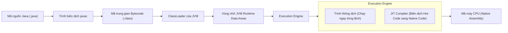
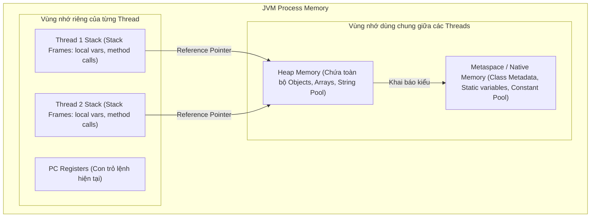
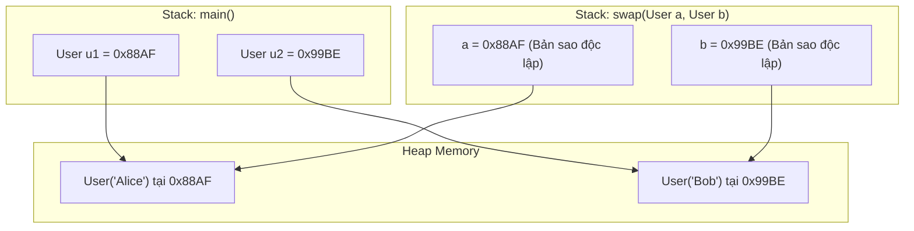
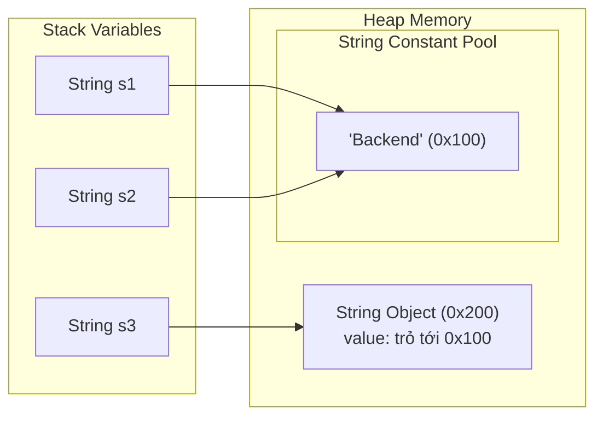
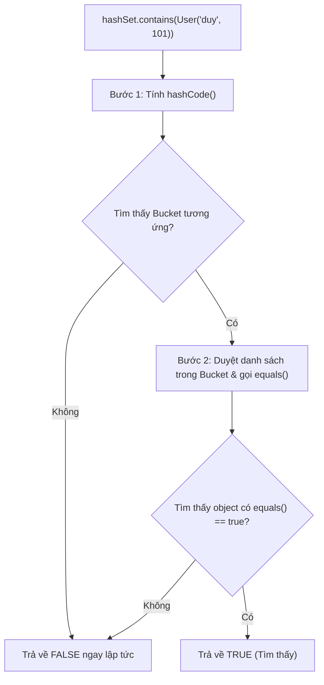
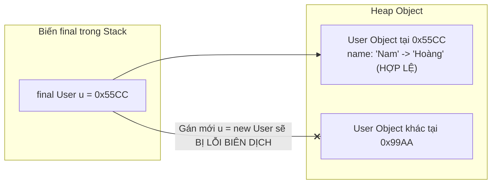

# 1.1. Java Language Fundamentals & Memory Model (Bản chất Ngôn ngữ & Cơ chế Bộ nhớ Java)

> [!IMPORTANT]
> **Nếu bạn chỉ được nhớ một điều duy nhất:** Trong Java, mọi thứ đều được truyền theo giá trị (*Pure Pass-by-Value*) — kể cả đối tượng, nơi thứ được sao chép là bản sao của giá trị tham chiếu (*reference bits*); kết hợp với sự phân chia nghiêm ngặt giữa Stack (biến cục bộ, giải phóng tức thì theo frame) và Heap (đối tượng động do Garbage Collector quản lý), đây là nền móng cốt lõi chi phối toàn bộ hành vi vận hành dữ liệu của Java.

---

## 1. Tư duy Chuyển đổi từ Computer Science sang Java (Mental Model Shift)

Nếu bạn đã có nền tảng về Khoa học Máy tính (hiểu về con trỏ, bộ nhớ Stack/Heap, bảng ký hiệu, và các mô hình biên dịch như C/C++ hay thông dịch như Python/JavaScript), việc học Java không phải là học lại vòng lặp `for` hay câu lệnh `if-else`. Bạn chỉ cần nắm bắt đúng **mô hình thực thi (Execution Model)** và **cơ chế quản lý bộ nhớ** của máy ảo Java (JVM).

### 1.1. Quy trình Biên dịch và Thực thi

Java kết hợp cả hai mô hình **Biên dịch trước (AOT Bytecode compilation)** và **Biên dịch tức thời (Just-In-Time JIT compilation)**:



1. **`javac` không sinh mã máy trực tiếp**: Nó biên dịch mã nguồn Java thành các chỉ thị trừu tượng gọi là **Bytecode** độc lập với kiến trúc phần cứng.
2. **JVM thực thi Bytecode**:
   - Khi ứng dụng mới khởi động, **Interpreter** đọc và thực thi từng lệnh bytecode để ứng dụng phản hồi ngay lập tức.
   - Các đoạn mã được gọi lặp đi lặp lại nhiều lần (*Hot Spots*) sẽ được **JIT Compiler** biên dịch thẳng sang mã máy gốc tối ưu của CPU để đạt tốc độ tương đương C++.

---

## 2. Mô hình Vùng nhớ Runtime (Stack, Heap, Metaspace)

Để làm chủ Java Backend, bạn cần nhìn thấy được bức tranh bố cục bộ nhớ phía sau mỗi dòng mã:



* **Stack Memory (Vùng nhớ ngăn xếp)**:
  - Cấp phát theo từng Thread riêng biệt (Thread-safe tự nhiên).
  - Chứa các **Stack Frame**; mỗi hàm được gọi sẽ đẩy một frame vào stack.
  - Lưu trữ: Các biến nguyên thủy cục bộ (`int`, `boolean`, `double`...) và **địa chỉ tham chiếu (Reference Pointers)** trỏ tới đối tượng trên Heap.
  - Tự động thu hồi ngay khi hàm kết thúc (pop frame khỏi stack), chi phí CPU cực rẻ ($O(1)$).
* **Heap Memory (Vùng nhớ đống)**:
  - Vùng nhớ dùng chung cho toàn bộ ứng dụng (Cần cơ chế đồng bộ khi đa luồng truy cập).
  - Nơi cư ngụ của **tất cả Object** được khởi tạo bằng từ khóa `new`, mảng (`array`), và chuỗi trong **String Constant Pool**.
  - Được quản lý tự động bởi bộ dọn rác (**Garbage Collector - GC**).
* **Metaspace (Trước Java 8 là PermGen)**:
  - Nằm ở bộ nhớ bản địa (Native OS Memory).
  - Lưu thông tin cấu trúc lớp (`Class` metadata), phương thức, trường dữ liệu, và các biến tĩnh (`static`).

---

## 3. Kiểu Dữ Liệu: Primitive vs Reference

Java phân biệt rõ rệt giữa hai nhóm kiểu dữ liệu:

| Đặc tính | Primitive Types (Kiểu nguyên thủy) | Reference Types (Kiểu tham chiếu) |
| :--- | :--- | :--- |
| **Bao gồm** | `byte`, `short`, `int`, `long`, `float`, `double`, `char`, `boolean` (8 kiểu cố định) | `Class`, `Interface`, `Array`, `Record`, `Enum` |
| **Vị trí lưu giá trị** | Lưu trực tiếp giá trị nhị phân ngay trên **Stack Frame** (hoặc inline trong Object Heap) | Lưu địa chỉ trỏ đến Object thực tế nằm trên **Heap** |
| **Giá trị mặc định** | `0`, `0.0`, `false`, `\u0000` | `null` (chưa trỏ vào đâu) |
| **Khả năng gọi method** | Không (chỉ là giá trị thô) | Có (gọi các methods của class) |
| **Chi phí bộ nhớ** | Nhỏ gọn, cố định (VD: `int` luôn là 4 bytes) | Tốn bộ nhớ Object Header (12-16B) + Padding + Payload |

### Cạm bẫy Autoboxing & NullPointerException

Mỗi kiểu nguyên thủy đều có một lớp vỏ bọc tương ứng (**Wrapper Class**): `int` $\leftrightarrow$ `Integer`, `boolean` $\leftrightarrow$ `Boolean`... Trình biên dịch Java tự động chuyển đổi qua lại (**Autoboxing / Unboxing**), nhưng điều này tiềm ẩn lỗi runtime nghiêm trọng:

```java
// Demo cạm bẫy Autoboxing & Unboxing
Integer boxedScore = null; // Reference type có thể mang giá trị null

// Lỗi: Java tự động unbox boxedScore.intValue() -> Ném NullPointerException tại runtime!
int rawScore = boxedScore; 
```

---

## 4. Bản chất Truyền Tham Số: Pure Pass-by-Value

Một trong những câu hỏi phỏng vấn và điểm nhầm lẫn phổ biến nhất là: *"Java truyền tham số theo tham trị hay tham chiếu?"*

> [!NOTE]
> **Khẳng định nguyên lý**: Java **100% là Pass-by-Value (Truyền giá trị)** cho tất cả mọi trường hợp. Không có ngoại lệ.

Khi bạn truyền một biến Object vào một phương thức, giá trị được sao chép chính là **bản sao của địa chỉ tham chiếu (copy of the reference value)**.



### Code Demo chứng minh Pass-by-Value

```java
public class ParameterPassingDemo {
    static class User {
        String name;
        User(String name) { this.name = name; }
    }

    public static void swap(User a, User b) {
        User temp = a;
        a = b;
        b = temp;
        // Chỉ hoán đổi giá trị của 2 biến cục bộ a và b trong frame của swap()
    }

    public static void modifyName(User u) {
        // u đang cầm bản sao địa chỉ trỏ tới Heap Object -> Sửa trực tiếp trường của Object
        u.name = "Charlie"; 
    }

    public static void main(String[] args) {
        User u1 = new User("Alice"); // Giả sử địa chỉ 0x88AF
        User u2 = new User("Bob");   // Giả sử địa chỉ 0x99BE

        swap(u1, u2);
        // u1 vẫn là "Alice", u2 vẫn là "Bob"! swap() không hề có tác dụng ra bên ngoài!
        System.out.println(u1.name); // In ra: Alice

        modifyName(u1);
        // Tên của u1 đã bị biến đổi thành "Charlie"!
        System.out.println(u1.name); // In ra: Charlie
    }
}
```

---

## 5. String, String Pool & Tính Bất Biến (Immutability)

Chuỗi ký tự `String` trong Java là một đối tượng đặc biệt được thiết kế theo cơ chế **Bất biến (Immutable)**: một khi chuỗi đã được tạo ra trên Heap, nội dung bên trong mảng ký tự của nó không bao giờ có thể bị thay đổi.

### 5.1. Vì sao String lại Bất biến?
1. **Bảo mật (Security)**: Tham số nhạy cảm như URL kết nối DB, username/password, socket port đều là String. Nếu String có thể bị thay đổi (mutable), một luồng khác có thể làm sai lệch dữ liệu sau khi vượt qua vòng kiểm tra bảo mật.
2. **An toàn đa luồng (Thread-safety)**: Đối tượng bất biến có thể chia sẻ giữa nhiều luồng cùng lúc mà không bao giờ lo xảy ra Race Condition hay cần dùng khóa đồng bộ (`synchronized`).
3. **Tối ưu Hashing (Hashcode Caching)**: `hashCode` của String chỉ cần tính toán đúng một lần lúc khởi tạo và lưu lại (cache), giúp tăng tốc độ truy vấn cực cao khi làm key trong `HashMap`.
4. **Cho phép String Pool tồn tại**: Nhiều biến tham chiếu có thể cùng trỏ về một ô nhớ chuỗi giống nhau mà không sợ một biến sửa làm hỏng giá trị của các biến khác.

### 5.2. String Pool hoạt động như thế nào?



```java
// s1 và s2 dùng string literal -> JVM kiểm tra String Pool, tái sử dụng cùng 1 instance
String s1 = "Backend";
String s2 = "Backend";

// s3 dùng 'new' -> Bắt buộc cấp phát 1 Object String mới hoàn toàn trên Heap
String s3 = new String("Backend");

System.out.println(s1 == s2); // true (Cùng trỏ về ô nhớ 0x100 trong String Pool)
System.out.println(s1 == s3); // false (s1 trỏ 0x100, s3 trỏ 0x200 trên Heap)
System.out.println(s1.equals(s3)); // true (Nội dung chuỗi ký tự bằng nhau)
```

> [!TIP]
> **Thực tiễn Backend**: Khi cần nối chuỗi liên tục trong vòng lặp, **tuyệt đối không dùng toán tử `+`** (vì mỗi phép cộng sẽ tạo ra một `String` rác mới trên Heap, gây áp lực lớn lên GC). Hãy dùng **`StringBuilder`** (nhanh, không đồng bộ) hoặc **`StringBuffer`** (thread-safe, có `synchronized`).

---

## 6. Phân biệt `==` vs `.equals()` và Hợp đồng equals/hashCode

### 6.1. Khái niệm Cốt lõi
* **Toán tử `==`**: So sánh bit nguyên thủy.
  - Với biến nguyên thủy: So sánh giá trị số (`5 == 5`).
  - Với biến tham chiếu: So sánh **địa chỉ ô nhớ** (xem 2 biến có đang trỏ cùng vào một Object hay không).
* **Phương thức `.equals()`**: So sánh **bản chất nội dung logic** của 2 đối tượng. Mặc định trong class `Object`, `.equals()` hoạt động giống hệt `==`, nên bạn phải ghi đè (`@Override`) để định nghĩa sự bằng nhau về nghiệp vụ.

### 6.2. Hợp đồng Sống còn giữa `equals()` và `hashCode()` (The Contract)

Trong Java, cấu trúc dữ liệu nền tảng như `HashMap` và `HashSet` hoạt động dựa trên mã băm (**Hash Code**). Bạn bắt buộc phải tuân thủ quy tắc sau:

> **Quy tắc bất biến (Contract):**
> 1. Nếu hai đối tượng bằng nhau theo `equals()`: `a.equals(b) == true` $\implies$ Mã băm bắt buộc phải bằng nhau: `a.hashCode() == b.hashCode()`.
> 2. Nếu hai đối tượng có cùng `hashCode()`: Chúng **chưa chắc** đã bằng nhau theo `equals()` (đây là hiện tượng **Hash Collision**).



Nếu bạn ghi đè `equals()` mà **quên ghi đè `hashCode()`**, hai đối tượng có nội dung giống hệt nhau sẽ có hai mã băm khác nhau, bị xếp vào hai thùng (bucket) khác nhau $\to$ `HashSet.contains()` hoặc `HashMap.get()` sẽ trả về `null` dù dữ liệu thực sự đang tồn tại!

---

## 7. Bộ Từ Khóa Thiết Yếu: `static` và `final`

### 7.1. Từ khóa `static`
Thuộc tính hoặc phương thức mang từ khóa `static` sẽ **thuộc về Class** chứ không thuộc về bất kỳ đối tượng (instance) cụ thể nào:
- Được nạp và khởi tạo đúng **một lần duy nhất** khi class được nạp vào JVM (lưu tại Metaspace).
- Được dùng chung cho toàn bộ các instances của class đó.
- Không thể gọi biến hoặc phương thức non-static từ một ngữ cảnh `static` (vì lúc này chưa có `this`).

### 7.2. Từ khóa `final`

| Vị trí đặt `final` | Ý nghĩa Kỹ thuật |
| :--- | :--- |
| **Biến nguyên thủy (`final int x = 10;`)** | Biến trở thành hằng số; không thể thay đổi giá trị sau khi đã gán. |
| **Biến tham chiếu (`final User u = new User();`)** | **Không thể trỏ địa chỉ sang Object khác**; nhưng **nội dung bên trong** của Object vẫn hoàn toàn có thể thay đổi được! |
| **Phương thức (`final void run()`)** | Ngăn cản các lớp con ghi đè (`@Override`) phương thức này. |
| **Lớp (`final class String`)** | Ngăn cản lớp này bị kế thừa (bảo vệ tính bất biến hoặc tính đóng gói). |



---

## 8. Cú pháp Hiện đại cho Kỹ sư Backend (Modern Java)

Khi chuyển sang các phiên bản Java hiện đại (Java 17, Java 21) cho Spring Boot, bạn không cần phải viết những đoạn code Java rườm rà (boilerplate) như thời Java 8:

### 8.1. `record` (Java 16+) - Khởi tạo DTO Bất biến trong 1 Dòng
Trong backend, việc tạo các đối tượng truyền tải dữ liệu (Data Transfer Object - DTO) diễn ra liên tục. `record` tự động sinh ra cho bạn: constructor, private final fields, getter (`field()`), `equals()`, `hashCode()` và `toString()` chuẩn chỉ:

```java
// Thay vì viết cả trang code class với getter, setter, equals, hashCode cồng kềnh:
public record UserResponse(Long id, String username, String email) {
    // Có thể bổ sung compact constructor để validate dữ liệu đầu vào
    public UserResponse {
        if (id == null || id <= 0) {
            throw new IllegalArgumentException("ID người dùng không hợp lệ");
        }
    }
}
```

### 8.2. Suy luận kiểu cục bộ `var` (Java 10+)
Trình biên dịch tự động suy luận kiểu dữ liệu tại thời điểm biên dịch (*Compile-time Type Inference*), giúp mã nguồn gọn gàng mà vẫn đảm bảo an toàn kiểu tĩnh (Static Typing):

```java
// Thay vì: Map<String, List<UserResponse>> userGroupMap = new HashMap<>();
var userGroupMap = new HashMap<String, List<UserResponse>>();
```

---

## 9. Bảng Đối chiếu Nhận thức (Mental Mapping Table)

| Khái niệm | C / C++ | Python / JS | Java Backend Perspective |
| :--- | :--- | :--- | :--- |
| **Con trỏ / Địa chỉ** | `*ptr`, `&val`, con trỏ tường minh | Mọi thứ là reference ẩn | Mọi object đều là reference, nhưng không có phép toán con trỏ (*no pointer arithmetic*). |
| **Cấp phát & Giải phóng** | `malloc/free`, `new/delete`, RAII | Trình dọn rác (GC) ngầm | `new` trên Heap, bộ dọn rác thế hệ (**Generational GC**) tự động thu hồi. |
| **Kiểm tra bằng nhau** | `==` so sánh giá trị hoặc con trỏ | `==` (Python equality), `===` (JS) | `==` so sánh địa chỉ/primitive, `.equals()` so sánh nội dung. |
| **Đối tượng bất biến** | `const`, `constexpr` | Tuples, Frozen dataclass | `String`, `record`, các biến trường `final`. |

---

## 10. Checklist Kiểm tra Kiến thức (Self-Verification)

Trước khi chuyển sang phần tiếp theo (**OOP & Collections Framework**), hãy chắc chắn bạn đã tự trả lời được 5 câu hỏi cốt lõi này mà không cần nhìn tài liệu:

- [ ] Nếu truyền một `List<String>` vào một method rồi gọi `list.add("test")`, bên ngoài có thấy thay đổi không? Nếu gán `list = new ArrayList<>()` thì sao?
- [ ] Tại sao `String s1 = "a"; String s2 = "a";` thì `s1 == s2` trả về `true`, nhưng `new String("a") == new String("a")` lại trả về `false`?
- [ ] Khi nào một biến cục bộ gây ra `NullPointerException`?
- [ ] Khác biệt bản chất giữa `final User u = new User();` và `Immutable User` là gì?
- [ ] Vì sao khi ghi đè `equals()` bắt buộc phải ghi đè `hashCode()`?
