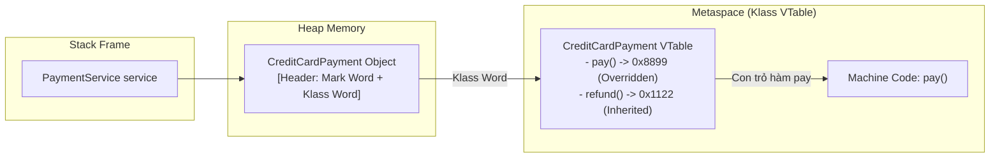
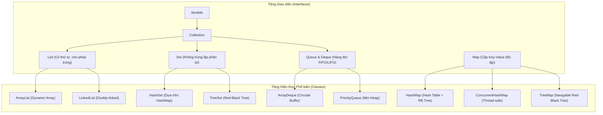
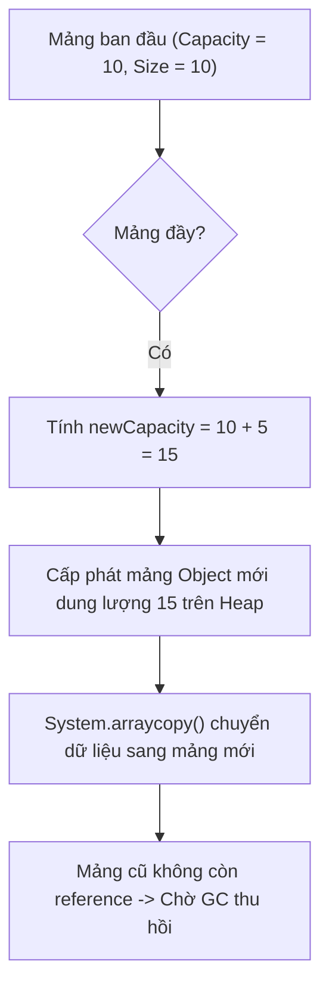
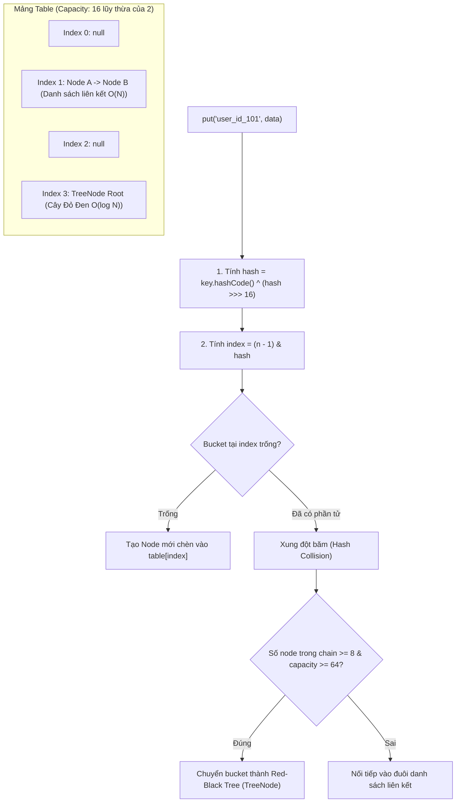
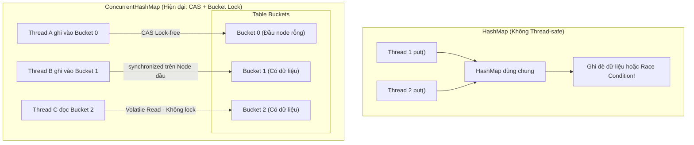

# 1.2. OOP & Java Collections Framework Internals (Bản chất Hướng đối tượng & Cấu trúc Dữ liệu Java)

> [!IMPORTANT]
> **Nếu bạn chỉ được nhớ một điều duy nhất:** Trong kỹ thuật Backend, `HashMap` là cấu trúc dữ liệu cốt lõi nhất — nó kết hợp mảng băm truy cập $O(1)$ với cơ chế chuyển đổi tự động từ Danh sách liên kết sang Cây đỏ đen (Red-Black Tree $O(\log N)$) khi xảy ra xung đột băm lớn; và hầu như trong mọi trường hợp, `ArrayList` luôn đánh bại `LinkedList` trên máy chủ thực tế nhờ tính định vị bộ nhớ đệm CPU (CPU Cache Locality).

---

## 1. Cơ chế Hướng Đối Tượng (OOP) Tầng Sâu trong Java

Là một kỹ sư đã có nền tảng Khoa học Máy tính, bạn đã quen thuộc với 4 trụ cột OOP. Trọng tâm ở đây là cách **JVM hiện thực hóa** tính đa hình, trừu tượng hóa và phân bổ quyền truy cập.

### 1.1. Bảng phân giải phương thức ảo (Virtual Method Table - VTable)
Trong Java, mọi phương thức không phải `static`, `private`, hoặc `final` đều mặc định là **Virtual Method** (phương thức ảo):



Khi bạn gọi `service.pay()`:
1. JVM không liên kết tĩnh tại compile-time mà phát lệnh `invokevirtual`.
2. Tại runtime, CPU đọc con trỏ `Klass Word` trong Object Header để tìm tới **VTable** của lớp thực tế.
3. Trích xuất địa chỉ hàm chính xác trong mảng con trỏ hàm $O(1)$ và nhảy đến thực thi (**Dynamic Dispatch**).

### 1.2. Interface vs Abstract Class: Quyết định Thiết kế Kiến trúc

| Tiêu chí | Abstract Class (Lớp trừu tượng) | Interface (Giao diện) |
| :--- | :--- | :--- |
| **Mối quan hệ** | **IS-A** (Là một): Thể hiện bản chất phân cấp chủng loài | **CAN-DO** (Có khả năng): Định nghĩa hợp đồng hành vi |
| **Số lượng kế thừa** | Đơn kế thừa (`extends` đúng 1 class) | Đa hiện thực (`implements` nhiều interfaces) |
| **Trạng thái (State)** | Chứa được biến instance có trạng thái động (`private int count`) | Chỉ chứa hằng số (`public static final`) |
| **Constructor** | Có constructor (để lớp con gọi `super(...)`) | Không có constructor |
| **Mục đích Backend** | Làm khung xương cơ sở (Skeleton / Template Pattern) | Làm ranh giới tách rời phụ thuộc (Decoupling / DI) |

### 1.3. Mã nguồn Minh họa: Interface hiện đại & Template Method Pattern

```java
// Interface định nghĩa hợp đồng CAN-DO
public interface PaymentGateway {
    // Phương thức trừu tượng thuần túy
    void processPayment(BigDecimal amount);

    // Default method (Java 8+): Cung cấp logic mặc định mà không phá vỡ các class hiện có
    default void logTransaction(String txId) {
        System.out.println("[Audit Log] Giao dịch được ghi nhận: " + txId);
    }

    // Static method (Java 8+): Phương thức tiện ích gắn liền với interface
    static boolean isValidCurrency(String currency) {
        return "VND".equalsIgnoreCase(currency) || "USD".equalsIgnoreCase(currency);
    }
}

// Abstract Class đóng vai trò Template Method (Xương sống xử lý giao dịch)
public abstract class AbstractPaymentProcessor implements PaymentGateway {
    private final String merchantId;

    protected AbstractPaymentProcessor(String merchantId) {
        this.merchantId = merchantId;
    }

    // Template Method: Cố định quy trình xử lý 3 bước nghiêm ngặt
    public final void execute(BigDecimal amount) {
        authenticateMerchant();
        processPayment(amount); // Bước trừu tượng để lớp con tự hiện thực
        sendNotification();
    }

    private void authenticateMerchant() {
        System.out.println("Xác thực Merchant ID: " + merchantId);
    }

    protected abstract void sendNotification();
}
```

### 1.4. Sealed Classes (Java 17+) - Kiểm soát Phân cấp Nghiêm ngặt
Trong kiến trúc Domain-Driven Design (DDD), bạn thường muốn giới hạn số lượng lớp con được phép kế thừa để đảm bảo an toàn logic nghiệp vụ:

```java
// Chỉ cho phép 2 trạng thái thanh toán cụ thể kế thừa
public sealed interface PaymentStatus permits SuccessStatus, FailedStatus {}

public final class SuccessStatus implements PaymentStatus {
    private final String transactionId;
    public SuccessStatus(String transactionId) { this.transactionId = transactionId; }
    public String getTransactionId() { return transactionId; }
}

public final class FailedStatus implements PaymentStatus {
    private final String errorCode;
    public FailedStatus(String errorCode) { this.errorCode = errorCode; }
    public String getErrorCode() { return errorCode; }
}
```

---

## 2. Tổng quan Java Collections Framework (JCF)



### Bảng Độ Phức Tạp Thời Gian (Time Complexity)

| Cấu trúc dữ liệu | Truy cập ngẫu nhiên (Index) | Tìm kiếm (Search) | Chèn đầu / cuối (Insert) | Bộ nhớ phụ trợ (Overhead) | Kịch bản thực tế |
| :--- | :--- | :--- | :--- | :--- | :--- |
| **`ArrayList`** | $O(1)$ | $O(N)$ | Đầu: $O(N)$ / Cuối: $O(1)$ amortized | Rất thấp (Mảng liên tục) | Mặc định 95% trường hợp Backend |
| **`LinkedList`** | $O(N)$ | $O(N)$ | Đầu: $O(1)$ / Cuối: $O(1)$ | Rất cao (+24 bytes / node) | Rất hiếm dùng trong thực tế |
| **`ArrayDeque`** | Không hỗ trợ index | $O(N)$ | Đầu: $O(1)$ / Cuối: $O(1)$ | Rất thấp (Mảng vòng) | Dùng làm Stack hoặc Queue |
| **`HashMap`** | $O(1)$ theo Key | $O(1)$ average / $O(\log N)$ worst | $O(1)$ average | Trung bình | Lưu cache, lookup entity, DTO mapping |
| **`TreeMap`** | $O(\log N)$ theo Key | $O(\log N)$ | $O(\log N)$ | Cao (Cấu trúc con trỏ cây) | Khi cần dữ liệu luôn được sắp xếp |

---

## 3. List Internals: ArrayList vs LinkedList

### 3.1. Cơ chế Tăng trưởng (Dynamic Resizing) của `ArrayList`
Bên trong `ArrayList` là một mảng thuần túy: `transient Object[] elementData`.

* **Dung lượng mặc định (Default Capacity)**: $10$ phần tử khi thêm phần tử đầu tiên.
* **Hệ số tăng trưởng (Growth Factor)**: $1.5$ lần ($50\%$).
* **Công thức dịch bit của JVM**:
  $$\text{newCapacity} = \text{oldCapacity} + (\text{oldCapacity} \gg 1)$$



### 3.2. Vì sao Backend hầu như LUÔN chọn `ArrayList` thay vì `LinkedList`?

Dưới góc nhìn Khoa học Máy tính và Phần cứng (Hardware & CPU Architecture):
1. **CPU Cache Locality**: Mảng của `ArrayList` nằm trên các ô nhớ vật lý liên tục. Khi CPU nạp 1 phần tử, **toàn bộ 1 Cache Line (thường là 64 bytes)** chứa các phần tử lân cận sẽ được nạp cùng lúc vào CPU L1/L2 Cache. Việc duyệt mảng có tỷ lệ **Cache Hit lên tới ~99%**.
2. **Bộ nhớ phân mảnh của `LinkedList`**: Mỗi node là một Object độc lập nằm rải rác khắp nơi trên Heap. Mỗi node tốn thêm **24 bytes overhead** (16 bytes Object Header + 8 bytes con trỏ `next`/`prev`). Khi duyệt danh sách, CPU liên tục bị **Cache Miss** và phải đợi RAM (chậm hơn hàng chục lần so với Cache).

```java
// Code Demo: Hiện tượng Fail-Fast của Iterator
List<String> list = new ArrayList<>(List.of("A", "B", "C"));

// Cạm bẫy: Xóa trực tiếp qua List khi đang duyệt foreach -> ConcurrentModificationException
try {
    for (String item : list) {
        if ("B".equals(item)) {
            list.remove(item); // Lỗi! Làm sai lệch biến nội bộ modCount
        }
    }
} catch (ConcurrentModificationException e) {
    System.out.println("Bắt gặp Fail-Fast: Danh sách bị sửa đổi ngoài tầm kiểm soát của Iterator!");
}

// Cách đúng: Sử dụng Iterator chính thống hoặc removeIf()
list.removeIf("B"::equals); // An toàn và tối ưu
```

---

## 4. HashMap Internals: Trái Tim của Java Backend

`HashMap` là cấu trúc dữ liệu xuất hiện ở khắp mọi tầng của Spring Boot (từ IoC Container Bean Registry, HTTP Request Headers, cho đến Caching).

### 4.1. Kiến trúc Bảng Băm trong Java 8+
Bên trong `HashMap` là một mảng các thùng: `Node<K,V>[] table`.



### 4.2. 3 Cơ chế Kỹ thuật Tinh hoa của `HashMap`

#### 1. Hàm xáo trộn băm (Perturbation Hash Function)
Để tránh các bit cấp cao của mã băm bị bỏ quên khi tính index, Java sử dụng phép toán dịch bit kết hợp XOR:
```java
static final int hash(Object key) {
    int h;
    return (key == null) ? 0 : (h = key.hashCode()) ^ (h >>> 16);
}
```
Lấy 16 bit cao XOR với 16 bit thấp, đảm bảo sự phân bố ngẫu nhiên đồng đều nhất ngay cả khi kích thước mảng nhỏ.

#### 2. Tính Index bằng Bitwise AND thay cho phép chia lấy dư
Thay vì dùng phép chia lấy dư `hash % capacity` (rất tốn CPU cycles), Java bắt buộc `capacity` luôn là **lũy thừa của 2** ($16, 32, 64...$), từ đó áp dụng phép toán bit siêu tốc:
$$\text{index} = (n - 1) \ \& \ \text{hash}$$

#### 3. Cơ chế Treeify (Chuyển đổi sang Cây Đỏ Đen)
- Khi một bucket có độ dài chuỗi va chạm $\ge 8$ và tổng dung lượng bảng $\ge 64$, danh sách liên kết sẽ được tự động chuyển thành **Cây Đỏ Đen (Red-Black Tree)**.
- Khi số phần tử trong cây giảm xuống $\le 6$, cây được giải nén ngược lại thành danh sách liên kết thông thường (**Untreeify**).
- **Mục đích an ninh**: Ngăn chặn các cuộc tấn công từ chối dịch vụ **Hash DoS Attack** (kẻ tấn công cố tình gửi hàng triệu key có cùng mã băm để ép hệ thống chạy ở độ phức tạp tồi tệ $O(N)$).

### 4.3. Code Demo: Tự tạo Bộ nhớ đệm LRU Cache với `LinkedHashMap`

`LinkedHashMap` kế thừa từ `HashMap` nhưng duy trì thêm một danh sách liên kết kép nối qua tất cả các phần tử để lưu thứ tự truy cập:

```java
import java.util.LinkedHashMap;
import java.util.Map;

public class SimpleLruCache<K, V> extends LinkedHashMap<K, V> {
    private final int maxEntries;

    // accessOrder = true: Sắp xếp theo thứ tự vừa mới truy cập (Most Recently Used ở cuối)
    public SimpleLruCache(int maxEntries) {
        super(maxEntries, 0.75f, true);
        this.maxEntries = maxEntries;
    }

    // Khi hàm này trả về true, phần tử cũ nhất (ít dùng nhất) sẽ tự động bị xóa bỏ
    @Override
    protected boolean removeEldestEntry(Map.Entry<K, V> eldest) {
        return size() > maxEntries;
    }

    public static void main(String[] args) {
        var cache = new SimpleLruCache<String, String>(3);
        cache.put("k1", "Data 1");
        cache.put("k2", "Data 2");
        cache.put("k3", "Data 3");

        cache.get("k1"); // Truy cập k1 -> k1 được đưa lên làm phần tử mới nhất
        cache.put("k4", "Data 4"); // Vượt quá maxEntries=3 -> Phần tử cũ nhất (k2) bị trục xuất!

        System.out.println(cache.keySet()); // In ra: [k3, k1, k4] (k2 đã biến mất)
    }
}
```

---

## 5. ConcurrentHashMap: Xử lý Đa luồng trong Backend

Trong môi trường Backend chịu tải hàng ngàn request đồng thời, `HashMap` thông thường không thread-safe và có thể gây lỗi corrupt dữ liệu hoặc lặp vô tận.



* **Trong Java 7**: Sử dụng kỹ thuật chia đoạn khóa (**Segment Locking** - chia bảng làm 16 Segment độc lập).
* **Trong Java 8+**:
  - Khi bucket còn trống: Sử dụng thuật toán không khóa **CAS (Compare-And-Swap)** để ghi dữ liệu trực tiếp, đạt tốc độ song song tuyệt đối.
  - Khi bucket đã có dữ liệu: Chỉ dùng từ khóa `synchronized` trên **Node đầu tiên của chính bucket đó**; các bucket khác vẫn đọc/ghi hoàn toàn độc lập!
  - Thao tác đọc (`get()`): Không sử dụng khóa (Lock-free) nhờ thuộc tính `volatile` trên giá trị node.

---

## 6. Sắp xếp Dữ liệu: Comparable vs Comparator

| Đặc điểm | `Comparable<T>` | `Comparator<T>` |
| :--- | :--- | :--- |
| **Bản chất** | **Thứ tự tự nhiên (Natural Ordering)** của chính đối tượng | **Tiêu chí tùy biến bên ngoài (Custom Ordering)** |
| **Vị trí viết code** | Cài đặt trực tiếp bên trong lớp: `implements Comparable<T>` | Tạo class riêng hoặc dùng Lambda expression bên ngoài |
| **Phương thức** | `public int compareTo(T o)` | `int compare(T o1, T o2)` |
| **Quy ước trả về** | Số âm ($<0$): nhỏ hơn; $0$: bằng nhau; Số dương ($>0$): lớn hơn | Tương tự |

### Code Demo: Áp dụng Lambda và Comparator Chuyên nghiệp

```java
import java.util.*;

public class SortingDemo {
    record Order(long id, double totalAmount, int priority) {}

    public static void main(String[] args) {
        List<Order> orders = new ArrayList<>(List.of(
            new Order(1, 250.0, 2),
            new Order(2, 500.0, 1),
            new Order(3, 250.0, 1)
        ));

        // Sắp xếp đa tầng (Chaining Comparator):
        // 1. Ưu tiên độ khẩn cấp (priority tăng dần)
        // 2. Nếu cùng priority -> Sắp xếp theo tổng tiền (totalAmount giảm dần)
        orders.sort(
            Comparator.comparingInt(Order::priority)
                      .thenComparing(Comparator.comparingDouble(Order::totalAmount).reversed())
        );

        orders.forEach(System.out::println);
    }
}
```

---

## 7. Checklist Tự Kiểm Tra (Self-Verification)

- [ ] Bạn có thể giải thích tại sao `(n - 1) & hash` lại tương đương với `hash % n` khi $n$ là lũy thừa của 2 không?
- [ ] Khi nào `HashMap` chuyển danh sách liên kết thành Red-Black Tree?
- [ ] Tại sao không nên dùng `LinkedList` để làm Queue/List cho các tác vụ cần tốc độ xử lý lớn?
- [ ] Sự khác biệt giữa `ConcurrentHashMap` và `Collections.synchronizedMap()` là gì?
- [ ] Tại sao phương thức `equals()` và `hashCode()` phải luôn đồng nhất khi làm việc với `HashSet`?
