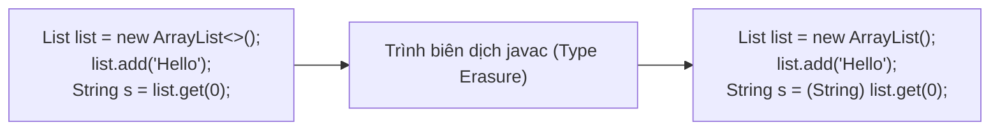
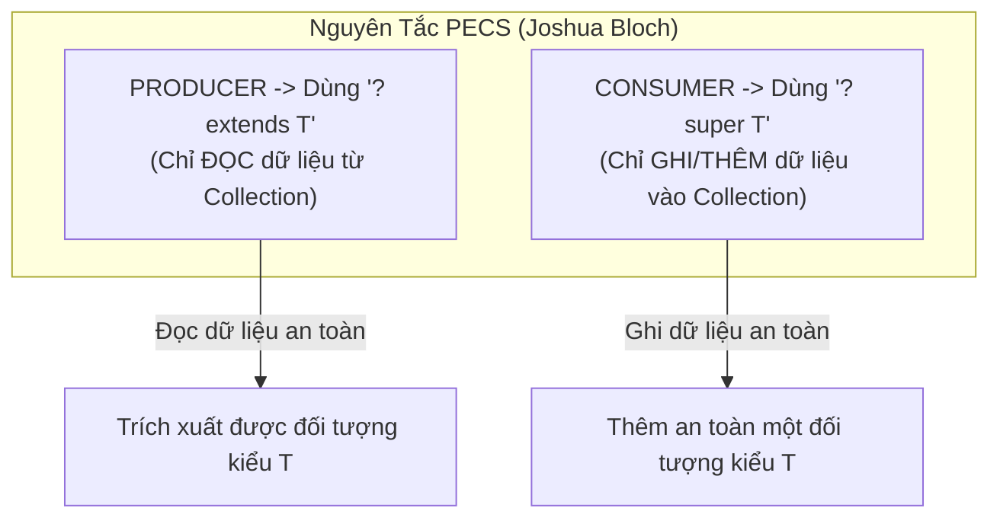
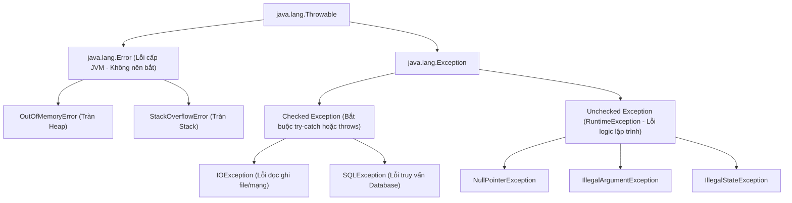
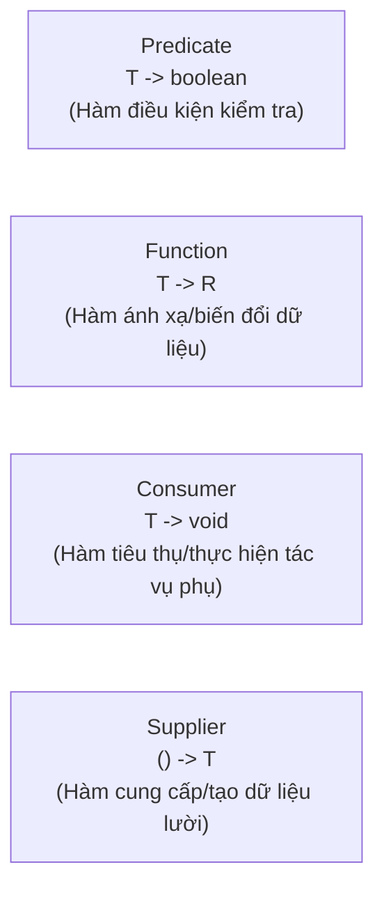
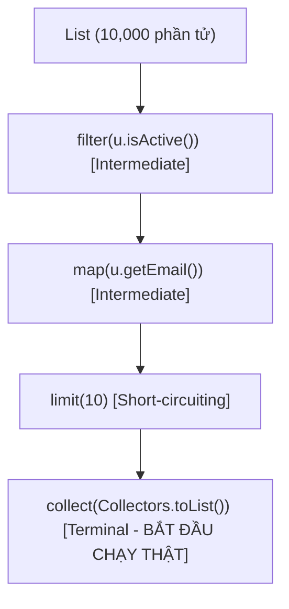

# 1.3. Generics, Exceptions & Stream API (Generics, Xử lý Ngoại lệ & Lập trình Hàm)

> [!IMPORTANT]
> **Nếu bạn chỉ được nhớ một điều duy nhất:** Generics trong Java hoạt động dựa trên cơ chế xóa bỏ kiểu (*Type Erasure*) tại thời điểm biên dịch để đảm bảo tương thích ngược với mã nguồn cũ; nguyên tắc vàng **PECS** (*Producer Extends, Consumer Super*) quyết định khả năng đọc/ghi an toàn của tham số tổng quát; và **Stream API** vận hành theo cơ chế đánh giá lười (*Lazy Evaluation*), chỉ thực sự duyệt qua dữ liệu khi chạm tới một thao tác kết thúc (*Terminal Operation*).

---

## 1. Java Generics Tầng Sâu & Nguyên Tắc PECS

Khác với C++ Templates (sinh ra một lớp nhị phân mới cho từng kiểu cụ thể tại compile-time, gây phình to file binary), Java áp dụng cơ chế **Type Erasure**.

### 1.1. Bản chất của Type Erasure (Xóa bỏ kiểu)

Khi bạn viết mã nguồn có Generic, trình biên dịch `javac` thực hiện 3 nhiệm vụ:
1. **Kiểm tra an toàn kiểu (Type Checking)** tại compile-time.
2. **Xóa bỏ toàn bộ thông tin kiểu tổng quát**: Thay thế `T` bằng kiểu chặn trên của nó (mặc định là `Object`, hoặc `Number` nếu là `<T extends Number>`).
3. **Tự động chèn ép kiểu (Cast Insertion)** tại các điểm lấy dữ liệu ra để đảm bảo runtime tương thích.



> [!NOTE]
> **Hệ quả của Type Erasure**:
> - Không thể khởi tạo instance của kiểu T: `new T()` là bất hợp pháp.
> - Không thể tạo mảng Generic: `new T[10]` bị cấm.
> - Không dùng được kiểu nguyên thủy: `List<int>` không hợp lệ (phải dùng `List<Integer>` vì `int` không kế thừa từ `Object`).
> - Thông tin kiểu bị xóa sạch khi runtime, trừ khi được lưu lại trong metadata của Class Signature (đây là cách Spring Framework đọc được Generic Type qua Reflection).

### 1.2. Ký tự đại diện (Wildcards) & Nguyên tắc PECS

Khi làm việc với các Collection trong kiến trúc Backend, bạn sẽ gặp nghịch lý: Dù `Integer` kế thừa từ `Number`, nhưng `List<Integer>` **KHÔNG HỀ** kế thừa từ `List<Number>`! Để giải quyết tính đa hình cho generic, Java giới thiệu **Wildcards**:

* **Upper-bounded Wildcard (`? extends T`)**: Bất kỳ kiểu nào kế thừa từ `T`.
* **Lower-bounded Wildcard (`? super T`)**: Bất kỳ kiểu nào là lớp cha của `T`.



### 1.3. Code Demo: Áp dụng PECS trong Thực tế

```java
import java.util.ArrayList;
import java.util.List;

public class PecsDemonstration {
    static class Account { double getBalance() { return 100.0; } }
    static class SavingsAccount extends Account {}

    // PRODUCER: Danh sách này "sản xuất" (cung cấp) dữ liệu cho hàm đọc
    public static double calculateTotalBalance(List<? extends Account> accounts) {
        double total = 0;
        for (Account acc : accounts) { // Đọc an toàn kiểu Account
            total += acc.getBalance();
        }
        // accounts.add(new SavingsAccount()); // LỖI BIÊN DỊCH! Không thể ghi vào producer!
        return total;
    }

    // CONSUMER: Danh sách này "tiêu thụ" (nhận) dữ liệu được ghi vào
    public static void populateAccounts(List<? super SavingsAccount> consumerList) {
        consumerList.add(new SavingsAccount()); // Ghi an toàn vì mọi lớp cha đều chứa được SavingsAccount
        // SavingsAccount acc = consumerList.get(0); // LỖI BIÊN DỊCH! Đọc ra chỉ nhận được kiểu Object
    }

    public static void main(String[] args) {
        List<SavingsAccount> savings = List.of(new SavingsAccount(), new SavingsAccount());
        System.out.println("Tổng số dư: " + calculateTotalBalance(savings)); // Chạy hoàn hảo!
    }
}
```

---

## 2. Hệ Thống Xử Lý Ngoại Lệ (Exception Hierarchy)



### 2.1. Checked vs Unchecked Exception trong Kiến trúc Backend
* **Checked Exception**: Đại diện cho các lỗi **có thể dự đoán và có thể phục hồi** (mất kết nối mạng tạm thời, file không tồn tại). Trình biên dịch bắt buộc phải có khối `try-catch` hoặc khai báo `throws`.
* **Unchecked Exception (`RuntimeException`)**: Đại diện cho **lỗi logic của lập trình viên** (truy cập con trỏ null, index vượt mảng, tham số không hợp lệ).
* **Thực tiễn Spring Boot**: Trong các hệ thống hiện đại, người ta hầu như **bọc toàn bộ Checked Exception thành Unchecked Custom Exception** (ví dụ `BusinessException`, `ResourceNotFoundException`) để không làm rườm rà chữ ký method và cho phép `@ControllerAdvice` bắt lỗi tập trung tại tầng Controller.

### 2.2. Try-with-resources & Giao diện AutoCloseable

Trước Java 7, việc đóng kết nối Database hoặc File trong khối `finally` rất cồng kềnh và dễ nuốt mất lỗi gốc (**Exception Masking**). Cú pháp `try-with-resources` tự động giải phóng tài nguyên implements `AutoCloseable`:

```java
import java.io.BufferedReader;
import java.io.FileReader;
import java.io.IOException;

public class ResourceManagementDemo {
    public static String readFirstLine(String path) throws IOException {
        // Tài nguyên khai báo trong ngoặc tròn sẽ được tự động gọi close() khi thoát khỏi khối try
        try (BufferedReader br = new BufferedReader(new FileReader(path))) {
            return br.readLine();
        } // Ngay cả khi xảy ra Exception, br.close() vẫn được đảm bảo thực thi 100%!
    }
}
```

---

## 3. Lập Trình Hàm (Functional Programming) & Stream API

Java 8 mang tư tưởng lập trình hàm vào ngôn ngữ hướng đối tượng thông qua **SAM Interface (Single Abstract Method)**.

### 3.1. 4 Giao Diện Hàm Cốt Lõi (Core Functional Interfaces)



```java
import java.util.function.*;

public class FunctionalInterfaceDemo {
    public static void main(String[] args) {
        // Predicate: Kiểm tra xem user có phải VIP không
        Predicate<Integer> isVip = points -> points > 1000;

        // Function: Chuyển đổi mã người dùng thành chuỗi định dạng
        Function<Long, String> formatUserId = id -> "USER-ID-" + id;

        // Consumer: Ghi log ra console
        Consumer<String> auditLogger = msg -> System.out.println("[AUDIT] " + msg);

        // Supplier: Tạo mã token ngẫu nhiên khi được yêu cầu
        Supplier<String> tokenGenerator = () -> "TOKEN-" + System.currentTimeMillis();

        if (isVip.test(1500)) {
            String formatted = formatUserId.apply(99L);
            auditLogger.accept(formatted + " cấp token: " + tokenGenerator.get());
        }
    }
}
```

### 3.2. Vòng đời Xử lý của Stream API (Lazy Evaluation)

Một Stream bao gồm 3 giai đoạn:
1. **Khởi tạo (Source)**: Từ Collection, Array, hoặc I/O Channel.
2. **Thao tác trung gian (Intermediate Operations - LAZY)**: `filter()`, `map()`, `flatMap()`, `sorted()`. Không xử lý dữ liệu ngay mà chỉ lưu trữ lại kế hoạch thực thi trong một chuỗi liên kết các `Pipeline Stage`.
3. **Thao tác kết thúc (Terminal Operation - EAGER)**: `collect()`, `reduce()`, `count()`, `findFirst()`. Kích hoạt luồng dữ liệu chạy qua toàn bộ pipeline trong **một lượt duyệt duy nhất**.



### 3.3. Code Demo: Xử lý Pipeline phức tạp trong Backend

```java
import java.util.*;
import java.util.stream.Collectors;

public class StreamPipelineDemo {
    record Order(String id, String customerId, double amount, String status) {}

    public static void main(String[] args) {
        List<Order> orders = List.of(
            new Order("O1", "C1", 150.0, "COMPLETED"),
            new Order("O2", "C2", 300.0, "PENDING"),
            new Order("O3", "C1", 200.0, "COMPLETED"),
            new Order("O4", "C3", 450.0, "COMPLETED"),
            new Order("O5", "C2", 50.0, "CANCELLED")
        );

        // Bài toán: Nhóm các đơn hàng COMPLETED theo Customer, tính tổng tiền đã chi của mỗi người
        Map<String, Double> customerSpending = orders.stream()
            // 1. Lọc đơn hoàn thành
            .filter(order -> "COMPLETED".equals(order.status()))
            // 2. Gom nhóm theo customerId và tính tổng amount
            .collect(Collectors.groupingBy(
                Order::customerId,
                Collectors.summingDouble(Order::amount)
            ));

        System.out.println("Thống kê chi tiêu khách hàng: " + customerSpending);
        // Kết quả: {C1=350.0, C3=450.0}
    }
}
```

---

## 4. `Optional<T>`: Tiêu Diệt NullPointerException Chuẩn Phong Cách Java

`Optional<T>` là một đối tượng chứa (Container Object) có thể chứa hoặc không chứa một giá trị non-null.

### 4.1. Quy tắc Thiết kế An toàn với `Optional`
* **CHỈ dùng làm kiểu trả về của method**: Báo hiệu tường minh cho người gọi rằng "Dữ liệu này có thể không tồn tại trong Database".
* **KHÔNG dùng `Optional` làm thuộc tính class (field)** (vì không implements `Serializable`).
* **KHÔNG dùng `Optional` làm tham số đầu vào của method** (hãy nạp chồng method hoặc truyền null trực tiếp).
* **Tránh gọi `.get()` mù quáng**: Luôn dùng `.orElse()`, `.orElseGet()`, hoặc `.orElseThrow()`.

```java
import java.util.Optional;

public class OptionalBestPractice {
    record UserProfile(String email) {}

    public static Optional<UserProfile> findUserById(Long id) {
        if (id == 1L) return Optional.of(new UserProfile("admin@system.com"));
        return Optional.empty(); // Không tìm thấy -> Trả về Empty Optional thay vì null
    }

    public static void main(String[] args) {
        // Cách tiếp cận Functional mượt mà (Chaining)
        String userEmail = findUserById(2L)
            .map(UserProfile::email)
            .map(String::toLowerCase)
            .orElseGet(() -> "default-support@system.com"); // Lazy fallback qua Supplier

        System.out.println("Email liên hệ: " + userEmail);
    }
}
```

---

## 5. Checklist Tự Kiểm Tra (Self-Verification)

- [ ] Bạn có thể giải thích tại sao `List<String>.class` không tồn tại trong Java mà chỉ có `List.class` không?
- [ ] Trong nguyên tắc PECS, khi bạn muốn viết một hàm copy phần tử từ `src` sang `dest`, kiểu dữ liệu của `src` và `dest` nên khai báo như thế nào?
- [ ] Tại sao trong các dự án Spring Boot hiện đại, người ta hầu như không khai báo Checked Exception ở tầng Service?
- [ ] Khác biệt giữa `.orElse(expensiveCall())` và `.orElseGet(() -> expensiveCall())` là gì?
- [ ] Stream API duyệt qua danh sách theo chiều dọc hay chiều ngang khi kết hợp `filter()` và `map()`?
