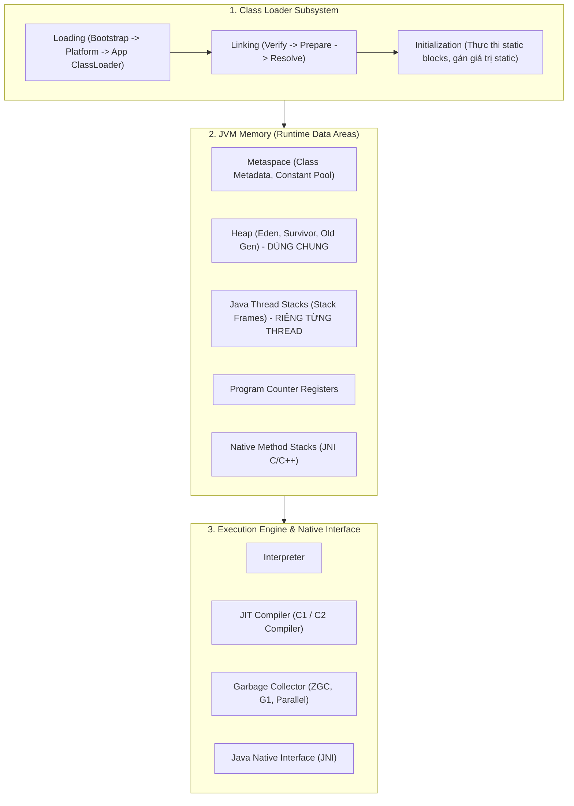
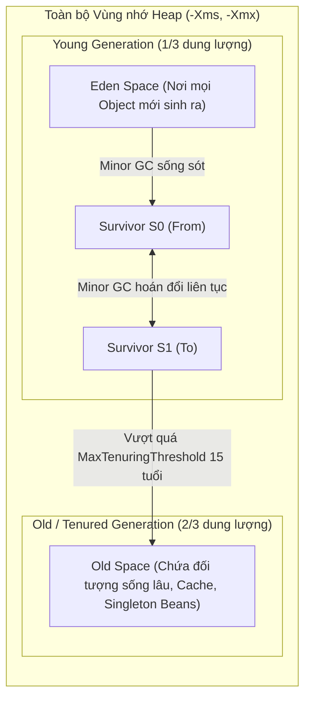
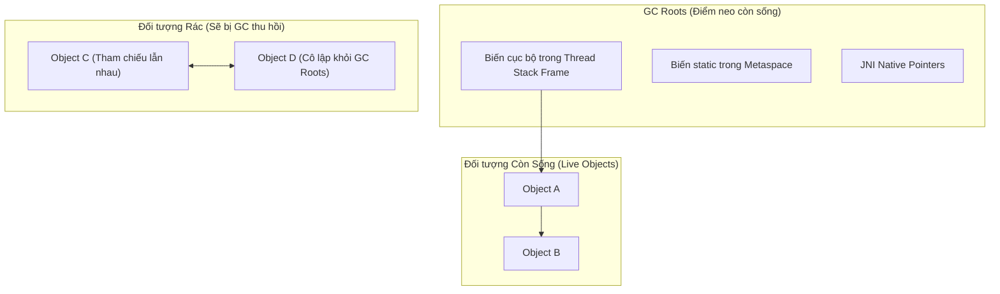

# 2.1. JVM Architecture & Garbage Collection (Kiến trúc Máy ảo Java & Quản lý Bộ nhớ GC)

> [!IMPORTANT]
> **Nếu bạn chỉ được nhớ một điều duy nhất:** Garbage Collection trong JVM vận hành dựa trên **Giả thuyết Thế hệ Yếu (Weak Generational Hypothesis)**: *Đại đa số đối tượng (hơn 95%) đều "chết yểu" ngay sau khi được tạo ra*; vì vậy, việc phân tách Heap thành Young Generation (thu gom siêu tốc bằng thuật toán sao chép Copying) và Old Generation (thu gom định kỳ bằng Mark-Sweep-Compact) chính là chìa khóa giúp các máy chủ Java Backend duy trì thông lượng cao và giảm thiểu thời gian ngưng trệ ứng dụng (*GC Pause Time*).

---

## 1. Kiến Trúc Tổng Thể Máy Ảo Java (JVM Subsystems)

Máy ảo Java (Java Virtual Machine) là một máy tính phần mềm trừu tượng gồm 3 phân hệ chính: **Class Loader Subsystem**, **Runtime Data Areas**, và **Execution Engine**.



### 1.1. Cơ chế ClassLoader và Mô hình Ủy quyền Cha (Parent Delegation Model)
Khi một class cần nạp vào bộ nhớ, JVM sử dụng mô hình cây ủy quyền:
1. **Bootstrap ClassLoader**: Viết bằng C/C++, nạp các lớp nhân của JDK (`java.lang.*`, `java.util.*` từ `rt.jar`/modules).
2. **Platform ClassLoader (trước Java 9 là Extension)**: Nạp các thư viện mở rộng của nền tảng Java.
3. **Application (System) ClassLoader**: Nạp các class từ đường dẫn `CLASSPATH` hoặc thư mục ứng dụng của bạn.

> **Quy tắc Ủy quyền**: Khi nhận yêu cầu nạp class, một ClassLoader luôn **hỏi ClassLoader cha trước**. Chỉ khi cha không tìm thấy class, con mới tự mình quét và nạp. Điều này ngăn chặn kẻ xấu tạo ra các lớp giả mạo như `java.lang.String` để tấn công JVM.

---

## 2. Cấu Trúc Bộ Nhớ Heap Phân Đại (Generational Heap)



### 2.1. Chu trình Vận hành của một Đối tượng (Object Lifecycle)
1. **Khởi sinh**: Đối tượng mới luôn được cấp phát tại **Eden Space**.
2. **Minor GC (Young GC)**:
   - Khi Eden đầy, Minor GC kích hoạt.
   - Thuật toán **Copying**: Quét các Object còn sống sót (được tham chiếu từ GC Roots) trong Eden và Survivor From (S0), sao chép toàn bộ chúng sang Survivor To (S1).
   - Eden và S0 bị dọn sạch $100\%$ chỉ trong vài mili-giây mà không bị phân mảnh bộ nhớ.
   - S0 và S1 hoán đổi vai trò cho nhau.
3. **Thăng hạng (Promotion)**:
   - Mỗi lần sống sót qua một đợt Minor GC, đối tượng được tăng 1 "tuổi" (lưu trong Object Header Mark Word).
   - Khi vượt qua ngưỡng tuổi tối đa (mặc định là `MaxTenuringThreshold = 15`), đối tượng được thăng hạng sang **Old Generation**.
4. **Major GC / Full GC**:
   - Khi Old Generation đầy, đợt thu dọn lớn được kích hoạt. Quá trình này tốn nhiều thời gian hơn và thường làm ngưng trệ toàn bộ các luồng ứng dụng (**Stop-The-World - STW**).

---

## 3. Các Thuật Toán & Bộ Thu Gom Rác (Garbage Collectors) Hiện Đại

### 3.1. Xác định "Rác": Reference Counting vs Reachability Analysis

JVM không dùng phương pháp đếm tham chiếu (Reference Counting) vì nó bị tê liệt trước lỗi **tham chiếu vòng tròn (Circular Reference)** giữa hai đối tượng rác. Thay vào đó, JVM sử dụng **Phân tích Khả năng Tiếp cận (Reachability Analysis)**:



### 3.2. Bảng So Sánh Các Bộ Garbage Collector Phổ Biến

| Garbage Collector | Cơ chế Hoạt động | Độ trễ STW (Pause Time) | Thông lượng (Throughput) | Kịch bản sử dụng thực tế |
| :--- | :--- | :--- | :--- | :--- |
| **Serial GC** | Đơn luồng | Rất cao | Thấp | Ứng dụng nhúng, CLI nhỏ, micro-containers < 512MB RAM |
| **Parallel GC** | Đa luồng thu gom song song | Cao (vài trăm ms) | Cực cao (Maximized) | Tác vụ Batch Processing, Data Crunching không quan tâm độ trễ |
| **G1 GC (Garbage-First)** | Chia Heap thành hàng ngàn Regions (1MB-32MB) | Thấp (< 200ms) | Rất tốt | **Bộ GC mặc định từ Java 9+**, chuẩn cho hầu hết Backend REST API |
| **ZGC (Z Garbage Collector)** | Tô màu con trỏ (Colored Pointers) & Load Barriers | Siêu thấp (< 1ms bất kể Heap TB) | Tốt | Hệ thống giao dịch chứng khoán, Streaming, Heap siêu lớn (16GB - 16TB) |

---

## 4. Rò Rỉ Bộ Nhớ trong Java (Memory Leaks) & Cách Điều Tra

Mặc dù có GC tự động, Java Backend vẫn thường xuyên bị **Memory Leak** (đối tượng không còn dùng trong nghiệp vụ nhưng vẫn vô tình bị giữ tham chiếu từ một GC Root).

### 4.1. 3 Thủ phạm Gây Rò rỉ Bộ nhớ Phổ biến Nhất
1. **Bộ sưu tập Static không giới hạn kích thước**: Khai báo `static List` hoặc `static Map` và `put()` dữ liệu liên tục mà không có cơ chế eviction hoặc TTL.
2. **Rò rỉ `ThreadLocal` trong môi trường Thread Pool (Tomcat)**: Các Thread của Tomcat được tái sử dụng liên tục. Nếu bạn gán dữ liệu vào `ThreadLocal` mà không gọi `.remove()` trong khối `finally`, dữ liệu đó sẽ tồn tại vĩnh viễn và phình to sau mỗi HTTP request.
3. **Không đóng tài nguyên I/O hoặc Listener**: Các kết nối Database, WebSocket session không được đóng dẫn đến rò rỉ bộ nhớ bản địa (Off-heap memory).

```java
// Code Demo: Phòng chống rò rỉ ThreadLocal trong Spring Boot Filter
public class UserContextFilter {
    private static final ThreadLocal<String> CURRENT_USER = new ThreadLocal<>();

    public void doFilter(HttpRequest request) {
        try {
            String userId = request.getHeader("X-User-Id");
            CURRENT_USER.set(userId);
            // Xử lý chuỗi nghiệp vụ...
        } finally {
            // BẮT BUỘC: Xóa sạch dữ liệu khi Thread quay về Thread Pool
            CURRENT_USER.remove(); 
        }
    }
}
```

### 4.2. Công Cụ & Quy Trình Khám Phục Hiện Trường (Heap Dump Analysis)

Khi máy chủ bị crash vì lỗi `java.lang.OutOfMemoryError: Java heap space`:

```bash
# 1. Cấu hình JVM tự động chụp ảnh bộ nhớ khi gặp sự cố OOM
java -XX:+HeapDumpOnOutOfMemoryError -XX:HeapDumpPath=/var/log/heapdump.hprof -jar app.jar

# 2. Hoặc chủ động xuất Heap Dump từ một tiến trình PID đang chạy bằng công cụ jcmd
jcmd <PID> GC.heap_dump /tmp/live_dump.hprof

# 3. Phân tích file .hprof bằng công cụ Eclipse Memory Analyzer (MAT) hoặc IntelliJ Profiler:
# - Tìm kiếm 'Dominator Tree' (Đối tượng nào đang chiếm > 80% dung lượng Heap).
# - Kiểm tra đường dẫn 'Shortest Path to GC Roots' để xem ai đang giữ tham chiếu đối tượng rác đó.
```

---

## 5. Tham Số JVM Tuning Chuẩn Sản Xuất (Production JVM Flags)

```bash
java -server \
  # Khởi tạo kích thước Heap tối thiểu và tối đa bằng nhau để tránh chi phí OS cấp phát lại liên tục
  -Xms4g -Xmx4g \
  # Kích thước Stack cho mỗi Thread (mặc định 1MB là quá đủ cho hầu hết ứng dụng)
  -Xss1m \
  # Kích thước Metaspace
  -XX:MetaspaceSize=256m -XX:MaxMetaspaceSize=512m \
  # Kích hoạt bộ thu gom G1 GC hiện đại
  -XX:+UseG1GC \
  # Đặt mục tiêu thời gian ngưng trệ tối đa cho G1 (JVM sẽ tự điều tiết vùng nhớ để đạt mục tiêu này)
  -XX:MaxGCPauseMillis=200 \
  # Ghi log chi tiết của GC để giám sát sức khỏe hệ thống
  -Xlog:gc*,gc+phases=debug:file=/var/log/gc.log:time,uptime,pid:filecount=5,filesize=50m \
  -jar backend-service.jar
```

---

## 6. Checklist Tự Kiểm Tra (Self-Verification)

- [ ] Phân biệt sự khác nhau giữa Minor GC, Major GC và Full GC?
- [ ] Tại sao JVM không dùng Reference Counting để dọn rác?
- [ ] Vì sao việc không gọi `ThreadLocal.remove()` trong máy chủ Tomcat lại dẫn đến rò rỉ bộ nhớ nghiêm trọng?
- [ ] Tại sao thông số `-Xms` và `-Xmx` trên Production thường được cấu hình bằng nhau?
- [ ] G1 GC chia bộ nhớ Heap thành các vùng (Regions) có ưu điểm gì vượt trội so với thế hệ GC cũ?
