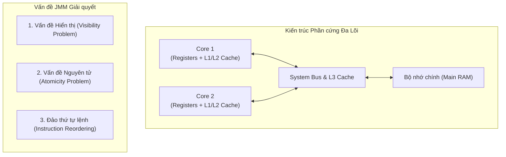
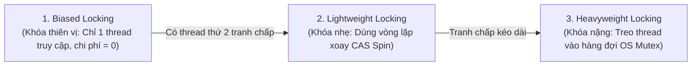
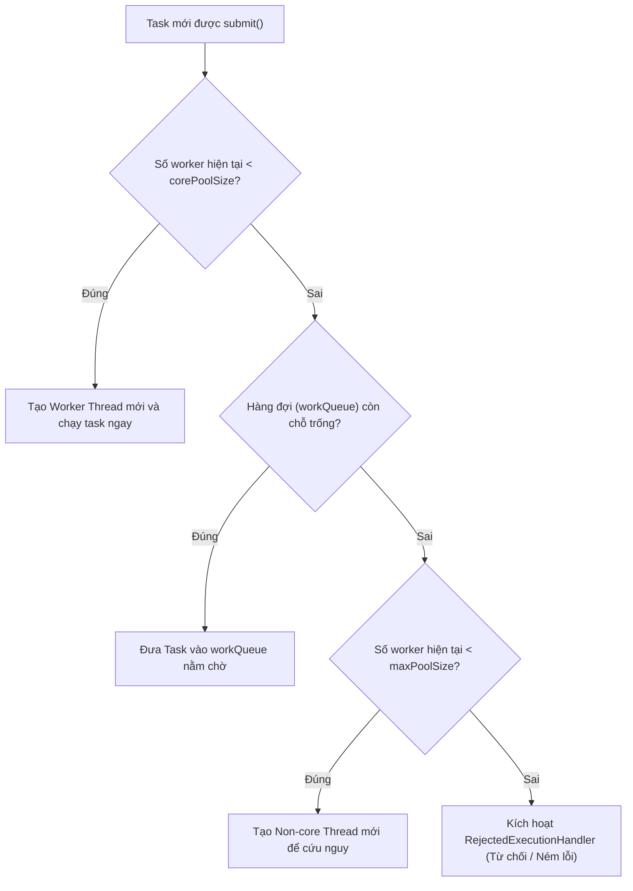
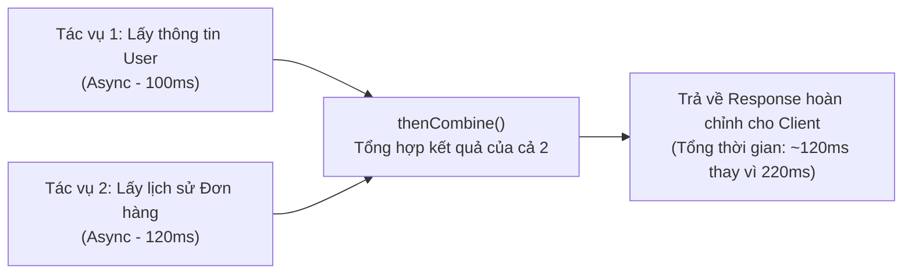
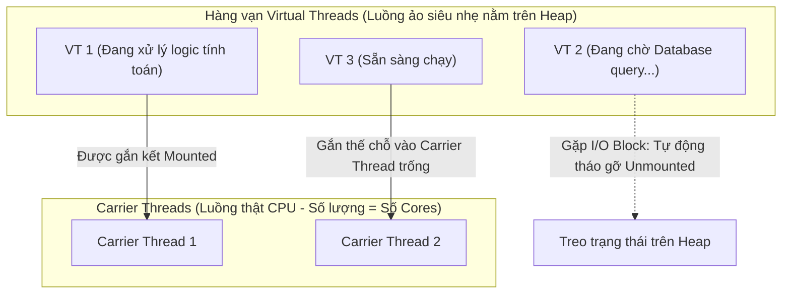

# 2.2. Java Concurrency & Virtual Threads (Lập trình Đa luồng & Luồng Ảo Java 21)

> [!IMPORTANT]
> **Nếu bạn chỉ được nhớ một điều duy nhất:** Trong mô hình đa luồng truyền thống, mỗi Thread của Java là một luồng cấp hệ điều hành (1:1 OS Thread) với chi phí bộ nhớ lớn (1MB stack) và chi phí chuyển ngữ cảnh (Context Switch) đắt đỏ; sự xuất hiện của **Virtual Threads (Project Loom trong Java 21)** đã thay đổi hoàn toàn cục diện bằng mô hình $M:N$, cho phép hàng triệu luồng ảo siêu nhẹ cùng tồn tại trên một vài luồng thực, tự động tách luồng (unmount) khi gặp tác vụ chờ I/O mà không làm nghẽn CPU.

---

## 1. Mô Hình Bộ Nhớ Java (Java Memory Model - JMM)

Khi viết ứng dụng Backend xử lý hàng nghìn request đồng thời, bạn phải đối mặt với kiến trúc phần cứng đa lõi (Multi-core CPU) nơi mỗi lõi có bộ nhớ đệm riêng (L1/L2/L3 Cache) và có thể tự ý sắp xếp lại thứ tự thực thi lệnh (**Instruction Reordering**).



### 1.1. Từ khóa `volatile` và Mối quan hệ Happens-Before
* **Bản chất của `volatile`**: Buộc CPU đọc và ghi biến trực tiếp vào **Bộ nhớ chính (Main RAM)** thay vì lưu đệm trong CPU Cache của từng lõi, đồng thời chèn các rào chắn bộ nhớ (**Memory Barriers**) để cấm trình biên dịch đảo thứ tự lệnh.
* **Cạm bẫy của `volatile`**: `volatile` chỉ đảm bảo tính **Hiển thị (Visibility)**, tuyệt đối **KHÔNG đảm bảo tính Nguyên tử (Atomicity)** đối với các thao tác kép như `count++` (vốn gồm 3 lệnh máy tính độc lập: Read $\to$ Modify $\to$ Write).

```java
// Code Demo: volatile vs AtomicInteger
public class ConcurrencyPrimacyDemo {
    // volatile KHÔNG đủ an toàn cho biến đếm tăng dần!
    private volatile int volatileCounter = 0;

    // AtomicInteger sử dụng chỉ thị CPU cấp thấp CAS (Compare-And-Swap) -> An toàn 100%
    private final AtomicInteger atomicCounter = new AtomicInteger(0);

    public void increment() {
        volatileCounter++; // DỄ BỊ RACE CONDITION (Mất mát dữ liệu khi đa luồng)
        atomicCounter.incrementAndGet(); // THREAD-SAFE (Lock-free)
    }
}
```

---

## 2. Cơ Chế Đồng Bộ & Khóa (Synchronization & Locks)

### 2.1. Bản chất của `synchronized` & Nâng cấp Khóa (Lock Escalation)
Từ khóa `synchronized` trong Java gắn liền với khái niệm **Monitor Lock** được nhúng trong phần đầu (Header Mark Word) của mọi Object:



### 2.2. `ReentrantLock`: Sự Linh Hoạt Vượt Trội so với `synchronized`

`ReentrantLock` cung cấp các tính năng cao cấp không thể có ở `synchronized`:
- **Khả năng thử khóa với Timeout (`tryLock`)**: Ngăn chặn Deadlock vĩnh viễn.
- **Fairness Policy (Chính sách công bằng)**: Thread nào đến trước được cấp khóa trước (FIFO), chống hiện tượng bỏ đói luồng (Thread Starvation).
- **Hỗ trợ ngắt quãng (`lockInterruptibly`)**: Cho phép hủy bỏ việc chờ đợi khóa khi luồng bị cancel.

```java
import java.util.concurrent.TimeUnit;
import java.util.concurrent.locks.ReentrantLock;

public class LockBestPractice {
    private final ReentrantLock lock = new ReentrantLock(true); // true = Fair Lock

    public void executeCriticalSection() {
        try {
            // Thử lấy khóa trong vòng 2 giây, nếu không lấy được thì bỏ qua (Tránh Deadlock)
            if (lock.tryLock(2, TimeUnit.SECONDS)) {
                try {
                    // Thao tác chỉnh sửa tài nguyên dùng chung an toàn ở đây...
                    System.out.println("Đã sở hữu khóa thành công trên Thread: " + Thread.currentThread().getName());
                } finally {
                    // BẮT BUỘC đặt unlock() trong finally để không bao giờ bị khóa chết tài nguyên
                    lock.unlock();
                }
            } else {
                System.out.println("Hết thời gian chờ khóa (Timeout), hủy thao tác an toàn!");
            }
        } catch (InterruptedException e) {
            Thread.currentThread().interrupt(); // Khôi phục cờ ngắt
        }
    }
}
```

---

## 3. Quản Lý Luồng với Executor Framework & ThreadPoolExecutor

Tạo một `new Thread()` trong Java rất đắt đỏ: Hệ điều hành phải cấp phát ngay **1MB Stack**, thực hiện hàng loạt syscall và tốn tài nguyên quản lý. Do đó, Backend luôn dùng **Thread Pool** để tái sử dụng luồng.



### 3.1. 7 Tham Số Sống Còn của `ThreadPoolExecutor`

```java
ThreadPoolExecutor executor = new ThreadPoolExecutor(
    10,                       // 1. corePoolSize: Số luồng duy trì thường trực
    50,                       // 2. maximumPoolSize: Số luồng tối đa khi quá tải
    60L, TimeUnit.SECONDS,    // 3 & 4. keepAliveTime & Unit: Thời gian hủy non-core thread rảnh
    new ArrayBlockingQueue<>(500), // 5. workQueue: Hàng đợi có giới hạn (tránh tràn RAM)
    new CustomThreadFactory(),     // 6. threadFactory: Tự đặt tên luồng để dễ debug log
    new ThreadPoolExecutor.CallerRunsPolicy() // 7. handler: Chiến lược khi quá tải
);
```

> [!WARNING]
> **Quy tắc Vàng cho Backend**: **TUYỆT ĐỐI KHÔNG** dùng `Executors.newCachedThreadPool()` (có thể sinh vô hạn thread $\to$ làm sập máy chủ do OOM) hoặc `Executors.newFixedThreadPool()` (dùng `LinkedBlockingQueue` vô hạn $\to$ tích tụ hàng triệu task làm tràn Heap). Luôn tự khởi tạo `ThreadPoolExecutor` với hàng đợi có giới hạn (**Bounded Queue**)!

---

## 4. Lập Trình Bất Đồng Bộ Hiện Đại với `CompletableFuture`

`CompletableFuture` đại diện cho một tác vụ chạy nền có thể kích hoạt chuỗi xử lý bất đồng bộ (**Non-blocking Chaining**) mà không cần block luồng gọi bằng `future.get()`:



### Code Demo: Ghép Nối API Song Song

```java
import java.util.concurrent.CompletableFuture;
import java.util.concurrent.ExecutorService;
import java.util.concurrent.Executors;

public class CompletableFutureAsyncDemo {
    private static final ExecutorService customPool = Executors.newFixedThreadPool(10);

    public static void main(String[] args) {
        // Gọi song song 2 dịch vụ độc lập
        CompletableFuture<String> fetchUser = CompletableFuture.supplyAsync(() -> {
            simulateLatency(100);
            return "User(Duy, VIP)";
        }, customPool);

        CompletableFuture<String> fetchOrders = CompletableFuture.supplyAsync(() -> {
            simulateLatency(120);
            return "Orders([#101, #102])";
        }, customPool);

        // Kết hợp kết quả khi cả 2 cùng hoàn thành mà không hề chặn luồng chính
        CompletableFuture<String> aggregatedResponse = fetchUser
            .thenCombine(fetchOrders, (user, orders) -> user + " -> " + orders)
            .exceptionally(ex -> "Lỗi lấy dữ liệu fallback: " + ex.getMessage());

        System.out.println("Kết quả tổng hợp: " + aggregatedResponse.join());
        customPool.shutdown();
    }

    private static void simulateLatency(long ms) {
        try { Thread.sleep(ms); } catch (InterruptedException ignored) {}
    }
}
```

---

## 5. Cuộc Cách Mạng Luồng Ảo (Virtual Threads - Java 21)

### 5.1. Giới Hạn Của Luồng Hệ Điều Hành (Platform Threads)
Trong các máy chủ Web truyền thống như Spring MVC với Tomcat, mô hình áp dụng là **Thread-per-request**:
- Mỗi HTTP request chiếm dụng riêng 1 Platform Thread từ đầu đến cuối.
- Nếu ứng dụng gọi Database mất $50\text{ms}$ hay gọi bên thứ ba mất $200\text{ms}$, luồng này **ngủ (idle) và chiếm dụng 1MB RAM** mà không làm bất cứ việc gì!
- Khi có $10,000$ kết nối đồng thời, hệ thống cần $10,000$ luồng $\to$ tốn $10\text{GB}$ RAM chỉ cho Stack và làm tê liệt bộ điều phối của Kernel CPU.

### 5.2. Cách Virtual Threads Giải Cứu I/O



1. **Siêu nhẹ**: Một Virtual Thread chỉ tốn vài **Kilobytes bộ nhớ Heap** (thay vì 1MB bộ nhớ Stack vật lý).
2. **Cơ chế Unmount tự động**: Khi mã Java của bạn gọi một hàm chặn I/O (như `socket.read()`, `Thread.sleep()`, JDBC query), JVM sẽ tự động tháo rời Virtual Thread khỏi Carrier Thread thực sự và cất trạng thái ngữ cảnh vào Heap. Carrier Thread ngay lập tức rảnh tay để đón nhận một Virtual Thread khác!
3. **Mã nguồn đồng bộ, hiệu năng bất đồng bộ**: Bạn không cần phải viết code reactive phức tạp (`Flux`/`Mono` của WebFlux); bạn cứ viết code tuần tự, đơn giản truyền thống mà vẫn đạt throughput tương đương Node.js hay Go Goroutines.

### 5.3. Code Demo: So Sánh 10,000 Tác Vụ Đồng Thời

```java
import java.time.Duration;
import java.time.Instant;
import java.util.concurrent.Executors;

public class VirtualThreadPerformanceDemo {
    public static void main(String[] args) {
        int numberOfTasks = 10_000;

        Instant start = Instant.now();

        // Khởi tạo Executor chạy trên Virtual Threads hoàn toàn mới của Java 21
        try (var executor = Executors.newVirtualThreadPerTaskExecutor()) {
            for (int i = 0; i < numberOfTasks; i++) {
                final int taskId = i;
                executor.submit(() -> {
                    // Giả lập tác vụ I/O mất 1 giây (như truy vấn DB hoặc gọi API)
                    Thread.sleep(Duration.ofSeconds(1));
                    return taskId;
                });
            }
        } // Khối try-with-resources sẽ tự động đợi toàn bộ 10,000 luồng ảo hoàn tất

        Instant finish = Instant.now();
        long timeElapsed = Duration.between(start, finish).toMillis();

        System.out.println("Hoàn tất 10,000 tác vụ I/O trong: " + timeElapsed + " ms!");
        // Kết quả: Chỉ mất ~1,200 ms (tương đương 1.2 giây) trên máy tính thông thường!
    }
}
```

---

## 6. Checklist Tự Kiểm Tra (Self-Verification)

- [ ] Tại sao biến khai báo `volatile` lại không đảm bảo tính toàn vẹn khi thực hiện phép toán `count++`?
- [ ] Vấn đề "Lock Escalation" trong JVM diễn ra qua những giai đoạn nào?
- [ ] Khi cấu hình `ThreadPoolExecutor`, thứ tự ưu tiên xử lý giữa `corePoolSize`, `workQueue`, và `maximumPoolSize` diễn ra như thế nào?
- [ ] Virtual Threads giải quyết điểm nghẽn I/O khác biệt gì so với Platform Threads truyền thống?
- [ ] Khi nào KHÔNG NÊN dùng Virtual Threads (Gợi ý: Tác vụ nặng tính toán CPU-bound)?
