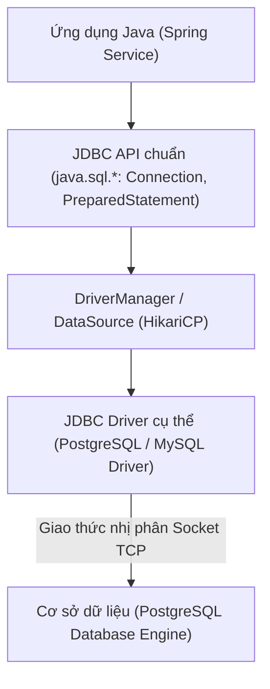
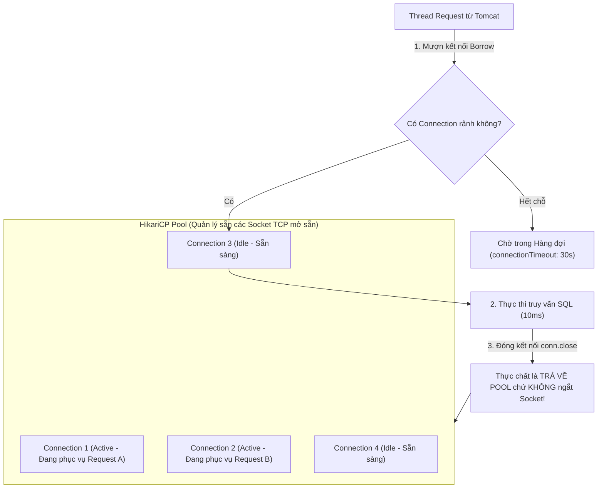

# 3.1. Build Tools (Maven) & Database Connectivity (JDBC / HikariCP)

> [!IMPORTANT]
> **Nếu bạn chỉ được nhớ một điều duy nhất:** Khởi tạo một kết nối cơ sở dữ liệu vật lý (Physical TCP Connection) là một trong những thao tác tốn kém tài nguyên nhất trong Backend (bắt tay 3 bước TCP, bảo mật SSL/TLS, xác thực mật khẩu, cấp phát bộ nhớ session trên DB); do đó, **Connection Pool (như HikariCP)** là thành phần bắt buộc phải có để duy trì sẵn các kết nối "sống", cho phép các luồng ứng dụng mượn và trả kết nối với độ trễ tính bằng micro-giây.

---

## 1. Công Cụ Đóng Gói & Quản Lý Phụ Thuộc (Apache Maven)

Maven không chỉ là công cụ tải thư viện `.jar`; nó là một hệ thống tự động hóa toàn bộ vòng đời xây dựng ứng dụng phần mềm (**Build Lifecycle**).

```mermaid
flowchart LR
    Validate["validate (Kiểm tra cấu trúc dự án)"]
    --> Compile["compile (Biên dịch mã nguồn src/main/java)"]
    --> Test["test (Chạy Unit Tests với Surefire)"]
    --> Package["package (Đóng gói mã nhị phân thành JAR/WAR)"]
    --> Verify["verify (Chạy Integration Tests)"]
    --> Install["install (Lưu file JAR vào Local Repository ~/.m2)"]
    --> Deploy["deploy (Đẩy file JAR lên Remote Nexus/Artifactory)"]
```



### 1.1. Phạm Vi Phụ Thuộc (Dependency Scopes)

Trong file `pom.xml`, thuộc tính `<scope>` quyết định thời điểm thư viện được đưa vào `CLASSPATH`:

| Dependency Scope | Lúc Biên dịch (Compile) | Lúc Chạy Test (Test) | Lúc Triển khai Sản xuất (Runtime) | Ví dụ Thực tế |
| :--- | :--- | :--- | :--- | :--- |
| **`compile` (Mặc định)** | Có | Có | Có (Được đóng gói vào file JAR cuối) | `spring-boot-starter-web`, `jackson` |
| **`provided`** | Có | Có | **Không** (Môi trường máy chủ đã có sẵn) | `lombok`, `servlet-api` |
| **`runtime`** | Không | Có | Có | `postgresql`, `mysql-connector-j` (Driver) |
| **`test`** | Không | Có | **Không** | `junit-jupiter`, `mockito-core` |

---

## 2. Java Database Connectivity (JDBC) Tầng Thấp

Mọi Framework ORM cao cấp (kể cả Hibernate hay Spring Data JPA) cuối cùng đều phải dịch mã truy vấn thành các lời gọi **JDBC thuần túy** để giao tiếp với hệ quản trị cơ sở dữ liệu.



### 2.1. Bản chất Kỹ thuật của `PreparedStatement` & Chống SQL Injection

Tại sao `PreparedStatement` lại an toàn tuyệt đối trước lỗi **SQL Injection** trong khi `Statement` thông thường thì không?

```java
// NGUY HIỂM: Statement thông thường nối chuỗi trực tiếp (Dễ bị SQL Injection)
String sql = "SELECT * FROM users WHERE username = '" + userInput + "'";
// Nếu userInput = "' OR '1'='1" -> Kẻ tấn công vượt qua xác thực!

// AN TOÀN TUYỆT ĐỐI: PreparedStatement dùng giao thức nhị phân với tham số vị trí (?)
String safeSql = "SELECT * FROM users WHERE username = ? AND status = ?";
try (PreparedStatement pstmt = conn.prepareStatement(safeSql)) {
    pstmt.setString(1, userInput); // Gửi tham số tách rời hoàn toàn khỏi cây cú pháp SQL
    pstmt.setString(2, "ACTIVE");
    ResultSet rs = pstmt.executeQuery();
}
```

* **Dưới góc nhìn Cơ sở dữ liệu (Database Engine Internals)**:
  1. Khi nhận câu lệnh chứa dấu hỏi chấm `?`, Database tiến hành phân tích cú pháp (**SQL Parsing**), tối ưu hóa (**Query Optimizer**) và lập kế hoạch thực thi (**Execution Plan**) trước. Cây cú pháp của câu lệnh đã được đóng băng.
  2. Dữ liệu tham số truyền vào sau đó qua `pstmt.setString()` chỉ được coi là **giá trị dữ liệu thuần túy (Raw Literal Value)**, không bao giờ có thể bị Database hiểu nhầm thành các lệnh điều khiển như `OR`, `DROP TABLE`, hay `UNION`.

---

## 3. Kiến Trúc Bộ Đệm Kết Nối HikariCP (Connection Pooling)

Trong Spring Boot 2 và 3, **HikariCP** là thư viện Connection Pool mặc định nhờ tốc độ và hiệu năng dẫn đầu thế giới.



### 3.1. Tại sao HikariCP lại siêu nhanh?
1. **Thay thế `ArrayList` bằng `FastList`**: Loại bỏ thao tác kiểm tra chỉ mục bounds-checking trùng lặp và hỗ trợ tìm kiếm xóa phần tử từ cuối danh sách (tối ưu cho hành vi đóng kết nối theo thứ tự LIFO).
2. **Cấu trúc dữ liệu `ConcurrentBag`**: Thuật toán không khóa (Lock-free design), áp dụng kỹ thuật Thread-local caching giúp các luồng mượn kết nối mà không bị tranh chấp khóa (Lock Contention).
3. **Sinh mã Bytecode trực tiếp**: Tinh gọn tối đa mã trung gian, giúp các lời gọi hàm đủ ngắn để JIT Compiler tự động **Method Inlining**.

### 3.2. Cấu hình Chuẩn HikariCP cho Dự Án Backend

```properties
# Số lượng kết nối tối đa trong Pool (Khuyên dùng: CPU Cores * 2 + Effective Spindle Count)
spring.datasource.hikari.maximum-pool-size=10

# Số kết nối nhàn rỗi tối thiểu luôn duy trì
spring.datasource.hikari.minimum-idle=5

# Thời gian tối đa một thread chờ mượn kết nối trước khi ném lỗi Exception (milliseconds)
spring.datasource.hikari.connection-timeout=30000

# Thời gian sống tối đa của một kết nối vật lý (tránh kết nối bị stale do tường lửa ngắt)
spring.datasource.hikari.max-lifetime=1800000

# Cảnh báo rò rỉ kết nối nếu một tác vụ giữ kết nối quá 2 giây mà không trả lại pool
spring.datasource.hikari.leak-detection-threshold=2000
```

---

## 4. Quản Lý Giao Dịch Tầng Thấp (JDBC Transaction Management)

Một giao dịch (**Transaction**) đảm bảo tính chất **ACID** (Nguyên tử, Nhất quán, Cô lập, Bền vững). Ở tầng JDBC, nó được điều khiển thủ công như sau:

```java
import java.sql.Connection;
import java.sql.PreparedStatement;
import java.sql.SQLException;
import javax.sql.DataSource;

public class RawJdbcTransactionService {
    private final DataSource dataSource;

    public RawJdbcTransactionService(DataSource dataSource) {
        this.dataSource = dataSource;
    }

    public void transferMoney(long fromAccountId, long toAccountId, double amount) throws SQLException {
        try (Connection conn = dataSource.getConnection()) {
            // 1. Tắt chế độ tự động commit (Auto-commit = false) -> Bắt đầu Transaction
            conn.setAutoCommit(false);

            try (
                PreparedStatement deductStmt = conn.prepareStatement(
                    "UPDATE accounts SET balance = balance - ? WHERE id = ?");
                PreparedStatement addStmt = conn.prepareStatement(
                    "UPDATE accounts SET balance = balance + ? WHERE id = ?")
            ) {
                // Trừ tiền tài khoản nguồn
                deductStmt.setDouble(1, amount);
                deductStmt.setLong(2, fromAccountId);
                deductStmt.executeUpdate();

                // Cộng tiền tài khoản đích
                addStmt.setDouble(1, amount);
                addStmt.setLong(2, toAccountId);
                addStmt.executeUpdate();

                // 2. Toàn bộ các thao tác thành công -> Xác nhận ghi dữ liệu vĩnh viễn
                conn.commit();
                System.out.println("Giao dịch chuyển tiền thành công!");
            } catch (Exception ex) {
                // 3. Có lỗi xảy ra -> Khôi phục lại toàn bộ trạng thái ban đầu
                conn.rollback();
                System.err.println("Giao dịch thất bại! Đã Rollback dữ liệu: " + ex.getMessage());
                throw ex;
            } finally {
                // Khôi phục lại trạng thái mặc định cho Connection trước khi trả về Pool
                conn.setAutoCommit(true);
            }
        }
    }
}
```

> [!NOTE]
> Khi bạn dùng annotation `@Transactional` trong Spring Boot, toàn bộ logic `setAutoCommit(false)`, `commit()`, và `rollback()` ở trên sẽ được Spring AOP Proxy tự động sinh mã bọc lấy method của bạn.

---

## 5. Checklist Tự Kiểm Tra (Self-Verification)

- [ ] Phân biệt sự khác biệt về vai trò giữa Maven scope `provided` và `runtime`?
- [ ] Tại sao `PreparedStatement` lại miễn nhiễm với tấn công SQL Injection?
- [ ] Khi một luồng gọi lệnh `connection.close()`, kết nối vật lý TCP có thực sự bị ngắt khỏi Database không?
- [ ] Tham số `leak-detection-threshold` trong HikariCP dùng để làm gì và cảnh báo vấn đề gì?
- [ ] Bản chất kỹ thuật của việc bắt đầu một Transaction trong JDBC là gì?
