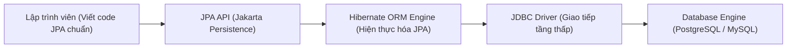
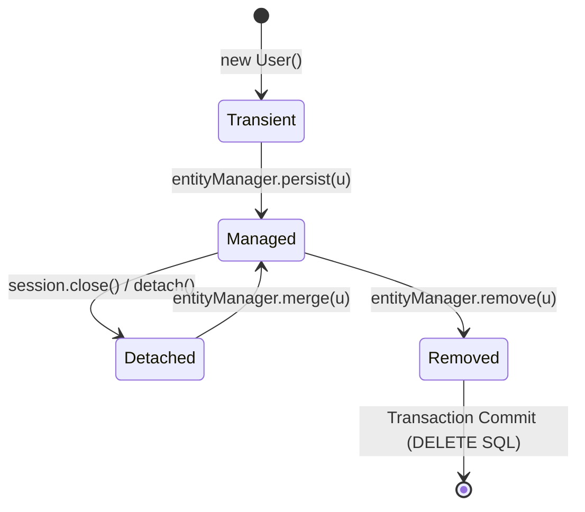
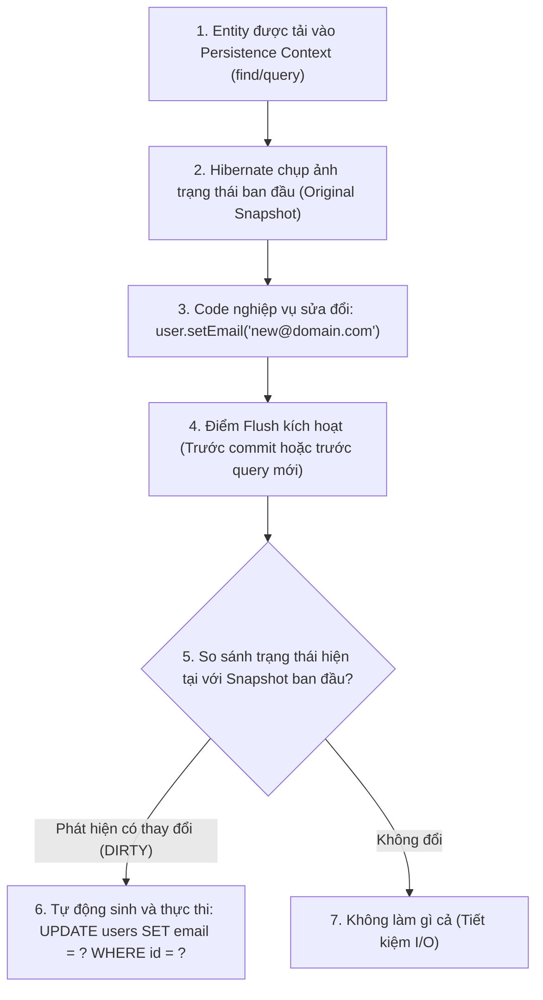
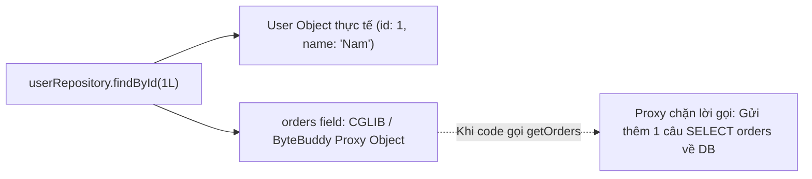
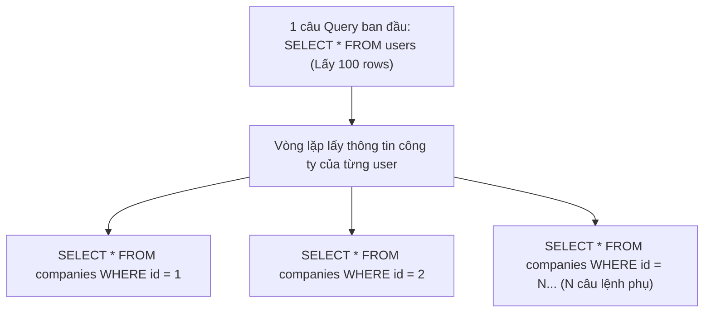
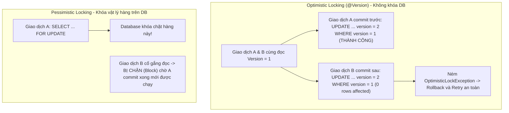

# 3.2. ORM, JPA & Hibernate Deep Dive (Bản chất ORM, Bối cảnh Lưu trữ & Vấn đề N+1)

> [!IMPORTANT]
> **Nếu bạn chỉ được nhớ một điều duy nhất:** JPA chỉ là giao diện đặc tả (Specification), còn **Hibernate** là động cơ hiện thực hóa (Implementation); toàn bộ "phép màu" của Hibernate xoay quanh **Bối cảnh Lưu trữ (Persistence Context / First-Level Cache)** — nơi giám sát các thực thể ở trạng thái Managed, tự động tạo câu lệnh SQL `UPDATE` thông qua cơ chế kiểm tra bẩn (**Dirty Checking**) mà không cần bạn phải gọi lệnh lưu thủ công, và kiểm soát ranh giới truy vấn để tránh thảm họa hiệu năng kinh điển **N+1 Query Problem**.

---

## 1. Mối Quan Hệ: JPA Specification vs Hibernate Engine

Trong thế giới Java, sự nhầm lẫn giữa JPA và Hibernate rất phổ biến:
* **JPA (Jakarta Persistence API)**: Là một bộ **chuẩn giao diện (Standard Specification)** bao gồm các interface (`EntityManager`, `EntityTransaction`) và các annotations chuẩn (`@Entity`, `@Id`, `@Column`). JPA hoàn toàn không chứa mã nguồn thực thi để kết nối DB.
* **Hibernate ORM**: Là **động cơ hiện thực (Vendor Implementation)** triển khai toàn bộ các interface của JPA, đồng thời cung cấp thêm các tính năng độc quyền cao cấp (Caching L2, Envers Auditing, Spatial).



---

## 2. Vòng Đời Thực Thể (Entity Lifecycle) & Persistence Context

Mỗi đối tượng Entity trong JPA luôn nằm ở một trong 4 trạng thái vòng đời nghiêm ngặt:



1. **Transient (Mới sinh)**: Đối tượng vừa được tạo bằng từ khóa `new`. Nó chỉ là một Java Object bình thường trên Heap, chưa có ID trong Database và hoàn toàn không chịu sự quản lý của JPA.
2. **Managed (Đang quản lý)**: Đối tượng đã được gắn kết với **Persistence Context**. Mọi thay đổi trên các trường dữ liệu của đối tượng này đều được Hibernate theo dõi chặt chẽ.
3. **Detached (Tách rời)**: Đối tượng từng ở trạng thái Managed nhưng Persistence Context hiện tại đã bị đóng (hoặc giao dịch kết thúc). Các thay đổi trên đối tượng lúc này sẽ không được tự động cập nhật vào Database.
4. **Removed (Đã xóa)**: Đối tượng được đánh dấu để xóa khỏi Database khi Transaction thực hiện lệnh Flush/Commit.

---

## 3. Cơ Chế Kiểm Tra Bẩn Tự Động (Dirty Checking Mechanism)

Tại sao trong Spring Data JPA, khi bạn lấy một entity ra, sửa đổi trường của nó và kết thúc phương thức `@Transactional`, dữ liệu trong Database lại tự động được cập nhật dù bạn **không hề gọi `repository.save()`**?



```java
@Service
public class UserService {
    private final UserRepository userRepository;

    public UserService(UserRepository userRepository) {
        this.userRepository = userRepository;
    }

    @Transactional
    public void updateUserEmail(Long userId, String newEmail) {
        // 1. entity chuyển sang trạng thái MANAGED trong Persistence Context
        User user = userRepository.findById(userId)
            .orElseThrow(() -> new EntityNotFoundException("User not found"));

        // 2. Thay đổi trạng thái Object trên Heap
        user.setEmail(newEmail);

        // KHÔNG CẦN GỌI: userRepository.save(user);
        // Khi hàm kết thúc, @Transactional commit -> Kích hoạt Dirty Checking -> Tự động sinh lệnh UPDATE!
    }
}
```

---

## 4. Tải Lười (Lazy Loading) & Lỗi LazyInitializationException

Khi thiết lập quan hệ bảng (ví dụ một `User` có nhiều `Order`), Hibernate cho phép chọn:
* **`FetchType.EAGER` (Tải háo hức)**: Luôn luôn tải toàn bộ các bảng liên quan cùng lúc (thường gây chậm hệ thống và tốn RAM).
* **`FetchType.LAZY` (Tải lười - Khuyên dùng)**: Chỉ tải bảng chính; bảng con chỉ được truy vấn khi bạn thực sự gọi getter (`user.getOrders()`).



### Nguồn Gốc Lỗi `LazyInitializationException`
Khi bạn chuyển một Entity từ tầng `@Service` sang tầng `@Controller` hoặc đưa vào tiến trình bất đồng bộ:
- Transaction đã kết thúc $\to$ `EntityManager` (Session) đã bị đóng.
- Khi tầng Controller hoặc thư viện JSON Serializer (Jackson) cố gắng đọc thuộc tính lười `user.getOrders()`: Proxy Object không còn Session kết nối DB nào để gửi câu lệnh SQL $\to$ Ném ngay lỗi kinh điển:
  `org.hibernate.LazyInitializationException: could not initialize proxy - no Session`!

---

## 5. Thảm Họa Hiệu Năng: Vấn Đề N+1 Query & 3 Giải Pháp Triệt Để

Giả sử bạn cần hiển thị danh sách $100$ người dùng kèm theo thông tin chi nhánh công ty của họ (`@ManyToOne`):

```java
// Giả sử có 100 users trong bảng
List<User> users = userRepository.findAll(); // 1 câu lệnh SQL đầu tiên
for (User u : users) {
    System.out.println(u.getCompany().getName()); // GÂY RA THÊM 100 CÂU LỆNH SQL NỮA!
}
// Tổng cộng: 1 + 100 = 101 câu lệnh truy vấn bắn về DB -> Khiến Database sập vì quá tải!
```



### 3 Giải Pháp Khắc Phục Chuẩn Mực

#### Giải pháp 1: Dùng `JOIN FETCH` trong JPQL (Nhanh và tường minh nhất)
Buộc Hibernate sử dụng phép nối `INNER JOIN` hoặc `LEFT JOIN` để nạp toàn bộ dữ liệu bảng con trong **đúng 1 câu lệnh duy nhất**:
```java
public interface UserRepository extends JpaRepository<User, Long> {
    @Query("SELECT u FROM User u JOIN FETCH u.company")
    List<User> findAllUsersWithCompany();
}
```

#### Giải pháp 2: Sử dụng `@EntityGraph` (Giải pháp cấu hình sạch)
```java
public interface UserRepository extends JpaRepository<User, Long> {
    @EntityGraph(attributePaths = {"company"})
    List<User> findAll();
}
```

#### Giải pháp 3: Batch Fetching (Cứu tinh cho toàn bộ ứng dụng)
Cấu hình Hibernate tự động gom các ID con lại để truy vấn theo lô bằng mệnh đề `IN (?, ?, ...)` thay vì gửi từng lệnh đơn lẻ:
```properties
# Trong application.properties:
spring.jpa.properties.hibernate.default_batch_fetch_size=100
```
Khi đó, thay vì phát sinh $100$ câu lệnh đơn, Hibernate chỉ phát sinh đúng **1 câu lệnh phụ gom nhóm**:
`SELECT * FROM companies WHERE id IN (1, 2, 3, ..., 100);` (Giảm $99\%$ số lượng round-trip mạng!).

---

## 6. Kiểm Soát Cạnh Tranh: Optimistic Locking vs Pessimistic Locking

Khi có hai giao dịch đồng thời cố gắng cập nhật cùng một bản ghi số dư tài khoản:



```java
// Demo Optimistic Locking trong Entity:
@Entity
public class Account {
    @Id
    @GeneratedValue(strategy = GenerationType.IDENTITY)
    private Long id;

    private BigDecimal balance;

    @Version // Trường quản lý phiên bản tự động của JPA
    private Long version;
}
```

---

## 7. Checklist Tự Kiểm Tra (Self-Verification)

- [ ] Phân biệt sự khác nhau giữa trạng thái Transient, Managed và Detached của Entity?
- [ ] Tại sao cơ chế Dirty Checking lại có thể phát hiện được dữ liệu bị sửa đổi mà không cần phương thức setter thông báo?
- [ ] Nguyên nhân cốt lõi gây ra lỗi `LazyInitializationException` là gì?
- [ ] Vấn đề N+1 query xuất hiện như thế nào và tại sao `JOIN FETCH` lại giải quyết triệt để vấn đề này?
- [ ] Khi nào nên sử dụng Optimistic Locking (`@Version`) và khi nào bắt buộc phải dùng Pessimistic Locking (`FOR UPDATE`)?
